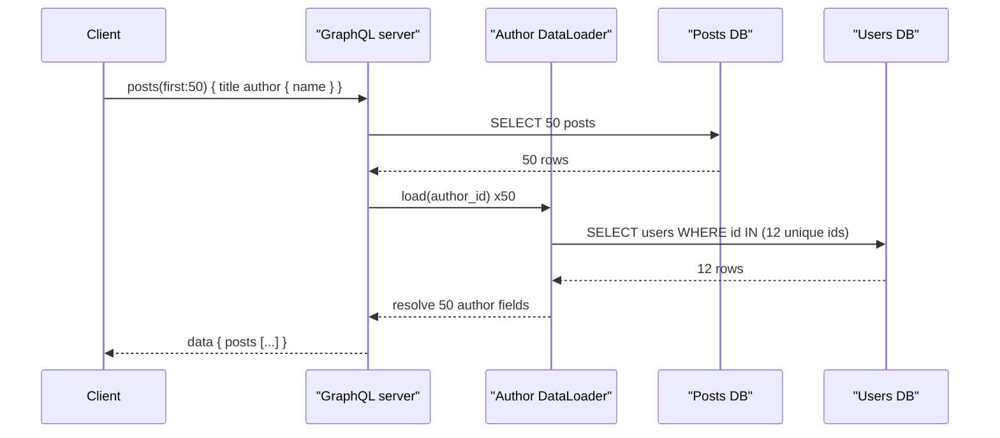

## In one minute
- GraphQL exposes a typed schema; clients send a query describing exactly the fields they need, and get back JSON of the same shape.
- One request can replace several REST round trips, which matters most on mobile networks and for aggregating many backends.
- The server executes the query by calling a *resolver* per field, which makes the N+1 query problem the default unless you batch.
- Arbitrary client queries make cost unpredictable, so production servers need depth and cost limits, timeouts and usually persisted queries.
- HTTP caching mostly stops working; caching moves into clients (normalised stores) and into resolvers.

## How it works

### Schema, queries and resolvers
The schema defines object types, fields and their types, plus root `Query`, `Mutation` and `Subscription` types. A query selects fields from the root down. Execution walks the selection tree: for each field it calls that field's resolver with the parent object, and for list fields it does this per element. Fields on the same level can resolve in parallel; mutations at the root run serially. The spec separates two kinds of failure. A *request error* (the document does not parse, fails validation, or has bad variables) stops everything, and the response has `errors` but no `data`. An *execution error* in one field nulls that field and adds an entry to `errors`, while the rest of `data` returns, so a query can partially succeed.

Over HTTP, most servers have answered `200` for all of these with `application/json`. The GraphQL-over-HTTP working draft changes that for the newer `application/graphql-response+json` media type: 400 when the document cannot be parsed, 422 when it fails validation, and a custom `294` status for partial success, which clients that do not know it must treat as 200 ([GraphQL over HTTP](https://graphql.github.io/graphql-over-http/draft/)).

### The N+1 problem and batching
Query `posts(first: 50) { title author { name } }`. The naive server runs one query for posts and 50 queries for authors. Nested one more level (comments and their authors), it becomes thousands. The standard fix is a *DataLoader*: within one frame of execution, resolvers call `load(id)` instead of querying; the loader collects all ids, issues one batched query (`WHERE id IN (...)`), and caches results for the rest of the request. Fifty author lookups become one. That cache is per request by design; the reference implementation says to create a new loader per request so one user's results never serve another with different permissions ([DataLoader](https://github.com/graphql/dataloader)).

### Cost control
A client can write a query that is deeply nested or fans out (`users(first: 100) { friends(first: 100) { friends(first: 100) ... } }`), which is a million objects from a tiny request. Defences, in increasing strength:

1. Depth limit (reject nesting beyond 8 to 10), plus breadth limits on aliases and on operations per batch, since both multiply work without adding depth ([graphql.org](https://graphql.org/learn/security/)).
2. Static cost analysis: multiply list sizes along each path and reject queries above a budget.
3. Execution timeouts and per-client rate limits measured in cost points, not requests.
4. Trusted documents: clients register their operations at build time and send only an ID or hash, so production only runs operations your own team reviewed. graphql.org calls the older name "persisted queries" a misnomer, and notes this cannot work for a public API whose callers write their own queries ([graphql.org](https://graphql.org/learn/security/)).

Public GraphQL APIs publish these limits as numbers. GitHub requires `first` or `last` between 1 and 100 on every connection, caps a call at 500,000 nodes, scores a query by the requests needed to fill its connections divided by 100, gives users 5,000 points an hour, and kills anything that runs over 10 seconds ([GitHub docs](https://docs.github.com/en/graphql/overview/rate-limits-and-query-limits-for-the-graphql-api)). Shopify assigns every field a cost, rejects any single query above 1,000 points, reserves the requested cost before running and refunds the difference after, and refills each app's bucket at 100 to 2,000 points a second depending on the store's plan ([Shopify docs](https://shopify.dev/docs/apps/build/apis/graphql-admin/rate-limits)).

### Caching
REST gets CDN caching for free because each URL is a resource. GraphQL usually sends `POST /graphql`, so intermediaries cannot cache it. Options: send persisted queries as `GET` with the hash in the URL for public data (Apollo Client does this when `useGETForHashedQueries` is on; mutations stay `POST`) ([Apollo docs](https://www.apollographql.com/docs/apollo-server/performance/apq)), cache at the resolver or data-source layer, and use client libraries that normalise results by type and id so one update refreshes every view.

### Federation
Large organisations split the schema across teams. A gateway composes subgraphs into one supergraph and plans each query across them, fetching an entity from one service and extending it with fields from another. This keeps one API for clients but adds a planning layer, cross-service latency, and schema governance work.

## Down the stack

### Layer 1: The contract
The GraphQL spec promises a response whose `data` mirrors the query's shape and key order, plus an `errors` list with a `path` for each failure, such as `["hero", "heroFriends", 1, "name"]`, so a client can tell a real `null` from a failed field. A field that errors becomes `null`; if the field is declared non-null, the error propagates to the parent position, up to the nearest nullable one, which can blank out a whole subtree ([GraphQL spec, September 2025](https://spec.graphql.org/September2025/)). That edition, the first since October 2021, also added OneOf input objects (`@oneOf`, exactly one field set), schema coordinates for naming schema elements, and deprecation on more kinds of element ([graphql.org](https://graphql.org/blog/2025-09-08-september-edition/)). Top-level mutation fields execute serially in the order written; query fields may execute in any order or in parallel. Nothing in the contract bounds cost or latency; those are server policies.

### Layer 2: The mechanism
A server parses the query text into a document AST, validates it against the schema with a fixed set of rules (fields exist on their types, variables are used and typed correctly, fragments do not cycle), then executes. Execution runs `CollectFields` on a selection set, merging fragments and applying `@skip` and `@include`, then for each field calls the resolver, then *completes* the value: checks non-null, iterates lists, resolves abstract types to concrete ones, and recurses into sub-selections. A DataLoader exploits the event loop: every resolver at one level calls `load(id)` synchronously, the loader schedules a single flush for after the current microtask queue drains, and the flush issues one batched query. Automatic persisted queries send a SHA-256 hash in `extensions.persistedQuery`; on a cache miss the server replies with an error whose code is `PERSISTED_QUERY_NOT_FOUND` and the client resends the full text once ([Apollo docs](https://www.apollographql.com/docs/apollo-server/performance/apq)). Because any client can register any query this way, automatic persisted queries save bandwidth but are not an allowlist; trusted documents are.

### Layer 3: The machine
Parsing and validating a 2 KB query costs roughly 0.1 to 1 ms of CPU, so servers cache parsed documents by hash. Each resolved field typically allocates a promise and a result object; a list of 10,000 items with 20 fields each is 200,000 resolver calls and can block a single-threaded Node event loop for tens of milliseconds, stalling every other request on that process. On the data side, one `WHERE id IN (...)` query with 50 ids is a single network round trip of about 0.5 to 1 ms in-region and one index scan, against 50 round trips for the unbatched version. Large responses are dominated by JSON serialisation and compression, so limiting list sizes protects CPU as much as the database.

### Why it's built this way
1. Many clients on slow mobile networks need different data for each screen, so the client describes the shape and gets it in one round trip.
2. The server cannot predict which shapes will arrive, so it composes small per-field resolvers instead of hand-written endpoints.
3. Per-field resolution naturally fans out into N+1 queries, so batching hooks into the event loop to collect keys first.
4. Open-ended queries have open-ended cost, so production servers analyse cost statically or accept only persisted queries.
5. A single POST endpoint defeats URL-based HTTP caches, so caching moves into normalised client stores and the data layer.

## Diagram



## Worked example
A mobile home screen needs the user profile, 20 feed items with author and like counts, and 5 notifications. Over REST this is 1 + 1 + 20 + 1 calls; on a 4G connection with 80 ms round trips and HTTP/2 multiplexing, the dependent calls still cost about 3 sequential round trips (240 ms) plus about 40 KB of over-fetched JSON. With GraphQL it is one round trip and about 9 KB.

Server side, without batching, the feed query triggers 1 feed query + 20 author queries + 20 like-count queries = 41 database round trips at 1 ms each, roughly 41 ms of serialised waiting. With DataLoaders for authors and like counts, it is 3 queries and about 4 ms.

Cost limiting: the team assigns cost 1 per object and multiplies by `first`. The home screen query costs about 20 x 3 + 6 = 66 points. They set a per-query cap of 1,000 and a per-client budget of 50,000 points per minute. A scraper sending `users(first:100){followers(first:100){name}}` costs 10,100 points and is rejected before execution.

## In the wild
- **Peloton, 2021: a GraphQL gateway that answered anyone.** Pen Test Partners found Peloton's GraphQL gateways and a REST endpoint returning rider data, including age, gender, location and workout stats, to unauthenticated callers, even for profiles set to private. Reported on 20 January, the first fix on 2 February only required a login, and since anyone can create an account, the data stayed open to every user until a fuller fix about a week after press contact in May ([Pen Test Partners](https://www.pentestpartners.com/security-blog/tour-de-peloton-exposed-user-data/)). One flexible endpoint over the whole graph needs authorization on every object, not at the door.
- **GitLab, 2025: crafted queries bypass complexity limits.** CVE-2025-12562 let an unauthenticated user send GraphQL queries that slipped past GitLab's query complexity limits and caused a denial of service. It affected every version from 11.10 until the patch releases of 10 December 2025 and was rated 7.5 (High) ([NVD](https://nvd.nist.gov/vuln/detail/CVE-2025-12562), [GitLab](https://docs.gitlab.com/releases/patches/patch-release-gitlab-18-6-2-released/)). A cost limiter is security code: test it with adversarial queries, not just the ones your apps send.

## Trade-offs

| Option | Strengths | Weaknesses | Choose when |
| --- | --- | --- | --- |
| GraphQL | Client-shaped responses, one round trip, typed schema | Cost control, caching, N+1 by default | Many clients with different data needs |
| REST | HTTP caching, simple ops, mature tooling | Over- and under-fetching, many round trips | Public resource APIs, CDN-heavy reads |
| gRPC | Fast, streaming, strong contracts | Not browser-native, binary | Internal service-to-service calls |
| Federated GraphQL | One graph across teams | Gateway planning, governance overhead | Dozens of teams behind one client API |

## Pitfalls in production
- **N+1 everywhere.** Each new nested field adds hidden queries. Make DataLoaders the default data access path and alert on queries per request.
- **Unbounded queries.** A single query exhausts the database. Enforce depth and cost limits and require `first` on list fields.
- **Errors hidden in 200s.** Dashboards show 100% success while `errors` is full. Emit metrics per field error.
- **Introspection in production.** Attackers map your schema. Disabling it is only obscurity, because "did you mean" suggestions in validation errors leak field names too; mask error detail in production and use trusted documents where you control the clients.
- **Authorization at the gateway only.** Nested fields bypass checks. Authorize in resolvers or the domain layer, per object.

## Leadership lens
- Adopt GraphQL when client diversity is the problem; it does not make backends faster.
- Decide who owns the schema and how breaking changes are reviewed; deprecate fields with usage tracking rather than versioning.
- Budget for observability per resolver, since request-level latency hides which field is slow.
- Persisted queries turn an open query language into a known set of operations, which simplifies security and caching.

## Check yourself
1. Why does GraphQL tend to produce N+1 queries?
   **Answer:** Each field resolver runs independently per parent object, so a list of N parents calls the child resolver N times unless calls are batched.
2. Why is a depth limit alone not enough?
   **Answer:** A shallow query can still fan out hugely through large list arguments; cost must multiply list sizes along the path.
3. How do persisted queries help caching?
   **Answer:** A known query hash can be sent as a GET URL, which CDNs and browsers can cache like any other resource.

## Practice
**Task:** Implement a request-scoped `DataLoader`. `load(key)` returns a `Pending` object and queues the key. `dispatch()` calls `batch_fn(keys)` with unique queued keys in first-seen order, split into chunks of at most `max_batch`, and resolves every pending object; `batch_fn` returns a list of values in the same order. After dispatch, `Pending.value` holds the result. Keys already resolved are served from cache: `load` returns an already-resolved `Pending` and does not queue them again.

```python starter
class Pending:
    def __init__(self):
        self.value = None
        self.done = False

class DataLoader:
    def __init__(self, batch_fn, max_batch=100):
        pass

    def load(self, key):
        raise NotImplementedError

    def dispatch(self):
        raise NotImplementedError
```

```python tests
def users_db(calls):
    def fetch(ids):
        calls.append(list(ids))
        return ["user" + str(i) for i in ids]
    return fetch

def test_batches_and_dedupes():
    calls = []
    dl = DataLoader(users_db(calls))
    ps = [dl.load(i) for i in [3, 1, 3, 2]]
    dl.dispatch()
    assert calls == [[3, 1, 2]]
    assert [p.value for p in ps] == ["user3", "user1", "user3", "user2"]

def test_cache_avoids_second_fetch():
    calls = []
    dl = DataLoader(users_db(calls))
    dl.load(1)
    dl.dispatch()
    p = dl.load(1)
    assert p.done and p.value == "user1"
    dl.dispatch()
    assert calls == [[1]]

def test_max_batch_chunks():
    calls = []
    dl = DataLoader(users_db(calls), max_batch=2)
    for i in range(5):
        dl.load(i)
    dl.dispatch()
    assert calls == [[0, 1], [2, 3], [4]]

def test_empty_dispatch_makes_no_call():
    calls = []
    DataLoader(users_db(calls)).dispatch()
    assert calls == []
```

```python solution
class Pending:
    def __init__(self):
        self.value = None
        self.done = False

class DataLoader:
    def __init__(self, batch_fn, max_batch=100):
        self.batch_fn, self.max_batch = batch_fn, max_batch
        self.cache = {}
        self.queue = []

    def load(self, key):
        if key not in self.cache:
            self.cache[key] = Pending()
            self.queue.append(key)
        return self.cache[key]

    def dispatch(self):
        keys, self.queue = self.queue, []
        for i in range(0, len(keys), self.max_batch):
            chunk = keys[i:i + self.max_batch]
            for k, v in zip(chunk, self.batch_fn(chunk)):
                self.cache[k].value = v
                self.cache[k].done = True
```

```typescript starter
export class Pending<V> {
  value: V | null = null;
  done = false;
}

export class DataLoader<K, V> {
  constructor(batchFn: (keys: K[]) => V[], maxBatch = 100) {}
  load(key: K): Pending<V> {
    throw new Error("TODO");
  }
  dispatch(): void {
    throw new Error("TODO");
  }
}
```

```typescript tests
function usersDb(calls: number[][]) {
  return (ids: number[]): string[] => {
    calls.push([...ids]);
    return ids.map((i) => "user" + i);
  };
}
test("batches and dedupes", () => {
  const calls: number[][] = [];
  const dl = new DataLoader<number, string>(usersDb(calls));
  const ps = [3, 1, 3, 2].map((i) => dl.load(i));
  dl.dispatch();
  assertEqual(calls, [[3, 1, 2]]);
  assertEqual(ps.map((p) => p.value), ["user3", "user1", "user3", "user2"]);
});
test("cache avoids second fetch", () => {
  const calls: number[][] = [];
  const dl = new DataLoader<number, string>(usersDb(calls));
  dl.load(1);
  dl.dispatch();
  const p = dl.load(1);
  assert(p.done && p.value === "user1", "served from cache");
  dl.dispatch();
  assertEqual(calls, [[1]]);
});
test("max batch chunks", () => {
  const calls: number[][] = [];
  const dl = new DataLoader<number, string>(usersDb(calls), 2);
  for (let i = 0; i < 5; i++) dl.load(i);
  dl.dispatch();
  assertEqual(calls, [[0, 1], [2, 3], [4]]);
});
test("empty dispatch makes no call", () => {
  const calls: number[][] = [];
  new DataLoader<number, string>(usersDb(calls)).dispatch();
  assertEqual(calls, []);
});
```

```typescript solution
export class Pending<V> {
  value: V | null = null;
  done = false;
}

export class DataLoader<K, V> {
  private cache = new Map<K, Pending<V>>();
  private queue: K[] = [];
  constructor(private batchFn: (keys: K[]) => V[], private maxBatch = 100) {}
  load(key: K): Pending<V> {
    let p = this.cache.get(key);
    if (!p) {
      p = new Pending<V>();
      this.cache.set(key, p);
      this.queue.push(key);
    }
    return p;
  }
  dispatch(): void {
    const keys = this.queue;
    this.queue = [];
    for (let i = 0; i < keys.length; i += this.maxBatch) {
      const chunk = keys.slice(i, i + this.maxBatch);
      const vals = this.batchFn(chunk);
      chunk.forEach((k, j) => {
        const p = this.cache.get(k)!;
        p.value = vals[j];
        p.done = true;
      });
    }
  }
}
```

```go starter
package practice

type Pending struct {
	Value string
	Done  bool
}

type DataLoader struct{}

func NewDataLoader(batch func(keys []int) []string, maxBatch int) *DataLoader {
	return &DataLoader{}
}

func (d *DataLoader) Load(key int) *Pending {
	panic("TODO")
}

func (d *DataLoader) Dispatch() {
	panic("TODO")
}
```

```go tests
package practice

import (
	"reflect"
	"strconv"
	"testing"
)

func usersDB(calls *[][]int) func([]int) []string {
	return func(ids []int) []string {
		*calls = append(*calls, append([]int(nil), ids...))
		out := make([]string, len(ids))
		for i, id := range ids {
			out[i] = "user" + strconv.Itoa(id)
		}
		return out
	}
}

func TestBatchesAndDedupes(t *testing.T) {
	var calls [][]int
	dl := NewDataLoader(usersDB(&calls), 100)
	var ps []*Pending
	for _, k := range []int{3, 1, 3, 2} {
		ps = append(ps, dl.Load(k))
	}
	dl.Dispatch()
	if !reflect.DeepEqual(calls, [][]int{{3, 1, 2}}) {
		t.Fatalf("calls %v", calls)
	}
	if ps[0].Value != "user3" || ps[1].Value != "user1" || ps[2].Value != "user3" || ps[3].Value != "user2" {
		t.Fatal("wrong values")
	}
}

func TestCache(t *testing.T) {
	var calls [][]int
	dl := NewDataLoader(usersDB(&calls), 100)
	dl.Load(1)
	dl.Dispatch()
	p := dl.Load(1)
	dl.Dispatch()
	if !p.Done || p.Value != "user1" || len(calls) != 1 {
		t.Fatalf("p=%v calls=%v", p, calls)
	}
}

func TestMaxBatch(t *testing.T) {
	var calls [][]int
	dl := NewDataLoader(usersDB(&calls), 2)
	for i := 0; i < 5; i++ {
		dl.Load(i)
	}
	dl.Dispatch()
	if !reflect.DeepEqual(calls, [][]int{{0, 1}, {2, 3}, {4}}) {
		t.Fatalf("calls %v", calls)
	}
}

func TestEmptyDispatch(t *testing.T) {
	var calls [][]int
	NewDataLoader(usersDB(&calls), 100).Dispatch()
	if len(calls) != 0 {
		t.Fatal("unexpected call")
	}
}
```

```go solution
package practice

type Pending struct {
	Value string
	Done  bool
}

type DataLoader struct {
	batch    func([]int) []string
	maxBatch int
	cache    map[int]*Pending
	queue    []int
}

func NewDataLoader(batch func(keys []int) []string, maxBatch int) *DataLoader {
	return &DataLoader{batch: batch, maxBatch: maxBatch, cache: map[int]*Pending{}}
}

func (d *DataLoader) Load(key int) *Pending {
	if p, ok := d.cache[key]; ok {
		return p
	}
	p := &Pending{}
	d.cache[key] = p
	d.queue = append(d.queue, key)
	return p
}

func (d *DataLoader) Dispatch() {
	keys := d.queue
	d.queue = nil
	for i := 0; i < len(keys); i += d.maxBatch {
		end := i + d.maxBatch
		if end > len(keys) {
			end = len(keys)
		}
		chunk := keys[i:end]
		vals := d.batch(chunk)
		for j, k := range chunk {
			d.cache[k].Value = vals[j]
			d.cache[k].Done = true
		}
	}
}
```

## Mock interview
**Prompt:** Your company has web, iOS, Android and partner clients hitting 30 REST microservices. Mobile screens make 15 calls each. Design a GraphQL layer to replace this, serving 20,000 queries per second.

- Follow-up: The feed query takes 400 ms and issues 300 SQL queries. What is wrong and how do you fix it?
- Follow-up: A partner sends a deeply nested query that takes the database down. What controls should have stopped it?
- Follow-up: Would you federate the schema across teams or keep one gateway team? Why?

**A strong answer covers:**
- Schema design around client use cases, with resolvers calling existing services.
- DataLoader batching and per-request caching to remove N+1.
- Depth limits, cost analysis, timeouts and persisted queries for untrusted clients.
- Caching strategy without URL-based HTTP caching.
- Per-field metrics and authorization inside resolvers.

## Sources and further study
**Primary**
- [GraphQL over HTTP (working draft)](https://graphql.github.io/graphql-over-http/draft/): methods, media types and the status codes for request errors and partial success.
- [Announcing the September 2025 edition of the GraphQL spec](https://graphql.org/blog/2025-09-08-september-edition/): what changed in the first spec release in four years.

**Systems docs**
- [GitHub: Rate limits and query limits for the GraphQL API](https://docs.github.com/en/graphql/overview/rate-limits-and-query-limits-for-the-graphql-api): node limits, point scoring and timeouts at scale.
- [Shopify: GraphQL Admin API rate limits](https://shopify.dev/docs/apps/build/apis/graphql-admin/rate-limits): per-field costs, a leaky bucket and refunds of unused cost.
- [Apollo: Automatic persisted queries](https://www.apollographql.com/docs/apollo-server/performance/apq): the hash protocol and GET requests for CDN caching.
- [graphql/dataloader](https://github.com/graphql/dataloader): the reference batching and per-request caching library.

**Books**
- *Building Microservices* (2nd edition), Sam Newman, chapter 5 "Implementing Microservice Communication" (its GraphQL section) and chapter 14 "User Interfaces" (backend for frontend versus GraphQL as an aggregation layer).

**Other curricula**
- [roadmap.sh: GraphQL](https://roadmap.sh/graphql): walks from queries and the type system through execution to serving over HTTP, WebSockets and SSE, with caching, batching and pagination; it frames GraphQL from the spec outward rather than from operating cost.
- [donnemartin/system-design-primer](https://github.com/donnemartin/system-design-primer): does not cover GraphQL; its REST versus RPC section lists the multiple-round-trip problem GraphQL was built to solve.

## Watch
- [What Is GraphQL? REST vs. GraphQL (ByteByteGo)](https://www.youtube.com/watch?v=yWzKJPw_VzM): concise comparison of the models.
- [GraphQL N+1 Problem (Ben Awad)](https://www.youtube.com/watch?v=uCbFMZYQbxE): shows the problem and DataLoader fix in code.

## Free resources
- [GraphQL specification (September 2025)](https://spec.graphql.org/September2025/): the current edition's execution algorithm and error semantics.
- [Learn GraphQL](https://graphql.org/learn/): official introduction to schemas, queries and resolvers.
- [GraphQL performance](https://graphql.org/learn/performance/): official guidance on batching and caching.
- [GraphQL security](https://graphql.org/learn/security/): depth, cost and persisted-query defences.
- [Apollo Federation overview](https://www.apollographql.com/docs/graphos/schema-design/federated-schemas/federation): how subgraphs compose into one graph.
