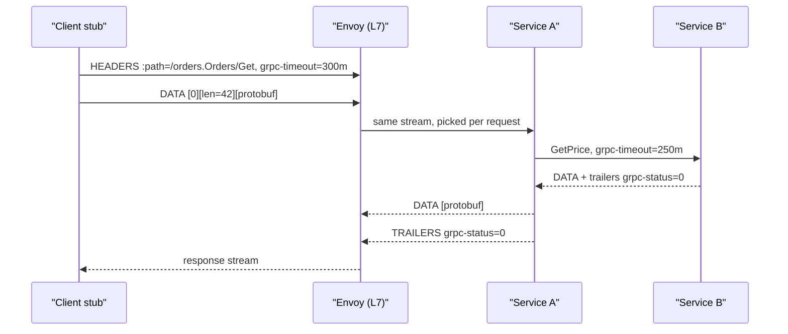

## In one minute
- gRPC is an RPC framework: you define services and messages in a `.proto` file and generate typed client stubs and server interfaces in many languages.
- It runs over HTTP/2, with each call as a stream, Protobuf-encoded messages, and status carried in HTTP trailers.
- Four call shapes: unary, server streaming, client streaming and bidirectional streaming.
- Deadlines, cancellation and metadata propagate across hops, which is the feature that matters most at scale.
- Long-lived HTTP/2 connections break naive L4 load balancing; you need L7 proxies or client-side balancing.

## How it works

### The wire
A gRPC call is an HTTP/2 request: `POST /package.Service/Method` with `content-type: application/grpc`, headers for metadata (auth tokens, trace ids) and `grpc-timeout` for the deadline. The body is a sequence of *length-prefixed messages*: 1 byte compression flag, 4 bytes big-endian length, then the Protobuf bytes. The response sends headers, zero or more messages, and then *trailers* with `grpc-status` and `grpc-message`; the spec requires the status in trailers even when the call succeeds ([gRPC HTTP/2 protocol](https://github.com/grpc/grpc/blob/master/doc/PROTOCOL-HTTP2.md)). Because status lives in trailers, a call can stream for an hour and still report an error at the end.

HTTP/2 multiplexes many concurrent streams on one TCP connection, with per-stream flow control. A single connection can carry thousands of in-flight calls, which removes connection setup cost but concentrates load.

### Contracts and codegen
The `.proto` file is the contract. Code generation gives each language a typed stub, so a field rename is a compile error rather than a production incident. Protobuf's evolution rules apply: add fields with new numbers, never reuse or retype them.

### Deadlines and cancellation
gRPC sets no deadline by default, so a call with none can wait forever ([gRPC deadlines](https://grpc.io/docs/guides/deadlines/)). Each call should carry an absolute deadline. A server that calls downstream services passes the *remaining* time: the library turns the deadline into a relative timeout with the elapsed time already taken off, which also sidesteps clock skew between machines. Java and Go propagate it automatically; C++ needs you to turn it on. That way an edge request with a 300 ms budget never triggers a backend call that will run for 2 seconds. When a client cancels or the deadline passes, cancellation propagates down the call tree, freeing work that nobody will use. Without deadlines, slow dependencies accumulate stuck requests until threads or memory run out.

### Status codes and retries
gRPC has 17 codes of its own, among them `UNAVAILABLE` (usually transient and worth retrying with backoff, though not always safe for a non-idempotent call) ([gRPC status codes](https://grpc.io/docs/guides/status-codes/)), `DEADLINE_EXCEEDED`, `RESOURCE_EXHAUSTED` (rate limited), `INVALID_ARGUMENT`, `NOT_FOUND`, `ABORTED` (concurrency conflict), `INTERNAL`. A service config can declare retry policies per method, with maximum attempts, backoff and retryable codes, plus hedging (sending a second copy after a delay). Each backoff gets ±20% jitter, and a `retryThrottling` setting acts as a retry budget: each failure spends a token, each success earns back a fraction of one, and retries stop while the bucket is below half full ([gRPC retry guide](https://grpc.io/docs/guides/retry/)).

### Load balancing
An L4 load balancer balances *connections*. With HTTP/2 a client opens one connection and sends everything over it, so all its traffic hits one backend, and new backends get nothing until clients reconnect. Fixes: an L7 proxy (Envoy, a service mesh) that balances per request, or client-side balancing where the client resolves all backend addresses and spreads calls with round robin or least-request. Servers should also set a maximum connection age: past it, the server sends GOAWAY and lets in-flight calls finish, with ±10% jitter so clients do not all reconnect at once ([gRFC A9](https://github.com/grpc/proposal/blob/master/A9-server-side-conn-mgt.md)). A long-lived stream cannot be rebalanced once it has started, so streaming only where it pays is also a balancing decision ([gRPC performance guide](https://grpc.io/docs/guides/performance/)).

### Browsers
Browsers cannot read HTTP/2 trailers through fetch, so they use gRPC-Web, which moves the trailers into the response body as a final message marked by the top bit of the flag byte. A proxy such as Envoy usually translates between the two ([gRPC-Web protocol](https://github.com/grpc/grpc/blob/master/doc/PROTOCOL-WEB.md)). The other route is a transcoding gateway that exposes the API as JSON.

## Down the stack

### Layer 1: The contract
Every gRPC call ends with exactly one status: a code and an optional message. Messages within one stream arrive in order and intact. A call that outlives its deadline fails with `DEADLINE_EXCEEDED` on the client, and the server sees its context cancelled. Without a retry policy a call is attempted at most once from the application's view. The library may still retry *transparently* when it knows the server application never saw the request: as often as needed if the call never left the client, and once if it reached the server's gRPC library but not the handler ([gRPC retry guide](https://grpc.io/docs/guides/retry/)).

### Layer 2: The mechanism
On HTTP/2 a call is one stream. The client sends a HEADERS frame with `:method POST`, `:path /pkg.Service/Method`, `te: trailers`, `content-type: application/grpc`, `grpc-timeout` and optional `grpc-encoding`, then DATA frames holding the 5-byte-prefixed messages; one message can span several DATA frames or several messages can share one. The server answers with HEADERS, DATA, and a final HEADERS frame flagged END_STREAM that carries `grpc-status`. Cancellation is an RST_STREAM frame with error code CANCEL. Flow control uses WINDOW_UPDATE frames from an initial 65,535-byte window ([RFC 9113](https://www.rfc-editor.org/rfc/rfc9113.html), which replaced RFC 7540 in 2022), which gRPC grows by probing the bandwidth-delay product. Keepalives are PING frames, and a server that wants a client to reconnect elsewhere sends GOAWAY. On the client, a name resolver produces addresses and a load-balancing policy (`pick_first`, `round_robin`, or xDS-driven) picks a subchannel per call.

### Layer 3: The machine
Each HTTP/2 frame has a 9-byte header and HPACK shrinks repeated headers to a few bytes, so a small unary call costs well under 100 bytes of framing. All streams share one TCP connection, so a single lost segment stalls every stream behind it until the retransmit; on Linux the minimum retransmission timeout is 200 ms, which shows up as p99 spikes on lossy links. One busy connection is also served by one socket and often one I/O thread, which caps throughput and is another reason to keep a small pool of connections per backend. Encoding a 1 KB Protobuf message costs on the order of a microsecond. Cloud load balancers and NATs drop idle TCP flows after a timeout, which is why keepalive intervals must be shorter. AWS NLB defaults to 350 seconds; since 2024 TCP listeners can set 60 to 6,000 seconds, while TLS listeners stay fixed at 350 ([AWS NLB docs](https://docs.aws.amazon.com/elasticloadbalancing/latest/network/network-load-balancers.html)).

### Why it's built this way
1. Internal services make many small calls, and new TCP and TLS handshakes are expensive, so gRPC multiplexes calls over long-lived HTTP/2 connections.
2. Streaming responses only know their outcome at the end, so status goes in trailers rather than the HTTP status line.
3. Many languages must agree on bytes and types, so the contract is an IDL with generated code.
4. Deep call chains amplify slowness, so deadlines travel with the call and bound total work.
5. Long-lived multiplexed connections make connection-level balancing meaningless, so balancing moves into the client or an L7 proxy.

## Diagram



## Worked example
A checkout service calls inventory, pricing and fraud services, 15,000 calls per second each, with p99 budgets that must fit inside a 400 ms user-facing deadline.

Switching inventory from JSON over HTTP/1.1 to gRPC: payload drops from 1.4 KB to 380 bytes, and serialisation CPU drops by about 4x. With HTTP/1.1, the client kept 600 connections open to avoid head-of-line blocking; with HTTP/2 it keeps 4 per backend host.

Then a problem: the inventory fleet scales from 20 to 30 pods, but the 10 new pods get almost no traffic, because checkout's existing connections still point at the first 20. Setting `MAX_CONNECTION_AGE` to 5 minutes on servers and using client-side round robin over DNS-discovered addresses spreads load within minutes.

Deadlines: checkout sets 400 ms. It spends 20 ms locally, then calls pricing with the remaining 380 ms. Pricing hits a slow cache and would take 2 seconds, but cancels at 380 ms, returning `DEADLINE_EXCEEDED`. Without propagation, pricing would have kept working for 1.6 seconds on 15,000 requests per second, 24,000 wasted in-flight requests during the incident.

## In the wild
- **Spotify, 2022: a managed xDS outage plus a gRPC client bug log users out.** On 8 March a Google Cloud Traffic Director outage, combined with a bug in the gRPC client library, broke service discovery for the services that had moved to xDS-based discovery. Users worldwide were logged out and could not log back in for about 2 hours 23 minutes, while services still on Spotify's DNS-based discovery kept working. Spotify moved the affected services back to DNS and added monitoring of discovery health ([Spotify](https://engineering.atspotify.com/2022/03/incident-report-spotify-outage-on-march-8/)).
- **Datadog, 2021: an aggressive reconnect setting floods the network on every rollout.** Rollouts of a metrics query service caused errors that looked like DNS. The real cause was a custom gRPC reconnect setting: about 900 clients retried a deleted pod's address roughly every 300 ms, up to 30,000 SYNs per second, and one stale IP drew about 90,000 connection attempts in 90 seconds, filling the AWS VPC connection-tracking table. Restoring the default gRPC backoff stopped the floods ([Datadog](https://datadoghq.com/blog/engineering/grpc-dns-and-load-balancing-incident)).
- **Dropbox, 2019: mandatory deadlines in Courier.** Dropbox's gRPC-based framework, which carries millions of requests per second between hundreds of services, made deadlines mandatory on every method, set per service or per method, with opt-outs only for rare watch calls. Deadlines propagate through metadata down to the database proxy, which kills a SQL query once its deadline passes. The team says this fixed whole classes of reliability problems ([Dropbox](https://dropbox.tech/infrastructure/courier-dropbox-migration-to-grpc)).

## Trade-offs

| Option | Strengths | Weaknesses | Choose when |
| --- | --- | --- | --- |
| gRPC | Typed contracts, compact, streaming, deadlines | Needs L7 or client-side LB; not browser-native | Internal service-to-service traffic |
| REST/JSON | Universal, cacheable, easy to debug | Larger payloads, weak contracts | Public and browser-facing APIs |
| GraphQL | Client-shaped queries | Server complexity, caching | Aggregation for many UI clients |
| Message queue | Decoupled, buffered | Async, no direct response | Work that need not finish in the request |

## Pitfalls in production
- **No deadline set.** Defaults are often infinite, so a slow backend pins resources forever. Require deadlines in client wrappers and lint for them.
- **Connection-level balancing.** New pods idle while old ones overload. Use L7 proxies or client-side balancing, plus maximum connection age.
- **Retry storms.** Every layer makes three attempts on `UNAVAILABLE`, amplifying load 27x across three hops; attempts multiply layer by layer ([Google SRE book](https://sre.google/sre-book/addressing-cascading-failures/)), and AWS cites 243x for five layers ([AWS Builders' Library](https://builder.aws.com/content/3EumjoZascWd1oZiEgL8ORlv3qE/timeouts-retries-and-backoff-with-jitter)). Retry at one layer and use retry throttling.
- **Huge messages.** The 4 MB default limit fails large responses. Stream or paginate instead of raising the limit.
- **Idle connections dropped.** NAT and cloud load balancers silently drop idle TCP. Client keepalive is off by default, so configure pings within the provider's idle timeout, but not below the server's permitted interval (5 minutes by default): a client that pings more often is sent GOAWAY with `too_many_pings` ([gRPC keepalive](https://grpc.io/docs/guides/keepalive/)).

## Leadership lens
- Own the `.proto` repository centrally, with breaking-change checks in CI.
- Ask in review: what deadline does this call get, and what happens when it is exceeded?
- Decide one load-balancing strategy across the org (mesh or client library), since mixing causes subtle imbalance.
- Expose a JSON gateway at the edge rather than forcing gRPC onto browser and partner clients.

## Check yourself
1. Why does an L4 load balancer distribute gRPC poorly?
   **Answer:** It balances TCP connections, and gRPC multiplexes all calls on a few long-lived connections, so load sticks to whichever backends those connections reached.
2. Why does gRPC put status in trailers rather than the HTTP status code?
   **Answer:** For streaming calls the outcome is known only at the end, after messages have already been sent.
3. What does deadline propagation save during an incident?
   **Answer:** Work that no caller is waiting for; downstream calls stop when the original budget expires instead of piling up.

## Practice
**Task:** Implement gRPC message framing. `encode_frame(payload, compressed=False)` returns 1 flag byte (0 or 1), a 4-byte big-endian length, then the payload. `FrameDecoder(max_size)` has `feed(chunk)`, which accepts arbitrary byte chunks as they arrive from the network and returns a list of complete `(compressed, payload)` tuples, keeping partial data buffered. If a frame's declared length exceeds `max_size`, `feed` raises `ValueError` (gRPC would return `RESOURCE_EXHAUSTED`).

```python starter
def encode_frame(payload, compressed=False):
    raise NotImplementedError

class FrameDecoder:
    def __init__(self, max_size):
        pass

    def feed(self, chunk):
        raise NotImplementedError
```

```python tests
def test_encode_layout():
    assert encode_frame(b"hi") == b"\x00\x00\x00\x00\x02hi"
    assert encode_frame(b"", True) == b"\x01\x00\x00\x00\x00"

def test_decode_two_frames_one_chunk():
    d = FrameDecoder(100)
    assert d.feed(encode_frame(b"a") + encode_frame(b"bc", True)) == [(False, b"a"), (True, b"bc")]

def test_split_across_chunks():
    d = FrameDecoder(100)
    data = encode_frame(b"hello")
    assert d.feed(data[:3]) == []
    assert d.feed(data[3:7]) == []
    assert d.feed(data[7:]) == [(False, b"hello")]

def test_empty_message():
    assert FrameDecoder(10).feed(encode_frame(b"")) == [(False, b"")]

def test_oversized_rejected():
    d = FrameDecoder(4)
    try:
        d.feed(encode_frame(b"12345"))
        assert False, "expected ValueError"
    except ValueError:
        pass
```

```python solution
import struct

def encode_frame(payload, compressed=False):
    return struct.pack(">BI", 1 if compressed else 0, len(payload)) + payload

class FrameDecoder:
    def __init__(self, max_size):
        self.max_size = max_size
        self.buf = b""

    def feed(self, chunk):
        self.buf += chunk
        out = []
        while len(self.buf) >= 5:
            flag, n = struct.unpack(">BI", self.buf[:5])
            if n > self.max_size:
                raise ValueError("message too large")
            if len(self.buf) < 5 + n:
                break
            out.append((flag == 1, self.buf[5:5 + n]))
            self.buf = self.buf[5 + n:]
        return out
```

```typescript starter
export function encodeFrame(payload: number[], compressed = false): number[] {
  throw new Error("TODO");
}

export class FrameDecoder {
  constructor(maxSize: number) {}
  feed(chunk: number[]): [boolean, number[]][] {
    throw new Error("TODO");
  }
}
```

```typescript tests
const bytes = (s: string): number[] => Array.from(s, (c) => c.charCodeAt(0));
test("encode layout", () => {
  assertEqual(encodeFrame(bytes("hi")), [0, 0, 0, 0, 2, 104, 105]);
  assertEqual(encodeFrame([], true), [1, 0, 0, 0, 0]);
});
test("two frames in one chunk", () => {
  const d = new FrameDecoder(100);
  const data = [...encodeFrame(bytes("a")), ...encodeFrame(bytes("bc"), true)];
  assertEqual(d.feed(data), [[false, bytes("a")], [true, bytes("bc")]]);
});
test("split across chunks", () => {
  const d = new FrameDecoder(100);
  const data = encodeFrame(bytes("hello"));
  assertEqual(d.feed(data.slice(0, 3)), []);
  assertEqual(d.feed(data.slice(3, 7)), []);
  assertEqual(d.feed(data.slice(7)), [[false, bytes("hello")]]);
});
test("empty message", () => {
  assertEqual(new FrameDecoder(10).feed(encodeFrame([])), [[false, []]]);
});
test("oversized rejected", () => {
  let threw = false;
  try { new FrameDecoder(4).feed(encodeFrame(bytes("12345"))); } catch (e) { threw = true; }
  assert(threw, "expected an error");
});
```

```typescript solution
export function encodeFrame(payload: number[], compressed = false): number[] {
  const n = payload.length;
  return [compressed ? 1 : 0, (n >>> 24) & 255, (n >>> 16) & 255, (n >>> 8) & 255, n & 255, ...payload];
}

export class FrameDecoder {
  private buf: number[] = [];
  constructor(private maxSize: number) {}
  feed(chunk: number[]): [boolean, number[]][] {
    this.buf.push(...chunk);
    const out: [boolean, number[]][] = [];
    while (this.buf.length >= 5) {
      const b = this.buf;
      const n = ((b[1] << 24) >>> 0) + (b[2] << 16) + (b[3] << 8) + b[4];
      if (n > this.maxSize) throw new Error("message too large");
      if (b.length < 5 + n) break;
      out.push([b[0] === 1, b.slice(5, 5 + n)]);
      this.buf = b.slice(5 + n);
    }
    return out;
  }
}
```

```go starter
package practice

type Frame struct {
	Compressed bool
	Payload    []byte
}

func EncodeFrame(payload []byte, compressed bool) []byte {
	panic("TODO")
}

type FrameDecoder struct{}

func NewFrameDecoder(maxSize uint32) *FrameDecoder {
	return &FrameDecoder{}
}

func (d *FrameDecoder) Feed(chunk []byte) ([]Frame, error) {
	panic("TODO")
}
```

```go tests
package practice

import (
	"bytes"
	"testing"
)

func TestEncodeLayout(t *testing.T) {
	if got := EncodeFrame([]byte("hi"), false); !bytes.Equal(got, []byte{0, 0, 0, 0, 2, 'h', 'i'}) {
		t.Fatalf("got %v", got)
	}
	if got := EncodeFrame(nil, true); !bytes.Equal(got, []byte{1, 0, 0, 0, 0}) {
		t.Fatalf("got %v", got)
	}
}

func TestTwoFramesOneChunk(t *testing.T) {
	d := NewFrameDecoder(100)
	fs, err := d.Feed(append(EncodeFrame([]byte("a"), false), EncodeFrame([]byte("bc"), true)...))
	if err != nil || len(fs) != 2 || string(fs[0].Payload) != "a" || fs[0].Compressed || !fs[1].Compressed || string(fs[1].Payload) != "bc" {
		t.Fatalf("got %v %v", fs, err)
	}
}

func TestSplitAcrossChunks(t *testing.T) {
	d := NewFrameDecoder(100)
	data := EncodeFrame([]byte("hello"), false)
	a, _ := d.Feed(data[:3])
	b, _ := d.Feed(data[3:7])
	c, _ := d.Feed(data[7:])
	if len(a) != 0 || len(b) != 0 || len(c) != 1 || string(c[0].Payload) != "hello" {
		t.Fatalf("got %v %v %v", a, b, c)
	}
}

func TestEmptyMessage(t *testing.T) {
	fs, err := NewFrameDecoder(10).Feed(EncodeFrame(nil, false))
	if err != nil || len(fs) != 1 || len(fs[0].Payload) != 0 {
		t.Fatalf("got %v %v", fs, err)
	}
}

func TestOversized(t *testing.T) {
	if _, err := NewFrameDecoder(4).Feed(EncodeFrame([]byte("12345"), false)); err == nil {
		t.Fatal("expected error")
	}
}
```

```go solution
package practice

import (
	"encoding/binary"
	"errors"
)

type Frame struct {
	Compressed bool
	Payload    []byte
}

func EncodeFrame(payload []byte, compressed bool) []byte {
	out := make([]byte, 5, 5+len(payload))
	if compressed {
		out[0] = 1
	}
	binary.BigEndian.PutUint32(out[1:5], uint32(len(payload)))
	return append(out, payload...)
}

type FrameDecoder struct {
	maxSize uint32
	buf     []byte
}

func NewFrameDecoder(maxSize uint32) *FrameDecoder {
	return &FrameDecoder{maxSize: maxSize}
}

func (d *FrameDecoder) Feed(chunk []byte) ([]Frame, error) {
	d.buf = append(d.buf, chunk...)
	var out []Frame
	for len(d.buf) >= 5 {
		n := binary.BigEndian.Uint32(d.buf[1:5])
		if n > d.maxSize {
			return out, errors.New("message too large")
		}
		if uint32(len(d.buf)) < 5+n {
			break
		}
		payload := append([]byte(nil), d.buf[5:5+n]...)
		out = append(out, Frame{d.buf[0] == 1, payload})
		d.buf = d.buf[5+n:]
	}
	return out, nil
}
```

## Mock interview
**Prompt:** You are moving 40 internal services from REST/JSON to gRPC. The busiest path handles 15,000 RPS across three hops with a 400 ms end-to-end budget. Plan the migration and the runtime setup.

- Follow-up: After scaling a backend from 20 to 30 pods, the new pods sit idle. Why?
- Follow-up: A downstream outage causes a 30x traffic spike. What went wrong?
- Follow-up: How do web browsers and external partners call these services?

**A strong answer covers:**
- Central proto repository, codegen, and breaking-change checks.
- Deadline propagation and cancellation as mandatory client defaults.
- L7 or client-side load balancing and maximum connection age.
- Retry policy at one layer with budgets and backoff, honouring retryable codes.
- gRPC-Web or JSON transcoding at the edge.

## Sources and further study
**Primary**
- [RFC 9113: HTTP/2](https://www.rfc-editor.org/rfc/rfc9113.html): the current HTTP/2 spec (2022), covering streams, flow-control windows, GOAWAY and the frame header.
- [gRFC A9: server-side connection management](https://github.com/grpc/proposal/blob/master/A9-server-side-conn-mgt.md): `MAX_CONNECTION_AGE`, idle limits, jitter and why they exist for L4 balancing.
- [gRPC-Web protocol](https://github.com/grpc/grpc/blob/master/doc/PROTOCOL-WEB.md): how trailers move into the body so browsers can call gRPC.

**Systems docs**
- [gRPC retry guide](https://grpc.io/docs/guides/retry/): retry policy fields, jitter, retry throttling and transparent retries.
- [gRPC keepalive guide](https://grpc.io/docs/guides/keepalive/): client and server keepalive defaults and the `too_many_pings` rule.
- [gRPC status codes](https://grpc.io/docs/guides/status-codes/): all 17 codes and how to choose between UNAVAILABLE, ABORTED and FAILED_PRECONDITION.
- [AWS Network Load Balancers](https://docs.aws.amazon.com/elasticloadbalancing/latest/network/network-load-balancers.html): idle timeouts that decide your keepalive interval.

**Books**
- *Building Microservices* (2nd ed.), Sam Newman, chapter 5 "Implementing Microservice Communication": RPC against REST, serialization formats and handling change between services.
- *High Performance Browser Networking*, Ilya Grigorik, chapter 12 "HTTP/2" ([read free](https://hpbn.co/http2/)): binary framing, streams and multiplexing underneath gRPC.
- *Site Reliability Engineering*, chapter 22 "Addressing Cascading Failures" ([read free](https://sre.google/sre-book/addressing-cascading-failures/)): deadline propagation and why retries at many layers multiply.

**Other curricula**
- [donnemartin/system-design-primer](https://github.com/donnemartin/system-design-primer#remote-procedure-call-rpc): treats RPC as exposing behaviour for internal calls and REST as exposing data for public APIs, and lists tight coupling and hard debugging as RPC's costs.
- [AWS Builders' Library: timeouts, retries and backoff with jitter](https://builder.aws.com/content/3EumjoZascWd1oZiEgL8ORlv3qE/timeouts-retries-and-backoff-with-jitter): frames retries as a load multiplier, retries at one layer only and caps them with a token bucket.

## Watch
- [gRPC Crash Course (Hussein Nasser)](https://www.youtube.com/watch?v=Yw4rkaTc0f8): call types, examples, pros and cons.
- [gRPC in 5 minutes (gRPC)](https://www.youtube.com/watch?v=njC24ts24Pg): official short overview from the gRPC team.

## Free resources
- [gRPC core concepts](https://grpc.io/docs/what-is-grpc/core-concepts/): call types, deadlines, cancellation and metadata.
- [gRPC over HTTP/2 protocol](https://raw.githubusercontent.com/grpc/grpc/master/doc/PROTOCOL-HTTP2.md): the exact framing, headers and trailers.
- [gRPC deadlines guide](https://grpc.io/docs/guides/deadlines/): why every call needs one and how they propagate.
- [gRPC load balancing](https://grpc.io/blog/grpc-load-balancing/): proxy versus client-side balancing.
- [gRPC performance best practices](https://grpc.io/docs/guides/performance/): connection reuse, streaming and keepalive advice.
