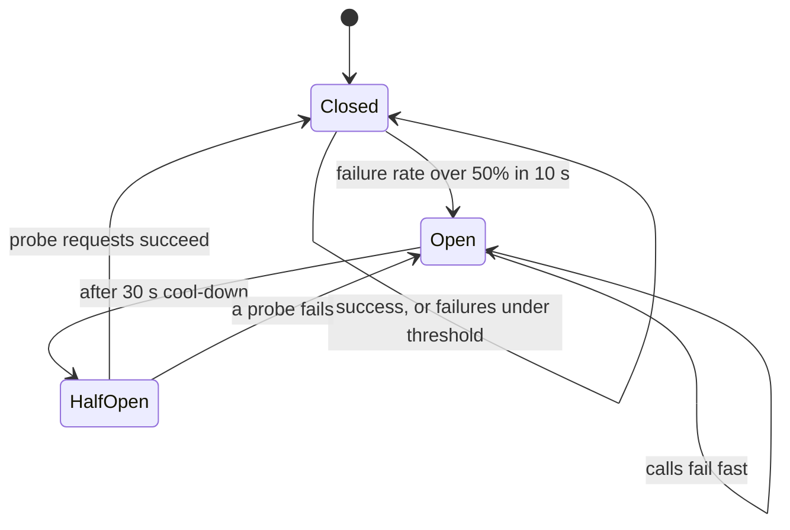

## In one minute
- In a large fleet, something is always failing. The goal is not to prevent failure but to contain it, so one bad dependency degrades a feature instead of taking down the product.
- Know the failure model you design for: crash-stop, crash-recovery, omission, timing, or Byzantine. Most business systems assume crash-recovery with unreliable timing.
- The core toolkit is timeouts, retries with backoff and jitter, idempotency, circuit breakers, bulkheads, load shedding and redundancy.
- Retries are both the main recovery tool and the main amplifier of outages. Bound them.
- Prefer static stability: a system that keeps working with what it already has when a dependency disappears.

## How it works

### Failure models
A *crash-stop* node halts and never returns. A *crash-recovery* node halts and later restarts, possibly having lost in-memory state, so anything promised must be on disk first. *Omission* failures drop messages. *Timing* failures respond, but too late to matter. *Byzantine* failures send wrong or conflicting data; outside blockchains and safety-critical systems, we usually defend against these only with checksums and validation.

The most damaging real failures are *grey*: a node that is slow, not dead. It passes health checks, keeps taking traffic, and drags down every caller's p99.

### Detect: timeouts and health checks
Every remote call needs a timeout. Set it from the dependency's measured latency, not from a round default like 30 seconds. AWS picks the false-timeout rate it can live with, such as 0.1%, and sets the timeout at that percentile of downstream latency, here p99.9 ([AWS Builders' Library](https://aws.amazon.com/builders-library/timeouts-retries-and-backoff-with-jitter/)). Deadlines should propagate: if the user request has 800 ms left, downstream calls get less than that, not their own full budget. Health checks should be shallow for liveness (is the process alive) and deeper for readiness (can it serve), and deep checks should never fail a whole fleet at once because a shared dependency blinked.

### Recover: retries done safely
Retry only operations that are idempotent or carry an idempotency key. Use exponential backoff with full jitter, so delay is a random value between zero and `min(cap, base * 2^attempt)`; jitter spreads out clients that failed together. Cap attempts at 2 or 3. In a stack of 4 layers that each retry 3 times, one user request can produce 3^4 = 81 calls to the bottom service; AWS's own example of 5 layers gives 243x. Retry at one layer only, and use a retry budget. Google allows at most 3 attempts per request and stops a client retrying once retries pass 10% of its requests, which cuts worst-case growth from almost 3x to about 1.1x ([Google SRE book](https://sre.google/sre-book/handling-overload/)). AWS SDKs build in the same idea: standard mode allows 3 attempts in total with full-jitter backoff, and a 500-token retry quota that each retry draws from stops a client retrying during a sustained outage (those numbers are from AWS's 2026 retry update, opt-in until it becomes the default) ([AWS SDK docs](https://docs.aws.amazon.com/sdkref/latest/guide/feature-retry-behavior.html)).

### Contain: breakers, bulkheads, shedding
A *circuit breaker* tracks recent failures to a dependency. Past a threshold it opens and fails calls immediately, then lets a few probe requests through after a cool-down. This gives the dependency room to recover and frees your threads. *Bulkheads* give each dependency its own connection pool or thread pool, so a stuck dependency exhausts only its own slots. *Load shedding* rejects work early, ideally by priority, when queue depth or latency crosses a limit, because serving 80% of requests well beats serving 100% badly. Be wary of clever *fallbacks* that switch to a different system under stress: AWS avoids them because they run rarely, hide bugs for years, and can push the extra load onto whatever is still standing ([AWS Builders' Library](https://aws.amazon.com/builders-library/avoiding-fallback-in-distributed-systems/)).

### Survive: redundancy and static stability
Run N+1 or N+2 capacity across availability zones so one zone can vanish without overload. Pre-provision rather than relying on scaling up during the incident. Cache config and credentials so the data plane keeps working when the control plane is down.

## Down the stack

### Layer 1: The contract
Every remote call ends in one of three states: success, a definite failure, or *unknown*. The protocol tells you which. In gRPC, `DEADLINE_EXCEEDED` means unknown: the docs warn it can come back even when the operation succeeded. `UNAVAILABLE` is the code for a transient condition worth retrying with backoff, but the docs still say retrying non-idempotent calls on it is not always safe ([gRPC status codes](https://grpc.io/docs/guides/status-codes/)). In HTTP, [RFC 9110](https://www.rfc-editor.org/rfc/rfc9110.html#name-idempotent-methods) defines GET, HEAD, PUT, DELETE, OPTIONS and TRACE as idempotent and POST as not; a 503 or 429 with `Retry-After` is the server telling you when to come back. Payment APIs such as Stripe accept an `Idempotency-Key` header so a retried POST returns the stored first result ([Stripe docs](https://docs.stripe.com/api/idempotent_requests)).

A well-behaved client therefore promises its own caller three things you can test: total latency never exceeds the deadline it was given, attempts never exceed N, and retry traffic never exceeds a fixed fraction of normal traffic.

### Layer 2: The mechanism
Deadlines travel on the wire. gRPC sends the remaining budget in the `grpc-timeout` header (for example `250m` for 250 ms) ([gRPC over HTTP/2](https://github.com/grpc/grpc/blob/master/doc/PROTOCOL-HTTP2.md)), and in Go the server side surfaces it as a `context.Context` whose cancellation propagates to every downstream call made with that context.

Retry budgets are small counters. gRPC's retry throttling keeps a token bucket per server: each failure subtracts 1 token, each success adds `tokenRatio` (for example 0.1), and retries are allowed only while the bucket is above half of `maxTokens`; `maxAttempts` above 5 is treated as 5 ([gRFC A6](https://github.com/grpc/proposal/blob/master/A6-client-retries.md)). Envoy expresses the same idea as a retry budget, by default 20% of active requests with a floor of 3 concurrent retries, alongside `num_retries` and a `per_try_timeout` ([Envoy docs](https://www.envoyproxy.io/docs/envoy/latest/api-v3/config/cluster/v3/circuit_breaker.proto)).

Breakers and bulkheads are mostly counting. A Resilience4j-style breaker keeps a sliding window, either the last N call outcomes in a ring buffer or per-second buckets, and opens when the failure rate crosses a threshold. Envoy's "circuit breakers" are really bulkheads: hard caps on connections, pending requests and active requests per upstream cluster, with overflow rejected immediately. Its outlier detection ejects a single host after 5 consecutive 5xx responses by default, for a 30 s base ejection time that grows on repeat offences, and by default ejects at most 10% of the cluster at once ([Envoy docs](https://www.envoyproxy.io/docs/envoy/latest/api-v3/config/cluster/v3/outlier_detection.proto)).

### Layer 3: The machine
A hung dependency consumes concrete resources. By Little's law, in-flight work equals arrival rate times latency: 2,000 RPS held for 10 s is 20,000 concurrent requests. With thread-per-request each one pins a thread, typically 1 MB of reserved stack on a 64-bit JVM, plus a socket, a file descriptor and kernel send and receive buffers. Goroutines start with a stack of a few KB, so Go survives more stuck calls, but it still runs out of file descriptors and connection slots.

The kernel's own failure detection is too slow to rely on. A `connect()` to a host that silently drops SYNs keeps retransmitting SYN and, with the Linux default `tcp_syn_retries = 6`, fails with `ETIMEDOUT` only after about 131 s. Kernels since mid-2023 (Linux 6.5) send the first 4 retries 1 s apart (`tcp_syn_linear_timeouts = 4`) and only then back off exponentially; older kernels doubled from the start and gave up after about 127 s ([kernel docs](https://docs.kernel.org/networking/ip-sysctl.html)). A closed port on a live host replies with RST and fails in one round trip as `ECONNREFUSED`. That asymmetry is why "down" is cheap and "unreachable" is expensive, and why clients must set explicit connect and request timeouts.

Timers themselves are cheap if built well. Event loops pass the nearest deadline as the timeout to `epoll_wait`, and runtimes use timer wheels or heaps so that tracking a hundred thousand pending timeouts costs O(1) or O(log n) per operation. Timeouts should be measured with a monotonic clock so an NTP step cannot fire them early or late.

### Why it's built this way
1. A remote node's silence has no definite meaning, so every call needs a client-side deadline and a plan for the unknown outcome.
2. Unknown outcomes force retries, and retries are only safe with idempotency keys or idempotent operations.
3. Retries add load exactly when a dependency is weakest, so they need jitter to spread out and budgets to cap amplification.
4. Stuck calls hold threads, sockets and memory, which are finite per host, so bulkheads and breakers cap how much of that capacity one dependency can take.

## Diagram


## Worked example
A checkout service handles 2,000 requests per second and calls a recommendations service (p99 120 ms) and a payment service (p99 300 ms). Each instance has 200 worker threads.

Recommendations starts hanging. With a 10 s timeout and a shared pool, each stuck request holds a thread for 10 s. At 2,000 RPS, all threads are stuck within a fraction of a second and checkout, including payment, goes down. A non-critical feature has taken out revenue.

Now apply the toolkit. Recommendations gets a 250 ms timeout, its own 40-thread bulkhead, a circuit breaker that opens at 50% failures, and a fallback of an empty list. When it hangs, at most 40 threads are involved, the breaker opens within seconds, and checkout continues at full rate with no recommendations shown. Payment keeps a 1 s timeout, 1 retry with jitter, and an idempotency key so a retried charge is never applied twice.

## In the wild
- **AWS, 2021: retries without backoff congest the internal network.** On 7 December an automated scaling action in us-east-1 set off a connection surge from many internal clients. A latent bug kept those clients from backing off, so their retries held the devices between AWS's internal and main networks in congestion for hours; Route 53 APIs were impaired from 7:30 AM to 2:30 PM PST and the operators' real-time monitoring data was unavailable for much of it. AWS disabled the scaling activity and committed to a client backoff fix ([AWS](https://aws.amazon.com/message/12721/)).
- **Google Cloud, 2025: a crash loop becomes a thundering herd.** On 12 June a quota-policy row with blank fields replicated worldwide within seconds and hit a code path in Service Control with no error handling and no feature flag, crash-looping it in every region. When tasks restarted in us-central1 they overloaded the Spanner table behind them, because they lacked randomized exponential backoff; that region took about 2h40m to recover. Fixes include failing open, feature flags for critical changes and an audit for jittered backoff ([Google Cloud](https://status.cloud.google.com/incidents/ow5i3PPK96RduMcb1SsW)).
- **Slack, 2022: retries lock in a cache-miss cascade.** A Consul agent rollout replaced memcached nodes with empty ones, and each client boot then ran a query across every database shard. Timeouts stopped the cache refilling and client retries kept the load up. Responders throttled client boots and raised the limit in small steps; their first, larger step pushed the database back over the edge ([Slack](https://slack.engineering/slacks-incident-on-2-22-22/)).

## Trade-offs
| Technique | Strengths | Weaknesses | Choose when |
|---|---|---|---|
| Retry with backoff | Absorbs transient errors | Amplifies load; needs idempotency | Short, rare failures |
| Circuit breaker | Fails fast, protects dependency | Tuning; can open on noise | Remote calls that can hang |
| Bulkhead | Limits blast radius | Lower utilisation per pool | Mixed critical and optional deps |
| Load shedding | Keeps latency bounded | Some users get errors | Overload is possible |
| Fallback | Feature degrades gracefully | Rarely tested path | Optional data |

## Pitfalls in production
- Retries at every layer multiplying load during an incident. Fix: retry at one layer and enforce a retry budget.
- Timeouts longer than the caller's own timeout, so work continues for requests nobody is waiting for. Fix: propagate deadlines and cancel downstream work.
- Fallbacks that call a different, untested system and fail in a new way. Fix: prefer static fallbacks and exercise them in game days.
- Health checks that depend on a shared database, so a database blip marks every node unhealthy. Fix: keep liveness shallow and fail open when all nodes look sick.
- Synchronised recovery: every client reconnects at the same second. Fix: jitter reconnects and warm caches gradually.

## Leadership lens
- Ask for each dependency: timeout, retry policy, breaker, fallback, and whether it is critical to the request. Put this in the design doc as a table.
- Decide where retries live. One owner per call path avoids exponential amplification.
- Fund chaos and game days. Containment code is only real once it has been triggered on purpose.

## Check yourself
1. Why is a slow dependency often worse than a dead one?
   **Answer:** A dead one fails fast and trips breakers; a slow one holds threads and connections until timeouts fire, exhausting caller resources and spreading latency upstream.
2. Why add jitter to exponential backoff?
   **Answer:** Clients that failed together would otherwise retry together in waves. Randomising the delay spreads retries out so the recovering service sees smooth load.
3. What does a circuit breaker's half-open state protect against?
   **Answer:** Sending full traffic to a dependency that may still be broken. It lets a few probes test recovery before closing again.

## Practice
**Task:** Write `call_with_retry(fn, max_attempts, base, cap, rand, sleep)`. Call `fn()`; if it raises `TransientError`, wait and retry, up to `max_attempts` total calls. Before retry number `i` (starting at 0), sleep for `rand() * min(cap, base * 2 ** i)`, which is full jitter. Any other exception is raised immediately without retrying. If all attempts fail, raise the last `TransientError`. `rand` and `sleep` are injected so tests stay deterministic.

```python starter
class TransientError(Exception):
    pass

def call_with_retry(fn, max_attempts, base, cap, rand, sleep):
    # TODO
    raise NotImplementedError
```

```python tests
def flaky(fails):
    state = {"n": 0}
    def fn():
        state["n"] += 1
        if state["n"] <= fails:
            raise TransientError("boom")
        return "ok"
    return fn, state

def test_success_after_retries():
    fn, st = flaky(2)
    slept = []
    assert call_with_retry(fn, 5, 0.1, 10, lambda: 1.0, slept.append) == "ok"
    assert slept == [0.1, 0.2]

def test_cap_applies():
    fn, st = flaky(4)
    slept = []
    call_with_retry(fn, 5, 1, 3, lambda: 1.0, slept.append)
    assert slept == [1, 2, 3, 3]

def test_jitter_scales_delay():
    fn, st = flaky(1)
    slept = []
    call_with_retry(fn, 3, 2, 10, lambda: 0.5, slept.append)
    assert slept == [1.0]

def test_gives_up():
    fn, st = flaky(9)
    try:
        call_with_retry(fn, 3, 1, 10, lambda: 0.0, lambda d: None)
        assert False, "should raise"
    except TransientError:
        assert st["n"] == 3

def test_non_transient_not_retried():
    calls = []
    def fn():
        calls.append(1)
        raise ValueError("bad input")
    try:
        call_with_retry(fn, 5, 1, 10, lambda: 1.0, lambda d: None)
        assert False, "should raise"
    except ValueError:
        assert len(calls) == 1
```

```python solution
class TransientError(Exception):
    pass

def call_with_retry(fn, max_attempts, base, cap, rand, sleep):
    for attempt in range(max_attempts):
        try:
            return fn()
        except TransientError:
            if attempt == max_attempts - 1:
                raise
            sleep(rand() * min(cap, base * 2 ** attempt))
```

```typescript starter
export class TransientError extends Error {}

export function callWithRetry<T>(
  fn: () => T,
  maxAttempts: number,
  base: number,
  cap: number,
  rand: () => number,
  sleep: (d: number) => void
): T {
  // TODO
  throw new Error("TODO");
}
```

```typescript tests
function flaky(fails: number): { fn: () => string; state: { n: number } } {
  const state = { n: 0 };
  const fn = () => {
    state.n += 1;
    if (state.n <= fails) throw new TransientError("boom");
    return "ok";
  };
  return { fn, state };
}

test("success after retries", () => {
  const { fn } = flaky(2);
  const slept: number[] = [];
  assertEqual(callWithRetry(fn, 5, 0.1, 10, () => 1.0, (d) => { slept.push(d); }), "ok");
  assertEqual(slept, [0.1, 0.2]);
});

test("cap applies", () => {
  const { fn } = flaky(4);
  const slept: number[] = [];
  callWithRetry(fn, 5, 1, 3, () => 1.0, (d) => { slept.push(d); });
  assertEqual(slept, [1, 2, 3, 3]);
});

test("jitter scales delay", () => {
  const { fn } = flaky(1);
  const slept: number[] = [];
  callWithRetry(fn, 3, 2, 10, () => 0.5, (d) => { slept.push(d); });
  assertEqual(slept, [1.0]);
});

test("gives up", () => {
  const { fn, state } = flaky(9);
  let caught = false;
  try {
    callWithRetry(fn, 3, 1, 10, () => 0.0, () => {});
  } catch (e) {
    caught = e instanceof TransientError;
  }
  assert(caught, "should raise TransientError");
  assertEqual(state.n, 3);
});

test("non-transient not retried", () => {
  let calls = 0;
  const fn = (): string => {
    calls++;
    throw new RangeError("bad input");
  };
  let caught = false;
  try {
    callWithRetry(fn, 5, 1, 10, () => 1.0, () => {});
  } catch (e) {
    caught = e instanceof RangeError;
  }
  assert(caught, "should raise RangeError");
  assertEqual(calls, 1);
});
```

```typescript solution
export class TransientError extends Error {}

export function callWithRetry<T>(
  fn: () => T,
  maxAttempts: number,
  base: number,
  cap: number,
  rand: () => number,
  sleep: (d: number) => void
): T {
  for (let attempt = 0; ; attempt++) {
    try {
      return fn();
    } catch (e) {
      if (!(e instanceof TransientError) || attempt >= maxAttempts - 1) throw e;
      sleep(rand() * Math.min(cap, base * Math.pow(2, attempt)));
    }
  }
}
```

```go starter
package practice

import "errors"

// ErrTransient marks errors that are safe to retry. Wrap it with %w.
var ErrTransient = errors.New("transient")

// CallWithRetry calls fn up to maxAttempts times with full-jitter backoff.
func CallWithRetry(fn func() (string, error), maxAttempts int, base, cap float64,
	rand func() float64, sleep func(float64)) (string, error) {
	// TODO
	panic("TODO")
}
```

```go tests
package practice

import (
	"errors"
	"fmt"
	"testing"
)

func flaky(fails int) (func() (string, error), *int) {
	n := 0
	return func() (string, error) {
		n++
		if n <= fails {
			return "", fmt.Errorf("boom: %w", ErrTransient)
		}
		return "ok", nil
	}, &n
}

func sameFloats(a, b []float64) bool {
	if len(a) != len(b) {
		return false
	}
	for i := range a {
		if a[i] != b[i] {
			return false
		}
	}
	return true
}

func TestSuccessAfterRetries(t *testing.T) {
	fn, _ := flaky(2)
	var slept []float64
	got, err := CallWithRetry(fn, 5, 0.1, 10, func() float64 { return 1.0 },
		func(d float64) { slept = append(slept, d) })
	if err != nil || got != "ok" {
		t.Fatalf("got %q, %v", got, err)
	}
	if !sameFloats(slept, []float64{0.1, 0.2}) {
		t.Fatalf("slept %v", slept)
	}
}

func TestCapApplies(t *testing.T) {
	fn, _ := flaky(4)
	var slept []float64
	CallWithRetry(fn, 5, 1, 3, func() float64 { return 1.0 },
		func(d float64) { slept = append(slept, d) })
	if !sameFloats(slept, []float64{1, 2, 3, 3}) {
		t.Fatalf("slept %v", slept)
	}
}

func TestJitterScalesDelay(t *testing.T) {
	fn, _ := flaky(1)
	var slept []float64
	CallWithRetry(fn, 3, 2, 10, func() float64 { return 0.5 },
		func(d float64) { slept = append(slept, d) })
	if !sameFloats(slept, []float64{1.0}) {
		t.Fatalf("slept %v", slept)
	}
}

func TestGivesUp(t *testing.T) {
	fn, n := flaky(9)
	_, err := CallWithRetry(fn, 3, 1, 10, func() float64 { return 0 }, func(float64) {})
	if !errors.Is(err, ErrTransient) {
		t.Fatalf("want transient error, got %v", err)
	}
	if *n != 3 {
		t.Fatalf("calls = %d, want 3", *n)
	}
}

func TestNonTransientNotRetried(t *testing.T) {
	calls := 0
	bad := errors.New("bad input")
	fn := func() (string, error) {
		calls++
		return "", bad
	}
	_, err := CallWithRetry(fn, 5, 1, 10, func() float64 { return 1 }, func(float64) {})
	if err != bad {
		t.Fatalf("got %v", err)
	}
	if calls != 1 {
		t.Fatalf("calls = %d, want 1", calls)
	}
}
```

```go solution
package practice

import (
	"errors"
	"math"
)

// ErrTransient marks errors that are safe to retry. Wrap it with %w.
var ErrTransient = errors.New("transient")

// CallWithRetry calls fn up to maxAttempts times with full-jitter backoff.
func CallWithRetry(fn func() (string, error), maxAttempts int, base, cap float64,
	rand func() float64, sleep func(float64)) (string, error) {
	var lastErr error
	for attempt := 0; attempt < maxAttempts; attempt++ {
		v, err := fn()
		if err == nil {
			return v, nil
		}
		if !errors.Is(err, ErrTransient) {
			return "", err
		}
		lastErr = err
		if attempt < maxAttempts-1 {
			sleep(rand() * math.Min(cap, base*math.Pow(2, float64(attempt))))
		}
	}
	return "", lastErr
}
```

## Mock interview
**Prompt:** Your API gateway fans out each request to 6 backend services and serves 15,000 RPS. Last month one backend's latency spike caused a full outage. Redesign the failure handling.

- Follow-up: How do you pick timeout values for each backend?
- Follow-up: The backend recovers but immediately falls over again. Why, and what do you change?
- Follow-up: When is returning a partial response worse than returning an error?

**A strong answer covers:**
- Per-dependency timeouts from measured latency, with deadline propagation.
- Bulkheads and circuit breakers per backend, with defined fallbacks for optional ones.
- Retries in one layer only, with jitter and a retry budget, and idempotency keys for writes.
- Recovery storms: jittered reconnects, gradual traffic ramp, breaker half-open probes.
- Load shedding by priority and N+1 capacity across zones.

## Sources and further study
**Primary**
- [gRFC A6: gRPC client retries](https://github.com/grpc/proposal/blob/master/A6-client-retries.md): retry policy, hedging and the token-bucket retry throttle, as specified.
- [RFC 9110: HTTP Semantics, idempotent methods](https://www.rfc-editor.org/rfc/rfc9110.html#name-idempotent-methods): which methods a client may safely repeat.
- [Linux ip-sysctl documentation](https://docs.kernel.org/networking/ip-sysctl.html): the SYN, retransmission and keepalive timers that decide how slowly the kernel notices a dead peer.

**Systems docs**
- [AWS SDKs: retry behavior](https://docs.aws.amazon.com/sdkref/latest/guide/feature-retry-behavior.html): standard and adaptive modes, the backoff formula and the retry quota numbers.
- [Envoy: outlier detection](https://www.envoyproxy.io/docs/envoy/latest/intro/arch_overview/upstream/outlier): host ejection rules and the safeguards that stop a proxy ejecting a whole cluster.
- [gRPC: deadlines](https://grpc.io/docs/guides/deadlines/): how deadlines are set, propagated and cancelled across services.

**Books**
- *Designing Data-Intensive Applications* (1st ed.), Martin Kleppmann, Ch 8 "The Trouble with Distributed Systems": partial failures, unreliable networks and why timeouts are guesses.
- *Release It!* (2nd ed.), Michael T. Nygard, Ch 4 "Stability Antipatterns" and Ch 5 "Stability Patterns": chain reactions, blocked threads, timeouts, breakers and bulkheads.
- *Site Reliability Engineering*, Beyer et al. (eds.), Ch 21 "Handling Overload": per-customer limits, client-side throttling, criticality and retry budgets.

**Other curricula**
- [donnemartin/system-design-primer](https://github.com/donnemartin/system-design-primer): covers failure through fail-over (active-passive with heartbeats) and back pressure with exponential backoff; it does not cover breakers, retry budgets or deadlines.
- [roadmap.sh: System Design](https://roadmap.sh/system-design): lists Retry, Retry Storm, Circuit Breaker and Bulkhead as separate one-paragraph reliability-pattern nodes.

## Watch
- [Distributed Systems 2.4: Fault tolerance (Martin Kleppmann)](https://www.youtube.com/watch?v=43TDfUNsM3E): failure models, failure detectors and what fault tolerance means.
- [L5: The many types of fail (Distributed Systems Course)](https://www.youtube.com/watch?v=MnYlwjuGcg8): a tour of crash, omission, timing and Byzantine failures.

## Free resources
- [Timeouts, retries, and backoff with jitter (AWS Builders' Library)](https://aws.amazon.com/builders-library/timeouts-retries-and-backoff-with-jitter/): how AWS sets timeouts and bounds retries.
- [Addressing Cascading Failures (Google SRE book)](https://sre.google/sre-book/addressing-cascading-failures/): how overload spreads and the controls that stop it.
- [Circuit Breaker pattern (Azure Architecture Center)](https://learn.microsoft.com/en-us/azure/architecture/patterns/circuit-breaker): states, tuning and when not to use it.
- [Static stability using Availability Zones (AWS Builders' Library)](https://aws.amazon.com/builders-library/static-stability-using-availability-zones/): designing systems that keep working when dependencies fail.
- [Making retries safe with idempotent APIs (AWS Builders' Library)](https://aws.amazon.com/builders-library/making-retries-safe-with-idempotent-APIs/): idempotency tokens in practice.
