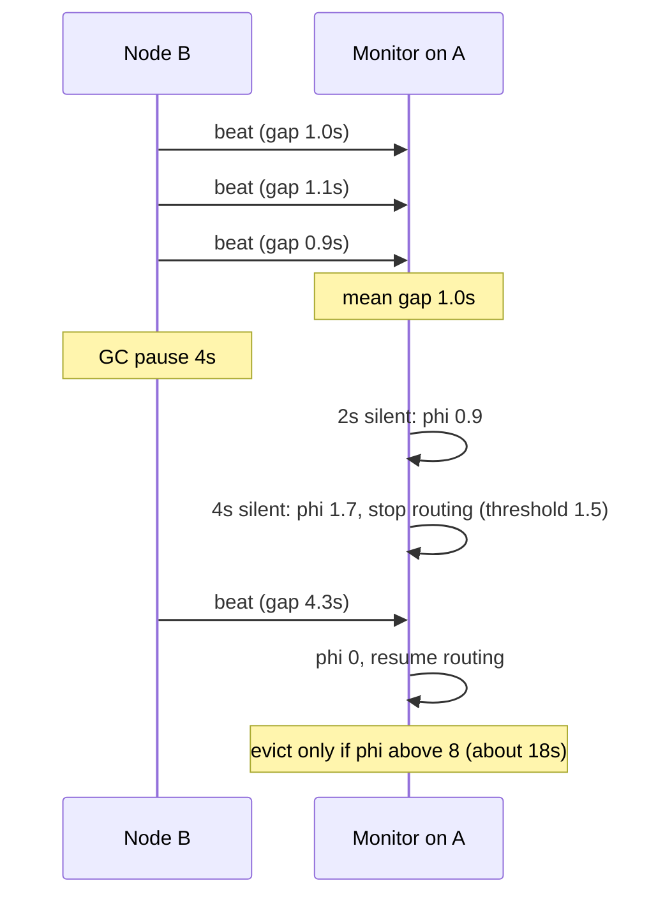

## In one minute
- A heartbeat is a small periodic message that says "I am still here." Its absence, measured against a timeout, is how a system guesses that a node has failed.
- The guess is never certain. A short timeout detects crashes fast but convicts nodes that are merely slow or paused; a long one leaves traffic flowing to a dead node.
- Adaptive detectors such as phi accrual learn the normal gap between beats and report a suspicion level, so each action can pick its own threshold.
- A heartbeat proves only that the heartbeat code runs. Tie it to real progress, or a wedged node looks healthy.
- All-to-all heartbeats cost O(N squared) messages, so large clusters use a lease store, gossip, or SWIM.

## How it works

### The basic loop
A sender emits a beat every interval `T`, for example every second. A monitor records when each beat arrives and declares the sender suspect if nothing arrives for a timeout `D`, usually a small multiple of `T`. The two numbers set two error rates. Detection time for a real crash is between `D - T` and `D`. The false positive rate depends on how often normal jitter, packet loss or a GC pause makes a gap longer than `D`.

This is the partial failure problem shape at its core: silence is ambiguous, and the system must act on it anyway. A ride-hailing app faces the same choice when it marks a driver offline after 30 seconds without a location ping: too short and drivers in tunnels flicker offline, too long and riders are matched with someone who closed the app.

### Push, pull and leases
In **push** style, the monitored node sends beats on its own schedule; the monitor only listens. In **pull** style, the monitor sends a ping and expects a reply, which also measures round-trip time and catches one-way failures from the monitor's side. Load balancer health checks are pull; Kafka consumer heartbeats, Kubernetes node leases and Raft leader heartbeats are push.

A **lease** is a heartbeat with a contract attached. The holder must renew before expiry, and the grantor promises not to hand the resource to anyone else until then. Kubernetes kubelets renew a `Lease` object in the `kube-node-lease` namespace every 10 seconds, with a 40-second lease duration ([kubelet config](https://kubernetes.io/docs/reference/config-api/kubelet-config.v1beta1/)). The node controller marks a node unhealthy after `--node-monitor-grace-period` without a heartbeat; the default is now 50 seconds, where older guides still say 40 ([kube-controller-manager](https://kubernetes.io/docs/reference/command-line-tools-reference/kube-controller-manager/)). The leader election lesson covers how leases plus fencing tokens make leadership safe.

### Fixed versus adaptive timeouts
A fixed rule like "suspect after 3 missed one-second beats" assumes a stable gap between beats. Across regions or on a congested link, it is not. Adaptive detectors judge the current silence against a sliding window of recent inter-arrival times.

The **phi accrual** detector (Hayashibara and others, 2004, [paper](https://dspace.jaist.ac.jp/dspace/bitstream/10119/4784/1/IS-RR-2004-010.pdf)) outputs a number instead of a verdict: `phi = -log10(P(a gap at least this long))`. A phi of 1 means a 10% chance that a healthy node would be this quiet, 2 means 1%, and 8 means one in 100 million. Each consumer of the detector picks its own threshold: a load balancer might stop routing at phi 3, while a cluster manager only evicts at phi 8. Cassandra models gaps as exponentially distributed, which makes phi simply proportional to `silence / mean_gap`; Akka models them as a normal distribution with a minimum standard deviation (100 ms by default) and an "acceptable pause" allowance.

### Heartbeats that lie
A heartbeat sent from a dedicated timer thread keeps flowing while the main worker is deadlocked, stuck on a disk, or spinning in a retry loop. Kafka hit exactly this: consumers send heartbeats from a background thread, so a separate `max.poll.interval.ms` (5 minutes by default) evicts a consumer that keeps beating but stops calling `poll()` ([Kafka consumer configs](https://kafka.apache.org/43/configuration/consumer-configs/)). The fix in general is to make the beat carry evidence of progress (a counter the work loop increments, the last applied log index, queue depth) and have the monitor check that the evidence moves.

### Scaling the conversation
With N nodes all heartbeating to each other, the cluster sends N times (N - 1) messages per interval: 1,000 nodes at 1 per second is about a million messages per second for liveness alone. Large systems instead use a **central coordinator** (ZooKeeper sessions, etcd leases, the Kubernetes control plane) that receives N beats, or **gossip** and **SWIM**, which keep per-node load constant and are covered in the gossip protocol lesson. A third option is a fixed set of watchers: in Akka Cluster each node is monitored by only 9 peers by default (`monitored-by-nr-of-members`), and their verdicts spread by gossip ([Akka configuration](https://doc.akka.io/libraries/akka-core/current/general/configuration-reference.html)).

## Down the stack

### Layer 1: The contract
A failure detector is judged on two properties defined by Chandra and Toueg: **completeness** (every crashed node is eventually suspected by every correct node) and **accuracy** (correct nodes are not suspected, or at least not forever). In an asynchronous network you cannot have both perfectly, so practical detectors promise completeness within a bounded time and accept a measurable false positive rate. Write the contract in numbers: "a crashed node is suspected within 6 seconds at p99, and a healthy node is wrongly suspected less than once per node per month." Raft's leader heartbeat contract is relative: `broadcastTime << electionTimeout << MTBF`, with the Raft paper suggesting broadcast times of 0.5 to 20 ms and election timeouts of 10 to 500 ms ([Raft paper](https://raft.github.io/raft.pdf)).

### Layer 2: The mechanism
Real systems expose the knobs directly. etcd sends leader heartbeats as empty `MsgHeartbeat` messages every `--heartbeat-interval` (100 ms default) and followers start an election after `--election-timeout` (1000 ms default) of silence, randomised so they do not all stand at once ([etcd tuning](https://etcd.io/docs/v3.5/tuning/)). ZooKeeper clients negotiate a session timeout between 2 and 20 times `tickTime` (2 seconds by default), and the client library pings after a third of the timeout passes with no traffic ([ZooKeeper docs](https://zookeeper.apache.org/doc/current/zookeeperProgrammers.html)). Kafka consumers on the classic group protocol use `heartbeat.interval.ms` (3 seconds) against `session.timeout.ms` (45 seconds). The newer consumer group protocol (`group.protocol=consumer`, still opt-in on the client) moves both knobs to the broker, which hands out a 5-second heartbeat interval and keeps the 45-second session timeout ([Kafka broker configs](https://kafka.apache.org/43/configuration/broker-configs/)). Cassandra gossips once per second and convicts at `phi_convict_threshold` 8 ([cassandra.yaml](https://cassandra.apache.org/doc/latest/cassandra/managing/configuration/cass_yaml_file.html)). Akka Cluster defaults to a 1-second heartbeat, threshold 8 and a 3-second `acceptable-heartbeat-pause`. TCP keepalive is the slowest of all: Linux waits `tcp_keepalive_time` (7,200 seconds) before the first probe, then sends 9 probes 75 seconds apart ([Linux docs](https://docs.kernel.org/networking/ip-sysctl.html)), so it cannot be your failure detector without tuning.

The phi computation itself is cheap. Keep a ring buffer of the last 100 to 1,000 inter-arrival times with a running sum (and sum of squares for the normal model). On each beat, push `now - last`; on each query, compute the mean and evaluate the tail probability. Both are O(1).

### Layer 3: The machine
A heartbeat is tiny: a UDP datagram of 50 to 200 bytes, or an HTTP/2 `PING` frame (8 bytes of payload plus a 9-byte frame header) on an existing connection. Bandwidth is negligible; scheduling is what matters. A timer on a loaded box can fire tens of ms late, and a JVM stop-the-world pause freezes both sending and receiving, so a paused monitor wakes up, sees huge gaps from everyone, and may convict the whole cluster. Good detectors timestamp arrivals with a monotonic clock (`CLOCK_MONOTONIC`, `System.nanoTime()`) so NTP steps do not create phantom gaps. Heartbeats also share socket buffers and switch queues with bulk traffic, so a node busy streaming replication data delays its own beats; some systems send liveness on a separate connection or with higher DSCP priority.

### Why it's built this way
1. A remote process gives no signal when it dies, so the only evidence is the absence of expected messages.
2. Absence needs a deadline, and any deadline trades detection speed for false positives because network delay has no hard upper bound.
3. Delay distributions shift with load and topology, so a fixed deadline is wrong most of the time, which motivates adaptive detectors that learn the distribution.
4. Different actions tolerate different error rates, so detectors report a continuous suspicion level and let each action choose its threshold.
5. All-to-all monitoring grows quadratically, so large systems funnel beats through a coordinator or spread them with gossip.

## Diagram


## Worked example
A 300-node storage cluster uses a gossip heartbeat every second. Measured inter-arrival gaps average 1.0 s with a long tail from GC: about one gap in 10,000 exceeds 5 s.

With a fixed 5-second timeout, each node produces about 8.6 gaps over 5 s per day (86,400 beats times 1 in 10,000), and because a GC pause silences the node to everyone at once, all 299 peers suspect it together. Every node is wrongly declared dead around 9 times a day, about 2,600 false failures per day across the cluster. If suspicion triggers re-replication of a 2 TB node, that is unaffordable.

Now use phi with the exponential model. Phi for a silence `t` is `t / (mean × ln 10)`, about `0.434 × t` seconds here. Two thresholds serve two actions. At phi 2 (about 4.6 s of silence) coordinators stop sending reads to the node and try another replica; a wrong guess costs one slower read. At phi 8 (about 18.4 s) the cluster starts hinted handoff, and only after a much longer, human-confirmed outage does it re-replicate. When a busy replication stream raises one node's mean gap to 1.5 s, its thresholds stretch to 6.9 s and 27.6 s automatically, instead of flapping. Phi state is cheap: a 1,000-entry ring of floats per peer is 8 KB, about 2.4 MB per node for 299 peers.

## In the wild
- **GitHub, 2012: a failed health check that fed on itself.** Heavy migration load made the active MySQL node fail a Pacemaker health check, so Pacemaker moved the active role to a node with a cold buffer pool, which performed badly and triggered another failover. The next day a Pacemaker segfault partitioned the cluster and two separate clusters ran master elections at once. Over two days there was 1h46m of downtime, and automatic failover of the active role was changed to need a human to start it ([GitHub](https://github.blog/news-insights/the-library/github-availability-this-week/)).
- **Discord, 2026: overloaded supervisors starve the heartbeats.** A config change halved the number of session pods in one zone, 17% of sessions ended ungracefully, and the reconnect storm ran gateways out of memory. Two single-process Erlang supervisors became bottlenecks and blocked etcd heartbeats, so instances could not refresh their etcd registrations and dropped out of the hash ring and voice and video were mostly down for about 3h17m. Fixes included draining before scale-down and partitioned connection pools ([Discord](https://discord.com/blog/behind-the-scenes-of-the-3-25-26-voice-outage)).

## Trade-offs
| Approach | Strengths | Weaknesses | Choose when |
|---|---|---|---|
| Fixed timeout (k missed beats) | Simple, predictable, easy to reason about | Wrong when latency shifts; one value for all actions | Single data centre, stable latency, small clusters |
| Phi accrual | Adapts to each link; per-action thresholds | Needs warm-up history; harder to explain to on-call | Heterogeneous links, large clusters, gossip systems |
| Central lease store | Clear authority; O(N) beats | Coordinator is critical infrastructure | Leader election, Kubernetes nodes, locks |
| SWIM probing | Constant load per node; indirect probes cut false positives | Probabilistic detection time | Thousands of nodes, service discovery |
| TCP keepalive | Free, built into the kernel | Hours by default; sees only the socket | Keeping NAT and idle connections alive |

## Pitfalls in production
- **Heartbeat thread healthy, node not.** A dedicated beat thread hides deadlocks and stuck work. Put a progress counter in the beat and alarm if it stops moving, as Kafka does with `max.poll.interval.ms`.
- **Timeout shorter than a GC pause.** A 2-second election timeout with a JVM that pauses 3 seconds causes leader churn. Measure pause p99.9 and set timeouts above it, or fix the pauses.
- **Monitor pauses convict everyone.** After its own long pause, a monitor sees every peer as silent. Detect self-pause (a monotonic gap far larger than the tick) and reset the window before judging.
- **Correlated eviction.** A network blip makes many nodes suspect at once, and the cluster rebalances everything. Cap the fraction of nodes that can be evicted per minute and delay expensive actions.
## Leadership lens
- Ask what each detector triggers and what a false positive costs: a retried read, a leader election, or rebuilding 2 TB of data. Set thresholds per action, not per cluster.
- Make detection time an explicit SLO input. If the availability target needs failover in 10 seconds, timeouts, election and client retry together must fit in it.
- Track false suspicions as a metric. A rising rate is an early warning of GC, network or capacity problems before they become outages.

## Check yourself
1. Why does a heartbeat interval of 1 s and a timeout of 1.5 s cause trouble even on a healthy network?
   **Answer:** Normal jitter, timer lateness and one dropped packet routinely create gaps over 1.5 s, so healthy nodes are suspected often. The timeout must cover several intervals plus pause and delay tails.
2. Two links have mean heartbeat gaps of 1 s and 3 s. After 6 s of silence, which node is more suspicious under the exponential phi model?
   **Answer:** The 1 s link: phi is about 2.6 versus about 0.87 for the 3 s link. The same silence is far more unusual where beats normally arrive quickly.
3. A worker's heartbeats are fine but it has processed nothing for 10 minutes. What design fixes this?
   **Answer:** Make liveness depend on progress: include a work counter or last-processed offset in the beat, or add a second deadline on the work loop itself, and evict when progress stops.

## Practice
**Task:** Implement a phi accrual failure detector with an injected clock. `PhiDetector(window)` keeps the most recent `window` inter-arrival intervals. `heartbeat(now)` records a beat at time `now` (seconds, non-decreasing); from the second beat on it appends `now - last` to the window, dropping the oldest when full. `phi(now)` returns `0.0` if fewer than one interval is known, and otherwise `(now - last) / (mean × ln 10)`, the exponential model, where `mean` is the average interval in the window. `available(now, threshold)` returns true when `phi(now) < threshold`. Do not read a real clock.

```python starter
import math


class PhiDetector:
    def __init__(self, window):
        self.window = window

    def heartbeat(self, now):
        # TODO
        raise NotImplementedError

    def phi(self, now):
        # TODO
        raise NotImplementedError

    def available(self, now, threshold):
        # TODO
        raise NotImplementedError
```

```python tests
import math

def close(a, b):
    return abs(a - b) < 1e-9

def beats(d, times):
    for t in times:
        d.heartbeat(t)

def test_no_history_is_zero():
    d = PhiDetector(10)
    assert d.phi(5.0) == 0.0
    d.heartbeat(0.0)
    assert d.phi(100.0) == 0.0, "one beat gives no interval yet"

def test_phi_grows_with_silence():
    d = PhiDetector(10)
    beats(d, [0.0, 1.0, 2.0, 3.0])
    assert close(d.phi(3.0), 0.0)
    assert close(d.phi(3.0 + math.log(10)), 1.0)
    assert close(d.phi(3.0 + 8 * math.log(10)), 8.0)

def test_slower_link_is_less_suspicious():
    fast, slow = PhiDetector(10), PhiDetector(10)
    beats(fast, [0.0, 1.0, 2.0])
    beats(slow, [0.0, 3.0, 6.0])
    assert fast.phi(2.0 + 6.0) > slow.phi(6.0 + 6.0)

def test_window_slides():
    d = PhiDetector(2)
    beats(d, [0.0, 10.0, 11.0, 12.0])
    assert close(d.phi(12.0 + math.log(10)), 1.0), "the 10s gap fell out of the window"

def test_heartbeat_resets_silence():
    d = PhiDetector(10)
    beats(d, [0.0, 2.0])
    assert d.phi(10.0) > 1.0
    d.heartbeat(10.0)
    assert close(d.phi(10.0), 0.0)

def test_available_uses_threshold():
    d = PhiDetector(10)
    beats(d, [0.0, 1.0])
    assert d.available(1.0 + 2.0, 1.0)
    assert not d.available(1.0 + 3.0, 1.0)
```

```python solution
import math
from collections import deque


class PhiDetector:
    def __init__(self, window):
        self.window = window
        self.intervals = deque()
        self.total = 0.0
        self.last = None

    def heartbeat(self, now):
        if self.last is not None:
            gap = now - self.last
            self.intervals.append(gap)
            self.total += gap
            if len(self.intervals) > self.window:
                self.total -= self.intervals.popleft()
        self.last = now

    def phi(self, now):
        if not self.intervals:
            return 0.0
        mean = self.total / len(self.intervals)
        return (now - self.last) / (mean * math.log(10))

    def available(self, now, threshold):
        return self.phi(now) < threshold
```

```typescript starter
export class PhiDetector {
  constructor(public window: number) {}
  heartbeat(now: number): void {
    throw new Error("TODO");
  }
  phi(now: number): number {
    throw new Error("TODO");
  }
  available(now: number, threshold: number): boolean {
    throw new Error("TODO");
  }
}
```

```typescript tests
function near(a: number, b: number): boolean {
  return Math.abs(a - b) < 1e-9;
}
function feed(d: PhiDetector, times: number[]): void {
  for (const t of times) d.heartbeat(t);
}
test("no history is zero", () => {
  const d = new PhiDetector(10);
  assertEqual(d.phi(5), 0);
  d.heartbeat(0);
  assertEqual(d.phi(100), 0, "one beat gives no interval yet");
});
test("phi grows with silence", () => {
  const d = new PhiDetector(10);
  feed(d, [0, 1, 2, 3]);
  assert(near(d.phi(3), 0), "zero at the beat");
  assert(near(d.phi(3 + Math.LN10), 1), "phi 1");
  assert(near(d.phi(3 + 8 * Math.LN10), 8), "phi 8");
});
test("slower link is less suspicious", () => {
  const fast = new PhiDetector(10);
  const slow = new PhiDetector(10);
  feed(fast, [0, 1, 2]);
  feed(slow, [0, 3, 6]);
  assert(fast.phi(8) > slow.phi(12), "same silence, different history");
});
test("window slides", () => {
  const d = new PhiDetector(2);
  feed(d, [0, 10, 11, 12]);
  assert(near(d.phi(12 + Math.LN10), 1), "the 10s gap fell out of the window");
});
test("heartbeat resets silence", () => {
  const d = new PhiDetector(10);
  feed(d, [0, 2]);
  assert(d.phi(10) > 1, "suspicious before beat");
  d.heartbeat(10);
  assert(near(d.phi(10), 0), "reset after beat");
});
test("available uses threshold", () => {
  const d = new PhiDetector(10);
  feed(d, [0, 1]);
  assert(d.available(3, 1), "phi 0.87 is available");
  assert(!d.available(4, 1), "phi 1.3 is not");
});
```

```typescript solution
export class PhiDetector {
  private intervals: number[] = [];
  private total = 0;
  private last: number | null = null;

  constructor(public window: number) {}

  heartbeat(now: number): void {
    if (this.last !== null) {
      const gap = now - this.last;
      this.intervals.push(gap);
      this.total += gap;
      if (this.intervals.length > this.window) {
        this.total -= this.intervals.shift() as number;
      }
    }
    this.last = now;
  }

  phi(now: number): number {
    if (this.intervals.length === 0 || this.last === null) return 0;
    const mean = this.total / this.intervals.length;
    return (now - this.last) / (mean * Math.LN10);
  }

  available(now: number, threshold: number): boolean {
    return this.phi(now) < threshold;
  }
}
```

```go starter
package practice

type PhiDetector struct {
	window int
}

func NewPhiDetector(window int) *PhiDetector { return &PhiDetector{window: window} }

func (d *PhiDetector) Heartbeat(now float64)                     { panic("TODO") }
func (d *PhiDetector) Phi(now float64) float64                   { panic("TODO") }
func (d *PhiDetector) Available(now, threshold float64) bool     { panic("TODO") }
```

```go tests
package practice

import (
	"math"
	"testing"
)

func near(a, b float64) bool { return math.Abs(a-b) < 1e-9 }

func feed(d *PhiDetector, times ...float64) {
	for _, t := range times {
		d.Heartbeat(t)
	}
}

func TestNoHistoryIsZero(t *testing.T) {
	d := NewPhiDetector(10)
	if d.Phi(5) != 0 {
		t.Fatal("empty detector should report 0")
	}
	d.Heartbeat(0)
	if d.Phi(100) != 0 {
		t.Fatal("one beat gives no interval yet")
	}
}

func TestPhiGrowsWithSilence(t *testing.T) {
	d := NewPhiDetector(10)
	feed(d, 0, 1, 2, 3)
	if !near(d.Phi(3), 0) || !near(d.Phi(3+math.Ln10), 1) || !near(d.Phi(3+8*math.Ln10), 8) {
		t.Fatalf("got %v %v %v", d.Phi(3), d.Phi(3+math.Ln10), d.Phi(3+8*math.Ln10))
	}
}

func TestSlowerLinkIsLessSuspicious(t *testing.T) {
	fast, slow := NewPhiDetector(10), NewPhiDetector(10)
	feed(fast, 0, 1, 2)
	feed(slow, 0, 3, 6)
	if !(fast.Phi(8) > slow.Phi(12)) {
		t.Fatal("same silence should be more suspicious on the fast link")
	}
}

func TestWindowSlides(t *testing.T) {
	d := NewPhiDetector(2)
	feed(d, 0, 10, 11, 12)
	if !near(d.Phi(12+math.Ln10), 1) {
		t.Fatalf("the 10s gap should have left the window, got %v", d.Phi(12+math.Ln10))
	}
}

func TestHeartbeatResetsSilence(t *testing.T) {
	d := NewPhiDetector(10)
	feed(d, 0, 2)
	if d.Phi(10) <= 1 {
		t.Fatal("should be suspicious before the beat")
	}
	d.Heartbeat(10)
	if !near(d.Phi(10), 0) {
		t.Fatal("beat should reset phi")
	}
}

func TestAvailableUsesThreshold(t *testing.T) {
	d := NewPhiDetector(10)
	feed(d, 0, 1)
	if !d.Available(3, 1) || d.Available(4, 1) {
		t.Fatal("threshold comparison wrong")
	}
}
```

```go solution
package practice

import (
	"math"
	"sync"
)

type PhiDetector struct {
	mu        sync.Mutex
	window    int
	intervals []float64
	total     float64
	last      float64
	hasLast   bool
}

func NewPhiDetector(window int) *PhiDetector { return &PhiDetector{window: window} }

func (d *PhiDetector) Heartbeat(now float64) {
	d.mu.Lock()
	defer d.mu.Unlock()
	if d.hasLast {
		gap := now - d.last
		d.intervals = append(d.intervals, gap)
		d.total += gap
		if len(d.intervals) > d.window {
			d.total -= d.intervals[0]
			d.intervals = d.intervals[1:]
		}
	}
	d.last, d.hasLast = now, true
}

func (d *PhiDetector) Phi(now float64) float64 {
	d.mu.Lock()
	defer d.mu.Unlock()
	if len(d.intervals) == 0 {
		return 0
	}
	mean := d.total / float64(len(d.intervals))
	return (now - d.last) / (mean * math.Ln10)
}

func (d *PhiDetector) Available(now, threshold float64) bool {
	return d.Phi(now) < threshold
}
```

## Mock interview
**Prompt:** Design failure detection for a 2,000-node cache cluster spread over three availability zones. Clients should stop sending requests to a dead node within 5 seconds, but the cluster must not reshuffle keys because of a 3-second GC pause or a brief cross-zone network blip.

- Follow-up: How many heartbeat messages per second does your design generate, and how does that grow if the cluster doubles?
- Follow-up: A node's heartbeat thread is fine, but its request handler is deadlocked. How do you notice?
- Follow-up: Why not just use one fixed timeout for everything?

**A strong answer covers:**
- Separate actions with separate thresholds: fast client-side avoidance (local passive signals plus a low suspicion threshold) and slow, rate-limited membership changes.
- A scalable dissemination scheme: gossip or SWIM with indirect probes, or a lease store, with message counts that grow linearly or better.
- Adaptive detection (phi accrual or percentile-based timeouts) measured with monotonic clocks, with timeouts chosen from measured GC and network tails.
- Liveness tied to progress, such as request completions or a work counter, not just a timer thread.

## Sources and further study
**Primary**
- [Ongaro and Ousterhout, Raft](https://raft.github.io/raft.pdf): the timing requirement that ties heartbeat, election timeout and MTBF together.
- [Fischer, Lynch and Paterson (1985)](https://groups.csail.mit.edu/tds/papers/Lynch/jacm85.pdf): why no detector can be both complete and accurate in an asynchronous network.

**Systems docs**
- [Kubernetes: kube-controller-manager flags](https://kubernetes.io/docs/reference/command-line-tools-reference/kube-controller-manager/): `--node-monitor-grace-period` and the other node-health timers.
- [Apache Kafka consumer configs](https://kafka.apache.org/43/configuration/consumer-configs/): session timeout, heartbeat interval, `max.poll.interval.ms` and the two group protocols.
- [Akka configuration reference](https://doc.akka.io/libraries/akka-core/current/general/configuration-reference.html): every phi accrual knob with its default.

**Books**
- *Database Internals*, Alex Petrov, chapter 9 "Failure Detection": heartbeats and pings, phi accrual, and gossip-based detection.
- *Understanding Distributed Systems* (2nd edition), Roberto Vitillo, chapter 7 "Failure detection": pings, heartbeats and timeouts for practitioners.

**Other curricula**
- [Patterns of Distributed Systems: HeartBeat (martinfowler.com)](https://martinfowler.com/articles/patterns-of-distributed-systems/heartbeat.html): the pattern with a fixed timeout that is a multiple of the interval, and why the interval must exceed the round trip.
- [donnemartin/system-design-primer](https://github.com/donnemartin/system-design-primer): mentions heartbeats only as the trigger for active-passive fail-over, without timeouts or false positives.
- [Azure Architecture Center: Health Endpoint Monitoring](https://learn.microsoft.com/en-us/azure/architecture/patterns/health-endpoint-monitoring): the pull-style health check as a cloud pattern.

## Watch
- [Distributed Systems 2.4: Fault tolerance (Martin Kleppmann)](https://www.youtube.com/watch?v=43TDfUNsM3E): failure detectors, timeouts and why perfect detection is impossible.
- [Designing for Understandability: The Raft Consensus Algorithm (Diego Ongaro)](https://www.youtube.com/watch?v=vYp4LYbnnW8): how leader heartbeats and randomised election timeouts drive failover.

## Free resources
- [The phi accrual failure detector (Hayashibara and others, JAIST)](https://dspace.jaist.ac.jp/dspace/bitstream/10119/4784/1/IS-RR-2004-010.pdf): the original paper defining phi and per-application thresholds.
- [SWIM: Scalable Weakly-consistent Infection-style Process Group Membership Protocol](https://www.cs.cornell.edu/projects/Quicksilver/public_pdfs/SWIM.pdf): indirect probing and why all-to-all heartbeats do not scale.
- [Akka phi accrual failure detector](https://doc.akka.io/libraries/akka-core/current/typed/failure-detector.html): a production implementation with its tuning knobs explained.
- [etcd tuning guide](https://etcd.io/docs/v3.5/tuning/): how heartbeat interval and election timeout relate to network round-trip time.
- [Kubernetes Leases](https://kubernetes.io/docs/concepts/architecture/leases/): node heartbeats as lease renewals in the control plane.
