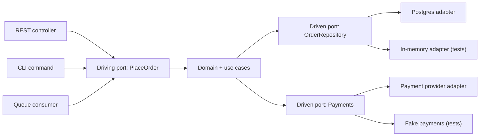

## In one minute
- Hexagonal architecture (ports and adapters) puts business logic at the centre and pushes every technology concern (HTTP, databases, queues, third-party APIs) to the edge.
- The core defines **ports**: interfaces describing what it needs (a `PaymentGateway`) or what it offers (a `PlaceOrder` use case). **Adapters** implement those ports for a specific technology.
- Dependencies point inward only. The core never imports a framework, an ORM, or an SDK, so it can be tested in milliseconds and kept stable while technology changes around it.
- The cost is indirection: more interfaces and mapping code. It pays off for long-lived domains with real logic, not for thin CRUD services.

## How it works

### Inside and outside
Alistair Cockburn described the pattern in 2005, and he is explicit that the hexagon is not a hexagon because six matters: the shape just leaves room to draw ports, and most applications have two to four ([Cockburn](https://alistair.cockburn.us/hexagonal-architecture/)). Inside sit domain entities and application services (use cases). Outside sit the things that change for technical reasons: web frameworks, message brokers, database drivers, cloud SDKs. The rule is the dependency direction: outside code depends on inside code, never the reverse.

### Driving and driven ports
A **driving** (primary) port is how the world asks the application to do something, for example `PlaceOrder.execute(command)`. A REST controller, a CLI, a Kafka consumer, and a test are all driving adapters that translate their input into the same call. That symmetry was the original goal: an application that can be driven equally by users, other programs, automated tests or batch scripts ([Cockburn](https://alistair.cockburn.us/hexagonal-architecture/)). A **driven** (secondary) port is what the application needs from the world, for example `OrderRepository.save(order)` or `Payments.charge(amount, token)`. A Postgres repository and an in-memory fake are both driven adapters for the same port.

### Wiring
Something must construct the adapters and inject them into the core. That is the composition root, usually `main` or a dependency-injection container. It is the only place that knows which concrete adapters are in use. Swapping Stripe for Adyen, or Postgres for DynamoDB, changes the composition root and one adapter, not the use cases.

### Relationship to other styles
Onion Architecture ([Palermo, 2008](https://jeffreypalermo.com/2008/07/the-onion-architecture-part-1/)) and Clean Architecture ([Martin, 2012](https://blog.cleancoder.com/uncle-bob/2012/08/13/the-clean-architecture.html)) express the same idea with more prescribed rings, and Martin's "Dependency Rule" (source code dependencies point only inward) is the shared core. All three are dependency inversion at the architecture level. Hexagonal is the lightest: it insists on the inside/outside boundary and explicit ports, and says nothing about how the inside is organised. A layered domain inside the hexagon is allowed, not required.

When a driven port faces a legacy system or a partner with a messy model, the adapter is also where translation lives, so the outside model never leaks in. Microsoft calls that adapter an anti-corruption layer ([Azure Architecture Center](https://learn.microsoft.com/en-us/azure/architecture/patterns/anti-corruption-layer)).

### Testing benefits
Because the core depends only on port interfaces, use-case tests run with in-memory adapters and no containers. A suite of 2,000 such tests can finish in a few seconds. Adapter tests then run separately against real infrastructure, checking only translation and integration, which keeps slow tests few and focused.

## Down the stack

### Layer 1: The contract
A port is a contract the core states in its own terms: method signatures, domain types in and out, the errors it can raise, and semantic guarantees that adapters must honour. For a repository port that includes "save is atomic for one aggregate" and "load after save returns the saved state". For a payments port it includes "charge with the same idempotency key at most once". If a guarantee is not written into the port, the core cannot rely on it, and a fake adapter will not enforce it.

### Layer 2: The mechanism
The mechanism is dependency inversion enforced by the build. In Java, the core is a module with no dependency on Spring, JPA, or SDK artifacts; adapters live in modules that depend on the core and implement its interfaces, and ArchUnit tests fail the build if a class in `..domain..` imports `org.springframework..`. ArchUnit ships a ready-made `onionArchitecture()` rule (its guide notes it covers hexagonal too) that takes the domain, application and adapter packages and checks every dependency between them ([ArchUnit user guide](https://www.archunit.org/userguide/html/000_Index.html)). In Go, the core package declares small interfaces, adapters satisfy them implicitly, and the import graph (checked with `go list -deps` or a linter) must never point from core to adapter. The composition root, usually `main`, constructs a `PostgresOrderRepository` with a `*sql.DB` and passes it to `NewPlaceOrder(repo, payments, clock)`. A unit-of-work port wraps a database transaction so a use case can save two aggregates atomically without importing the driver.

### Layer 3: The machine
The runtime cost of the indirection is small. An interface call is an indirect jump through a vtable or Go itab, about 1 to 2 ns, and often devirtualised: the JVM's JIT does it when one implementation dominates, and since Go 1.21 profile-guided builds add a direct call to the most common callee so it can be inlined ([Go 1.21 release notes](https://go.dev/doc/go1.21)). Mapping between domain objects and persistence rows allocates: copying a 1 KB object per request at 10,000 requests per second is 10 MB per second of extra garbage, noticeable in GC profiles but rarely in latency. The real physics is in testing. A call to an in-memory adapter takes around 100 ns; a round trip to Postgres takes 0.3 to 1 ms; starting a database container for a test run takes 5 to 10 seconds. A suite of 2,000 use-case tests is milliseconds of CPU against fakes and minutes against real I/O.

### Why it's built this way
1. Business rules and technologies change at different rates and for different reasons, so they are separated.
2. Tests need fast, deterministic feedback, and I/O is slow and nondeterministic, so I/O is pushed behind ports.
3. Swapping a dependency should not ripple through rules, so the core owns the interfaces and adapters depend on it.
4. An indirect call costs nanoseconds while I/O costs milliseconds, so the extra layer is affordable.

## Diagram


## Worked example
A subscription billing service has grown for six years. Business rules (proration, trials, dunning) are tangled with ORM calls and payment SDK objects. The test suite needs a database container and takes 25 minutes, so engineers skip it locally.

The team introduces ports incrementally. First, a `BillingAccounts` driven port with `load(id)` and `save(account)`, plus a `PaymentProvider` port with `charge(account_id, cents, idempotency_key)`. The proration logic moves into a pure `Subscription` entity that takes dates and prices and returns invoice lines. The existing ORM code becomes the Postgres adapter.

```python
class ChangePlan:
    def __init__(self, accounts, payments, clock):
        self.accounts, self.payments, self.clock = accounts, payments, clock

    def execute(self, account_id, new_plan):
        acct = self.accounts.load(account_id)
        lines = acct.subscription.change_plan(new_plan, self.clock.today())
        due = sum(l.cents for l in lines)
        if due > 0:
            self.payments.charge(account_id, due, key="chg-%s-%s" % (account_id, new_plan.id))
        self.accounts.save(acct)
        return lines
```

After three months, 1,800 use-case tests run in 6 seconds with in-memory adapters, and 120 adapter tests run against real Postgres and the provider's sandbox in 4 minutes. When the company adds a second payment provider for one region, only a new adapter and a routing rule in the composition root change.

## In the wild
- **Netflix, 2020: swapping a data source in two hours.** Netflix's Studio Workflows team built a new app on ports and adapters because much of its data still lived in a monolith that was being split into services. When they hit a read limit on the monolith, they moved reads for one entity from a JSON API to a GraphQL aggregation layer in about 2 hours, changing only the adapter, because both sources held the same data and business logic depended only on the port ([Netflix TechBlog](https://netflixtechblog.com/ready-for-changes-with-hexagonal-architecture-b315ec967749)).
- **Shopify, 2024: static boundary checks are not enough.** Shopify built Packwerk in 2020 to enforce dependency and privacy rules between packages of its Rails monolith. Four years on, the team reported that boundaries drawn by naming often sat in the wrong place, that a package with zero Packwerk violations could still fail at runtime because the tool sees only autoloaded constants, and that privacy checks were removed in version 3.0. Their lesson: measure modularity by code that actually runs, not by tool output ([Shopify Engineering](https://shopify.engineering/a-packwerk-retrospective)).

## Trade-offs
| Option | Strengths | Weaknesses | Choose when |
|---|---|---|---|
| Layered (controller, service, DAO) | Familiar, little ceremony | Domain often leaks into DAOs and frameworks | Simple apps with modest logic |
| Hexagonal | Framework-free core, fast tests, swappable infrastructure | More interfaces and mapping code | Long-lived services with real business rules |
| Clean or Onion | Strong, explicit rings and rules | Heavier structure, risk of ceremony | Large teams that need enforced conventions |
| Transaction script or CRUD | Very fast to build | Logic scatters as rules grow | Thin data services, prototypes |

## Pitfalls in production
- **Leaky ports.** A repository port returns ORM entities or a payment port takes SDK objects, so the core depends on the technology anyway. Ports must speak only domain types.
- **Interface for everything.** Wrapping every class in an interface adds noise without benefit. Define ports only at real boundaries with infrastructure or other systems.
- **Anaemic core.** All logic sits in adapters and the core just forwards calls. Move decisions (validation, calculations, state transitions) into entities and use cases.
- **Transaction boundaries lost.** Each repository call commits separately, breaking atomicity. Add a unit-of-work port owned by the use case.
- **Fakes that drift.** In-memory adapters behave differently from real ones (no uniqueness constraints, no ordering). Run a shared contract test suite against both, on the rhythm of the real dependency's changes rather than only your own commits ([Fowler](https://martinfowler.com/bliki/ContractTest.html)).

## Leadership lens
- Decide where the pattern earns its keep. Apply it to domains with complex, long-lived rules and accept simpler structure for thin services. AWS's own guidance says the adapter code is justified only when a component has several inputs or outputs, or its stores are expected to change; otherwise it is one more layer to maintain ([AWS Prescriptive Guidance](https://docs.aws.amazon.com/prescriptive-guidance/latest/cloud-design-patterns/hexagonal-architecture.html)).
- In code review, check imports: anything framework- or vendor-specific inside the core is a boundary violation. Enforce it with an architecture test or module rules.
- Ask what the port contracts are and who owns them. Ports are the stable API of your domain.
- Measure the payoff in test speed and in how cheaply infrastructure can change.

## Check yourself
1. What is the difference between a driving and a driven port?
   **Answer:** A driving port is an entry point the outside world calls to use the application; a driven port is an interface the application calls to reach infrastructure or other systems.
2. Why must ports use domain types rather than ORM or SDK types?
   **Answer:** Otherwise the core imports and depends on that technology, which defeats the isolation and makes the core untestable without it.
3. Where do concrete adapters get chosen and wired in?
   **Answer:** In the composition root, typically `main` or a DI container, which is the only code that knows both the core and the concrete adapters.

## Practice
**Task:** Implement a `TransferService` use case that depends only on two ports passed to its constructor: an accounts port with `get(account_id)` (returns the balance in cents, or `None` if unknown) and `save(account_id, balance)`, and a notifier port with `send(message)`. `transfer(src, dst, amount)` returns `"ok"` on success, or one of these errors without saving anything: `"invalid amount"` (amount not positive), `"same account"`, `"unknown account"`, `"insufficient funds"`. On success it saves both balances and sends exactly one message: `"transferred {amount} from {src} to {dst}"`. The tests supply in-memory adapters.

```python starter
class TransferService:
    def __init__(self, accounts, notifier):
        self.accounts = accounts
        self.notifier = notifier

    def transfer(self, src, dst, amount):
        # TODO
        raise NotImplementedError
```

```python tests
class MemAccounts:
    def __init__(self, balances):
        self.balances = dict(balances)
        self.saves = 0
    def get(self, account_id):
        return self.balances.get(account_id)
    def save(self, account_id, balance):
        self.saves += 1
        self.balances[account_id] = balance

class MemNotifier:
    def __init__(self):
        self.sent = []
    def send(self, message):
        self.sent.append(message)

def make(balances):
    a, n = MemAccounts(balances), MemNotifier()
    return TransferService(a, n), a, n

def test_success():
    svc, a, n = make({"a": 500, "b": 100})
    assert svc.transfer("a", "b", 200) == "ok"
    assert a.balances == {"a": 300, "b": 300}
    assert n.sent == ["transferred 200 from a to b"]

def test_insufficient_funds_saves_nothing():
    svc, a, n = make({"a": 50, "b": 0})
    assert svc.transfer("a", "b", 51) == "insufficient funds"
    assert a.saves == 0 and n.sent == []

def test_unknown_account():
    svc, a, n = make({"a": 50})
    assert svc.transfer("a", "zz", 10) == "unknown account"

def test_invalid_amount():
    svc, a, n = make({"a": 50, "b": 0})
    assert svc.transfer("a", "b", 0) == "invalid amount"
    assert svc.transfer("a", "b", -5) == "invalid amount"

def test_same_account():
    svc, a, n = make({"a": 50})
    assert svc.transfer("a", "a", 10) == "same account"

def test_exact_balance_allowed():
    svc, a, n = make({"a": 50, "b": 0})
    assert svc.transfer("a", "b", 50) == "ok" and a.balances["a"] == 0
```

```python solution
class TransferService:
    def __init__(self, accounts, notifier):
        self.accounts = accounts
        self.notifier = notifier

    def transfer(self, src, dst, amount):
        if amount <= 0:
            return "invalid amount"
        if src == dst:
            return "same account"
        src_bal = self.accounts.get(src)
        dst_bal = self.accounts.get(dst)
        if src_bal is None or dst_bal is None:
            return "unknown account"
        if src_bal < amount:
            return "insufficient funds"
        self.accounts.save(src, src_bal - amount)
        self.accounts.save(dst, dst_bal + amount)
        self.notifier.send("transferred %d from %s to %s" % (amount, src, dst))
        return "ok"
```

```typescript starter
export interface Accounts {
  get(id: string): number | null;
  save(id: string, balance: number): void;
}
export interface Notifier {
  send(message: string): void;
}

export class TransferService {
  constructor(private accounts: Accounts, private notifier: Notifier) {}
  transfer(src: string, dst: string, amount: number): string {
    throw new Error("TODO");
  }
}
```

```typescript tests
class MemAccounts implements Accounts {
  saves = 0;
  constructor(public balances: Record<string, number>) {}
  get(id: string): number | null { return id in this.balances ? this.balances[id] : null; }
  save(id: string, balance: number): void { this.saves++; this.balances[id] = balance; }
}
class MemNotifier implements Notifier {
  sent: string[] = [];
  send(message: string): void { this.sent.push(message); }
}
function make(b: Record<string, number>): [TransferService, MemAccounts, MemNotifier] {
  const a = new MemAccounts({ ...b });
  const n = new MemNotifier();
  return [new TransferService(a, n), a, n];
}
test("success", () => {
  const [svc, a, n] = make({ a: 500, b: 100 });
  assertEqual(svc.transfer("a", "b", 200), "ok");
  assertEqual(a.balances, { a: 300, b: 300 });
  assertEqual(n.sent, ["transferred 200 from a to b"]);
});
test("insufficient funds saves nothing", () => {
  const [svc, a, n] = make({ a: 50, b: 0 });
  assertEqual(svc.transfer("a", "b", 51), "insufficient funds");
  assert(a.saves === 0 && n.sent.length === 0, "nothing saved or sent");
});
test("unknown account", () => {
  const [svc] = make({ a: 50 });
  assertEqual(svc.transfer("a", "zz", 10), "unknown account");
});
test("invalid amount", () => {
  const [svc] = make({ a: 50, b: 0 });
  assertEqual(svc.transfer("a", "b", 0), "invalid amount");
  assertEqual(svc.transfer("a", "b", -5), "invalid amount");
});
test("same account", () => {
  const [svc] = make({ a: 50 });
  assertEqual(svc.transfer("a", "a", 10), "same account");
});
test("exact balance allowed", () => {
  const [svc, a] = make({ a: 50, b: 0 });
  assertEqual(svc.transfer("a", "b", 50), "ok");
  assertEqual(a.balances.a, 0);
});
```

```typescript solution
export interface Accounts {
  get(id: string): number | null;
  save(id: string, balance: number): void;
}
export interface Notifier {
  send(message: string): void;
}

export class TransferService {
  constructor(private accounts: Accounts, private notifier: Notifier) {}
  transfer(src: string, dst: string, amount: number): string {
    if (amount <= 0) return "invalid amount";
    if (src === dst) return "same account";
    const s = this.accounts.get(src);
    const d = this.accounts.get(dst);
    if (s === null || d === null) return "unknown account";
    if (s < amount) return "insufficient funds";
    this.accounts.save(src, s - amount);
    this.accounts.save(dst, d + amount);
    this.notifier.send(`transferred ${amount} from ${src} to ${dst}`);
    return "ok";
  }
}
```

```go starter
package practice

import "errors"

var (
	ErrInvalidAmount     = errors.New("invalid amount")
	ErrSameAccount       = errors.New("same account")
	ErrUnknownAccount    = errors.New("unknown account")
	ErrInsufficientFunds = errors.New("insufficient funds")
)

// Accounts is the driven port for balances (in cents).
type Accounts interface {
	Get(id string) (int, bool)
	Save(id string, balance int)
}

// Notifier is the driven port for notifications.
type Notifier interface {
	Send(message string)
}

type TransferService struct {
	Accounts Accounts
	Notifier Notifier
}

func (s *TransferService) Transfer(src, dst string, amount int) error {
	panic("TODO")
}
```

```go tests
package practice

import (
	"errors"
	"reflect"
	"testing"
)

type memAccounts struct {
	balances map[string]int
	saves    int
}

func (m *memAccounts) Get(id string) (int, bool) { b, ok := m.balances[id]; return b, ok }
func (m *memAccounts) Save(id string, b int)      { m.saves++; m.balances[id] = b }

type memNotifier struct{ sent []string }

func (n *memNotifier) Send(msg string) { n.sent = append(n.sent, msg) }

func mk(b map[string]int) (*TransferService, *memAccounts, *memNotifier) {
	a, n := &memAccounts{balances: b}, &memNotifier{}
	return &TransferService{Accounts: a, Notifier: n}, a, n
}

func TestSuccess(t *testing.T) {
	s, a, n := mk(map[string]int{"a": 500, "b": 100})
	if err := s.Transfer("a", "b", 200); err != nil {
		t.Fatal(err)
	}
	if a.balances["a"] != 300 || a.balances["b"] != 300 {
		t.Fatalf("balances %v", a.balances)
	}
	if !reflect.DeepEqual(n.sent, []string{"transferred 200 from a to b"}) {
		t.Fatalf("sent %v", n.sent)
	}
}

func TestInsufficient(t *testing.T) {
	s, a, n := mk(map[string]int{"a": 50, "b": 0})
	if err := s.Transfer("a", "b", 51); !errors.Is(err, ErrInsufficientFunds) || a.saves != 0 || len(n.sent) != 0 {
		t.Fatalf("err=%v saves=%d", err, a.saves)
	}
}

func TestUnknown(t *testing.T) {
	s, _, _ := mk(map[string]int{"a": 50})
	if err := s.Transfer("a", "zz", 10); !errors.Is(err, ErrUnknownAccount) {
		t.Fatal(err)
	}
}

func TestInvalidAmount(t *testing.T) {
	s, _, _ := mk(map[string]int{"a": 50, "b": 0})
	if !errors.Is(s.Transfer("a", "b", 0), ErrInvalidAmount) || !errors.Is(s.Transfer("a", "b", -5), ErrInvalidAmount) {
		t.Fatal("expected invalid amount")
	}
}

func TestSameAccount(t *testing.T) {
	s, _, _ := mk(map[string]int{"a": 50})
	if !errors.Is(s.Transfer("a", "a", 10), ErrSameAccount) {
		t.Fatal("expected same account")
	}
}

func TestExactBalance(t *testing.T) {
	s, a, _ := mk(map[string]int{"a": 50, "b": 0})
	if err := s.Transfer("a", "b", 50); err != nil || a.balances["a"] != 0 {
		t.Fatalf("err=%v", err)
	}
}
```

```go solution
package practice

import (
	"errors"
	"fmt"
)

var (
	ErrInvalidAmount     = errors.New("invalid amount")
	ErrSameAccount       = errors.New("same account")
	ErrUnknownAccount    = errors.New("unknown account")
	ErrInsufficientFunds = errors.New("insufficient funds")
)

// Accounts is the driven port for balances (in cents).
type Accounts interface {
	Get(id string) (int, bool)
	Save(id string, balance int)
}

// Notifier is the driven port for notifications.
type Notifier interface {
	Send(message string)
}

type TransferService struct {
	Accounts Accounts
	Notifier Notifier
}

func (s *TransferService) Transfer(src, dst string, amount int) error {
	if amount <= 0 {
		return ErrInvalidAmount
	}
	if src == dst {
		return ErrSameAccount
	}
	sb, ok1 := s.Accounts.Get(src)
	db, ok2 := s.Accounts.Get(dst)
	if !ok1 || !ok2 {
		return ErrUnknownAccount
	}
	if sb < amount {
		return ErrInsufficientFunds
	}
	s.Accounts.Save(src, sb-amount)
	s.Accounts.Save(dst, db+amount)
	s.Notifier.Send(fmt.Sprintf("transferred %d from %s to %s", amount, src, dst))
	return nil
}
```

## Mock interview
**Prompt:** You inherit a 5-year-old insurance quoting service where pricing rules are mixed with Spring controllers, JPA entities, and calls to three external rating APIs. Tests take 40 minutes. Explain how you would restructure it with ports and adapters without a rewrite.

- Follow-up: How do you keep a database transaction spanning two repository calls once persistence is behind ports?
- Follow-up: Your in-memory fakes pass but production fails on a uniqueness violation. What went wrong and how do you prevent it?
- Follow-up: Which services in your organisation would you not apply this to?

**A strong answer covers:**
- Incremental extraction: identify use cases, introduce driven ports at the boundaries, move rules into pure domain code.
- Ports expressed in domain types, with adapters doing all translation.
- A unit-of-work or transaction port owned by the use case.
- Contract tests run against both fake and real adapters.
- Architecture tests or module rules that forbid framework imports in the core.
- Pragmatism: thin CRUD services do not need the ceremony.

## Sources and further study
**Primary**
- [Jeffrey Palermo, The Onion Architecture, part 1 (2008)](https://jeffreypalermo.com/2008/07/the-onion-architecture-part-1/): the ring-based variant and its shared premise with ports and adapters.
- [Robert C. Martin, The Clean Architecture (2012)](https://blog.cleancoder.com/uncle-bob/2012/08/13/the-clean-architecture.html): the Dependency Rule that unifies hexagonal, onion and clean.
- [Martin Fowler, ContractTest](https://martinfowler.com/bliki/ContractTest.html): how to keep test doubles honest against the real service.

**Systems docs**
- [ArchUnit user guide: architectures](https://www.archunit.org/userguide/html/000_Index.html): executable layered and onion (ports and adapters) dependency rules for Java.
- [Go: profile-guided optimization](https://go.dev/doc/pgo): how PGO builds inline and devirtualise hot interface calls.

**Books**
- *Hexagonal Architecture Explained*, Alistair Cockburn and Juan Manuel Garrido de Paz (2024): the pattern's author on its definition, code samples and common misreadings.
- *Clean Architecture* (1st ed.), Robert C. Martin, Ch 22 "The Clean Architecture" and Ch 34 "The Missing Chapter" (which compares package by layer, by feature and ports and adapters).
- *Domain-Driven Design* (1st ed.), Eric Evans, Ch 4 "Isolating the Domain": why domain logic must be separated from UI and infrastructure.

**Other curricula**
- [AWS Prescriptive Guidance: Hexagonal architecture pattern](https://docs.aws.amazon.com/prescriptive-guidance/latest/cloud-design-patterns/hexagonal-architecture.html): frames it as a way to keep Lambda business logic testable without DynamoDB, and warns about maintenance overhead and an extra layer of latency.

## Watch
- [Hexagonal Architecture, Alistair Cockburn (Tech Excellence)](https://www.youtube.com/watch?v=k0ykTxw7s0Y): the pattern explained by its author.
- [The Hexagonal: Ports and Adapters Architecture, Alistair Cockburn (iSAQB)](https://www.youtube.com/watch?v=ChUlRa0xsWo): a more recent talk on intent and common misreadings.

## Free resources
- [Hexagonal Architecture, Alistair Cockburn](https://alistair.cockburn.us/hexagonal-architecture/): the original description of ports and adapters.
- [Wikipedia: Hexagonal architecture](https://en.wikipedia.org/wiki/Hexagonal_architecture_%28software%29): background and relation to onion and clean architecture.
- [Bounded Context (martinfowler.com)](https://martinfowler.com/bliki/BoundedContext.html): how domain boundaries shape what sits inside the hexagon.
- [Anti-corruption Layer (Azure Architecture Center)](https://learn.microsoft.com/en-us/azure/architecture/patterns/anti-corruption-layer): a close relative for isolating a domain from external models.
