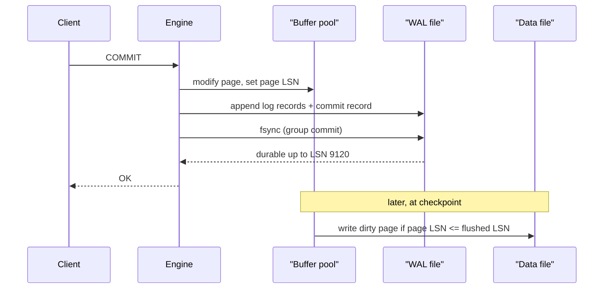

## In one minute
- Durability means an acknowledged commit survives a crash, power loss, or restart. It is only as strong as what happened before the "OK" was sent.
- The core mechanism is a write-ahead log (WAL): describe the change in an append-only log, force that log to stable storage with `fsync`, then acknowledge. Data pages are updated lazily and repaired from the log after a crash.
- The flush is the expensive part (50 microseconds to several milliseconds), so engines batch many commits into one flush (group commit).
- Surviving the loss of a disk or machine needs replication, and the commit must wait for a replica to persist the record, not merely receive it.

## How it works

### Why not write the data pages directly?
A row lives in an 8 KB or 16 KB page. Updating pages in place on every commit means random writes, a crash mid-write can leave a *torn page*, and a transaction touching ten pages would need all ten writes to land atomically, which no disk offers.

The WAL sidesteps this. Every change is first described as a log record and appended sequentially, the access pattern storage handles best. Once a transaction's commit record is on stable storage it is durable, even though its data pages are still dirty in memory.

### The rules that make it correct
1. **Log before data.** A dirty page may not be written to the data file until every log record describing changes to it is durable. Each page carries the log sequence number (LSN) of its latest change, and the buffer manager checks it against the flushed LSN.
2. **Force the log at commit.** The commit returns only after the log up to and including the commit record is flushed.
3. **Checkpoint.** Periodically, flush dirty pages and record a checkpoint LSN. Recovery only needs to replay from there, which bounds restart time and lets old log segments be recycled.

On restart, recovery reads from the last checkpoint, *redoes* every logged change, then *undoes* transactions that never committed. This is the essence of ARIES. Engines that never write uncommitted data to pages (many LSM stores) need only redo.

### What "on stable storage" actually means
A `write()` only reaches the OS page cache. Only `fsync`, `fdatasync`, or `O_DSYNC` pushes bytes to the device and asks it to flush its volatile cache. Three layers can lie to you:
- The OS, if you skip `fsync` or misuse it.
- The drive, if its volatile cache ignores flush commands. SSDs with power-loss protection acknowledge flushes quickly and safely.
- Virtualized or network storage, whose guarantees you must look up.

Torn pages need separate handling: PostgreSQL logs a full page image on the first change after a checkpoint (`full_page_writes`, on by default), and InnoDB uses a doublewrite buffer. Checksums on log records detect a torn log tail, which recovery truncates.

### Group commit
If 2,000 commits per second each needed a 1 ms flush, the device would saturate. Instead, commits arriving during a flush wait, and the next flush covers all of them. Throughput scales with batch size while each commit pays at most about two flush latencies. PostgreSQL can widen the batch on purpose: `commit_delay` waits a few microseconds before flushing, but only when at least `commit_siblings` (default 5) other transactions are active, so an idle server pays nothing ([PostgreSQL WAL settings](https://www.postgresql.org/docs/current/runtime-config-wal.html)).

### Durability beyond one machine
Replicated systems define commit as "the log record is durable on a quorum." Synchronous replication adds a network round trip (0.2 to 1 ms in one zone) to every commit. Asynchronous replication keeps latency low but can lose the last seconds of commits on failover, which is a durability decision whether or not anyone wrote it down.

## Down the stack

### Layer 1: The contract
A durable commit promises that once the client receives success, every later read after any crash, power loss, or restart observes the transaction's effects, and that a transaction which never returned success is either fully present or fully absent. The test: cut power at a random moment, restart, and check every acknowledged transaction. Configuration moves the line. PostgreSQL's `synchronous_commit` ranges from `off` (acknowledge before the flush, risking commits from the last three `wal_writer_delay` intervals, 600 ms at the 200 ms default, but never corruption) through `local`, `remote_write`, `on`, and `remote_apply` ([PostgreSQL WAL settings](https://www.postgresql.org/docs/current/runtime-config-wal.html)). InnoDB's `innodb_flush_log_at_trx_commit=1` (the default) flushes the redo log on every commit; `2` writes to the OS at commit and flushes about once a second, so it survives a process crash but not an OS crash or power loss; `0` both writes and flushes once a second. MySQL's own manual warns that drives which fake the flush void even the default ([MySQL InnoDB parameters](https://dev.mysql.com/doc/refman/8.4/en/innodb-parameters.html)).

### Layer 2: The mechanism
PostgreSQL writes WAL into 16 MB segment files made of 8 KB pages. Each record's `XLogRecord` header carries its length, transaction id, a pointer to the previous record (`xl_prev`), the resource manager that replays it, and a CRC-32C. Recovery reads forward from the checkpoint's redo pointer and stops at the first record whose CRC or `xl_prev` does not match, which is how a torn tail is detected and discarded. PostgreSQL recovery is redo only: aborted transactions leave tuples behind, but the commit log (`pg_xact`) marks them aborted and MVCC visibility hides them, so no undo pass is needed. The first change to a page after each checkpoint logs a full-page image, so replay starts from a known-good copy rather than a torn one.

InnoDB writes redo in 512-byte blocks and keeps undo logs to roll back uncommitted changes, closer to ARIES. Since MySQL 8.0.30 the redo log is sized by one setting, `innodb_redo_log_capacity`, and kept as 32 files in a `#innodb_redo` directory, superseding `innodb_log_file_size` and `innodb_log_files_in_group` when set ([MySQL redo log](https://dev.mysql.com/doc/refman/8.0/en/innodb-redo-log.html)). For torn data pages it uses the doublewrite buffer: dirty pages are first written in a batch to dedicated doublewrite files (such as `#ib_16384_0.dblwr`) and flushed, then written to their home locations. If a home write tears, recovery finds an intact copy there. The doubled write is cheap because it is one large sequential write and one `fsync`, and `innodb_doublewrite=DETECT_ONLY` keeps only metadata, so torn pages are detected but not repaired ([MySQL doublewrite buffer](https://dev.mysql.com/doc/refman/8.4/en/innodb-doublewrite-buffer.html)).

### Layer 3: The machine
`write()` only dirties pages in the page cache. `fsync()` writes the dirty pages, waits for completion, and asks the device to flush its volatile write cache (an NVMe Flush command or a write with Force Unit Access). `fdatasync()` skips metadata such as modification time unless the file size changed, which is why PostgreSQL preallocates WAL segments: appends inside a preallocated file need only `fdatasync`, its default `wal_sync_method` on Linux and FreeBSD. A flush costs tens of microseconds on an enterprise SSD with power-loss protection, where the capacitor-backed cache can acknowledge immediately, and can reach milliseconds on consumer SSDs or spinning disks.

Atomicity at the device is only guaranteed for one sector, usually 512 bytes or 4 KiB. An 8 KB PostgreSQL page or a 16 KB InnoDB page spans several sectors, so a power cut mid-write can leave half old, half new: the torn page. The WAL tolerates this through record checksums; data pages need full-page images or doublewrite. Error reporting is a further trap. The 2018 "fsyncgate" discussion showed that after a failed writeback Linux may mark pages clean, so a retried `fsync` can succeed while data is lost; newer kernels (4.14 and 4.16 onward) report the error, but only once ([PostgreSQL wiki](https://wiki.postgresql.org/wiki/Fsync_Errors)). PostgreSQL now treats an `fsync` failure as a PANIC and recovers from WAL instead of retrying, controlled by `data_sync_retry`, which defaults to off ([PostgreSQL error handling](https://www.postgresql.org/docs/current/runtime-config-error-handling.html)).

### Why it's built this way
1. Devices promise only atomic sector writes and caches hold data until flushed, so commits become explicitly flushed appends.
2. A flush costs far more than a commit's CPU work, so many commits share one flush.
3. Pages are larger than sectors, so data page writes can tear, and engines keep a second copy (full-page image or doublewrite) to repair them.
4. Replaying an unbounded log makes restart slow, so checkpoints bound recovery time and let old log segments be recycled.
5. A whole machine can disappear, so the strongest settings mean "flushed on a quorum of machines."

## Diagram


## Worked example
A payments service runs 3,000 commits per second on PostgreSQL. The WAL lives on an NVMe drive whose `fsync` takes about 0.4 ms. Without batching, the ceiling is roughly 2,500 flushes per second, so the database would queue. With group commit, an average batch of 6 commits needs only 500 flushes per second, leaving headroom, and commit latency stays near 1 ms.

Each commit writes about 1.5 KB of WAL, so the log grows at 4.5 MB/s. Stretching checkpoints from 5 to 15 minutes cuts full-page images but means up to 4 GB of WAL to replay after a crash, around 20 seconds at 200 MB/s.

A synchronous replica in-region costs about 0.5 ms per commit; cross-region it would cost 30 ms. The team keeps the synchronous replica in-region and ships WAL asynchronously across regions, accepting a few seconds of loss in a regional disaster.

## In the wild
- **PostgreSQL, 2018: "fsyncgate".** Developers found that PostgreSQL assumed a failed `fsync` could simply be retried because the kernel still held the dirty pages, but Linux could mark them clean after the writeback error, so a retry reported success over lost data. PostgreSQL 12 switched to PANIC on `fsync` failure and recovery from WAL, and the change was backpatched to 9.4 through 11. InnoDB and WiredTiger made similar changes ([PostgreSQL wiki](https://wiki.postgresql.org/wiki/Fsync_Errors)). A 2020 study of PostgreSQL, LMDB, LevelDB, SQLite and Redis on ext4, XFS and Btrfs found that no application handled fsync failures fully correctly ([Rebello et al., USENIX ATC 2020](https://www.usenix.org/conference/atc20/presentation/rebello)).
- **Jepsen, 2025: NATS JetStream 2.12.1 loses acknowledged messages.** JetStream acknowledged publishes immediately but by default fsynced only every two minutes. With simulated power loss, one run lost 131,418 of 930,005 acknowledged messages, about thirty seconds of writes. Single-bit corruption or truncation of data files on a minority of nodes lost 679,153 of 1,367,069 acknowledged writes in another run. NATS documented the fsync hazard; the corruption bugs were still open at publication ([Jepsen](https://jepsen.io/analyses/nats-2.12.1)).
- **GitLab, 2017: every recovery path failed at once.** Replication lag led an engineer to rebuild a secondary, and he wiped about 300 GB on the primary by mistake. `pg_dump` backups had been failing silently because of a version mismatch, their alert emails were rejected, and disk snapshots were off. GitLab.com was down about 18 hours and restored from a 6-hour-old LVM snapshot, losing data for about 5,000 projects. Follow-ups included investigating point-in-time recovery with continuous archiving (they were not using WAL archiving) and automated restore tests ([GitLab](https://about.gitlab.com/blog/2017/02/10/postmortem-of-database-outage-of-january-31/)).

## Trade-offs
| Option | Strengths | Weaknesses | Choose when |
|---|---|---|---|
| fsync every commit (with group commit) | No acknowledged commit is lost on crash | Latency bound by flush time | Money, orders, anything you must not lose |
| Async commit (flush every N ms) | Much higher throughput, sub-ms commits | Last few ms of commits lost on crash | Metrics, caches, recomputable data |
| Synchronous replication to a quorum | Survives losing a disk or host | Adds network RTT to every commit | Primary data with strict RPO of zero |
| Async replication | No commit latency cost | Data loss window on failover | Cross-region DR, read replicas |
| Battery or capacitor-backed write cache | Fast flushes that are still safe | Hardware cost, must verify it is real | Write-heavy OLTP on owned hardware |

## Pitfalls in production
- **Benchmark settings left on.** `fsync=off` or `innodb_flush_log_at_trx_commit=2` silently lose data on power failure. Audit durability settings in config review. Check the defaults of newer systems too: NATS JetStream acknowledges publishes immediately but fsyncs only every two minutes unless `sync_interval` is changed ([Jepsen](https://jepsen.io/analyses/nats-2.12.1)).
- **Drives that ignore flushes.** Test with power cuts or buy drives with power-loss protection.
- **Not syncing the directory.** A file create or rename is durable only after the parent directory is synced, a classic bug in log rotation.
- **Calling async replication lossless.** Failover promotes a replica that may be seconds behind. Measure lag and state the real RPO.

## Leadership lens
- Ask every data store owner what an acknowledged write survives: process crash, host crash, disk loss, zone loss, region loss.
- Durability settings are a product decision. Get the RPO signed off, then pick the cheapest configuration that meets it.
- Recovery time is part of durability. Measure and rehearse crash recovery and replica rebuilds.
- Distrust durability claims from layers that do not own the disk, such as caches that "persist" asynchronously.

## Check yourself
1. Why can a database acknowledge a commit while the modified data pages are still only in memory?
   **Answer:** The commit record and all changes are already durable in the WAL, so recovery can rebuild those pages by replaying the log after a crash.
2. What does group commit trade, and why is it nearly free?
   **Answer:** Each commit may wait up to one extra flush interval, but one flush now persists many commits, so throughput rises sharply while latency changes little.
3. Why must a dirty page never be written before its log records are durable?
   **Answer:** After a crash, recovery would find changes with no log record to undo them, breaking atomicity.
4. A system uses async replication with fsync on the primary. Which failure loses acknowledged data?
   **Answer:** Losing the primary's disk or host, followed by promoting a replica that had not yet received the latest commits.

## Practice
**Task:** Build a tiny write-ahead log for a key-value store. `append(log, key, value)` adds a record to a `bytearray`: a 4-byte big-endian payload length, a 4-byte CRC32 of the payload, then the payload (JSON of key and value). `recover(data)` replays records and returns `(state, valid_bytes)`: the resulting dict and the length of the clean prefix. Recovery stops at the first truncated or corrupt record, as after a torn write.

```python starter
import json
import struct
import zlib

def append(log, key, value):
    # TODO: frame and append one record
    raise NotImplementedError

def recover(data):
    # TODO: return (state_dict, valid_bytes)
    raise NotImplementedError
```

```python tests
def test_roundtrip():
    log = bytearray()
    append(log, "a", 1)
    append(log, "b", 2)
    append(log, "a", 3)
    state, n = recover(bytes(log))
    assert state == {"a": 3, "b": 2}
    assert n == len(log)

def test_empty_log():
    assert recover(b"") == ({}, 0)

def test_torn_tail_is_dropped():
    log = bytearray()
    append(log, "x", 1)
    good = len(log)
    append(log, "y", 2)
    state, n = recover(bytes(log[:-3]))
    assert state == {"x": 1}
    assert n == good

def test_partial_header_is_dropped():
    log = bytearray()
    append(log, "x", 1)
    good = len(log)
    state, n = recover(bytes(log) + b"\x00\x00")
    assert state == {"x": 1} and n == good

def test_corrupt_record_stops_replay():
    log = bytearray()
    append(log, "x", 1)
    good = len(log)
    append(log, "y", 2)
    append(log, "z", 3)
    log[good + 9] ^= 0xFF
    state, n = recover(bytes(log))
    assert state == {"x": 1}
    assert n == good
```

```python solution
import json
import struct
import zlib

def append(log, key, value):
    payload = json.dumps({"k": key, "v": value}).encode()
    log.extend(struct.pack(">II", len(payload), zlib.crc32(payload)))
    log.extend(payload)

def recover(data):
    state, pos = {}, 0
    while pos + 8 <= len(data):
        length, crc = struct.unpack(">II", data[pos:pos + 8])
        end = pos + 8 + length
        if end > len(data):
            break
        payload = data[pos + 8:end]
        if zlib.crc32(payload) != crc:
            break
        rec = json.loads(payload.decode())
        state[rec["k"]] = rec["v"]
        pos = end
    return state, pos
```

```typescript starter
export function append(log: number[], key: string, value: number): void {
  throw new Error("TODO");
}

export function recover(data: number[]): [Record<string, number>, number] {
  throw new Error("TODO");
}
```

```typescript tests
test("roundtrip", () => {
  const log: number[] = [];
  append(log, "a", 1);
  append(log, "b", 2);
  append(log, "a", 3);
  assertEqual(recover(log), [{ a: 3, b: 2 }, log.length]);
});
test("empty log", () => {
  assertEqual(recover([]), [{}, 0]);
});
test("torn tail is dropped", () => {
  const log: number[] = [];
  append(log, "x", 1);
  const good = log.length;
  append(log, "y", 2);
  assertEqual(recover(log.slice(0, log.length - 3)), [{ x: 1 }, good]);
});
test("partial header is dropped", () => {
  const log: number[] = [];
  append(log, "x", 1);
  const good = log.length;
  assertEqual(recover(log.concat([0, 0])), [{ x: 1 }, good]);
});
test("corrupt record stops replay", () => {
  const log: number[] = [];
  append(log, "x", 1);
  const good = log.length;
  append(log, "y", 2);
  append(log, "z", 3);
  log[good + 9] ^= 0xff;
  assertEqual(recover(log), [{ x: 1 }, good]);
});
```

```typescript solution
function crc32(bytes: number[]): number {
  let c = 0xffffffff;
  for (const b of bytes) {
    c ^= b;
    for (let i = 0; i < 8; i++) c = (c >>> 1) ^ (0xedb88320 & -(c & 1));
  }
  return (c ^ 0xffffffff) >>> 0;
}

function u32(n: number): number[] {
  return [(n >>> 24) & 255, (n >>> 16) & 255, (n >>> 8) & 255, n & 255];
}

function readU32(d: number[], i: number): number {
  return ((d[i] << 24) | (d[i + 1] << 16) | (d[i + 2] << 8) | d[i + 3]) >>> 0;
}

export function append(log: number[], key: string, value: number): void {
  const text = JSON.stringify({ k: key, v: value });
  const payload = Array.from(text, (ch) => ch.charCodeAt(0) & 255);
  log.push(...u32(payload.length), ...u32(crc32(payload)), ...payload);
}

export function recover(data: number[]): [Record<string, number>, number] {
  const state: Record<string, number> = {};
  let pos = 0;
  while (pos + 8 <= data.length) {
    const len = readU32(data, pos);
    const end = pos + 8 + len;
    if (end > data.length) break;
    const payload = data.slice(pos + 8, end);
    if (crc32(payload) !== readU32(data, pos + 4)) break;
    const rec = JSON.parse(String.fromCharCode(...payload));
    state[rec.k] = rec.v;
    pos = end;
  }
  return [state, pos];
}
```

```go starter
package practice

func Append(log []byte, key string, value int) []byte {
	panic("TODO")
}

func Recover(data []byte) (map[string]int, int) {
	panic("TODO")
}
```

```go tests
package practice

import (
	"reflect"
	"testing"
)

func TestRoundtrip(t *testing.T) {
	var log []byte
	log = Append(log, "a", 1)
	log = Append(log, "b", 2)
	log = Append(log, "a", 3)
	state, n := Recover(log)
	if !reflect.DeepEqual(state, map[string]int{"a": 3, "b": 2}) || n != len(log) {
		t.Fatalf("got %v %d", state, n)
	}
}

func TestEmptyLog(t *testing.T) {
	state, n := Recover(nil)
	if len(state) != 0 || n != 0 {
		t.Fatalf("got %v %d", state, n)
	}
}

func TestTornTailIsDropped(t *testing.T) {
	log := Append(nil, "x", 1)
	good := len(log)
	log = Append(log, "y", 2)
	state, n := Recover(log[:len(log)-3])
	if !reflect.DeepEqual(state, map[string]int{"x": 1}) || n != good {
		t.Fatalf("got %v %d", state, n)
	}
}

func TestPartialHeaderIsDropped(t *testing.T) {
	log := Append(nil, "x", 1)
	good := len(log)
	state, n := Recover(append(log, 0, 0))
	if !reflect.DeepEqual(state, map[string]int{"x": 1}) || n != good {
		t.Fatalf("got %v %d", state, n)
	}
}

func TestCorruptRecordStopsReplay(t *testing.T) {
	log := Append(nil, "x", 1)
	good := len(log)
	log = Append(log, "y", 2)
	log = Append(log, "z", 3)
	log[good+9] ^= 0xff
	state, n := Recover(log)
	if !reflect.DeepEqual(state, map[string]int{"x": 1}) || n != good {
		t.Fatalf("got %v %d", state, n)
	}
}
```

```go solution
package practice

import (
	"encoding/binary"
	"encoding/json"
	"hash/crc32"
)

type record struct {
	K string `json:"k"`
	V int    `json:"v"`
}

func Append(log []byte, key string, value int) []byte {
	payload, _ := json.Marshal(record{key, value})
	log = binary.BigEndian.AppendUint32(log, uint32(len(payload)))
	log = binary.BigEndian.AppendUint32(log, crc32.ChecksumIEEE(payload))
	return append(log, payload...)
}

func Recover(data []byte) (map[string]int, int) {
	state, pos := map[string]int{}, 0
	for pos+8 <= len(data) {
		length := int(binary.BigEndian.Uint32(data[pos:]))
		end := pos + 8 + length
		if end > len(data) {
			break
		}
		payload := data[pos+8 : end]
		if crc32.ChecksumIEEE(payload) != binary.BigEndian.Uint32(data[pos+4:]) {
			break
		}
		var r record
		if err := json.Unmarshal(payload, &r); err != nil {
			break
		}
		state[r.K] = r.V
		pos = end
	}
	return state, pos
}
```

## Mock interview
**Prompt:** You own a wallet ledger doing 5,000 transfers per second at peak, and a confirmed transfer must never be lost. Walk through how you guarantee that from the API down to the disk.

- Follow-up: p99 commit latency doubled after moving the WAL to network storage. What do you check?
- Follow-up: `fsync` returns an I/O error. Why is retrying wrong?
- Follow-up: Would you replicate synchronously across regions?

**A strong answer covers:**
- WAL with a forced flush before acknowledging, plus group commit to reach the throughput.
- Torn-write protection and checksummed log records.
- Verified flush semantics of the drive or cloud volume.
- In-region quorum replication, plus an explicit RPO for regional loss.
- Idempotency keys so client retries do not double-apply transfers.
- Rehearsed recovery and alerts on replication lag.

## Sources and further study
**Primary**
- [Mohan et al., ARIES (ACM TODS 1992)](https://web.stanford.edu/class/cs345d-01/rl/aries.pdf): the write-ahead logging and recovery algorithm behind most disk-based engines.
- [Rebello et al., Can Applications Recover from fsync Failures? (USENIX ATC 2020)](https://www.usenix.org/conference/atc20/presentation/rebello): how file systems and five real applications behave after a failed `fsync`.
- [Jepsen: NATS 2.12.1](https://jepsen.io/analyses/nats-2.12.1): what lazy fsync and file corruption do to a replicated log.

**Systems docs**
- [PostgreSQL: Write Ahead Log settings](https://www.postgresql.org/docs/current/runtime-config-wal.html): `synchronous_commit`, `wal_sync_method`, `full_page_writes`, `commit_delay` and WAL compression.
- [MySQL: Doublewrite buffer](https://dev.mysql.com/doc/refman/8.4/en/innodb-doublewrite-buffer.html): file layout, I/O cost and the `DETECT_ONLY` mode.
- [PostgreSQL wiki: Fsync Errors](https://wiki.postgresql.org/wiki/Fsync_Errors): kernel versions, error semantics and what each database changed.

**Books**
- *Database Internals* (1st ed.), Alex Petrov, chapter 5 "Transaction Processing and Recovery": buffer management, steal and force policies, logging and ARIES.
- *Designing Data-Intensive Applications* (1st ed.), Martin Kleppmann, chapter 7 "Transactions": what durability does and does not promise, including the hardware caveats.
- *Seeking SRE* (1st ed.), edited by David N. Blank-Edelman, chapter 17 "Engineering for Data Durability": why replication is table stakes and how to verify durability in practice.

**Other curricula**
- [donnemartin/system-design-primer](https://github.com/donnemartin/system-design-primer): defines durability in one line under ACID and does not cover logging, flushing or torn writes.

## Watch
- [#21 - Write-Ahead Logging + Shadow Paging (CMU Database Group)](https://www.youtube.com/watch?v=CedEy54pe3g): a full lecture on logging schemes, buffer pool policies, and checkpoints.
- [#21 - Database Recovery with ARIES (CMU Database Group)](https://www.youtube.com/watch?v=yVpzHdAP0TY): how redo and undo work after a crash, step by step.
- [Write-Ahead Logs (Ben Dicken)](https://www.youtube.com/watch?v=s3hKYMOpp3E): a short visual introduction to why the log comes first.

## Free resources
- [PostgreSQL: Write-Ahead Logging](https://www.postgresql.org/docs/current/wal-intro.html): the concise official explanation of WAL and why it reduces disk writes.
- [PostgreSQL: Reliability and the WAL](https://www.postgresql.org/docs/current/wal-reliability.html): what can lie about durability between the database and the platter.
- [SQLite: Atomic Commit](https://www.sqlite.org/atomiccommit.html): a careful walk through every step a single-file database takes to commit safely.
- [PostgreSQL fsync errors (LWN)](https://lwn.net/Articles/752063/): the story of how fsync error semantics broke a long-standing assumption.
- [All File Systems Are Not Created Equal (OSDI 2014)](https://www.usenix.org/system/files/conference/osdi14/osdi14-paper-pillai.pdf): a study of crash-consistency bugs in real applications.
