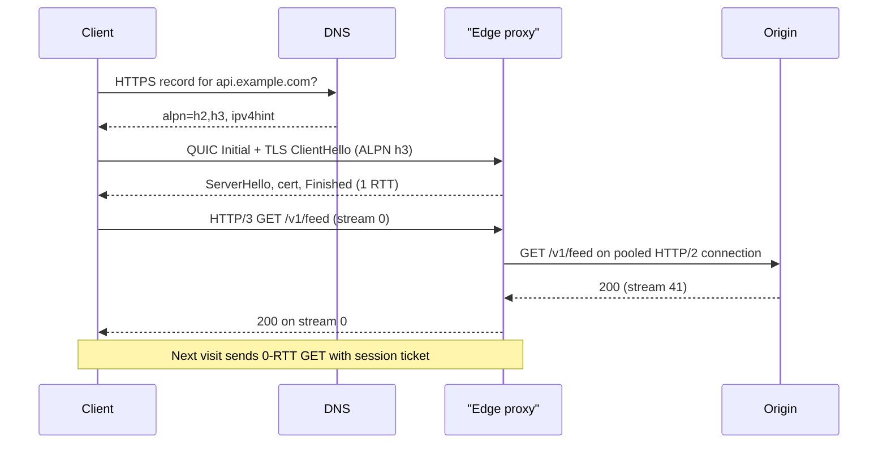

## In one minute
- At system-design scale, HTTPS is a cost model: every new connection pays round trips (TCP, TLS, sometimes QUIC) and CPU (key exchange, signatures), so connection reuse is the biggest lever you have.
- HTTP/2 multiplexes many requests as streams over one TCP connection with flow control and HPACK header compression. HTTP/3 does the same over QUIC, which removes TCP head-of-line blocking and merges the transport and TLS handshakes.
- Versions are negotiated, not configured: ALPN inside the TLS handshake picks `h2` or `http/1.1`, and `Alt-Svc` or an `HTTPS` DNS record advertises `h3`.
- A request crosses several hops (client to edge, edge to load balancer, load balancer to service). Each hop has its own protocol version, TLS session, keep-alive and timeouts, and mismatches between hops cause most of the strange 502s you will debug.
- Certificates are an operations problem, not a crypto problem: automate issuance with ACME, because the maximum lifetime fell from 398 to 200 days in March 2026 and reaches 47 days in 2029.

## How it works

### What a new connection costs
A fresh HTTPS request over TCP with TLS 1.3 needs three round trips before the first response byte: TCP handshake, TLS handshake, then the request. TLS 1.2 needs four. TLS 1.3 itself was republished in July 2026 as [RFC 9846](https://www.rfc-editor.org/rfc/rfc9846), which obsoletes RFC 8446 and the TLS 1.2 specification. QUIC folds transport and crypto setup into one round trip, so HTTP/3 needs two. A resumed TLS 1.3 or QUIC session can send the request in the first flight (0-RTT), at the price of replay risk.

At a 150 ms round trip, that is 450 ms versus 150 ms on a warm connection. The server pays too: a full handshake costs an ECDHE key exchange and a signature, roughly 0.1 to 0.3 ms of CPU, which adds up at 50,000 new connections per second.

Handshakes are also getting bigger. Hybrid post-quantum key agreement went mainstream fast: by the last week of October 2025 most human traffic to Cloudflare used it ([Cloudflare](https://blog.cloudflare.com/pq-2025/)). The common hybrid, X25519MLKEM768, sends a 1,216-byte client key share instead of X25519's 32 bytes ([RFC 10024](https://www.rfc-editor.org/rfc/rfc10024)). The ClientHello no longer comfortably fits in one packet, and middleboxes that assume it does have broken connections in earlier experiments with large key shares, so test the whole path, not just the server.

### Connection reuse
Keep-alive keeps the socket open, client pools keep warm connections per origin, and TLS session tickets let a returning client skip the certificate exchange. HTTP/2 adds *connection coalescing*: one connection can serve `api.example.com` and `cdn.example.com` if both resolve to the same address and the certificate covers both names; a server that cannot serve a name answers `421 Misdirected Request` ([RFC 9110](https://www.rfc-editor.org/rfc/rfc9110)).

### HTTP/2: streams on one connection
HTTP/2 tags frames with a stream ID, so dozens of requests interleave on one connection. Each stream and the connection have flow-control windows, so one slow download need not block small responses. HPACK keeps a shared table of recently sent header fields: a 600-byte cookie becomes a one or two byte index after the first request. The original priority tree did not survive: [RFC 9113](https://www.rfc-editor.org/rfc/rfc9113) deprecated it, along with the cleartext `Upgrade` path, and HTTP/2 and HTTP/3 now signal urgency with the simpler `Priority` header field ([RFC 9218](https://www.rfc-editor.org/rfc/rfc9218)).

The single connection is also the catch. All streams share one TCP byte stream, so one lost packet stalls every stream until it is retransmitted. And because the connection lives for minutes or hours, a layer 4 load balancer that balances *connections* stops balancing *requests*. This is the classic gRPC problem: 20 client pods with one HTTP/2 connection each to a 50-pod service keep at most 20 backends busy.

### HTTP/3: streams in the transport
QUIC runs over UDP and implements streams, loss recovery, congestion control and TLS 1.3 in user space. A lost packet stalls only the streams whose data it carried. Connection IDs, not the address tuple, identify a connection, so a phone moving from Wi-Fi to cellular keeps it. QPACK replaces HPACK and sends table updates on separate streams so headers do not reintroduce head-of-line blocking (RFC 9204).

Clients discover HTTP/3 from an `Alt-Svc: h3=":443"` header on an earlier response, or from an `HTTPS` DNS record (RFC 9460) with `alpn=h2,h3` before the first visit. They race QUIC against TCP and fall back silently, because some networks block UDP.

### Where TLS terminates
Terminating at a CDN edge gives the shortest handshake and lets the edge cache, but the edge sees plaintext. Re-encrypting to services, often with mutual TLS, protects traffic inside the data centre. TLS passthrough (routing on SNI without decrypting) keeps keys only on the backend, but the proxy loses every layer 7 feature.

### Certificates at fleet scale
ACME automates issuance: you prove control with an HTTP-01 challenge (a token at a well-known path) or DNS-01 (a TXT record, required for wildcards). Every public certificate lands in Certificate Transparency logs, which you can watch for certificates you did not request. In April 2025 the CA/Browser Forum voted to cut the maximum lifetime from 398 days to an eventual 47, and domain-validation reuse to an eventual 10 days ([CA/B Forum SC-081v3](https://cabforum.org/2025/04/11/ballot-sc081v3-introduce-schedule-of-reducing-validity-and-data-reuse-periods/)). The steps are 200 days from 15 March 2026, 100 days from 15 March 2027 and 47 days from 15 March 2029 ([DNSimple](https://support.dnsimple.com/articles/announcement-ssl-certificate-validity-changes/)). Let's Encrypt goes further: its default profile moves from 90 to 64 days in February 2027 and to 45 days in February 2028 ([Let's Encrypt](https://letsencrypt.org/2025/12/02/from-90-to-45/)). It also switched off its OCSP responders in August 2025 and relies on CRLs ([Let's Encrypt](https://letsencrypt.org/2024/12/05/ending-ocsp/)). Manual renewal is no longer viable; renew from ACME Renewal Information or at about two-thirds of the lifetime, not on a fixed 60-day cron. HSTS tells browsers never to use plain HTTP for your domain.

## Down the stack

### Layer 1: The contract
HTTP semantics (RFC 9110) are version-independent: methods, status codes and headers mean the same over HTTP/1.1, 2 and 3, so a proxy can speak HTTP/3 to the client and HTTP/1.1 to the origin. HTTPS adds that the peer holds a key certified for the requested hostname and that the stream is confidential and unmodified. HTTP/2 orders data only within a stream, and gives a precise retry contract: `GOAWAY` carries the last stream ID the server will process, so requests on higher IDs (or reset with `REFUSED_STREAM`) were not processed and can be retried, even POSTs. A lower-numbered request without a response is unknown, like any timeout.

### Layer 2: The mechanism
Every HTTP/2 frame starts with a 9-byte header: a 24-bit length, an 8-bit type (`DATA`, `HEADERS`, `SETTINGS`, `WINDOW_UPDATE`, `RST_STREAM`, `GOAWAY`), 8 bits of flags, and a 31-bit stream ID (odd for client streams). `SETTINGS_MAX_CONCURRENT_STREAMS` caps parallel requests (the RFC advises no fewer than 100, and 100 to 128 is common), and the initial flow-control window is 65,535 bytes per stream until `WINDOW_UPDATE` frames grow it. HPACK has a static table of 61 common fields and a dynamic table, 4,096 bytes by default, where each entry costs its name length plus value length plus 32 bytes of overhead; new entries take index 62 and the oldest are evicted first.

QUIC packet numbers are never reused, even for retransmitted data, so round-trip measurement is unambiguous; lost data is re-sent in new `STREAM` frames carrying the stream offset. ALPN tokens `h2`, `http/1.1` and `h3` travel in the TLS ClientHello and ServerHello.

### Layer 3: The machine
A new TCP connection may send about 10 segments (14 KB) before the first acknowledgement ([RFC 6928](https://www.rfc-editor.org/rfc/rfc6928)), so the first response on a cold connection is slow regardless of bandwidth. On HTTP/2 over a path with 1% loss, each loss stalls all streams for at least one round trip; QUIC stalls only the affected stream. QUIC costs more CPU per byte because user space encrypts each packet and makes a syscall per datagram; UDP segmentation offload (`UDP_SEGMENT`) and `sendmmsg` close much of that gap. Each open connection holds socket buffers plus TLS state, tens of kilobytes, so a million idle keep-alive connections cost gigabytes of memory.

### Why it's built this way
1. Latency is bounded by the speed of light, so every version has attacked round trips: keep-alive, multiplexing, then merged handshakes and 0-RTT.
2. Multiplexing over one TCP connection made a single lost packet stall everything.
3. TCP lives in kernels and middleboxes that update over decades, so the fix moved to UDP and user space, where it ships with the browser.
4. QUIC encrypts nearly all its headers so middleboxes cannot depend on them and freeze the protocol again.
5. Short certificate lifetimes limit a leaked key's damage without relying on revocation, which clients check unreliably.

## Diagram


## Worked example
A mobile API serves 50,000 requests per second from us-east. Users in Southeast Asia see 220 ms round trips. The app makes about 8 calls per session start.

Without reuse, each call pays TCP plus TLS 1.3 plus the request, about 660 ms, and the origin runs 50,000 handshakes per second at about 0.2 ms CPU each: 10 cores on handshakes alone. With one HTTP/2 connection per session, the first call costs 660 ms, the other seven run in parallel in one more round trip, and handshakes drop to about 6,000 per second.

An edge in Singapore at 20 ms finishes TCP and TLS in 40 ms and keeps warm HTTP/2 connections to us-east, so only the request pays the 220 ms trip. Session start drops from about 1.3 seconds to about 300 ms, and origin handshakes fall to a few per second.

The trap: the origin sits behind a layer 4 balancer with 60 backends, and 12 edge proxies hold 2 connections each. Only 24 backends get traffic. Fix it with more connections per proxy, a maximum connection age (say 5 minutes, ending with `GOAWAY`), or a per-request layer 7 balancer.

## In the wild
- **Google, 2023: HTTP/2 Rapid Reset.** In August, attackers opened HTTP/2 streams and cancelled each one at once with `RST_STREAM`, so the concurrent-stream limit never applied and request rate depended only on bandwidth. Google's edge absorbed a peak above 398 million requests per second. The fix was to close the whole connection on abuse, for example more than 100 requests with over half cancelled, tracked as CVE-2023-44487 ([Google Cloud](https://cloud.google.com/blog/products/identity-security/how-it-works-the-novel-http2-rapid-reset-ddos-attack)).
- **HTTP/2 implementations, 2025: MadeYouReset.** Researchers showed the same budget bypass with resets the *server* sends: malformed frames or flow-control errors make the server reset a stream, which no longer counts against the limit, while many implementations keep working on the request. Tomcat, Varnish and Fastly shipped fixes; Envoy, Go and HAProxy said their Rapid Reset defences already covered it ([CERT/CC VU#767506](https://kb.cert.org/vuls/id/767506)).
- **Ericsson, 2018: one expired certificate, millions offline.** On 6 December, an expired certificate in two software versions of Ericsson's SGSN-MME core nodes took down mobile data for operators in several countries, including O2 in the UK and SoftBank in Japan; most were restored the same day ([Ericsson](https://www.ericsson.com/en/press-releases/2018/12/update-on-software-issue-impacting-certain-customers), [TelecomTV](https://www.telecomtv.com/content/mobile/ericsson-apologises-for-software-fault-that-brought-down-cellular-networks-33522/)). Certificates inside appliances and vendor software expire too, and nobody's ACME client renews them.

## Trade-offs
| Option | Strengths | Weaknesses | Choose when |
| --- | --- | --- | --- |
| HTTP/1.1 with keep-alive | Simple, every tool and proxy understands it | One request in flight per connection, many sockets | Internal hops through older proxies, debugging |
| HTTP/2 | Multiplexing, HPACK, one connection per origin | TCP head-of-line blocking, connection-level imbalance | Default for browsers, gRPC, edge to origin |
| HTTP/3 (QUIC) | 1-RTT setup, no transport head-of-line blocking, connection migration | Higher CPU, UDP blocked on some networks, weaker tooling | Mobile and lossy last-mile links |
| Terminate TLS at edge only | Fastest handshake, caching, WAF | Plaintext inside your network | Static or low-sensitivity traffic |
| Re-encrypt or mTLS to backends | Encryption and identity on every hop | Certificate rotation for every service, CPU | Regulated data, zero-trust networks |
| 0-RTT resumption | Saves a full round trip | Early data can be replayed | Idempotent GETs only |

## Pitfalls in production
- **Idle timeout mismatch.** The load balancer reuses an upstream connection just as the backend closes it, and the client gets a 502. Fix: backend keep-alive timeout longer than the caller's (75 s behind a 60 s load balancer).
- **HTTP/2 connections pinned to a few backends.** Long-lived connections through an L4 balancer leave new pods idle after a scale-up. Fix: max connection age with graceful `GOAWAY`, client-side balancing, or an L7 balancer.
- **Expired certificates.** Still a top cause of total outages. Fix: ACME automation, external expiry probes, and an inventory of every endpoint that presents a certificate.
- **HTTP/2 Rapid Reset (CVE-2023-44487).** Opening and instantly resetting streams bypassed the concurrent-stream limit. Fix: patched servers that count resets and close abusive connections.
- **0-RTT replay.** A replayed early-data POST executes twice. Fix: accept early data only for safe methods, and have the proxy add `Early-Data: 1` so the origin can answer `425 Too Early` ([RFC 8470](https://www.rfc-editor.org/rfc/rfc8470)).

## Leadership lens
- Ask for the connection budget of a design: how many new TLS handshakes per second at peak, where they terminate, and what the CPU and latency cost is.
- Decide the TLS termination point per data class with security, and write it down; "is traffic encrypted inside the VPC?" should have one answer.
- Treat certificate expiry as an owned service with monitoring, not as a calendar reminder. Shrinking lifetimes will expose every manual process you have.
- Roll out HTTP/3 behind a measurement of tail latency on real mobile networks; gains concentrate on lossy links and the CPU cost is real.

## Check yourself
1. A server sends `GOAWAY` with last-stream-ID 41 while a client has streams 39, 43 and 45 in flight. Which can be retried safely, including POSTs?
   **Answer:** Streams 43 and 45, because the server has promised it never processed streams above 41. Stream 39 may or may not have been processed and needs idempotency to retry.
2. Why can switching a gRPC client from HTTP/1.1 to HTTP/2 make backend load more uneven?
   **Answer:** HTTP/1.1 used many short or pooled connections that spread across backends; HTTP/2 sends all requests over one long-lived connection, which an L4 balancer pins to one backend.
3. A client's first visit uses HTTP/2 and later visits use HTTP/3. Why, and how could the first visit use HTTP/3?
   **Answer:** The client learned about h3 from the `Alt-Svc` header on the first response. Publishing an `HTTPS` DNS record with `alpn=h3` lets it try QUIC before any HTTP exchange.

## Practice
**Task:** Implement the HPACK dynamic table (RFC 7541, section 4). `HpackTable(max_size)` stores `(name, value)` entries; an entry's size is `len(name) + len(value) + 32`. `add(name, value)` inserts at the front, so the newest entry has index 62 (indices 1 to 61 belong to the static table) and older entries shift up by one. Before inserting, evict oldest entries until the new entry fits; if the entry alone is larger than `max_size`, empty the table and do not insert it. `get(index)` returns the entry or nothing (None, null, or `ok == false`) when the index is outside the dynamic table. `find(name, value)` returns the lowest index of an exact match or nothing. `resize(new_max)` evicts oldest entries until the table fits. `size()` returns the current total size and `count()` the number of entries.

```python starter
class HpackTable:
    def __init__(self, max_size):
        # TODO
        pass

    def add(self, name, value):
        raise NotImplementedError

    def get(self, index):
        raise NotImplementedError

    def find(self, name, value):
        raise NotImplementedError

    def resize(self, new_max):
        raise NotImplementedError

    def size(self):
        raise NotImplementedError

    def count(self):
        raise NotImplementedError
```

```python tests
def test_add_and_size():
    t = HpackTable(4096)
    t.add("custom-key", "custom-header")
    assert t.size() == 55
    assert t.get(62) == ("custom-key", "custom-header")

def test_newest_first():
    t = HpackTable(4096)
    t.add("a", "1")
    t.add("b", "2")
    assert t.get(62) == ("b", "2")
    assert t.get(63) == ("a", "1")
    assert t.count() == 2

def test_eviction_of_oldest():
    t = HpackTable(100)
    t.add("a", "1")
    t.add("b", "2")
    t.add("c", "3")
    assert t.count() == 2
    assert t.get(62) == ("c", "3")
    assert t.get(63) == ("b", "2")
    assert t.size() == 68

def test_oversized_entry_empties_table():
    t = HpackTable(50)
    t.add("a", "1")
    t.add("x" * 10, "y" * 10)
    assert t.count() == 0
    assert t.size() == 0

def test_resize_evicts():
    t = HpackTable(200)
    t.add("a", "1")
    t.add("b", "2")
    t.add("c", "3")
    t.resize(40)
    assert t.count() == 1
    assert t.get(62) == ("c", "3")
    t.resize(0)
    assert t.count() == 0

def test_get_out_of_range():
    t = HpackTable(4096)
    t.add("a", "1")
    assert t.get(61) is None
    assert t.get(63) is None

def test_find_lowest_index():
    t = HpackTable(4096)
    t.add("k", "v")
    t.add("z", "z")
    t.add("k", "v")
    assert t.find("k", "v") == 62
    assert t.find("z", "z") == 63
    assert t.find("k", "w") is None
```

```python solution
class HpackTable:
    def __init__(self, max_size):
        self.max_size = max_size
        self.entries = []
        self.total = 0

    def _evict_to(self, limit):
        while self.entries and self.total > limit:
            n, v = self.entries.pop()
            self.total -= len(n) + len(v) + 32

    def add(self, name, value):
        cost = len(name) + len(value) + 32
        if cost > self.max_size:
            self.entries = []
            self.total = 0
            return
        self._evict_to(self.max_size - cost)
        self.entries.insert(0, (name, value))
        self.total += cost

    def get(self, index):
        i = index - 62
        if 0 <= i < len(self.entries):
            return self.entries[i]
        return None

    def find(self, name, value):
        for i, e in enumerate(self.entries):
            if e == (name, value):
                return i + 62
        return None

    def resize(self, new_max):
        self.max_size = new_max
        self._evict_to(new_max)

    def size(self):
        return self.total

    def count(self):
        return len(self.entries)
```

```typescript starter
export class HpackTable {
  constructor(maxSize: number) {}
  add(name: string, value: string): void {
    throw new Error("TODO");
  }
  get(index: number): [string, string] | null {
    throw new Error("TODO");
  }
  find(name: string, value: string): number | null {
    throw new Error("TODO");
  }
  resize(newMax: number): void {
    throw new Error("TODO");
  }
  size(): number {
    throw new Error("TODO");
  }
  count(): number {
    throw new Error("TODO");
  }
}
```

```typescript tests
test("add and size", () => {
  const t = new HpackTable(4096);
  t.add("custom-key", "custom-header");
  assertEqual(t.size(), 55);
  assertEqual(t.get(62), ["custom-key", "custom-header"]);
});
test("newest first", () => {
  const t = new HpackTable(4096);
  t.add("a", "1");
  t.add("b", "2");
  assertEqual(t.get(62), ["b", "2"]);
  assertEqual(t.get(63), ["a", "1"]);
  assertEqual(t.count(), 2);
});
test("eviction of oldest", () => {
  const t = new HpackTable(100);
  t.add("a", "1");
  t.add("b", "2");
  t.add("c", "3");
  assertEqual(t.count(), 2);
  assertEqual(t.get(62), ["c", "3"]);
  assertEqual(t.get(63), ["b", "2"]);
  assertEqual(t.size(), 68);
});
test("oversized entry empties table", () => {
  const t = new HpackTable(50);
  t.add("a", "1");
  t.add("x".repeat(10), "y".repeat(10));
  assertEqual(t.count(), 0);
  assertEqual(t.size(), 0);
});
test("resize evicts", () => {
  const t = new HpackTable(200);
  t.add("a", "1");
  t.add("b", "2");
  t.add("c", "3");
  t.resize(40);
  assertEqual(t.count(), 1);
  assertEqual(t.get(62), ["c", "3"]);
  t.resize(0);
  assertEqual(t.count(), 0);
});
test("get out of range", () => {
  const t = new HpackTable(4096);
  t.add("a", "1");
  assertEqual(t.get(61), null);
  assertEqual(t.get(63), null);
});
test("find lowest index", () => {
  const t = new HpackTable(4096);
  t.add("k", "v");
  t.add("z", "z");
  t.add("k", "v");
  assertEqual(t.find("k", "v"), 62);
  assertEqual(t.find("z", "z"), 63);
  assertEqual(t.find("k", "w"), null);
});
```

```typescript solution
export class HpackTable {
  private entries: [string, string][] = [];
  private total = 0;
  constructor(private maxSize: number) {}

  private evictTo(limit: number): void {
    while (this.entries.length > 0 && this.total > limit) {
      const [n, v] = this.entries.pop()!;
      this.total -= n.length + v.length + 32;
    }
  }
  add(name: string, value: string): void {
    const cost = name.length + value.length + 32;
    if (cost > this.maxSize) {
      this.entries = [];
      this.total = 0;
      return;
    }
    this.evictTo(this.maxSize - cost);
    this.entries.unshift([name, value]);
    this.total += cost;
  }
  get(index: number): [string, string] | null {
    const i = index - 62;
    return i >= 0 && i < this.entries.length ? this.entries[i] : null;
  }
  find(name: string, value: string): number | null {
    for (let i = 0; i < this.entries.length; i++) {
      if (this.entries[i][0] === name && this.entries[i][1] === value) return i + 62;
    }
    return null;
  }
  resize(newMax: number): void {
    this.maxSize = newMax;
    this.evictTo(newMax);
  }
  size(): number {
    return this.total;
  }
  count(): number {
    return this.entries.length;
  }
}
```

```go starter
package practice

type Entry struct {
	Name, Value string
}

type HpackTable struct{}

func NewHpackTable(maxSize int) *HpackTable { return &HpackTable{} }

func (t *HpackTable) Add(name, value string)            { panic("TODO") }
func (t *HpackTable) Get(index int) (Entry, bool)       { panic("TODO") }
func (t *HpackTable) Find(name, value string) (int, bool) { panic("TODO") }
func (t *HpackTable) Resize(newMax int)                 { panic("TODO") }
func (t *HpackTable) Size() int                         { panic("TODO") }
func (t *HpackTable) Count() int                        { panic("TODO") }
```

```go tests
package practice

import (
	"strings"
	"testing"
)

func expectEntry(t *testing.T, tb *HpackTable, idx int, name, value string) {
	t.Helper()
	e, ok := tb.Get(idx)
	if !ok || e.Name != name || e.Value != value {
		t.Fatalf("Get(%d) = %v %v, want %s=%s", idx, e, ok, name, value)
	}
}

func TestAddAndSize(t *testing.T) {
	tb := NewHpackTable(4096)
	tb.Add("custom-key", "custom-header")
	if tb.Size() != 55 {
		t.Fatalf("size %d", tb.Size())
	}
	expectEntry(t, tb, 62, "custom-key", "custom-header")
}

func TestNewestFirst(t *testing.T) {
	tb := NewHpackTable(4096)
	tb.Add("a", "1")
	tb.Add("b", "2")
	expectEntry(t, tb, 62, "b", "2")
	expectEntry(t, tb, 63, "a", "1")
	if tb.Count() != 2 {
		t.Fatal("count")
	}
}

func TestEvictionOfOldest(t *testing.T) {
	tb := NewHpackTable(100)
	tb.Add("a", "1")
	tb.Add("b", "2")
	tb.Add("c", "3")
	if tb.Count() != 2 || tb.Size() != 68 {
		t.Fatalf("count %d size %d", tb.Count(), tb.Size())
	}
	expectEntry(t, tb, 62, "c", "3")
	expectEntry(t, tb, 63, "b", "2")
}

func TestOversizedEntryEmptiesTable(t *testing.T) {
	tb := NewHpackTable(50)
	tb.Add("a", "1")
	tb.Add(strings.Repeat("x", 10), strings.Repeat("y", 10))
	if tb.Count() != 0 || tb.Size() != 0 {
		t.Fatal("table should be empty")
	}
}

func TestResizeEvicts(t *testing.T) {
	tb := NewHpackTable(200)
	tb.Add("a", "1")
	tb.Add("b", "2")
	tb.Add("c", "3")
	tb.Resize(40)
	if tb.Count() != 1 {
		t.Fatalf("count %d", tb.Count())
	}
	expectEntry(t, tb, 62, "c", "3")
	tb.Resize(0)
	if tb.Count() != 0 {
		t.Fatal("resize 0 should empty")
	}
}

func TestGetOutOfRange(t *testing.T) {
	tb := NewHpackTable(4096)
	tb.Add("a", "1")
	if _, ok := tb.Get(61); ok {
		t.Fatal("61 is static")
	}
	if _, ok := tb.Get(63); ok {
		t.Fatal("63 is past the end")
	}
}

func TestFindLowestIndex(t *testing.T) {
	tb := NewHpackTable(4096)
	tb.Add("k", "v")
	tb.Add("z", "z")
	tb.Add("k", "v")
	if i, ok := tb.Find("k", "v"); !ok || i != 62 {
		t.Fatalf("find k=v: %d %v", i, ok)
	}
	if i, ok := tb.Find("z", "z"); !ok || i != 63 {
		t.Fatalf("find z=z: %d %v", i, ok)
	}
	if _, ok := tb.Find("k", "w"); ok {
		t.Fatal("k=w should be absent")
	}
}
```

```go solution
package practice

type Entry struct {
	Name, Value string
}

type HpackTable struct {
	maxSize int
	entries []Entry
	total   int
}

func NewHpackTable(maxSize int) *HpackTable { return &HpackTable{maxSize: maxSize} }

func cost(name, value string) int { return len(name) + len(value) + 32 }

func (t *HpackTable) evictTo(limit int) {
	for len(t.entries) > 0 && t.total > limit {
		last := t.entries[len(t.entries)-1]
		t.entries = t.entries[:len(t.entries)-1]
		t.total -= cost(last.Name, last.Value)
	}
}

func (t *HpackTable) Add(name, value string) {
	c := cost(name, value)
	if c > t.maxSize {
		t.entries = nil
		t.total = 0
		return
	}
	t.evictTo(t.maxSize - c)
	t.entries = append([]Entry{{name, value}}, t.entries...)
	t.total += c
}

func (t *HpackTable) Get(index int) (Entry, bool) {
	i := index - 62
	if i < 0 || i >= len(t.entries) {
		return Entry{}, false
	}
	return t.entries[i], true
}

func (t *HpackTable) Find(name, value string) (int, bool) {
	for i, e := range t.entries {
		if e.Name == name && e.Value == value {
			return i + 62, true
		}
	}
	return 0, false
}

func (t *HpackTable) Resize(newMax int) {
	t.maxSize = newMax
	t.evictTo(newMax)
}

func (t *HpackTable) Size() int  { return t.total }
func (t *HpackTable) Count() int { return len(t.entries) }
```

## Mock interview
**Prompt:** You run a public API at 80,000 requests per second for a mobile app whose users are mostly in Asia, with the origin in one US region. p99 latency on session start is 2.5 seconds. Walk through how you would cut it, covering protocol versions, TLS termination and connection management.

- Follow-up: After enabling HTTP/2 between your edge and origin, three of forty origin pods run hot while others idle. Why, and what do you change?
- Follow-up: Your team wants 0-RTT everywhere. What can go wrong and what guardrails do you add?
- Follow-up: When is HTTP/3 not worth it?

**A strong answer covers:**
- Counting round trips, terminating TCP and TLS at an edge near users, and keeping warm pooled connections to the origin.
- HTTP/2 multiplexing with parallel rather than sequential calls.
- Connection-level imbalance with long-lived HTTP/2 connections behind L4 balancing, fixed with max connection age, more connections or per-request L7 balancing.
- 0-RTT restricted to idempotent requests, with `Early-Data` and `425 Too Early` handling at the origin.
- HTTP/3 measured on real mobile networks against its CPU cost and UDP fallback rate.
- Certificate automation and idle-timeout alignment across every hop.

## Sources and further study
**Primary**
- [RFC 9110: HTTP Semantics](https://www.rfc-editor.org/rfc/rfc9110): methods, status codes and fields, shared by every HTTP version.
- [RFC 9114: HTTP/3](https://www.rfc-editor.org/rfc/rfc9114): mapping HTTP onto QUIC streams, with QPACK in RFC 9204.
- [RFC 9846: TLS 1.3](https://www.rfc-editor.org/rfc/rfc9846): the July 2026 revision of the TLS 1.3 specification.
- [RFC 8470: Using Early Data in HTTP](https://www.rfc-editor.org/rfc/rfc8470): the `Early-Data` header and `425 Too Early`.

**Systems docs**
- [CA/Browser Forum ballot SC-081v3](https://cabforum.org/2025/04/11/ballot-sc081v3-introduce-schedule-of-reducing-validity-and-data-reuse-periods/): the vote that shortens certificate and validation lifetimes.
- [Let's Encrypt: Decreasing certificate lifetimes to 45 days](https://letsencrypt.org/2025/12/02/from-90-to-45/): dates, profiles and the renewal advice that follows.

**Books**
- *TCP/IP Illustrated, Volume 1* (2nd edition), Fall and Stevens, section 18.9 "Transport Layer Security (TLS and DTLS)" and section 18.5 on certificates and PKI: the handshake and trust chain on the wire, written before TLS 1.3.
- *Computer Networking: A Top-Down Approach*, Kurose and Ross, section 2.2 "The Web and HTTP": persistent connections, caching and HTTP/2 framing.

**Other curricula**
- [donnemartin/system-design-primer](https://github.com/donnemartin/system-design-primer): treats HTTP as a request/response protocol with a table of verbs and idempotency; no versions, TLS or connection costs.
- [roadmap.sh: System Design](https://roadmap.sh/system-design): one HTTP node on statelessness and methods, linking out to general explainers.

## Watch
- [HTTP/1 to HTTP/2 to HTTP/3 (ByteByteGo)](https://www.youtube.com/watch?v=a-sBfyiXysI): what each version changed and which bottleneck it removed.
- [SSL, TLS, HTTPS Explained (ByteByteGo)](https://www.youtube.com/watch?v=j9QmMEWmcfo): a compact refresher on certificates and the handshake behind HTTPS.

## Free resources
- [RFC 9113: HTTP/2](https://www.rfc-editor.org/rfc/rfc9113): frames, streams, flow control and the `GOAWAY` retry semantics.
- [RFC 7541: HPACK](https://www.rfc-editor.org/rfc/rfc7541): the dynamic table you implement in the practice, with worked examples in Appendix C.
- [HTTP/3 explained (Daniel Stenberg)](https://http3-explained.haxx.se/en): a readable book on QUIC and HTTP/3 by the author of curl.
- [High Performance Browser Networking (Ilya Grigorik)](https://hpbn.co/): the classic free book on TCP, TLS and HTTP latency.
- [HTTP/2 Rapid Reset technical breakdown (Cloudflare)](https://blog.cloudflare.com/technical-breakdown-http2-rapid-reset-ddos-attack/): how stream resets were abused and how servers were fixed.
- [Let's Encrypt challenge types](https://letsencrypt.org/docs/challenge-types/): how HTTP-01, DNS-01 and TLS-ALPN-01 prove domain control.
