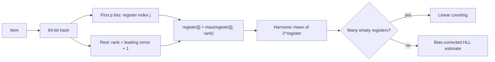

## In one minute
- HyperLogLog (HLL) estimates how many *distinct* items a stream contains using a fixed, tiny amount of memory: about 12 KB gives roughly 0.8 percent standard error whether you count a thousand or a billion items.
- It hashes each item and remembers, per bucket, the longest run of leading zeros it has seen. Long runs are rare, so they reveal how many different hashes must have been seen.
- Sketches **merge** losslessly by taking the maximum of each register, so you can count per shard, per hour, or per region and combine later. That property is what makes HLL a building block for analytics systems.
- It cannot list items, answer "was X seen?", or give exact counts. Intersections are possible only indirectly and with much worse error.

## How it works

### The intuition
Hash every item to a random bit string. Half of all hashes start with `1`, a quarter with `01`, an eighth with `001`. If the longest run of leading zeros seen is 20, you have probably seen around 2^20 distinct values, and duplicates never change the answer. One observation is very noisy, so HLL splits the stream into many independent sub-streams and averages.

### Registers
Choose a precision `p` and create `m = 2^p` registers. For each item:

1. Hash it to 64 bits (32 is enough for modest cardinalities).
2. Use the first `p` bits as the register index.
3. In the remaining bits, compute the position of the first 1 bit (leading zeros plus one), called the rank.
4. Set the register to the maximum of its current value and that rank.

Each register is a small number, at most about 64, so 6 bits per register suffice. With `p = 14` that is 16,384 registers in 12 KB, the configuration Redis uses.

### The estimate
HLL combines the registers with a **harmonic mean**, which resists outliers:

`E = alpha * m^2 / sum(2^-register[j])`

where `alpha` is a constant close to 0.72 that corrects a systematic bias. The relative standard error is about `1.04 / sqrt(m)`: 1.6 percent at `p = 12`, 0.81 percent at `p = 14`, 0.41 percent at `p = 16`. The original paper's headline example is counting well beyond 10^9 distinct items at about 2 percent error in 1.5 KB ([Flajolet et al., 2007](https://algo.inria.fr/flajolet/Publications/FlFuGaMe07.pdf)).

### Small and large ranges
With few items, many registers are zero and the raw formula overestimates, so the original algorithm switches to **linear counting**: with `V` empty registers, the estimate is `m * ln(m / V)`. Google's HLL++, which most libraries implement, adds empirical bias correction, a 64-bit hash so large counts do not saturate, and a **sparse** encoding for small sketches ([Heule et al., EDBT 2013](https://research.google/pubs/hyperloglog-in-practice-algorithmic-engineering-of-a-state-of-the-art-cardinality-estimation-algorithm/)).

Newer estimators replace those patches with one formula. Otmar Ertl's 2017 estimator removes the small- and large-range bias from theory rather than from empirical tables ([Ertl](https://arxiv.org/abs/1702.01284)), and current Redis computes `PFCOUNT` with it instead of linear counting ([Redis source](https://github.com/redis/redis/blob/unstable/src/hyperloglog.c)). Ertl's UltraLogLog (2024) keeps mergeability and constant-time inserts but needs 24 to 28 percent less space than HLL for the same accuracy ([PVLDB](https://www.vldb.org/pvldb/vol17/p1655-ertl.pdf)), so "HLL" is no longer the last word in distinct counting.

### Merge, union, intersection
Two sketches with the same `p` and hash function merge by taking the element-wise maximum of registers. The result is exactly the sketch you would have built from the combined stream, so the union of daily sketches gives a weekly count with no extra error. Intersection must be estimated as `|A| + |B| - |A union B|`; when the overlap is small relative to the sets, the subtraction of two large noisy numbers produces a huge relative error. A maximum-likelihood method gets better intersection estimates from the same registers, but small overlaps of large sets stay noisy.

Sketches with different precision can still be combined by folding the finer one down to the smaller `p`. BigQuery does this automatically: merging a precision-14 and a precision-15 sketch returns precision 14 ([BigQuery docs](https://docs.cloud.google.com/bigquery/docs/reference/standard-sql/hll_functions)). Sketches built with different hash functions cannot be combined at all.

## Down the stack

### Layer 1: The contract
The estimate has relative standard error about `1.04 / sqrt(m)`. That is a statistical statement: about 68 percent of estimates fall within one standard error and 95 percent within two, not a hard bound. Merging two sketches with the same precision and hash is lossless. The result depends only on the set of distinct items, not their order or multiplicity. Nothing about individual items can be recovered.

### Layer 2: The mechanism
Redis stores a HyperLogLog as an ordinary string, so `GET` and `SET` serialise it ([Redis docs](https://redis.io/docs/latest/develop/data-types/probabilistic/hyperloglogs/)). A 16-byte header holds the magic `HYLL`, an encoding byte (dense or sparse), and a cached cardinality whose top bit marks it stale. The dense form packs 16,384 6-bit registers into 12,288 bytes. The sparse form is run-length encoded with three opcodes: `ZERO` (one byte, up to 64 empty registers), `XZERO` (two bytes, up to 16,384), and `VAL` (one byte, a value up to 32 repeated up to 4 times); any register above 32 forces the dense form. Redis also converts to dense when the sparse form, header included, exceeds `hll-sparse-max-bytes`, 3,000 by default ([redis.conf](https://raw.githubusercontent.com/redis/redis/unstable/redis.conf)). Items are hashed with 64-bit MurmurHash2 (`MurmurHash64A`). `PFCOUNT` returns the cached value if nothing changed since the last count.

BigQuery exposes the same idea through `HLL_COUNT.INIT`, `HLL_COUNT.MERGE`, and `HLL_COUNT.EXTRACT`, storing HLL++ sketches as bytes columns with precision from 10 to 24, default 15. Defaults differ between engines: Presto's `APPROX_DISTINCT` defaults to about 2.3 percent standard error and is exact below 256 items thanks to its sparse layout ([Meta](https://engineering.fb.com/2018/12/13/data-infrastructure/hyperloglog/)), while Redis gives 0.81 percent. Two dashboards that both say "unique users" can disagree by more than either team's error budget.

### Layer 3: The machine
An `add` is one hash of the input (roughly 10 to 30 ns for a short key), one count-leading-zeros instruction (`LZCNT` on x86, `CLZ` on ARM), and a read-modify-write of a 6-bit field that may straddle two bytes. The whole dense sketch, 12 KB, fits in a 32 to 48 KB L1 data cache, so updates are a few nanoseconds once warm.

Counting is the heavier operation: summing `2^-register` over 16,384 registers with a precomputed table takes on the order of 10 to 50 us, which is why Redis caches the result. Merging is a byte-wise maximum, which vectorises well. On the network, a dense sketch is 12 KB; most sparse sketches are a few hundred bytes, which matters when millions are shipped between services.

### Why it's built this way
1. Exact distinct counting needs memory proportional to the number of distinct items, so the sketch accepts error in exchange for constant space.
2. The longest run of leading zeros needs only `log log n` bits to store, which is where the name comes from.
3. One such observation is very noisy, so the stream is split into `m` registers and combined, with error falling as `1 / sqrt(m)`.
4. Most real sets are small, so implementations add sparse encodings and small-range corrections instead of always paying for 12 KB.

## Diagram


## Worked example
An ad platform reports unique users per campaign, per country, per day. There are 20,000 active campaigns and 60 countries, about 1.2 million (campaign, country) pairs each day, from 8 billion impression events.

Exact counting needs a set of user IDs per pair: about 1 GB for one 30-million-user campaign-day, and daily numbers cannot be added into weekly uniques because users repeat across days.

With HLL at `p = 14`, each pair costs 12 KB dense, or a few hundred bytes sparse, about 4 GB per day in the warehouse. A 30-day count for one campaign merges 1,800 sketches (30 days by 60 countries) in a few milliseconds, with 0.8 percent standard error.

The trade surfaces when the sales team asks "how many users saw both campaign A and campaign B?". If A reached 10 million users, B reached 8 million, and the overlap is 50,000, inclusion-exclusion subtracts two numbers each uncertain by about 80,000. The answer is meaningless. That question needs a different sketch (Theta or KMV sketches handle set operations better) or an exact join on sampled data.

## In the wild
- **Meta, 2018: HLL in Presto turns days into hours.** Counting distinct weekly Facebook visitors with plain SQL would have taken days and terabytes of memory; with HLL sketches it took 12 hours and under 1 MB. Meta reports speedups of 7x to 1,000x, and stores daily sketches as `VARBINARY` so pipelines merge them into 7-, 28- and 84-day counts without rescanning raw data ([Engineering at Meta](https://engineering.fb.com/2018/12/13/data-infrastructure/hyperloglog/)).
- **Redis, 2019: a corrupted sketch overflows the heap.** CVE-2019-10192: by corrupting an HLL with `SETRANGE`, an attacker could make the dense-encoding parser write up to 3 bytes past a heap buffer. Fixed in 3.2.13, 4.0.14 and 5.0.4 ([Debian tracker](https://security-tracker.debian.org/tracker/CVE-2019-10192)).
- **Redis, 2025: the same class of bug, again.** CVE-2025-32023: an authenticated user could send a crafted string that triggers an out-of-bounds stack or heap write in HLL commands, affecting every version since 2.8. Fixed in 8.0.3 and matching patch releases; the advisory's workaround is an ACL that blocks HLL commands ([Redis advisory](https://github.com/redis/redis/security/advisories/GHSA-rp2m-q4j6-gr43), [8.0.3 release](https://github.com/redis/redis/releases/tag/8.0.3)).

## Trade-offs
| Option | Strengths | Weaknesses | Choose when |
|---|---|---|---|
| HyperLogLog (HLL++) | Fixed tiny memory, mergeable, about 1 percent error | No membership or listing, poor intersections | Distinct counts over large, partitioned data |
| Exact set or `COUNT(DISTINCT)` | Exact, supports any query | Memory grows with cardinality, not mergeable across periods | Small cardinalities or billing-grade numbers |
| Theta / KMV sketches | Unions, intersections, and differences | Larger than HLL for the same error | Overlap and set-difference questions |
| Roaring bitmaps of user IDs | Exact, fast set algebra | Needs dense integer IDs, more memory | Audience building and segmentation |

## Pitfalls in production
- **Mismatched parameters.** Sketches with a different hash function cannot be merged, and a different `p` merges only by dropping to the coarser precision, which some engines do silently. Some libraries merge mismatched sketches wrongly without any error. Encode precision and hash version in the stored format and reject or explicitly downgrade mismatches.
- **Bad hash functions.** A weak hash, such as a language's default string hash, biases the leading-zero distribution and the estimate. Use a well-mixed 64-bit hash like MurmurHash3 or xxHash.
- **Reporting estimates as exact.** Finance and billing users treat numbers as truth. Label approximate metrics and keep exact counts where money depends on them.
- **Intersections by subtraction.** Small overlaps of large sets have errors larger than the answer. Use a sketch designed for set operations. Apache DataSketches points intersection and difference queries to Theta sketches, while noting HLL is 2 to 16 times smaller than Theta at the same accuracy for large counts ([DataSketches](https://datasketches.apache.org/docs/HLL/HllSketches.html)).
- **Untrusted sketch bytes.** A serialised sketch is input like any other. Redis accepts HLL strings through `SET` and `SETRANGE`, and corrupted encodings have caused memory-safety bugs (see below). Validate sketches from clients or restrict who can write them.

## Leadership lens
- Ask which metrics may be approximate and agree the error budget with product owners before choosing `p`.
- Store sketches, not just numbers. A stored daily sketch lets you answer any later rollup; a stored daily count does not.
- Version the sketch format. A change of hash or precision is a data migration, not a code change.

## Check yourself
1. Why does adding the same item a million times not change an HLL estimate?
   **Answer:** The item always hashes to the same register and rank, and the register keeps a maximum, so repeats cannot change any register.
2. Why is a harmonic mean used to combine registers instead of an arithmetic mean?
   **Answer:** Register values contribute as powers of two, so one unusually large register would dominate an arithmetic mean; the harmonic mean downweights those outliers.
3. Doubling the registers from 16,384 to 32,768 improves error from 0.81 percent to what, and why only that much?
   **Answer:** About 0.57 percent, because error scales as `1.04 / sqrt(m)`, so doubling memory improves accuracy by only a factor of the square root of two.

## Practice
**Task:** Implement HyperLogLog with precision `p` (so `m = 2^p` registers) over a 32-bit hash: `h = mix(fnv1a(item))`, where `mix` is the MurmurHash3 32-bit finaliser (given in the starter). The register index is the top `p` bits; the rank is `rho(w, 32 - p)`, the number of leading zeros of `w` within that width plus one (so `rho(0, b) == b + 1`). `count()` uses `alpha = 0.7213 / (1 + 1.079 / m)` and switches to linear counting `m * ln(m / V)` when the raw estimate is at most `2.5 * m` and `V > 0` registers are zero. `merge(other)` updates in place with the register-wise maximum. TypeScript: `HyperLogLog`, `rho`; Go: `New`, `Add`, `Count`, `Merge`, `Rho`.

```python starter
import math

def fnv1a(s):
    h = 2166136261
    for c in s.encode():
        h = ((h ^ c) * 16777619) & 0xFFFFFFFF
    return h

def mix(h):
    h ^= h >> 16
    h = (h * 0x85EBCA6B) & 0xFFFFFFFF
    h ^= h >> 13
    h = (h * 0xC2B2AE35) & 0xFFFFFFFF
    return h ^ (h >> 16)

def rho(w, bits):
    raise NotImplementedError

class HyperLogLog:
    def __init__(self, p):
        self.p = p

    def add(self, item):
        raise NotImplementedError

    def count(self):
        raise NotImplementedError

    def merge(self, other):
        raise NotImplementedError
```

```python tests
def test_rho():
    assert rho(1, 18) == 18
    assert rho(1 << 17, 18) == 1
    assert rho(0, 18) == 19

def test_empty_is_zero():
    assert HyperLogLog(10).count() == 0

def test_duplicates_ignored():
    h = HyperLogLog(12)
    for _ in range(1000):
        h.add("same")
    assert abs(h.count() - 1) < 0.01

def test_small_cardinality():
    h = HyperLogLog(12)
    for i in range(100):
        h.add("u%d" % i)
    assert abs(h.count() - 100) <= 5

def test_large_cardinality_within_five_percent():
    h = HyperLogLog(12)
    for i in range(50000):
        h.add("user-%d" % i)
    assert abs(h.count() - 50000) / 50000 < 0.05

def test_merge_equals_union():
    a, b, u = HyperLogLog(12), HyperLogLog(12), HyperLogLog(12)
    for i in range(20000):
        a.add("a%d" % i)
        u.add("a%d" % i)
        b.add("b%d" % i)
        u.add("b%d" % i)
    a.merge(b)
    assert a.count() == u.count()
    assert abs(a.count() - 40000) / 40000 < 0.05
```

```python solution
import math

def fnv1a(s):
    h = 2166136261
    for c in s.encode():
        h = ((h ^ c) * 16777619) & 0xFFFFFFFF
    return h

def mix(h):
    h ^= h >> 16
    h = (h * 0x85EBCA6B) & 0xFFFFFFFF
    h ^= h >> 13
    h = (h * 0xC2B2AE35) & 0xFFFFFFFF
    return h ^ (h >> 16)

def rho(w, bits):
    r = 1
    for i in range(bits - 1, -1, -1):
        if (w >> i) & 1:
            return r
        r += 1
    return r

class HyperLogLog:
    def __init__(self, p):
        self.p, self.m = p, 1 << p
        self.reg = [0] * self.m

    def add(self, item):
        h = mix(fnv1a(item))
        j = h >> (32 - self.p)
        w = h & ((1 << (32 - self.p)) - 1)
        self.reg[j] = max(self.reg[j], rho(w, 32 - self.p))

    def count(self):
        m = self.m
        alpha = 0.7213 / (1 + 1.079 / m)
        e = alpha * m * m / sum(2.0 ** -r for r in self.reg)
        v = self.reg.count(0)
        if e <= 2.5 * m and v > 0:
            return m * math.log(m / v)
        return e

    def merge(self, other):
        self.reg = [max(a, b) for a, b in zip(self.reg, other.reg)]
```

```typescript starter
export function fnv1a(s: string): number {
  let h = 2166136261;
  for (let i = 0; i < s.length; i++) h = Math.imul(h ^ s.charCodeAt(i), 16777619) >>> 0;
  return h;
}
export function mix(h: number): number {
  h ^= h >>> 16; h = Math.imul(h, 0x85ebca6b) >>> 0;
  h ^= h >>> 13; h = Math.imul(h, 0xc2b2ae35) >>> 0;
  return (h ^ (h >>> 16)) >>> 0;
}
export function rho(w: number, bits: number): number { throw new Error("TODO"); }
export class HyperLogLog {
  constructor(public p: number) {}
  add(item: string): void { throw new Error("TODO"); }
  count(): number { throw new Error("TODO"); }
  merge(other: HyperLogLog): void { throw new Error("TODO"); }
}
```

```typescript tests
test("rho", () => {
  assertEqual(rho(1, 18), 18);
  assertEqual(rho(1 << 17, 18), 1);
  assertEqual(rho(0, 18), 19);
});
test("empty is zero", () => {
  assertEqual(new HyperLogLog(10).count(), 0);
});
test("duplicates ignored", () => {
  const h = new HyperLogLog(12);
  for (let i = 0; i < 1000; i++) h.add("same");
  assert(Math.abs(h.count() - 1) < 0.01, "about one");
});
test("small cardinality", () => {
  const h = new HyperLogLog(12);
  for (let i = 0; i < 100; i++) h.add("u" + i);
  assert(Math.abs(h.count() - 100) <= 5, "near 100");
});
test("large cardinality within five percent", () => {
  const h = new HyperLogLog(12);
  for (let i = 0; i < 50000; i++) h.add("user-" + i);
  assert(Math.abs(h.count() - 50000) / 50000 < 0.05, "got " + h.count());
});
test("merge equals union", () => {
  const a = new HyperLogLog(12), b = new HyperLogLog(12), u = new HyperLogLog(12);
  for (let i = 0; i < 20000; i++) { a.add("a" + i); u.add("a" + i); b.add("b" + i); u.add("b" + i); }
  a.merge(b);
  assertEqual(a.count(), u.count());
  assert(Math.abs(a.count() - 40000) / 40000 < 0.05, "near 40000");
});
```

```typescript solution
export function fnv1a(s: string): number {
  let h = 2166136261;
  for (let i = 0; i < s.length; i++) h = Math.imul(h ^ s.charCodeAt(i), 16777619) >>> 0;
  return h;
}
export function mix(h: number): number {
  h ^= h >>> 16; h = Math.imul(h, 0x85ebca6b) >>> 0;
  h ^= h >>> 13; h = Math.imul(h, 0xc2b2ae35) >>> 0;
  return (h ^ (h >>> 16)) >>> 0;
}
export function rho(w: number, bits: number): number {
  let r = 1;
  for (let i = bits - 1; i >= 0; i--) { if ((w >>> i) & 1) return r; r++; }
  return r;
}
export class HyperLogLog {
  private m: number;
  private reg: number[];
  constructor(public p: number) { this.m = 1 << p; this.reg = new Array(this.m).fill(0); }
  add(item: string): void {
    const h = mix(fnv1a(item)), b = 32 - this.p;
    const j = h >>> b, w = h & ((1 << b) - 1);
    this.reg[j] = Math.max(this.reg[j], rho(w, b));
  }
  count(): number {
    const m = this.m, alpha = 0.7213 / (1 + 1.079 / m);
    const e = (alpha * m * m) / this.reg.reduce((s, r) => s + 2 ** -r, 0);
    const v = this.reg.filter(r => r === 0).length;
    return e <= 2.5 * m && v > 0 ? m * Math.log(m / v) : e;
  }
  merge(other: HyperLogLog): void { this.reg = this.reg.map((r, i) => Math.max(r, other.reg[i])); }
}
```

```go starter
package practice

// FNV1a is 32-bit FNV-1a.
func FNV1a(s string) uint32 {
	h := uint32(2166136261)
	for i := 0; i < len(s); i++ {
		h = (h ^ uint32(s[i])) * 16777619
	}
	return h
}

// Mix is the MurmurHash3 32-bit finaliser.
func Mix(h uint32) uint32 {
	h ^= h >> 16
	h *= 0x85ebca6b
	h ^= h >> 13
	h *= 0xc2b2ae35
	return h ^ h>>16
}

// Rho returns leading zeros of w within bits, plus one.
func Rho(w uint32, bits int) int { panic("TODO") }

// HLL is a HyperLogLog sketch.
type HLL struct{}

// New creates a sketch with 2^p registers.
func New(p int) *HLL { return &HLL{} }

func (h *HLL) Add(item string)   { panic("TODO") }
func (h *HLL) Count() float64    { panic("TODO") }
func (h *HLL) Merge(other *HLL) { panic("TODO") }
```

```go tests
package practice

import (
	"fmt"
	"math"
	"testing"
)

func TestRho(t *testing.T) {
	if Rho(1, 18) != 18 || Rho(1<<17, 18) != 1 || Rho(0, 18) != 19 {
		t.Fatal("rho")
	}
}

func TestEmptyIsZero(t *testing.T) {
	if New(10).Count() != 0 {
		t.Fatal("want 0")
	}
}

func TestDuplicatesIgnored(t *testing.T) {
	h := New(12)
	for i := 0; i < 1000; i++ {
		h.Add("same")
	}
	if math.Abs(h.Count()-1) >= 0.01 {
		t.Fatal(h.Count())
	}
}

func TestSmallCardinality(t *testing.T) {
	h := New(12)
	for i := 0; i < 100; i++ {
		h.Add(fmt.Sprint("u", i))
	}
	if math.Abs(h.Count()-100) > 5 {
		t.Fatal(h.Count())
	}
}

func TestLargeCardinality(t *testing.T) {
	h := New(12)
	for i := 0; i < 50000; i++ {
		h.Add(fmt.Sprint("user-", i))
	}
	if math.Abs(h.Count()-50000)/50000 >= 0.05 {
		t.Fatal(h.Count())
	}
}

func TestMergeEqualsUnion(t *testing.T) {
	a, b, u := New(12), New(12), New(12)
	for i := 0; i < 20000; i++ {
		x, y := fmt.Sprint("a", i), fmt.Sprint("b", i)
		a.Add(x)
		u.Add(x)
		b.Add(y)
		u.Add(y)
	}
	a.Merge(b)
	if a.Count() != u.Count() || math.Abs(a.Count()-40000)/40000 >= 0.05 {
		t.Fatal(a.Count(), u.Count())
	}
}
```

```go solution
package practice

import "math"

// FNV1a is 32-bit FNV-1a.
func FNV1a(s string) uint32 {
	h := uint32(2166136261)
	for i := 0; i < len(s); i++ {
		h = (h ^ uint32(s[i])) * 16777619
	}
	return h
}

// Mix is the MurmurHash3 32-bit finaliser.
func Mix(h uint32) uint32 {
	h ^= h >> 16
	h *= 0x85ebca6b
	h ^= h >> 13
	h *= 0xc2b2ae35
	return h ^ h>>16
}

// Rho returns leading zeros of w within bits, plus one.
func Rho(w uint32, bits int) int {
	r := 1
	for i := bits - 1; i >= 0; i-- {
		if (w>>uint(i))&1 == 1 {
			return r
		}
		r++
	}
	return r
}

// HLL is a HyperLogLog sketch.
type HLL struct {
	p   int
	reg []int
}

// New creates a sketch with 2^p registers.
func New(p int) *HLL { return &HLL{p: p, reg: make([]int, 1<<p)} }

func (h *HLL) Add(item string) {
	x, b := Mix(FNV1a(item)), 32-h.p
	j, w := x>>uint(b), x&(1<<uint(b)-1)
	if r := Rho(w, b); r > h.reg[j] {
		h.reg[j] = r
	}
}

func (h *HLL) Count() float64 {
	m := float64(len(h.reg))
	alpha := 0.7213 / (1 + 1.079/m)
	sum, v := 0.0, 0
	for _, r := range h.reg {
		sum += math.Pow(2, -float64(r))
		if r == 0 {
			v++
		}
	}
	e := alpha * m * m / sum
	if e <= 2.5*m && v > 0 {
		return m * math.Log(m/float64(v))
	}
	return e
}

func (h *HLL) Merge(other *HLL) {
	for i, r := range other.reg {
		if r > h.reg[i] {
			h.reg[i] = r
		}
	}
}
```

## Mock interview
**Prompt:** Design the "unique visitors" metric for a web analytics product used by 200,000 websites, with 5 billion page views a day. Customers want unique visitors for any date range up to 13 months, filtered by country and device, with answers in under a second.

- Follow-up: What do you store per site per day, and how big is it?
- Follow-up: A customer compares your number with their own exact count and finds a 1.5 percent difference. How do you respond?
- Follow-up: Product now wants "visitors who came back within 7 days". Does HLL still work?

**A strong answer covers:**
- Per (site, day, country, device) HLL++ sketches, with sparse encoding for small sites and dense 12 KB sketches for large ones.
- Merging daily sketches at query time for arbitrary ranges and filters, with a cost estimate for 400 days of merges.
- The standard error at the chosen precision, how it was agreed with product, and how it is disclosed to customers.
- Hash and precision versioning so stored sketches stay mergeable for 13 months.
- Retention needs intersection or per-user state; inclusion-exclusion on HLL is too noisy, so use Theta sketches or exact computation on a sample.

## Sources and further study
**Primary**
- [Ertl, New cardinality estimation algorithms for HyperLogLog sketches (2017)](https://arxiv.org/abs/1702.01284): the bias-free and maximum-likelihood estimators, including better set-operation estimates.
- [Ertl, UltraLogLog (PVLDB 2024)](https://www.vldb.org/pvldb/vol17/p1655-ertl.pdf): a mergeable successor that stores the same information in about a quarter less space.

**Systems docs**
- [Redis hyperloglog.c](https://github.com/redis/redis/blob/unstable/src/hyperloglog.c): the header, sparse opcodes and estimator, with long explanatory comments.
- [BigQuery: HyperLogLog++ functions](https://docs.cloud.google.com/bigquery/docs/reference/standard-sql/hll_functions): precision range, sketch columns and how mixed-precision merges downgrade.
- [Apache DataSketches: HLL sketches](https://datasketches.apache.org/docs/HLL/HllSketches.html): HLL_4/6/8 register widths and when to choose Theta sketches instead.

**Books**
- *Mining of Massive Datasets*, Leskovec, Rajaraman and Ullman, chapter 4 "Mining Data Streams", section 4.4 "Counting Distinct Elements in a Stream": the Flajolet-Martin idea HLL builds on.

**Other curricula**
- [Stanford CS246](https://web.stanford.edu/class/cs246/): covers streams in its "Mining Data Streams" lectures, with MMDS chapter 4 as the reading, so distinct counting sits next to other one-pass stream algorithms.
- [donnemartin/system-design-primer](https://github.com/donnemartin/system-design-primer): does not cover HyperLogLog or other sketches; analytics counting is left to the reader.

## Watch
- [HyperLogLog Hit Counter (Computerphile)](https://www.youtube.com/watch?v=B_PexYrEcEw): the leading-zeros intuition explained from first principles.
- [The Algorithm with the Best Name: HyperLogLog Explained (Victor Sanches Portella)](https://www.youtube.com/watch?v=2PlrMCiUN_s): a visual derivation of registers, harmonic mean, and error bounds.

## Free resources
- [Flajolet et al.: HyperLogLog (2007)](http://algo.inria.fr/flajolet/Publications/FlFuGaMe07.pdf): the original analysis of the algorithm and its error.
- [Heule, Nunkesser, Hall: HyperLogLog in Practice (Google)](https://research.google/pubs/hyperloglog-in-practice-algorithmic-engineering-of-a-state-of-the-art-cardinality-estimation-algorithm/): the HLL++ improvements most libraries now use.
- [antirez: Redis new data structure, the HyperLogLog](http://antirez.com/news/75): engineering notes on the 12 KB Redis implementation and its sparse encoding.
- [Engineering at Meta: HyperLogLog in Presto](https://engineering.fb.com/2018/12/13/data-infrastructure/hyperloglog/): how a SQL engine uses HLL for fast approximate distinct counts.
- [Redis: HyperLogLog](https://redis.io/docs/latest/develop/data-types/probabilistic/hyperloglogs/): the PFADD, PFCOUNT, and PFMERGE commands and their limits.
