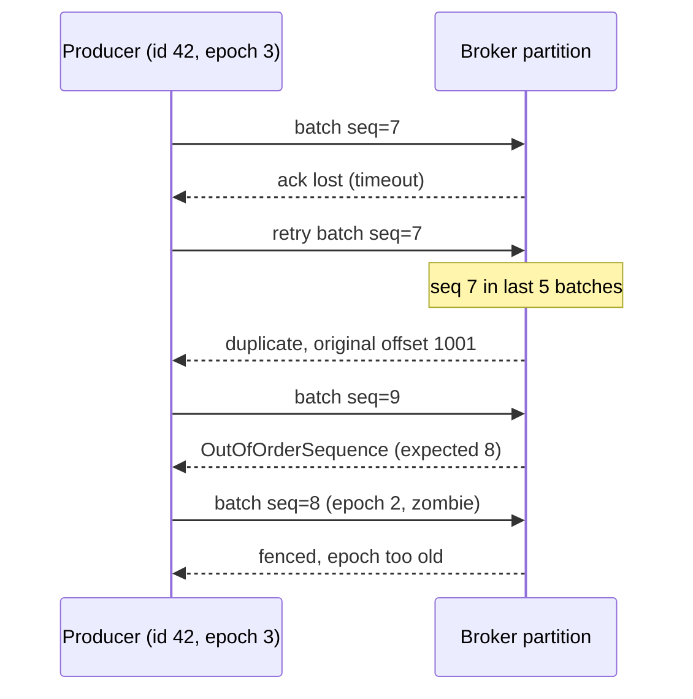

## In one minute
- An operation is idempotent when doing it twice leaves the system in the same state as doing it once. That property is what makes retries safe, and retries are the only general answer to a network that loses requests and responses.
- Some operations are idempotent by nature (set a value, delete by ID, `PUT` a whole resource). Others (increment, append, charge, send) must be made idempotent by giving each intent an identity and remembering what was already done.
- The main tools are deterministic IDs with unique constraints, conditional writes on a version, idempotency keys with stored results, and per-sender sequence numbers. They differ in how much state they keep and for how long.
- Every deduplication scheme has a window. A retry that arrives after the window is a new request, so the window must outlast your longest retry path, including queues and manual replays.
- Idempotency must cover every side effect, not just the database row: emails, calls to third parties and events published downstream.

## How it works

### Why retries need it
A client sends a request and the network goes quiet. Three things could have happened: the request never arrived, the server is still working, or the server finished and the response was lost. The client cannot tell which. Its only choices are to give up, which risks losing the operation, or to retry, which risks doing it twice. Idempotency removes the second risk, so retrying becomes the right default. This is the duplicates problem shape, and it looks the same whether a payment API times out, a rider double-taps "book", or an AI agent re-runs a tool call that creates a ticket because the first call timed out.

### Same state, not same response
Mathematically, `f` is idempotent if `f(f(x)) = f(x)`. For APIs the useful definition is about effects: N deliveries of the same request have the same effect on server state as one. The responses may differ. `DELETE /files/9` is idempotent even though the first call returns `204` and the second `404`, because the file is gone either way. HTTP defines it the same way: a method is idempotent when many identical requests have the intended effect of one, and `PUT`, `DELETE` and the safe methods qualify ([RFC 9110](https://www.rfc-editor.org/rfc/rfc9110.html#section-9.2.2)). Idempotent is also different from safe: a safe operation (`GET`) changes nothing, while an idempotent one may change state but only once.

### Natural idempotency by design
The cheapest idempotency needs no extra machinery, because the operation is shaped to be repeatable:
- **Set instead of add.** `balance = 120` is idempotent; `balance += 20` is not. Send the target state, not the delta, when you can.
- **Client-chosen IDs.** `PUT /orders/7f3c...` with an ID the client generated creates the order once; a repeat finds it already exists. AWS uses the same idea with `ClientToken` on EC2 `RunInstances` ([EC2 idempotency](https://docs.aws.amazon.com/AWSEC2/latest/APIReference/Run_Instance_Idempotency.html)).
- **Unique constraints.** A unique index on `(merchant_id, order_id)` makes a second insert fail, so "charge order 512" cannot happen twice even if two code paths try.
- **Conditional writes.** `UPDATE ... WHERE id = 7 AND version = 4` succeeds once; a replay finds version 5 and changes nothing. HTTP expresses this with `If-Match: "<etag>"` and `412 Precondition Failed`.

### Idempotency keys for everything else
Operations with no natural identity ("send this email", "charge this card") need an idempotency key: the client names the intent, and the server records the key with the outcome and replays it on a repeat. The REST API Design lesson covers the basic store; the hard parts are elsewhere. There is still no standard for this header: the IETF's `Idempotency-Key` draft reached version 07 in October 2025 and then expired without becoming an RFC ([IETF Datatracker](https://datatracker.ietf.org/doc/draft-ietf-httpapi-idempotency-key-header/)). Its conventions are widely copied anyway: `400` when a required key is missing, `422` when a key is reused with a different payload, and `409` while the first request is still running ([draft 07](https://www.ietf.org/archive/id/draft-ietf-httpapi-idempotency-key-header-07.html)). Stripe's v1 API stores the status and body of the first attempt, replays it even if it was a `500`, and may forget keys once they are 24 hours old ([Stripe docs](https://docs.stripe.com/api/idempotent_requests)). The key must be generated once per intent and reused on every retry. Two copies can arrive at once, so the first must claim the key atomically and the second must wait or get `409 Conflict`. And a request that crashed halfway leaves a claimed key with no result, so the claim needs an expiring lease plus recovery points that tell a retry where to resume.

### Sequence numbers for streams
When one sender sends many messages in order, a key per message is wasteful. Instead the sender numbers its messages, and the receiver remembers the last number it accepted from each sender. Anything at or below that number is a duplicate; anything above the next expected number reveals a gap. TCP has done this since 1981 with byte sequence numbers, which is why a retransmitted segment never appears twice in your socket. Kafka's idempotent producer applies the same idea to records.

## Down the stack

### Layer 1: The contract
For an idempotent API the contract is: for a given scope (usually the caller's account) and a given key or identity, any number of deliveries within the window `W` produce at most one effect, and every completed delivery reports that same effect. Concurrent duplicates never both execute; one runs and the others wait or are told to retry. Reusing a key with a different request is an error, not a silent replay. After `W` the key may be forgotten. The client's side of the contract is to keep its retry horizon shorter than `W`: if a message can sit in a dead-letter queue for 7 days and then be replayed, a 24-hour window is a bug waiting to happen. Azure's guidance on idempotent consumers makes the same point, sizing the window from delivery attempts, lock timeout and message TTL, plus manual resubmissions from dead-letter queues ([Azure Architecture Center](https://learn.microsoft.com/en-us/azure/architecture/patterns/idempotent-consumer)).

### Layer 2: The mechanism
Kafka's idempotent producer shows the sequence-number approach in a production system. `enable.idempotence=true` was meant to be the default from Kafka 3.0, but a validation bug delayed it to 3.0.1, 3.1.1 and 3.2.0 ([KAFKA-13598](https://issues.apache.org/jira/browse/KAFKA-13598)), and it still turns itself off without warning if you set a conflicting `acks`, `retries` or in-flight limit and leave idempotence unset ([Kafka producer configs](https://kafka.apache.org/42/configuration/producer-configs/)). The broker assigns each producer a producer ID and an epoch. Each batch the producer sends to a partition carries the producer ID, epoch and a base sequence number. For each producer and partition, the broker keeps the last sequence number and metadata for the 5 most recent batches. A batch whose sequence is the next expected one is appended. A batch that matches one of the cached 5 is a duplicate: the broker acknowledges it with the original offset and writes nothing. A batch that skips ahead is rejected with `OutOfOrderSequenceException`. Hence `max.in.flight.requests.per.connection` must be at most 5. The epoch fences zombies: a restarted producer with the same `transactional.id` gets a higher epoch, and the broker rejects writes from the old one.

In a relational database the same guarantees come from constraints. `INSERT INTO idempotency_keys (account_id, key, request_hash, status) VALUES (...) ON CONFLICT DO NOTHING RETURNING key` claims a key atomically: if no row comes back, someone else owns it. The effect and the key's final status must commit in one transaction, otherwise a crash between them leaves a key that says "done" for an effect that never happened, or the reverse. SQS FIFO queues offer the same at the queue level with `MessageDeduplicationId` and a fixed 5-minute deduplication interval.

### Layer 3: The machine
Deduplication state costs memory or disk in proportion to rate times window. At 10,000 requests per second with a 24-hour window, the store holds 864 million keys; at about 200 bytes per row with its index entry, that is roughly 170 GB. Each new key is also a unique-index insert in a B-tree and a write-ahead log record that must reach disk with `fsync` before the response, about 0.05 to 2 ms depending on storage. Sequence numbers cost almost nothing by comparison: Kafka keeps a fixed handful of entries per producer and partition, so its dedupe state does not grow with traffic. Windows exist at the bottom of the stack too. TCP's sequence numbers are 32 bits, so at 10 Gbit/s the 4 GB sequence space wraps in about 3.4 seconds, faster than an old delayed segment can be ruled out. TCP therefore adds timestamps (PAWS, [RFC 7323](https://www.rfc-editor.org/rfc/rfc7323.html)) to reject an old segment whose sequence number has come round again.

### Why it's built this way
1. Networks lose both requests and responses, and the sender cannot tell which, so it must be allowed to retry.
2. Retrying a non-idempotent operation duplicates its effect, so each intent needs an identity the receiver can recognise.
3. Remembering identities costs storage that grows with rate times time, so every scheme keeps a bounded window.
4. A bounded window only works if retries stop before it closes, so retry policies, queues and replays must be designed together with the window.
5. Where the sender is a single ordered stream, a counter replaces a set of keys, which is why TCP and Kafka use sequence numbers and HTTP APIs use keys.

## Diagram


## Worked example
A notifications service sends 2,000 push and email messages per second on behalf of other services. Callers use a 2-second timeout and retry up to 3 times. In a normal hour 0.5% of calls time out; during a database failover 10% do.

Without idempotency, most timeouts happen after the message was already sent, so 0.5% of 2,000 is 10 duplicate notifications per second, about 860,000 a day. During a failover it is 200 per second, and every user in that window gets the same password-reset email two or three times.

With idempotency keys derived from the business event, for example `password-reset:<user_id>:<token_id>`, even a caller that crashes and restarts reuses the same key. The client retry horizon is about 15 seconds, but upstream services can replay their queues for up to 3 days, so the window is set to 4 days. Storage is 2,000 × 345,600 seconds, about 690 million keys; at 150 bytes each that is about 100 GB in a key-value store with TTL expiry, which is cheap next to the support cost of duplicate messages.

The email provider is the remaining gap: if the service crashes after the provider accepted the message but before marking the key done, the retry sends again. Passing the same key to the provider's own idempotency header closes it, because the provider then deduplicates too. Each hop has to carry the identity forward.

## In the wild
- **Twilio, 2013: a charge that could not record itself repeated.** On 18 July a misdiagnosed restart of the Redis master behind billing loaded a bad configuration and left the master read-only with balances at zero. Every billable action then triggered an auto-recharge against the customer's card, and because the new balance could not be written, recharges were attempted again and again. The incident affected 1.4% of customers. Twilio refunded the charges, stopped restarting the master in place, and added fail-safes so cards are not charged when a balance is missing or cannot be written ([Twilio](https://www.twilio.com/en-us/blog/company/communications/billing-incident-post-mortem-breakdown-analysis-and-root-cause-html)).
- **Stripe, 2017: idempotency keys as a public API contract.** Stripe's engineering post sets out why a charge must happen once even when a network failure hides whether the request arrived, half-ran or succeeded with the response lost. Clients send an `Idempotency-Key` on each POST; the server replays the stored result or resumes the work, and clients retry with exponential backoff and jitter so a recovering server is not stampeded ([Stripe](https://stripe.com/blog/idempotency)).
- **Jepsen, 2020: retries that ignored their own setting.** Testing MongoDB 4.2.6 transactions, Jepsen saw duplicate writes among other anomalies, and found that transaction retries ignored the `retryWrites` setting, a likely source of the duplicates. MongoDB traced the anomalies to a retry bug fixed in 4.2.8. A driver-level retry is only safe when the operation it retries is idempotent ([Jepsen](https://jepsen.io/analyses/mongodb-4.2.6)).

## Trade-offs
| Approach | Strengths | Weaknesses | Choose when |
|---|---|---|---|
| Natural (set, `PUT`, delete by ID) | No extra state, trivially correct | Only works for operations that can be expressed as target state | Updates and deletes of known resources |
| Client-generated IDs plus unique constraint | Dedupe lives in the business table, no expiry | Client must generate IDs; the constraint must cover the real intent | Creating orders, payments, records |
| Conditional writes (version, ETag) | Also prevents lost updates between different writers | Repeat gets a conflict, not the original response | Read-modify-write updates |
| Idempotency keys with stored results | Works for any operation, replays exact response | Storage grows with rate times window; in-flight and crash handling | Charges, sends, third-party calls |
| Per-sender sequence numbers | Constant state, detects gaps as well as duplicates | Needs one ordered sender per sequence | Streams, replication, producer to broker |

## Pitfalls in production
- **Key generated per attempt.** Creating the UUID inside the retry loop gives every retry a new key, so nothing is deduplicated. Generate the key when the intent is created and persist it with the intent.
- **Key and effect in different stores.** Writing the key to Redis and the effect to Postgres leaves a crash window between them. Commit both in one transaction, or make the effect itself idempotent by using the key as its ID.
- **Window shorter than the retry horizon.** A dead-letter queue replayed after a week sails past a 24-hour window and duplicates every effect. Size the window from the longest replay path, or keep dedupe in a unique constraint that never expires.
- **Uncovered side effects.** The database write is deduplicated but the email or the downstream event is sent before the commit and again on retry. Use the outbox pattern for events and pass the key to every external provider.
- **Treating "in progress" as success.** Returning `200` to a duplicate while the first attempt is still running tells the client the work is done when it may yet fail. Return `409` or make the duplicate wait for the outcome.
- **Unscoped keys.** Two tenants that both use `order-1` as a key collide. Scope keys by account or caller identity.

## Leadership lens
- Make idempotency part of the API contract for every mutating endpoint and every message consumer, written down with the window, and check it in design review rather than after the first duplicate charge.
- Ask: what is the longest path by which this request can be retried or replayed, and is our dedupe window longer than that?
- Budget the storage explicitly (rate times window times bytes per key). It is usually cheap, and putting a number on it stops someone shortening the window to save money.
- Test it on purpose: chaos tests that drop responses and replay messages find missing idempotency faster than code review does.

## Check yourself
1. `DELETE /items/5` returns `204` the first time and `404` the second. Is it idempotent?
   **Answer:** Yes. Idempotency is about the effect on state, and after one or two calls the item is gone. Clients should treat `404` on a retried delete as success.
2. Why does Kafka limit an idempotent producer to 5 in-flight requests per connection?
   **Answer:** The broker remembers only the last 5 batches per producer and partition. With more in flight, a retried batch could fall outside that cache and be rejected instead of being recognised as a duplicate.
3. A consumer deduplicates by message ID in a 24-hour Redis set. What scenario still produces duplicates?
   **Answer:** Any redelivery after 24 hours, such as a dead-letter queue replay, plus a crash between performing the effect and writing the ID, because Redis and the effect are not in one transaction.
4. When is a version-conditioned update better than an idempotency key?
   **Answer:** For read-modify-write updates where several writers may race: the version check deduplicates retries and also prevents one writer silently overwriting another, without a separate key store.

## Practice
**Task:** Implement the broker side of an idempotent producer. `SequenceLog(window)` holds an append-only list of records. `append(producer, epoch, seq, record)` returns a pair of status and offset. A write with an epoch lower than the producer's current one returns `("fenced", -1)`. A write from an unknown producer, or with a higher epoch than the current one, must have `seq == 0` (otherwise `("out_of_order", -1)` and no state change) and starts fresh state for that producer at that epoch. Within the current epoch, `seq` equal to the last accepted sequence plus one is appended at the next offset and returns `("ok", offset)`; a `seq` that matches one of the producer's last `window` accepted sequences returns `("duplicate", original_offset)` without appending; any other `seq` returns `("out_of_order", -1)`. `records()` returns the records in offset order. Offsets are shared across producers and start at 0.

```python starter
class SequenceLog:
    def __init__(self, window):
        self.window = window

    def append(self, producer, epoch, seq, record):
        # TODO
        raise NotImplementedError

    def records(self):
        # TODO
        raise NotImplementedError
```

```python tests
def test_appends_share_offsets_across_producers():
    log = SequenceLog(5)
    assert log.append("p1", 0, 0, "a") == ("ok", 0)
    assert log.append("p2", 0, 0, "b") == ("ok", 1)
    assert log.append("p1", 0, 1, "c") == ("ok", 2)
    assert log.records() == ["a", "b", "c"]

def test_retry_returns_original_offset():
    log = SequenceLog(5)
    log.append("p1", 0, 0, "a")
    log.append("p1", 0, 1, "b")
    assert log.append("p1", 0, 1, "b") == ("duplicate", 1)
    assert log.append("p1", 0, 0, "a") == ("duplicate", 0)
    assert log.records() == ["a", "b"], "duplicates are not appended"

def test_gap_is_rejected():
    log = SequenceLog(5)
    log.append("p1", 0, 0, "a")
    assert log.append("p1", 0, 2, "c") == ("out_of_order", -1)
    assert log.append("p1", 0, 1, "b") == ("ok", 1)
    assert log.append("p1", 0, 2, "c") == ("ok", 2)

def test_duplicate_outside_window_is_out_of_order():
    log = SequenceLog(2)
    for i in range(4):
        log.append("p1", 0, i, "r%d" % i)
    assert log.append("p1", 0, 0, "r0") == ("out_of_order", -1)
    assert log.append("p1", 0, 2, "r2") == ("duplicate", 2)
    assert len(log.records()) == 4

def test_new_producer_must_start_at_zero():
    log = SequenceLog(5)
    assert log.append("p1", 0, 3, "x") == ("out_of_order", -1)
    assert log.append("p1", 0, 0, "a") == ("ok", 0)

def test_higher_epoch_fences_old_one():
    log = SequenceLog(5)
    log.append("p1", 1, 0, "a")
    log.append("p1", 1, 1, "b")
    assert log.append("p1", 2, 5, "x") == ("out_of_order", -1), "new epoch starts at 0"
    assert log.append("p1", 1, 2, "c") == ("ok", 2), "failed bump changes nothing"
    assert log.append("p1", 2, 0, "d") == ("ok", 3)
    assert log.append("p1", 1, 3, "zombie") == ("fenced", -1)
    assert log.append("p1", 2, 1, "e") == ("ok", 4)
    assert log.records() == ["a", "b", "c", "d", "e"]
```

```python solution
class SequenceLog:
    def __init__(self, window):
        self.window = window
        self.log = []
        self.state = {}

    def append(self, producer, epoch, seq, record):
        st = self.state.get(producer)
        if st is not None and epoch < st["epoch"]:
            return ("fenced", -1)
        if st is None or epoch > st["epoch"]:
            if seq != 0:
                return ("out_of_order", -1)
            st = {"epoch": epoch, "last": -1, "recent": []}
            self.state[producer] = st
        elif seq <= st["last"]:
            for s, off in st["recent"]:
                if s == seq:
                    return ("duplicate", off)
            return ("out_of_order", -1)
        elif seq != st["last"] + 1:
            return ("out_of_order", -1)
        offset = len(self.log)
        self.log.append(record)
        st["last"] = seq
        st["recent"].append((seq, offset))
        if len(st["recent"]) > self.window:
            st["recent"].pop(0)
        return ("ok", offset)

    def records(self):
        return list(self.log)
```

```typescript starter
export class SequenceLog {
  constructor(public window: number) {}
  append(producer: string, epoch: number, seq: number, record: string): [string, number] {
    throw new Error("TODO");
  }
  records(): string[] {
    throw new Error("TODO");
  }
}
```

```typescript tests
test("appends share offsets across producers", () => {
  const log = new SequenceLog(5);
  assertEqual(log.append("p1", 0, 0, "a"), ["ok", 0]);
  assertEqual(log.append("p2", 0, 0, "b"), ["ok", 1]);
  assertEqual(log.append("p1", 0, 1, "c"), ["ok", 2]);
  assertEqual(log.records(), ["a", "b", "c"]);
});
test("retry returns original offset", () => {
  const log = new SequenceLog(5);
  log.append("p1", 0, 0, "a");
  log.append("p1", 0, 1, "b");
  assertEqual(log.append("p1", 0, 1, "b"), ["duplicate", 1]);
  assertEqual(log.append("p1", 0, 0, "a"), ["duplicate", 0]);
  assertEqual(log.records(), ["a", "b"], "duplicates are not appended");
});
test("gap is rejected", () => {
  const log = new SequenceLog(5);
  log.append("p1", 0, 0, "a");
  assertEqual(log.append("p1", 0, 2, "c"), ["out_of_order", -1]);
  assertEqual(log.append("p1", 0, 1, "b"), ["ok", 1]);
  assertEqual(log.append("p1", 0, 2, "c"), ["ok", 2]);
});
test("duplicate outside window is out of order", () => {
  const log = new SequenceLog(2);
  for (let i = 0; i < 4; i++) log.append("p1", 0, i, "r" + i);
  assertEqual(log.append("p1", 0, 0, "r0"), ["out_of_order", -1]);
  assertEqual(log.append("p1", 0, 2, "r2"), ["duplicate", 2]);
  assertEqual(log.records().length, 4);
});
test("new producer must start at zero", () => {
  const log = new SequenceLog(5);
  assertEqual(log.append("p1", 0, 3, "x"), ["out_of_order", -1]);
  assertEqual(log.append("p1", 0, 0, "a"), ["ok", 0]);
});
test("higher epoch fences old one", () => {
  const log = new SequenceLog(5);
  log.append("p1", 1, 0, "a");
  log.append("p1", 1, 1, "b");
  assertEqual(log.append("p1", 2, 5, "x"), ["out_of_order", -1], "new epoch starts at 0");
  assertEqual(log.append("p1", 1, 2, "c"), ["ok", 2], "failed bump changes nothing");
  assertEqual(log.append("p1", 2, 0, "d"), ["ok", 3]);
  assertEqual(log.append("p1", 1, 3, "zombie"), ["fenced", -1]);
  assertEqual(log.append("p1", 2, 1, "e"), ["ok", 4]);
  assertEqual(log.records(), ["a", "b", "c", "d", "e"]);
});
```

```typescript solution
interface ProducerState {
  epoch: number;
  last: number;
  recent: Array<[number, number]>;
}

export class SequenceLog {
  private log: string[] = [];
  private state = new Map<string, ProducerState>();

  constructor(public window: number) {}

  append(producer: string, epoch: number, seq: number, record: string): [string, number] {
    let st = this.state.get(producer);
    if (st !== undefined && epoch < st.epoch) return ["fenced", -1];
    if (st === undefined || epoch > st.epoch) {
      if (seq !== 0) return ["out_of_order", -1];
      st = { epoch, last: -1, recent: [] };
      this.state.set(producer, st);
    } else if (seq <= st.last) {
      for (const [s, off] of st.recent) {
        if (s === seq) return ["duplicate", off];
      }
      return ["out_of_order", -1];
    } else if (seq !== st.last + 1) {
      return ["out_of_order", -1];
    }
    const offset = this.log.length;
    this.log.push(record);
    st.last = seq;
    st.recent.push([seq, offset]);
    if (st.recent.length > this.window) st.recent.shift();
    return ["ok", offset];
  }

  records(): string[] {
    return [...this.log];
  }
}
```

```go starter
package practice

type SequenceLog struct {
	window int
}

func NewSequenceLog(window int) *SequenceLog {
	return &SequenceLog{window: window}
}

func (l *SequenceLog) Append(producer string, epoch, seq int, record string) (string, int) {
	panic("TODO")
}

func (l *SequenceLog) Records() []string {
	panic("TODO")
}
```

```go tests
package practice

import (
	"fmt"
	"reflect"
	"testing"
)

func expect(t *testing.T, l *SequenceLog, producer string, epoch, seq int, record, wantStatus string, wantOffset int) {
	t.Helper()
	status, offset := l.Append(producer, epoch, seq, record)
	if status != wantStatus || offset != wantOffset {
		t.Fatalf("append(%s, %d, %d): got (%s, %d), want (%s, %d)", producer, epoch, seq, status, offset, wantStatus, wantOffset)
	}
}

func records(t *testing.T, l *SequenceLog, want []string) {
	t.Helper()
	if got := l.Records(); !reflect.DeepEqual(got, want) {
		t.Fatalf("records: got %v, want %v", got, want)
	}
}

func TestAppendsShareOffsetsAcrossProducers(t *testing.T) {
	l := NewSequenceLog(5)
	expect(t, l, "p1", 0, 0, "a", "ok", 0)
	expect(t, l, "p2", 0, 0, "b", "ok", 1)
	expect(t, l, "p1", 0, 1, "c", "ok", 2)
	records(t, l, []string{"a", "b", "c"})
}

func TestRetryReturnsOriginalOffset(t *testing.T) {
	l := NewSequenceLog(5)
	l.Append("p1", 0, 0, "a")
	l.Append("p1", 0, 1, "b")
	expect(t, l, "p1", 0, 1, "b", "duplicate", 1)
	expect(t, l, "p1", 0, 0, "a", "duplicate", 0)
	records(t, l, []string{"a", "b"})
}

func TestGapIsRejected(t *testing.T) {
	l := NewSequenceLog(5)
	l.Append("p1", 0, 0, "a")
	expect(t, l, "p1", 0, 2, "c", "out_of_order", -1)
	expect(t, l, "p1", 0, 1, "b", "ok", 1)
	expect(t, l, "p1", 0, 2, "c", "ok", 2)
}

func TestDuplicateOutsideWindowIsOutOfOrder(t *testing.T) {
	l := NewSequenceLog(2)
	for i := 0; i < 4; i++ {
		l.Append("p1", 0, i, fmt.Sprintf("r%d", i))
	}
	expect(t, l, "p1", 0, 0, "r0", "out_of_order", -1)
	expect(t, l, "p1", 0, 2, "r2", "duplicate", 2)
	if len(l.Records()) != 4 {
		t.Fatal("duplicates must not append")
	}
}

func TestNewProducerMustStartAtZero(t *testing.T) {
	l := NewSequenceLog(5)
	expect(t, l, "p1", 0, 3, "x", "out_of_order", -1)
	expect(t, l, "p1", 0, 0, "a", "ok", 0)
}

func TestHigherEpochFencesOldOne(t *testing.T) {
	l := NewSequenceLog(5)
	l.Append("p1", 1, 0, "a")
	l.Append("p1", 1, 1, "b")
	expect(t, l, "p1", 2, 5, "x", "out_of_order", -1)
	expect(t, l, "p1", 1, 2, "c", "ok", 2)
	expect(t, l, "p1", 2, 0, "d", "ok", 3)
	expect(t, l, "p1", 1, 3, "zombie", "fenced", -1)
	expect(t, l, "p1", 2, 1, "e", "ok", 4)
	records(t, l, []string{"a", "b", "c", "d", "e"})
}
```

```go solution
package practice

import "sync"

type accepted struct {
	seq    int
	offset int
}

type producerState struct {
	epoch  int
	last   int
	recent []accepted
}

type SequenceLog struct {
	mu     sync.Mutex
	window int
	log    []string
	state  map[string]*producerState
}

func NewSequenceLog(window int) *SequenceLog {
	return &SequenceLog{window: window, state: map[string]*producerState{}}
}

func (l *SequenceLog) Append(producer string, epoch, seq int, record string) (string, int) {
	l.mu.Lock()
	defer l.mu.Unlock()
	st, known := l.state[producer]
	switch {
	case known && epoch < st.epoch:
		return "fenced", -1
	case !known || epoch > st.epoch:
		if seq != 0 {
			return "out_of_order", -1
		}
		st = &producerState{epoch: epoch, last: -1}
		l.state[producer] = st
	case seq <= st.last:
		for _, a := range st.recent {
			if a.seq == seq {
				return "duplicate", a.offset
			}
		}
		return "out_of_order", -1
	case seq != st.last+1:
		return "out_of_order", -1
	}
	offset := len(l.log)
	l.log = append(l.log, record)
	st.last = seq
	st.recent = append(st.recent, accepted{seq, offset})
	if len(st.recent) > l.window {
		st.recent = st.recent[1:]
	}
	return "ok", offset
}

func (l *SequenceLog) Records() []string {
	l.mu.Lock()
	defer l.mu.Unlock()
	return append([]string{}, l.log...)
}
```

## Mock interview
**Prompt:** Design the "create transfer" API for a fintech app that moves money between users, about 3,000 transfers per second at peak. Mobile clients on flaky networks retry aggressively, and transfers also flow through an internal queue to a ledger service and then to an external bank API.

- Follow-up: Two identical requests with the same key arrive 5 ms apart on different servers. Walk through exactly what each one does.
- Follow-up: The server crashes after debiting the sender but before recording the response for the key. What happens on the client's retry?
- Follow-up: The bank API has no idempotency support. How do you avoid sending the same transfer to the bank twice?

**A strong answer covers:**
- A client-generated key per transfer intent, scoped to the user, stored with a request hash, and claimed atomically with a unique insert; concurrent duplicates wait or get `409`.
- The key's state and the ledger effect committed in one transaction, with recovery points so a retry resumes instead of redoing completed steps.
- Idempotent consumers on the internal queue, keyed by transfer ID, and an outbox for publishing events.
- For a non-idempotent bank: a persisted "sent, outcome unknown" state, status queries or reconciliation before any resend, and never a blind retry.
- A dedupe window sized from the longest retry and replay path, with the storage cost estimated.

## Sources and further study
**Primary**
- [RFC 9110, section 9.2.2: Idempotent Methods](https://www.rfc-editor.org/rfc/rfc9110.html#section-9.2.2): the HTTP definition of idempotence and which methods have it.
- [draft-ietf-httpapi-idempotency-key-header-07](https://www.ietf.org/archive/id/draft-ietf-httpapi-idempotency-key-header-07.html): the last text of the `Idempotency-Key` draft, with its fingerprint and error-code rules.
- [RFC 7323: TCP Extensions for High Performance](https://www.rfc-editor.org/rfc/rfc7323.html): timestamps and PAWS, the guard against wrapped sequence numbers.

**Systems docs**
- [Apache Kafka producer configuration](https://kafka.apache.org/42/configuration/producer-configs/): `enable.idempotence` and exactly when it is silently disabled.
- [Amazon SQS: exactly-once processing](https://docs.aws.amazon.com/AWSSimpleQueueService/latest/SQSDeveloperGuide/FIFO-queues-exactly-once-processing.html): deduplication ids, content-based deduplication and the 5-minute interval.

**Books**
- *Designing Distributed Systems* (2nd ed.), Brendan Burns, Ch 2 "Important Distributed System Concepts": idempotency as a basic building block, next to latency and reliability.
- *Designing Data-Intensive Applications* (1st ed.), Martin Kleppmann, Ch 12 "The Future of Data Systems": the "Aiming for Correctness" section on end-to-end operation ids.

**Other curricula**
- [Azure Architecture Center: Idempotent Consumer pattern](https://learn.microsoft.com/en-us/azure/architecture/patterns/idempotent-consumer): stable keys, atomic markers, concurrent duplicates and how long to keep dedupe records.
- [roadmap.sh: System Design](https://roadmap.sh/system-design): lists "Idempotent Operations" as its own node in the system design path.
- [donnemartin/system-design-primer](https://github.com/donnemartin/system-design-primer): marks which HTTP verbs are idempotent in its REST table and stops there; keys and windows are not covered.

## Watch
- [Idempotency - What it is and How to Implement it (Alex Hyett)](https://www.youtube.com/watch?v=XAccGbtl3Z8): idempotent HTTP methods and how to make `POST` and `PATCH` idempotent with keys.
- [Idempotency and Intelligent Retry | PayPal (ByteMonk)](https://www.youtube.com/watch?v=S3nq_Iq4eMI): how a payments company combines idempotency keys with retries.

## Free resources
- [Making retries safe with idempotent APIs (AWS Builders' Library)](https://aws.amazon.com/builders-library/making-retries-safe-with-idempotent-APIs/): how Amazon designs idempotent create calls with client tokens.
- [Implementing Stripe-like idempotency keys in Postgres (Brandur Leach)](https://brandur.org/idempotency-keys): atomic phases, recovery points and locking for in-flight requests.
- [The Idempotency-Key HTTP header field (IETF draft)](https://datatracker.ietf.org/doc/draft-ietf-httpapi-idempotency-key-header/): the expired 2025 draft that most APIs still follow for key semantics, expiry and error codes.
- [KIP-98: Exactly once delivery and transactional messaging (Apache Kafka)](https://cwiki.apache.org/confluence/display/KAFKA/KIP-98+-+Exactly+Once+Delivery+and+Transactional+Messaging): the design of producer IDs, epochs and sequence numbers.
- [Ensuring idempotency of Amazon EC2 API requests (AWS)](https://docs.aws.amazon.com/AWSEC2/latest/APIReference/Run_Instance_Idempotency.html): client tokens on a real create API, including what happens on mismatch.
- [Idempotent requests (Stripe API docs)](https://docs.stripe.com/api/idempotent_requests): exact semantics of key reuse, expiry and conflicting parameters.
