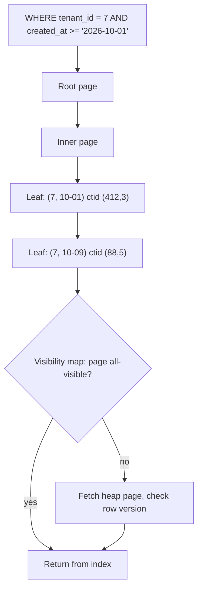

## In one minute
- An index is a second copy of some columns, kept in an order (or a hash) that lets the database jump to matching rows instead of reading the whole table. It trades write cost and storage for read speed.
- Most indexes are B+ trees of `(key, pointer)` entries. The pointer is a physical address in Postgres and a primary key value in InnoDB, and that one difference shapes update cost, lookup cost and what "clustered" means.
- An index helps only when the query's shape matches its order: equality columns first, then at most one range, and ideally every needed column included so the table is never touched.
- Every index is written on every insert and delete, and on every update that changes an indexed column. Eight indexes can make a write several times more expensive.
- Other shapes need other structures: inverted indexes for words and array elements, spatial trees for geometry, block-range summaries for append-only time data, vector graphs for similarity.

## How it works

### Why scanning stops working
Without an index, `WHERE email = 'ana@x.io'` over 50 million 200-byte rows reads about 1.2 million 8 KB pages, roughly 10 GB. A B+ tree on `email` needs three or four page reads. This is the "finding things fast" problem shape, and it recurs as a search engine's inverted index, a vector database's neighbour graph and a code-search trigram index: pay at write time so reads touch a small fraction of the data.

### What an index entry holds
An index entry is the indexed value plus a way to find the row. In Postgres the table is an unordered *heap* and each entry stores a `ctid`, the row's physical (block, offset) address. In InnoDB the table *is* a B+ tree ordered by primary key (a *clustered* index), and secondary entries store the primary key ([MySQL docs](https://dev.mysql.com/doc/refman/8.0/en/innodb-index-types.html)). An InnoDB lookup by email descends two trees; Postgres descends one and reads a heap page. In exchange, InnoDB secondary indexes ignore rows moving within the clustered tree, while Postgres adds index entries whenever an update puts a new row version on another page.

### Composite, covering, partial and expression indexes
A composite index on `(tenant_id, created_at)` sorts by tenant, then by time within a tenant. It serves "tenant 7's orders this week" as one contiguous range, but not "all orders this week" (the *Database Design* lesson covers the prefix rule in detail). Postgres 18 softened that rule with B-tree *skip scan*: when the leading column has few distinct values, the planner can probe once per value instead of giving up on the index ([Postgres docs](https://www.postgresql.org/docs/current/indexes-multicolumn.html)). With thousands of tenants it still loses to an index that leads with `created_at`. A **covering** index holds every column a query needs, either as key columns or as `INCLUDE` payload, so the database can answer from the index alone. A **partial** index (`WHERE status = 'open'`) indexes only the rows a hot query cares about, often a few percent of the table. An **expression** index on `lower(email)` serves queries that filter on that expression, which a plain index on `email` cannot.

### Choosing what to index
Indexes pay off when the query is selective. If a filter matches 30% of rows, following the pointers costs more than one sequential pass, and the planner rightly ignores the index (see *Query Optimization*). Index join keys, high-QPS lookups and the sort order of paginated lists; skip low-cardinality flags on their own, write-mostly columns, and indexes that duplicate another index's prefix.

### Indexes in distributed stores
When data is partitioned, an index is **local** (each partition indexes its own rows: local writes, but a lookup asks every partition) or **global** (partitioned by the indexed value: one-partition lookups, but writes cross machines). DynamoDB's global secondary indexes are updated asynchronously, normally within a fraction of a second, and serve only eventually consistent reads; its local ones share the table's partition key and allow strong reads. The global index also pushes back: if it lacks write capacity, writes to the base table are throttled ([DynamoDB docs](https://docs.aws.amazon.com/amazondynamodb/latest/developerguide/GSI.html)). Cassandra's secondary indexes are local. Storage-attached indexes (SAI) index each node's memtables and SSTables as they are written, so a query without the partition key still asks replicas range by range ([Cassandra docs](https://cassandra.apache.org/doc/latest/cassandra/developing/cql/indexing/sai/sai-concepts.html)); they suit filtering, not high-QPS lookups by a non-key column.

## Down the stack

### Layer 1: The contract
An index is invisible to results: a query returns the same rows with or without it, and the index reflects every committed change in the same transaction (single-node relational) or within a stated lag (DynamoDB global indexes). A unique index also promises no two visible rows share a key, so it is a constraint as much as a speed-up. Nothing promises the planner will use it; that is a per-query cost decision. Building an index normally blocks writes for its duration; `CREATE INDEX CONCURRENTLY` in Postgres and online DDL in InnoDB avoid the block at the cost of a slower build (Postgres scans the table twice and waits for older transactions) and, for Postgres, an index left `INVALID` if the build fails. An invalid index is ignored by queries but still updated on every write until you drop it ([Postgres docs](https://www.postgresql.org/docs/current/sql-createindex.html)).

### Layer 2: The mechanism
A Postgres B-tree index is a Lehman-Yao B+ tree of 8 KB pages: leaf pages hold `(key, ctid)` tuples in key order and are linked to their siblings for range scans and for detecting concurrent splits, and inner pages hold separator keys ([nbtree README](https://github.com/postgres/postgres/blob/master/src/backend/access/nbtree/README)). Since Postgres 13, repeated keys in a non-unique index are stored once with a posting list of `ctid`s, which keeps low-cardinality indexes much smaller. An **index-only scan** still has to know whether each row is visible to the current transaction, and Postgres keeps visibility in the heap, so it consults the *visibility map* (two bits per heap page). If the page is marked all-visible, the heap visit is skipped; if not, the scan fetches the heap tuple anyway ([Postgres docs](https://www.postgresql.org/docs/current/indexes-index-only-scans.html)). After a bulk load, an index-only scan is only fast once `VACUUM` has set those bits.

Updates are where indexes cost the most. Postgres writes a new row version for every update. If no indexed column changed and the new version fits on the same heap page, a **heap-only tuple** (HOT) update chains it from the old version and adds no index entries; otherwise every index on the table gets a new entry. Leaving free space on each page (`fillfactor` below 100) raises the HOT rate ([Postgres docs](https://www.postgresql.org/docs/current/storage-hot.html)). InnoDB can buffer changes to non-unique secondary indexes in its *change buffer* and merge them when the page is next read, turning random index writes into batched ones; unique indexes cannot be buffered because the uniqueness check needs the page now. MySQL 8.4 turned this off by default (`innodb_change_buffering` went from `all` to `none`), so on current versions every secondary index write goes straight to its page ([MySQL 8.4 changes](https://dev.mysql.com/doc/refman/8.4/en/mysql-nutshell.html)).

**GIN** indexes store a posting list of row pointers per element, for arrays, `jsonb` keys and full-text tokens. **BRIN** stores only the min and max of each block range (128 heap pages by default), tiny even for a terabyte table and precise only when the column follows insertion order, like a timestamp ([Postgres docs](https://www.postgresql.org/docs/current/brin.html)).

### Layer 3: The machine
With 8 KB pages and 16-byte entries plus per-tuple overhead, a B-tree leaf holds a few hundred entries, so 100 million keys need three or four levels. The root and inner levels are a few megabytes and stay in memory; a lookup costs one or two leaf and heap reads that may miss the cache, about 0.1 ms each on NVMe and 5 to 10 ms on a spinning disk. A range scan reads leaves sequentially, but each matching row in a heap table can be on a different page: fetching 10,000 rows scattered across the heap can cost 10,000 random reads, which is why Postgres switches to a *bitmap heap scan* that sorts pointers by page first, and why clustering by the scan order matters.

Each index also costs buffer pool memory and WAL bandwidth. One insert into a table with six indexes dirties at least seven pages and writes seven WAL records, and the first change to a page after a checkpoint logs the full 8 KB page image. Random UUID keys send each insert to a different leaf, so the whole index is the working set; time-ordered keys (UUIDv7, sequences) keep inserts on a few hot rightmost leaves. Postgres 18 added a built-in `uuidv7()` for exactly this reason ([Postgres 18 release notes](https://www.postgresql.org/docs/18/release-18.html)).

### Why it's built this way
1. Storage rewards reading a few nearby pages and punishes scattered ones, so an index keeps keys sorted in large pages of hundreds of entries.
2. A sorted copy must stay correct under writes, so every index is updated in the writing transaction, and cost scales with the index count.
3. Rewriting every index on every update is ruinous, so engines add escape hatches: HOT updates, change buffers, pointing by primary key.
4. One ordering cannot serve every query, so engines offer several structures and the planner chooses per query by estimated cost.

## Diagram


## Worked example
A multi-tenant billing table has 400 million invoices of 300 bytes, about 120 GB, taking 3,000 inserts and 1,500 updates a second. The hot query lists one tenant's unpaid invoices by due date, 50 per page, at 2,000 QPS.

Without a suitable index, each query scans the tenant's rows: 2 million invoices, about 600 MB, impossible at 2,000 QPS.

An index on `(tenant_id, status, due_date)` turns each query into one descent plus a 50-entry range, followed by up to 50 heap fetches: around 55 page reads, most cached. Since only 3% of invoices are unpaid, a partial index on `(tenant_id, due_date) WHERE status = 'unpaid'` holds 12 million entries instead of 400 million: at about 40 bytes each, roughly 0.5 GB instead of 16 GB, small enough to stay in memory. Adding `INCLUDE (amount, customer_name)` makes it covering, so pages whose heap blocks are all-visible need no heap fetch at all.

Now the write side. The table already had five indexes. Each insert touches six B-trees, 18,000 index insertions a second. Updates mostly change `status` and `paid_at`; because `status` is in the old composite index, every payment update was non-HOT and wrote all five indexes. Moving to the partial index and dropping two unused indexes (found with `pg_stat_user_indexes.idx_scan = 0` over 30 days) cut the indexes a payment update touches from five to two, with a matching drop in WAL volume.

## In the wild
- **AWS, 2015: secondary indexes grow the metadata that takes DynamoDB down.** On 20 September a short network disruption at 2:19am PDT made many storage servers re-request their partition membership at once. Fast adoption of global secondary indexes had made that membership data much larger, responses missed their timeout, servers took themselves out of service and retried, and error rates settled near 55% until about 7:10am. AWS added metadata capacity, monitored membership size and lengthened timeouts ([AWS](https://aws.amazon.com/message/5467D2/)).
- **Uber, 2016: every index pays for every row version.** Uber's write-up on leaving Postgres explains that because Postgres indexes point at physical tuple locations, changing one indexed field on a table with 12 indexes wrote entries into all 12, and that WAL volume was then shipped to every replica across data centers. InnoDB's secondary indexes point at the primary key, so only the clustered index changes. The trade-off is the one described in *What an index entry holds* above ([Uber](https://www.uber.com/en-US/blog/postgres-to-mysql-migration/)).
- **GitHub, 2022: a missing index during peak load.** Four outages in eight days (16, 17, 22 and 23 March, each between about 2.5 and 5.6 hours) started when peak load plus a poorly performing query exhausted the database proxy's connections to the shared `mysql1` cluster. Adding an index fixed the main query; GitHub also throttled webhooks at peak and moved traffic off the cluster ([GitHub](https://github.blog/2022-03-23-an-update-on-recent-service-disruptions/)).

## Trade-offs
| Option | Strengths | Weaknesses | Choose when |
|---|---|---|---|
| B+ tree on one column | Equality, range and order, general purpose | Write cost, random I/O for unclustered rows | Selective lookups and sorted pagination |
| Composite or covering B+ tree | One range scan, no sort, no heap visits | Larger entries, only serves its prefix | High-QPS queries with a fixed shape |
| Partial index | Small, cache-resident, cheap to maintain | Only queries matching the predicate can use it | Hot queries over a small subset of rows |
| GIN or inverted index | Array, `jsonb` and full-text membership | Slow, large updates; no ordering | Tags, documents, search |
| BRIN | Tiny, near-free to maintain | Useful only when values follow physical order | Append-only time-series tables |
| Global secondary index (distributed) | Single-partition reads by the indexed value | Cross-node writes, often eventually consistent | Lookups by a non-partition key at scale |

## Pitfalls in production
- **Index sprawl.** Every team adds indexes and nobody removes them. Drop indexes unused for a full business cycle and review new ones against write volume.
- **Indexes that block deploys.** A plain `CREATE INDEX` on a large table blocks writes for minutes. Use `CREATE INDEX CONCURRENTLY` or online DDL, and check for and rebuild `INVALID` leftovers.
- **Hidden columns.** `WHERE lower(email) = ?` or an implicit cast (comparing a MySQL string column to a number, `WHERE phone = 5551234`) cannot use a plain index. Match the expression or add an expression index.
- **Random keys.** Random UUID primary keys spread inserts over every leaf, inflating cache misses and page splits. Prefer time-ordered identifiers for clustered or heavily inserted keys.
- **Index-only scans that are not.** On busy tables the visibility map is rarely set, so "index-only" scans still visit the heap. Tune autovacuum and check `Heap Fetches` in `EXPLAIN ANALYZE`.

## Leadership lens
- Ask for each proposed index: which query, at what QPS, and what it costs per write. An index nobody can tie to a query is a liability.
- Track write amplification and index size as first-class capacity metrics; they drive storage, replication lag and backup time.
- In distributed stores, decide early which access patterns need a global index and accept its consistency lag explicitly in the product design.

## Check yourself
1. Why does an update to a non-indexed column in Postgres sometimes still write to every index?
   **Answer:** If the new row version does not fit on the same heap page, it is not a HOT update, so every index needs an entry pointing to the new `ctid`. Lowering `fillfactor` leaves room and raises the HOT rate.
2. Why does an InnoDB secondary index lookup touch two B-trees?
   **Answer:** Secondary entries store the primary key, not a physical address, so the engine finds the primary key in the secondary index and then descends the clustered index to read the row.
3. A query filters on a status that 40% of rows have. Why might the planner ignore an index on status?
   **Answer:** Following 40% of the pointers costs more random reads than scanning the table sequentially, so the cost model picks the scan. A partial or composite index that makes the query selective helps.
4. What is the cost of a global secondary index in a partitioned store?
   **Answer:** A write to one partition must also update the index partition that owns the new value, often on another node, so writes cost more and the index usually lags the base table.

## Practice
**Task:** Implement a secondary index that stays correct under writes. `IndexedTable(columns, unique)` indexes rows (maps from column name to integer) on the ordered list `columns`. Keep entries as `(key, rowid)` sorted by key then rowid, where the key is the tuple of the row's values for those columns. `insert(rowid, row)` adds the row and its entry; `update(rowid, row)` replaces the row and touches the index only if the key changed; `delete(rowid)` removes both and returns whether the row existed. With `unique`, `insert` and `update` return false and change nothing if another row already has that key; otherwise they return true. `scan(prefix, lo, hi)` returns rowids in index order whose key starts with `prefix` and whose next column lies within the optional inclusive bounds `lo` and `hi`. `index_writes()` counts entries added plus entries removed, so an unchanged key costs nothing and a moved key costs two.

```python starter
class IndexedTable:
    def __init__(self, columns, unique=False):
        self.columns = list(columns)

    def insert(self, rowid, row):
        # TODO
        raise NotImplementedError

    def update(self, rowid, row):
        # TODO
        raise NotImplementedError

    def delete(self, rowid):
        # TODO
        raise NotImplementedError

    def scan(self, prefix, lo=None, hi=None):
        # TODO
        raise NotImplementedError

    def index_writes(self):
        # TODO
        raise NotImplementedError
```

```python tests
def invoices():
    t = IndexedTable(["tenant", "due"])
    t.insert(1, {"tenant": 7, "due": 300, "amount": 50})
    t.insert(2, {"tenant": 3, "due": 100, "amount": 20})
    t.insert(3, {"tenant": 7, "due": 100, "amount": 10})
    t.insert(4, {"tenant": 7, "due": 200, "amount": 99})
    t.insert(5, {"tenant": 9, "due": 50, "amount": 5})
    t.insert(6, {"tenant": 7, "due": 200, "amount": 1})
    return t


def test_prefix_scan_in_index_order():
    t = invoices()
    assert t.scan([7]) == [3, 4, 6, 1]
    assert t.scan([]) == [2, 3, 4, 6, 1, 5]
    assert t.scan([8]) == []


def test_range_on_next_column():
    t = invoices()
    assert t.scan([7], 150, 300) == [4, 6, 1]
    assert t.scan([7], None, 200) == [3, 4, 6]
    assert t.scan([], 4, 7) == [3, 4, 6, 1], "range on the first column"
    assert t.scan([7, 200]) == [4, 6], "duplicate keys ordered by rowid"


def test_update_without_key_change_is_free():
    t = invoices()
    before = t.index_writes()
    assert before == 6
    assert t.update(4, {"tenant": 7, "due": 200, "amount": 0}) is True
    assert t.index_writes() == before


def test_update_that_moves_key_costs_two():
    t = invoices()
    t.update(3, {"tenant": 9, "due": 10, "amount": 10})
    assert t.index_writes() == 8
    assert t.scan([7]) == [4, 6, 1]
    assert t.scan([9]) == [3, 5]


def test_delete():
    t = invoices()
    assert t.delete(6) is True
    assert t.delete(6) is False
    assert t.scan([7, 200]) == [4]
    assert t.index_writes() == 7


def test_unique_index():
    t = IndexedTable(["tenant", "ext"], unique=True)
    assert t.insert(1, {"tenant": 1, "ext": 10}) is True
    assert t.insert(2, {"tenant": 1, "ext": 11}) is True
    assert t.insert(3, {"tenant": 1, "ext": 10}) is False
    assert t.update(2, {"tenant": 1, "ext": 10}) is False
    assert t.scan([1]) == [1, 2], "failed update changed nothing"
    assert t.update(1, {"tenant": 1, "ext": 10}) is True, "same key on itself is fine"
    t.delete(1)
    assert t.insert(3, {"tenant": 1, "ext": 10}) is True
    assert t.scan([1, 10]) == [3]
```

```python solution
import bisect


class IndexedTable:
    def __init__(self, columns, unique=False):
        self.columns = list(columns)
        self.unique = unique
        self.rows = {}
        self.entries = []
        self.writes = 0

    def _key(self, row):
        return tuple(row[c] for c in self.columns)

    def _conflict(self, key, rowid):
        i = bisect.bisect_left(self.entries, (key,))
        while i < len(self.entries) and self.entries[i][0] == key:
            if self.entries[i][1] != rowid:
                return True
            i += 1
        return False

    def _add(self, key, rowid):
        bisect.insort(self.entries, (key, rowid))
        self.writes += 1

    def _remove(self, key, rowid):
        i = bisect.bisect_left(self.entries, (key, rowid))
        del self.entries[i]
        self.writes += 1

    def insert(self, rowid, row):
        key = self._key(row)
        if self.unique and self._conflict(key, rowid):
            return False
        self.rows[rowid] = dict(row)
        self._add(key, rowid)
        return True

    def update(self, rowid, row):
        old = self._key(self.rows[rowid])
        new = self._key(row)
        if new != old:
            if self.unique and self._conflict(new, rowid):
                return False
            self._remove(old, rowid)
            self._add(new, rowid)
        self.rows[rowid] = dict(row)
        return True

    def delete(self, rowid):
        if rowid not in self.rows:
            return False
        self._remove(self._key(self.rows.pop(rowid)), rowid)
        return True

    def scan(self, prefix, lo=None, hi=None):
        prefix = tuple(prefix)
        p = len(prefix)
        start = prefix + ((lo,) if lo is not None else ())
        i = bisect.bisect_left(self.entries, (start,))
        out = []
        while i < len(self.entries):
            key, rowid = self.entries[i]
            if key[:p] != prefix:
                break
            if hi is not None and key[p] > hi:
                break
            out.append(rowid)
            i += 1
        return out

    def index_writes(self):
        return self.writes
```

```typescript starter
export type Row = { [column: string]: number };

export class IndexedTable {
  constructor(public columns: string[], public unique: boolean = false) {}
  insert(rowid: number, row: Row): boolean {
    throw new Error("TODO");
  }
  update(rowid: number, row: Row): boolean {
    throw new Error("TODO");
  }
  delete(rowid: number): boolean {
    throw new Error("TODO");
  }
  scan(prefix: number[], lo: number | null = null, hi: number | null = null): number[] {
    throw new Error("TODO");
  }
  indexWrites(): number {
    throw new Error("TODO");
  }
}
```

```typescript tests
function invoices(): IndexedTable {
  const t = new IndexedTable(["tenant", "due"]);
  t.insert(1, { tenant: 7, due: 300, amount: 50 });
  t.insert(2, { tenant: 3, due: 100, amount: 20 });
  t.insert(3, { tenant: 7, due: 100, amount: 10 });
  t.insert(4, { tenant: 7, due: 200, amount: 99 });
  t.insert(5, { tenant: 9, due: 50, amount: 5 });
  t.insert(6, { tenant: 7, due: 200, amount: 1 });
  return t;
}

test("prefix scan in index order", () => {
  const t = invoices();
  assertEqual(t.scan([7]), [3, 4, 6, 1]);
  assertEqual(t.scan([]), [2, 3, 4, 6, 1, 5]);
  assertEqual(t.scan([8]), []);
});
test("range on next column", () => {
  const t = invoices();
  assertEqual(t.scan([7], 150, 300), [4, 6, 1]);
  assertEqual(t.scan([7], null, 200), [3, 4, 6]);
  assertEqual(t.scan([], 4, 7), [3, 4, 6, 1], "range on the first column");
  assertEqual(t.scan([7, 200]), [4, 6], "duplicate keys ordered by rowid");
});
test("update without key change is free", () => {
  const t = invoices();
  assertEqual(t.indexWrites(), 6);
  assertEqual(t.update(4, { tenant: 7, due: 200, amount: 0 }), true);
  assertEqual(t.indexWrites(), 6);
});
test("update that moves key costs two", () => {
  const t = invoices();
  t.update(3, { tenant: 9, due: 10, amount: 10 });
  assertEqual(t.indexWrites(), 8);
  assertEqual(t.scan([7]), [4, 6, 1]);
  assertEqual(t.scan([9]), [3, 5]);
});
test("delete", () => {
  const t = invoices();
  assertEqual(t.delete(6), true);
  assertEqual(t.delete(6), false);
  assertEqual(t.scan([7, 200]), [4]);
  assertEqual(t.indexWrites(), 7);
});
test("unique index", () => {
  const t = new IndexedTable(["tenant", "ext"], true);
  assertEqual(t.insert(1, { tenant: 1, ext: 10 }), true);
  assertEqual(t.insert(2, { tenant: 1, ext: 11 }), true);
  assertEqual(t.insert(3, { tenant: 1, ext: 10 }), false);
  assertEqual(t.update(2, { tenant: 1, ext: 10 }), false);
  assertEqual(t.scan([1]), [1, 2], "failed update changed nothing");
  assertEqual(t.update(1, { tenant: 1, ext: 10 }), true, "same key on itself is fine");
  t.delete(1);
  assertEqual(t.insert(3, { tenant: 1, ext: 10 }), true);
  assertEqual(t.scan([1, 10]), [3]);
});
```

```typescript solution
export type Row = { [column: string]: number };

interface Entry {
  key: number[];
  rowid: number;
}

function cmpKeys(a: number[], b: number[]): number {
  const n = Math.min(a.length, b.length);
  for (let i = 0; i < n; i++) if (a[i] !== b[i]) return a[i] < b[i] ? -1 : 1;
  return a.length - b.length;
}

function cmpEntry(a: Entry, b: Entry): number {
  return cmpKeys(a.key, b.key) || a.rowid - b.rowid;
}

export class IndexedTable {
  private rows = new Map<number, Row>();
  private entries: Entry[] = [];
  private writes = 0;
  constructor(public columns: string[], public unique: boolean = false) {}

  private keyOf(row: Row): number[] {
    return this.columns.map((c) => row[c]);
  }
  private lowerBound(pred: (e: Entry) => boolean): number {
    let lo = 0, hi = this.entries.length;
    while (lo < hi) {
      const mid = (lo + hi) >> 1;
      if (pred(this.entries[mid])) hi = mid;
      else lo = mid + 1;
    }
    return lo;
  }
  private conflict(key: number[], rowid: number): boolean {
    let i = this.lowerBound((e) => cmpKeys(e.key, key) >= 0);
    for (; i < this.entries.length && cmpKeys(this.entries[i].key, key) === 0; i++) {
      if (this.entries[i].rowid !== rowid) return true;
    }
    return false;
  }
  private add(key: number[], rowid: number): void {
    const e = { key, rowid };
    this.entries.splice(this.lowerBound((x) => cmpEntry(x, e) >= 0), 0, e);
    this.writes++;
  }
  private remove(key: number[], rowid: number): void {
    const e = { key, rowid };
    this.entries.splice(this.lowerBound((x) => cmpEntry(x, e) >= 0), 1);
    this.writes++;
  }
  insert(rowid: number, row: Row): boolean {
    const key = this.keyOf(row);
    if (this.unique && this.conflict(key, rowid)) return false;
    this.rows.set(rowid, { ...row });
    this.add(key, rowid);
    return true;
  }
  update(rowid: number, row: Row): boolean {
    const old = this.keyOf(this.rows.get(rowid) as Row);
    const next = this.keyOf(row);
    if (cmpKeys(old, next) !== 0) {
      if (this.unique && this.conflict(next, rowid)) return false;
      this.remove(old, rowid);
      this.add(next, rowid);
    }
    this.rows.set(rowid, { ...row });
    return true;
  }
  delete(rowid: number): boolean {
    const row = this.rows.get(rowid);
    if (row === undefined) return false;
    this.rows.delete(rowid);
    this.remove(this.keyOf(row), rowid);
    return true;
  }
  scan(prefix: number[], lo: number | null = null, hi: number | null = null): number[] {
    const p = prefix.length;
    const start = lo === null ? prefix : [...prefix, lo];
    const out: number[] = [];
    for (let i = this.lowerBound((e) => cmpKeys(e.key, start) >= 0); i < this.entries.length; i++) {
      const { key, rowid } = this.entries[i];
      if (cmpKeys(key.slice(0, p), prefix) !== 0) break;
      if (hi !== null && key[p] > hi) break;
      out.push(rowid);
    }
    return out;
  }
  indexWrites(): number {
    return this.writes;
  }
}
```

```go starter
package practice

type Row = map[string]int

type IndexedTable struct {
	columns []string
}

func NewIndexedTable(columns []string, unique bool) *IndexedTable {
	return &IndexedTable{columns: columns}
}

func (t *IndexedTable) Insert(rowid int, row Row) bool { panic("TODO") }
func (t *IndexedTable) Update(rowid int, row Row) bool { panic("TODO") }
func (t *IndexedTable) Delete(rowid int) bool          { panic("TODO") }

// Scan uses nil for an absent bound.
func (t *IndexedTable) Scan(prefix []int, lo, hi *int) []int { panic("TODO") }
func (t *IndexedTable) IndexWrites() int                     { panic("TODO") }
```

```go tests
package practice

import (
	"reflect"
	"testing"
)

func invoices() *IndexedTable {
	t := NewIndexedTable([]string{"tenant", "due"}, false)
	t.Insert(1, Row{"tenant": 7, "due": 300, "amount": 50})
	t.Insert(2, Row{"tenant": 3, "due": 100, "amount": 20})
	t.Insert(3, Row{"tenant": 7, "due": 100, "amount": 10})
	t.Insert(4, Row{"tenant": 7, "due": 200, "amount": 99})
	t.Insert(5, Row{"tenant": 9, "due": 50, "amount": 5})
	t.Insert(6, Row{"tenant": 7, "due": 200, "amount": 1})
	return t
}

func ptr(v int) *int { return &v }

func same(t *testing.T, got, want []int) {
	t.Helper()
	if len(got) == 0 && len(want) == 0 {
		return
	}
	if !reflect.DeepEqual(got, want) {
		t.Fatalf("got %v, want %v", got, want)
	}
}

func TestPrefixScanInIndexOrder(t *testing.T) {
	tb := invoices()
	same(t, tb.Scan([]int{7}, nil, nil), []int{3, 4, 6, 1})
	same(t, tb.Scan(nil, nil, nil), []int{2, 3, 4, 6, 1, 5})
	same(t, tb.Scan([]int{8}, nil, nil), []int{})
}

func TestRangeOnNextColumn(t *testing.T) {
	tb := invoices()
	same(t, tb.Scan([]int{7}, ptr(150), ptr(300)), []int{4, 6, 1})
	same(t, tb.Scan([]int{7}, nil, ptr(200)), []int{3, 4, 6})
	same(t, tb.Scan(nil, ptr(4), ptr(7)), []int{3, 4, 6, 1})
	same(t, tb.Scan([]int{7, 200}, nil, nil), []int{4, 6})
}

func TestUpdateWithoutKeyChangeIsFree(t *testing.T) {
	tb := invoices()
	if tb.IndexWrites() != 6 {
		t.Fatalf("writes %d, want 6", tb.IndexWrites())
	}
	if !tb.Update(4, Row{"tenant": 7, "due": 200, "amount": 0}) || tb.IndexWrites() != 6 {
		t.Fatalf("non-key update should not touch the index, writes %d", tb.IndexWrites())
	}
}

func TestUpdateThatMovesKeyCostsTwo(t *testing.T) {
	tb := invoices()
	tb.Update(3, Row{"tenant": 9, "due": 10, "amount": 10})
	if tb.IndexWrites() != 8 {
		t.Fatalf("writes %d, want 8", tb.IndexWrites())
	}
	same(t, tb.Scan([]int{7}, nil, nil), []int{4, 6, 1})
	same(t, tb.Scan([]int{9}, nil, nil), []int{3, 5})
}

func TestDelete(t *testing.T) {
	tb := invoices()
	if !tb.Delete(6) || tb.Delete(6) {
		t.Fatal("delete should succeed once")
	}
	same(t, tb.Scan([]int{7, 200}, nil, nil), []int{4})
	if tb.IndexWrites() != 7 {
		t.Fatalf("writes %d, want 7", tb.IndexWrites())
	}
}

func TestUniqueIndex(t *testing.T) {
	tb := NewIndexedTable([]string{"tenant", "ext"}, true)
	if !tb.Insert(1, Row{"tenant": 1, "ext": 10}) || !tb.Insert(2, Row{"tenant": 1, "ext": 11}) {
		t.Fatal("distinct keys should insert")
	}
	if tb.Insert(3, Row{"tenant": 1, "ext": 10}) {
		t.Fatal("duplicate insert should fail")
	}
	if tb.Update(2, Row{"tenant": 1, "ext": 10}) {
		t.Fatal("update into a taken key should fail")
	}
	same(t, tb.Scan([]int{1}, nil, nil), []int{1, 2})
	if !tb.Update(1, Row{"tenant": 1, "ext": 10}) {
		t.Fatal("same key on itself is fine")
	}
	tb.Delete(1)
	if !tb.Insert(3, Row{"tenant": 1, "ext": 10}) {
		t.Fatal("key is free after delete")
	}
	same(t, tb.Scan([]int{1, 10}, nil, nil), []int{3})
}
```

```go solution
package practice

import (
	"sort"
	"sync"
)

type Row = map[string]int

type entry struct {
	key   []int
	rowid int
}

type IndexedTable struct {
	mu      sync.Mutex
	columns []string
	unique  bool
	rows    map[int]Row
	entries []entry
	writes  int
}

func NewIndexedTable(columns []string, unique bool) *IndexedTable {
	return &IndexedTable{columns: columns, unique: unique, rows: map[int]Row{}}
}

func cmpKeys(a, b []int) int {
	for i := 0; i < len(a) && i < len(b); i++ {
		if a[i] != b[i] {
			if a[i] < b[i] {
				return -1
			}
			return 1
		}
	}
	return len(a) - len(b)
}

func cmpEntry(a, b entry) int {
	if c := cmpKeys(a.key, b.key); c != 0 {
		return c
	}
	return a.rowid - b.rowid
}

func (t *IndexedTable) keyOf(row Row) []int {
	k := make([]int, len(t.columns))
	for i, c := range t.columns {
		k[i] = row[c]
	}
	return k
}

func (t *IndexedTable) lowerBound(target []int) int {
	return sort.Search(len(t.entries), func(i int) bool { return cmpKeys(t.entries[i].key, target) >= 0 })
}

func (t *IndexedTable) conflict(key []int, rowid int) bool {
	for i := t.lowerBound(key); i < len(t.entries) && cmpKeys(t.entries[i].key, key) == 0; i++ {
		if t.entries[i].rowid != rowid {
			return true
		}
	}
	return false
}

func (t *IndexedTable) add(key []int, rowid int) {
	e := entry{key, rowid}
	i := sort.Search(len(t.entries), func(i int) bool { return cmpEntry(t.entries[i], e) >= 0 })
	t.entries = append(t.entries, entry{})
	copy(t.entries[i+1:], t.entries[i:])
	t.entries[i] = e
	t.writes++
}

func (t *IndexedTable) remove(key []int, rowid int) {
	e := entry{key, rowid}
	i := sort.Search(len(t.entries), func(i int) bool { return cmpEntry(t.entries[i], e) >= 0 })
	t.entries = append(t.entries[:i], t.entries[i+1:]...)
	t.writes++
}

func copyRow(r Row) Row {
	c := Row{}
	for k, v := range r {
		c[k] = v
	}
	return c
}

func (t *IndexedTable) Insert(rowid int, row Row) bool {
	t.mu.Lock()
	defer t.mu.Unlock()
	key := t.keyOf(row)
	if t.unique && t.conflict(key, rowid) {
		return false
	}
	t.rows[rowid] = copyRow(row)
	t.add(key, rowid)
	return true
}

func (t *IndexedTable) Update(rowid int, row Row) bool {
	t.mu.Lock()
	defer t.mu.Unlock()
	old, next := t.keyOf(t.rows[rowid]), t.keyOf(row)
	if cmpKeys(old, next) != 0 {
		if t.unique && t.conflict(next, rowid) {
			return false
		}
		t.remove(old, rowid)
		t.add(next, rowid)
	}
	t.rows[rowid] = copyRow(row)
	return true
}

func (t *IndexedTable) Delete(rowid int) bool {
	t.mu.Lock()
	defer t.mu.Unlock()
	row, ok := t.rows[rowid]
	if !ok {
		return false
	}
	delete(t.rows, rowid)
	t.remove(t.keyOf(row), rowid)
	return true
}

// Scan uses nil for an absent bound.
func (t *IndexedTable) Scan(prefix []int, lo, hi *int) []int {
	t.mu.Lock()
	defer t.mu.Unlock()
	p := len(prefix)
	start := append([]int(nil), prefix...)
	if lo != nil {
		start = append(start, *lo)
	}
	out := []int{}
	for i := t.lowerBound(start); i < len(t.entries); i++ {
		e := t.entries[i]
		if cmpKeys(e.key[:p], prefix) != 0 {
			break
		}
		if hi != nil && e.key[p] > *hi {
			break
		}
		out = append(out, e.rowid)
	}
	return out
}

func (t *IndexedTable) IndexWrites() int {
	t.mu.Lock()
	defer t.mu.Unlock()
	return t.writes
}
```

## Mock interview
**Prompt:** A Postgres `events` table has 2 billion rows, growing 30 million a day. The dashboard asks for "account X's events of type Y in the last 24 hours, newest first, 100 per page" at 3,000 QPS, and p99 has crept from 20 ms to 900 ms. Diagnose and fix it.

- Follow-up: Your new index makes inserts 30% slower. What do you look at, and what do you trade?
- Follow-up: How do you build the index on a live table without blocking writes, and what can go wrong?
- Follow-up: Data older than 90 days is rarely read. How does that change your indexing strategy?

**A strong answer covers:**
- Reading `EXPLAIN (ANALYZE, BUFFERS)` and spotting an index on `account_id` or time alone, forcing a large range plus filter and sort.
- A composite index `(account_id, type, created_at DESC)` that turns the query into one bounded range with no sort, plus keyset pagination instead of `OFFSET`.
- Write cost: drop unused indexes, `INCLUDE` only what the hot query needs, watch the HOT update ratio.
- `CREATE INDEX CONCURRENTLY`, its two table scans, and handling an `INVALID` index after a failure.
- Time partitioning: recent partitions fully indexed and cached, old ones with BRIN or fewer indexes, dropped instead of mass-deleted.

## Sources and further study
**Primary**
- [Lehman and Yao, Efficient Locking for Concurrent Operations on B-Trees (TODS 1981)](https://dl.acm.org/doi/10.1145/319628.319663): the right-link design Postgres still implements, which lets readers proceed during page splits.
- [Postgres nbtree README](https://github.com/postgres/postgres/blob/master/src/backend/access/nbtree/README): the implementer's notes on page splits, deduplication and deletion inside Postgres B-trees.

**Systems docs**
- [PostgreSQL: CREATE INDEX](https://www.postgresql.org/docs/current/sql-createindex.html): concurrent builds, invalid indexes and the default B-tree fillfactor of 90.
- [Cassandra: SAI concepts](https://cassandra.apache.org/doc/latest/cassandra/developing/cql/indexing/sai/sai-concepts.html): how a distributed store indexes per node and coordinates a non-key query.
- [MySQL 8.4: what changed](https://dev.mysql.com/doc/refman/8.4/en/mysql-nutshell.html): the InnoDB default changes, including change buffering and the adaptive hash index both switched off.

**Books**
- *Database Internals*, Alex Petrov, chapters 2 "B-Tree Basics" and 4 "Implementing B-Trees": node layout, binary search within pages, splits and right-only appends.
- *Designing Data-Intensive Applications* (1st ed.), Martin Kleppmann, chapter 3 "Storage and Retrieval" and chapter 6 "Partitioning" (section "Partitioning and Secondary Indexes"): B-trees versus LSM trees, and local versus global indexes.

**Other curricula**
- [donnemartin/system-design-primer](https://github.com/donnemartin/system-design-primer): treats indexes as one SQL tuning tip (index the columns you filter, sort and join on) and notes that writes get slower.
- [Azure Architecture Center: Index Table pattern](https://learn.microsoft.com/en-us/azure/architecture/patterns/index-table): building your own secondary index in a store that lacks one, with full, partial or no duplication, and the consistency work that follows.

## Watch
- [Database Indexing Explained (with PostgreSQL) (Hussein Nasser)](https://www.youtube.com/watch?v=-qNSXK7s7_w): live examples of how an index changes a query plan and when it does not help.
- [F2023 #08 - B+Tree Indexes (CMU Database Group)](https://www.youtube.com/watch?v=5gXn5fLkbM0): the structure underneath most indexes, including node layout and composite keys.

## Free resources
- [Use The Index, Luke](https://use-the-index-luke.com/): a free book on indexing for developers, from B-tree anatomy to composite and covering indexes across engines.
- [PostgreSQL: index-only scans and covering indexes](https://www.postgresql.org/docs/current/indexes-index-only-scans.html): the visibility map and `INCLUDE`, explained by the people who built them.
- [PostgreSQL: heap-only tuples](https://www.postgresql.org/docs/current/storage-hot.html): when updates skip index maintenance and how `fillfactor` helps.
- [MySQL: clustered and secondary indexes](https://dev.mysql.com/doc/refman/8.0/en/innodb-index-types.html): how InnoDB organises tables by primary key and what secondary entries store.
- [PostgreSQL: BRIN indexes](https://www.postgresql.org/docs/current/brin.html): block-range summaries for very large, naturally ordered tables.
- [DynamoDB: global secondary indexes](https://docs.aws.amazon.com/amazondynamodb/latest/developerguide/GSI.html): how a distributed store maintains indexes asynchronously across partitions.
