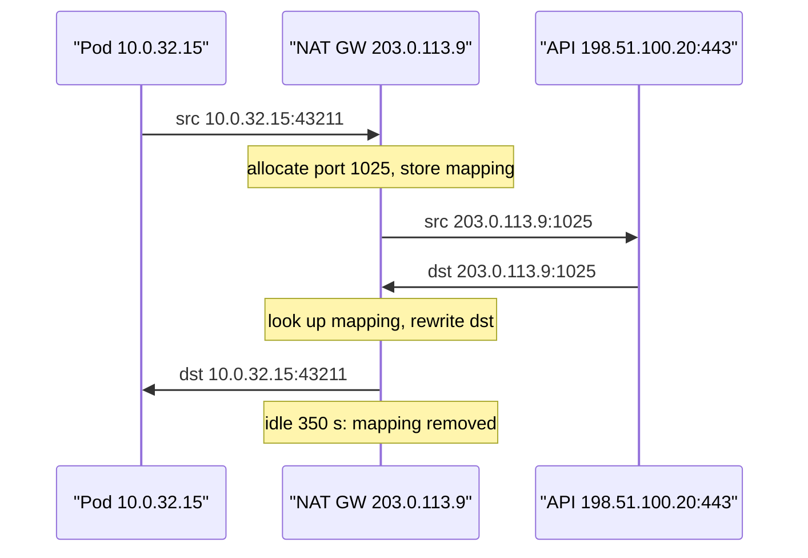

## In one minute
- An IP address is a *locator*, a position in the routing hierarchy, not an identity. A prefix such as `10.20.0.0/16` names a block, and routers forward on the longest prefix that matches.
- Address planning is architecture. Overlapping private ranges block VPC peering, mergers and VPNs for years, and subnets sized too small run out when pods start taking one address each.
- NAT lets many hosts share few public addresses. In exchange it keeps per-flow state, limits concurrent connections per destination, and breaks inbound reachability. Many "random" egress failures are NAT port exhaustion.
- IPv6 removes scarcity (every subnet is a /64) and with it the need for NAT, but the internet will run dual-stack for years, so clients race both families with Happy Eyeballs.
- The problem shapes are *finding things fast* (longest-prefix match over a million routes in nanoseconds) and *contention* (thousands of flows competing for 64K ports on one NAT address).

## How it works

### CIDR: prefixes and the arithmetic
Classless Inter-Domain Routing (1993) replaced fixed class A, B and C networks with a prefix of any length. A `/n` block holds 2^(32−n) addresses: `/16` is 65,536, `/24` is 256, `/28` is 16. Blocks align on their size, so `10.0.4.0/22` covers `10.0.4.0` to `10.0.7.255`, while `10.0.5.0/22` is invalid because host bits are set. Adjacent aligned blocks aggregate: `10.0.4.0/23` and `10.0.6.0/23` together form `10.0.4.0/22`. Aggregation is what keeps the global IPv4 table at about 1.05 million routes (January 2026), instead of one per network ([APNIC, BGP in 2025](https://blog.apnic.net/2026/01/08/bgp-in-2025/)).

A router picks the most specific match: with `0.0.0.0/0 → internet`, `10.0.0.0/8 → transit` and `10.20.3.0/24 → VPN`, a packet to `10.20.3.9` takes the VPN. Traffic engineering and hijacks both exploit this: announce a more specific prefix and you win the traffic. The defence is RPKI route origin validation. The prefix holder publishes a signed ROA naming the AS allowed to originate it and the longest prefix length allowed, and routers that enforce it drop announcements that don't match ([RFC 6811](https://www.rfc-editor.org/rfc/rfc6811)). Many networks also refuse IPv4 prefixes longer than `/24`. Both only help where operators actually enforce them.

Reserved ranges matter: private `10.0.0.0/8`, `172.16.0.0/12` and `192.168.0.0/16` ([RFC 1918](https://www.rfc-editor.org/rfc/rfc1918)); carrier-grade NAT `100.64.0.0/10` (RFC 6598), which some Kubernetes setups borrow for pods; link-local `169.254.0.0/16`, home of the cloud metadata endpoint `169.254.169.254`.

### Subnets in a cloud network
An AWS VPC takes one or more blocks between `/16` and `/28`. Each subnet lives in one availability zone and loses five addresses: network, VPC router, DNS, one reserved for future use, and broadcast ([AWS subnet sizing](https://docs.aws.amazon.com/vpc/latest/userguide/subnet-sizing.html)). Each zone typically gets a public subnet (load balancers, NAT), a large private one for compute, and a small one for databases.

Two decisions are hard to undo. First, ranges must not overlap anything you might ever connect to (other VPCs, on-premises, partners, acquisitions), because routing cannot distinguish identical prefixes. Second, size for pods, not nodes. With the AWS VPC CNI, every pod gets a real VPC address, so a 300-node cluster at 30 pods per node consumes 9,000 addresses.

### NAT: sharing addresses with state
Source NAT rewrites an outgoing packet's source address and port to a public address and a free port, and records the mapping so replies can be rewritten back. The translator keys each flow on the 5-tuple, so one public IP can reuse the same port for flows to *different* destinations. To one destination IP and port, though, it can hold at most about 64,000 flows. AWS NAT Gateway documents 55,000 simultaneous connections per unique destination (destination IP, port and protocol) for each public IP, and allows up to eight IPv4 addresses per gateway ([AWS NAT gateway basics](https://docs.aws.amazon.com/vpc/latest/userguide/nat-gateway-basics.html)). A flow idle for 350 seconds times out, and the gateway answers the next packet with an RST, not a FIN ([AWS troubleshooting](https://docs.aws.amazon.com/vpc/latest/userguide/nat-gateway-troubleshooting.html)).

Unsolicited inbound packets have no mapping and are dropped, which people mistake for a firewall. Peer-to-peer apps work around it with STUN and hole punching, falling back to TURN relays when the NAT maps per destination. [RFC 4787](https://www.rfc-editor.org/rfc/rfc4787) classifies these behaviours and requires UDP mappings to last at least two minutes, although many deployed NATs time out sooner.

### Unicast, anycast, multicast
Most addresses are unicast. Anycast announces one prefix from many sites so routing picks the nearest (see the anycast lesson). Multicast (`224.0.0.0/4`, `ff00::/8`) delivers to a group, common inside data centres and rare across the internet.

### IPv6
IPv6 addresses are 128 bits, written in hex groups with `::` for one run of zeros, for example `2001:db8:12::7`. Every LAN is a `/64`, so hosts can pick addresses themselves (SLAAC) and rotate privacy addresses. Sites typically get a `/48` or `/56`. ARP is replaced by Neighbor Discovery over ICMPv6, so blocking ICMPv6 breaks the network outright. The header is a fixed 40 bytes with no checksum, and only the source may fragment, never a router ([RFC 8200](https://www.rfc-editor.org/rfc/rfc8200)).

Native IPv6 access to Google first passed 50% on 28 March 2026, though the average across the measurements the Internet Society tracks is nearer 43% ([ISOC Pulse](https://pulse.internetsociety.org/en/blog/18-years-later-ipv6-reaches-majority/)). Many mobile carriers run IPv6-only with NAT64, and AWS charges $0.005 an hour, about $3.65 a month, for every public IPv4 address ([AWS VPC pricing](https://aws.amazon.com/vpc/pricing/)). Clients that resolve both `A` and `AAAA` records use Happy Eyeballs (RFC 8305). They wait up to 50 ms for the `AAAA` answer, try IPv6, start IPv4 about 250 ms later if IPv6 has not connected, and use whichever finishes first, so a broken IPv6 path costs latency instead of an outage. Version 3, still an Internet-Draft in 2026, folds `HTTPS`/`SVCB` DNS records and QUIC into the same race ([draft-ietf-happy-happyeyeballs-v3](https://datatracker.ietf.org/doc/draft-ietf-happy-happyeyeballs-v3/)).

## Down the stack

### Layer 1: The contract
Routing promises that a packet sent to an address goes, best effort, towards whichever interface currently holds the longest matching prefix. It does not promise that the holder is who you think. Source addresses are not authenticated, and spoofing is stopped only where networks filter at the edge (BCP 38). A NAT promises that an outbound flow gets a stable public mapping while it stays active, that replies come back through that mapping, and that unsolicited inbound traffic is dropped. A mapping idle for longer than the timeout is gone, and the next packet on that flow gets a reset or silence.

### Layer 2: The mechanism
Longest-prefix match needs a structure better than a hash table, because the key length varies. Linux uses an LC-trie (`fib_trie`) that compresses the binary trie into multi-way nodes. DPDK's `rte_lpm` uses DIR-24-8: a 2^24-entry table indexed by the first 24 bits, plus 256-entry second-level tables for longer prefixes, so most lookups take one memory read. Hardware routers use TCAM, which compares the address against every entry in parallel and returns the highest-priority match.

The next hop's MAC comes from ARP or Neighbor Discovery, cached in `ip neigh`. Linux NAT runs in netfilter conntrack. Each `nf_conntrack` entry stores the original and reply tuples, state and a timeout (by default 5 days for established TCP, 30 seconds for one-way UDP, 120 seconds for UDP streams, per the [kernel docs](https://docs.kernel.org/networking/nf_conntrack-sysctl.html)). When the table reaches `nf_conntrack_max`, the kernel logs "table full, dropping packet", and new flows fail.

### Layer 3: The machine
The global table holds about 1.05 million IPv4 routes and about 240,000 IPv6 routes. The original DIR-24-8 design used 2-byte entries, so its first level alone is 32 MB; DPDK's entries are 4 bytes, so it is 64 MB. That explains why software routers care about huge pages and cache misses. A miss to DRAM costs about 100 ns, while the per-packet budget at 10 Gbps line rate with small packets is 67 ns. TCAM answers in nanoseconds but costs far more power and money per bit than SRAM, so table growth is watched closely.

A conntrack entry costs a few hundred bytes, so a million flows is hundreds of megabytes of state. On the wire, an IPv4 address is 4 bytes and an IPv6 address 16, so IPv6 adds 20 bytes of header per packet: 1.3% of a 1,500-byte packet, but 50% of a 40-byte TCP ACK.

### Why it's built this way
1. In 1981, 32 bits looked plentiful, and fixed classes wasted most of each block, so CIDR (1993) introduced arbitrary prefixes to slow exhaustion.
2. Routers cannot hold a route per host, so addresses follow topology and are aggregated, which makes an address a location, not a name.
3. Addresses still ran out, so NAT spread one address across many hosts, at the cost of per-flow state and end-to-end reachability.
4. NAT's costs and continued growth justified IPv6. Changing every host, router and application takes decades, so dual-stack and Happy Eyeballs bridge the gap.

## Diagram



## Worked example
A company plans a `10.40.0.0/16` VPC for an EKS platform across three availability zones, expecting 25,000 pods at peak with the VPC CNI.

- Private compute: one `/18` per zone (16,384 − 5 = 16,379 usable), so 49,137 in total. That covers 25,000 pods plus nodes, with about 2x headroom. It uses `10.40.0.0` to `10.40.191.255`.
- Public: one `/24` per zone for load balancers and NAT, carved from `10.40.192.0/20`.
- Databases: one `/24` per zone in `10.40.208.0/20`, leaving `10.40.224.0/19` free for later.
- Before committing, check the range against the corporate WAN (`10.0.0.0/12`, which does not include `10.40`) and the partner VPN (`10.40.128.0/20`). The partner overlaps the compute range. The team moves to `10.64.0.0/16` now, rather than add double NAT later.

Egress is next. 2,000 pods each keep up to 40 concurrent connections to a payment provider at a single address on port 443. That is 80,000 flows to one destination through one NAT IP limited to 55,000, so about a third of new connections fail with port allocation errors during peaks. CloudWatch shows `ErrorPortAllocation` climbing. There are three fixes, in order of cost. First, connection pooling (a shared HTTP/2 client per pod brings flows down to 2,000). Second, more public IPs on the NAT gateway (each adds 55,000, up to eight per gateway). Third, IPv6 egress, if the provider supports it.

Cost: NAT data processing is about $0.045 per GB, so 40 TB a month is about $1,800 before transfer charges. An S3 gateway endpoint often removes most of that volume.

## In the wild
- **YouTube, 2008: a more specific prefix wins.** On 24 February, Pakistan Telecom (AS17557) announced `208.65.153.0/24`, and its upstream PCCW passed it on. Because YouTube announced only the covering `/22`, longest-prefix match sent YouTube traffic worldwide to Pakistan from 18:47 UTC. YouTube announced the same `/24` and then two `/25`s to win the traffic back, and the hijack ended when PCCW withdrew the route at 21:01, about two hours later ([RIPE NCC](https://www.ripe.net/about-us/news/youtube-hijacking-a-ripe-ncc-ris-case-study/)).
- **Cloudflare, 2024: 1.1.1.1 hijacked by a /32.** On 27 June, Eletronet (AS267613) originated `1.1.1.1/32`, and several networks, including a Tier 1 provider, accepted it as a blackhole route. A route leak of `1.1.1.0/24` added to it, affecting users in over 300 networks in 70 countries until 22:16 UTC (the leak lasted until 02:28 the next day). The prefix was signed with RPKI, so networks enforcing origin validation, or rejecting IPv4 routes longer than `/24`, were unaffected ([Cloudflare](https://blog.cloudflare.com/cloudflare-1111-incident-on-june-27-2024/)).

## Trade-offs

| Option | Strengths | Weaknesses | Choose when |
| --- | --- | --- | --- |
| Large private IPv4 VPC per environment | Simple routing, pods get real IPs | Consumes scarce RFC 1918 space, overlap risk | Few environments, central IP plan |
| Overlay or `100.64/10` pod range | Saves routable space | Encapsulation or SNAT, harder debugging | Very large clusters, constrained IP plan |
| NAT gateway egress | No public IPs on hosts, managed | Per-destination port limits, per-GB cost, state | Default private-subnet egress |
| Public IP per host | No NAT state or limits | IPv4 cost, larger attack surface | High-connection-count egress, P2P |
| IPv6 dual-stack | Ends scarcity and NAT for v6 peers | Two of everything: rules, monitoring, testing | New platforms, mobile-heavy traffic |

## Pitfalls in production
- **Overlapping CIDRs discovered at integration time.** Peering, VPNs or an acquisition fail because both sides used `10.0.0.0/16`. Keep a central IP address management (IPAM) registry and allocate from it, never by hand.
- **Subnet exhaustion from pods.** Deployments hang in `Pending` with no IP available. Size subnets for pods, add secondary CIDRs, or use prefix delegation.
- **NAT port exhaustion to a single hot destination.** Errors appear only at peak and only for one dependency. Pool connections, add NAT IPs, and alert on port-allocation metrics.
- **Idle mappings dropped silently.** Long-lived database or gRPC connections die after 350 seconds of quiet, and the next query hangs. Set TCP keepalive or application pings below the NAT idle timeout.
- **Trusting source IPs for security.** Allowlists break behind shared NAT and proxies, and addresses change. Authenticate with mTLS or tokens, and use IPs only as one layer of defence.

## Leadership lens
- Treat IP space as a company-wide resource with an owner and an IPAM tool. Undoing an overlap later takes a migration project, not a ticket.
- In design reviews, ask for the egress path of each dependency: which NAT, how many flows per destination, and what happens at 3x.
- Put public IPv4 and NAT processing on the cost dashboard. Gateway endpoints and IPv6 often pay for themselves.
- Decide an IPv6 posture explicitly (dual-stack at the edge first) rather than discovering it in an incident.

## Check yourself
1. Routes exist for `10.0.0.0/8`, `10.1.0.0/16` and `10.1.2.0/24`. Where does a packet to `10.1.3.4` go, and why?
   **Answer:** Via `10.1.0.0/16`. The `/24` does not contain it, and of the prefixes that match, the `/16` is the longest.
2. Why can one NAT IP hold far more than 65,535 connections in total, yet fail at 55,000 to one API?
   **Answer:** Mappings are unique per full 5-tuple, so a port can be reused for different destinations. With the destination IP and port fixed, only the source port varies, which caps flows to that destination.
3. Why does IPv6 make NAT unnecessary but not firewalls?
   **Answer:** Scarcity was NAT's reason to exist, and every subnet now has 2^64 addresses. The "drop unsolicited inbound" behaviour people relied on must now be an explicit stateful firewall rule.

## Practice
**Task:** Build a small CIDR toolkit for IPv4. `contains(cidr, ip)` says whether an address is in a block. `overlaps(a, b)` says whether two blocks share any address. `subnets(cidr, new_prefix)` splits a block into equal subnets in address order, and raises an error if `new_prefix` is shorter than the block's prefix or longer than 32. `lookup(routes, ip)` takes a mapping from CIDR to next hop and returns the next hop of the longest matching prefix, or none. Inputs are well-formed dotted quads; any CIDR with host bits set (such as `10.0.5.0/22`) must raise an error in every function.

```python starter
def contains(cidr, ip):
    # TODO
    raise NotImplementedError

def overlaps(a, b):
    # TODO
    raise NotImplementedError

def subnets(cidr, new_prefix):
    # TODO: list of CIDR strings
    raise NotImplementedError

def lookup(routes, ip):
    # TODO: next hop or None
    raise NotImplementedError
```

```python tests
def test_contains():
    assert contains("10.0.4.0/22", "10.0.7.255")
    assert not contains("10.0.4.0/22", "10.0.8.0")
    assert contains("0.0.0.0/0", "203.0.113.9")

def test_host_bits_rejected():
    try:
        contains("10.0.5.0/22", "10.0.5.1")
        assert False, "host bits accepted"
    except ValueError:
        pass

def test_overlaps():
    assert overlaps("10.40.0.0/16", "10.40.128.0/20")
    assert not overlaps("10.40.0.0/16", "10.41.0.0/16")
    assert overlaps("10.1.2.3/32", "10.0.0.0/8")

def test_subnets():
    assert subnets("10.40.0.0/16", 18) == ["10.40.0.0/18", "10.40.64.0/18",
                                           "10.40.128.0/18", "10.40.192.0/18"]
    assert subnets("192.168.1.0/24", 24) == ["192.168.1.0/24"]

def test_subnets_bad_prefix():
    for bad in (15, 33):
        try:
            subnets("10.40.0.0/16", bad)
            assert False, "bad prefix accepted"
        except ValueError:
            pass

def test_longest_prefix_match():
    routes = {"0.0.0.0/0": "igw", "10.0.0.0/8": "transit",
              "10.1.0.0/16": "peer", "10.1.2.0/24": "vpn"}
    assert lookup(routes, "10.1.2.9") == "vpn"
    assert lookup(routes, "10.1.3.4") == "peer"
    assert lookup(routes, "8.8.8.8") == "igw"
    assert lookup({"10.0.0.0/8": "transit"}, "192.168.0.1") is None
```

```python solution
def _ip(s):
    a, b, c, d = (int(x) for x in s.split("."))
    return (a << 24) | (b << 16) | (c << 8) | d

def _fmt(n):
    return ".".join(str((n >> s) & 255) for s in (24, 16, 8, 0))

def _parse(cidr):
    addr, plen = cidr.split("/")
    plen = int(plen)
    if plen < 0 or plen > 32:
        raise ValueError("bad prefix length")
    mask = (0xFFFFFFFF << (32 - plen)) & 0xFFFFFFFF
    net = _ip(addr)
    if net & ~mask & 0xFFFFFFFF:
        raise ValueError("host bits set")
    return net, plen, mask

def contains(cidr, ip):
    net, _, mask = _parse(cidr)
    return _ip(ip) & mask == net

def overlaps(a, b):
    na, pa, ma = _parse(a)
    nb, pb, mb = _parse(b)
    m = ma if pa < pb else mb
    return na & m == nb & m

def subnets(cidr, new_prefix):
    net, plen, _ = _parse(cidr)
    if new_prefix < plen or new_prefix > 32:
        raise ValueError("bad new prefix")
    step = 1 << (32 - new_prefix)
    return [_fmt(net + i * step) + "/" + str(new_prefix)
            for i in range(1 << (new_prefix - plen))]

def lookup(routes, ip):
    best, best_len = None, -1
    for cidr, hop in routes.items():
        _, plen, _ = _parse(cidr)
        if plen > best_len and contains(cidr, ip):
            best, best_len = hop, plen
    return best
```

```typescript starter
export function contains(cidr: string, ip: string): boolean {
  throw new Error("TODO");
}

export function overlaps(a: string, b: string): boolean {
  throw new Error("TODO");
}

export function subnets(cidr: string, newPrefix: number): string[] {
  throw new Error("TODO");
}

export function lookup(routes: Record<string, string>, ip: string): string | null {
  throw new Error("TODO");
}
```

```typescript tests
function throws(fn: () => void): boolean { try { fn(); return false; } catch (e) { return true; } }

test("contains", () => {
  assert(contains("10.0.4.0/22", "10.0.7.255"), "last address");
  assert(!contains("10.0.4.0/22", "10.0.8.0"), "next block");
  assert(contains("0.0.0.0/0", "203.0.113.9"), "default route");
});
test("host bits rejected", () => {
  assert(throws(() => contains("10.0.5.0/22", "10.0.5.1")), "host bits accepted");
});
test("overlaps", () => {
  assert(overlaps("10.40.0.0/16", "10.40.128.0/20"), "nested");
  assert(!overlaps("10.40.0.0/16", "10.41.0.0/16"), "disjoint");
  assert(overlaps("10.1.2.3/32", "10.0.0.0/8"), "host in block");
});
test("subnets", () => {
  assertEqual(subnets("10.40.0.0/16", 18),
    ["10.40.0.0/18", "10.40.64.0/18", "10.40.128.0/18", "10.40.192.0/18"]);
  assertEqual(subnets("192.168.1.0/24", 24), ["192.168.1.0/24"]);
});
test("subnets bad prefix", () => {
  assert(throws(() => subnets("10.40.0.0/16", 15)), "shorter accepted");
  assert(throws(() => subnets("10.40.0.0/16", 33)), "33 accepted");
});
test("longest prefix match", () => {
  const routes = { "0.0.0.0/0": "igw", "10.0.0.0/8": "transit", "10.1.0.0/16": "peer", "10.1.2.0/24": "vpn" };
  assertEqual(lookup(routes, "10.1.2.9"), "vpn");
  assertEqual(lookup(routes, "10.1.3.4"), "peer");
  assertEqual(lookup(routes, "8.8.8.8"), "igw");
  assertEqual(lookup({ "10.0.0.0/8": "transit" }, "192.168.0.1"), null);
});
```

```typescript solution
function ipNum(s: string): number {
  return s.split(".").reduce((acc, x) => ((acc * 256) + Number(x)) >>> 0, 0);
}

function fmt(n: number): string {
  return [24, 16, 8, 0].map((s) => (n >>> s) & 255).join(".");
}

function maskOf(plen: number): number {
  return plen === 0 ? 0 : (0xffffffff << (32 - plen)) >>> 0;
}

function parse(cidr: string): { net: number; plen: number; mask: number } {
  const [addr, p] = cidr.split("/");
  const plen = Number(p);
  if (!(plen >= 0 && plen <= 32)) throw new Error("bad prefix length");
  const mask = maskOf(plen);
  const net = ipNum(addr);
  if (((net & ~mask) >>> 0) !== 0) throw new Error("host bits set");
  return { net, plen, mask };
}

export function contains(cidr: string, ip: string): boolean {
  const { net, mask } = parse(cidr);
  return ((ipNum(ip) & mask) >>> 0) === net;
}

export function overlaps(a: string, b: string): boolean {
  const x = parse(a);
  const y = parse(b);
  const m = x.plen < y.plen ? x.mask : y.mask;
  return ((x.net & m) >>> 0) === ((y.net & m) >>> 0);
}

export function subnets(cidr: string, newPrefix: number): string[] {
  const { net, plen } = parse(cidr);
  if (newPrefix < plen || newPrefix > 32) throw new Error("bad new prefix");
  const step = 2 ** (32 - newPrefix);
  const count = 2 ** (newPrefix - plen);
  const out: string[] = [];
  for (let i = 0; i < count; i++) out.push(fmt(net + i * step) + "/" + newPrefix);
  return out;
}

export function lookup(routes: Record<string, string>, ip: string): string | null {
  let best: string | null = null;
  let bestLen = -1;
  for (const cidr of Object.keys(routes)) {
    const { plen } = parse(cidr);
    if (plen > bestLen && contains(cidr, ip)) {
      best = routes[cidr];
      bestLen = plen;
    }
  }
  return best;
}
```

```go starter
package practice

func Contains(cidr, ip string) (bool, error) {
	panic("TODO")
}

func Overlaps(a, b string) (bool, error) {
	panic("TODO")
}

func Subnets(cidr string, newPrefix int) ([]string, error) {
	panic("TODO")
}

// Lookup returns the next hop and false when no route matches.
func Lookup(routes map[string]string, ip string) (string, bool, error) {
	panic("TODO")
}
```

```go tests
package practice

import (
	"reflect"
	"testing"
)

func TestContains(t *testing.T) {
	cases := []struct {
		cidr, ip string
		want     bool
	}{
		{"10.0.4.0/22", "10.0.7.255", true},
		{"10.0.4.0/22", "10.0.8.0", false},
		{"0.0.0.0/0", "203.0.113.9", true},
	}
	for _, c := range cases {
		if got, err := Contains(c.cidr, c.ip); err != nil || got != c.want {
			t.Fatalf("%s %s: got %v err %v", c.cidr, c.ip, got, err)
		}
	}
	if _, err := Contains("10.0.5.0/22", "10.0.5.1"); err == nil {
		t.Fatal("host bits accepted")
	}
}

func TestOverlaps(t *testing.T) {
	if ok, _ := Overlaps("10.40.0.0/16", "10.40.128.0/20"); !ok {
		t.Fatal("nested")
	}
	if ok, _ := Overlaps("10.40.0.0/16", "10.41.0.0/16"); ok {
		t.Fatal("disjoint")
	}
	if ok, _ := Overlaps("10.1.2.3/32", "10.0.0.0/8"); !ok {
		t.Fatal("host in block")
	}
}

func TestSubnets(t *testing.T) {
	got, err := Subnets("10.40.0.0/16", 18)
	want := []string{"10.40.0.0/18", "10.40.64.0/18", "10.40.128.0/18", "10.40.192.0/18"}
	if err != nil || !reflect.DeepEqual(got, want) {
		t.Fatalf("got %v err %v", got, err)
	}
	for _, bad := range []int{15, 33} {
		if _, err := Subnets("10.40.0.0/16", bad); err == nil {
			t.Fatalf("prefix %d accepted", bad)
		}
	}
}

func TestLookup(t *testing.T) {
	routes := map[string]string{"0.0.0.0/0": "igw", "10.0.0.0/8": "transit", "10.1.0.0/16": "peer", "10.1.2.0/24": "vpn"}
	for ip, want := range map[string]string{"10.1.2.9": "vpn", "10.1.3.4": "peer", "8.8.8.8": "igw"} {
		if got, ok, err := Lookup(routes, ip); err != nil || !ok || got != want {
			t.Fatalf("%s: got %q ok=%v err %v", ip, got, ok, err)
		}
	}
	if _, ok, _ := Lookup(map[string]string{"10.0.0.0/8": "transit"}, "192.168.0.1"); ok {
		t.Fatal("expected no route")
	}
}
```

```go solution
package practice

import (
	"errors"
	"fmt"
	"strconv"
	"strings"
)

func ipNum(s string) (uint32, error) {
	parts := strings.Split(s, ".")
	if len(parts) != 4 {
		return 0, errors.New("bad address")
	}
	var n uint32
	for _, p := range parts {
		v, err := strconv.Atoi(p)
		if err != nil || v < 0 || v > 255 {
			return 0, errors.New("bad octet")
		}
		n = n<<8 | uint32(v)
	}
	return n, nil
}

func parse(cidr string) (net uint32, plen int, mask uint32, err error) {
	addr, p, ok := strings.Cut(cidr, "/")
	if !ok {
		return 0, 0, 0, errors.New("missing prefix")
	}
	if plen, err = strconv.Atoi(p); err != nil || plen < 0 || plen > 32 {
		return 0, 0, 0, errors.New("bad prefix length")
	}
	if plen > 0 {
		mask = ^uint32(0) << (32 - plen)
	}
	if net, err = ipNum(addr); err != nil {
		return 0, 0, 0, err
	}
	if net&^mask != 0 {
		return 0, 0, 0, errors.New("host bits set")
	}
	return net, plen, mask, nil
}

func Contains(cidr, ip string) (bool, error) {
	net, _, mask, err := parse(cidr)
	if err != nil {
		return false, err
	}
	n, err := ipNum(ip)
	if err != nil {
		return false, err
	}
	return n&mask == net, nil
}

func Overlaps(a, b string) (bool, error) {
	na, pa, ma, err := parse(a)
	if err != nil {
		return false, err
	}
	nb, pb, mb, err := parse(b)
	if err != nil {
		return false, err
	}
	m := mb
	if pa < pb {
		m = ma
	}
	return na&m == nb&m, nil
}

func Subnets(cidr string, newPrefix int) ([]string, error) {
	net, plen, _, err := parse(cidr)
	if err != nil {
		return nil, err
	}
	if newPrefix < plen || newPrefix > 32 {
		return nil, errors.New("bad new prefix")
	}
	step := uint64(1) << (32 - newPrefix)
	count := uint64(1) << (newPrefix - plen)
	out := make([]string, 0, count)
	for i := uint64(0); i < count; i++ {
		n := uint32(uint64(net) + i*step)
		out = append(out, fmt.Sprintf("%d.%d.%d.%d/%d", n>>24, n>>16&255, n>>8&255, n&255, newPrefix))
	}
	return out, nil
}

// Lookup returns the next hop and false when no route matches.
func Lookup(routes map[string]string, ip string) (string, bool, error) {
	best, bestLen := "", -1
	for cidr, hop := range routes {
		_, plen, _, err := parse(cidr)
		if err != nil {
			return "", false, err
		}
		in, err := Contains(cidr, ip)
		if err != nil {
			return "", false, err
		}
		if in && plen > bestLen {
			best, bestLen = hop, plen
		}
	}
	return best, bestLen >= 0, nil
}
```

## Mock interview
**Prompt:** You are designing the network for a new platform: three regions, Kubernetes in each, about 60,000 pods at peak in total, connectivity to an on-premises data centre that uses most of `10.0.0.0/8`, and heavy outbound traffic to a few third-party APIs. Lay out the addressing and egress design.

- Follow-up: How do you avoid overlap with on-premises and with future acquisitions when most of `10.0.0.0/8` is taken?
- Follow-up: Calls to one payment provider fail intermittently at peak, and only through one NAT gateway. What is going on?
- Follow-up: Would you go IPv6-first for pods? What breaks, and what do you gain?

**A strong answer covers:**
- An IPAM-driven plan with per-region, non-overlapping blocks sized for pods, using secondary ranges (`100.64.0.0/10` or other unused space) with SNAT where routable space is short.
- Per-zone subnet layout and the addresses each subnet reserves, with headroom for growth.
- NAT 5-tuple mapping and the per-destination port limit: pooling, more NAT IPs, and metrics on port allocation.
- IPv6 trade-offs: no scarcity and no NAT, but dual-stack operations, ICMPv6 requirements, Happy Eyeballs and third-party support.

## Sources and further study
**Primary**
- [RFC 1918: Address Allocation for Private Internets](https://www.rfc-editor.org/rfc/rfc1918): the three private ranges and why they must never leak into global routing.
- [RFC 6811: BGP Prefix Origin Validation](https://www.rfc-editor.org/rfc/rfc6811): how routers mark announcements valid, invalid or not found against signed ROAs.
- [RFC 8200: IPv6 Specification](https://www.rfc-editor.org/rfc/rfc8200): the fixed header, extension headers and source-only fragmentation.

**Systems docs**
- [Linux nf_conntrack sysctls](https://docs.kernel.org/networking/nf_conntrack-sysctl.html): the table size and per-protocol timeouts behind Linux NAT.
- [DPDK LPM library](https://doc.dpdk.org/guides/prog_guide/lpm_lib.html): DIR-24-8 longest-prefix match as shipped in a fast packet path.
- [AWS NAT gateway basics](https://docs.aws.amazon.com/vpc/latest/userguide/nat-gateway-basics.html): bandwidth, packet-rate and per-destination connection limits.

**Books**
- *Computer Networking: A Top-Down Approach*, Kurose and Ross, chapter 4 "The Network Layer: Data Plane": IPv4 addressing, CIDR, NAT and IPv6; chapter 5 covers BGP.
- *TCP/IP Illustrated, Volume 1* (2nd edition), Fall and Stevens, chapter 2 "The Internet Address Architecture" and chapter 7 "Firewalls and Network Address Translation".
- [*Computer Networks: A Systems Approach*, Peterson and Davie, section 3.3 "Internet (IP)"](https://book.systemsapproach.org/internetworking/basic-ip.html): free online; subnetting, CIDR, ARP and DHCP from first principles.

**Other curricula**
- [donnemartin/system-design-primer](https://github.com/donnemartin/system-design-primer): has no section on addressing; IP appears only as the layer under TCP and UDP.
- [roadmap.sh: Software Architect](https://roadmap.sh/software-architect): lists networks and the OSI and TCP/IP models as background nodes, without subnetting or NAT.

## Watch
- [Network Routing Crash Course (Hussein Nasser)](https://www.youtube.com/watch?v=iV5fajdpb7c): subnet masks, gateways, ARP and routing tables, built up from first principles.
- [NAT Explained (PowerCert Animated Videos)](https://www.youtube.com/watch?v=FTUV0t6JaDA): an animated walk through address and port translation.
- [IP Addressing Explained: IPv4, IPv6, Subnetting, CIDR, NAT (StudyPalz)](https://www.youtube.com/watch?v=jqQjzrvQm0g): a single overview of the addressing topics in this lesson.

## Free resources
- [RFC 4632: Classless Inter-domain Routing (CIDR)](https://www.rfc-editor.org/rfc/rfc4632): prefixes, aggregation and the reasons classful addressing was abandoned.
- [IANA IPv4 Special-Purpose Address Registry](https://www.iana.org/assignments/iana-ipv4-special-registry/iana-ipv4-special-registry.xhtml): the authoritative list of reserved ranges.
- [RFC 4787: NAT Behavioral Requirements for Unicast UDP](https://www.rfc-editor.org/rfc/rfc4787): mapping and filtering behaviours, and why they matter for peer-to-peer.
- [AWS VPC CIDR blocks](https://docs.aws.amazon.com/vpc/latest/userguide/vpc-cidr-blocks.html) and [AWS NAT gateways](https://docs.aws.amazon.com/vpc/latest/userguide/vpc-nat-gateway.html): concrete limits, reserved addresses and timeouts from a major cloud.
- [RFC 8305: Happy Eyeballs Version 2](https://www.rfc-editor.org/rfc/rfc8305): how clients race IPv6 and IPv4 connections.
- [Google IPv6 statistics](https://www.google.com/intl/en/ipv6/statistics.html): live adoption data by country.
