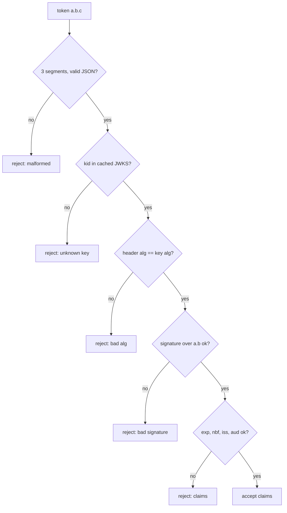

## In one minute
- A JSON Web Token is a set of JSON claims plus a signature, packed into three base64url segments separated by dots: `header.payload.signature`.
- The signature proves who issued the claims and that nobody changed them. It does not hide them: anyone holding the token can read the payload.
- A JWT is only as safe as its validation. The consumer must pin the algorithm, find the right key, check the signature, then check `exp`, `nbf`, `iss` and `aud`, every time.
- Most JWT incidents come from the header being trusted: `alg: none`, RSA-to-HMAC confusion, and attacker-supplied key URLs.
- Key rotation through a published key set (JWKS) and short lifetimes are what make JWTs operable at scale.

## How it works

### Three segments
A JWT in its usual form (a *JWS compact serialization*) looks like `eyJhbGciOi...` `.` `eyJzdWIiOi...` `.` `MEUCIQ...`. Each segment is base64url-encoded without padding, so the token is safe in URLs, headers and cookies.

The **header** says how the token is protected, for example `{"alg":"ES256","kid":"2026-10","typ":"at+jwt"}`. The **payload** holds claims: registered ones such as `iss` (issuer), `sub` (subject), `aud` (audience), `exp` (expiry), `nbf` (not before), `iat` (issued at) and `jti` (a unique ID), plus any private claims such as `tenant` or `scope`. The **signature** is computed over the exact ASCII bytes `base64url(header) + "." + base64url(payload)`, which is called the signing input.

The verifier never re-serializes the JSON. It signs and checks the encoded segments as received, which sidesteps the problem that the same JSON object can be written in many byte-different ways.

### Symmetric and asymmetric signatures
With **HS256** the issuer and every verifier share one secret, and the signature is HMAC-SHA256 over the signing input. It is fast and simple, but any service that can verify can also mint tokens, so it fits only when issuer and verifier are the same trust domain.

With **RS256**, **ES256** or **Ed25519** the issuer signs with a private key and publishes the public key. Any number of services can verify, and none can forge. Older documents write Ed25519 as `EdDSA`, but RFC 9864 (October 2025) deprecated that identifier because it does not say which curve to use, and registered the fully specified `Ed25519` and `Ed448` in its place ([RFC 9864](https://www.rfc-editor.org/rfc/rfc9864)). Libraries will accept both for years, so pin the one your issuer actually emits. This is what lets an identity provider issue tokens that hundreds of services and third parties check independently.

### What a JWT is for, and what it is not
JWTs fit wherever a claim must cross a trust boundary and be checked without calling home: OAuth access tokens, OpenID Connect ID tokens, service-to-service credentials, CI jobs proving their identity to a cloud provider, signed invitation links. They fit poorly as long-lived browser sessions, because they cannot be revoked before `exp` without adding back the lookup they were meant to remove. If the payload must be secret, the encrypted variant (JWE, five segments) exists, but most systems simply keep secrets out of the payload.

### The problem shape: trust but verify
A JWT moves trust from a network call to a signature check, and the same shape appears in S3 presigned URLs, Stripe's signed webhooks (a signature plus a timestamp tolerance against replay) and signed software packages. Each time, the rules are the same: the verifier, not the message, decides which key and algorithm are acceptable; the signature covers every field that matters; and a time window limits replay.

## Down the stack

### Layer 1: The contract
RFC 7519 defines the claims; RFC 7515 defines how they are signed; RFC 8725 lists what a careful consumer must do ([RFC 8725](https://www.rfc-editor.org/rfc/rfc8725)). Its replacement, draft-ietf-oauth-rfc8725bis, was with the IESG in 2026 and adds attacks seen since 2020, such as `alg` blocklists bypassed with `"noNE"`, JWE decompression bombs and SSRF through `jku` and `x5u` ([draft-ietf-oauth-rfc8725bis](https://datatracker.ietf.org/doc/draft-ietf-oauth-rfc8725bis/)). A validator promises to accept a token only if all of these hold: the algorithm is on an allowlist and matches the key it selects; the signature over the signing input verifies with that key; `now < exp + leeway`; `now + leeway >= nbf` when `nbf` is present; `iss` equals the expected issuer; and `aud` (a string or an array) contains this service's identifier. Leeway is typically 30 to 120 seconds to absorb clock skew; RFC 7519 says "usually no more than a few minutes" ([RFC 7519 §4.1.4](https://www.rfc-editor.org/rfc/rfc7519#section-4.1.4)). RFC 9068 requires JWT access tokens to carry `typ: at+jwt` and requires resource servers to reject any other value, so an ID token cannot be replayed as an access token ([RFC 9068 §4](https://www.rfc-editor.org/rfc/rfc9068#section-4)). Nothing in the format promises revocation, confidentiality or single use; those need `jti` tracking, JWE, or a server-side store.

### Layer 2: The mechanism
HS256 is HMAC per [RFC 2104](https://www.rfc-editor.org/rfc/rfc2104): pad the key to SHA-256's 64-byte block, compute `SHA256((K xor opad) || SHA256((K xor ipad) || message))` with `ipad = 0x36` and `opad = 0x5c` repeated, and compare the 32-byte result with a constant-time comparison so timing does not leak how many bytes matched. RS256 is an RSASSA-PKCS1-v1_5 signature, 256 bytes for a 2048-bit key. ES256 is ECDSA on P-256, and JOSE encodes it as the raw 64 bytes `r || s`, not the DER structure most crypto libraries emit; mixing the two is a classic interoperability bug.

Verification keys are published as a JSON Web Key Set at the issuer's `jwks_uri`: entries like `{"kty":"EC","crv":"P-256","kid":"2026-10","x":"...","y":"..."}`. The verifier reads `kid` from the header, selects the key from a cached set, and takes the algorithm from the key, not from the token. That last rule closes the famous 2015 bugs: libraries that honoured `alg: none` accepted unsigned tokens, and libraries that let `alg: HS256` select HMAC accepted tokens "signed" with the issuer's *public* RSA key used as an HMAC secret ([Auth0, 2015](https://auth0.com/blog/critical-vulnerabilities-in-json-web-token-libraries/)). Header fields like `jku` and `x5u`, which point at a key URL, must be ignored or pinned, or an attacker simply supplies their own key. In 2022, CVE-2022-21449 showed the bottom layer can fail too: Java 15 to 18 accepted ECDSA signatures with `r = s = 0` as valid for any message ([Neil Madden](https://neilmadden.blog/2022/04/19/psychic-signatures-in-java/)). Even a correct library leaves one check to you: that the key is allowed to sign *this kind* of token for *this* issuer, which is the check Microsoft's mail system skipped in 2023 (see In the wild).

### Layer 3: The machine
Base64 inflates by 4/3, so a 300-byte JSON payload becomes 400 characters. An ES256 signature is 86 characters, an RS256 signature 342, so a modest RS256 access token is 800 to 1,200 bytes and travels on every request. Verification cost, roughly, on one modern core: HMAC-SHA256 about 1 us for a short input; RSA-2048 verify 20 to 40 us (the public exponent 65537 makes it cheap); Ed25519 verify about 50 us; P-256 verify 60 to 100 us. Signing is the asymmetric part: an RSA-2048 signature costs about 1 ms, which only the issuer pays. Expiry checks read the local wall clock, so a host whose NTP sync has drifted by two minutes rejects fresh tokens or accepts stale ones, and the JWKS fetch is an HTTPS call that must be cached (commonly 5 to 60 minutes) and rate-limited, or an unknown `kid` in a flood of junk tokens becomes a flood of outbound requests.

### Why it's built this way
1. Claims must pass through URLs, headers and cookies, so the format is compact and base64url-encoded.
2. JSON serialization is not canonical, so the signature covers the encoded bytes and nobody re-serializes.
3. Issuers need to change algorithms and keys over time, so the header names `alg` and `kid`.
4. A header the attacker writes cannot be trusted to choose security, so modern validators pin the algorithm to the key and use the header only as a lookup hint.
5. Tokens cannot be recalled, so lifetimes are short and keys rotate through a cached, published key set.

## Diagram


## Worked example
An identity provider issues ES256 access tokens that live 15 minutes. Forty services cache its JWKS for 10 minutes. The security team wants to rotate the signing key every 90 days without a single failed request.

The timeline follows from the two numbers. At T0 the issuer *publishes* the new public key in the JWKS alongside the old one but keeps signing with the old key. Every verifier has refetched within 10 minutes, so from T0 + 10 minutes everyone knows both keys. Add margin for a stuck cache and switch signing to the new key at T0 + 1 hour. Tokens signed with the old key keep arriving for up to 15 minutes after the switch, plus leeway, so the old key stays published until at least T0 + 1 hour 17 minutes; in practice, a day later. Skipping the first step (sign with the new key immediately) produces up to 10 minutes of `unknown kid` failures on every service, which at 25,000 requests per second is up to 15 million rejected calls.

Cost check: 25,000 verifications per second at about 80 us each is 2 CPU-seconds per second, two cores spread across the fleet. Each token is about 900 bytes, so headers add about 22 MB/s of ingress. Both are acceptable; neither would be if tokens bloated to 8 KB with a full group list, which also trips the 8 KB header limits of many proxies; nginx, for example, answers `400` when one header field exceeds its default 8 KB buffer ([nginx docs](https://nginx.org/en/docs/http/ngx_http_core_module.html#large_client_header_buffers)).

## In the wild
- **Microsoft, 2023: a consumer key signed enterprise tokens.** The Storm-0558 actor used a Microsoft account (consumer) signing key to forge tokens that Exchange Online accepted for enterprise mailboxes, reaching about 25 organizations from 15 May until customers noticed on 16 June ([MSRC, July 2023](https://www.microsoft.com/en-us/msrc/blog/2023/07/microsoft-mitigates-china-based-threat-actor-storm-0558-targeting-of-customer-email)). The signature was valid. The bug was that the mail system's developers assumed the shared library checked issuer and key scope, and it only checked the signature. Microsoft shipped libraries that validate scope automatically ([MSRC, September 2023](https://www.microsoft.com/en-us/msrc/blog/2023/09/results-of-major-technical-investigations-for-storm-0558-key-acquisition)).
- **Java, 2022: "psychic signatures".** The ECDSA verifier rewritten in Java 15 skipped the check that `r` and `s` are non-zero, so an all-zero signature verified against any key and any message: JWTs, OIDC ID tokens, SAML assertions and WebAuthn messages included. Reported in November 2021 and fixed in the April 2022 critical patch update; Oracle scored it 7.5, while ForgeRock, where the reporter worked, rated it 10 ([Neil Madden](https://neilmadden.blog/2022/04/19/psychic-signatures-in-java/)).

## Trade-offs
| Option | Strengths | Weaknesses | Choose when |
|---|---|---|---|
| HS256 (shared secret) | Fastest, tiny signature, simple | Every verifier can forge; secret must be distributed | Issuer and verifier are one service or one team |
| RS256 | Widely supported, fast verify | 342-character signature, slow signing, large keys | Interop with older libraries and providers |
| ES256 / Ed25519 | Short signatures, strong small keys | Slower verify than RSA; ES256 encoding pitfalls | New systems issuing many tokens |
| JWT vs opaque token + introspection | No lookup per request, works offline | No early revocation, claims visible and stale | Many verifiers, high QPS, short lifetimes |
| JWE (encrypted) | Payload confidential in transit and at rest in logs | Complex, larger, fewer libraries | Claims must stay secret from the client |

## Pitfalls in production
- **Decoding instead of verifying.** Calling a library's `decode` with verification off, "just to read the user ID", trusts attacker input. Make the verified path the only path, and lint for the unsafe call.
- **Trusting the header's `alg`.** Pass an explicit allowlist and bind each key to one algorithm, so `none` and HMAC-with-a-public-key tokens are rejected before any crypto runs. Compare exactly: a case-insensitive blocklist of `none` lets `nOnE` through.
- **Skipping `aud`.** A token minted for the low-risk reporting service is accepted by the payments service. Every service must check that its own identifier is in `aud`.
- **Secrets in the payload.** Base64url is encoding, not encryption; emails, internal IDs and roles end up in browser history, logs and analytics. Put only what verifiers need, and nothing sensitive.
- **Rotation without overlap.** Signing with a new `kid` before verifiers have it fails every request for one JWKS cache period. Publish first, sign later, retire last.
- **Unbounded JWKS refetch.** Refetching on every unknown `kid` lets junk tokens drive outbound traffic. Refetch at most once every few seconds and cap the cache size.

## Leadership lens
- Mandate one shared, reviewed validation library or gateway filter; JWT bugs come from every team writing its own five lines of checks.
- Ask in design review: what is the token lifetime, what is the revocation story, and which claims are trusted for authorization?
- Treat key rotation as a routine, automated operation with a runbook and an alarm on `unknown kid` rates, not a yearly event someone remembers.
- Decide early whether tokens may reach third parties; that choice forces asymmetric keys, audience discipline and a public JWKS endpoint with its own SLO.

## Check yourself
1. Why must the verifier compute the signature over the received base64url segments instead of re-encoding the parsed JSON?
   **Answer:** JSON has many byte-different encodings of the same object (key order, whitespace, escapes). Re-encoding could produce different bytes than the issuer signed, so verification would fail or, worse, accept something the issuer never signed.
2. How does the RSA-to-HMAC algorithm confusion attack work, and what single design rule prevents it?
   **Answer:** The attacker sets `alg: HS256` and signs with the issuer's public RSA key as the HMAC secret; a library that lets the header choose the algorithm verifies it with that same public key. Binding each key to one algorithm, chosen by the verifier, stops it.
3. A token has `exp` of 10:00:00 and the service allows 60 seconds of leeway. Is it accepted at 10:00:45? At 10:01:00?
   **Answer:** Accepted at 10:00:45, because that is before `exp + 60s`. Rejected at 10:01:00, since the rule is `now < exp + leeway`.
4. Why is `typ: at+jwt` useful when the same issuer also signs ID tokens?
   **Answer:** Both are signed by the same key with similar claims, so without a type check an ID token handed to a client could be replayed to an API as an access token.

## Practice
**Task:** Implement the validation half of a JWT library. `validate(token, keys, decode, verify, now, issuer, audience, leeway)` gets a compact token, a map from `kid` to the one algorithm allowed for that key, a `decode(segment)` function that returns a segment's text (and fails on bad input), and a `verify(kid, signing_input, signature)` function that checks a signature. Return the payload claims on success, or an error code: `malformed` (not three segments, undecodable, or header or payload not a JSON object), `bad_alg` (`alg` missing or `none`, or not equal to the key's algorithm), `unknown_kid`, `bad_signature`, `expired` (missing `exp`, or `now >= exp + leeway`), `not_yet_valid` (`nbf` present and `now + leeway < nbf`), `bad_issuer`, or `bad_audience` (`aud` is a string or a list and must contain `audience`). Check in that order, with the `none` check before the `kid` lookup. Python returns `(claims, "ok")` or `(None, code)`; TypeScript returns `{ claims, error }` with `error` `"ok"` on success; Go returns `(map[string]any, error)` using the exported sentinel errors.

```python starter
def validate(token, keys, decode, verify, now, issuer, audience, leeway):
    # TODO
    raise NotImplementedError
```

```python tests
import json

def enc(s):
    return s.encode().hex()

def dec(seg):
    return bytes.fromhex(seg).decode()

def fake_verify(kid, signing_input, sig):
    return sig == enc(kid + "|" + signing_input)

KEYS = {"k1": "ES256", "k2": "HS256"}
CLAIMS = {"sub": "u42", "iss": "https://id.example", "aud": "orders", "exp": 1000}

def make(header, claims, kid_for_sig=None):
    h = enc(json.dumps(header))
    p = enc(json.dumps(claims))
    k = kid_for_sig if kid_for_sig is not None else header.get("kid", "")
    return h + "." + p + "." + enc(k + "|" + h + "." + p)

def check(token, now=900, aud="orders"):
    return validate(token, KEYS, dec, fake_verify, now, "https://id.example", aud, 30)

def test_valid_token():
    claims, err = check(make({"alg": "ES256", "kid": "k1"}, CLAIMS))
    assert err == "ok"
    assert claims["sub"] == "u42"

def test_tampered_payload():
    t = make({"alg": "ES256", "kid": "k1"}, CLAIMS)
    h, p, s = t.split(".")
    forged = dict(CLAIMS, sub="admin")
    assert check(h + "." + enc(json.dumps(forged)) + "." + s) == (None, "bad_signature")

def test_alg_rules():
    assert check(make({"alg": "none", "kid": "zz"}, CLAIMS))[1] == "bad_alg", "none is rejected first"
    assert check(make({"alg": "HS256", "kid": "k1"}, CLAIMS))[1] == "bad_alg", "alg must match the key"
    assert check(make({"kid": "k1"}, CLAIMS))[1] == "bad_alg"
    assert check(make({"alg": "ES256", "kid": "k9"}, CLAIMS))[1] == "unknown_kid"

def test_expiry_and_leeway():
    t = make({"alg": "ES256", "kid": "k1"}, CLAIMS)
    assert check(t, now=1029)[1] == "ok"
    assert check(t, now=1030) == (None, "expired")
    no_exp = {"sub": "u", "iss": "https://id.example", "aud": "orders"}
    assert check(make({"alg": "ES256", "kid": "k1"}, no_exp))[1] == "expired"

def test_not_before():
    c = dict(CLAIMS, nbf=500)
    t = make({"alg": "ES256", "kid": "k1"}, c)
    assert check(t, now=470)[1] == "ok"
    assert check(t, now=469)[1] == "not_yet_valid"

def test_issuer_and_audience():
    t = make({"alg": "ES256", "kid": "k1"}, dict(CLAIMS, iss="https://evil.example"))
    assert check(t)[1] == "bad_issuer"
    t = make({"alg": "ES256", "kid": "k1"}, dict(CLAIMS, aud=["billing", "orders"]))
    assert check(t)[1] == "ok"
    assert check(t, aud="payments")[1] == "bad_audience"

def test_malformed():
    assert check("abc.def")[1] == "malformed"
    assert check("zz.zz.zz")[1] == "malformed"
    arr = enc("[1]")
    h = enc(json.dumps({"alg": "ES256", "kid": "k1"}))
    assert check(h + "." + arr + "." + enc("k1|" + h + "." + arr))[1] == "malformed"
```

```python solution
import json

def validate(token, keys, decode, verify, now, issuer, audience, leeway):
    parts = token.split(".")
    if len(parts) != 3:
        return None, "malformed"
    try:
        header = json.loads(decode(parts[0]))
        claims = json.loads(decode(parts[1]))
    except Exception:
        return None, "malformed"
    if not isinstance(header, dict) or not isinstance(claims, dict):
        return None, "malformed"
    alg = header.get("alg")
    if not alg or alg == "none":
        return None, "bad_alg"
    kid = header.get("kid")
    if kid not in keys:
        return None, "unknown_kid"
    if keys[kid] != alg:
        return None, "bad_alg"
    if not verify(kid, parts[0] + "." + parts[1], parts[2]):
        return None, "bad_signature"
    exp = claims.get("exp")
    if not isinstance(exp, (int, float)) or now >= exp + leeway:
        return None, "expired"
    nbf = claims.get("nbf")
    if isinstance(nbf, (int, float)) and now + leeway < nbf:
        return None, "not_yet_valid"
    if claims.get("iss") != issuer:
        return None, "bad_issuer"
    aud = claims.get("aud")
    auds = aud if isinstance(aud, list) else [aud]
    if audience not in auds:
        return None, "bad_audience"
    return claims, "ok"
```

```typescript starter
export type Claims = { [k: string]: unknown };

export function validate(
  token: string,
  keys: { [kid: string]: string },
  decode: (seg: string) => string,
  verify: (kid: string, signingInput: string, sig: string) => boolean,
  now: number,
  issuer: string,
  audience: string,
  leeway: number
): { claims: Claims | null; error: string } {
  throw new Error("TODO");
}
```

```typescript tests
function enc(s: string): string {
  let out = "";
  for (let i = 0; i < s.length; i++) out += s.charCodeAt(i).toString(16).padStart(2, "0");
  return out;
}
function dec(seg: string): string {
  if (seg.length % 2 !== 0 || !/^[0-9a-f]*$/.test(seg)) throw new Error("bad hex");
  let out = "";
  for (let i = 0; i < seg.length; i += 2) out += String.fromCharCode(parseInt(seg.slice(i, i + 2), 16));
  return out;
}
const fakeVerify = (kid: string, input: string, sig: string) => sig === enc(kid + "|" + input);
const KEYS = { k1: "ES256", k2: "HS256" };
const CLAIMS: Claims = { sub: "u42", iss: "https://id.example", aud: "orders", exp: 1000 };

function make(header: { [k: string]: string }, claims: Claims): string {
  const h = enc(JSON.stringify(header));
  const p = enc(JSON.stringify(claims));
  return h + "." + p + "." + enc((header.kid ?? "") + "|" + h + "." + p);
}
function check(token: string, now = 900, aud = "orders") {
  return validate(token, KEYS, dec, fakeVerify, now, "https://id.example", aud, 30);
}

test("valid token", () => {
  const r = check(make({ alg: "ES256", kid: "k1" }, CLAIMS));
  assertEqual(r.error, "ok");
  assertEqual(r.claims && r.claims.sub, "u42");
});
test("tampered payload", () => {
  const [h, , s] = make({ alg: "ES256", kid: "k1" }, CLAIMS).split(".");
  const forged = enc(JSON.stringify({ ...CLAIMS, sub: "admin" }));
  assertEqual(check(h + "." + forged + "." + s), { claims: null, error: "bad_signature" });
});
test("alg rules", () => {
  assertEqual(check(make({ alg: "none", kid: "zz" }, CLAIMS)).error, "bad_alg", "none is rejected first");
  assertEqual(check(make({ alg: "HS256", kid: "k1" }, CLAIMS)).error, "bad_alg", "alg must match the key");
  assertEqual(check(make({ kid: "k1" }, CLAIMS)).error, "bad_alg");
  assertEqual(check(make({ alg: "ES256", kid: "k9" }, CLAIMS)).error, "unknown_kid");
});
test("expiry and leeway", () => {
  const t = make({ alg: "ES256", kid: "k1" }, CLAIMS);
  assertEqual(check(t, 1029).error, "ok");
  assertEqual(check(t, 1030), { claims: null, error: "expired" });
  const noExp = make({ alg: "ES256", kid: "k1" }, { sub: "u", iss: "https://id.example", aud: "orders" });
  assertEqual(check(noExp).error, "expired");
});
test("not before", () => {
  const t = make({ alg: "ES256", kid: "k1" }, { ...CLAIMS, nbf: 500 });
  assertEqual(check(t, 470).error, "ok");
  assertEqual(check(t, 469).error, "not_yet_valid");
});
test("issuer and audience", () => {
  assertEqual(check(make({ alg: "ES256", kid: "k1" }, { ...CLAIMS, iss: "https://evil.example" })).error, "bad_issuer");
  const t = make({ alg: "ES256", kid: "k1" }, { ...CLAIMS, aud: ["billing", "orders"] });
  assertEqual(check(t).error, "ok");
  assertEqual(check(t, 900, "payments").error, "bad_audience");
});
test("malformed", () => {
  assertEqual(check("abc.def").error, "malformed");
  assertEqual(check("zz.zz.zz").error, "malformed");
  const h = enc(JSON.stringify({ alg: "ES256", kid: "k1" }));
  const arr = enc("[1]");
  assertEqual(check(h + "." + arr + "." + enc("k1|" + h + "." + arr)).error, "malformed");
});
```

```typescript solution
export type Claims = { [k: string]: unknown };

function isObject(v: unknown): v is Claims {
  return typeof v === "object" && v !== null && !Array.isArray(v);
}

export function validate(
  token: string,
  keys: { [kid: string]: string },
  decode: (seg: string) => string,
  verify: (kid: string, signingInput: string, sig: string) => boolean,
  now: number,
  issuer: string,
  audience: string,
  leeway: number
): { claims: Claims | null; error: string } {
  const fail = (error: string) => ({ claims: null, error });
  const parts = token.split(".");
  if (parts.length !== 3) return fail("malformed");
  let header: unknown;
  let claims: unknown;
  try {
    header = JSON.parse(decode(parts[0]));
    claims = JSON.parse(decode(parts[1]));
  } catch (e) {
    return fail("malformed");
  }
  if (!isObject(header) || !isObject(claims)) return fail("malformed");
  const alg = header.alg;
  if (typeof alg !== "string" || alg === "" || alg === "none") return fail("bad_alg");
  const kid = header.kid;
  if (typeof kid !== "string" || !Object.prototype.hasOwnProperty.call(keys, kid)) return fail("unknown_kid");
  if (keys[kid] !== alg) return fail("bad_alg");
  if (!verify(kid, parts[0] + "." + parts[1], parts[2])) return fail("bad_signature");
  const exp = claims.exp;
  if (typeof exp !== "number" || now >= exp + leeway) return fail("expired");
  const nbf = claims.nbf;
  if (typeof nbf === "number" && now + leeway < nbf) return fail("not_yet_valid");
  if (claims.iss !== issuer) return fail("bad_issuer");
  const aud = claims.aud;
  const auds = Array.isArray(aud) ? aud : [aud];
  if (auds.indexOf(audience) < 0) return fail("bad_audience");
  return { claims, error: "ok" };
}
```

```go starter
package practice

import "errors"

var (
	ErrMalformed    = errors.New("malformed")
	ErrBadAlg       = errors.New("bad_alg")
	ErrUnknownKid   = errors.New("unknown_kid")
	ErrBadSignature = errors.New("bad_signature")
	ErrExpired      = errors.New("expired")
	ErrNotYetValid  = errors.New("not_yet_valid")
	ErrBadIssuer    = errors.New("bad_issuer")
	ErrBadAudience  = errors.New("bad_audience")
)

func Validate(token string, keys map[string]string,
	decode func(string) ([]byte, error),
	verify func(kid, signingInput, sig string) bool,
	now int64, issuer, audience string, leeway int64) (map[string]any, error) {
	panic("TODO")
}
```

```go tests
package practice

import (
	"encoding/hex"
	"encoding/json"
	"errors"
	"strings"
	"testing"
)

func enc(s string) string { return hex.EncodeToString([]byte(s)) }

func dec(seg string) ([]byte, error) { return hex.DecodeString(seg) }

func fakeVerify(kid, input, sig string) bool { return sig == enc(kid+"|"+input) }

var keys = map[string]string{"k1": "ES256", "k2": "HS256"}

func claims(extra map[string]any) map[string]any {
	c := map[string]any{"sub": "u42", "iss": "https://id.example", "aud": "orders", "exp": 1000}
	for k, v := range extra {
		if v == nil {
			delete(c, k)
		} else {
			c[k] = v
		}
	}
	return c
}

func jsonEnc(v any) string {
	b, _ := json.Marshal(v)
	return enc(string(b))
}

func mk(header map[string]string, c any) string {
	h, p := jsonEnc(header), jsonEnc(c)
	return h + "." + p + "." + enc(header["kid"]+"|"+h+"."+p)
}

func check(token string, now int64, aud string) (map[string]any, error) {
	return Validate(token, keys, dec, fakeVerify, now, "https://id.example", aud, 30)
}

func expectErr(t *testing.T, token string, now int64, aud string, want error) {
	t.Helper()
	_, err := check(token, now, aud)
	if !errors.Is(err, want) {
		t.Fatalf("got %v, want %v", err, want)
	}
}

var good = map[string]string{"alg": "ES256", "kid": "k1"}

func TestValidToken(t *testing.T) {
	c, err := check(mk(good, claims(nil)), 900, "orders")
	if err != nil || c["sub"] != "u42" {
		t.Fatalf("got %v, %v", c, err)
	}
}

func TestTamperedPayload(t *testing.T) {
	parts := strings.Split(mk(good, claims(nil)), ".")
	forged := parts[0] + "." + jsonEnc(claims(map[string]any{"sub": "admin"})) + "." + parts[2]
	expectErr(t, forged, 900, "orders", ErrBadSignature)
}

func TestAlgRules(t *testing.T) {
	expectErr(t, mk(map[string]string{"alg": "none", "kid": "zz"}, claims(nil)), 900, "orders", ErrBadAlg)
	expectErr(t, mk(map[string]string{"alg": "HS256", "kid": "k1"}, claims(nil)), 900, "orders", ErrBadAlg)
	expectErr(t, mk(map[string]string{"kid": "k1"}, claims(nil)), 900, "orders", ErrBadAlg)
	expectErr(t, mk(map[string]string{"alg": "ES256", "kid": "k9"}, claims(nil)), 900, "orders", ErrUnknownKid)
}

func TestExpiryAndLeeway(t *testing.T) {
	tok := mk(good, claims(nil))
	if _, err := check(tok, 1029, "orders"); err != nil {
		t.Fatalf("within leeway: %v", err)
	}
	expectErr(t, tok, 1030, "orders", ErrExpired)
	expectErr(t, mk(good, claims(map[string]any{"exp": nil})), 900, "orders", ErrExpired)
}

func TestNotBefore(t *testing.T) {
	tok := mk(good, claims(map[string]any{"nbf": 500}))
	if _, err := check(tok, 470, "orders"); err != nil {
		t.Fatalf("within leeway: %v", err)
	}
	expectErr(t, tok, 469, "orders", ErrNotYetValid)
}

func TestIssuerAndAudience(t *testing.T) {
	expectErr(t, mk(good, claims(map[string]any{"iss": "https://evil.example"})), 900, "orders", ErrBadIssuer)
	tok := mk(good, claims(map[string]any{"aud": []string{"billing", "orders"}}))
	if _, err := check(tok, 900, "orders"); err != nil {
		t.Fatalf("aud list: %v", err)
	}
	expectErr(t, tok, 900, "payments", ErrBadAudience)
}

func TestMalformed(t *testing.T) {
	expectErr(t, "abc.def", 900, "orders", ErrMalformed)
	expectErr(t, "zz.zz.zz", 900, "orders", ErrMalformed)
	h, arr := jsonEnc(good), enc("[1]")
	expectErr(t, h+"."+arr+"."+enc("k1|"+h+"."+arr), 900, "orders", ErrMalformed)
}
```

```go solution
package practice

import (
	"encoding/json"
	"errors"
	"strings"
)

var (
	ErrMalformed    = errors.New("malformed")
	ErrBadAlg       = errors.New("bad_alg")
	ErrUnknownKid   = errors.New("unknown_kid")
	ErrBadSignature = errors.New("bad_signature")
	ErrExpired      = errors.New("expired")
	ErrNotYetValid  = errors.New("not_yet_valid")
	ErrBadIssuer    = errors.New("bad_issuer")
	ErrBadAudience  = errors.New("bad_audience")
)

func decodeObject(decode func(string) ([]byte, error), seg string) (map[string]any, bool) {
	raw, err := decode(seg)
	if err != nil {
		return nil, false
	}
	var m map[string]any
	if err := json.Unmarshal(raw, &m); err != nil || m == nil {
		return nil, false
	}
	return m, true
}

func Validate(token string, keys map[string]string,
	decode func(string) ([]byte, error),
	verify func(kid, signingInput, sig string) bool,
	now int64, issuer, audience string, leeway int64) (map[string]any, error) {
	parts := strings.Split(token, ".")
	if len(parts) != 3 {
		return nil, ErrMalformed
	}
	header, ok1 := decodeObject(decode, parts[0])
	claims, ok2 := decodeObject(decode, parts[1])
	if !ok1 || !ok2 {
		return nil, ErrMalformed
	}
	alg, _ := header["alg"].(string)
	if alg == "" || alg == "none" {
		return nil, ErrBadAlg
	}
	kid, _ := header["kid"].(string)
	want, found := keys[kid]
	if !found {
		return nil, ErrUnknownKid
	}
	if want != alg {
		return nil, ErrBadAlg
	}
	if !verify(kid, parts[0]+"."+parts[1], parts[2]) {
		return nil, ErrBadSignature
	}
	t := float64(now)
	exp, ok := claims["exp"].(float64)
	if !ok || t >= exp+float64(leeway) {
		return nil, ErrExpired
	}
	if nbf, ok := claims["nbf"].(float64); ok && t+float64(leeway) < nbf {
		return nil, ErrNotYetValid
	}
	if iss, _ := claims["iss"].(string); iss != issuer {
		return nil, ErrBadIssuer
	}
	switch aud := claims["aud"].(type) {
	case string:
		if aud == audience {
			return claims, nil
		}
	case []any:
		for _, a := range aud {
			if s, _ := a.(string); s == audience {
				return claims, nil
			}
		}
	}
	return nil, ErrBadAudience
}
```

## Mock interview
**Prompt:** Your company runs 60 microservices behind an API gateway, serving 25,000 requests per second. An identity service issues JWT access tokens. Design token issuance, validation and key management so that services verify tokens locally and a compromised signing key can be replaced within an hour.

- Follow-up: Walk through an emergency key rotation after the private key leaks. What breaks, for how long, and for whom?
- Follow-up: A pentest finds that one service accepts tokens with `alg: none`. How did that happen, and how do you make sure no other service has the same bug?
- Follow-up: Product wants to include the user's full permission list in the token. What do you say?

**A strong answer covers:**
- Asymmetric signing (ES256 or Ed25519), a JWKS endpoint with `kid`, cache TTLs and rate-limited refetch.
- A normal rotation schedule (publish, wait one cache TTL, switch, retire after max token lifetime) and an emergency path that accepts forced re-login.
- Validation rules in one shared library or at the gateway: algorithm allowlist bound to keys, `iss`, `aud`, `exp`, `nbf`, `typ`, and leeway.
- Short access-token lifetimes with refresh tokens, and a `jti` or per-user revocation check for high-risk endpoints.
- Token size and staleness: coarse claims in the token, fine-grained permissions resolved at the resource.

## Sources and further study
**Primary**
- [RFC 9864: Fully-Specified Algorithms for JOSE and COSE (2025)](https://www.rfc-editor.org/rfc/rfc9864): why `EdDSA` is deprecated in favour of `Ed25519` and `Ed448`.
- [draft-ietf-oauth-rfc8725bis](https://datatracker.ietf.org/doc/draft-ietf-oauth-rfc8725bis/): the pending update to the JWT best practices, with the attacks found since 2020.
- [RFC 7517: JSON Web Key](https://www.rfc-editor.org/rfc/rfc7517): the JWK and JWK Set formats behind every `jwks_uri`.

**Systems docs**
- [nginx: large_client_header_buffers](https://nginx.org/en/docs/http/ngx_http_core_module.html#large_client_header_buffers): the header-size limit oversized tokens hit first.
- [OpenID Connect Core 1.0, ID Token validation](https://openid.net/specs/openid-connect-core-1_0.html#IDTokenValidation): the most widely deployed JWT validation rules, now also ISO/IEC 26131:2024.

**Books**
- *Building Microservices* (2nd ed.), Sam Newman, Ch 11 "Security": JSON Web Tokens for passing user identity between services, and the confused deputy problem.
- *Building Secure and Reliable Systems*, Adkins et al. (Google, 2020), Ch 5 "Design for Least Privilege": why credentials should be narrowly scoped and short-lived ([read free](https://google.github.io/building-secure-and-reliable-systems/raw/ch05.html)).

**Other curricula**
- [OWASP JSON Web Token Cheat Sheet](https://cheatsheetseries.owasp.org/cheatsheets/JSON_Web_Token_Cheat_Sheet.html): a checklist of the same validation and storage rules from the attacker's side.
- [Azure Architecture Center: Valet Key pattern](https://learn.microsoft.com/en-us/azure/architecture/patterns/valet-key): signed, time-limited, narrowly scoped grants as a general design pattern.

## Watch
- [What Is JWT and Why Should You Use JWT (Web Dev Simplified)](https://www.youtube.com/watch?v=7Q17ubqLfaM): the structure and signing flow worked through in code.
- [Session Vs JWT: The Differences You May Not Know! (ByteByteGo)](https://www.youtube.com/watch?v=fyTxwIa-1U0): where JWTs fit compared with server-side sessions.

## Free resources
- [RFC 7519: JSON Web Token](https://www.rfc-editor.org/rfc/rfc7519): the registered claims and their exact processing rules.
- [RFC 7515: JSON Web Signature](https://www.rfc-editor.org/rfc/rfc7515): the signing input, compact serialization and header parameters.
- [RFC 8725: JWT Best Current Practices](https://www.rfc-editor.org/rfc/rfc8725): the attacks seen in the wild and the validation rules that stop them.
- [RFC 9068: JWT Profile for OAuth 2.0 Access Tokens](https://www.rfc-editor.org/rfc/rfc9068): required claims and the `at+jwt` type for access tokens.
- [Critical vulnerabilities in JSON Web Token libraries (Auth0)](https://auth0.com/blog/critical-vulnerabilities-in-json-web-token-libraries/): the original write-up of the `none` and RSA-to-HMAC confusion bugs.
- [RFC 2104: HMAC](https://www.rfc-editor.org/rfc/rfc2104): the construction behind HS256, short and readable.
