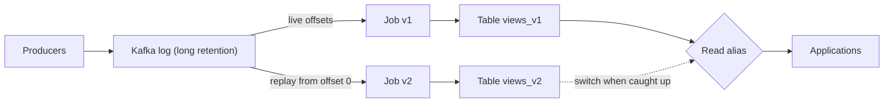

## In one minute
- Kappa architecture uses **one stream processing pipeline** for everything. There is no separate batch layer.
- The durable, replayable **log** (usually Kafka) is the source of truth. Any derived view is the result of running a job over that log.
- To fix a bug or change logic, you **reprocess**: start a new version of the job from the beginning of the log (or a chosen offset), let it catch up into a new output table, then switch readers over.
- It removes the dual-codebase problem of Lambda, at the price of long log retention and reprocessing throughput that must be planned.
- It suits naturally incremental logic: aggregations, windowed joins, enrichment, materialised views.

## How it works

### The log as the system of record
Every event is appended to a partitioned, ordered log. Retention is long: days to forever, using tiered storage that moves old segments to object storage, or **log compaction** for keyed changelogs where only the latest value per key matters. The two do not mix: Kafka's tiered storage, declared production-ready in 3.9 ([Kafka 3.9 release](https://kafka.apache.org/blog/2024/11/06/apache-kafka-3.9.0-release-announcement/)), still does not support compacted topics, so compacted changelogs stay on broker disks ([Kafka docs](https://kafka.apache.org/43/operations/tiered-storage/)). Consumers track their position as an offset per partition, so any consumer can rewind.

Jay Kreps named the pattern in 2014 as an answer to Lambda's two codebases: keep the raw input in the log, and recompute by running a second copy of the same stream job ([Kreps](https://www.oreilly.com/radar/questioning-the-lambda-architecture/)). The Azure Architecture Center frames it the same way, with events mirrored to long-term storage so the stream can be recomputed when needed ([Azure](https://learn.microsoft.com/en-us/azure/architecture/databases/guide/big-data-architectures)).

### Stateful stream jobs
A job reads the log, maintains state (counters, windows, join tables) in a local store such as RocksDB, and writes results to an output: another topic, a database, or a search index. State is checkpointed with the input offsets, so after a crash the job restores state and resumes from the matching offset without losing or double counting.

### Reprocessing instead of batch
When logic changes, you do not patch the old output in place. You deploy job v2 alongside v1, reading from offset zero (or from a snapshot point), writing to a new table `views_v2`. v2 processes history much faster than real time because it is reading stored data in bulk. When v2's lag reaches near zero, readers switch to `views_v2` and v1 is stopped. Rollback is switching back.

Replaying from offset zero is not the only start point. If the change is small and the state is compatible, v2 can start from a **savepoint** of v1, a consistent image of its state and offsets. In Flink this only works if every stateful operator has a stable ID set with `uid()`; auto-generated IDs change when the program changes, and the restore fails ([Flink docs](https://nightlies.apache.org/flink/flink-docs-stable/docs/ops/state/savepoints/)). A logic bug that corrupted the state itself still needs a replay from before the bug.

### Event time and ordering
Because historical replay races through months of data in hours, the job must use **event time** (when the event happened) and watermarks, not processing time (when the job sees it), to assign events to windows ([Akidau](https://www.oreilly.com/radar/the-world-beyond-batch-streaming-101/)). Otherwise a replay assigns every event to "now". Ordering is guaranteed only within a partition, so keys that need ordered processing must share a partition.

## Down the stack

### Layer 1: The contract
The log promises that records within a partition are stored and delivered in offset order, that acknowledged records (with `acks=all` and `min.insync.replicas=2`) survive the loss of one broker, and that records remain readable until retention expires. `acks=all` and idempotence are producer defaults today ([producer configs](https://kafka.apache.org/43/configuration/producer-configs/)), but `min.insync.replicas` must still be raised from its default of 1 for that promise to hold. A consumer group promises each partition is assigned to one consumer at a time, and committed offsets mark where processing resumes. Together these let a job promise that its output is a deterministic function of the log prefix it has processed.

### Layer 2: The mechanism
Each Kafka partition is a directory of **segment** files, by default 1 GiB each (`log.segment.bytes`, [Kafka configs](https://kafka.apache.org/43/configuration/broker-configs/)), named by their base offset, with a sparse `.index` mapping offsets to byte positions and a `.timeindex` mapping timestamps to offsets. A consumer that seeks to offset 0 or to a timestamp uses these indexes to find the right segment and byte position in a binary search. With tiered storage, closed segments are copied to object storage and deleted locally after a short local retention; brokers fetch remote segments on demand when an old offset is requested. A fetch request serves remote data for only one partition at a time, which caps how fast one consumer can replay many partitions from the remote tier ([Kafka wiki](https://cwiki.apache.org/confluence/display/KAFKA/Kafka+Tiered+Storage+GA+Release+Notes)). Log compaction runs a cleaner thread that rewrites old segments keeping only the newest record per key, and treats a record with a null value (a tombstone) as a delete. Tombstones themselves are removed after `delete.retention.ms`, 24 hours by default, so a consumer rebuilding from offset 0 must reach the head within that time or it will miss deletes ([Kafka design](https://kafka.apache.org/43/design/design/)). Consumer offsets are themselves stored in the compacted internal topic `__consumer_offsets`, keyed by group, topic, and partition.

### Layer 3: The machine
Kafka relies heavily on the OS page cache. Producers append to the active segment with sequential writes, and recent reads are served from page cache by `sendfile`, which copies bytes from the cache to the socket inside the kernel without passing through user space ([Kafka design](https://kafka.apache.org/43/design/design/)). A live consumer reading the tail therefore costs almost no disk I/O. A replay is different: it reads cold segments from disk or object storage, pulling gigabytes through the page cache and evicting the hot tail that live consumers depend on. Their reads then fall through to disk, latency rises from sub-millisecond to tens of milliseconds, and producers can slow down too. This is the physical reason to throttle replays with quotas or to serve them from tiered storage instead of broker disks.

### Why it's built this way
1. Maintaining two codebases for batch and stream is expensive, so Kappa keeps one.
2. One codebase needs a way to recompute history, so the log is retained long enough to replay.
3. Disks and networks are efficient for large sequential reads, so replaying a log is much faster than re-querying a database row by row.
4. Keeping years of segments on broker SSDs is costly, so old segments move to object storage, and keyed state uses compaction.

## Diagram


## Worked example
A marketplace computes seller metrics (orders, revenue, cancellation rate by day) from an `order_events` topic with 64 partitions. Traffic averages 20,000 events per second at 500 bytes, about 860 GB per day. Kafka keeps 7 days on broker disks and 2 years in tiered object storage, around 630 TB, costing roughly $14,000 per month at standard object storage prices.

The team discovers the cancellation rate double counts orders cancelled and then reinstated. They fix the logic and launch v2 from the start of retention.

Replay throughput: each of 64 Flink task slots reads one partition. Reading from tiered storage and updating RocksDB, each sustains about 40 MB/s, so the job reads 2.5 GB/s in aggregate. Two years of data, 630 TB, would take about 70 hours. That is too long. The metric is only displayed for 13 months, so v2 replays from 13 months ago, about 340 TB, in roughly 38 hours. Partition count caps read parallelism at 64, so going faster would mean replaying from a Parquet archive in the lake instead.

v1 keeps serving during replay. When v2's lag drops under a minute, the alias moves; v1's table stays a week for rollback.

## In the wild
- **The New York Times, 2017: every article since 1851 in one Kafka topic.** The publishing pipeline stores every published asset in the "Monolog", a single-partition topic kept forever so it stays totally ordered, under 100 GB at the time. New services build their view by replaying from the start, then keep reading live updates; some only start a few hours back ([Confluent blog](https://www.confluent.io/blog/publishing-apache-kafka-new-york-times/)).
- **Uber, 2020: backfills without flooding Kafka.** Uber rejected replaying days of trip and client logs back into Kafka because it would overwhelm the cluster and cause lag, and rejected running the streaming code as a Spark batch job because that ignored event-time windows and watermarks. Uber instead made a Hive table a streaming source for the same Spark job, relaxed the watermark from 10 seconds to two hours, and backfilled about nine days (10 TB) of Hive data; the production streaming job it reuses runs on 75 cores and 1.2 TB of memory ([Uber](https://www.uber.com/en-US/blog/kappa-architecture-data-stream-processing/)).
- **Honeycomb, 2025: tiered storage in the way of recovery.** An EU Kafka cluster lost redundancy, about a quarter of partitions had no leader, and brokers filled their disks until ingest was switched off. Turning off tiered storage freed space but made damage to internal metadata permanent. Customers saw about 6 hours of ingest outage, and the team evacuated to a new cluster, producers first ([Honeycomb](https://status.honeycomb.io/incidents/pjzh0mtqw3vt)).

## Trade-offs

| Option | Strengths | Weaknesses | Choose when |
|---|---|---|---|
| Kappa | One codebase and semantics; reprocessing via replay | Long log retention cost; replay time for large histories | Logic is incremental and the log is the source of truth |
| Lambda | Batch can use heavy, non-incremental logic | Two implementations that drift | Batch-only computations are essential |
| Kappa with lake snapshots | Replay from a recent state snapshot plus log tail | Snapshot and log must stay consistent | Histories too large to replay from zero |
| Batch only | Cheap and simple | No freshness | Minutes or hours of latency are acceptable |

## Pitfalls in production
- **Retention shorter than needed.** The fix requires 90 days of history but the topic keeps 7. Decide retention from the longest reprocessing horizon, and archive to object storage with tiered storage.
- **Replay overloads the cluster.** A full replay saturates broker disks and slows live consumers. Use quotas, read from tiered storage, or replay from an archived copy.
- **Processing-time windows.** A replayed job puts two years of events into the current hour. Use event time and watermarks everywhere.
- **Side effects during replay.** Replaying a job that sends emails or charges cards repeats those actions. Separate pure view-building jobs from effectful consumers, and make effects idempotent with dedupe keys.
- **Rebuild misses deletes.** A new job reads a compacted topic from offset 0 but takes three days to reach the head, while tombstones are removed after 24 hours, so keys deleted meanwhile survive in the rebuilt view. Raise `delete.retention.ms` above the worst-case rebuild time.
- **Schema evolution.** Old events in the log use schema v1 and the new job expects v3. Use a schema registry with compatibility rules and code that can read all historical versions.

## Leadership lens
- Ask "how long would a full reprocess take?" in every design review. If the answer is weeks, the architecture is not really Kappa.
- Treat the log as a product: schemas, compatibility rules, retention, and ownership must be explicit.
- Budget for replay capacity, not just steady-state capacity. A job sized for live traffic will crawl through history.
- Keep effectful consumers separate from derived-view jobs so reprocessing is always safe to run.

## Check yourself
1. Why must Kappa jobs use event time rather than processing time?
   **Answer:** During replay, processing time is the moment of reprocessing, so windows and aggregations would be wrong; event time keeps results identical to a live run.
2. How does Kappa handle a logic bug that affected three months of output?
   **Answer:** Deploy a fixed job version that replays the log from before the bug into a new output, then switch readers once it has caught up.
3. What makes log compaction useful for Kappa?
   **Answer:** For keyed changelogs it keeps the latest value per key indefinitely, so new jobs can rebuild current state without storing every historical update.

## Practice
**Task:** Simulate a Kappa reprocessing switch. Implement `Pipeline(log)` where `log` is a list of `(key, amount)` events. `run(version, logic, upto)` processes events from offset 0 to `upto` (exclusive) through `logic(state, key, amount)`, which returns the new state dict, and stores the output for that version along with its offset. `catch_up(version, logic)` continues from that version's stored offset to the end of the log. `switch(version)` sets the served version but raises `ValueError` if that version has not reached the end of the log (in TypeScript it is `switchTo` and throws; in Go, `Switch` returns an error). `serve()` returns the served version's output state.

```python starter
class Pipeline:
    def __init__(self, log):
        pass  # TODO

    def run(self, version, logic, upto):
        raise NotImplementedError

    def catch_up(self, version, logic):
        raise NotImplementedError

    def switch(self, version):
        raise NotImplementedError

    def serve(self):
        raise NotImplementedError
```

```python tests
LOG = [("a", 5), ("b", 3), ("a", -5), ("a", 2)]

def total(state, k, v):
    s = dict(state); s[k] = s.get(k, 0) + v; return s

def positive_only(state, k, v):
    return total(state, k, v) if v > 0 else dict(state)

def test_full_run_and_serve():
    p = Pipeline(LOG); p.run("v1", total, len(LOG)); p.switch("v1")
    assert p.serve() == {"a": 2, "b": 3}

def test_switch_requires_caught_up():
    p = Pipeline(LOG); p.run("v2", positive_only, 2)
    try:
        p.switch("v2"); assert False
    except ValueError:
        pass

def test_catch_up_then_switch():
    p = Pipeline(LOG); p.run("v1", total, 4); p.switch("v1")
    p.run("v2", positive_only, 1); p.catch_up("v2", positive_only); p.switch("v2")
    assert p.serve() == {"a": 7, "b": 3}

def test_old_version_kept_for_rollback():
    p = Pipeline(LOG); p.run("v1", total, 4); p.run("v2", positive_only, 4)
    p.switch("v2"); p.switch("v1")
    assert p.serve() == {"a": 2, "b": 3}
```

```python solution
class Pipeline:
    def __init__(self, log):
        self.log = log
        self.out = {}
        self.served = None

    def _process(self, version, logic, start, end):
        state = self.out.get(version, ({}, 0))[0]
        for k, v in self.log[start:end]:
            state = logic(state, k, v)
        self.out[version] = (state, end)

    def run(self, version, logic, upto):
        self.out.pop(version, None)
        self._process(version, logic, 0, upto)

    def catch_up(self, version, logic):
        self._process(version, logic, self.out[version][1], len(self.log))

    def switch(self, version):
        if version not in self.out or self.out[version][1] < len(self.log):
            raise ValueError("version not caught up")
        self.served = version

    def serve(self):
        return self.out[self.served][0]
```

```typescript starter
export type State = Record<string, number>;
export type Logic = (s: State, k: string, v: number) => State;
export class Pipeline {
  constructor(private log: [string, number][]) {}
  run(version: string, logic: Logic, upto: number): void { throw new Error("TODO"); }
  catchUp(version: string, logic: Logic): void { throw new Error("TODO"); }
  switchTo(version: string): void { throw new Error("TODO"); }
  serve(): State { throw new Error("TODO"); }
}
```

```typescript tests
const LOG: [string, number][] = [["a", 5], ["b", 3], ["a", -5], ["a", 2]];
const total: Logic = (s, k, v) => ({ ...s, [k]: (s[k] ?? 0) + v });
const positiveOnly: Logic = (s, k, v) => (v > 0 ? total(s, k, v) : { ...s });
test("full run and serve", () => {
  const p = new Pipeline(LOG); p.run("v1", total, 4); p.switchTo("v1");
  assertEqual(p.serve(), { a: 2, b: 3 });
});
test("switch requires caught up", () => {
  const p = new Pipeline(LOG); p.run("v2", positiveOnly, 2);
  let threw = false;
  try { p.switchTo("v2"); } catch { threw = true; }
  assert(threw, "expected an error");
});
test("catch up then switch", () => {
  const p = new Pipeline(LOG); p.run("v1", total, 4); p.switchTo("v1");
  p.run("v2", positiveOnly, 1); p.catchUp("v2", positiveOnly); p.switchTo("v2");
  assertEqual(p.serve(), { a: 7, b: 3 });
});
test("old version kept for rollback", () => {
  const p = new Pipeline(LOG); p.run("v1", total, 4); p.run("v2", positiveOnly, 4);
  p.switchTo("v2"); p.switchTo("v1");
  assertEqual(p.serve(), { a: 2, b: 3 });
});
```

```typescript solution
export type State = Record<string, number>;
export type Logic = (s: State, k: string, v: number) => State;
export class Pipeline {
  private out = new Map<string, { state: State; offset: number }>();
  private served: string | null = null;
  constructor(private log: [string, number][]) {}
  private process(version: string, logic: Logic, start: number, end: number): void {
    let state = this.out.get(version)?.state ?? {};
    for (const [k, v] of this.log.slice(start, end)) state = logic(state, k, v);
    this.out.set(version, { state, offset: end });
  }
  run(version: string, logic: Logic, upto: number): void {
    this.out.delete(version);
    this.process(version, logic, 0, upto);
  }
  catchUp(version: string, logic: Logic): void {
    this.process(version, logic, this.out.get(version)!.offset, this.log.length);
  }
  switchTo(version: string): void {
    const o = this.out.get(version);
    if (!o || o.offset < this.log.length) throw new Error("version not caught up");
    this.served = version;
  }
  serve(): State { return this.out.get(this.served!)!.state; }
}
```

```go starter
package practice

type Event struct {
	Key   string
	Value int
}

type Logic func(state map[string]int, key string, value int) map[string]int

type Pipeline struct{}

func NewPipeline(log []Event) *Pipeline { return &Pipeline{} }

func (p *Pipeline) Run(version string, logic Logic, upto int) { panic("TODO") }

func (p *Pipeline) CatchUp(version string, logic Logic) { panic("TODO") }

func (p *Pipeline) Switch(version string) error { panic("TODO") }

func (p *Pipeline) Serve() map[string]int { panic("TODO") }
```

```go tests
package practice

import (
	"reflect"
	"testing"
)

var log = []Event{{"a", 5}, {"b", 3}, {"a", -5}, {"a", 2}}

func total(s map[string]int, k string, v int) map[string]int {
	out := map[string]int{}
	for kk, vv := range s {
		out[kk] = vv
	}
	out[k] += v
	return out
}

func positiveOnly(s map[string]int, k string, v int) map[string]int {
	if v > 0 {
		return total(s, k, v)
	}
	return total(s, k, 0)
}

func TestFullRun(t *testing.T) {
	p := NewPipeline(log)
	p.Run("v1", total, 4)
	p.Switch("v1")
	if !reflect.DeepEqual(p.Serve(), map[string]int{"a": 2, "b": 3}) {
		t.Fatalf("got %v", p.Serve())
	}
}

func TestSwitchRequiresCaughtUp(t *testing.T) {
	p := NewPipeline(log)
	p.Run("v2", positiveOnly, 2)
	if err := p.Switch("v2"); err == nil {
		t.Fatal("expected error")
	}
}

func TestCatchUpThenSwitch(t *testing.T) {
	p := NewPipeline(log)
	p.Run("v2", positiveOnly, 1)
	p.CatchUp("v2", positiveOnly)
	if err := p.Switch("v2"); err != nil || !reflect.DeepEqual(p.Serve(), map[string]int{"a": 7, "b": 3}) {
		t.Fatalf("got %v %v", err, p.Serve())
	}
}

func TestRollback(t *testing.T) {
	p := NewPipeline(log)
	p.Run("v1", total, 4)
	p.Run("v2", positiveOnly, 4)
	p.Switch("v2")
	p.Switch("v1")
	if p.Serve()["a"] != 2 {
		t.Fatalf("got %v", p.Serve())
	}
}
```

```go solution
package practice

import "errors"

type Event struct {
	Key   string
	Value int
}

type Logic func(state map[string]int, key string, value int) map[string]int

type output struct {
	state  map[string]int
	offset int
}

type Pipeline struct {
	log    []Event
	out    map[string]output
	served string
}

func NewPipeline(log []Event) *Pipeline {
	return &Pipeline{log: log, out: map[string]output{}}
}

func (p *Pipeline) process(version string, logic Logic, start, end int) {
	state := p.out[version].state
	if state == nil {
		state = map[string]int{}
	}
	for _, e := range p.log[start:end] {
		state = logic(state, e.Key, e.Value)
	}
	p.out[version] = output{state, end}
}

func (p *Pipeline) Run(version string, logic Logic, upto int) {
	delete(p.out, version)
	p.process(version, logic, 0, upto)
}

func (p *Pipeline) CatchUp(version string, logic Logic) {
	p.process(version, logic, p.out[version].offset, len(p.log))
}

func (p *Pipeline) Switch(version string) error {
	o, ok := p.out[version]
	if !ok || o.offset < len(p.log) {
		return errors.New("version not caught up")
	}
	p.served = version
	return nil
}

func (p *Pipeline) Serve() map[string]int { return p.out[p.served].state }
```

## Mock interview
**Prompt:** A fintech wants per-account balances and risk features computed from 50,000 transactions per second, available within one second, and recomputable after any logic change. Design it as a Kappa system.

- Follow-up: Your new risk feature needs 18 months of history. How do you backfill it?
- Follow-up: How do you guarantee balances are not double counted after a crash?
- Follow-up: Which parts would you not put through replay, and why?

**A strong answer covers:**
- Kafka as source of truth with tiered or archived retention sized to the longest reprocessing horizon.
- Stateful jobs with checkpointed state and offsets for exactly-once results within the pipeline.
- Versioned outputs, side-by-side replay, and an alias switch with rollback.
- Replay throughput estimates and temporary scaling during backfills.
- Keeping effectful actions (notifications, payments) outside replayable jobs or behind idempotency keys.

## Sources and further study
**Primary**
- [Akidau et al., The Dataflow Model (VLDB 2015)](https://www.vldb.org/pvldb/vol8/p1792-Akidau.pdf): event-time windows, watermarks and triggers, the semantics that let one streaming job also do the batch job's work.
- [KIP-405: Kafka Tiered Storage](https://cwiki.apache.org/confluence/display/KAFKA/KIP-405%3A+Kafka+Tiered+Storage): the design for moving closed segments to remote storage.
- [Kafka Tiered Storage GA release notes](https://cwiki.apache.org/confluence/display/KAFKA/Kafka+Tiered+Storage+GA+Release+Notes): the current limits, including no compacted topics and one remote partition per fetch.

**Systems docs**
- [Kafka design: persistence and compaction](https://kafka.apache.org/43/design/design/): page cache, `sendfile`, and the tombstone retention rule.
- [Flink savepoints](https://nightlies.apache.org/flink/flink-docs-stable/docs/ops/state/savepoints/): how to upgrade a stateful job without replaying, and why operator IDs matter.

**Books**
- *Designing Data-Intensive Applications* (1st ed.), Martin Kleppmann, Ch 11 "Stream Processing": logs, change data capture, and reprocessing for application evolution.
- *Designing Data-Intensive Applications* (2nd ed.), Kleppmann and Riccomini, Ch 13 "A Philosophy of Streaming Systems": unbundling the database and deriving state from an event log.

**Other curricula**
- [Azure Architecture Center: Big data architectures](https://learn.microsoft.com/en-us/azure/architecture/databases/guide/big-data-architectures): presents Kappa as a single stream path with events mirrored to long-term storage for recomputation.
- [donnemartin/system-design-primer](https://github.com/donnemartin/system-design-primer): covers queues and asynchronism but has no section on Lambda, Kappa, or replay.

## Watch
- [Kafka: I Love Logs (Jay Kreps, SF Scala)](https://www.youtube.com/watch?v=wKe7w_wOzSI): the log-centric view of data systems that motivated Kappa.
- [Turning the database inside out with Apache Samza (Martin Kleppmann, Strange Loop)](https://www.youtube.com/watch?v=fU9hR3kiOK0): materialised views derived from a log, the core Kappa idea.

## Free resources
- [Questioning the Lambda Architecture (Jay Kreps)](https://www.oreilly.com/radar/questioning-the-lambda-architecture/): the essay that proposed reprocessing by replay.
- [Kafka log compaction](https://kafka.apache.org/documentation/#compaction): how compacted topics keep the latest value per key.
- [Kafka Streams documentation](https://kafka.apache.org/documentation/streams/): state stores, changelogs, and reprocessing in a library-based engine.
- [Streaming 101 (Tyler Akidau)](https://www.oreilly.com/radar/the-world-beyond-batch-streaming-101/): why event time matters and how streaming can subsume batch.
