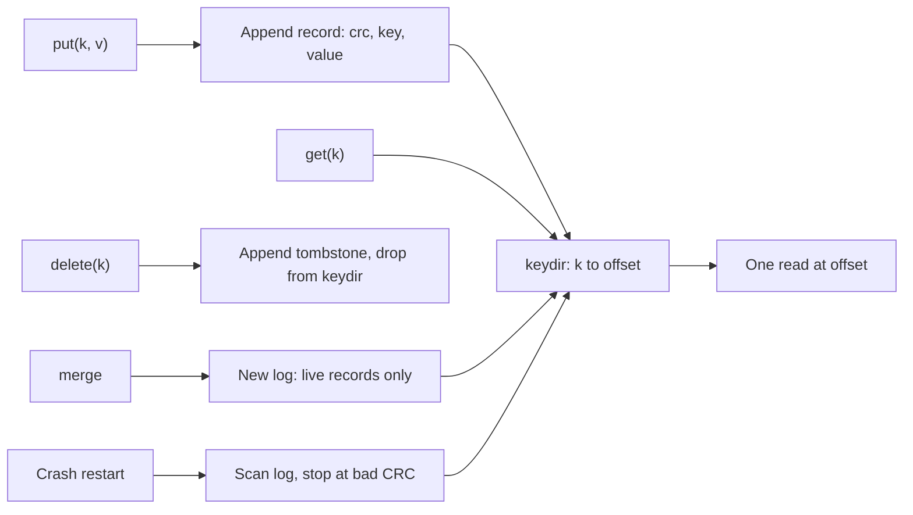

## In one minute
- A key-value store offers the smallest useful database API: `get(key)`, `put(key, value)`, `delete(key)`, sometimes with compare-and-set and expiry. The value is opaque bytes; the store never looks inside.
- Giving up queries on anything but the key buys predictable latency, simple partitioning and easy replication, which is why key-value stores sit under caches, session stores, config systems and many larger databases.
- The first engine question is hashed or ordered. A hash index answers point lookups in one step but cannot scan a range; an ordered index (B+ tree or LSM tree) supports prefix and range scans, which turns key design into schema design.
- The second is where the data lives: in memory (Redis, Memcached), in an embedded engine on local disk (RocksDB, LMDB, bbolt, Bitcask), or in a distributed service (DynamoDB, etcd, FoundationDB) that adds partitioning, replication and a consistency model.
- Everything you would otherwise get from a query planner (secondary lookups, aggregates, joins) becomes your job, done by writing extra keys.

## How it works

### The narrow contract
The API is a map from short byte-string keys to values from a counter to a few hundred kilobytes. Because the store never interprets the value, it can place any key on any machine by hashing it, replicate it blindly, and serve it at the same cost every time. This is the "finding things fast" problem shape in its purest form. It also shows up as a DNS resolver's cache, Git's content-addressed object database, and an LLM server's prefix cache keyed by a hash of the prompt tokens.

### Hashed versus ordered
A **hash** store (Memcached, the Redis keyspace, Bitcask) maps each key to a slot. Lookups are O(1), but keys sit in no useful order, so "every key starting with `user:42:`" means scanning everything. An **ordered** store (RocksDB, LMDB, bbolt, etcd, FoundationDB, DynamoDB's sort key) keeps keys sorted, so a prefix or range is one seek followed by a sequential read. Ordered stores let you build structure into the key: `order/2026-10-16/000187` makes "today's orders" a range scan, and FoundationDB's tuple layer encodes `(tenant, table, id)` into bytes that sort the way the tuple does ([FoundationDB docs](https://apple.github.io/foundationdb/data-modeling.html)).

### Key design is the schema
With no secondary indexes, every access pattern needs a key that answers it. To look a user up by email as well as by id, you write two keys, `user/id/42` holding the record and `user/email/ana@x.io` holding `42`, and you are now responsible for keeping them consistent. The *Indexing* lesson shows the database doing this for you; here you do it by hand, ideally in one transaction or with a repair job. Hot keys are the other half of key design: a key that receives a large share of traffic lands on one partition no matter how many you have (see *Hot Keys*).

### Families of stores
In-memory stores trade durability for sub-millisecond latency (see *Redis*). Check the licence as well as the engine: Redis moved to source-available licences in 2024, the Linux Foundation forked Valkey from Redis 7.2.4 under BSD ([Linux Foundation](https://www.linuxfoundation.org/press/linux-foundation-launches-open-source-valkey-community)), and Redis 8 added AGPLv3 as an option ([Redis](https://redis.io/legal/licenses/)). Embedded engines are libraries: RocksDB is an LSM tree (see *LSM Trees*), LMDB and bbolt are copy-on-write B+ trees read through `mmap` ([bbolt README](https://github.com/etcd-io/bbolt)), and Bitcask is a log plus an in-memory hash table. Distributed stores partition and replicate the keyspace: DynamoDB with per-partition leaders, etcd with Raft over one small keyspace, Dynamo-style systems with leaderless quorums (see *Design a Key-Value Store*). Many richer databases are key-value stores underneath: CockroachDB and TiKV map SQL rows onto ordered keys.

### Conditional writes
A plain `put` loses updates when two clients read, modify and write the same key. Every serious store therefore offers a compare-and-set: Redis `WATCH` with `MULTI`/`EXEC` or `SET key value NX`, DynamoDB's `ConditionExpression`, etcd transactions that compare a key's `mod_revision`. This is the contention problem shape, solved by optimistic concurrency on a single key.

## Down the stack

### Layer 1: The contract
Per key, a store promises either linearizability (etcd, FoundationDB, DynamoDB strongly consistent reads: a read returns the latest acknowledged write) or eventual consistency (Dynamo-style stores, DynamoDB's default reads, Redis replicas: a read may return an older value for a while). Durability is a separate dial: Memcached promises none, Redis with `appendfsync everysec`, the default AOF policy, may lose about one second of writes on a crash ([Redis docs](https://redis.io/docs/latest/operate/oss_and_stack/management/persistence/)), and etcd acknowledges only after a majority of members have the entry on disk. Limits are part of the contract: DynamoDB items are capped at 400 KB, etcd requests at 1.5 MiB with a 2 GiB default storage quota and a suggested maximum of 8 GiB ([etcd docs](https://etcd.io/docs/v3.6/dev-guide/limit/)), and Redis strings at 512 MB. Multi-key atomicity is never free: absent, limited to keys on one shard (Redis Cluster hash tags, [cluster spec](https://redis.io/docs/latest/operate/oss_and_stack/reference/cluster-spec/)), or a transaction with a size cap (100 items and 4 MB in DynamoDB, [AWS docs](https://docs.aws.amazon.com/amazondynamodb/latest/developerguide/transaction-apis.html)).

### Layer 2: The mechanism
Bitcask, Riak's original engine, is the simplest durable design. Every write appends a record to the active data file: CRC, timestamp, key size, value size, key, value; a delete appends a tombstone. An in-memory hash table, the *keydir*, maps each key to `(file_id, value_sz, value_pos, tstamp)` of its latest record, so a read is one hash lookup and one disk read ([Bitcask paper](https://riak.com/assets/bitcask-intro.pdf)). A background *merge* rewrites only live records into new files, plus a *hint file* of keys and positions so a restart rebuilds the keydir without reading values. On startup, a record whose CRC does not match is a torn write from a crash, and the tail after it is discarded.

LMDB and bbolt keep one file holding a B+ tree, updated copy-on-write: a write transaction writes changed pages to free space, then flips a meta page to the new root. Readers keep the old root and never block; there is one writer at a time, and old pages cannot be reused while a long read transaction still holds them, so a stuck reader makes the file grow. etcd stores every revision of every key in bbolt, keyed by revision number, with an in-memory B-tree from user keys to revisions, which is how it serves watches and historical reads ([etcd docs](https://etcd.io/docs/v3.6/learning/data_model/)).

### Layer 3: The machine
An in-memory hash lookup costs about 100 ns, mostly one or two cache misses. Over the network the same `GET` costs a datacenter round trip of 100 to 500 µs, which is why Redis clients pipeline: 100 commands share one round trip and one `read`/`write` syscall pair. An NVMe SSD serves a 4 KB random read in roughly 10 to 100 µs, so Bitcask's one read per `get` is fast while the keydir fits in RAM; at the key plus a few dozen bytes per entry, 500 million keys need tens of gigabytes.

Writes hit the log sequentially, and durability is decided by `fsync`: a millisecond or more on a consumer SSD, tens of microseconds on drives with power-loss protection. Stores batch many writes per `fsync` (group commit). LMDB maps its file with `mmap`, so a cold read is a page fault and its cache is the OS page cache.

### Why it's built this way
1. Most hot data is fetched by an exact identifier, so a structure that answers only that question can be faster and simpler than a general query engine.
2. Random writes are slow and sequential appends are fast on every medium, so durable engines log first (Bitcask, LSM) or copy-on-write (LMDB) instead of updating in place.
3. Logs accumulate dead records, so engines merge or compact in the background, and must checksum records because a crash can tear the last write.
4. An opaque value with a hashable key can live anywhere, so partitioning and replication are mechanical; the price is that every other access path must be a key you maintain.

## Diagram


## Worked example
A login service keeps 40 million active sessions. Each key is `sess:` plus a 32-character token (37 bytes) and each value is about 300 bytes of JSON. Traffic is 60,000 reads and 4,000 writes a second, with a 30-day sliding expiry.

In Redis, each key costs key and value plus roughly 50 to 80 bytes for the dictionary entry, object header and expiry, about 420 bytes. 40 million sessions need about 17 GB: three shards of about 6 GB leave room for replication buffers and snapshot forks, and 64,000 operations a second is light for three shards.

On a Bitcask-style disk store, the keydir holds 37 bytes of key plus about 40 bytes of overhead per entry, about 3 GB of RAM, and the values live on SSD: 40 million times 340 bytes is 14 GB of live data. With 4,000 writes a second and sessions updated on activity, the log grows by about 1.4 MB a second, around 117 GB a day, almost all of it garbage. Merging when dead bytes exceed 50% of a file keeps disk usage near 30 GB and costs a steady background read and write stream.

Sessions are a natural key-value fit. The trap arrives when someone asks for "all sessions for user 42" to log a user out everywhere. With only token keys, that is a full scan. The fix is a second key per user, `user_sess:42`, holding a set of tokens, updated in the same transaction as the session itself.

## In the wild
- **Jepsen, 2020: etcd's key-value operations are safe, its locks are not.** Under partitions, pauses, clock skew and membership changes, etcd 3.4.3's reads and writes were strict serializable. Its lock API did not give mutual exclusion: with 2-second lease TTLs and process pauses, lock-protected updates lost about 18% of acknowledged writes. The advice: use such locks for efficiency, and have the protected resource check a fencing token such as the key's revision ([Jepsen](https://jepsen.io/analyses/etcd-3.4.3)).
- **Roblox, 2021: a 73-hour outage inside a key-value store.** Every backend service, and monitoring, depended on one Consul cluster. A newly enabled streaming feature caused contention under heavy load, and Consul's BoltDB Raft log had a freelist of nearly a million page IDs (about 7.8 MB) that was rewritten on every append, slowing the leader. The fixes included a planned move to bbolt, cleaning obsolete keys, and separate Consul clusters ([Roblox](https://about.roblox.com/newsroom/2022/01/roblox-return-to-service-10-28-10-31-2021/)).
- **Cloudflare, 2025: a "coreless" KV with a central dependency.** Workers KV served from edge caches but relied on a central source-of-truth store, part of which ran on a third-party cloud that had an outage. About 90% of KV requests failed for roughly 2.5 hours, taking Access logins, WARP and other products with it; Cloudflare is building tooling to re-enable namespaces progressively during storage incidents ([Cloudflare](https://blog.cloudflare.com/cloudflare-service-outage-june-12-2025/)).

## Trade-offs
| Option | Strengths | Weaknesses | Choose when |
|---|---|---|---|
| In-memory hash (Memcached, Redis) | Sub-millisecond, simple, rich types in Redis | RAM cost, weak durability by default | Caches, sessions, counters, rate limits |
| Log plus hash index (Bitcask) | One disk read per get, sequential writes, simple recovery | All keys must fit in RAM, no range scans | Many writes, point lookups, moderate key count |
| LSM tree (RocksDB) | High write throughput, ordered, compresses well | Read and write amplification, compaction tuning | Write-heavy embedded storage, engines under databases |
| Copy-on-write B+ tree (LMDB, bbolt) | Fast lock-free reads, crash-safe without a log | One writer, write amplification on random updates | Read-heavy embedded data, config and metadata |
| Distributed service (DynamoDB, etcd) | Replication, failover and scaling handled for you | Network latency, item and request limits, cost per request | Shared state across services and regions |

## Pitfalls in production
- **Scanning a hash keyspace.** `KEYS *` in Redis is O(N) and blocks the single thread while it walks every key; Redis's own docs warn against it in application code ([Redis docs](https://redis.io/docs/latest/commands/keys/)). Use `SCAN` with a cursor, and better, keep an explicit index key for any set you need to enumerate.
- **Lost updates.** Read, modify, write without a condition loses concurrent changes. Use compare-and-set, an atomic server-side operation (`INCR`, `HINCRBY`) or a version check.
- **Large values.** A 5 MB value blocks a Redis shard for milliseconds on every read and inflates replication. Split large values into chunks or store them in object storage and keep a pointer.
- **Unbounded growth.** Keys written without expiry accumulate until memory or disk runs out, and etcd stops accepting writes when it hits its storage quota. Set TTLs, compact old revisions, and alert on keyspace growth.
- **Hand-made indexes that drift.** A secondary key written in a separate request will eventually disagree with the primary record. Write both atomically, or run a periodic repair that rebuilds the index from the source keys.

## Leadership lens
- Before approving a key-value store, ask for the list of access patterns and the key that serves each one; if any pattern needs a scan, the store is the wrong choice or the design needs an extra key.
- Decide durability explicitly: "it's a cache" and "it holds the only copy of the sessions" lead to different persistence settings, replication and on-call expectations.
- In managed stores, a hot key or an accidental scan shows up first as throttling and on the invoice; review key design with cost in mind.
- Keep etcd and similar coordination stores for small, critical metadata, owned by the platform team, and push application data elsewhere.

## Check yourself
1. Why can Bitcask serve any `get` with a single disk read, and what limits how much data it can hold?
   **Answer:** The in-memory keydir gives the exact file and offset of the latest value, so the read goes straight there. Every key must fit in RAM, so key count, not value size, sets the limit.
2. You need "all orders for customer 42 in the last week". What does each kind of store require?
   **Answer:** An ordered store can hold keys like `cust/42/order/2026-10-16/...` and answer with one prefix range scan. A hash store needs an extra key per customer listing order ids, maintained on every write.
3. Why must a log-structured store checksum every record?
   **Answer:** A crash can leave the last record partly written. Without a checksum, recovery would load garbage as a valid value; with one, it detects the torn record and discards the tail.
4. Two workers increment the same counter with get then put. What goes wrong and what are the fixes?
   **Answer:** Both read 10 and both write 11, losing an increment. Use an atomic server-side increment or a compare-and-set that retries when the value changed.

## Practice
**Task:** Build a Bitcask-style store. `KV()` keeps an append-only `log` of records (key, value, checksum), where a tombstone has no value, and an in-memory index from each live key to the position of its latest record. `put(key, value)` appends a record; `get(key)` reads through the index and returns the value or none; `delete(key)` appends a tombstone and returns true, or returns false and appends nothing if the key is not live. `live_keys()` returns live keys sorted, `garbage()` counts log records the index does not point to, and `merge()` rewrites the log to hold only the latest record of each live key, in the order those records appeared, and returns how many records it removed. `KV.recover(log)` rebuilds a store from a log, stopping at the first record whose checksum does not match and discarding it and everything after it. The checksum helper is given: 32-bit FNV-1a over the key, a zero character, and for a put `"="` plus the value.

```python starter
def checksum(key, value):
    data = key + "\x00" + ("" if value is None else "=" + value)
    h = 2166136261
    for ch in data:
        h = ((h ^ ord(ch)) * 16777619) & 0xFFFFFFFF
    return h


class KV:
    def __init__(self):
        self.log = []

    def put(self, key, value):
        # TODO
        raise NotImplementedError

    def get(self, key):
        # TODO
        raise NotImplementedError

    def delete(self, key):
        # TODO
        raise NotImplementedError

    def live_keys(self):
        # TODO
        raise NotImplementedError

    def garbage(self):
        # TODO
        raise NotImplementedError

    def merge(self):
        # TODO
        raise NotImplementedError

    @classmethod
    def recover(cls, log):
        # TODO
        raise NotImplementedError
```

```python tests
def test_put_get_overwrite():
    s = KV()
    s.put("a", "1")
    s.put("b", "2")
    s.put("a", "3")
    assert s.get("a") == "3"
    assert s.get("b") == "2"
    assert s.get("zz") is None
    assert len(s.log) == 3
    assert s.garbage() == 1


def test_delete_writes_tombstone():
    s = KV()
    s.put("a", "1")
    s.put("b", "2")
    assert s.delete("a") is True
    assert s.get("a") is None
    assert s.delete("a") is False, "not live, nothing appended"
    assert len(s.log) == 3
    assert s.log[2][1] is None
    assert s.garbage() == 2
    assert s.live_keys() == ["b"]


def test_merge_keeps_latest_live_records_in_log_order():
    s = KV()
    s.put("a", "1")
    s.put("b", "2")
    s.put("a", "3")
    s.put("c", "4")
    s.delete("b")
    assert s.merge() == 3
    assert [r[0] for r in s.log] == ["a", "c"]
    assert [r[1] for r in s.log] == ["3", "4"]
    assert s.garbage() == 0
    assert s.get("a") == "3" and s.get("c") == "4" and s.get("b") is None
    s.put("b", "5")
    assert s.live_keys() == ["a", "b", "c"]


def test_recover_rebuilds_index():
    s = KV()
    for k, v in [("x", "1"), ("y", "2"), ("x", "9")]:
        s.put(k, v)
    s.delete("y")
    r = KV.recover(list(s.log))
    assert r.get("x") == "9"
    assert r.get("y") is None
    assert r.live_keys() == ["x"]
    assert len(r.log) == 4


def test_recover_drops_torn_tail():
    s = KV()
    s.put("k", "old")
    s.put("k", "new")
    key, _, crc = s.log[1]
    torn = list(s.log[:1]) + [(key, "ne", crc)]
    r = KV.recover(torn)
    assert r.get("k") == "old"
    assert len(r.log) == 1


def test_corruption_discards_everything_after():
    s = KV()
    for k in ["a", "b", "c", "d"]:
        s.put(k, k.upper())
    log = list(s.log)
    log[1] = ("b", "X", log[1][2])
    r = KV.recover(log)
    assert r.live_keys() == ["a"]
    assert len(r.log) == 1
    r.put("e", "E")
    assert r.get("e") == "E"


def test_records_carry_valid_checksums():
    s = KV()
    s.put("k", "v")
    s.delete("k")
    assert s.log[0] == ("k", "v", checksum("k", "v"))
    assert s.log[1] == ("k", None, checksum("k", None))
```

```python solution
def checksum(key, value):
    data = key + "\x00" + ("" if value is None else "=" + value)
    h = 2166136261
    for ch in data:
        h = ((h ^ ord(ch)) * 16777619) & 0xFFFFFFFF
    return h


class KV:
    def __init__(self):
        self.log = []
        self.index = {}

    def _append(self, key, value):
        self.log.append((key, value, checksum(key, value)))
        return len(self.log) - 1

    def put(self, key, value):
        self.index[key] = self._append(key, value)

    def get(self, key):
        pos = self.index.get(key)
        return None if pos is None else self.log[pos][1]

    def delete(self, key):
        if key not in self.index:
            return False
        self._append(key, None)
        del self.index[key]
        return True

    def live_keys(self):
        return sorted(self.index)

    def garbage(self):
        return len(self.log) - len(self.index)

    def merge(self):
        before = len(self.log)
        live = sorted(self.index.items(), key=lambda kv: kv[1])
        self.log = [self.log[pos] for _, pos in live]
        self.index = {rec[0]: i for i, rec in enumerate(self.log)}
        return before - len(self.log)

    @classmethod
    def recover(cls, log):
        s = cls()
        for key, value, crc in log:
            if checksum(key, value) != crc:
                break
            pos = len(s.log)
            s.log.append((key, value, crc))
            if value is None:
                s.index.pop(key, None)
            else:
                s.index[key] = pos
        return s
```

```typescript starter
export interface LogRecord {
  key: string;
  value: string | null;
  crc: number;
}

export function checksum(key: string, value: string | null): number {
  const data = key + "\u0000" + (value === null ? "" : "=" + value);
  let h = 2166136261;
  for (let i = 0; i < data.length; i++) {
    h = Math.imul(h ^ data.charCodeAt(i), 16777619) >>> 0;
  }
  return h;
}

export class KV {
  log: LogRecord[] = [];
  put(key: string, value: string): void {
    throw new Error("TODO");
  }
  get(key: string): string | null {
    throw new Error("TODO");
  }
  delete(key: string): boolean {
    throw new Error("TODO");
  }
  liveKeys(): string[] {
    throw new Error("TODO");
  }
  garbage(): number {
    throw new Error("TODO");
  }
  merge(): number {
    throw new Error("TODO");
  }
  static recover(log: LogRecord[]): KV {
    throw new Error("TODO");
  }
}
```

```typescript tests
test("put, get, overwrite", () => {
  const s = new KV();
  s.put("a", "1");
  s.put("b", "2");
  s.put("a", "3");
  assertEqual(s.get("a"), "3");
  assertEqual(s.get("b"), "2");
  assertEqual(s.get("zz"), null);
  assertEqual(s.log.length, 3);
  assertEqual(s.garbage(), 1);
});
test("delete writes tombstone", () => {
  const s = new KV();
  s.put("a", "1");
  s.put("b", "2");
  assertEqual(s.delete("a"), true);
  assertEqual(s.get("a"), null);
  assertEqual(s.delete("a"), false, "not live, nothing appended");
  assertEqual(s.log.length, 3);
  assertEqual(s.log[2].value, null);
  assertEqual(s.garbage(), 2);
  assertEqual(s.liveKeys(), ["b"]);
});
test("merge keeps latest live records in log order", () => {
  const s = new KV();
  s.put("a", "1");
  s.put("b", "2");
  s.put("a", "3");
  s.put("c", "4");
  s.delete("b");
  assertEqual(s.merge(), 3);
  assertEqual(s.log.map((r) => r.key), ["a", "c"]);
  assertEqual(s.log.map((r) => r.value), ["3", "4"]);
  assertEqual(s.garbage(), 0);
  assert(s.get("a") === "3" && s.get("c") === "4" && s.get("b") === null, "reads after merge");
  s.put("b", "5");
  assertEqual(s.liveKeys(), ["a", "b", "c"]);
});
test("recover rebuilds index", () => {
  const s = new KV();
  for (const [k, v] of [["x", "1"], ["y", "2"], ["x", "9"]]) s.put(k, v);
  s.delete("y");
  const r = KV.recover(s.log.slice());
  assertEqual(r.get("x"), "9");
  assertEqual(r.get("y"), null);
  assertEqual(r.liveKeys(), ["x"]);
  assertEqual(r.log.length, 4);
});
test("recover drops torn tail", () => {
  const s = new KV();
  s.put("k", "old");
  s.put("k", "new");
  const torn = [s.log[0], { key: "k", value: "ne", crc: s.log[1].crc }];
  const r = KV.recover(torn);
  assertEqual(r.get("k"), "old");
  assertEqual(r.log.length, 1);
});
test("corruption discards everything after", () => {
  const s = new KV();
  for (const k of ["a", "b", "c", "d"]) s.put(k, k.toUpperCase());
  const log = s.log.slice();
  log[1] = { key: "b", value: "X", crc: log[1].crc };
  const r = KV.recover(log);
  assertEqual(r.liveKeys(), ["a"]);
  assertEqual(r.log.length, 1);
  r.put("e", "E");
  assertEqual(r.get("e"), "E");
});
test("records carry valid checksums", () => {
  const s = new KV();
  s.put("k", "v");
  s.delete("k");
  assertEqual(s.log[0], { key: "k", value: "v", crc: checksum("k", "v") });
  assertEqual(s.log[1], { key: "k", value: null, crc: checksum("k", null) });
});
```

```typescript solution
export interface LogRecord {
  key: string;
  value: string | null;
  crc: number;
}

export function checksum(key: string, value: string | null): number {
  const data = key + "\u0000" + (value === null ? "" : "=" + value);
  let h = 2166136261;
  for (let i = 0; i < data.length; i++) {
    h = Math.imul(h ^ data.charCodeAt(i), 16777619) >>> 0;
  }
  return h;
}

export class KV {
  log: LogRecord[] = [];
  private index = new Map<string, number>();

  private append(key: string, value: string | null): number {
    this.log.push({ key, value, crc: checksum(key, value) });
    return this.log.length - 1;
  }
  put(key: string, value: string): void {
    this.index.set(key, this.append(key, value));
  }
  get(key: string): string | null {
    const pos = this.index.get(key);
    return pos === undefined ? null : this.log[pos].value;
  }
  delete(key: string): boolean {
    if (!this.index.has(key)) return false;
    this.append(key, null);
    this.index.delete(key);
    return true;
  }
  liveKeys(): string[] {
    return [...this.index.keys()].sort();
  }
  garbage(): number {
    return this.log.length - this.index.size;
  }
  merge(): number {
    const before = this.log.length;
    const positions = [...this.index.values()].sort((a, b) => a - b);
    this.log = positions.map((p) => this.log[p]);
    this.index = new Map(this.log.map((r, i) => [r.key, i] as [string, number]));
    return before - this.log.length;
  }
  static recover(log: LogRecord[]): KV {
    const s = new KV();
    for (const rec of log) {
      if (checksum(rec.key, rec.value) !== rec.crc) break;
      s.log.push(rec);
      if (rec.value === null) s.index.delete(rec.key);
      else s.index.set(rec.key, s.log.length - 1);
    }
    return s;
  }
}
```

```go starter
package practice

type Record struct {
	Key       string
	Value     string
	Tombstone bool
	CRC       uint32
}

func Checksum(key, value string, tombstone bool) uint32 {
	data := key + "\x00"
	if !tombstone {
		data += "=" + value
	}
	h := uint32(2166136261)
	for i := 0; i < len(data); i++ {
		h ^= uint32(data[i])
		h *= 16777619
	}
	return h
}

type KV struct {
	Log []Record
}

func NewKV() *KV { return &KV{} }

func (s *KV) Put(key, value string)         { panic("TODO") }
func (s *KV) Get(key string) (string, bool) { panic("TODO") }
func (s *KV) Delete(key string) bool        { panic("TODO") }
func (s *KV) LiveKeys() []string            { panic("TODO") }
func (s *KV) Garbage() int                  { panic("TODO") }
func (s *KV) Merge() int                    { panic("TODO") }
func Recover(log []Record) *KV              { panic("TODO") }
```

```go tests
package practice

import (
	"reflect"
	"testing"
)

func val(t *testing.T, s *KV, key, want string) {
	t.Helper()
	got, ok := s.Get(key)
	if want == "" {
		if ok {
			t.Fatalf("%s: expected missing, got %q", key, got)
		}
		return
	}
	if !ok || got != want {
		t.Fatalf("%s: got %q (%v), want %q", key, got, ok, want)
	}
}

func keysEq(t *testing.T, got, want []string) {
	t.Helper()
	if !reflect.DeepEqual(got, want) {
		t.Fatalf("got %v, want %v", got, want)
	}
}

func TestPutGetOverwrite(t *testing.T) {
	s := NewKV()
	s.Put("a", "1")
	s.Put("b", "2")
	s.Put("a", "3")
	val(t, s, "a", "3")
	val(t, s, "b", "2")
	val(t, s, "zz", "")
	if len(s.Log) != 3 || s.Garbage() != 1 {
		t.Fatalf("log %d garbage %d", len(s.Log), s.Garbage())
	}
}

func TestDeleteWritesTombstone(t *testing.T) {
	s := NewKV()
	s.Put("a", "1")
	s.Put("b", "2")
	if !s.Delete("a") {
		t.Fatal("delete of live key should return true")
	}
	val(t, s, "a", "")
	if s.Delete("a") {
		t.Fatal("not live, nothing appended")
	}
	if len(s.Log) != 3 || !s.Log[2].Tombstone || s.Garbage() != 2 {
		t.Fatalf("log %v garbage %d", s.Log, s.Garbage())
	}
	keysEq(t, s.LiveKeys(), []string{"b"})
}

func TestMergeKeepsLatestLiveRecordsInLogOrder(t *testing.T) {
	s := NewKV()
	s.Put("a", "1")
	s.Put("b", "2")
	s.Put("a", "3")
	s.Put("c", "4")
	s.Delete("b")
	if n := s.Merge(); n != 3 {
		t.Fatalf("merge removed %d, want 3", n)
	}
	if len(s.Log) != 2 || s.Log[0].Key != "a" || s.Log[0].Value != "3" || s.Log[1].Key != "c" {
		t.Fatalf("log after merge %v", s.Log)
	}
	if s.Garbage() != 0 {
		t.Fatal("no garbage after merge")
	}
	val(t, s, "a", "3")
	val(t, s, "c", "4")
	val(t, s, "b", "")
	s.Put("b", "5")
	keysEq(t, s.LiveKeys(), []string{"a", "b", "c"})
}

func TestRecoverRebuildsIndex(t *testing.T) {
	s := NewKV()
	s.Put("x", "1")
	s.Put("y", "2")
	s.Put("x", "9")
	s.Delete("y")
	r := Recover(append([]Record(nil), s.Log...))
	val(t, r, "x", "9")
	val(t, r, "y", "")
	keysEq(t, r.LiveKeys(), []string{"x"})
	if len(r.Log) != 4 {
		t.Fatalf("log length %d", len(r.Log))
	}
}

func TestRecoverDropsTornTail(t *testing.T) {
	s := NewKV()
	s.Put("k", "old")
	s.Put("k", "new")
	torn := []Record{s.Log[0], {Key: "k", Value: "ne", CRC: s.Log[1].CRC}}
	r := Recover(torn)
	val(t, r, "k", "old")
	if len(r.Log) != 1 {
		t.Fatalf("log length %d", len(r.Log))
	}
}

func TestCorruptionDiscardsEverythingAfter(t *testing.T) {
	s := NewKV()
	for _, k := range []string{"a", "b", "c", "d"} {
		s.Put(k, k+k)
	}
	log := append([]Record(nil), s.Log...)
	log[1].Value = "X"
	r := Recover(log)
	keysEq(t, r.LiveKeys(), []string{"a"})
	if len(r.Log) != 1 {
		t.Fatalf("log length %d", len(r.Log))
	}
	r.Put("e", "E")
	val(t, r, "e", "E")
}

func TestRecordsCarryValidChecksums(t *testing.T) {
	s := NewKV()
	s.Put("k", "v")
	s.Delete("k")
	if s.Log[0] != (Record{Key: "k", Value: "v", CRC: Checksum("k", "v", false)}) {
		t.Fatalf("put record %v", s.Log[0])
	}
	if s.Log[1] != (Record{Key: "k", Tombstone: true, CRC: Checksum("k", "", true)}) {
		t.Fatalf("tombstone record %v", s.Log[1])
	}
}
```

```go solution
package practice

import "sort"

type Record struct {
	Key       string
	Value     string
	Tombstone bool
	CRC       uint32
}

func Checksum(key, value string, tombstone bool) uint32 {
	data := key + "\x00"
	if !tombstone {
		data += "=" + value
	}
	h := uint32(2166136261)
	for i := 0; i < len(data); i++ {
		h ^= uint32(data[i])
		h *= 16777619
	}
	return h
}

type KV struct {
	Log   []Record
	index map[string]int
}

func NewKV() *KV { return &KV{index: map[string]int{}} }

func (s *KV) appendRecord(key, value string, tombstone bool) int {
	s.Log = append(s.Log, Record{key, value, tombstone, Checksum(key, value, tombstone)})
	return len(s.Log) - 1
}

func (s *KV) Put(key, value string) {
	s.index[key] = s.appendRecord(key, value, false)
}

func (s *KV) Get(key string) (string, bool) {
	pos, ok := s.index[key]
	if !ok {
		return "", false
	}
	return s.Log[pos].Value, true
}

func (s *KV) Delete(key string) bool {
	if _, ok := s.index[key]; !ok {
		return false
	}
	s.appendRecord(key, "", true)
	delete(s.index, key)
	return true
}

func (s *KV) LiveKeys() []string {
	keys := make([]string, 0, len(s.index))
	for k := range s.index {
		keys = append(keys, k)
	}
	sort.Strings(keys)
	return keys
}

func (s *KV) Garbage() int { return len(s.Log) - len(s.index) }

func (s *KV) Merge() int {
	before := len(s.Log)
	positions := make([]int, 0, len(s.index))
	for _, p := range s.index {
		positions = append(positions, p)
	}
	sort.Ints(positions)
	merged := make([]Record, 0, len(positions))
	s.index = map[string]int{}
	for i, p := range positions {
		merged = append(merged, s.Log[p])
		s.index[s.Log[p].Key] = i
	}
	s.Log = merged
	return before - len(s.Log)
}

func Recover(log []Record) *KV {
	s := NewKV()
	for _, rec := range log {
		if Checksum(rec.Key, rec.Value, rec.Tombstone) != rec.CRC {
			break
		}
		s.Log = append(s.Log, rec)
		if rec.Tombstone {
			delete(s.index, rec.Key)
		} else {
			s.index[rec.Key] = len(s.Log) - 1
		}
	}
	return s
}
```

## Mock interview
**Prompt:** Design the storage for a feature-flag and configuration service used by 2,000 microservices. There are about 50,000 keys of up to 10 KB each, services read their config on startup and watch for changes, and a bad config push must be revertible within a minute.

- Follow-up: Why might you pick etcd over Redis here, and what limits would you design around?
- Follow-up: 2,000 services restart at once after a region failover and all read their config. What happens and how do you protect the store?
- Follow-up: Product asks for "every flag changed by user X last month". How do you serve that without scanning?

**A strong answer covers:**
- An ordered, linearizable store such as etcd, with keys by prefix (`/config/<service>/<key>`) so a service reads its config with one range read and watches one prefix.
- Revisions and watches: clients resume a watch from the last revision they saw, and rollback is a write of the previous revision's value, kept in history until compaction.
- Thundering-herd protection: clients cache the last good config, jitter startup, and read from followers or a cache tier.
- Respecting limits: 1.5 MiB requests, the storage quota, and compaction plus defragmentation scheduled so revision history does not grow without bound.
- Audit queries served from a separate append-only log or table written alongside each change, not from the key-value store.

## Sources and further study
**Primary**
- [Zhou et al., FoundationDB: A Distributed Unbundled Transactional Key Value Store (SIGMOD 2021)](https://www.foundationdb.org/files/fdb-paper.pdf): an ordered, strictly serializable key-value core with everything else built as layers on top.
- [Nishtala et al., Scaling Memcache at Facebook (NSDI 2013)](https://www.usenix.org/conference/nsdi13/technical-sessions/presentation/nishtala): leases, regional pools and commit-log invalidation around a plain in-memory key-value store.
- [Jepsen: etcd 3.4.3](https://jepsen.io/analyses/etcd-3.4.3): what a linearizable key-value store does and does not guarantee once you build locks on it.

**Systems docs**
- [etcd: system limits](https://etcd.io/docs/v3.6/dev-guide/limit/): request size, storage quota and why the database should stay small.
- [bbolt README](https://github.com/etcd-io/bbolt): copy-on-write B+ tree, one writer, `mmap` caching and the costs of long read transactions.
- [Redis cluster specification](https://redis.io/docs/latest/operate/oss_and_stack/reference/cluster-spec/): 16,384 hash slots, hash tags and which multi-key operations a cluster allows.

**Books**
- *Database Internals*, Alex Petrov, Ch 6 "B-Tree Variants" and Ch 7 "Log-Structured Storage": copy-on-write B-trees as in LMDB, and Bitcask-style unordered log storage.
- *System Design Interview, Volume 1*, Alex Xu, Ch 6 "Design A Key-value Store": the distributed side, with partitioning, quorums and anti-entropy.

**Other curricula**
- [donnemartin/system-design-primer](https://github.com/donnemartin/system-design-primer): describes a key-value store with the abstraction "hash table", noting that some keep keys sorted for range reads and that complexity moves to the application.
- [Azure Architecture Center: Understand data models](https://learn.microsoft.com/en-us/azure/architecture/data-guide/technology-choices/understand-data-store-models): points out that most key-value stores overwrite the whole value on change and that value-based lookups need a redesign.
- [roadmap.sh: System Design](https://roadmap.sh/system-design): its "Key-Value Store" node is a one-paragraph definition naming Redis and DynamoDB for caching and sessions.

## Watch
- [F2023 #07 - Hash Tables (CMU Database Group)](https://www.youtube.com/watch?v=eBgKVqFUUlA): the hashing schemes inside key-value engines, including how they resize and handle collisions.
- [RocksDB: A High Performance Embedded Key-Value Store for Flash Storage (Meta Developers)](https://www.youtube.com/watch?v=V_C-T5S-w8g): Dhruba Borthakur on why RocksDB was built and how it uses flash.
- [Amazon DynamoDB Under the Hood (AWS re:Invent 2018)](https://www.youtube.com/watch?v=yvBR71D0nAQ): request routing, partitions and replication in a distributed key-value service.

## Free resources
- [Bitcask: A Log-Structured Hash Table for Fast Key/Value Data](https://riak.com/assets/bitcask-intro.pdf): the short paper behind this lesson's Practice, including the record format, keydir and hint files.
- [Dynamo: Amazon's Highly Available Key-value Store](https://www.allthingsdistributed.com/files/amazon-dynamo-sosp2007.pdf): the paper that defined leaderless, eventually consistent key-value stores.
- [RocksDB Overview](https://github.com/facebook/rocksdb/wiki/RocksDB-Overview): the architecture of the most widely embedded ordered key-value engine.
- [etcd: data model](https://etcd.io/docs/v3.5/learning/data_model/): revisions, MVCC and how etcd stores history on top of bbolt.
- [FoundationDB: data modeling](https://apple.github.io/foundationdb/data-modeling.html): how to build tuples, indexes and richer models on an ordered key-value store.
- [Redis persistence](https://redis.io/docs/latest/operate/oss_and_stack/management/persistence/): RDB snapshots, AOF and the durability each `fsync` policy gives.
