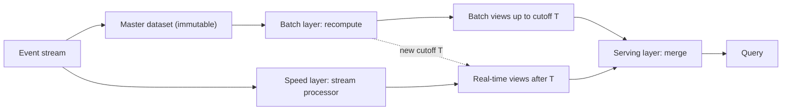

## In one minute
- Lambda architecture runs two pipelines over the same events: a **batch layer** that periodically recomputes exact results from the full immutable history, and a **speed layer** that produces approximate, recent results in real time.
- A **serving layer** merges them at query time: batch views cover everything up to the last batch run, and real-time views fill the gap since then.
- The design gets correctness from recomputation: any bug or late data in the speed layer is overwritten by the next batch run.
- Its well-known cost is **two codebases** that must compute the same thing in two different frameworks, and they drift.
- It still fits when the batch computation is fundamentally different or much cheaper than streaming, or when an approximate real-time view is acceptable alongside an exact daily one.

## How it works

### The master dataset
All raw events are appended to an immutable store, typically a data lake partitioned by time. Nothing is updated in place. This is the source of truth; every derived view is a function of it, so a view can always be rebuilt. Nathan Marz, who proposed the design in 2011, summarised it as query equals a function of all data, with the real-time layer covering only the hours the batch layer has not yet reached ([Marz](http://nathanmarz.com/blog/how-to-beat-the-cap-theorem.html)).

### Batch layer
On a schedule (hourly or daily), a batch job such as Spark or a warehouse query recomputes views from the master dataset, or from the newest partitions merged with the previous view. Because it sees all data for the interval, including late arrivals, it can compute exact distinct counts, complex joins, and ML features. The output is written as a new, immutable version of the batch view and swapped in atomically.

### Speed layer
A stream processor (Flink, Kafka Streams, Spark Structured Streaming) consumes the same events as they arrive and incrementally updates a real-time view, often in a key-value store such as Redis or Cassandra. It only needs to cover data newer than the last completed batch run. It may use approximations (HyperLogLog for distinct counts; Redis's version uses at most 12 KB per key with 0.81% standard error ([Redis docs](https://redis.io/docs/latest/develop/data-types/probabilistic/hyperloglogs/))) and may drop very late events, because those errors are temporary.

### Serving layer and the merge
A query for "views of video V today" reads the batch view up to the batch cutoff time T and the real-time view for events after T, then combines them. When the next batch run finishes, the cutoff moves forward and the corresponding real-time entries are discarded. The merge logic must know T exactly; an off-by-one hour here double counts or drops an hour of data.

### The Kappa alternative
Jay Kreps argued in 2014 that keeping one piece of logic in sync across a batch system and a stream processor is the design's unfixable cost. His alternative keeps the raw events in a replayable log; to change the logic, start a second copy of the streaming job from the start of the log, writing to a new table, and switch readers when it catches up ([Kreps](https://www.oreilly.com/radar/questioning-the-lambda-architecture/)). The catch is retention: Kappa needs the log to hold as much history as you may ever reprocess, and at Uber's volume Kafka keeps only a few days ([Fu and Soman](https://arxiv.org/abs/2104.00087)). Kafka's tiered storage, production-ready since 3.9 in November 2024, offloads log data to pluggable external stores such as cloud object storage, which makes long retention much cheaper than broker disks ([Apache Kafka](https://kafka.apache.org/blog/2024/11/06/apache-kafka-3.9.0-release-announcement/)). Microsoft's architecture guide now presents Lambda, Kappa and lakehouse designs side by side, naming duplicated logic as Lambda's main drawback ([Azure Architecture Center](https://learn.microsoft.com/en-us/azure/architecture/databases/guide/big-data-architectures)).

## Down the stack

### Layer 1: The contract
For any query time, the answer equals exact batch results for all data before the published cutoff T plus best-effort streaming results after T. Results before T are final unless the batch is rerun; results after T are provisional and may change by a bounded amount once the next batch lands. Data is never counted twice and never missing, provided the serving layer merges on the same T the batch layer published.

### Layer 2: The mechanism
The batch layer writes each run as a new versioned output, for example `views/campaign_hourly/run=2026-10-14T13/`, and publishes a small manifest row `(view, cutoff_T, location, run_id)` only after all files are committed. The serving layer reads the latest manifest row, so the cutoff and the data it describes change together. The speed layer stores per-key, per-minute buckets in a key-value store with keys such as `campaign:8812:202610141347` and a TTL a little longer than the batch delay, typically 24 to 48 hours. In Cassandra, each increment is a write to a memtable plus a commit log append, and counters there are not idempotent: a timed-out increment may or may not have been applied, so a retry can over-count. Counter columns also cannot expire, and a counter table may hold only counters outside its primary key ([Cassandra docs](https://cassandra.apache.org/doc/latest/cassandra/developing/cql/types.html)). That is why many speed layers write absolute values computed by the stream processor as plain columns with upserts and a TTL, instead of increments. A query fans out: one read for the batch view range, one multi-get or range scan for the minute buckets after T, then a sum in the service.

### Layer 3: The machine
The two layers stress hardware in opposite ways. The batch layer is throughput-bound: hourly jobs scan hundreds of GB sequentially from object storage at 100 MB/s per connection across many connections, and their cost is CPU hours. The speed layer is latency- and IOPS-bound: 300,000 events per second become tens of thousands of key-value writes per second after pre-aggregation, each an append to the commit log, which on an SSD with `fsync` batched every 10 ms sustains easily, but each read for a dashboard must touch up to 100 minute-buckets, so the speed store's p99 read latency, often 5 to 20 ms, dominates the query. Two separate clusters also means two sets of memory, disks, and network paths to provision and patch.

### Why it's built this way
1. Exact computation over all data is slow, so it runs in batch on a schedule.
2. Users want fresh numbers, so a second, incremental path covers the gap since the last batch.
3. Incremental code is harder to get right and cannot run every algorithm, so its results are allowed to be approximate and are overwritten.
4. Overwriting is only safe if the master data is immutable and the cutoff is explicit, so both are core to the design.

## Diagram


## Worked example
An ad platform reports impressions and unique users per campaign. It receives 300,000 impressions per second at peak, about 15 billion per day.

The speed layer is a Flink job keyed by `campaign_id`, keeping per-minute counters and a HyperLogLog sketch (12 KB each, about 0.8 percent error) for unique users. With 200,000 active campaigns, the state is roughly 2.4 GB of sketches plus counters, well within a 10-node cluster. Results go to Cassandra as absolute per-minute values (not counter columns, which cannot expire) with a 48-hour TTL.

The batch layer runs hourly at 15 minutes past the hour on the previous hour's partition in the lake. It computes exact impression counts after fraud filtering, which uses a model too heavy to run per event in the stream, and exact distinct users using a full `COUNT(DISTINCT)`. Fraud filtering typically removes 3 to 6 percent of impressions.

A dashboard query at 14:40 for today reads batch views for 00:00 to 13:00 (the 13:00 to 14:00 batch has not finished yet) and the speed view for 13:00 to 14:40. The advertiser sees a number that is exact up to 13:00 and slightly inflated for the last 100 minutes, because the speed layer cannot apply the fraud model. When the 13:00 batch lands, the cutoff moves and the number drops by a few percent for that hour. The UI must explain this correction, or advertisers will file tickets.

## In the wild
- **LinkedIn, 2020: Who Viewed Your Profile goes Lambda-less.** The feature ran a nearline Kafka consumer that called about ten services to enrich profile views, plus daily Hadoop MapReduce jobs that redid the same work, both feeding Pinot. Every feature, bug fix or compliance change was done twice, the nearline job lagged and the offline jobs failed regularly. A single Samza job on the Beam API replaced both computations (a small offline job remains only to copy results into Pinot); most development-time measures roughly halved and maintenance overhead fell by more than half. LinkedIn notes batch is still the better fit for some work, A/B testing among it ([LinkedIn](https://www.linkedin.com/blog/engineering/data-science/lambda-to-lambda-less-architecture)).
- **Uber, 2021: why pure Kappa did not fit.** Uber moves trillions of Kafka messages a day but keeps only a few days of retention, for cost and broker-replacement reasons, so it could not replay history from Kafka. It built two Flink backfill paths instead: one SQL query compiled into a streaming job and a batch job over Hive, and "Kappa+", which runs the streaming code directly over archived Hive data with throttling and larger out-of-order buffers ([Fu and Soman](https://arxiv.org/abs/2104.00087)).

## Trade-offs

| Option | Strengths | Weaknesses | Choose when |
|---|---|---|---|
| Lambda (batch plus speed) | Exact recomputation, real-time freshness, robust to stream bugs | Two codebases, merge complexity, double infrastructure | Batch logic cannot run in the stream, or approximations are fine short-term |
| Kappa (stream only, replay to fix) | One codebase, one set of semantics | Reprocessing history through the stream can be slow and costly | Logic expressible in streaming, log retention is affordable |
| Batch only | Simplest, cheapest, exact | Hours of latency | Nobody acts on data faster than the batch interval |
| Unified engine (Beam, Spark, Flink SQL) | Same code for batch and stream runs | Engine-specific semantics leak; not all logic ports cleanly | You want Lambda behaviour without two codebases |

## Pitfalls in production
- **Logic drift.** The batch SQL and the streaming Java compute "unique user" differently and dashboards disagree by 8 percent. Share definitions through a unified framework, or run automated reconciliation that alerts on divergence. LinkedIn found every feature, fix and compliance change had to be made twice until it merged the two paths ([LinkedIn](https://www.linkedin.com/blog/engineering/data-science/lambda-to-lambda-less-architecture)).
- **Cutoff bugs.** The serving layer uses the batch schedule time instead of the actual completed watermark, so a late batch causes a gap or double count. Publish the exact cutoff with each batch view and merge on it.
- **Speed layer state loss.** A Redis restart wipes real-time views and recent hours show zero. Make the speed layer replayable from the log since the last cutoff.
- **Batch overrun.** The hourly job takes 70 minutes, so runs pile up and real-time views must cover ever-longer windows. Monitor batch duration against its interval and scale or reduce scope.
- **Visible corrections.** Users see numbers go down when batch replaces speed results. Label recent data as provisional in the product.

## Leadership lens
- Ask whether the batch and stream paths truly need different logic. If not, Kappa or a unified engine avoids paying for two teams' worth of code.
- Assign a single owner for metric definitions across both paths, with a reconciliation dashboard.
- Count the infrastructure: two processing stacks, two serving stores, and on-call for both. That is roughly double the operational surface.
- Plan the user experience for provisional numbers before launch, not after the first escalation.

## Check yourself
1. Why can the speed layer afford to be approximate or lossy?
   **Answer:** Its results are temporary; every interval is eventually recomputed exactly by the batch layer and the real-time values for it are discarded.
2. What exactly must the serving layer know to merge correctly?
   **Answer:** The precise cutoff of the most recent completed batch view, so it reads batch data before that point and real-time data only after it.
3. What is the main argument for replacing Lambda with Kappa?
   **Answer:** Maintaining two implementations of the same logic is costly and they diverge; if the stream processor can reprocess history by replaying the log, one path suffices.

## Practice
**Task:** Implement the serving-layer merge. `merged_count(batch_view, cutoff, speed_events, start, end)` returns the count of events in the half-open interval `[start, end)`. `batch_view` maps hour-start timestamps (multiples of 3600) to exact counts and covers hours that start before `cutoff`. `speed_events` is a list of event timestamps that may include events before the cutoff (already covered by batch) which must be ignored. `start` and `end` are hour-aligned. Do not double count and do not drop data.

```python starter
def merged_count(batch_view, cutoff, speed_events, start, end):
    # TODO
    raise NotImplementedError
```

```python tests
BATCH = {0: 100, 3600: 120, 7200: 90}

def test_only_batch():
    assert merged_count(BATCH, 10800, [], 0, 7200) == 220

def test_batch_plus_speed():
    ev = [10800, 11000, 14000]
    assert merged_count(BATCH, 10800, ev, 3600, 14400) == 120 + 90 + 3

def test_ignores_speed_before_cutoff():
    ev = [5000, 7300, 10900]
    assert merged_count(BATCH, 10800, ev, 0, 14400) == 310 + 1

def test_respects_end():
    ev = [10800, 14400, 15000]
    assert merged_count(BATCH, 10800, ev, 0, 14400) == 311

def test_window_entirely_after_cutoff():
    ev = [20000, 21000, 30000]
    assert merged_count(BATCH, 10800, ev, 18000, 25200) == 2
```

```python solution
def merged_count(batch_view, cutoff, speed_events, start, end):
    total = 0
    for hour, count in batch_view.items():
        if start <= hour < end and hour < cutoff:
            total += count
    lo = max(start, cutoff)
    for ts in speed_events:
        if lo <= ts < end:
            total += 1
    return total
```

```typescript starter
export function mergedCount(batchView: Map<number, number>, cutoff: number,
    speedEvents: number[], start: number, end: number): number {
  throw new Error("TODO");
}
```

```typescript tests
const BATCH = new Map<number, number>([[0, 100], [3600, 120], [7200, 90]]);
test("only batch", () => assertEqual(mergedCount(BATCH, 10800, [], 0, 7200), 220));
test("batch plus speed", () =>
  assertEqual(mergedCount(BATCH, 10800, [10800, 11000, 14000], 3600, 14400), 213));
test("ignores speed before cutoff", () =>
  assertEqual(mergedCount(BATCH, 10800, [5000, 7300, 10900], 0, 14400), 311));
test("respects end", () =>
  assertEqual(mergedCount(BATCH, 10800, [10800, 14400, 15000], 0, 14400), 311));
test("window entirely after cutoff", () =>
  assertEqual(mergedCount(BATCH, 10800, [20000, 21000, 30000], 18000, 25200), 2));
```

```typescript solution
export function mergedCount(batchView: Map<number, number>, cutoff: number,
    speedEvents: number[], start: number, end: number): number {
  let total = 0;
  for (const [hour, count] of batchView) {
    if (hour >= start && hour < end && hour < cutoff) total += count;
  }
  const lo = Math.max(start, cutoff);
  for (const ts of speedEvents) if (ts >= lo && ts < end) total += 1;
  return total;
}
```

```go starter
package practice

func MergedCount(batchView map[int64]int, cutoff int64, speedEvents []int64, start, end int64) int {
	panic("TODO")
}
```

```go tests
package practice

import "testing"

var batch = map[int64]int{0: 100, 3600: 120, 7200: 90}

func expect(t *testing.T, got, want int) {
	t.Helper()
	if got != want {
		t.Fatalf("got %d want %d", got, want)
	}
}

func TestOnlyBatch(t *testing.T) { expect(t, MergedCount(batch, 10800, nil, 0, 7200), 220) }

func TestBatchPlusSpeed(t *testing.T) {
	expect(t, MergedCount(batch, 10800, []int64{10800, 11000, 14000}, 3600, 14400), 213)
}

func TestIgnoresSpeedBeforeCutoff(t *testing.T) {
	expect(t, MergedCount(batch, 10800, []int64{5000, 7300, 10900}, 0, 14400), 311)
}

func TestRespectsEnd(t *testing.T) {
	expect(t, MergedCount(batch, 10800, []int64{10800, 14400, 15000}, 0, 14400), 311)
}

func TestAfterCutoff(t *testing.T) {
	expect(t, MergedCount(batch, 10800, []int64{20000, 21000, 30000}, 18000, 25200), 2)
}
```

```go solution
package practice

func MergedCount(batchView map[int64]int, cutoff int64, speedEvents []int64, start, end int64) int {
	total := 0
	for hour, count := range batchView {
		if hour >= start && hour < end && hour < cutoff {
			total += count
		}
	}
	lo := start
	if cutoff > lo {
		lo = cutoff
	}
	for _, ts := range speedEvents {
		if ts >= lo && ts < end {
			total++
		}
	}
	return total
}
```

## Mock interview
**Prompt:** Design view counting for a video platform with 2 million views per second at peak. Creators want counts within seconds, and payouts must be exact and fraud-filtered.

- Follow-up: How do you avoid showing a count that later goes down?
- Follow-up: The streaming job had a bug for six hours. How do you fix the numbers?
- Follow-up: Could you do this with a single streaming pipeline instead?

**A strong answer covers:**
- Separate approximate real-time counts from exact, fraud-filtered batch counts used for payouts.
- A precise cutoff contract between batch and serving layers.
- Recovery by letting the batch layer overwrite, plus replaying the stream since the last cutoff.
- Product decisions such as showing provisional counts or freezing displayed counts until reconciled.
- A reasoned Kappa alternative and what it would need: long log retention and a fraud model that runs in the stream.

## Sources and further study
**Primary**
- [Fu and Soman, Real-time Data Infrastructure at Uber (SIGMOD 2021)](https://arxiv.org/abs/2104.00087): a production view of why Lambda and Kappa both fell short and what backfill looked like instead.
- [Akidau et al., The Dataflow Model (VLDB 2015)](https://www.vldb.org/pvldb/vol8/p1792-Akidau.pdf): the unified batch and streaming semantics that let one codebase replace the two layers.

**Systems docs**
- [Apache Kafka 3.9 release announcement](https://kafka.apache.org/blog/2024/11/06/apache-kafka-3.9.0-release-announcement/): production-ready tiered storage, the feature that changes Kappa's retention economics.
- [Cassandra CQL data types: counters](https://cassandra.apache.org/doc/latest/cassandra/developing/cql/types.html): why counter increments are not safe to retry and cannot expire.

**Books**
- *Big Data: Principles and best practices of scalable realtime data systems*, Nathan Marz and James Warren, chapter 1 "A new paradigm for Big Data", then Parts 1 to 3 on the batch, serving and speed layers.
- *Designing Data-Intensive Applications*, Martin Kleppmann, chapter 12 "The Future of Data Systems", section "Data Integration": combining batch and stream processing and reprocessing for schema evolution (chapter 13 in the 2026 second edition).

**Other curricula**
- [Google SRE workbook, "Data Processing Pipelines"](https://sre.google/workbook/data-processing/): Spotify's event delivery treats completeness and skew as SLOs, the property Lambda's batch layer exists to guarantee.

## Watch
- [Runaway Complexity in Big Data Systems (Nathan Marz, GOTO 2012)](https://www.youtube.com/watch?v=ucHjyb6jv08): the originator of the Lambda architecture explains the reasoning behind it.
- [It's Time To Stop Using Lambda Architecture (Yaroslav Tkachenko)](https://www.youtube.com/watch?v=sG8QD8AeWH4): the case for moving to streaming-first designs.

## Free resources
- [How to beat the CAP theorem (Nathan Marz)](http://nathanmarz.com/blog/how-to-beat-the-cap-theorem.html): the original essay describing batch and real-time layers over immutable data.
- [Questioning the Lambda Architecture (Jay Kreps)](https://www.oreilly.com/radar/questioning-the-lambda-architecture/): the critique that introduced the Kappa alternative.
- [Big data architectures (Azure Architecture Center)](https://learn.microsoft.com/en-us/azure/architecture/data-guide/big-data/): Lambda and Kappa side by side with components.
- [Lambda architecture (Wikipedia)](https://en.wikipedia.org/wiki/Lambda_architecture): background and criticism summary.
