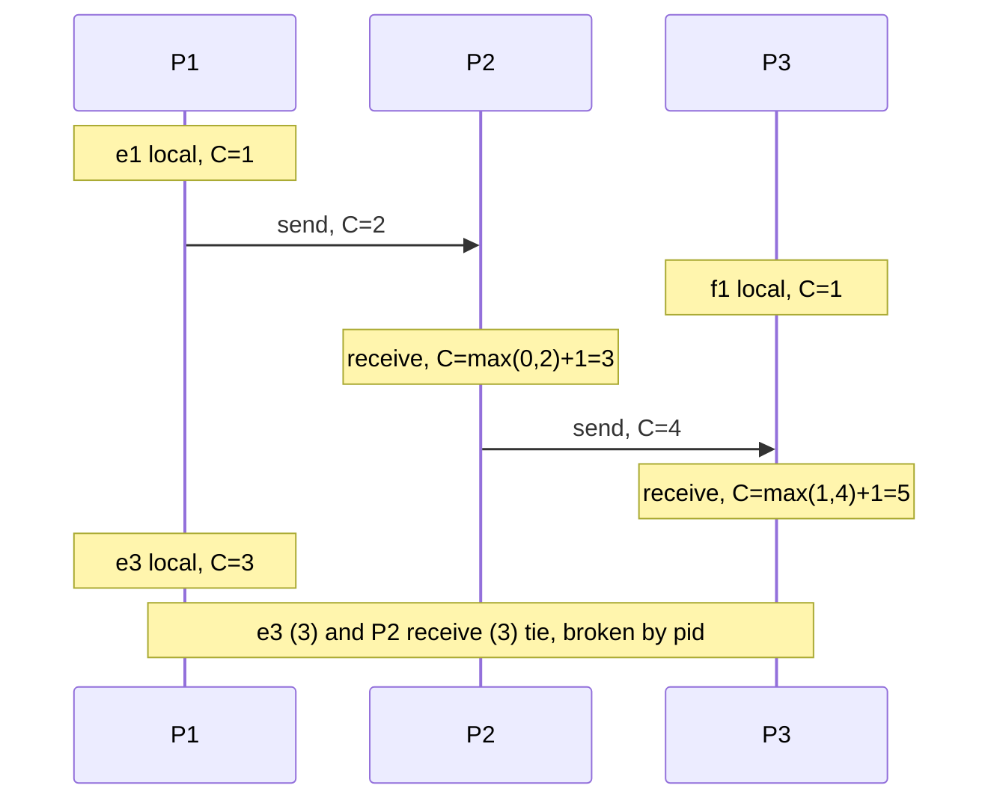

## In one minute
- A Lamport timestamp is a single integer counter per process, updated by three rules, that gives every event a number consistent with causality.
- If event a happened before b, then `L(a) < L(b)`. The reverse is not guaranteed, so Lamport timestamps cannot tell you two events were concurrent.
- Pairing the counter with a process ID, `(counter, pid)`, gives a total order that every process computes identically, with no coordinator.
- That total order is the basis for distributed mutual exclusion, totally ordered broadcast, and the term and epoch numbers inside consensus protocols.

## How it works

### The three rules
Each process `p` holds an integer `C`, starting at 0.

1. Before any local event, increment `C`.
2. When sending a message, increment `C` and attach it to the message.
3. When receiving a message carrying `T`, set `C = max(C, T) + 1` and stamp the receive event with that value.

That is the whole algorithm, close to the two implementation rules in Lamport's 1978 paper ([Lamport](https://lamport.azurewebsites.net/pubs/time-clocks.pdf)). The `max` step is the important part: a receiver jumps ahead of anything the sender had seen, so an effect always gets a larger number than its cause.

### Why the guarantee holds
Happens-before is built from two links: program order on one process and send-to-receive across processes. Rule 1 makes timestamps strictly increase along program order. Rules 2 and 3 make the receive larger than the send. Any causal chain is a sequence of those links, so timestamps strictly increase along it.

### Why the converse fails
Two processes that never communicate both count 1, 2, 3. Event 2 on one and event 3 on the other are unrelated, but the numbers suggest an order. Lamport timestamps compress a partial order into a line, and that throws away the information about which pairs were unordered. If you need to detect concurrency, use vector clocks, which Fidge and Mattern each published in 1988 for exactly this gap ([Mattern](https://pages.cs.wisc.edu/~remzi/Classes/739/Fall2018/Papers/mattern89.pdf)).

There is a second blind spot. The clocks only see messages that go through the system. Lamport's own paper describes a user who issues request A, then phones a friend who issues request B; the system may stamp B before A, because the phone call carried causality the clocks never saw ([Lamport 1978](https://lamport.azurewebsites.net/pubs/time-clocks.pdf)). Any side channel, a shared cache, a queue that drops headers, a human, can do the same.

### Building a total order
Break ties with process ID: `(C_a, p_a) < (C_b, p_b)` if `C_a < C_b`, or the counters are equal and `p_a < p_b`. Every process applies the same rule to the same timestamps and reaches the same order without exchanging extra messages. The order is arbitrary among concurrent events but never contradicts causality.

### What it is used for
*Mutual exclusion.* Each process broadcasts a timestamped request. A process enters the critical section when its request is the smallest in its queue and it has heard a later-stamped message from every other process. It costs `3(N-1)` messages per entry and assumes reliable FIFO channels and no crashes, so it is a teaching tool more than a production lock.

*Totally ordered broadcast.* Deliver messages in timestamp order once you know no smaller timestamp can still arrive, which requires hearing from every process. Replicas that apply operations in that order stay identical.

*Epochs and terms.* Raft terms, Kafka leader epochs and ballot numbers in Paxos follow the same idea: a counter that only goes up, where seeing a larger value makes you adopt it. They are Lamport clocks specialised to leadership changes.

### Practical details
Use 64-bit counters. A busy process incrementing a million times per second would take over 290,000 years to overflow. Persist the counter, or restart above any value you might have sent, or a restarted process may reuse numbers. Clocks only advance on events, so the counter carries no meaning about elapsed time.

## Down the stack

### Layer 1: The contract
A Lamport clock implementation owes its callers three testable properties. First, the clock condition: for every send and its receive, and for consecutive events on one process, the later stamp is strictly larger. Second, `(counter, pid)` is a strict total order, so two distinct events never compare equal, which requires process IDs to be unique and stable. Third, monotonicity across restarts: no process ever issues a stamp it issued before. The first two hold by construction; the third is an engineering problem that most bugs in this area come from.

Totally ordered broadcast built on top adds a delivery contract: every correct process delivers the same messages in the same order. It assumes reliable FIFO channels and no crashes, and those assumptions are what production systems remove by switching to a leader.

### Layer 2: The mechanism
Most production uses of the idea are terms and epochs. In Raft every RPC carries the sender's `term`; a receiver that sees a larger term sets `currentTerm` to it and becomes a follower, which is rule 3 with adoption instead of max-plus-one. The Raft paper says outright that terms act as a logical clock ([Raft paper](https://raft.github.io/raft.pdf)). etcd persists `currentTerm` inside a `HardState` record (`Term`, `Vote`, `Commit`) in its write-ahead log before acting on it ([raft.proto](https://github.com/etcd-io/raft/blob/main/raftpb/raft.proto)).

Kafka writes a 32-bit `PartitionLeaderEpoch` into the header of every record batch, and each broker keeps a `leader-epoch-checkpoint` file mapping epochs to the first offset written in that epoch. After a failover, a follower asks the new leader for the end offset of its last epoch (the `OffsetForLeaderEpoch` request, [schema](https://github.com/apache/kafka/blob/trunk/clients/src/main/resources/common/message/OffsetForLeaderEpochRequest.json)) and truncates any divergent tail ([KIP-101](https://cwiki.apache.org/confluence/display/KAFKA/KIP-101+-+Alter+Replication+Protocol+to+use+Leader+Epoch+rather+than+High+Watermark+for+Truncation)). The epoch field is visible in the record batch format as `partitionLeaderEpoch: int32` ([Kafka docs](https://kafka.apache.org/41/implementation/message-format/)). ZooKeeper's `zxid` puts the epoch in the high 32 bits and a per-epoch counter in the low 32 bits, and a new leader starts at `(e+1, 0)` where `e` is the highest epoch it has seen, which is rule 3 again ([ZooKeeper internals](https://zookeeper.apache.org/doc/current/zookeeperInternals.html)).

Paxos ballot numbers are the clearest example: a ballot is literally `(round, node_id)`, compared lexicographically. A proposer that is rejected because it saw a higher ballot picks a round above it, which is the same max-then-increment rule, and the node ID in the low position is the pid tie-breaker.

### Layer 3: The machine
In memory the clock is an 8-byte integer. A local event is a single atomic increment, a `LOCK XADD` on x86 costing a few nanoseconds when uncontended. A receive needs `max(C, T) + 1`, and x86 has no atomic max, so a lock-free implementation uses a compare-and-swap loop that retries when another thread advanced the counter first. Under contention, every core is fighting for one 64-byte cache line.

Persistence is the expensive part. An `fsync` costs tens of microseconds on an SSD with power-loss protection and several milliseconds on many network volumes, far too slow to pay on every event. The standard trick, also used by database sequence caches, is to persist a high-water mark ahead of use: write "C may reach 10,000" once, issue stamps up to that limit from memory, and on restart begin from the persisted mark. A crash wastes the unused range but never reuses a value.

On the wire the cost is tiny. Protobuf encodes integers as varints, 7 payload bits per byte, so a counter under 16,384 takes 2 bytes and a full 64-bit value at most 10 ([Protobuf encoding](https://protobuf.dev/programming-guides/encoding/)). The FIFO assumption comes from TCP, but only within one connection. After a reconnect, an application-level retry can deliver an older message after a newer one, so real protocols add per-channel sequence numbers or, as Raft does, include enough log position information to reject stale messages.

### Why it's built this way
1. There is no shared clock across machines, so ordering must be carried in the messages themselves.
2. A single integer is the smallest possible carrier and fits in a few bytes, so it is cheap enough to attach to every message.
3. A single integer cannot represent a partial order, so concurrency information is lost and ties need an arbitrary but agreed rule, the pid.
4. The guarantee depends on the counter never going backwards, and memory is lost on crash, so counters are persisted, usually in reserved blocks to amortise the cost of `fsync`.

## Diagram


## Worked example
Three replicas of a key-value store use totally ordered broadcast with Lamport timestamps to apply `SET` operations in the same order. Replica 1 sends `SET x=1` stamped `(5, 1)`. Replica 3, whose counter is 4, concurrently sends `SET x=7` stamped `(5, 3)`. Every replica buffers both. Once each has heard something stamped above 5 from all three replicas, it delivers `(5, 1)` then `(5, 3)`. Everyone ends with `x=7`.

The cost shows up in latency. A replica cannot deliver until it has heard from every peer, so delivery waits for the slowest replica. With peers 2 ms apart, plus heartbeats every 10 ms to keep silent replicas from stalling delivery, expected delivery delay is around 10 to 12 ms, and a single crashed replica blocks delivery entirely. This is why production systems usually replace the "hear from everyone" rule with a leader and a quorum, keeping the monotonic counter as the term.

Overhead is about 12 bytes per message, constant regardless of cluster size.

## In the wild
- **Apache Kafka, KIP-101: replacing the high watermark with a leader epoch.** Followers used to truncate their log to the high watermark after a restart. Because a follower learns the watermark one fetch late, a restart followed by a leader change could permanently drop committed messages, and after a power loss replicas could diverge. The fix stamps every message with a 32-bit, monotonically increasing leader epoch and truncates by epoch boundaries instead, the term idea from consensus applied to a log ([KIP-101](https://cwiki.apache.org/confluence/display/KAFKA/KIP-101+-+Alter+Replication+Protocol+to+use+Leader+Epoch+rather+than+High+Watermark+for+Truncation)).
- **AWS, 2025: a stale writer overwrites a newer DNS plan.** In DynamoDB's DNS automation, each Enactor checked that its plan was newer than the one applied, then took a long time to apply it. Meanwhile another Enactor applied a newer plan, the slow one overwrote it with its old plan, and cleanup then deleted that old plan, leaving `dynamodb.us-east-1` with no IP addresses. DynamoDB errors ran from 11:48 PM to about 2:40 AM PDT. A generation check made once at the start is not a fence; the comparison has to happen where the write lands ([AWS](https://aws.amazon.com/message/101925/)).
- **etcd 3.4.3, 2020: locks without fencing tokens.** Jepsen found etcd's key-value operations strict-serializable, but its locks did not give mutual exclusion: with 2-second leases and process pauses, lock-protected updates lost about 18% of acknowledged writes. Jepsen's advice was to use the lock key's revision as a globally ordered fencing token that the protected resource checks on every operation, a Lamport-style counter ([Jepsen](https://jepsen.io/analyses/etcd-3.4.3)).

## Trade-offs
| Approach | Strengths | Weaknesses | Choose when |
|---|---|---|---|
| Lamport timestamps | Constant size, simple, causal | No concurrency detection | Total ordering, epochs, tie-breaking |
| Lamport plus pid total order | Identical order on all nodes | Order among concurrent events is arbitrary | Deterministic replicated state |
| Vector clocks | Detect concurrency exactly | Size grows with processes | Conflict detection |
| Hybrid logical clocks | Causal and near real time | Needs bounded skew | Timestamps users and queries depend on |
| Physical timestamps | Meaningful to humans | Can contradict causality | Display and coarse logging only |

## Pitfalls in production
- Inferring causality from a smaller timestamp, for example "this write must have caused that one". Fix: treat the order as consistent with causality, nothing more.
- Resetting the counter on restart, so new events reuse old numbers. Fix: persist the high-water mark, or start from a value guaranteed above anything sent, such as a persisted epoch times 2^32.
- Forgetting rule 3 on some message path, like a retry or a side channel through a cache. Fix: centralise clock handling in the messaging library.
- Using last-writer-wins on Lamport order and assuming no updates were lost. Fix: concurrent writes are silently overwritten; use vector clocks or CRDTs where that matters.

## Leadership lens
- Recognise Lamport clocks inside designs: terms, epochs, fencing tokens and sequence numbers are all the same idea. Review them with the same three rules.
- Ask whether the design needs to know two operations conflicted. If yes, a scalar timestamp is insufficient.
- Check restart behaviour explicitly in design review. A counter that goes backwards breaks every guarantee.

## Check yourself
1. Process A has counter 9 and receives a message stamped 4. What is its new counter?
   **Answer:** `max(9, 4) + 1 = 10`. The receive is still an event, so it increments.
2. Two events have timestamps `(7, 2)` and `(7, 1)`. Could one have caused the other?
   **Answer:** No. If one caused the other, its counter would be strictly smaller. Equal counters mean they are concurrent.
3. Why is a Raft term a kind of Lamport clock?
   **Answer:** It only increases, it travels in every message, and a node that sees a higher term adopts it, which is rule 3 applied to leadership.

## Practice
**Task:** Write `lamport(trace)`. The trace is a list of events in the order they occurred: `("local", p)`, `("send", p, msg_id)` or `("recv", p, msg_id)`, where `p` is a process name. Apply the three Lamport rules with every process starting at 0, and return the list of timestamps, one per event. A receive always comes after its send in the trace.

```python starter
def lamport(trace):
    # TODO
    raise NotImplementedError
```

```python tests
def test_local_events_count_up():
    assert lamport([("local", "a"), ("local", "a")]) == [1, 2]

def test_receive_jumps_ahead():
    t = [("local", "a"), ("send", "a", "m"), ("recv", "b", "m")]
    assert lamport(t) == [1, 2, 3]

def test_receiver_already_ahead():
    t = [("send", "a", "m"), ("local", "b"), ("local", "b"),
         ("local", "b"), ("recv", "b", "m")]
    assert lamport(t) == [1, 1, 2, 3, 4]

def test_chain_across_three():
    t = [("send", "a", "m1"), ("local", "c"), ("recv", "b", "m1"),
         ("send", "b", "m2"), ("recv", "c", "m2")]
    assert lamport(t) == [1, 1, 2, 3, 4]

def test_empty():
    assert lamport([]) == []
```

```python solution
def lamport(trace):
    clocks = {}
    sent = {}
    out = []
    for ev in trace:
        p = ev[1]
        c = clocks.get(p, 0)
        if ev[0] == "recv":
            c = max(c, sent[ev[2]]) + 1
        else:
            c += 1
            if ev[0] == "send":
                sent[ev[2]] = c
        clocks[p] = c
        out.append(c)
    return out
```

```typescript starter
export type TraceEvent = [kind: "local" | "send" | "recv", proc: string, msgId?: string];

export function lamport(trace: TraceEvent[]): number[] {
  // TODO
  throw new Error("TODO");
}
```

```typescript tests
test("local events count up", () => {
  assertEqual(lamport([["local", "a"], ["local", "a"]]), [1, 2]);
});

test("receive jumps ahead", () => {
  assertEqual(lamport([["local", "a"], ["send", "a", "m"], ["recv", "b", "m"]]), [1, 2, 3]);
});

test("receiver already ahead", () => {
  const t: TraceEvent[] = [["send", "a", "m"], ["local", "b"], ["local", "b"],
    ["local", "b"], ["recv", "b", "m"]];
  assertEqual(lamport(t), [1, 1, 2, 3, 4]);
});

test("chain across three", () => {
  const t: TraceEvent[] = [["send", "a", "m1"], ["local", "c"], ["recv", "b", "m1"],
    ["send", "b", "m2"], ["recv", "c", "m2"]];
  assertEqual(lamport(t), [1, 1, 2, 3, 4]);
});

test("empty", () => {
  assertEqual(lamport([]), []);
});
```

```typescript solution
export type TraceEvent = [kind: "local" | "send" | "recv", proc: string, msgId?: string];

export function lamport(trace: TraceEvent[]): number[] {
  const clocks = new Map<string, number>();
  const sent = new Map<string, number>();
  const out: number[] = [];
  for (const [kind, p, msg] of trace) {
    let c = clocks.get(p) ?? 0;
    if (kind === "recv") {
      c = Math.max(c, sent.get(msg as string) ?? 0) + 1;
    } else {
      c += 1;
      if (kind === "send") sent.set(msg as string, c);
    }
    clocks.set(p, c);
    out.push(c);
  }
  return out;
}
```

```go starter
package practice

// Event is one trace entry. Kind is "local", "send" or "recv"; Msg is empty for local.
type Event struct {
	Kind, Proc, Msg string
}

// Lamport returns the Lamport timestamp of each event in order.
func Lamport(trace []Event) []int {
	// TODO
	panic("TODO")
}
```

```go tests
package practice

import "testing"

func sameInts(a, b []int) bool {
	if len(a) != len(b) {
		return false
	}
	for i := range a {
		if a[i] != b[i] {
			return false
		}
	}
	return true
}

func TestLocalEventsCountUp(t *testing.T) {
	got := Lamport([]Event{{"local", "a", ""}, {"local", "a", ""}})
	if !sameInts(got, []int{1, 2}) {
		t.Fatalf("got %v", got)
	}
}

func TestReceiveJumpsAhead(t *testing.T) {
	got := Lamport([]Event{{"local", "a", ""}, {"send", "a", "m"}, {"recv", "b", "m"}})
	if !sameInts(got, []int{1, 2, 3}) {
		t.Fatalf("got %v", got)
	}
}

func TestReceiverAlreadyAhead(t *testing.T) {
	got := Lamport([]Event{{"send", "a", "m"}, {"local", "b", ""}, {"local", "b", ""},
		{"local", "b", ""}, {"recv", "b", "m"}})
	if !sameInts(got, []int{1, 1, 2, 3, 4}) {
		t.Fatalf("got %v", got)
	}
}

func TestChainAcrossThree(t *testing.T) {
	got := Lamport([]Event{{"send", "a", "m1"}, {"local", "c", ""}, {"recv", "b", "m1"},
		{"send", "b", "m2"}, {"recv", "c", "m2"}})
	if !sameInts(got, []int{1, 1, 2, 3, 4}) {
		t.Fatalf("got %v", got)
	}
}

func TestEmptyTrace(t *testing.T) {
	if got := Lamport(nil); len(got) != 0 {
		t.Fatalf("got %v", got)
	}
}
```

```go solution
package practice

// Event is one trace entry. Kind is "local", "send" or "recv"; Msg is empty for local.
type Event struct {
	Kind, Proc, Msg string
}

// Lamport returns the Lamport timestamp of each event in order.
func Lamport(trace []Event) []int {
	clocks := map[string]int{}
	sent := map[string]int{}
	out := make([]int, 0, len(trace))
	for _, ev := range trace {
		c := clocks[ev.Proc]
		if ev.Kind == "recv" {
			if s := sent[ev.Msg]; s > c {
				c = s
			}
			c++
		} else {
			c++
			if ev.Kind == "send" {
				sent[ev.Msg] = c
			}
		}
		clocks[ev.Proc] = c
		out = append(out, c)
	}
	return out
}
```

## Mock interview
**Prompt:** You need every replica of a 5-node configuration store to apply updates in the same order, without a single sequencer service. Writes are about 200 per second. Show how Lamport timestamps could provide the order, and then explain whether you would ship it.

- Follow-up: One node crashes. What happens to delivery?
- Follow-up: Two writes to the same key get timestamps 41 and 42. Can you tell whether the client meant to overwrite?
- Follow-up: How does a node recover its counter after restart?

**A strong answer covers:**
- The three rules and tie-breaking by node ID for a total order.
- Delivery only after hearing a larger timestamp from every node, and the liveness problem when one is down.
- The limit: ordering is causal but cannot reveal concurrency or intent.
- Persisting the counter or using an epoch prefix.
- Recommending a leader-based log with a term number in production, and why.

## Sources and further study
**Primary**
- [Ongaro and Ousterhout, In Search of an Understandable Consensus Algorithm (Raft)](https://raft.github.io/raft.pdf): terms as a logical clock, and how stale terms are rejected.
- [Mattern, Virtual Time and Global States of Distributed Systems (1988)](https://pages.cs.wisc.edu/~remzi/Classes/739/Fall2018/Papers/mattern89.pdf): why a single counter loses concurrency and how vectors recover it.
- [KIP-101: Leader Epoch rather than High Watermark for Truncation](https://cwiki.apache.org/confluence/display/KAFKA/KIP-101+-+Alter+Replication+Protocol+to+use+Leader+Epoch+rather+than+High+Watermark+for+Truncation): the data-loss scenarios and the epoch-based fix.

**Systems docs**
- [ZooKeeper internals](https://zookeeper.apache.org/doc/current/zookeeperInternals.html): the zxid's epoch and counter, and how a new leader picks its epoch.
- [Kafka record batch format](https://kafka.apache.org/41/implementation/message-format/): where the partition leader epoch lives on disk and on the wire.
- [Jepsen: etcd 3.4.3](https://jepsen.io/analyses/etcd-3.4.3): why locks need fencing tokens, and which etcd number to use as one.

**Books**
- *Designing Data-Intensive Applications*, Martin Kleppmann, chapter 9 "Consistency and Consensus" (1st edition), section "Ordering Guarantees": Lamport timestamps, their limits and total order broadcast.
- *Database Internals*, Alex Petrov, chapter 14 "Consensus", sections "Atomic Broadcast", "Paxos" and "Raft": ballots, epochs and terms in practice.

**Other curricula**
- [Kleppmann, Distributed Systems lecture notes (Cambridge)](https://www.cl.cam.ac.uk/teaching/2122/ConcDisSys/dist-sys-notes.pdf): section 4.1 derives Lamport clocks and section 4.3 builds total order broadcast on them.
- [donnemartin/system-design-primer](https://github.com/donnemartin/system-design-primer): does not cover Lamport clocks; ordering only appears implicitly through master-slave replication.

## Watch
- [Distributed Systems 4.1: Logical time (Martin Kleppmann)](https://www.youtube.com/watch?v=x-D8iFU1d-o): Lamport timestamps derived from happens-before, with the total order.
- [Lamport on writing "Time, Clocks, and the Ordering of Events" (Turing Awardee Clips)](https://www.youtube.com/watch?v=nfRouGH0oMg): Leslie Lamport on how the paper came about.

## Free resources
- [Time, Clocks, and the Ordering of Events in a Distributed System (Lamport)](https://lamport.azurewebsites.net/pubs/time-clocks.pdf): the original paper, including the mutual exclusion algorithm.
- [Lamport Clock (Patterns of Distributed Systems)](https://martinfowler.com/articles/patterns-of-distributed-systems/lamport-clock.html): the pattern applied to a replicated key-value store.
- [Lamport timestamp (Wikipedia)](https://en.wikipedia.org/wiki/Lamport_timestamp): a concise summary with the formal properties.
- [Generation Clock (Patterns of Distributed Systems)](https://martinfowler.com/articles/patterns-of-distributed-systems/generation.html): epochs and terms as monotonic counters.
