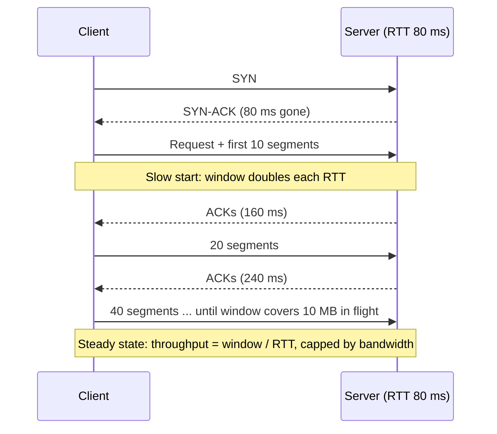

## In one minute
- **Latency** is how long one operation takes, from request to response. It is a distribution, not a number, so describe it with percentiles (p50, p99, p99.9).
- **Throughput** is how many operations complete per unit of time: requests per second, messages per second, bytes per second actually delivered.
- **Bandwidth** is the maximum rate a channel can carry, such as a 10 Gbps link. Throughput can never exceed it and is usually well below it.
- Little's law ties them together: work in flight = throughput x latency. To get more throughput at the same latency, you need more concurrency.
- As utilisation approaches 100%, queues form and latency climbs steeply. Most systems trade a little throughput for predictable latency by running with headroom.

## How it works

### Three different questions
On a highway, bandwidth is the number of lanes, latency is how long one car takes from on-ramp to exit, and throughput is how many cars pass the exit per hour. Adding lanes raises the throughput ceiling but makes no single car faster.

### Little's law
For any stable system, the average number of items inside it equals the arrival rate times the average time each spends inside: `L = λ x W`. A service handling 2,000 requests per second at 50 ms average latency has about 100 requests in flight at any moment. This is why thread pools, connection pools and TCP windows all have to be sized from both numbers. If the pool holds only 50, the service cannot exceed 1,000 requests per second at that latency, no matter how idle the CPU looks.

### Utilisation and queueing
A server that takes 10 ms per request can, in theory, do 100 per second. In practice, requests arrive in bursts, and when one arrives while the server is busy, it waits. For a simple single-server queue, average time in the system is `service_time / (1 - utilisation)`. At 50% utilisation, 10 ms becomes 20 ms. At 90%, it becomes 100 ms. At 99%, a full second. Throughput rose by under a factor of two while latency rose fifty-fold. This curve is why capacity plans target 60 to 70% utilisation for latency-sensitive services.

### Batching trades one for the other
Sending one message per network round trip wastes the fixed cost of each trip. Grouping 100 messages into one write raises throughput dramatically but makes the first message wait for the batch to fill. Kafka producers expose this directly with `linger.ms` and `batch.size`; databases do it with group commit; GPUs do it with inference batches. Batching does not always cost latency, though. Kafka 4.0 raised the default `linger.ms` from 0 to 5 ms because, under load, larger batches mean fewer requests queueing at the broker, so producer latency often stays the same or drops ([Kafka docs](https://kafka.apache.org/43/configuration/producer-configs/)). The right setting depends on whether the consumer cares about the time of each item or the total volume.

### Tails dominate at scale
If a page fans out to 100 backends and each has a 1% chance of a slow response, the page is slow `1 - 0.99^100 ≈ 63%` of the time ([Dean and Barroso, 2013](https://www.barroso.org/publications/TheTailAtScale.pdf)). The average backend latency is irrelevant; the p99 of each backend becomes the median of the page. The same paper shows the fix can be cheap: in a Bigtable test, sending a backup request after 10 ms cut the 99.9th-percentile latency from 1,800 ms to 74 ms for only 2% more requests. This is the *fan-out* shape. The same maths applies to an AI agent that calls ten tools in parallel and to a checkout page waiting on pricing, inventory and fraud checks: the slowest dependency sets the experience.

## Down the stack

### Layer 1: The contract
Performance contracts are stated as a latency percentile at a throughput: "p99 under 200 ms at 5,000 requests per second, with error rate under 0.1%." A latency number without a load level is meaningless, because latency depends on load. A bandwidth number from a provider is a ceiling on raw bits, before protocol overhead (Ethernet, IP and TCP headers take about 3 to 5% at 1,500-byte packets) and before retransmissions.

### Layer 2: The mechanism
TCP throughput on one connection is bounded by `window / RTT`. The receiver advertises a window (scaled by the window-scale option, up to 1 GiB ([RFC 7323](https://www.rfc-editor.org/rfc/rfc7323))), and the sender keeps a congestion window that starts small (10 segments, about 14.6 KB, as specified in [RFC 6928](https://www.rfc-editor.org/rfc/rfc6928) and used by Linux) and grows each round trip during slow start. To fill a link, the window must cover the bandwidth-delay product: 1 Gbps x 80 ms = 10 MB in flight. Linux caps this with `net.ipv4.tcp_rmem` and `tcp_wmem`. The receive maximum stayed at 6 MB from 2012 until Linux 6.16 raised it to 32 MB, because receivers on long paths were capped by it ([kernel commit](https://github.com/torvalds/linux/commit/572be9bf9d0d)); the send maximum still defaults to at most 4 MB ([kernel docs](https://docs.kernel.org/networking/ip-sysctl.html)). Congestion control (CUBIC by default, now a Standards Track spec in [RFC 9438](https://www.rfc-editor.org/rfc/rfc9438), which replaced RFC 8312; or BBR) decides how fast to grow and how hard to back off on loss. Above TCP, HTTP/2 multiplexes many requests on one connection to avoid repeated handshakes.

### Layer 3: The machine
Light in fibre travels about 200,000 km per second, so every 1,000 km adds about 5 ms one way. New York to London (about 5,600 km) can never be faster than roughly 56 ms round trip ([High Performance Browser Networking](https://hpbn.co/primer-on-latency-and-bandwidth/)). Serialisation delay is the time to put bits on the wire: a 1,500-byte packet takes 12 µs at 1 Gbps and 1.2 µs at 10 Gbps. Inside a machine, an L1 cache hit costs about 1 ns, main memory about 100 ns, an NVMe read about 20 to 100 µs. The classic 500 µs for a round trip within a data centre is a 2000s figure: the fabric itself now takes a few microseconds, and the kernel, scheduler wake-ups and RPC stack add tens of microseconds or more on top ([Barroso et al., 2017](https://www.barroso.org/publications/AttackoftheKillerMicroseconds.pdf)). NICs coalesce interrupts (`ethtool -C rx-usecs`) and the kernel merges packets with GRO, which raises throughput by doing less work per packet at the cost of a few microseconds of added latency per packet: the batching trade-off again, in hardware.

### Why it's built this way
1. Distance has a floor set by the speed of light, so latency between regions cannot be engineered away, only avoided with caches and replicas closer to users.
2. Every operation has a fixed cost (a round trip, a syscall, a disk seek), so systems batch work to spread that cost, trading latency for throughput.
3. A pipe is only full if enough data is in flight to cover its delay, so windows and pools are sized by Little's law and the bandwidth-delay product.
4. Queues grow without bound as utilisation nears 100%, so systems keep headroom and shed load rather than run hot.

## Diagram


## Worked example
A team copies a 1 GB backup from a data centre in Virginia to one in Frankfurt. The link is 1 Gbps and the round trip is 80 ms. Their naive estimate is 8 seconds.

With an old 64 KB TCP window and no window scaling, one connection can only have 64 KB in flight per 80 ms, so throughput is `64 KB / 0.08 s = 800 KB/s`, about 6.4 Mbps. The copy takes over 20 minutes on a link that is 99% idle. The link's bandwidth was never the limit; latency times window was.

The bandwidth-delay product is `1 Gbps x 0.08 s = 80 Mbit = 10 MB`. Raising `tcp_rmem` and `tcp_wmem` maximums to 16 MB lets the window grow to fill the pipe. On Linux 6.16 or later the receiver may already allow 32 MB, but the sender's 4 MB default still caps the flow at about 50 MB/s, so check both ends. Slow start needs about 10 round trips (under a second) to reach 10 MB, and the copy then finishes in roughly 9 seconds. A tool that opens 8 parallel connections achieves the same with smaller windows, which is why `aws s3 cp` and most bulk-transfer tools use multipart, parallel uploads (the AWS CLI defaults to 8 MB parts and 10 concurrent requests ([AWS CLI docs](https://docs.aws.amazon.com/cli/latest/topic/s3-config.html))).

The same reasoning applies to the API in front of that system: at 3,000 requests per second and 40 ms average latency, Little's law says about 120 requests are in flight. With a database pool of 64, it plateaued near 1,600 requests per second while CPU sat at 35%, because requests queued for a connection.

## In the wild
- **Slack, 2021: Little's law in an outage.** On the first workday of 2021 an AWS Transit Gateway did not scale fast enough, and packet loss sharply raised latency from the web tier to its backends. With each request taking longer, web servers needed more Apache workers in flight for the same throughput; CPU *fell* because threads were waiting, which first triggered automated downscaling. Then worker utilisation hit its limit, autoscaling tried to add 1,200 servers, and Slack was down or degraded from about 7:00 to 10:40 PST until AWS raised the gateway's capacity ([Slack](https://slack.engineering/slacks-outage-on-january-4th-2021/)).
- **Discord, 2020: tail latency every two minutes.** The Read States service kept a huge LRU cache in Go. Go forces a garbage collection at least every 2 minutes, and scanning the cache produced regular latency and CPU spikes even though average latency looked fine. A Rust rewrite removed the spikes and let each server hold 8 million entries ([Discord](https://discord.com/blog/why-discord-is-switching-from-go-to-rust)).
- **Canva, 2024: a stalled fetch becomes a burst.** A stale CDN route sent traffic over a lossy path, and request coalescing held about 270,000 browsers on one slow JavaScript file. When it finally loaded, they all hit the API together at about 1.5 million requests per second, three times the normal peak, and the gateway fell over for about 52 minutes. An accidental batch turned a latency problem into a throughput problem ([Canva](https://www.canva.dev/blog/engineering/canva-incident-report-api-gateway-outage/)).

## Trade-offs
| Lever | Improves | Costs | Choose when |
|---|---|---|---|
| Batching | Throughput, cost per item | Latency of each item | Logs, analytics, bulk writes |
| More concurrency (pools, connections) | Throughput | Memory, contention, more load on dependencies | Latency is fine but throughput is capped by in-flight limits |
| Caching and replicas near users | Latency | Staleness, cost, invalidation work | Read-heavy, geographically spread users |
| Running with headroom | Tail latency | Idle capacity, money | User-facing, latency-sensitive paths |
| Hedged requests | Tail latency | Extra load (typically 2 to 5%) | Fan-out reads against replicated data |
| More bandwidth | Ceiling on throughput | Money | Measured utilisation is near the link limit |

## Pitfalls in production
- **Reporting averages.** A 30 ms average hides a 2-second p99. Report percentiles, and aggregate them from histograms, not by averaging per-host percentiles; precomputed quantiles cannot be combined ([Prometheus docs](https://prometheus.io/docs/practices/histograms/)).
- **Coordinated omission.** Load generators that wait for a response before sending the next request stop sending during stalls and under-count slow requests. Use open-loop load tests at a fixed arrival rate that measure from when each request should have been sent ([wrk2](https://github.com/giltene/wrk2)).
- **Buying bandwidth for a latency problem.** A bigger link does nothing for a transfer limited by window size or round trips. Compute the bandwidth-delay product first.
- **Pools sized by habit.** A pool smaller than throughput x latency caps throughput and adds queueing delay. Size from Little's law and check under load.
- **Running hot.** At 90% utilisation, small bursts cause large latency spikes. Alert on utilisation and saturation, not only on errors.
- **Batch settings tuned once.** A `linger.ms` that suits peak traffic adds pointless delay at night. Use size-or-time triggers and revisit them when traffic patterns change.

## Leadership lens
- Insist that every performance target names a percentile, a load level and an error budget; "fast" is not a requirement.
- Ask which resource is the bottleneck before approving spend on bandwidth, bigger instances or more nodes. Often it is a pool limit or round trips.
- Decide per workload whether latency or throughput matters more, and make the batching and headroom choices explicit in the design doc.
- Treat tail latency as a product decision: hedging and headroom cost money, and the business should choose the trade knowingly.

## Check yourself
1. A service handles 500 requests per second with 200 ms average latency. How many requests are in flight, and what happens if the worker pool has 50 slots?
   **Answer:** About 100 are in flight by Little's law. With 50 slots, throughput caps at 250 per second at that latency and the rest queue, so latency rises.
2. Why can't a single TCP connection fill a 10 Gbps link across a 100 ms round trip with a 1 MB window?
   **Answer:** Throughput is window divided by RTT, so 1 MB / 0.1 s = 10 MB/s, about 80 Mbps. Filling the link needs a window of about 125 MB or many parallel connections.
3. A page calls 50 backends in parallel, each slow 1% of the time. Roughly how often is the page slow?
   **Answer:** `1 - 0.99^50 ≈ 39%` of the time, so the backends' p99 becomes the page's typical experience.
4. Why does batching raise throughput but hurt latency?
   **Answer:** It spreads a fixed per-operation cost over many items, but each item waits for the batch to fill or for the flush timer before it is sent.

## Practice
**Task:** Write `analyze(requests)` for a list of completed requests, each a `(start_ms, end_ms)` pair of integers. Return the request count, throughput in requests per second over the span from the earliest start to the latest end, p50 and p99 latency using the nearest-rank method (sort latencies, take index `ceil(p / 100 x n) - 1`), average concurrency by Little's law (total latency divided by span), and peak concurrency (the most requests in flight at once, where a request occupies `[start, end)`, so one ending at t does not overlap one starting at t). Raise an error for an empty list or a span of zero.

```python starter
def analyze(requests):
    # Returns a dict with keys: count, throughput, p50, p99, avg_concurrency, peak_concurrency
    # TODO
    raise NotImplementedError
```

```python tests
def test_back_to_back_requests():
    r = analyze([(0, 100), (100, 200), (200, 300), (300, 400)])
    assert r == {"count": 4, "throughput": 10.0, "p50": 100, "p99": 100,
                 "avg_concurrency": 1.0, "peak_concurrency": 1}

def test_fully_overlapping():
    r = analyze([(0, 100)] * 10)
    assert r["throughput"] == 100.0
    assert r["avg_concurrency"] == 10.0
    assert r["peak_concurrency"] == 10

def test_percentiles_nearest_rank():
    r = analyze([(0, i) for i in range(1, 101)])
    assert r["p50"] == 50 and r["p99"] == 99
    assert r["avg_concurrency"] == 50.5
    assert r["throughput"] == 1000.0

def test_p99_sees_tail_only_above_one_percent():
    one_slow = [(0, 10)] * 99 + [(0, 1000)]
    assert analyze(one_slow)["p99"] == 10
    two_slow = [(0, 10)] * 98 + [(0, 1000)] * 2
    assert analyze(two_slow)["p99"] == 1000

def test_unsorted_input():
    r = analyze([(300, 400), (0, 100), (200, 300), (100, 200)])
    assert r["peak_concurrency"] == 1 and r["throughput"] == 10.0

def test_errors():
    for bad in ([], [(5, 5)]):
        try:
            analyze(bad)
            assert False, "expected ValueError"
        except ValueError:
            pass
```

```python solution
import math

def analyze(requests):
    if not requests:
        raise ValueError("no requests")
    first = min(s for s, _ in requests)
    last = max(e for _, e in requests)
    span = last - first
    if span <= 0:
        raise ValueError("zero span")
    lat = sorted(e - s for s, e in requests)
    n = len(lat)

    def pct(p):
        return lat[max(0, math.ceil(p / 100 * n) - 1)]

    events = []
    for s, e in requests:
        events.append((s, 1))
        events.append((e, -1))
    events.sort()  # at equal times, -1 (end) sorts before +1 (start)
    cur = peak = 0
    for _, d in events:
        cur += d
        peak = max(peak, cur)
    return {
        "count": n,
        "throughput": n * 1000 / span,
        "p50": pct(50),
        "p99": pct(99),
        "avg_concurrency": sum(lat) / span,
        "peak_concurrency": peak,
    }
```

```typescript starter
export interface Stats {
  count: number;
  throughput: number;
  p50: number;
  p99: number;
  avgConcurrency: number;
  peakConcurrency: number;
}

export function analyze(requests: [number, number][]): Stats {
  throw new Error("TODO");
}
```

```typescript tests
test("back to back", () => {
  assertEqual(analyze([[0, 100], [100, 200], [200, 300], [300, 400]]),
    { count: 4, throughput: 10, p50: 100, p99: 100, avgConcurrency: 1, peakConcurrency: 1 });
});
test("fully overlapping", () => {
  const reqs: [number, number][] = [];
  for (let i = 0; i < 10; i++) reqs.push([0, 100]);
  const r = analyze(reqs);
  assertEqual([r.throughput, r.avgConcurrency, r.peakConcurrency], [100, 10, 10]);
});
test("percentiles nearest rank", () => {
  const reqs: [number, number][] = [];
  for (let i = 1; i <= 100; i++) reqs.push([0, i]);
  const r = analyze(reqs);
  assertEqual([r.p50, r.p99, r.avgConcurrency, r.throughput], [50, 99, 50.5, 1000]);
});
test("p99 tail threshold", () => {
  const one: [number, number][] = [];
  for (let i = 0; i < 99; i++) one.push([0, 10]);
  one.push([0, 1000]);
  assertEqual(analyze(one).p99, 10);
  const two: [number, number][] = [];
  for (let i = 0; i < 98; i++) two.push([0, 10]);
  two.push([0, 1000], [0, 1000]);
  assertEqual(analyze(two).p99, 1000);
});
test("unsorted input", () => {
  const r = analyze([[300, 400], [0, 100], [200, 300], [100, 200]]);
  assertEqual([r.peakConcurrency, r.throughput], [1, 10]);
});
test("errors", () => {
  for (const bad of [[], [[5, 5]]] as [number, number][][]) {
    let threw = false;
    try { analyze(bad); } catch (e) { threw = true; }
    assert(threw, "expected error");
  }
});
```

```typescript solution
export interface Stats {
  count: number;
  throughput: number;
  p50: number;
  p99: number;
  avgConcurrency: number;
  peakConcurrency: number;
}

export function analyze(requests: [number, number][]): Stats {
  if (requests.length === 0) throw new Error("no requests");
  const first = Math.min(...requests.map((r) => r[0]));
  const last = Math.max(...requests.map((r) => r[1]));
  const span = last - first;
  if (span <= 0) throw new Error("zero span");
  const lat = requests.map((r) => r[1] - r[0]).sort((a, b) => a - b);
  const n = lat.length;
  const pct = (p: number) => lat[Math.max(0, Math.ceil((p / 100) * n) - 1)];
  const events: [number, number][] = [];
  for (const [s, e] of requests) {
    events.push([s, 1], [e, -1]);
  }
  events.sort((a, b) => a[0] - b[0] || a[1] - b[1]);
  let cur = 0;
  let peak = 0;
  for (const [, d] of events) {
    cur += d;
    peak = Math.max(peak, cur);
  }
  return {
    count: n,
    throughput: (n * 1000) / span,
    p50: pct(50),
    p99: pct(99),
    avgConcurrency: lat.reduce((a, b) => a + b, 0) / span,
    peakConcurrency: peak,
  };
}
```

```go starter
package practice

// Request is a completed request with start and end times in milliseconds.
type Request struct{ Start, End int }

type Stats struct {
	Count           int
	Throughput      float64
	P50, P99        int
	AvgConcurrency  float64
	PeakConcurrency int
}

// Analyze summarises latency, throughput and concurrency for a set of requests.
func Analyze(reqs []Request) (Stats, error) { panic("TODO") }
```

```go tests
package practice

import "testing"

func repeat(r Request, n int) []Request {
	out := []Request{}
	for i := 0; i < n; i++ {
		out = append(out, r)
	}
	return out
}

func TestBackToBack(t *testing.T) {
	got, err := Analyze([]Request{{0, 100}, {100, 200}, {200, 300}, {300, 400}})
	want := Stats{Count: 4, Throughput: 10, P50: 100, P99: 100, AvgConcurrency: 1, PeakConcurrency: 1}
	if err != nil || got != want {
		t.Fatalf("got %+v, %v", got, err)
	}
}

func TestFullyOverlapping(t *testing.T) {
	got, _ := Analyze(repeat(Request{0, 100}, 10))
	if got.Throughput != 100 || got.AvgConcurrency != 10 || got.PeakConcurrency != 10 {
		t.Fatalf("got %+v", got)
	}
}

func TestPercentiles(t *testing.T) {
	reqs := []Request{}
	for i := 1; i <= 100; i++ {
		reqs = append(reqs, Request{0, i})
	}
	got, _ := Analyze(reqs)
	if got.P50 != 50 || got.P99 != 99 || got.AvgConcurrency != 50.5 || got.Throughput != 1000 {
		t.Fatalf("got %+v", got)
	}
}

func TestTailThreshold(t *testing.T) {
	one, _ := Analyze(append(repeat(Request{0, 10}, 99), Request{0, 1000}))
	two, _ := Analyze(append(repeat(Request{0, 10}, 98), Request{0, 1000}, Request{0, 1000}))
	if one.P99 != 10 || two.P99 != 1000 {
		t.Fatalf("got %d and %d", one.P99, two.P99)
	}
}

func TestUnsorted(t *testing.T) {
	got, _ := Analyze([]Request{{300, 400}, {0, 100}, {200, 300}, {100, 200}})
	if got.PeakConcurrency != 1 || got.Throughput != 10 {
		t.Fatalf("got %+v", got)
	}
}

func TestErrors(t *testing.T) {
	if _, err := Analyze(nil); err == nil {
		t.Fatal("expected error for empty")
	}
	if _, err := Analyze([]Request{{5, 5}}); err == nil {
		t.Fatal("expected error for zero span")
	}
}
```

```go solution
package practice

import (
	"errors"
	"math"
	"sort"
)

// Request is a completed request with start and end times in milliseconds.
type Request struct{ Start, End int }

type Stats struct {
	Count           int
	Throughput      float64
	P50, P99        int
	AvgConcurrency  float64
	PeakConcurrency int
}

// Analyze summarises latency, throughput and concurrency for a set of requests.
func Analyze(reqs []Request) (Stats, error) {
	if len(reqs) == 0 {
		return Stats{}, errors.New("no requests")
	}
	first, last := reqs[0].Start, reqs[0].End
	lat := make([]int, 0, len(reqs))
	total := 0
	type event struct{ t, d int }
	events := make([]event, 0, 2*len(reqs))
	for _, r := range reqs {
		if r.Start < first {
			first = r.Start
		}
		if r.End > last {
			last = r.End
		}
		lat = append(lat, r.End-r.Start)
		total += r.End - r.Start
		events = append(events, event{r.Start, 1}, event{r.End, -1})
	}
	span := last - first
	if span <= 0 {
		return Stats{}, errors.New("zero span")
	}
	sort.Ints(lat)
	n := len(lat)
	pct := func(p float64) int {
		i := int(math.Ceil(p/100*float64(n))) - 1
		if i < 0 {
			i = 0
		}
		return lat[i]
	}
	sort.Slice(events, func(i, j int) bool {
		if events[i].t != events[j].t {
			return events[i].t < events[j].t
		}
		return events[i].d < events[j].d
	})
	cur, peak := 0, 0
	for _, e := range events {
		cur += e.d
		if cur > peak {
			peak = cur
		}
	}
	return Stats{
		Count:           n,
		Throughput:      float64(n) * 1000 / float64(span),
		P50:             pct(50),
		P99:             pct(99),
		AvgConcurrency:  float64(total) / float64(span),
		PeakConcurrency: peak,
	}, nil
}
```

## Mock interview
**Prompt:** A video platform's upload API accepts 1,000 uploads per minute averaging 200 MB each from users worldwide into a single US region. Users in Asia report uploads that take ten times longer than in the US even on fast connections, and total ingest plateaus around 15 Gbps although 40 Gbps of bandwidth is purchased. Diagnose and redesign.

- Follow-up: Why does a 300 ms round trip slow a single upload so much, and how do you fix it without moving the data centre?
- Follow-up: The ingest tier's p99 jumps from 2 s to 30 s at peak while CPU sits at 40%. Where do you look?
- Follow-up: Would you batch the post-upload transcoding jobs, and what would that cost the user?

**A strong answer covers:**
- Separating the three quantities: required throughput (1,000 x 200 MB per minute is about 27 Gbps on average, so 40 Gbps leaves little peak headroom), per-upload latency, and link bandwidth.
- Window / RTT limits on long-distance TCP, with fixes: regional upload edges, multipart parallel uploads, tuned buffers or BBR.
- Little's law for concurrent uploads in flight and sizing of connection and worker pools, with queueing as the cause of the p99 jump.
- Headroom targets and percentile-based SLOs per region rather than global averages.
- Batching of background work where users do not wait on it, with a size-or-time trigger.

## Sources and further study
**Primary**
- [Dean and Barroso, The Tail at Scale (CACM 2013)](https://www.barroso.org/publications/TheTailAtScale.pdf): fan-out maths and hedged, tied and canary requests.
- [Barroso et al., Attack of the Killer Microseconds (CACM 2017)](https://www.barroso.org/publications/AttackoftheKillerMicroseconds.pdf): why microsecond-scale networks and storage are wasted on millisecond-era software.
- [RFC 7323: TCP Extensions for High Performance](https://www.rfc-editor.org/rfc/rfc7323): window scaling and timestamps for long fat networks.
- [RFC 9438: CUBIC for Fast and Long-Distance Networks](https://www.rfc-editor.org/rfc/rfc9438): the default congestion control, now on the Standards Track.

**Systems docs**
- [Linux kernel: IP sysctl](https://docs.kernel.org/networking/ip-sysctl.html): `tcp_rmem`, `tcp_wmem` and the other knobs that bound per-connection throughput.
- [Apache Kafka: producer configs](https://kafka.apache.org/43/configuration/producer-configs/): `linger.ms` and `batch.size` and why the default changed.
- [Prometheus: Histograms and summaries](https://prometheus.io/docs/practices/histograms/): how to record latency so percentiles stay correct after aggregation.

**Books**
- *High Performance Browser Networking*, Ilya Grigorik, chapter 2 "Building Blocks of TCP": slow start, the bandwidth-delay product and head-of-line blocking ([read free](https://hpbn.co/building-blocks-of-tcp/)).
- *Systems Performance* (2nd ed.), Brendan Gregg, chapter 2 "Methodologies": latency, utilisation and saturation as working terms, with the USE method in appendix A.
- *Designing Data-Intensive Applications* (2nd ed.), Kleppmann and Riccomini, chapter 2 "Defining Nonfunctional Requirements": the "Describing Performance" section on percentiles and tail latency.

**Other curricula**
- [donnemartin/system-design-primer](https://github.com/donnemartin/system-design-primer): defines latency and throughput in two lines and advises maximal throughput with acceptable latency; no queueing or bandwidth-delay maths.
- [roadmap.sh System Design](https://roadmap.sh/system-design): has a "Latency vs Throughput" node that links to short introductory articles and an MIT lecture.

## Watch
- [Latency vs Throughput: System Design Essentials (Be A Better Dev)](https://www.youtube.com/watch?v=84ZLMbHefJI): the two metrics with examples of when each matters.
- [Latency Numbers Programmer Should Know (ByteByteGo)](https://www.youtube.com/watch?v=FqR5vESuKe0): the order-of-magnitude costs of memory, disk and network operations.

## Free resources
- [Primer on Latency and Bandwidth (High Performance Browser Networking)](https://hpbn.co/primer-on-latency-and-bandwidth/): the components of network delay and why latency, not bandwidth, usually limits the web.
- [The Tail at Scale (Google Research)](https://research.google/pubs/the-tail-at-scale/): why fan-out makes rare slow responses common, and hedged requests as a fix.
- [Latency numbers every programmer should know (Jonas Bonér)](https://gist.github.com/jboner/2841832): the classic table of operation costs.
- [Bandwidth-delay product (Wikipedia)](https://en.wikipedia.org/wiki/Bandwidth-delay_product): why long, fat networks need large windows.
- [Little's law (Wikipedia)](https://en.wikipedia.org/wiki/Little%27s_law): the relation between throughput, latency and concurrency.
- [The USE Method (Brendan Gregg)](https://www.brendangregg.com/usemethod.html): utilisation, saturation and errors as a checklist for finding the real bottleneck.
