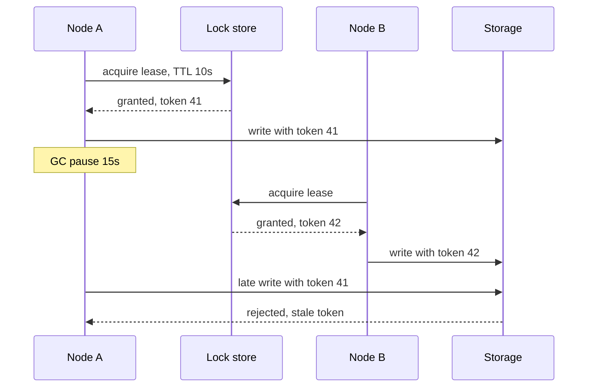

## In one minute
- Leader election picks one node to do work that must not be done twice at once: own a shard, run a scheduler, accept writes for a log.
- In practice you rarely run an election algorithm yourself. You take a **lease** from a strongly consistent store (etcd, ZooKeeper, Consul, a database row) and renew it.
- No election can guarantee that only one node *believes* it is leader. Pauses and partitions make overlap possible, so the resource must reject the old leader using a **fencing token** (a term or epoch number).
- Tuning is a trade between failover speed and false failovers: shorter leases detect death faster but fire on GC pauses and network blips.

## How it works

### Why you need a leader
A single leader turns a coordination problem into a local decision. The cost is a throughput ceiling and a failover gap when it dies.

### Classic algorithms
The **Bully algorithm** has each node with a known ID; a node that suspects the leader is dead messages all higher-ID nodes, and if none reply it declares itself leader. The **ring algorithm** passes an election message around a logical ring collecting IDs, then announces the highest. Both assume reliable failure detection, so a partition gives each side its own leader. They are teaching tools, not production designs. Google's SRE book tells the production version of this story: a pair of file servers that picked a master by heartbeat timeout and STONITH ended up either both active or both down when the network degraded, because they tried to solve leader election with simple timeouts ([Google SRE book](https://sre.google/sre-book/managing-critical-state/)).

### Consensus-based election
Raft and ZooKeeper's Zab elect leaders by majority vote within a numbered term. Two leaders in the same term are impossible because each voter votes once per term and majorities overlap. A deposed leader from an older term can still be alive and acting, but any write it sends will be rejected by a majority that has moved to the newer term.

### Lease-based election on a coordination service
Most applications borrow consensus. Each candidate tries to create a key such as `/services/billing/leader` with a TTL of, say, 10 s, using a compare-and-set that succeeds only if the key is absent. The winner renews every 3 s. Others watch the key and try again when it disappears. ZooKeeper does the same with ephemeral sequential znodes: the lowest sequence number leads, and each node watches only its predecessor to avoid a thundering herd. Kubernetes controllers use a `Lease` object with `leaseDurationSeconds` and `renewTime` ([Kubernetes docs](https://kubernetes.io/docs/concepts/architecture/leases/)). Kubernetes also shows that "who leads" can be a policy, not a race: *coordinated leader election* (beta since v1.33, off by default) has candidates register `LeaseCandidate` objects, and the only built-in strategy picks the candidate with the oldest emulation version, so the leader during a rolling upgrade is always the one every peer is compatible with ([Kubernetes docs](https://kubernetes.io/docs/concepts/cluster-administration/coordinated-leader-election/)).

### Fencing
Suppose the leader stalls in a 15 s GC pause, which is not far-fetched: stop-the-world pauses have been known to last minutes ([Kleppmann](https://martin.kleppmann.com/2016/02/08/how-to-do-distributed-locking.html)). Its 10 s lease expires, another node takes over, then the old leader wakes up and finishes a write it started. The lease alone cannot stop this. Fix it by issuing a monotonically increasing token with each lease (etcd's revision, ZooKeeper's `zxid`, or a counter you bump). Every write carries the token, and the storage layer rejects any token lower than the highest it has seen.

### Self-demotion
A leader should stop acting before its lease could expire at the store. If the lease is 10 s, step down at about 7 s without a successful renewal. The margin absorbs clock rate drift and message delay. Amazon's guidance adds two habits: check the remaining lease time right before any side effect outside the leader, and do not renew from a background thread that keeps the lease alive while the work thread is stuck ([AWS Builders' Library](https://builder.aws.com/content/3Ev0vH0hfkcUizISUWYTvHibtcp/leader-election-in-distributed-systems)).

## Down the stack

### Layer 1: The contract
There are two different promises, and mixing them up causes most incidents. Consensus election promises at most one leader *per term*; it never promises that only one process *believes* it is leader, because a deposed leader may not have heard yet. A lease promises that the store grants the key to one holder at a time, and that the holder can safely act for `ttl - margin` measured on its own monotonic clock, provided clock rates drift within a bound and the process is not paused. Only fencing gives a promise that holds with no timing assumption: the protected resource never accepts a write from an older term. Liveness: after the leader dies, a new one is in place within about one lease duration plus one retry period.

### Layer 2: The mechanism
ZooKeeper's own election (Zab's fast leader election) has each server vote for the peer with the highest `(epoch, zxid, serverId)`, so the winner always has the most complete history. A `zxid` is 64 bits: the high 32 bits are the leader epoch and the low 32 a counter, so every transaction id also encodes which leadership produced it, which is why it works as a fencing token ([ZooKeeper internals](https://zookeeper.apache.org/doc/current/zookeeperInternals.html)). Applications usually elect with the recipe above: ephemeral sequential znodes under a parent, lowest sequence wins, each candidate watching only its predecessor. The ephemeral node is bound to a session that the client keeps alive with pings; the server clamps the requested session timeout to between 2 and 20 times `tickTime`, which the sample config sets to 2 s ([ZooKeeper admin guide](https://zookeeper.apache.org/doc/current/zookeeperAdmin.html)).

etcd's `concurrency.Election` follows the same pattern with leases: each candidate writes a key under a prefix attached to its lease, and the key with the lowest create revision leads. Keepalives travel over a long-lived gRPC stream. Kubernetes' client-go elector stores holder identity and `renewTime` in a `Lease` object and updates it with an optimistic-concurrency write on `resourceVersion`. Controller-manager's defaults are a 15 s lease, a 10 s renew deadline and a 2 s retry period, so the leader gives up after 10 s without a renewal, leaving 5 s of margin ([kube-controller-manager reference](https://kubernetes.io/docs/reference/command-line-tools-reference/kube-controller-manager/)). Google's Chubby handed out *sequencers*, an early form of fencing token, and told a newly elected primary to confirm with `CheckSequencer()` that it was still primary ([Chubby paper](https://static.googleusercontent.com/media/research.google.com/en//archive/chubby-osdi06.pdf)).

### Layer 3: The machine
Leases must be timed with `CLOCK_MONOTONIC`, never wall-clock time; Amazon's leases rely only on locally measured elapsed time for this reason ([AWS Builders' Library](https://builder.aws.com/content/3Ev0vH0hfkcUizISUWYTvHibtcp/leader-election-in-distributed-systems)): NTP can step the wall clock by seconds, while the monotonic clock only drifts with the crystal, typically tens of parts per million, or a few hundred microseconds over a 10 s lease. Drift is not the real threat. Pauses are: a stop-the-world GC on a large heap, a VM live migration, a swap storm or a `SIGSTOP` can freeze a process for seconds, and when it resumes the next instruction may be a write. No pre-write check closes that window.

The storage side enforces fencing cheaply: a conditional update such as `UPDATE jobs SET ... WHERE fence <= $token` is one indexed comparison inside a write that already happens. Each renewal is a small RPC but also a consensus write in etcd or ZooKeeper, so it costs a WAL fsync on a quorum. Thousands of short leases renewed every second can saturate the coordination cluster's disks.

### Why it's built this way
1. Machines cannot tell a dead peer from a slow one, so any election is driven by timeouts and will sometimes produce two processes that think they lead.
2. Electing by majority prevents two leaders in one term, but it cannot stop an old leader acting late, so a term number must travel with every write.
3. Running consensus in every application is costly and error-prone, so applications borrow it from a small coordination cluster and hold leases there.
4. Leases need time, and only local monotonic durations are trustworthy, so expiry is measured locally with a safety margin and backed by fencing at the resource.

## Diagram


## Worked example
A billing reconciliation job runs on 3 replicas; exactly one should run at a time. You use an etcd lease with TTL 10 s and renew every 3 s.

- Leader crash: the lease expires within 10 s, followers see the key deletion through a watch in a few ms, and the next leader starts in roughly 10.1 s. Worst-case gap is the TTL.
- Network blip of 4 s between leader and etcd: one or two renewals fail, but the lease survives because 4 s is less than 10 s. No failover.
- Lowering TTL to 2 s would cut failover to about 2 s, but a 2.5 s stop-the-world GC on a 32 GB heap would now cause a spurious failover, plus the work of resuming the job on another node.

If the job writes to a Postgres table, add a `leader_epoch` column check: `UPDATE ... WHERE id = $1 AND $token >= (SELECT max_epoch FROM fence)`. Now a stale leader's late write affects zero rows.

At scale, prefer one lease per shard rather than one global leader. With 1,000 shards and 50 workers, each worker holds about 20 leases, and a single failure moves 20 shards, not everything.

## In the wild
- **GitHub, 2012: Pacemaker failover loop and split brain.** Migration load made the MySQL primary fail Percona Replication Manager health checks, so Pacemaker moved the active role to a node with a cold InnoDB buffer pool, which failed the same checks. The next day a Pacemaker segfault partitioned the cluster and two master elections were attempted without coordination. The result was 1 h 46 min of downtime plus an hour of degradation, and 16 private repositories were visible to outsiders for seven minutes. Afterwards, failover of the active role required an operator to start it ([GitHub](https://github.blog/news-insights/the-library/github-availability-this-week/)).
- **Stripe, 2019: a shard that could not elect a primary.** A database minor-version upgrade three months earlier carried a failover fault that only showed when several nodes stalled. On 10 July one shard could not elect a new primary and the API degraded for 27 minutes; rolling back the election protocol then clashed with a recent config change and starved CPU, for another 93 minutes. Stripe added alerts for nodes that stop reporting replication lag, circuit breakers per cluster and limits on client retries ([Stripe](https://stripe.com/rcas/2019-07-10)).

## Trade-offs
| Option | Strengths | Weaknesses | Choose when |
|---|---|---|---|
| Lease in etcd/ZooKeeper/Consul | Battle-tested, watches, fencing tokens | Another tier-0 dependency | Most services needing a single active worker |
| Database row lease | No new infrastructure | Polling, DB failover affects leadership | You already have a strongly consistent DB |
| Embedded Raft | No external dependency, leader is also the data owner | You operate consensus yourself | You are building a replicated data store |
| Bully / ring | Simple, no external service | Unsafe under partitions | Teaching, or fixed clusters with fencing elsewhere |
| Cloud primitive (e.g. Kubernetes Lease) | Native to the platform | Bound to the API server's availability | Controllers and operators on Kubernetes |

## Pitfalls in production
- Split brain after a pause: the old leader keeps writing. Pass a fencing token on every side-effecting call and enforce it at the resource.
- Leases tuned below GC or I/O pause times cause flapping. Measure pause p99.9 and set TTL to several times it.
- Using wall-clock timestamps from different machines to judge lease expiry. Use the store's TTL and local monotonic timers only.
- Leadership that is not released on graceful shutdown adds a full TTL to every deploy. Revoke the lease in the shutdown hook. Kubernetes itself only added this for kube-controller-manager as an alpha gate in v1.36, `ControllerManagerReleaseLeaderElectionLockOnExit` ([Kubernetes docs](https://kubernetes.io/docs/concepts/architecture/leases/)).
- Automatic failover that fires on load, not death. A busy primary fails a health check, the standby takes over cold, and fails the same check. Require a human or a damping rule before a second failover.

## Leadership lens
- First question: does this work truly need a single leader, or can it be partitioned so each shard has its own owner? Sharded ownership scales and limits blast radius.
- Ask what happens when two leaders act for 30 s. If the answer is "corrupt data", fencing is mandatory, not optional.
- Expose metrics for leader changes and lease renewal latency, and alert on churn, which is the early warning of overload.
- Document the failover time budget (TTL plus startup) and agree it with the service's SLO owners.

## Check yourself
1. Why does a lease not by itself guarantee a single active leader?
   **Answer:** A paused or partitioned leader cannot know its lease has expired and may keep acting. Only the resource checking a fencing token can reject its late writes.
2. Why should a leader step down before its lease TTL elapses?
   **Answer:** Its local timer and the store's timer can drift and messages take time, so a safety margin keeps it from acting after another node has been granted the lease.
3. Why does ZooKeeper's recipe have each node watch only its predecessor?
   **Answer:** If all nodes watched the leader's znode, every one would wake on its deletion and race, creating a herd. Watching the predecessor wakes only the next in line.
4. What failure does the Bully algorithm not handle?
   **Answer:** A network partition: each side sees the other as dead and elects its own leader.

## Practice
**Task:** Build a lease-based election with fencing. `LeaseStore(ttl)` has `acquire(node, now)` which returns a new fencing token (1, 2, 3, ...) if no unexpired lease exists or the caller already holds it, else `None`. A holder re-acquiring keeps its token and extends expiry to `now + ttl`. `leader(now)` returns the current holder or `None`. `FencedStorage` has `write(token, value)` which returns `True` and stores the value only if `token` is at least the highest token seen so far. Time is passed in; do not read a clock.

```python starter
class LeaseStore:
    def __init__(self, ttl):
        self.ttl = ttl

    def acquire(self, node, now):
        # TODO
        return None

    def leader(self, now):
        # TODO
        return None


class FencedStorage:
    def write(self, token, value):
        # TODO
        return False
```

```python tests
def test_first_acquire_wins():
    s = LeaseStore(10)
    assert s.acquire("a", 0) == 1
    assert s.acquire("b", 1) is None
    assert s.leader(5) == "a"

def test_renew_keeps_token_and_extends():
    s = LeaseStore(10)
    s.acquire("a", 0)
    assert s.acquire("a", 8) == 1
    assert s.leader(15) == "a"

def test_expiry_hands_over_with_new_token():
    s = LeaseStore(10)
    s.acquire("a", 0)
    assert s.leader(10) is None
    assert s.acquire("b", 10) == 2

def test_fencing_rejects_stale_leader():
    st = FencedStorage()
    assert st.write(2, "from b")
    assert not st.write(1, "late from a")
    assert st.value == "from b"

def test_same_token_can_write_again():
    st = FencedStorage()
    assert st.write(3, "x")
    assert st.write(3, "y")
    assert st.value == "y"
```

```python solution
class LeaseStore:
    def __init__(self, ttl):
        self.ttl = ttl
        self.holder = None
        self.expires = 0
        self.token = 0

    def acquire(self, node, now):
        if self.holder is not None and now < self.expires:
            if self.holder != node:
                return None
            self.expires = now + self.ttl
            return self.token
        self.token += 1
        self.holder = node
        self.expires = now + self.ttl
        return self.token

    def leader(self, now):
        return self.holder if self.holder is not None and now < self.expires else None


class FencedStorage:
    def __init__(self):
        self.max_token = 0
        self.value = None

    def write(self, token, value):
        if token < self.max_token:
            return False
        self.max_token = token
        self.value = value
        return True
```

```typescript starter
export class LeaseStore {
  constructor(public ttl: number) {}

  acquire(node: string, now: number): number | null {
    throw new Error("TODO");
  }

  leader(now: number): string | null {
    throw new Error("TODO");
  }
}

export class FencedStorage {
  value: string | null = null;

  write(token: number, value: string): boolean {
    throw new Error("TODO");
  }
}
```

```typescript tests
test("first acquire wins", () => {
  const s = new LeaseStore(10);
  assertEqual(s.acquire("a", 0), 1);
  assertEqual(s.acquire("b", 1), null);
  assertEqual(s.leader(5), "a");
});

test("renew keeps token and extends", () => {
  const s = new LeaseStore(10);
  s.acquire("a", 0);
  assertEqual(s.acquire("a", 8), 1);
  assertEqual(s.leader(15), "a");
});

test("expiry hands over with new token", () => {
  const s = new LeaseStore(10);
  s.acquire("a", 0);
  assertEqual(s.leader(10), null);
  assertEqual(s.acquire("b", 10), 2);
});

test("fencing rejects stale leader", () => {
  const st = new FencedStorage();
  assert(st.write(2, "from b"), "newer token accepted");
  assert(!st.write(1, "late from a"), "older token rejected");
  assertEqual(st.value, "from b");
});

test("same token can write again", () => {
  const st = new FencedStorage();
  assert(st.write(3, "x"), "first write");
  assert(st.write(3, "y"), "same token");
  assertEqual(st.value, "y");
});
```

```typescript solution
export class LeaseStore {
  private holder: string | null = null;
  private expires = 0;
  private token = 0;

  constructor(public ttl: number) {}

  acquire(node: string, now: number): number | null {
    if (this.holder !== null && now < this.expires) {
      if (this.holder !== node) return null;
      this.expires = now + this.ttl;
      return this.token;
    }
    this.token += 1;
    this.holder = node;
    this.expires = now + this.ttl;
    return this.token;
  }

  leader(now: number): string | null {
    return this.holder !== null && now < this.expires ? this.holder : null;
  }
}

export class FencedStorage {
  value: string | null = null;
  private maxToken = 0;

  write(token: number, value: string): boolean {
    if (token < this.maxToken) return false;
    this.maxToken = token;
    this.value = value;
    return true;
  }
}
```

```go starter
package practice

type LeaseStore struct {
	TTL int
}

func NewLeaseStore(ttl int) *LeaseStore {
	return &LeaseStore{TTL: ttl}
}

// Acquire returns the fencing token and true, or 0 and false if another node holds the lease.
func (s *LeaseStore) Acquire(node string, now int) (int, bool) {
	panic("TODO")
}

// Leader returns the current holder and true, or "" and false if the lease is free.
func (s *LeaseStore) Leader(now int) (string, bool) {
	panic("TODO")
}

type FencedStorage struct {
	Value string
}

func (f *FencedStorage) Write(token int, value string) bool {
	panic("TODO")
}
```

```go tests
package practice

import "testing"

func TestFirstAcquireWins(t *testing.T) {
	s := NewLeaseStore(10)
	if tok, ok := s.Acquire("a", 0); !ok || tok != 1 {
		t.Fatalf("got %d %v", tok, ok)
	}
	if _, ok := s.Acquire("b", 1); ok {
		t.Fatal("b should not acquire a held lease")
	}
	if l, ok := s.Leader(5); !ok || l != "a" {
		t.Fatalf("leader %q", l)
	}
}

func TestRenewKeepsTokenAndExtends(t *testing.T) {
	s := NewLeaseStore(10)
	s.Acquire("a", 0)
	if tok, ok := s.Acquire("a", 8); !ok || tok != 1 {
		t.Fatalf("got %d %v", tok, ok)
	}
	if l, ok := s.Leader(15); !ok || l != "a" {
		t.Fatalf("leader %q", l)
	}
}

func TestExpiryHandsOverWithNewToken(t *testing.T) {
	s := NewLeaseStore(10)
	s.Acquire("a", 0)
	if _, ok := s.Leader(10); ok {
		t.Fatal("lease should have expired")
	}
	if tok, ok := s.Acquire("b", 10); !ok || tok != 2 {
		t.Fatalf("got %d %v", tok, ok)
	}
}

func TestFencingRejectsStaleLeader(t *testing.T) {
	st := &FencedStorage{}
	if !st.Write(2, "from b") || st.Write(1, "late from a") || st.Value != "from b" {
		t.Fatalf("value %q", st.Value)
	}
}

func TestSameTokenCanWriteAgain(t *testing.T) {
	st := &FencedStorage{}
	if !st.Write(3, "x") || !st.Write(3, "y") || st.Value != "y" {
		t.Fatalf("value %q", st.Value)
	}
}
```

```go solution
package practice

type LeaseStore struct {
	TTL     int
	holder  string
	held    bool
	expires int
	token   int
}

func NewLeaseStore(ttl int) *LeaseStore {
	return &LeaseStore{TTL: ttl}
}

func (s *LeaseStore) Acquire(node string, now int) (int, bool) {
	if s.held && now < s.expires {
		if s.holder != node {
			return 0, false
		}
		s.expires = now + s.TTL
		return s.token, true
	}
	s.token++
	s.holder, s.held, s.expires = node, true, now+s.TTL
	return s.token, true
}

func (s *LeaseStore) Leader(now int) (string, bool) {
	if s.held && now < s.expires {
		return s.holder, true
	}
	return "", false
}

type FencedStorage struct {
	Value    string
	maxToken int
}

func (f *FencedStorage) Write(token int, value string) bool {
	if token < f.maxToken {
		return false
	}
	f.maxToken = token
	f.Value = value
	return true
}
```

## Mock interview
**Prompt:** You run 1,000 Kafka-consumer-like partitions processed by a fleet of 40 workers, and each partition must be processed by exactly one worker at a time. Design how workers claim partitions and how you handle a worker that dies or stalls.

- Follow-up: a worker stalls for 20 s in GC with a 10 s lease; walk through what happens to its in-flight writes.
- Follow-up: the coordination store itself loses quorum for 2 minutes; what keeps working?
- Follow-up: why not one global leader that assigns partitions?

**A strong answer covers:**
- Per-partition leases in a consistent store, with TTL, renewal interval, and jitter.
- Fencing tokens checked by the downstream store, and idempotent processing for retries.
- Self-demotion margin and monotonic timers instead of cross-host wall clocks.
- Rebalancing that limits churn, such as sticky assignment and gradual handoff.
- Behaviour when the store is unavailable: leaders stop at lease expiry, so work pauses rather than doubles.
- Metrics on leader churn and renewal latency.

## Sources and further study
**Primary**
- [Ongaro and Ousterhout, In Search of an Understandable Consensus Algorithm (2014)](https://raft.github.io/raft.pdf): section 5.2 is the term-numbered, randomized-timeout election most systems now copy.
- [Gray and Cheriton, Leases (SOSP 1989)](https://www.andrew.cmu.edu/course/15-440/assets/READINGS/gray1989.pdf): where time-bounded grants and their clock-drift assumption come from.

**Systems docs**
- [Kubernetes: Coordinated Leader Election](https://kubernetes.io/docs/concepts/cluster-administration/coordinated-leader-election/): LeaseCandidate objects and version-aware leader choice.
- [kube-controller-manager flags](https://kubernetes.io/docs/reference/command-line-tools-reference/kube-controller-manager/): the `--leader-elect-*` lease, renew and retry settings.
- [ZooKeeper internals](https://zookeeper.apache.org/doc/current/zookeeperInternals.html): zxid layout and what a new leader must have seen.

**Books**
- *Database Internals*, Alex Petrov, chapter 10 "Leader Election": Bully, next-in-line failover, invitation and ring algorithms.
- *Designing Distributed Systems* (2nd edition), Brendan Burns, chapter 10 "Ownership Election": whether you need a leader at all, the basics of election, and handling concurrent data manipulation.
- *Site Reliability Engineering*, Beyer et al. (eds.), chapter 23 "Managing Critical State": why leader election by timeout alone causes split brain ([read free](https://sre.google/sre-book/managing-critical-state/)).

**Other curricula**
- [Azure Architecture Center: Leader Election pattern](https://learn.microsoft.com/en-us/azure/architecture/patterns/leader-election): a blob-lease mutex with renewal; names Bully and Raft but does not discuss fencing.
- [roadmap.sh System Design](https://roadmap.sh/system-design): lists Leader Election among its cloud design patterns as a single node to look up.

## Watch
- [Distributed Systems 6.1: Consensus (Martin Kleppmann)](https://www.youtube.com/watch?v=rN6ma561tak): why electing a leader is itself a consensus problem.
- [UMass CS677 Lecture 14: Leader Election, Distributed Locks (UMass OS)](https://www.youtube.com/watch?v=HzynQENHG7Q): Bully and ring algorithms alongside lock services.
- [Who's in Charge? Failure and leader election in databases (Ben Dicken)](https://www.youtube.com/watch?v=RAPvsSWyPQY): failure detection and election as covered in Database Internals.

## Free resources
- [Leader election in distributed systems (AWS Builders' Library)](https://aws.amazon.com/builders-library/leader-election-in-distributed-systems/): how Amazon uses leases and why fencing matters.
- [The Chubby lock service](https://static.googleusercontent.com/media/research.google.com/en//archive/chubby-osdi06.pdf): Google's paper on coarse-grained locks used mainly for election.
- [ZooKeeper recipes](https://zookeeper.apache.org/doc/current/recipes.html): the ephemeral sequential znode election recipe.
- [Kubernetes Leases](https://kubernetes.io/docs/concepts/architecture/leases/): how controllers elect leaders on the API server.
- [Generation Clock (martinfowler.com)](https://martinfowler.com/articles/patterns-of-distributed-systems/generation.html): the epoch number pattern behind fencing.
