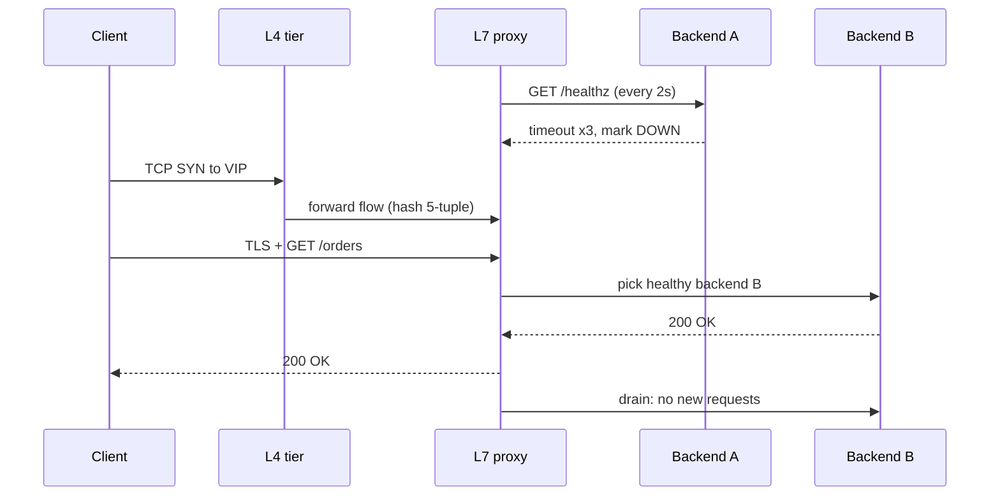

## In one minute
- A load balancer gives clients one stable address and spreads their connections or requests across a pool of interchangeable backends.
- Its second job matters as much as the first: it stops sending traffic to backends that are dead, slow or being retired, so clients rarely see a failure.
- Layer 4 balancers forward TCP or UDP flows without reading them; Layer 7 balancers terminate the connection, parse HTTP or gRPC, and route each request.
- Real deployments stack them: DNS or anycast picks a site, an L4 tier spreads flows across L7 proxies, and the proxies balance requests across services.
- The load balancer is itself a shared dependency, so it must be redundant, sized with headroom and watched closely.

## How it works

### One address, many servers
Without a load balancer, every client must know every server, notice when one dies, and pick among them. A load balancer moves that knowledge into one place: clients connect to a virtual IP (VIP) or hostname, and behind it sits a *pool* (HAProxy calls it a backend, Envoy a cluster, AWS a target group) of servers that can each handle any request.

This is the overload and partial-failure problem shape at its plainest. The same pattern routes payment calls across gateway instances and an agent's model calls across inference endpoints: one front door, a pool, and a rule for who may receive work.

### Layer 4 versus Layer 7
A **Layer 4** balancer looks at the IP and TCP or UDP headers, picks a backend for each new flow, and forwards every packet of that flow to the same place. It never reads the payload, so it is fast and protocol-agnostic, but it cannot route by URL, retry a failed request, or see that one long-lived connection carries thousands of requests.

A **Layer 7** balancer is a reverse proxy. It accepts the client's TCP and TLS connection, reads each HTTP request, then sends it over a separate connection to a backend it chooses. That makes path- and header-based routing, retries, timeouts, compression, auth and per-request metrics possible. The price is CPU for parsing and TLS, and two sets of socket buffers per client.

### Health checks and ejection
**Active** health checks probe each backend on a timer, for example an HTTP `GET /healthz` every 2 seconds. A backend is marked down after `fall` consecutive failures and back up after `rise` consecutive successes; the thresholds stop one dropped packet from flapping a server in and out. **Passive** checks, which Envoy calls outlier detection, watch real traffic and eject a backend after, say, 5 consecutive 5xx responses. Passive checks react fast under load; active checks catch dead servers that get no traffic. Use both. Managed balancers now do the passive half too: AWS's Application Load Balancer runs anomaly detection on every target group, comparing each target's error rate with its peers', and with the weighted random algorithm it can shift traffic away from the outlier automatically ([AWS ALB docs](https://docs.aws.amazon.com/elasticloadbalancing/latest/application/edit-target-group-attributes.html)).

How deep a check should go is a real decision. A check that only proves the process is listening misses a full disk; a check that calls the database fails on every server at once when the database blips. Amazon's guidance is to keep fast load-balancer checks to things local to the host and react to dependency failures centrally, and its NLB, ALB and Route 53 fail open, routing to all targets, when none look healthy ([AWS Builders' Library](https://builder.aws.com/content/3Ev53O39izHCtWLzp4XU6t8PC1O/implementing-health-checks)).

### Draining
Deploys and scale-in remove healthy servers on purpose. Draining stops new connections or requests going to a backend while existing ones finish, up to a deadline. AWS calls it the deregistration delay (300 seconds by default) ([AWS ALB docs](https://docs.aws.amazon.com/elasticloadbalancing/latest/application/edit-target-group-attributes.html)); HTTP/2 and gRPC servers send `GOAWAY` so clients finish in-flight streams and open new ones elsewhere ([RFC 9113](https://www.rfc-editor.org/rfc/rfc9113.html)). Without draining, every deploy shows up as a burst of resets.

### Where the balancer lives
Balancing can happen in a dedicated appliance or software tier (HAProxy, NGINX, Envoy, a cloud load balancer), in a sidecar next to each client (a service mesh), or inside the client library itself (gRPC's client-side balancing). Fewer hops favour the client side; central control and simpler clients favour a proxy tier.

## Down the stack

### Layer 1: The contract
An L4 balancer promises that every packet of a flow, identified by its 5-tuple (source IP and port, destination IP and port, protocol), reaches the same backend for the flow's life, and that new flows go only to backends currently believed healthy. An L7 balancer promises per-request routing with explicit failure semantics: a request that cannot be served gets a `502` (bad upstream response), `503` (no healthy upstream) or `504` (upstream timeout) instead of hanging. Neither promises instant detection. The worst-case time to stop routing to a dead backend is about `interval × fall` for active checks, plus any time a cached decision lives on in an open connection.

### Layer 2: The mechanism
HAProxy configures checks per server, as in `server app1 10.0.0.11:8080 check inter 2s rise 2 fall 3 slowstart 30s`, where `slowstart` ramps a recovered server's weight up over 30 seconds; `inter 2s`, `rise 2` and `fall 3` are also the defaults ([HAProxy docs](https://docs.haproxy.org/3.2/configuration.html)). Envoy's outlier detection uses `consecutive_5xx` (default 5), `base_ejection_time` (default 30 s, multiplied by the number of past ejections and capped by `max_ejection_time`, 300 s by default) and `max_ejection_percent` (default 10%) so a bad deploy cannot eject the whole cluster ([Envoy outlier detection API](https://www.envoyproxy.io/docs/envoy/latest/api-v3/config/cluster/v3/outlier_detection.proto)). Envoy also has a *panic threshold*: if fewer than 50% of hosts are healthy, it balances across all hosts, on the theory that health checking is more likely broken than half the fleet; setting it to 0% makes Envoy return `503 no healthy upstream` instead ([Envoy panic threshold](https://www.envoyproxy.io/docs/envoy/latest/intro/arch_overview/upstream/load_balancing/panic_threshold)). On the L4 side, Linux IPVS keeps a connection table keyed by 5-tuple; Google's Maglev and Facebook's Katran hash the 5-tuple into a lookup table so any balancer instance picks the same backend without shared state. Maglev has served Google's traffic since 2008, and one machine saturates a 10 Gbps link with small packets ([Maglev, NSDI 2016](https://research.google/pubs/maglev-a-fast-and-reliable-software-network-load-balancer/)). Katran, which replaced an IPVS design at Meta, keeps an LRU cache of recent flows on top of the hash, and routers spread VIP traffic across Katran hosts with ECMP ([Meta](https://engineering.fb.com/2018/05/22/open-source/open-sourcing-katran-a-scalable-network-load-balancer/)). Backends learn the real client address from `X-Forwarded-For` or the `Forwarded` header (RFC 7239) at L7, or from the PROXY protocol header at L4.

### Layer 3: The machine
An L4 balancer built on XDP or DPDK handles millions of packets per second per core, because it rewrites a few header bytes and never copies the payload into user space. With direct server return, responses go from backend to client without passing back through the balancer, which matters because responses are often ten times larger than requests. Katran works only this way: backends hold the VIP on their loopback interface, and the balancer wraps each inbound packet in an IP-in-IP header to reach them. An L7 proxy instead runs an `epoll_wait` loop over two sockets per client, each with kernel buffers of tens to hundreds of KB, and pays for TLS: a full handshake costs roughly 0.1 ms of CPU with ECDSA P-256 and closer to 1 ms with RSA-2048, so keep-alive and session resumption are what make TLS termination affordable. Each upstream connection from one proxy IP to one backend IP and port uses an ephemeral port; Linux's default range of 32768 to 60999 allows about 28,000 ([kernel docs](https://docs.kernel.org/networking/ip-sysctl.html)), which is why proxies pool upstream connections instead of opening one per request.

### Why it's built this way
1. One machine cannot serve all traffic, and clients should not track a changing fleet, so a stable address fronts a pool.
2. Servers fail and deploy constantly, so the balancer owns health and draining instead of every client.
3. Reading requests costs CPU, so the cheap L4 tier spreads flows and the expensive L7 tier scales out behind it.
4. A balancer tier that keeps per-flow state is hard to scale and fail over, so modern L4 designs use consistent hashing on the 5-tuple and stay nearly stateless.

## Diagram


## Worked example
An orders API serves 24,000 requests per second at peak across 12 backends, about 2,000 each. Each backend saturates at 3,000, so the fleet has 50% headroom.

Backend 7 hangs on a full disk. It still accepts TCP connections, so an L4-only setup keeps sending it one twelfth of new flows. With active checks at `inter 2s fall 3` and a 1-second timeout, detection takes up to 9 seconds. During that window 2,000 requests per second time out, about 18,000 failed requests. Adding passive checks with `consecutive_5xx: 5` and a 2-second request timeout ejects it after the first few timed-out requests, within a couple of seconds, cutting failures to a few thousand. A single retry on a different backend for idempotent `GET`s hides most of the rest.

Now the remaining 11 backends carry 24,000 / 11, about 2,180 each, which is fine. If three backends failed, the remaining nine would each take 2,670, close to saturation. That is the number that sizes the fleet: how many simultaneous failures it must absorb at peak.

For the balancer itself, perhaps 1,500 new TLS connections per second arrive with keep-alive. At 0.1 ms of CPU each with ECDSA that is 0.15 cores, small next to proxying. Run at least two proxies per zone, sized so one zone can be lost.

## In the wild
- **AWS, 2012: a maintenance job deletes ELB state on Christmas Eve.** A developer with standing production access ran a maintenance process against live ELB state data in US-East and deleted part of it. At peak 6.8% of load balancers were affected, and others could not be scaled or changed; almost all affected load balancers were restored by 10:30 AM PST on Christmas Day, about 22 hours after it began. AWS made that access require per-incident approval and planned automatic reconciliation of control-plane state ([AWS](https://aws.amazon.com/message/680587/)).
- **Google Cloud, 2021: a config race turns the global load balancer into a 404 machine.** A race condition, present for about six months in the pipeline that pushes customer configs to the external proxy load balancer, shipped a corrupted file. Most GCLB endpoints returned 404 for about 33 minutes, taking Cloud Run, App Engine, Cloud Functions, Apigee and Firebase routes with them. Google rolled back to the last good config and added pre-apply correctness checks ([Google Cloud](https://status.cloud.google.com/incidents/6PM5mNd43NbMqjCZ5REh)).
- **HubSpot, 2024: readiness probes eject an overloaded routing tier.** Envoy routing pods were packed unevenly onto Kubernetes nodes, and a fix shipped the day before had silently not taken effect. In a morning surge, many pods on hot nodes failed readiness at once and were removed, overloading the rest; two outages totalled about 52 minutes. HubSpot rolled back to NGINX and limited how many pods can be removed at once under load ([HubSpot](https://product.hubspot.com/blog/hubspot-incident-sept25)).

## Trade-offs
| Option | Strengths | Weaknesses | Choose when |
|---|---|---|---|
| L4 balancer | Very fast, any protocol, nearly stateless with hashing | No request routing, retries or per-request metrics | Front tier, non-HTTP protocols, raw throughput |
| L7 proxy | Routing by path or header, retries, TLS, observability | CPU and latency cost, must parse every protocol | HTTP and gRPC services, edge and internal |
| Client-side balancing | No extra hop, no central bottleneck | Logic in every client and language; harder to change | Internal gRPC with a uniform client stack |
| Sidecar mesh | Uniform policy without changing apps | Extra proxy per pod, memory and operations cost | Many services in many languages |
| DNS only | Simple, global | Coarse, cached, slow to react | Choosing a region, not a server |

## Pitfalls in production
- **Shallow health checks.** A `/healthz` that returns 200 while the database is unreachable keeps a broken server in rotation. Check the dependencies the server needs to do useful work, but keep the check cheap.
- **Deep health checks that cascade.** If every backend fails its check when a shared dependency blips, the balancer ejects the whole fleet. Use a panic threshold or `max_ejection_percent`, and let the backends degrade instead. The same cascade happens with overload: backends too busy to answer probes get pulled, which pushes more load onto the rest.
- **Long-lived connections stay put.** HTTP/2 and gRPC multiplex thousands of requests on one connection, so an L4 balancer pins them all to one backend. Use L7 balancing for these protocols, or recycle connections with a max age.
- **No draining on deploys.** Killing processes without deregistering them first shows up as resets on every rollout. Deregister, wait for the drain, then stop.
- **The balancer as a single point of failure.** One proxy instance, or one zone, takes down everything behind it. Run redundant instances across zones and test failover.

## Leadership lens
- Ask how long it takes from a backend dying to traffic stopping, in seconds, and how many failed requests that costs at peak.
- Decide which team owns the balancer configuration; shared edge proxies become a bottleneck for every team's changes unless ownership and self-service are clear.
- Size the fleet for N plus the number of simultaneous failures you must survive at peak, and check the balancer tier against the same rule.

## Check yourself
1. A backend accepts TCP connections but every request hangs. Which kinds of health checking catch it, and how quickly?
   **Answer:** An HTTP active check with a timeout catches it after about `interval × fall` seconds. Passive checks catch it after a few failed or timed-out real requests, which is faster under load. A TCP-only check never catches it.
2. Why might an L4 balancer leave one gRPC backend at 90% CPU while others idle?
   **Answer:** gRPC multiplexes many requests on a few long-lived connections, and an L4 balancer places connections, not requests. A few busy connections pinned to one backend stay there.
3. What is the purpose of Envoy's panic threshold?
   **Answer:** When most hosts look unhealthy, the health checking is likely wrong or a shared dependency is down. Spreading traffic across all hosts is better than piling it on the few that still pass.
4. Why does direct server return help an L4 tier scale?
   **Answer:** Responses are usually much larger than requests, and with DSR they go straight from backend to client, so the balancer only handles the small inbound half of the traffic.

## Practice
**Task:** Implement the backend pool inside a load balancer. `Pool(names, rise, fall)` creates backends in the given order, all starting up. `check(name, ok)` records a health check result: an up backend goes down after `fall` consecutive failures, a down backend comes back up after `rise` consecutive successes, and a result of the opposite kind resets the streak. `drain(name)` stops the backend receiving new work. `pick()` returns the next backend round robin, in list order starting after the last one picked, among backends that are up and not draining, increments that backend's active count, and returns `None` (TypeScript `null`, Go `"", false`) when none is eligible. `release(name)` decrements the active count, `is_up(name)` reports health, and `removable(name)` is true only for a draining backend with no active work.

```python starter
class Pool:
    def __init__(self, names, rise, fall):
        self.names = list(names)

    def check(self, name, ok):
        # TODO
        raise NotImplementedError

    def drain(self, name):
        # TODO
        raise NotImplementedError

    def pick(self):
        # TODO
        raise NotImplementedError

    def release(self, name):
        # TODO
        raise NotImplementedError

    def is_up(self, name):
        # TODO
        raise NotImplementedError

    def removable(self, name):
        # TODO
        raise NotImplementedError
```

```python tests
def test_round_robin_in_order():
    p = Pool(["a", "b", "c"], 2, 3)
    assert [p.pick() for _ in range(4)] == ["a", "b", "c", "a"]

def test_fall_threshold():
    p = Pool(["a", "b"], 2, 3)
    p.check("a", False)
    p.check("a", False)
    assert p.is_up("a")
    p.check("a", False)
    assert not p.is_up("a")
    assert [p.pick() for _ in range(3)] == ["b", "b", "b"]

def test_success_resets_failure_streak():
    p = Pool(["a"], 2, 3)
    for ok in [False, False, True, False, False]:
        p.check("a", ok)
    assert p.is_up("a")

def test_rise_threshold():
    p = Pool(["a", "b"], 2, 1)
    p.check("a", False)
    assert not p.is_up("a")
    p.check("a", True)
    assert not p.is_up("a"), "one success is not enough"
    p.check("a", True)
    assert p.is_up("a")

def test_none_when_no_eligible_backend():
    p = Pool(["a"], 1, 1)
    p.check("a", False)
    assert p.pick() is None

def test_drain_and_removable():
    p = Pool(["a", "b"], 2, 3)
    assert p.pick() == "a"
    assert p.pick() == "b"
    p.drain("a")
    assert not p.removable("a"), "still has active work"
    assert [p.pick() for _ in range(2)] == ["b", "b"]
    p.release("a")
    assert p.removable("a")
    assert not p.removable("b")

def test_round_robin_continues_after_recovery():
    p = Pool(["a", "b", "c"], 1, 1)
    assert p.pick() == "a"
    p.check("b", False)
    assert p.pick() == "c"
    p.check("b", True)
    assert [p.pick() for _ in range(3)] == ["a", "b", "c"]
```

```python solution
class Pool:
    def __init__(self, names, rise, fall):
        self.names = list(names)
        self.rise = rise
        self.fall = fall
        self.up = {n: True for n in self.names}
        self.streak = {n: 0 for n in self.names}
        self.draining = set()
        self.active = {n: 0 for n in self.names}
        self.cursor = 0

    def check(self, name, ok):
        if ok == self.up[name]:
            self.streak[name] = 0
            return
        self.streak[name] += 1
        needed = self.rise if ok else self.fall
        if self.streak[name] >= needed:
            self.up[name] = ok
            self.streak[name] = 0

    def drain(self, name):
        self.draining.add(name)

    def pick(self):
        n = len(self.names)
        for step in range(n):
            i = (self.cursor + step) % n
            name = self.names[i]
            if self.up[name] and name not in self.draining:
                self.cursor = (i + 1) % n
                self.active[name] += 1
                return name
        return None

    def release(self, name):
        if self.active[name] > 0:
            self.active[name] -= 1

    def is_up(self, name):
        return self.up[name]

    def removable(self, name):
        return name in self.draining and self.active[name] == 0
```

```typescript starter
export class Pool {
  constructor(public names: string[], public rise: number, public fall: number) {}
  check(name: string, ok: boolean): void {
    throw new Error("TODO");
  }
  drain(name: string): void {
    throw new Error("TODO");
  }
  pick(): string | null {
    throw new Error("TODO");
  }
  release(name: string): void {
    throw new Error("TODO");
  }
  isUp(name: string): boolean {
    throw new Error("TODO");
  }
  removable(name: string): boolean {
    throw new Error("TODO");
  }
}
```

```typescript tests
function picks(p: Pool, n: number): (string | null)[] {
  const out: (string | null)[] = [];
  for (let i = 0; i < n; i++) out.push(p.pick());
  return out;
}

test("round robin in order", () => {
  assertEqual(picks(new Pool(["a", "b", "c"], 2, 3), 4), ["a", "b", "c", "a"]);
});
test("fall threshold", () => {
  const p = new Pool(["a", "b"], 2, 3);
  p.check("a", false);
  p.check("a", false);
  assert(p.isUp("a"));
  p.check("a", false);
  assert(!p.isUp("a"));
  assertEqual(picks(p, 3), ["b", "b", "b"]);
});
test("success resets failure streak", () => {
  const p = new Pool(["a"], 2, 3);
  for (const ok of [false, false, true, false, false]) p.check("a", ok);
  assert(p.isUp("a"));
});
test("rise threshold", () => {
  const p = new Pool(["a", "b"], 2, 1);
  p.check("a", false);
  assert(!p.isUp("a"));
  p.check("a", true);
  assert(!p.isUp("a"), "one success is not enough");
  p.check("a", true);
  assert(p.isUp("a"));
});
test("null when no eligible backend", () => {
  const p = new Pool(["a"], 1, 1);
  p.check("a", false);
  assertEqual(p.pick(), null);
});
test("drain and removable", () => {
  const p = new Pool(["a", "b"], 2, 3);
  assertEqual(picks(p, 2), ["a", "b"]);
  p.drain("a");
  assert(!p.removable("a"), "still has active work");
  assertEqual(picks(p, 2), ["b", "b"]);
  p.release("a");
  assert(p.removable("a"));
  assert(!p.removable("b"));
});
test("round robin continues after recovery", () => {
  const p = new Pool(["a", "b", "c"], 1, 1);
  assertEqual(p.pick(), "a");
  p.check("b", false);
  assertEqual(p.pick(), "c");
  p.check("b", true);
  assertEqual(picks(p, 3), ["a", "b", "c"]);
});
```

```typescript solution
export class Pool {
  private up = new Map<string, boolean>();
  private streak = new Map<string, number>();
  private active = new Map<string, number>();
  private draining = new Set<string>();
  private cursor = 0;

  constructor(public names: string[], public rise: number, public fall: number) {
    for (const n of names) {
      this.up.set(n, true);
      this.streak.set(n, 0);
      this.active.set(n, 0);
    }
  }

  check(name: string, ok: boolean): void {
    if (ok === this.up.get(name)) {
      this.streak.set(name, 0);
      return;
    }
    const s = (this.streak.get(name) ?? 0) + 1;
    this.streak.set(name, s);
    if (s >= (ok ? this.rise : this.fall)) {
      this.up.set(name, ok);
      this.streak.set(name, 0);
    }
  }

  drain(name: string): void {
    this.draining.add(name);
  }

  pick(): string | null {
    const n = this.names.length;
    for (let step = 0; step < n; step++) {
      const i = (this.cursor + step) % n;
      const name = this.names[i];
      if (this.up.get(name) && !this.draining.has(name)) {
        this.cursor = (i + 1) % n;
        this.active.set(name, (this.active.get(name) ?? 0) + 1);
        return name;
      }
    }
    return null;
  }

  release(name: string): void {
    const a = this.active.get(name) ?? 0;
    if (a > 0) this.active.set(name, a - 1);
  }

  isUp(name: string): boolean {
    return this.up.get(name) === true;
  }

  removable(name: string): boolean {
    return this.draining.has(name) && (this.active.get(name) ?? 0) === 0;
  }
}
```

```go starter
package practice

type Pool struct {
	names []string
}

func NewPool(names []string, rise, fall int) *Pool { return &Pool{names: names} }

func (p *Pool) Check(name string, ok bool)   { panic("TODO") }
func (p *Pool) Drain(name string)            { panic("TODO") }
func (p *Pool) Pick() (string, bool)         { panic("TODO") }
func (p *Pool) Release(name string)          { panic("TODO") }
func (p *Pool) IsUp(name string) bool        { panic("TODO") }
func (p *Pool) Removable(name string) bool   { panic("TODO") }
```

```go tests
package practice

import (
	"reflect"
	"testing"
)

func picks(p *Pool, n int) []string {
	out := []string{}
	for i := 0; i < n; i++ {
		name, ok := p.Pick()
		if !ok {
			name = "<none>"
		}
		out = append(out, name)
	}
	return out
}

func eq(t *testing.T, got, want []string) {
	t.Helper()
	if !reflect.DeepEqual(got, want) {
		t.Fatalf("got %v, want %v", got, want)
	}
}

func TestRoundRobinInOrder(t *testing.T) {
	eq(t, picks(NewPool([]string{"a", "b", "c"}, 2, 3), 4), []string{"a", "b", "c", "a"})
}

func TestFallThreshold(t *testing.T) {
	p := NewPool([]string{"a", "b"}, 2, 3)
	p.Check("a", false)
	p.Check("a", false)
	if !p.IsUp("a") {
		t.Fatal("two failures should not mark down")
	}
	p.Check("a", false)
	if p.IsUp("a") {
		t.Fatal("three failures should mark down")
	}
	eq(t, picks(p, 3), []string{"b", "b", "b"})
}

func TestSuccessResetsFailureStreak(t *testing.T) {
	p := NewPool([]string{"a"}, 2, 3)
	for _, ok := range []bool{false, false, true, false, false} {
		p.Check("a", ok)
	}
	if !p.IsUp("a") {
		t.Fatal("streak should have reset")
	}
}

func TestRiseThreshold(t *testing.T) {
	p := NewPool([]string{"a", "b"}, 2, 1)
	p.Check("a", false)
	p.Check("a", true)
	if p.IsUp("a") {
		t.Fatal("one success is not enough")
	}
	p.Check("a", true)
	if !p.IsUp("a") {
		t.Fatal("two successes should mark up")
	}
}

func TestNoneWhenNoEligibleBackend(t *testing.T) {
	p := NewPool([]string{"a"}, 1, 1)
	p.Check("a", false)
	if _, ok := p.Pick(); ok {
		t.Fatal("expected no backend")
	}
}

func TestDrainAndRemovable(t *testing.T) {
	p := NewPool([]string{"a", "b"}, 2, 3)
	eq(t, picks(p, 2), []string{"a", "b"})
	p.Drain("a")
	if p.Removable("a") {
		t.Fatal("still has active work")
	}
	eq(t, picks(p, 2), []string{"b", "b"})
	p.Release("a")
	if !p.Removable("a") || p.Removable("b") {
		t.Fatal("removable wrong")
	}
}

func TestRoundRobinContinuesAfterRecovery(t *testing.T) {
	p := NewPool([]string{"a", "b", "c"}, 1, 1)
	eq(t, picks(p, 1), []string{"a"})
	p.Check("b", false)
	eq(t, picks(p, 1), []string{"c"})
	p.Check("b", true)
	eq(t, picks(p, 3), []string{"a", "b", "c"})
}
```

```go solution
package practice

import "sync"

type Pool struct {
	mu       sync.Mutex
	names    []string
	rise     int
	fall     int
	up       map[string]bool
	streak   map[string]int
	active   map[string]int
	draining map[string]bool
	cursor   int
}

func NewPool(names []string, rise, fall int) *Pool {
	p := &Pool{names: names, rise: rise, fall: fall,
		up: map[string]bool{}, streak: map[string]int{},
		active: map[string]int{}, draining: map[string]bool{}}
	for _, n := range names {
		p.up[n] = true
	}
	return p
}

func (p *Pool) Check(name string, ok bool) {
	p.mu.Lock()
	defer p.mu.Unlock()
	if ok == p.up[name] {
		p.streak[name] = 0
		return
	}
	p.streak[name]++
	needed := p.fall
	if ok {
		needed = p.rise
	}
	if p.streak[name] >= needed {
		p.up[name] = ok
		p.streak[name] = 0
	}
}

func (p *Pool) Drain(name string) {
	p.mu.Lock()
	defer p.mu.Unlock()
	p.draining[name] = true
}

func (p *Pool) Pick() (string, bool) {
	p.mu.Lock()
	defer p.mu.Unlock()
	n := len(p.names)
	for step := 0; step < n; step++ {
		i := (p.cursor + step) % n
		name := p.names[i]
		if p.up[name] && !p.draining[name] {
			p.cursor = (i + 1) % n
			p.active[name]++
			return name, true
		}
	}
	return "", false
}

func (p *Pool) Release(name string) {
	p.mu.Lock()
	defer p.mu.Unlock()
	if p.active[name] > 0 {
		p.active[name]--
	}
}

func (p *Pool) IsUp(name string) bool {
	p.mu.Lock()
	defer p.mu.Unlock()
	return p.up[name]
}

func (p *Pool) Removable(name string) bool {
	p.mu.Lock()
	defer p.mu.Unlock()
	return p.draining[name] && p.active[name] == 0
}
```

## Mock interview
**Prompt:** Design the load balancing for a public HTTPS API that peaks at 50,000 requests per second across three availability zones, with about 60 backend instances that deploy several times a day. Users must not see errors during deploys or when one instance dies.

- Follow-up: Walk through the timeline from an instance freezing to traffic no longer reaching it. Where do the seconds go?
- Follow-up: A bad config push makes every instance fail its health check at once. What does your balancer do?
- Follow-up: Some clients hold gRPC streams open for hours. How does that change your design?

**A strong answer covers:**
- Layering: DNS or anycast to the region, an L4 tier, L7 proxies spread across zones, then backends.
- Active and passive health checks with concrete intervals, thresholds and timeouts, and the resulting detection time.
- Draining on deploys with a deregistration delay, `GOAWAY` for HTTP/2, and slow start for new instances.
- Protection against mass ejection: panic thresholds, `max_ejection_percent`, and health checks that do not cascade.
- Capacity for N plus failures, including the balancer tier itself, and connection reuse to limit TLS and port costs.

## Sources and further study
**Primary**
- [Eisenbud et al., Maglev: A Fast and Reliable Software Network Load Balancer (NSDI 2016)](https://www.usenix.org/conference/nsdi16/technical-sessions/presentation/eisenbud): consistent hashing and connection tracking in a stateless L4 tier.
- [RFC 9113: HTTP/2](https://www.rfc-editor.org/rfc/rfc9113.html): `GOAWAY` and graceful shutdown, the basis of draining multiplexed connections.

**Systems docs**
- [AWS ALB target group attributes](https://docs.aws.amazon.com/elasticloadbalancing/latest/application/edit-target-group-attributes.html): deregistration delay, slow start, routing algorithms and automatic target weights.
- [Envoy panic threshold](https://www.envoyproxy.io/docs/envoy/latest/intro/arch_overview/upstream/load_balancing/panic_threshold): what happens when too few hosts look healthy.
- [HAProxy configuration manual](https://docs.haproxy.org/3.2/configuration.html): every check, rise, fall and slow-start parameter with defaults.

**Books**
- *Site Reliability Engineering*, Beyer et al., chapter 19 "Load Balancing at the Frontend": DNS and VIP balancing before traffic reaches a data centre.
- *Understanding Distributed Systems*, Roberto Vitillo, chapter "Network load balancing": DNS, L4 and L7 balancing and health checks in one short chapter.
- *Release It!* (2nd ed.), Michael Nygard, chapter 9 "Interconnect": load balancers among the pieces that connect tiers, and how they fail.

**Other curricula**
- [AWS Builders' Library: Implementing health checks](https://builder.aws.com/content/3Ev53O39izHCtWLzp4XU6t8PC1O/implementing-health-checks): shallow, local and dependency checks, and when to fail open.
- [donnemartin/system-design-primer](https://github.com/donnemartin/system-design-primer): covers L4 versus L7 and active-passive pairs in a page, framing the balancer mainly as a way to remove single points of failure.

## Watch
- [What is a Load Balancer? (IBM Technology)](https://www.youtube.com/watch?v=sCR3SAVdyCc): short whiteboard overview of what a balancer does and why.
- [Load balancing in Layer 4 vs Layer 7 with HAPROXY Examples (Hussein Nasser)](https://www.youtube.com/watch?v=aKMLgFVxZYk): the L4 and L7 difference shown on a real proxy.

## Free resources
- [How Elastic Load Balancing works (AWS)](https://docs.aws.amazon.com/elasticloadbalancing/latest/userguide/how-elastic-load-balancing-works.html): zones, cross-zone balancing, and routing in a managed balancer.
- [Envoy outlier detection](https://www.envoyproxy.io/docs/envoy/latest/intro/arch_overview/upstream/outlier): passive health checking, ejection times and limits in detail.
- [Envoy health checking](https://www.envoyproxy.io/docs/envoy/latest/intro/arch_overview/upstream/health_checking): active checks, thresholds and how they combine with passive ones.
- [Open-sourcing Katran (Meta Engineering)](https://engineering.fb.com/2018/05/22/open-source/open-sourcing-katran-a-scalable-network-load-balancer/): an XDP-based L4 balancer and why it is built that way.
- [Unimog, Cloudflare's edge load balancer](https://blog.cloudflare.com/unimog-cloudflares-edge-load-balancer/): L4 balancing across a whole data centre without dedicated balancer machines.
- [Load Balancing in the Datacenter (Google SRE book)](https://sre.google/sre-book/load-balancing-datacenter/): subsetting, lame-duck state and how Google balances internally.
