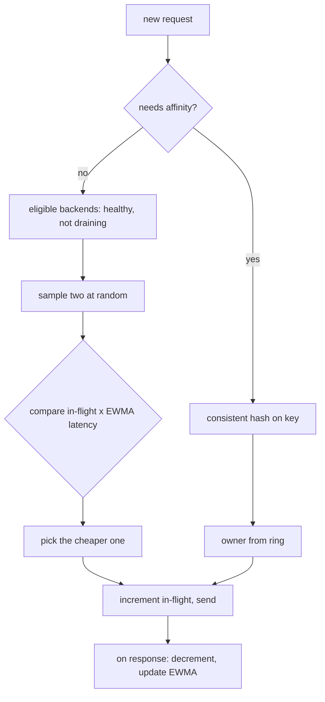

## In one minute
- A load balancing algorithm decides which healthy backend gets the next connection or request; the goal is low tail latency and no overloaded server, not equal counts.
- Static algorithms (round robin, weighted round robin, random, hashing) ignore current load. They are cheap and predictable, and they fail when requests or servers differ.
- Dynamic algorithms (least connections, least outstanding requests, latency-weighted EWMA) react to load, but every balancer sees only its own, slightly stale, view.
- Power of two choices, sampling two backends at random and taking the less loaded one, gets most of the benefit of "least loaded" while avoiding herding and global state.
- Hashing gives affinity (the same key goes to the same server) at the cost of balance; use consistent hashing so membership changes move few keys.

## How it works

### Static: round robin and its relatives
**Round robin** hands requests to backends in turn, which is ideal only when every request and server is alike. **Weighted round robin** gives a server with weight 3 three turns for every one of a weight-1 server, which handles mixed instance sizes and canaries at 5% of traffic. The naive version sends three requests in a row to the heavy server; NGINX's *smooth* weighted round robin interleaves them (for weights 5, 1, 1 it produces a, a, b, a, c, a, a) so no server sees bursts ([NGINX source](https://github.com/nginx/nginx/blob/master/src/http/ngx_http_upstream_round_robin.c)).

**Random** is round robin without the shared cursor: as even over time, with no coordination between balancers.

### Hashing for affinity
Hashing the client IP, a session cookie, a user ID or the URL sends the same key to the same backend. That keeps per-user caches warm and lets in-memory sessions work. Plain `hash mod N` reshuffles almost everything when N changes, so production balancers use consistent hashing: a ring, rendezvous hashing, or a Maglev table (see the Consistent Hashing lesson). Affinity trades away balance: one heavy user or a popular URL lands on one machine.

### Dynamic: least connections and least requests
**Least connections** picks the backend with the fewest open connections. It suits long-lived connections of varied length, such as database proxies or WebSockets. For HTTP, where one connection carries many requests, **least outstanding requests** counts in-flight requests instead. By Little's law, in-flight requests equal arrival rate times latency, so a backend that slows down accumulates in-flight work and automatically receives less. It makes the balancer route around slowness, not just death.

### Latency-aware: EWMA
Some balancers track an exponentially weighted moving average of each backend's response time and multiply it by in-flight requests to estimate the cost of the next one. Finagle and Linkerd use a "peak EWMA" that jumps up immediately on a slow response and decays slowly, so a backend that hiccups is avoided at once and trusted again gradually. Finagle's docs note the catch: the signal assumes slow means loaded, which breaks for long-polling clients whose requests are slow by design ([Finagle](https://twitter.github.io/finagle/guide/Clients.html)).

### Power of two choices
Picking the global minimum needs a fresh view of every backend, and when many balancers share a stale view they all pick the same "least loaded" server at once: a herd. Instead, sample two backends at random and take the less loaded. Randomness spreads the choices; comparing two still avoids busy servers. Envoy's `LEAST_REQUEST`, HAProxy's `random` (two draws by default) and open-source NGINX's `random two least_conn` (since 1.15.1) all work this way ([HAProxy docs](https://docs.haproxy.org/3.2/configuration.html), [NGINX upstream module](https://nginx.org/en/docs/http/ngx_http_upstream_module.html)).

### Slow start and warm-up
A fresh backend with an empty cache, a cold JIT or an unwarmed connection pool looks idle to least-requests and gets flooded. Slow start ramps its effective weight up over 30 to 60 seconds. The same problem shape appears in ride-hailing, where a driver who just came online should not be offered every nearby trip at once.

## Down the stack

### Layer 1: The contract
The algorithm receives the set of currently eligible backends, already filtered by health and draining, and returns one of them, in constant or near-constant time and without blocking. It promises a distribution, not an outcome: round robin promises equal shares over a cycle, weighted round robin shares proportional to weights, hashing that equal keys map to equal backends while membership is fixed, and load-aware algorithms only that they prefer backends with lower observed load. The inputs are local and stale. A balancer knows its own in-flight counts, not those of the other 40 instances sending to the same backends.

### Layer 2: The mechanism
NGINX's smooth weighted round robin, in `ngx_http_upstream_round_robin.c`, keeps `weight`, `effective_weight` and `current_weight` per peer. Each pick adds every peer's effective weight to its current weight, chooses the peer with the highest current weight, and subtracts the total from the winner. `effective_weight` drops on failures and recovers on successes, giving soft penalties. Envoy's `LEAST_REQUEST` samples `choice_count` hosts (default 2) and, when weights differ, divides weight by `(active_requests + 1)` raised to `active_request_bias` (default 1.0; at 0 it degrades to plain round robin) ([Envoy load balancers](https://www.envoyproxy.io/docs/envoy/latest/intro/arch_overview/upstream/load_balancing/load_balancers)). HAProxy offers `roundrobin` (dynamic weights, capped at 4,095 active servers per backend), `static-rr`, `leastconn`, `source`, `uri`, `hdr(name)` and `random(<draws>)`. AWS Application Load Balancers let a target group choose `round_robin`, `least_outstanding_requests` or `weighted_random`, the last able to shift weight away from targets whose error rate is anomalous compared with their peers ([AWS ALB docs](https://docs.aws.amazon.com/elasticloadbalancing/latest/application/edit-target-group-attributes.html)). Google's internal balancing, described in the SRE book, uses weighted round robin where backends report query rate, error rate and utilisation in every response and failures count as a penalty, and gives each client a deterministic *subset* of 20 to 100 backends so connection counts stay bounded ([Google SRE book](https://sre.google/sre-book/load-balancing-datacenter/)). The same idea is now open: gRPC's `weighted_round_robin` policy and Envoy's client-side weighted round robin compute each backend's weight as `qps / (utilization + eps/qps × penalty)` from ORCA load reports, so a backend that fails fast gets a low weight instead of a high one, and a new backend gets no weight until it has reported for a 10-second blackout period ([gRFC A58](https://github.com/grpc/proposal/blob/master/A58-client-side-weighted-round-robin-lb-policy.md)).

### Layer 3: The machine
Envoy runs one load balancer per worker thread, each with its own counters, so a proxy with 16 workers is really 16 independent balancers. Sharing one counter array across threads would cost an atomic increment on a contended cache line per request, roughly 20 to 100 ns under contention instead of about 1 ns locally, and a lock around a global minimum search would serialise every request. Random sampling needs a fast thread-local generator and two memory reads. The deeper limit is information: with 40 balancer instances and 16 workers each, there are 640 independent deciders. Mitzenmacher's analysis ([thesis](https://www.eecs.harvard.edu/~michaelm/postscripts/mythesis.pdf)) shows why two choices is enough: placing n jobs on n servers at random leaves the busiest server with about `log n / log log n` jobs, while picking the less loaded of two random servers cuts that to about `log log n / log 2`, an exponential improvement for one extra read.

### Why it's built this way
1. Requests differ in cost and servers differ in speed, so equal counts do not mean equal load, and the balancer needs a load signal.
2. In-flight requests reflect both rate and latency (Little's law), so they are a cheap, local load signal that needs no reporting protocol.
3. Each balancer's view is local and stale, so always choosing the global minimum herds; random sampling of two breaks the herd.
4. Some workloads need cache or session locality, so hashing exists, and consistent hashing limits the damage when membership changes.

## Diagram


## Worked example
A search service runs 10 backends behind one balancer tier at 5,000 requests per second, 500 per backend. Normal latency is 20 ms, so each backend has about 500 × 0.02 = 10 requests in flight.

Backend 4 enters a long garbage collection phase and its latency rises to 500 ms. With round robin it still receives 500 requests per second. Its in-flight count climbs to 500 × 0.5 = 250, and 10% of all requests now take half a second. The service's p99 latency jumps from about 40 ms to 500 ms, even though nine of ten servers are fine.

With least outstanding requests, backend 4's in-flight count rises above everyone else's and it stops winning comparisons. Traffic settles where its in-flight count roughly matches the others, about 10 requests, so it receives about 10 / 0.5 = 20 requests per second. That is 0.4% of traffic. The p99 returns close to normal, and only the p99.9 shows the slow server. The other nine absorb 4,980 requests per second, about 553 each, well within capacity.

Now the trap. Suppose backend 4 instead returns HTTP 500 in 1 ms because its database pool is exhausted. Its in-flight count is near zero, so least-requests sends it *more* traffic, and the error rate climbs. Load-aware algorithms need passive health checking or error-weighted penalties, or a fast-failing server becomes a black hole. Utilisation-weighted round robin with an error penalty, as in gRPC's policy above, would give this backend a weight near zero instead.

## In the wild
- **Dropbox, 2019: local in-flight counts were not enough.** Dropbox's Bandaid proxy already used random two choices on each proxy's own in-flight counts, which beat round robin and least connections, yet some servers still hit full utilisation at peak because each proxy saw only its own traffic. Backends began returning their utilisation in an `X-Bandaid-Utilization` header, and proxies scored candidates on it, with a decay for stale values and a penalty for recent 5xx so fast-failing servers stopped attracting traffic ([Dropbox](https://dropbox.tech/infrastructure/enhancing-bandaid-load-balancing-at-dropbox-by-leveraging-real-time-backend-server-load-information)).
- **Dropbox, 2024: weights from a feedback loop.** Its later Robinhood service runs a PID controller per backend that steers each node toward the fleet's average utilisation and ships the result to clients as weighted round robin weights over Envoy's EDS. On an Envoy cluster the max-to-average CPU ratio fell from 1.26 to 1.01, on a database frontend from 1.4 to 1.05, and some of the largest services shrank their fleets by 25% ([Dropbox](https://dropbox.tech/infrastructure/robinhood-in-house-load-balancing-service)).
- **Uber, 2022: static subsets left hot backends.** Each on-host proxy picked a random, fixed-size subset of backends, so heavy callers concentrated load and some tasks were rarely chosen. Uber made subset size dynamic, growing with each proxy's share of a service's traffic from load reports aggregated by the control plane. Of 36 large services onboarded last, 17 cut p99 CPU utilisation by at least 10%, some by up to 40% ([Uber](https://www.uber.com/us/en/blog/better-load-balancing-real-time-dynamic-subsetting/)).

## Trade-offs
| Algorithm | Strengths | Weaknesses | Choose when |
|---|---|---|---|
| Round robin | Simple, predictable, no state beyond a cursor | Ignores request cost and server speed | Uniform requests on identical servers |
| Weighted round robin | Handles mixed capacity and canary splits | Weights are static guesses | Known capacity differences, traffic shifting |
| Random | No coordination, even over time | Short-term imbalance, ignores load | Many independent balancers, simple stacks |
| Least connections | Good for long, varied connections | Wrong signal for multiplexed HTTP/2 | WebSockets, database proxies, TCP |
| Least requests with P2C | Routes around slow servers, no herding | Fast-failing servers attract traffic | Default for HTTP and gRPC services |
| Peak EWMA | Reacts to latency directly | More state and tuning | Latency-sensitive RPC with variable backends |
| Consistent hashing | Cache and session affinity | Hot keys, uneven load | Sharded caches, sticky sessions |

## Pitfalls in production
- **Black-hole servers.** A server that fails fast looks idle and wins every least-loaded comparison. Combine load-aware algorithms with outlier ejection, or count errors as heavy load.
- **Herding on stale data.** Many balancers choosing the global minimum from shared, delayed metrics all pick the same server. Use power of two choices or add randomness.
- **Cold-start floods.** A new instance with zero in-flight requests absorbs a burst before its caches warm. Enable slow start for 30 to 60 seconds.
- **Sticky sessions that never rebalance.** Affinity by cookie keeps old users on old servers after scale-out, so new servers stay idle. Bound session lifetimes, or keep session state out of the server.
- **Too many connections from too many clients.** A thousand clients each connecting to every backend means a million connections. Use deterministic subsetting so each client talks to a small, stable set.

## Leadership lens
- Make least outstanding requests with two random choices the default for HTTP and gRPC, and require a reason to choose anything else.
- Ask in design review what happens when one backend becomes 10 times slower, and separately when it starts failing fast. The answers differ by algorithm.
- Treat affinity as a cost. Every sticky session or hash-based route needs a plan for hot keys and for scale-out.
- Budget for observability per backend: in-flight requests, latency and error rate per instance are what reveal a bad algorithm choice.

## Check yourself
1. Why does least outstanding requests route around a slow server without any explicit latency measurement?
   **Answer:** In-flight requests equal arrival rate times latency, so a slower server accumulates more in-flight work at the same rate and loses comparisons until its rate drops.
2. Why can choosing the single least loaded backend be worse than choosing the better of two random ones?
   **Answer:** Many balancers with similar stale views all pick the same minimum at once and overload it. Random sampling spreads their choices while still avoiding busy servers.
3. A server starts answering every request with an error in 1 ms. What does least-requests do, and how do you fix it?
   **Answer:** It sends that server more traffic because it always looks idle. Add outlier detection that ejects it after consecutive errors, or penalise errors in the load estimate.
4. For weights 3 and 1, what problem does smooth weighted round robin solve compared with the naive version?
   **Answer:** The naive version sends three requests in a row to the heavy server, producing bursts. The smooth version spreads them so the light server's turn falls between them.

## Practice
**Task:** Implement two balancing algorithms. `SmoothWRR(backends)` takes a list of `(name, weight)` pairs; `next()` adds each backend's weight to its current weight, picks the backend with the highest current weight (ties go to the earlier one in the list), subtracts the total weight from the winner and returns its name. Backends with weight 0 are never picked, and `next()` returns `None` (TypeScript `null`, Go `"", false`) when the total weight is 0. `p2c_pick(loads, rnd)` takes a list of `(name, in_flight)` pairs and `rnd(n)`, which returns an integer in `[0, n)`. With no backends return `None`; with one, return it. Otherwise draw `i = rnd(n)` and `j = rnd(n - 1)`, add 1 to `j` if `j >= i`, and return the name with the smaller load, preferring `i` on a tie.

```python starter
class SmoothWRR:
    def __init__(self, backends):
        self.backends = list(backends)

    def next(self):
        # TODO
        raise NotImplementedError

def p2c_pick(loads, rnd):
    # TODO
    raise NotImplementedError
```

```python tests
def seq(*values):
    it = iter(values)
    return lambda n: next(it)

def test_smooth_sequence():
    w = SmoothWRR([("a", 5), ("b", 1), ("c", 1)])
    assert [w.next() for _ in range(7)] == ["a", "a", "b", "a", "c", "a", "a"]

def test_equal_weights_round_robin():
    w = SmoothWRR([("a", 1), ("b", 1), ("c", 1)])
    assert [w.next() for _ in range(6)] == ["a", "b", "c", "a", "b", "c"]

def test_weights_respected_and_zero_skipped():
    w = SmoothWRR([("a", 3), ("b", 0), ("c", 2)])
    picks = [w.next() for _ in range(50)]
    assert picks.count("a") == 30 and picks.count("c") == 20
    assert "b" not in picks
    assert picks[:5] == ["a", "c", "a", "c", "a"]

def test_wrr_all_zero():
    assert SmoothWRR([("a", 0)]).next() is None
    assert SmoothWRR([]).next() is None

def test_p2c_picks_less_loaded():
    loads = [("a", 9), ("b", 2), ("c", 5)]
    assert p2c_pick(loads, seq(0, 1)) == "c"
    assert p2c_pick(loads, seq(2, 0)) == "c"
    assert p2c_pick(loads, seq(0, 0)) == "b"

def test_p2c_second_draw_skips_first():
    loads = [("a", 4), ("b", 4), ("c", 1)]
    assert p2c_pick(loads, seq(1, 1)) == "c", "j=1 >= i=1 becomes 2"
    assert p2c_pick(loads, seq(2, 1)) == "c"

def test_p2c_tie_prefers_first_draw():
    loads = [("a", 3), ("b", 3)]
    assert p2c_pick(loads, seq(1, 0)) == "b"
    assert p2c_pick(loads, seq(0, 0)) == "a"

def test_p2c_small_inputs():
    assert p2c_pick([], seq()) is None
    assert p2c_pick([("only", 100)], seq()) == "only"
```

```python solution
class SmoothWRR:
    def __init__(self, backends):
        self.backends = list(backends)
        self.current = [0] * len(self.backends)

    def next(self):
        total = sum(w for _, w in self.backends)
        if total <= 0:
            return None
        best = -1
        for i, (_, w) in enumerate(self.backends):
            if w <= 0:
                continue
            self.current[i] += w
            if best < 0 or self.current[i] > self.current[best]:
                best = i
        self.current[best] -= total
        return self.backends[best][0]

def p2c_pick(loads, rnd):
    n = len(loads)
    if n == 0:
        return None
    if n == 1:
        return loads[0][0]
    i = rnd(n)
    j = rnd(n - 1)
    if j >= i:
        j += 1
    return loads[j][0] if loads[j][1] < loads[i][1] else loads[i][0]
```

```typescript starter
export class SmoothWRR {
  constructor(public backends: [string, number][]) {}
  next(): string | null {
    throw new Error("TODO");
  }
}

export function p2cPick(loads: [string, number][], rnd: (n: number) => number): string | null {
  throw new Error("TODO");
}
```

```typescript tests
function seq(...values: number[]): (n: number) => number {
  let k = 0;
  return (_n: number) => values[k++];
}
function take(w: SmoothWRR, n: number): (string | null)[] {
  const out: (string | null)[] = [];
  for (let i = 0; i < n; i++) out.push(w.next());
  return out;
}

test("smooth sequence", () => {
  assertEqual(take(new SmoothWRR([["a", 5], ["b", 1], ["c", 1]]), 7), ["a", "a", "b", "a", "c", "a", "a"]);
});
test("equal weights round robin", () => {
  assertEqual(take(new SmoothWRR([["a", 1], ["b", 1], ["c", 1]]), 6), ["a", "b", "c", "a", "b", "c"]);
});
test("weights respected and zero skipped", () => {
  const picks = take(new SmoothWRR([["a", 3], ["b", 0], ["c", 2]]), 50);
  assertEqual(picks.filter((p) => p === "a").length, 30);
  assertEqual(picks.filter((p) => p === "c").length, 20);
  assert(!picks.includes("b"));
  assertEqual(picks.slice(0, 5), ["a", "c", "a", "c", "a"]);
});
test("wrr all zero", () => {
  assertEqual(new SmoothWRR([["a", 0]]).next(), null);
  assertEqual(new SmoothWRR([]).next(), null);
});
test("p2c picks less loaded", () => {
  const loads: [string, number][] = [["a", 9], ["b", 2], ["c", 5]];
  assertEqual(p2cPick(loads, seq(0, 1)), "c");
  assertEqual(p2cPick(loads, seq(0, 0)), "b");
});
test("p2c second draw skips first", () => {
  const loads: [string, number][] = [["a", 4], ["b", 4], ["c", 1]];
  assertEqual(p2cPick(loads, seq(1, 1)), "c", "j=1 >= i=1 becomes 2");
  assertEqual(p2cPick(loads, seq(2, 1)), "c");
});
test("p2c tie prefers first draw", () => {
  const loads: [string, number][] = [["a", 3], ["b", 3]];
  assertEqual(p2cPick(loads, seq(1, 0)), "b");
  assertEqual(p2cPick(loads, seq(0, 0)), "a");
});
test("p2c small inputs", () => {
  assertEqual(p2cPick([], seq()), null);
  assertEqual(p2cPick([["only", 100]], seq()), "only");
});
```

```typescript solution
export class SmoothWRR {
  private current: number[];
  constructor(public backends: [string, number][]) {
    this.current = backends.map(() => 0);
  }
  next(): string | null {
    const total = this.backends.reduce((s, [, w]) => s + w, 0);
    if (total <= 0) return null;
    let best = -1;
    this.backends.forEach(([, w], i) => {
      if (w <= 0) return;
      this.current[i] += w;
      if (best < 0 || this.current[i] > this.current[best]) best = i;
    });
    this.current[best] -= total;
    return this.backends[best][0];
  }
}

export function p2cPick(loads: [string, number][], rnd: (n: number) => number): string | null {
  const n = loads.length;
  if (n === 0) return null;
  if (n === 1) return loads[0][0];
  const i = rnd(n);
  let j = rnd(n - 1);
  if (j >= i) j += 1;
  return loads[j][1] < loads[i][1] ? loads[j][0] : loads[i][0];
}
```

```go starter
package practice

type Backend struct {
	Name   string
	Weight int
}

type SmoothWRR struct {
	backends []Backend
}

func NewSmoothWRR(backends []Backend) *SmoothWRR { return &SmoothWRR{backends: backends} }

func (w *SmoothWRR) Next() (string, bool) { panic("TODO") }

type Load struct {
	Name     string
	InFlight int
}

func P2CPick(loads []Load, rnd func(n int) int) (string, bool) { panic("TODO") }
```

```go tests
package practice

import (
	"reflect"
	"testing"
)

func seq(values ...int) func(int) int {
	k := 0
	return func(int) int { v := values[k]; k++; return v }
}

func take(w *SmoothWRR, n int) []string {
	out := []string{}
	for i := 0; i < n; i++ {
		name, ok := w.Next()
		if !ok {
			name = "<none>"
		}
		out = append(out, name)
	}
	return out
}

func eq(t *testing.T, got, want interface{}) {
	t.Helper()
	if !reflect.DeepEqual(got, want) {
		t.Fatalf("got %v, want %v", got, want)
	}
}

func TestSmoothSequence(t *testing.T) {
	w := NewSmoothWRR([]Backend{{"a", 5}, {"b", 1}, {"c", 1}})
	eq(t, take(w, 7), []string{"a", "a", "b", "a", "c", "a", "a"})
}

func TestEqualWeightsRoundRobin(t *testing.T) {
	w := NewSmoothWRR([]Backend{{"a", 1}, {"b", 1}, {"c", 1}})
	eq(t, take(w, 6), []string{"a", "b", "c", "a", "b", "c"})
}

func TestWeightsRespectedAndZeroSkipped(t *testing.T) {
	picks := take(NewSmoothWRR([]Backend{{"a", 3}, {"b", 0}, {"c", 2}}), 50)
	counts := map[string]int{}
	for _, p := range picks {
		counts[p]++
	}
	eq(t, counts, map[string]int{"a": 30, "c": 20})
	eq(t, picks[:5], []string{"a", "c", "a", "c", "a"})
}

func TestWRRAllZero(t *testing.T) {
	if _, ok := NewSmoothWRR([]Backend{{"a", 0}}).Next(); ok {
		t.Fatal("zero weight should give nothing")
	}
	if _, ok := NewSmoothWRR(nil).Next(); ok {
		t.Fatal("empty should give nothing")
	}
}

func pick(loads []Load, rnd func(int) int) string {
	name, ok := P2CPick(loads, rnd)
	if !ok {
		return "<none>"
	}
	return name
}

func TestP2CPicksLessLoaded(t *testing.T) {
	loads := []Load{{"a", 9}, {"b", 2}, {"c", 5}}
	eq(t, pick(loads, seq(0, 1)), "c")
	eq(t, pick(loads, seq(0, 0)), "b")
}

func TestP2CSecondDrawSkipsFirst(t *testing.T) {
	loads := []Load{{"a", 4}, {"b", 4}, {"c", 1}}
	eq(t, pick(loads, seq(1, 1)), "c")
	eq(t, pick(loads, seq(2, 1)), "c")
}

func TestP2CTiePrefersFirstDraw(t *testing.T) {
	loads := []Load{{"a", 3}, {"b", 3}}
	eq(t, pick(loads, seq(1, 0)), "b")
	eq(t, pick(loads, seq(0, 0)), "a")
}

func TestP2CSmallInputs(t *testing.T) {
	eq(t, pick(nil, seq()), "<none>")
	eq(t, pick([]Load{{"only", 100}}, seq()), "only")
}
```

```go solution
package practice

type Backend struct {
	Name   string
	Weight int
}

type SmoothWRR struct {
	backends []Backend
	current  []int
}

func NewSmoothWRR(backends []Backend) *SmoothWRR {
	return &SmoothWRR{backends: backends, current: make([]int, len(backends))}
}

func (w *SmoothWRR) Next() (string, bool) {
	total := 0
	for _, b := range w.backends {
		total += b.Weight
	}
	if total <= 0 {
		return "", false
	}
	best := -1
	for i, b := range w.backends {
		if b.Weight <= 0 {
			continue
		}
		w.current[i] += b.Weight
		if best < 0 || w.current[i] > w.current[best] {
			best = i
		}
	}
	w.current[best] -= total
	return w.backends[best].Name, true
}

type Load struct {
	Name     string
	InFlight int
}

func P2CPick(loads []Load, rnd func(n int) int) (string, bool) {
	n := len(loads)
	if n == 0 {
		return "", false
	}
	if n == 1 {
		return loads[0].Name, true
	}
	i := rnd(n)
	j := rnd(n - 1)
	if j >= i {
		j++
	}
	if loads[j].InFlight < loads[i].InFlight {
		return loads[j].Name, true
	}
	return loads[i].Name, true
}
```

## Mock interview
**Prompt:** Your internal RPC platform has 300 services. Each service is called by 20 to 200 client instances and served by 10 to 500 backends, and p99 latency spikes whenever a single backend slows down. Choose the default load balancing algorithm for the platform's client library and justify it.

- Follow-up: How does your choice behave when one backend starts failing every request in under a millisecond?
- Follow-up: A client fleet of 2,000 instances talks to 500 backends. What happens to connection counts, and what do you change?
- Follow-up: One service needs per-user cache locality. How do you add that without breaking the rest of the design?

**A strong answer covers:**
- Least outstanding requests with power of two choices as the default, justified by Little's law and the herding problem.
- Outlier ejection or error penalties so fast failures do not attract traffic.
- Slow start for new instances and the cold-cache problem.
- Deterministic subsetting to bound connections, with the balance cost it introduces.
- Consistent hashing with bounded loads as an opt-in for affinity, plus a hot-key plan.
- Per-backend metrics (in-flight, latency, errors) to verify the algorithm works.

## Sources and further study
**Primary**
- [gRFC A58: client-side weighted round robin](https://github.com/grpc/proposal/blob/master/A58-client-side-weighted-round-robin-lb-policy.md): the weight formula, error penalty and blackout period for backend-reported load.
- [NGINX smooth weighted round robin source](https://github.com/nginx/nginx/blob/master/src/http/ngx_http_upstream_round_robin.c): `current_weight` and `effective_weight` in about forty lines.

**Systems docs**
- [Finagle client load balancers](https://twitter.github.io/finagle/guide/Clients.html): P2C with least loaded, peak EWMA and aperture, with when each one breaks.
- [HAProxy configuration manual](https://docs.haproxy.org/3.2/configuration.html): every `balance` algorithm, including `random(<draws>)` and its limits.
- [AWS ALB target group attributes](https://docs.aws.amazon.com/elasticloadbalancing/latest/application/edit-target-group-attributes.html): the three routing algorithms a managed balancer exposes and their restrictions.

**Books**
- *The Site Reliability Workbook*, Beyer et al., chapter 11 "Managing Load": load balancing, autoscaling and load shedding as one system.
- *Understanding Distributed Systems*, Roberto Vitillo, chapter "Network load balancing": round robin, least connections and power of two choices in context.

**Other curricula**
- [donnemartin/system-design-primer](https://github.com/donnemartin/system-design-primer): lists random, least loaded, session or cookie, and weighted round robin as routing metrics, without load signals or herding.
- [roadmap.sh system design](https://roadmap.sh/system-design): its "Load Balancing Algorithms" node covers round robin, least connections and IP hash, and says the choice depends on how uniform workload and capacity are.

## Watch
- [Top 6 Load Balancing Algorithms Every Developer Should Know (ByteByteGo)](https://www.youtube.com/watch?v=dBmxNsS3BGE): short visual tour of static and dynamic algorithms.
- [What is LOAD BALANCING? (Gaurav Sen)](https://www.youtube.com/watch?v=K0Ta65OqQkY): whiteboard intro that connects balancing to hashing.

## Free resources
- [Supported load balancers (Envoy)](https://www.envoyproxy.io/docs/envoy/latest/intro/arch_overview/upstream/load_balancing/load_balancers): weighted round robin, least request with P2C, ring hash and Maglev as implemented.
- [HTTP load balancing (NGINX)](https://nginx.org/en/docs/http/load_balancing.html): round robin, least connections, IP hash and weights in configuration.
- [Test Your Infrastructure with Power of Two Load Balancing (HAProxy)](https://www.haproxy.com/blog/power-of-two-load-balancing): measurements comparing P2C with other HAProxy algorithms.
- [Two Random Choices (Marc Brooker)](https://brooker.co.za/blog/2012/01/17/two-random.html): a clear simulation of why two random choices beats one.
- [The Power of Two Choices in Randomized Load Balancing (Mitzenmacher)](https://www.eecs.harvard.edu/~michaelm/postscripts/mythesis.pdf): the thesis behind the result.
- [Load Balancing in the Datacenter (Google SRE book)](https://sre.google/sre-book/load-balancing-datacenter/): subsetting and weighted round robin with backend-reported load.
