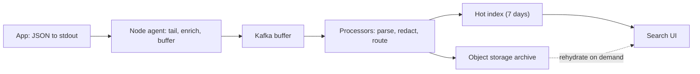

## In one minute
- Log aggregation collects log lines from every process and host into a central system where they can be searched, filtered, and retained.
- The pipeline has four stages: **emit** (structured logs to stdout or a file), **collect** (an agent on each node), **buffer and process** (a queue plus parsers), and **store and query** (an index or object store).
- Two storage philosophies dominate: **full-text indexing** (Elasticsearch, OpenSearch) for fast arbitrary search, and **label indexing plus brute-force scan** (Loki, ClickHouse-style) for much lower cost.
- Log volume grows faster than traffic, so sampling, levels, and retention tiers are what keep the bill under control.
- Logs are for detailed, per-event forensics. Use metrics for trends and alerts, and traces for request flow.

## How it works

### Emit
Applications should write **structured** logs, one JSON object per line, with consistent fields: `timestamp`, `level`, `service`, `trace_id`, `message`, and event-specific keys. The OpenTelemetry log data model is a good target schema, since its records already carry severity, trace ID and span ID ([OTel logs data model](https://opentelemetry.io/docs/specs/otel/logs/data-model/)). Writing to stdout and letting the platform capture it keeps shipping and rotation out of the app ([Twelve-Factor](https://12factor.net/logs)).

### Collect
An agent (Fluent Bit, Vector, the OpenTelemetry Collector) runs on every node, tails container log files, adds metadata such as pod, namespace, and region, and ships batches. It must checkpoint its read position so a restart loses nothing, and buffer to disk when the backend is slow. Fluent Bit's tail input keeps inode-to-offset pairs in a small SQLite file and warns that a few records may be read again after a crash, so "neither loses nor resends" is really "loses nothing, may resend" ([Fluent Bit docs](https://docs.fluentbit.io/manual/pipeline/inputs/tail)). The agent is not optional on Kubernetes: the kubelet keeps at most five 10 MiB files per container by default, and `kubectl logs` shows only the newest one ([Kubernetes logging](https://kubernetes.io/docs/concepts/cluster-administration/logging/)).

### Buffer and process
At scale, agents send to a durable queue such as Kafka, which absorbs bursts and decouples producers from indexers. Processors parse unstructured lines, drop noise, redact secrets and personal data, and route streams to different destinations by team or retention class.

### Store and query
**Inverted-index stores** tokenize every field and build a term-to-document index. Searches for any word are fast, but indexing costs CPU and the index can be as large as the raw data, so storage commonly runs 1 to 1.5 times raw. **Label-indexed stores** index only a few low-cardinality labels (service, environment, level) and keep log content as compressed chunks in object storage. Queries select streams by label, then scan chunks in parallel ([Loki overview](https://grafana.com/docs/loki/latest/get-started/overview/)). Ingest and storage are much cheaper, often 10 times compression on object storage, but searching for a rare string across a whole day means scanning everything.

### Retention tiers
Recent days stay on hot storage; older data moves to cold tiers or object storage and is deleted on a schedule set by debugging and compliance needs ([Elastic ILM](https://www.elastic.co/guide/en/elasticsearch/reference/current/index-lifecycle-management.html)). Which events you collect matters as much as how long you keep them: an investigation can only search the event types that were switched on before the attack, which is why security teams decide audit logging in advance rather than during an incident.

## Down the stack

### Layer 1: The contract
A log pipeline usually promises **at-least-once** delivery from the node to the store: every line written to stdout is eventually searchable, possibly duplicated, within a stated delay such as 30 seconds at p99. Ordering is promised only per source stream, by timestamp, not globally. Under sustained overload it promises explicit behaviour, either backpressure with bounded disk buffering or counted drops, never silent loss. Retention promises that data is deleted after its class's period.

### Layer 2: The mechanism
In Kubernetes, the container runtime writes each container's stdout to `/var/log/pods/NAMESPACE_POD_UID/CONTAINER/0.log` in CRI format: timestamp, stream, a partial-line flag, and the message. The kubelet rotates these files at `containerLogMaxSize` (10 MiB by default), keeping `containerLogMaxFiles` (5). The agent tails them with inotify, records the inode and byte offset of each file in a small database, and handles rotation by continuing to read the old inode until EOF before switching. Partial-line flags let it reassemble lines the runtime split at 16 KB. Batches are compressed and shipped; acknowledgement from Kafka or the backend advances the stored offset. Elasticsearch indexes each document into a Lucene in-memory buffer, makes it searchable after a **refresh** (1 second by default) by writing a new segment, and merges small segments in the background. A shard that has not been searched for 30 seconds stops refreshing until the next search arrives, unless the interval is set explicitly ([Elasticsearch index settings](https://www.elastic.co/guide/en/elasticsearch/reference/current/index-modules.html)). Loki groups lines by their label set into a **stream**, appends to an in-memory chunk per stream, and flushes chunks with a target size of 1.5 MB (`chunk_target_size` 1,572,864 bytes) to object storage with a small index entry per chunk ([Loki config](https://grafana.com/docs/loki/latest/configure/)). High-cardinality fields that people still filter on, such as `trace_id` or pod name, go in **structured metadata**: stored beside each line, not indexed, and available only with the `tsdb` index and schema v13, which replaced the deprecated `boltdb-shipper` ([Loki docs](https://grafana.com/docs/loki/latest/get-started/labels/structured-metadata/)).

### Layer 3: The machine
Tailing is cheap: inotify wakes the agent on writes, and reads hit the page cache because the data was just written. The expensive parts are compression and indexing. Gzip or Zstd at 100 to 500 MB/s per core means a node shipping 20 MB/s spends a few percent of a core. Lucene indexing, by contrast, tokenises every field and builds postings lists; a single core indexes on the order of 5,000 to 20,000 small log documents per second, so 300,000 lines per second needs tens of cores for indexing alone, plus disk writes for segment merges that rewrite data several times over. Loki avoids most of that CPU and write amplification, paying instead at query time by decompressing chunks at around 1 GB/s per core.

### Why it's built this way
1. Applications should not block or crash because the log backend is slow, so they write to local files and an agent ships asynchronously.
2. Agents and networks fail, so offsets are checkpointed and delivery is at-least-once.
3. Log bursts are much larger than average traffic, so a durable queue absorbs them.
4. Indexing every token is CPU- and storage-heavy, so cheaper designs index labels only and scan compressed chunks when needed.

## Diagram


## Worked example
A company runs 2,000 pods across 40 services. Average log rate is 150 lines per second per pod at 400 bytes, so 300,000 lines per second, 120 MB/s, about 10 TB per day raw.

Option A: Elasticsearch with 7 days hot. Index size near raw size, times two for one replica, gives 20 TB per day and 140 TB on disk: about 18 data nodes at 8 TB usable SSD each, a count that indexing 300,000 documents per second needs for CPU anyway.

Option B: Loki-style storage. Logs compress about 10 times into 1 TB per day of chunks in object storage. Thirty days is 30 TB, about $700 per month in storage. Ingesters and queriers need maybe 10 to 15 nodes. A query like "errors from checkout in the last hour" selects one stream set and scans 2 GB in seconds. A search for one order ID across all services for 7 days scans 7 TB compressed and takes minutes, unless the order ID is also emitted to a cheaper index.

Reduction first: the team finds that 45 percent of volume is DEBUG from two services and health-check access logs. Dropping health checks and sampling successful-request access logs at 10 percent cuts volume to 5 TB per day before choosing any backend.

## In the wild
- **Cloudflare, 2024: a blank config made the log pipeline fan out 40x.** A bug in config generation handed Logfwdr an empty configuration; the change was reverted within five minutes. Logfwdr's failsafe treated "no config" as "send everything", so it forwarded logs for every customer. Buftee, which keeps a buffer per customer job, went from about 1 million buffers to 40 million, its overload protections had never been configured, and it needed a full restart. About 55 percent of customer logs were lost over roughly 3.5 hours. Fixes: alerts for this misconfiguration, a tested fix, and regular overload tests ([Cloudflare](https://blog.cloudflare.com/cloudflare-incident-on-november-14-2024-resulting-in-lost-logs/)).
- **US federal agency, 2023: the attack was visible only in a premium log.** In mid-June 2023 an agency spotted `MailItemsAccessed` events from an application ID that never normally read mail, and that led to the discovery of the Storm-0558 intrusion into Microsoft-hosted email. CISA and the FBI advise enabling Purview Audit (Premium) logging, which requires G5/E5 licensing, and credit the agency's enhanced `MailItemsAccessed` logging for the detection, so organisations without that logging had no record to search ([CISA AA23-193A](https://www.cisa.gov/news-events/cybersecurity-advisories/aa23-193a)).
- **Okta, 2023: the evidence was under a different event type.** An attacker used a stolen service account to download customer support files, some of them HAR files with live session tokens, from 134 customers between 28 September and 17 October. Opening a file from the Files tab wrote a different log event from opening it through a case, and the first investigation searched only for the latter, which is part of why detection took about two weeks ([Okta](https://sec.okta.com/articles/2023/11/unauthorized-access-oktas-support-case-management-system-root-cause)).

## Trade-offs

| Option | Strengths | Weaknesses | Choose when |
|---|---|---|---|
| Full-text index (Elasticsearch, OpenSearch) | Fast search on any term, rich aggregations | High CPU, RAM, and storage cost; cluster tuning | Security analytics, heavy ad hoc search |
| Label index plus scan (Loki) | Cheap ingest and storage on object storage | Slow needle-in-haystack queries over long ranges | Operational debugging scoped by service and time |
| Columnar store (ClickHouse) | Fast aggregations, good compression, SQL | Schema design effort, self-managed | Structured logs used like analytics events |
| SaaS (Datadog, Splunk Cloud) | No operations, polished UX | Cost per GB scales painfully | Small teams or until volume makes it unaffordable |

## Pitfalls in production
- **Unbounded volume.** A retry loop logs a stack trace per attempt and one service generates 5 TB in an hour. Set per-service rate limits and quotas in the agent or processor, and alert on volume spikes.
- **Secrets and PII in logs.** Tokens, emails, and card numbers end up searchable by everyone. Redact in the pipeline, use structured fields with allow-lists, and restrict access by team.
- **High-cardinality labels.** Adding `user_id` as a Loki label creates millions of streams and overwhelms the index. Keep labels to low-cardinality dimensions and put IDs in the log body or in structured metadata.
- **Lost logs during incidents.** Under load, agents drop lines just when you need them. Use disk buffers, a Kafka buffer, and monitor agent drop counters.

## Leadership lens
- Cost is the main design driver. Ask each team for their log volume and who reads it; much of it is never queried.
- Define a logging standard: required fields, levels, trace IDs, and what must never be logged. Enforce it with a shared library.
- Decide retention per class, for example 7 days for debug, 30 days for application, 1 year for audit, and get compliance to sign off.

## Check yourself
1. Why is a label-indexed store much cheaper than a full-text index?
   **Answer:** It indexes only a few low-cardinality labels and stores compressed content in object storage, avoiding the CPU and disk cost of indexing every token.
2. What role does a Kafka buffer play between agents and the store?
   **Answer:** It absorbs bursts, decouples ingestion from indexing speed, and allows replay if the store is down or a processor has a bug.
3. Why put `trace_id` in every log line?
   **Answer:** It links logs to the distributed trace for the same request, so you can move from a slow span to the exact log lines it produced.

## Practice
**Task:** Write a tiny log pipeline stage. `process(lines, max_per_service)` receives raw JSON strings. Parse each; skip lines that fail to parse, counting them as `"invalid"`. Redact any value under keys `"password"` or `"token"` to `"[REDACTED]"`, and replace any 16-digit run in `message` with `"[CARD]"`. Enforce a per-service quota: after `max_per_service` lines from one `service`, drop the rest and count them as `"dropped"`. Return `(kept, stats)` where `kept` is the list of processed dicts and `stats` is a dict with `"invalid"` and `"dropped"` counts.

```python starter
import json

def process(lines, max_per_service):
    # TODO
    raise NotImplementedError
```

```python tests
import json

def test_redacts_secret_fields():
    kept, _ = process([json.dumps({"service": "a", "password": "x", "message": "hi"})], 10)
    assert kept[0]["password"] == "[REDACTED]"

def test_masks_card_numbers():
    m = "paid with 4111111111111111 ok"
    kept, _ = process([json.dumps({"service": "a", "message": m})], 10)
    assert kept[0]["message"] == "paid with [CARD] ok"

def test_invalid_counted():
    kept, stats = process(["not json", "{}"], 10)
    assert stats["invalid"] == 1 and len(kept) == 1

def test_quota_per_service():
    lines = [json.dumps({"service": "a", "message": str(i)}) for i in range(5)]
    lines.append(json.dumps({"service": "b", "message": "x"}))
    kept, stats = process(lines, 3)
    assert len(kept) == 4 and stats["dropped"] == 2

def test_empty():
    assert process([], 5) == ([], {"invalid": 0, "dropped": 0})
```

```python solution
import json

def _mask(msg):
    out, run = [], []
    for ch in msg + " ":
        if ch.isdigit():
            run.append(ch)
            continue
        out.append("[CARD]" if len(run) == 16 else "".join(run))
        run = []
        out.append(ch)
    return "".join(out)[:-1]

def process(lines, max_per_service):
    kept, stats, seen = [], {"invalid": 0, "dropped": 0}, {}
    for line in lines:
        try:
            rec = json.loads(line)
        except ValueError:
            stats["invalid"] += 1
            continue
        svc = rec.get("service")
        seen[svc] = seen.get(svc, 0) + 1
        if seen[svc] > max_per_service:
            stats["dropped"] += 1
            continue
        for k in ("password", "token"):
            if k in rec:
                rec[k] = "[REDACTED]"
        if isinstance(rec.get("message"), str):
            rec["message"] = _mask(rec["message"])
        kept.append(rec)
    return kept, stats
```

```typescript starter
export type Rec = Record<string, unknown>;
export function processLines(lines: string[], maxPerService: number):
    [Rec[], { invalid: number; dropped: number }] {
  throw new Error("TODO");
}
```

```typescript tests
test("redacts secret fields", () => {
  const [kept] = processLines([JSON.stringify({ service: "a", password: "x", message: "hi" })], 10);
  assertEqual(kept[0].password, "[REDACTED]");
});
test("masks card numbers", () => {
  const [kept] = processLines([JSON.stringify({ service: "a", message: "paid with 4111111111111111 ok" })], 10);
  assertEqual(kept[0].message, "paid with [CARD] ok");
});
test("invalid counted", () => {
  const [kept, stats] = processLines(["not json", "{}"], 10);
  assertEqual([stats.invalid, kept.length], [1, 1]);
});
test("quota per service", () => {
  const lines = [0, 1, 2, 3, 4].map(i => JSON.stringify({ service: "a", message: String(i) }));
  lines.push(JSON.stringify({ service: "b", message: "x" }));
  const [kept, stats] = processLines(lines, 3);
  assertEqual([kept.length, stats.dropped], [4, 2]);
});
test("empty", () => assertEqual(processLines([], 5), [[], { invalid: 0, dropped: 0 }]));
```

```typescript solution
export type Rec = Record<string, unknown>;
export function processLines(lines: string[], maxPerService: number):
    [Rec[], { invalid: number; dropped: number }] {
  const kept: Rec[] = [];
  const stats = { invalid: 0, dropped: 0 };
  const seen = new Map<unknown, number>();
  for (const line of lines) {
    let rec: Rec;
    try { rec = JSON.parse(line); } catch { stats.invalid++; continue; }
    const n = (seen.get(rec.service) ?? 0) + 1;
    seen.set(rec.service, n);
    if (n > maxPerService) { stats.dropped++; continue; }
    for (const k of ["password", "token"]) if (k in rec) rec[k] = "[REDACTED]";
    if (typeof rec.message === "string")
      rec.message = rec.message.replace(/\d+/g, m => (m.length === 16 ? "[CARD]" : m));
    kept.push(rec);
  }
  return [kept, stats];
}
```

```go starter
package practice

type Stats struct{ Invalid, Dropped int }

func ProcessLines(lines []string, maxPerService int) ([]map[string]any, Stats) {
	panic("TODO")
}
```

```go tests
package practice

import "testing"

func TestRedactsSecrets(t *testing.T) {
	kept, _ := ProcessLines([]string{`{"service":"a","password":"x","message":"hi"}`}, 10)
	if kept[0]["password"] != "[REDACTED]" {
		t.Fatalf("got %v", kept[0])
	}
}

func TestMasksCards(t *testing.T) {
	kept, _ := ProcessLines([]string{`{"service":"a","message":"paid with 4111111111111111 ok"}`}, 10)
	if kept[0]["message"] != "paid with [CARD] ok" {
		t.Fatalf("got %v", kept[0]["message"])
	}
}

func TestInvalidCounted(t *testing.T) {
	kept, st := ProcessLines([]string{"not json", "{}"}, 10)
	if st.Invalid != 1 || len(kept) != 1 {
		t.Fatalf("got %v %v", kept, st)
	}
}

func TestQuota(t *testing.T) {
	lines := []string{}
	for i := 0; i < 5; i++ {
		lines = append(lines, `{"service":"a","message":"m"}`)
	}
	lines = append(lines, `{"service":"b","message":"x"}`)
	kept, st := ProcessLines(lines, 3)
	if len(kept) != 4 || st.Dropped != 2 {
		t.Fatalf("got %d %v", len(kept), st)
	}
}

func TestEmpty(t *testing.T) {
	kept, st := ProcessLines(nil, 5)
	if len(kept) != 0 || st != (Stats{}) {
		t.Fatalf("got %v %v", kept, st)
	}
}
```

```go solution
package practice

import (
	"encoding/json"
	"fmt"
	"regexp"
)

type Stats struct{ Invalid, Dropped int }

var digits = regexp.MustCompile(`\d+`)

func ProcessLines(lines []string, maxPerService int) ([]map[string]any, Stats) {
	kept := []map[string]any{}
	var st Stats
	seen := map[string]int{}
	for _, line := range lines {
		var rec map[string]any
		if err := json.Unmarshal([]byte(line), &rec); err != nil {
			st.Invalid++
			continue
		}
		svc := fmt.Sprint(rec["service"])
		seen[svc]++
		if seen[svc] > maxPerService {
			st.Dropped++
			continue
		}
		for _, k := range []string{"password", "token"} {
			if _, ok := rec[k]; ok {
				rec[k] = "[REDACTED]"
			}
		}
		if msg, ok := rec["message"].(string); ok {
			rec["message"] = digits.ReplaceAllStringFunc(msg, func(m string) string {
				if len(m) == 16 {
					return "[CARD]"
				}
				return m
			})
		}
		kept = append(kept, rec)
	}
	return kept, st
}
```

## Mock interview
**Prompt:** Design centralized logging for 5,000 microservice instances producing 25 TB of logs per day, with 14 days searchable and a one-year audit trail, on a budget a third of the current SaaS bill.

- Follow-up: During an outage, log volume spikes tenfold. What breaks first?
- Follow-up: Security needs fast search for an IP across all logs for 30 days. How?
- Follow-up: How do you stop developers logging personal data?

**A strong answer covers:**
- Volume reduction first: levels, sampling, and dropping health checks, with numbers.
- Agents with disk buffering, Kafka as a shock absorber, and backpressure handling.
- Tiered storage: hot index or label store for recent data, compressed object storage for audit.
- A targeted secondary index or dedicated security pipeline for high-value fields like IPs.
- Redaction in the pipeline, logging standards, access control, and per-team cost attribution.

## Sources and further study
**Primary**
- [OpenTelemetry logs data model](https://opentelemetry.io/docs/specs/otel/logs/data-model/): the vendor-neutral record shape that agents and backends increasingly share.
- [CISA and FBI advisory AA23-193A](https://www.cisa.gov/news-events/cybersecurity-advisories/aa23-193a): a real investigation that turned on which audit events had been collected.

**Systems docs**
- [Kubernetes logging architecture](https://kubernetes.io/docs/concepts/cluster-administration/logging/): kubelet rotation defaults and the node-agent, sidecar and direct-push patterns.
- [Fluent Bit tail input](https://docs.fluentbit.io/manual/pipeline/inputs/tail): offset database, memory limits and pause-on-backpressure.
- [Grafana Loki structured metadata](https://grafana.com/docs/loki/latest/get-started/labels/structured-metadata/): where high-cardinality fields go when they cannot be labels.
- [Elasticsearch index settings](https://www.elastic.co/guide/en/elasticsearch/reference/current/index-modules.html): refresh interval and search-idle shards.

**Books**
- *Observability Engineering*, Majors, Fong-Jones and Miranda, chapter 18 "Telemetry Management with Pipelines": pipeline anatomy and Slack's telemetry pipeline as a case study.
- *Designing Distributed Systems* (2nd edition), Brendan Burns, chapter 5 "Adapters": the logging and monitoring adapter containers that normalise output before shipping.

**Other curricula**
- [Azure Architecture Center: monitoring and diagnostics](https://learn.microsoft.com/en-us/azure/architecture/best-practices/monitoring): treats collection, storage and analysis as stages of one pipeline and separates audit data from operational data.
- [AWS Builders' Library: instrumenting distributed systems](https://builder.aws.com/content/3EuxPBdIiiUhB5IK47p3O3fxhy7/instrumenting-distributed-systems-for-operational-visibility): frequent rotation, a separate partition, and agents that read from page cache.
- [donnemartin/system-design-primer](https://github.com/donnemartin/system-design-primer): does not cover log aggregation.

## Watch
- [Beginner's Crash Course to Elastic Stack, Part 1 (Official Elastic Community)](https://www.youtube.com/watch?v=gS_nHTWZEJ8): how Elasticsearch indexes and searches documents.
- [Meet Grafana Loki (Techno Tim)](https://www.youtube.com/watch?v=h_GGd7HfKQ8): a practical tour of label-based log aggregation.

## Free resources
- [The Twelve-Factor App: Logs](https://12factor.net/logs): the case for treating logs as event streams written to stdout.
- [Grafana Loki overview](https://grafana.com/docs/loki/latest/get-started/overview/): label indexing, chunks, and why it is cheaper than full-text indexing.
- [Elasticsearch index lifecycle management](https://www.elastic.co/guide/en/elasticsearch/reference/current/index-lifecycle-management.html): hot, warm, cold tiers and rollover in practice.
- [OpenTelemetry logs](https://opentelemetry.io/docs/concepts/signals/logs/): the log data model and correlation with traces.
