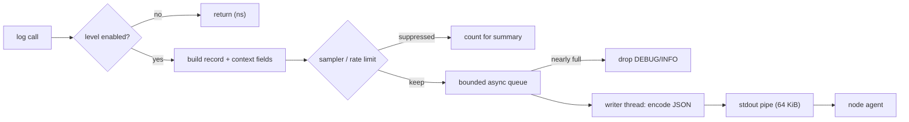

## In one minute
- A log line is a message to a stranger at 3 a.m. who has no access to your head. Write events with structured fields (`order_id=...`, `latency_ms=...`), not sentences with values glued in, so they can be filtered and grouped.
- Levels are a contract about who must act: ERROR means a request or job failed and someone may need to look; WARN means something degraded but was handled; INFO records business-relevant events; DEBUG is for developers and is off in production by default.
- Context beats volume. One wide "canonical" line per request with 20 to 50 fields, stamped with the trace ID, answers more questions than 30 scattered lines, and costs less.
- Logging is I/O on the request path. Use leveled, lazily formatted calls, bounded asynchronous queues, and sampling or rate limiting for hot paths, so a burst of warnings cannot take down the service it describes.
- Logs are data with legal weight: never write secrets or raw personal data, escape untrusted input, and treat audit logs as a separate stream with its own retention and integrity rules.

## How it works
This lesson is about what to put in log lines and how to emit them safely. The Log Aggregation lesson covers shipping and storage, and Design a Logging Framework covers logger hierarchies and sinks.

### Events, not prose
Compare two lines that describe the same failure:

```text
Failed to charge customer 8812 for order 55120 after 3 attempts: timeout
{"level":"error","event":"charge_failed","customer_id":8812,"order_id":55120,"attempts":3,"error":"timeout","provider":"acme","trace_id":"4bf9..."}
```

The first reads well once. The second can be counted by `provider`, filtered to one `order_id`, and joined to a trace. Write a stable `event` name that never changes when someone edits wording, and put variable data only in fields. Keep field names consistent across services (`user_id`, not `userId` in one and `uid` in another); the OpenTelemetry semantic conventions are a good default vocabulary (`http.request.method`, `http.response.status_code`, `db.system`) ([OTel HTTP conventions](https://opentelemetry.io/docs/specs/semconv/http/http-spans/)). The OpenTelemetry log data model now has a first-class `EventName` field for exactly this stable name ([OTel logs data model](https://opentelemetry.io/docs/specs/otel/logs/data-model/)).

### Levels as a contract
Teams misuse levels in two directions: expected conditions logged as ERROR (a 404, a validation failure), so real failures drown in noise; or handled-and-retried failures logged as INFO, so nobody sees a provider failing half its calls. A workable rule: ERROR when the unit of work failed and the system could not compensate; WARN when it succeeded through a fallback, a retry, or degraded data; INFO for state changes a human or auditor cares about (order placed, deploy started, config reloaded); DEBUG for everything else. If an ERROR line does not lead someone to do something, it is not an error.

### Log once, at the boundary
A common anti-pattern is log-and-rethrow: the repository logs the SQL error, the service logs it again with more words, the handler logs it a third time. One failure becomes three ERROR lines with three stack traces. Instead, lower layers wrap the error with context (`fmt.Errorf("load order %d: %w", id, err)` in Go, exception chaining in Python and Java) and return it. The outermost layer that decides what happens to the request logs it once, with the full chain.

### Context travels with the request
Every line inside a request should carry the request's identity without each call site passing it. Go's `slog` has `logger.With("trace_id", id)` and handlers that read the span from `context.Context`; Python uses `contextvars` with a logging filter; Java uses MDC (a thread-local map) which needs care with thread pools and virtual threads. The canonical-line pattern, popularised by Stripe ([Stripe](https://stripe.com/blog/canonical-log-lines)), goes further: accumulate fields in a request-scoped map as the request runs and emit one wide line at the end with route, status, duration, user tier, DB time, cache hits and the flags that were on. Searches then become group-bys over one line per request. Amazon reaches the same rule independently: one request log entry per unit of work, with the latency and status of every dependency call, and periodic entries only for long-running jobs ([AWS Builders' Library](https://builder.aws.com/content/3EuxPBdIiiUhB5IK47p3O3fxhy7/instrumenting-distributed-systems-for-operational-visibility)).

### What never to log
Passwords, tokens, session cookies, full card numbers, private keys, and request bodies that might contain any of them. Personal data (emails, phone numbers, addresses) only when there is a reason and a retention policy, ideally hashed or tokenised ([OWASP](https://cheatsheetseries.owasp.org/cheatsheets/Logging_Cheat_Sheet.html)). Prefer opt-in fields: a logger that prints whole request objects will start leaking the next sensitive parameter someone adds. Untrusted input must be escaped, or an attacker can forge lines by embedding newlines ([CWE-117](https://cwe.mitre.org/data/definitions/117.html)); truncating long values also stops a caller from filling the disk. Log4Shell (CVE-2021-44228) showed the extreme: Log4j 2 performed JNDI lookups on `${...}` patterns inside logged strings, so logging a user-agent header was remote code execution. It scored the maximum CVSS 10.0, and the first fix (2.15.0) was incomplete, so a second CVE needed 2.16.0 ([Apache Log4j security](https://logging.apache.org/log4j/2.x/security.html)).

### Volume control
A tight loop that logs at WARN on every iteration can produce 100,000 lines per second. Defences, in order of preference: do not log in the loop (count and log a summary); rate-limit identical messages and emit "suppressed N" summaries; sample INFO per event type; and always keep ERROR. This is the *overload* problem shape: the signal you need during an incident is generated fastest during the incident, and an unbounded producer will starve the consumer. The same shape appears in alert storms in a pager, and in a crash reporter that uploads the same stack trace from a million phones, where clients deduplicate by fingerprint and send counts.

## Down the stack

### Layer 1: The contract
A log call is best effort. An asynchronous handler loses its queue on SIGKILL or the OOM killer, so the lines just before a crash are the likeliest to vanish. Order holds per logger within a process, not across hosts, and timestamps come from a wall clock that can jump. Under overload the library blocks the caller (Logback's `AsyncAppender` default, `neverBlock=false` ([Logback docs](https://logback.qos.ch/manual/appenders-async-sift.html))), drops events (`neverBlock=true`, zap's sampler), or grows memory without bound. Choose deliberately: "blocks the caller" means logging can stall request threads.

### Layer 2: The mechanism
Fast loggers do three things. They check the level first: `slog`'s `Handler.Enabled(ctx, level)` and Python's cached `isEnabledFor` return in nanoseconds, and `logger.debug("x=%s", x)` defers formatting, unlike an f-string. They avoid allocation: zap and `slog` encode typed fields (`zap.Int("attempts", 3)`) straight into a pooled byte buffer. They move I/O off the request thread: Logback's `AsyncAppender` uses an `ArrayBlockingQueue` (default size 256) and, once less than 20 percent of capacity remains, discards TRACE, DEBUG and INFO while keeping WARN and ERROR; Python's `QueueHandler` and `QueueListener` split the work the same way. Zap's sampler counts entries per level and message in one-second ticks, logging the first `Initial` (100 in the production config) and then every `Thereafter`th (100) ([zap config.go](https://github.com/uber-go/zap/blob/master/config.go)).

### Layer 3: The machine
In containers, stdout is a pipe read by the container runtime, and a Linux pipe holds 64 KiB by default (16 pages) ([pipe(7)](https://man7.org/linux/man-pages/man7/pipe.7.html)). If the runtime or log agent falls behind, the pipe fills, `write(2)` blocks, and a synchronous logger blocks whichever thread called it: logging becomes a hidden lock across all request threads. Pipe writes up to `PIPE_BUF` (4,096 bytes) are atomic, so lines from many threads do not interleave if each is one write; a 10 KB stack trace written in pieces can be split. Formatting costs 1 to 5 microseconds per JSON line, and allocation is the hidden cost: 20,000 requests per second times 10 lines times 500 bytes of garbage is 100 MB per second for the garbage collector. Services that log to local files have one more failure to plan for: a full disk. Decide in advance whether the service stops taking traffic or keeps running blind, rotate often, put logs on their own partition, and test with a nearly full disk ([AWS Builders' Library](https://builder.aws.com/content/3EuxPBdIiiUhB5IK47p3O3fxhy7/instrumenting-distributed-systems-for-operational-visibility)).

### Why it's built this way
1. Most log calls are below the active level, so the fast path must exit before formatting or allocating.
2. Enabled calls still run on the request thread, so I/O is moved to a queue drained by another thread.
3. Queues are bounded to protect memory, so a full queue must either block or drop, and dropping low-severity events first keeps the lines that matter.
4. The most valuable lines are often produced in a flood (one bug, one message, a million times), so sampling and rate limiting by message bound volume without losing the fact that it happened.
5. Text is cheap to write but expensive to search, so structure is added at write time where it costs nanoseconds rather than at query time with regex parsing.

## Diagram


## Worked example
A payments API handles 3,000 requests per second across 30 pods and logs about 12 lines per request: entry and exit at INFO, three repository calls at DEBUG (left on since an incident a year ago), cache hits, and a provider call. At an average of 450 bytes, that is 3,000 times 12 times 450 = 16 MB per second, 1.4 TB per day raw. At a managed ingest price of around 0.50 dollars per GB, the bill is about 21,000 dollars a month.

The team makes three changes: DEBUG off in production with a per-request override header for on-call; entry, exit and cache lines replaced by one canonical line per request with 35 fields (about 1.2 KB); and the provider's retry WARN rate-limited by message to 20 per 10 seconds with a "suppressed N" summary.

New volume: 3,000 times 1.2 KB is 3.6 MB per second, about 310 GB per day, roughly 4,700 dollars a month. Investigations got faster: "which merchants saw p99 over 2 seconds on the new build" is one group-by on the canonical line.

Three weeks later a provider outage produced 9,000 retry warnings per second. A previous outage like it had filled every pod's stdout pipe and blocked request threads, turning a provider problem into an API outage. This time each pod logged 2 warnings per second plus summaries counting the suppressed thousands.

## In the wild
- **Facebook, 2019: passwords in plaintext in internal logs.** A routine security review in January 2019 found user passwords stored readably in internal data systems, even though the login path was designed to mask them. The estimate was hundreds of millions of Facebook Lite users, tens of millions of other Facebook users, and, after more logs turned up in April, millions of Instagram users. No internal abuse was found; the logging was fixed and the affected users notified ([Meta](https://about.fb.com/news/2019/03/keeping-passwords-secure/)).
- **Apache Log4j, 2021: logging a string ran the attacker's code.** Log4j 2 resolved JNDI lookups inside logged messages, so any logged header or form field could make the server load code from an attacker's LDAP server (CVE-2021-44228, CVSS 10.0). The 2.15.0 fix was incomplete and was followed by 2.16.0 for CVE-2021-45046, and later 2.17.x releases closed further issues. The lesson for loggers: never evaluate templates or lookups in logged data ([Apache](https://logging.apache.org/log4j/2.x/security.html)).

## Trade-offs
| Option | Strengths | Weaknesses | Choose when |
| --- | --- | --- | --- |
| Synchronous logging | Lines survive until the crash; simple | Request threads block on slow I/O | Low volume, CLIs, batch jobs |
| Async, bounded, drop low levels | Request path never blocks; keeps WARN and ERROR | Loses lines on SIGKILL and under floods | Most online services |
| Many small lines per request | Easy to add; tells a story in order | Expensive; hard to aggregate | Local debugging, startup and shutdown |
| One canonical line per request | Cheap per request; every query is a group-by | Must accumulate context; lost if the process dies mid-request | High-traffic request handlers |
| Sample or rate-limit by message | Bounds floods; preserves counts | Loses individual instances | Hot-path warnings, retry loops |

## Pitfalls in production
- ERROR used for expected outcomes (404s, validation failures), so alerts on error-log rate fire constantly and get muted. Fix: reserve ERROR for failed work the system could not handle; count client errors with a metric.
- Secrets in logs via `log.info("request %s", request)` that prints headers and bodies. Fix: allow-list fields to log, redact at the logger with a deny-list of keys as a backstop, and scan the pipeline for token patterns.
- Logging in a hot loop during an outage fills the stdout pipe and blocks request threads. Fix: async bounded handlers, rate limiting by message, and a load test that kills the log agent.
- Log-and-rethrow producing three copies of every error. Fix: wrap errors with context and log once at the boundary.
- Eager formatting of disabled debug calls (`log.debug(f"{expensive()}")`) burning CPU in production. Fix: lazy arguments or an explicit `if logger.isEnabledFor(DEBUG)` guard.
- Inconsistent field names across services, so `user_id` searches miss half the data. Fix: a shared field schema and a lint in CI.

## Leadership lens
- Write a one-page logging standard (levels, required fields, forbidden fields, the canonical line) and enforce it through a shared library, not review alone.
- Make cost visible per service; a team that sees 21,000 dollars a month next to its name finds the forgotten DEBUG lines.
- Keep audit logs (who did what, years, append-only) separate from operational logs (days, sampled), or the expensive retention applies to everything.
- Ask in design review: "What happens to this service when the log agent is down for 10 minutes?" The right answer names a bounded queue and what gets dropped.
- AI agents add log lines generously and often interpolate whole objects. Review generated code for secrets in log calls and for new ERROR lines on expected paths.

## Check yourself
1. Why is `logger.debug("user=%s", user)` cheaper than `logger.debug(f"user={user}")` when DEBUG is disabled?
   **Answer:** The f-string formats `user` (calling its `__str__`) before the call, while the `%s` form passes arguments unformatted and the logger returns after the level check without formatting.
2. A service with a synchronous stdout logger becomes unresponsive when the node's log agent crashes. Explain the chain.
   **Answer:** The agent stops draining the container runtime, the 64 KiB pipe fills, `write(2)` blocks, and every request thread that logs blocks on it, so the service stalls even though its own code is fine.
3. Why should rate limiting of repeated warnings emit a "suppressed N" summary instead of silently dropping?
   **Answer:** The count is the signal during an incident; silent dropping makes a 10,000-per-second flood look like 2 warnings per second, hiding the scale of the problem.
4. When is one canonical line per request worse than several lines?
   **Answer:** When the process may die mid-request (a crash or OOM), since the line is written at the end and is lost, or for long-running jobs where you need progress before completion.

## Practice
**Task:** Build a log gate that sits in front of a sink. `LogGate(clock, info_every, window, burst)` takes an injected clock (a function returning seconds). `offer(level, key, msg)` returns the list of records to emit as `(level, key, msg)` tuples. DEBUG is always dropped. ERROR is always emitted. INFO is sampled per `key`: the 1st, then every `info_every`th record for that key is emitted (counts 0, `info_every`, `2*info_every`, ...). WARN is rate-limited per `(key, msg)`: a window opens at the first WARN and lasts `window` seconds; within it at most `burst` records pass and the rest are counted as suppressed. When a WARN arrives after its window has expired, a new window opens at that time, and if the old window suppressed any, first emit `("WARN", key, "suppressed N: " + msg)`. `flush()` returns summaries for every `(key, msg)` with suppressed records, sorted by key then msg, and resets those counts. Reject `info_every < 1`, `burst < 1` or `window <= 0` with the error `invalid config`.

```python starter
class LogGate:
    def __init__(self, clock, info_every, window, burst):
        # TODO: validate and store
        raise NotImplementedError

    def offer(self, level, key, msg):
        # TODO: return list of (level, key, msg)
        raise NotImplementedError

    def flush(self):
        # TODO
        raise NotImplementedError
```

```python tests
class FakeClock:
    def __init__(self):
        self.t = 0.0
    def __call__(self):
        return self.t

def gate(info_every=3, window=10, burst=2):
    c = FakeClock()
    return c, LogGate(c, info_every, window, burst)

def test_errors_always_debug_never():
    _, g = gate()
    for _ in range(5):
        assert g.offer("ERROR", "db", "down") == [("ERROR", "db", "down")]
    assert g.offer("DEBUG", "db", "x") == []

def test_info_sampled_per_key():
    _, g = gate(info_every=3)
    out = []
    for i in range(7):
        out += g.offer("INFO", "cache", "hit %d" % i)
    out += g.offer("INFO", "auth", "ok")
    assert out == [("INFO", "cache", "hit 0"), ("INFO", "cache", "hit 3"),
                   ("INFO", "cache", "hit 6"), ("INFO", "auth", "ok")]

def test_warn_burst_then_suppressed_then_summary():
    c, g = gate(window=10, burst=2)
    assert g.offer("WARN", "pay", "retry") == [("WARN", "pay", "retry")]
    c.t = 1
    assert g.offer("WARN", "pay", "retry") == [("WARN", "pay", "retry")]
    for t in [2, 3, 9.9]:
        c.t = t
        assert g.offer("WARN", "pay", "retry") == []
    c.t = 10
    assert g.offer("WARN", "pay", "retry") == [
        ("WARN", "pay", "suppressed 3: retry"), ("WARN", "pay", "retry")]

def test_warn_limits_are_per_message():
    _, g = gate(burst=1)
    assert g.offer("WARN", "pay", "retry") != []
    assert g.offer("WARN", "pay", "slow") != []
    assert g.offer("WARN", "ship", "retry") != []
    assert g.offer("WARN", "pay", "retry") == []

def test_new_window_without_suppression_has_no_summary():
    c, g = gate(window=5, burst=3)
    g.offer("WARN", "k", "m")
    c.t = 6
    assert g.offer("WARN", "k", "m") == [("WARN", "k", "m")]

def test_flush_sorted_and_resets():
    _, g = gate(burst=1)
    for _ in range(3):
        g.offer("WARN", "z", "b")
        g.offer("WARN", "a", "y")
        g.offer("WARN", "a", "x")
    assert g.flush() == [("WARN", "a", "suppressed 2: x"), ("WARN", "a", "suppressed 2: y"),
                         ("WARN", "z", "suppressed 2: b")]
    assert g.flush() == []

def test_invalid_config():
    for args in [(0, 10, 1), (1, 0, 1), (1, 10, 0)]:
        try:
            LogGate(FakeClock(), *args)
            assert False, "expected ValueError"
        except ValueError as e:
            assert str(e) == "invalid config"
```

```python solution
class LogGate:
    def __init__(self, clock, info_every, window, burst):
        if info_every < 1 or burst < 1 or window <= 0:
            raise ValueError("invalid config")
        self.clock = clock
        self.info_every = info_every
        self.window = window
        self.burst = burst
        self.info_counts = {}
        self.warn = {}

    def offer(self, level, key, msg):
        if level == "DEBUG":
            return []
        if level == "INFO":
            n = self.info_counts.get(key, 0)
            self.info_counts[key] = n + 1
            return [(level, key, msg)] if n % self.info_every == 0 else []
        if level == "WARN":
            now = self.clock()
            st = self.warn.get((key, msg))
            out = []
            if st is None or now - st["start"] >= self.window:
                if st is not None and st["suppressed"] > 0:
                    out.append(("WARN", key, "suppressed %d: %s" % (st["suppressed"], msg)))
                self.warn[(key, msg)] = {"start": now, "count": 1, "suppressed": 0}
                out.append((level, key, msg))
                return out
            if st["count"] < self.burst:
                st["count"] += 1
                return [(level, key, msg)]
            st["suppressed"] += 1
            return []
        return [(level, key, msg)]

    def flush(self):
        out = []
        for (key, msg) in sorted(self.warn):
            st = self.warn[(key, msg)]
            if st["suppressed"] > 0:
                out.append(("WARN", key, "suppressed %d: %s" % (st["suppressed"], msg)))
                st["suppressed"] = 0
        return out
```

```typescript starter
export type LogRecord = [string, string, string];

export class LogGate {
  constructor(clock: () => number, infoEvery: number, window: number, burst: number) {
    throw new Error("TODO");
  }
  offer(level: string, key: string, msg: string): LogRecord[] { throw new Error("TODO"); }
  flush(): LogRecord[] { throw new Error("TODO"); }
}
```

```typescript tests
function makeGate(infoEvery = 3, window = 10, burst = 2) {
  const clock = { t: 0 };
  const g = new LogGate(() => clock.t, infoEvery, window, burst);
  return { clock, g };
}

test("errors always, debug never", () => {
  const { g } = makeGate();
  for (let i = 0; i < 5; i++) assertEqual(g.offer("ERROR", "db", "down"), [["ERROR", "db", "down"]]);
  assertEqual(g.offer("DEBUG", "db", "x"), []);
});

test("info sampled per key", () => {
  const { g } = makeGate(3);
  let out: LogRecord[] = [];
  for (let i = 0; i < 7; i++) out = out.concat(g.offer("INFO", "cache", "hit " + i));
  out = out.concat(g.offer("INFO", "auth", "ok"));
  assertEqual(out, [["INFO", "cache", "hit 0"], ["INFO", "cache", "hit 3"],
    ["INFO", "cache", "hit 6"], ["INFO", "auth", "ok"]]);
});

test("warn burst then suppressed then summary", () => {
  const { clock, g } = makeGate(3, 10, 2);
  assertEqual(g.offer("WARN", "pay", "retry"), [["WARN", "pay", "retry"]]);
  clock.t = 1;
  assertEqual(g.offer("WARN", "pay", "retry"), [["WARN", "pay", "retry"]]);
  for (const t of [2, 3, 9.9]) {
    clock.t = t;
    assertEqual(g.offer("WARN", "pay", "retry"), []);
  }
  clock.t = 10;
  assertEqual(g.offer("WARN", "pay", "retry"), [
    ["WARN", "pay", "suppressed 3: retry"], ["WARN", "pay", "retry"]]);
});

test("warn limits are per message", () => {
  const { g } = makeGate(3, 10, 1);
  assert(g.offer("WARN", "pay", "retry").length === 1, "first pay/retry");
  assert(g.offer("WARN", "pay", "slow").length === 1, "first pay/slow");
  assert(g.offer("WARN", "ship", "retry").length === 1, "first ship/retry");
  assertEqual(g.offer("WARN", "pay", "retry"), []);
});

test("new window without suppression has no summary", () => {
  const { clock, g } = makeGate(3, 5, 3);
  g.offer("WARN", "k", "m");
  clock.t = 6;
  assertEqual(g.offer("WARN", "k", "m"), [["WARN", "k", "m"]]);
});

test("flush sorted and resets", () => {
  const { g } = makeGate(3, 10, 1);
  for (let i = 0; i < 3; i++) {
    g.offer("WARN", "z", "b");
    g.offer("WARN", "a", "y");
    g.offer("WARN", "a", "x");
  }
  assertEqual(g.flush(), [["WARN", "a", "suppressed 2: x"], ["WARN", "a", "suppressed 2: y"],
    ["WARN", "z", "suppressed 2: b"]]);
  assertEqual(g.flush(), []);
});

test("invalid config", () => {
  for (const [e, w, b] of [[0, 10, 1], [1, 0, 1], [1, 10, 0]]) {
    let msg = "";
    try { new LogGate(() => 0, e, w, b); } catch (err) { msg = (err as Error).message; }
    assertEqual(msg, "invalid config");
  }
});
```

```typescript solution
export type LogRecord = [string, string, string];

interface WarnState { start: number; count: number; suppressed: number; key: string; msg: string; }

export class LogGate {
  private infoCounts = new Map<string, number>();
  private warn = new Map<string, WarnState>();

  constructor(private clock: () => number, private infoEvery: number,
              private window: number, private burst: number) {
    if (infoEvery < 1 || burst < 1 || window <= 0) throw new Error("invalid config");
  }

  offer(level: string, key: string, msg: string): LogRecord[] {
    if (level === "DEBUG") return [];
    if (level === "INFO") {
      const n = this.infoCounts.get(key) ?? 0;
      this.infoCounts.set(key, n + 1);
      return n % this.infoEvery === 0 ? [[level, key, msg]] : [];
    }
    if (level === "WARN") {
      const now = this.clock();
      const id = JSON.stringify([key, msg]);
      const st = this.warn.get(id);
      if (!st || now - st.start >= this.window) {
        const out: LogRecord[] = [];
        if (st && st.suppressed > 0) out.push(["WARN", key, `suppressed ${st.suppressed}: ${msg}`]);
        this.warn.set(id, { start: now, count: 1, suppressed: 0, key, msg });
        out.push([level, key, msg]);
        return out;
      }
      if (st.count < this.burst) {
        st.count++;
        return [[level, key, msg]];
      }
      st.suppressed++;
      return [];
    }
    return [[level, key, msg]];
  }

  flush(): LogRecord[] {
    const states = Array.from(this.warn.values()).sort((a, b) =>
      a.key < b.key ? -1 : a.key > b.key ? 1 : a.msg < b.msg ? -1 : a.msg > b.msg ? 1 : 0);
    const out: LogRecord[] = [];
    for (const st of states) {
      if (st.suppressed > 0) {
        out.push(["WARN", st.key, `suppressed ${st.suppressed}: ${st.msg}`]);
        st.suppressed = 0;
      }
    }
    return out;
  }
}
```

```go starter
package practice

type Record struct {
	Level, Key, Msg string
}

type LogGate struct{}

func NewLogGate(clock func() float64, infoEvery int, window float64, burst int) (*LogGate, error) {
	panic("TODO")
}

func (g *LogGate) Offer(level, key, msg string) []Record { panic("TODO") }
func (g *LogGate) Flush() []Record                       { panic("TODO") }
```

```go tests
package practice

import (
	"fmt"
	"reflect"
	"testing"
)

func makeGate(t *testing.T, now *float64, infoEvery int, window float64, burst int) *LogGate {
	t.Helper()
	g, err := NewLogGate(func() float64 { return *now }, infoEvery, window, burst)
	if err != nil {
		t.Fatal(err)
	}
	return g
}

func eq(t *testing.T, got, want []Record) {
	t.Helper()
	if len(got) == 0 && len(want) == 0 {
		return
	}
	if !reflect.DeepEqual(got, want) {
		t.Fatalf("got %v want %v", got, want)
	}
}

func TestErrorsAlwaysDebugNever(t *testing.T) {
	now := 0.0
	g := makeGate(t, &now, 3, 10, 2)
	for i := 0; i < 5; i++ {
		eq(t, g.Offer("ERROR", "db", "down"), []Record{{"ERROR", "db", "down"}})
	}
	eq(t, g.Offer("DEBUG", "db", "x"), nil)
}

func TestInfoSampledPerKey(t *testing.T) {
	now := 0.0
	g := makeGate(t, &now, 3, 10, 2)
	var out []Record
	for i := 0; i < 7; i++ {
		out = append(out, g.Offer("INFO", "cache", fmt.Sprintf("hit %d", i))...)
	}
	out = append(out, g.Offer("INFO", "auth", "ok")...)
	eq(t, out, []Record{{"INFO", "cache", "hit 0"}, {"INFO", "cache", "hit 3"},
		{"INFO", "cache", "hit 6"}, {"INFO", "auth", "ok"}})
}

func TestWarnBurstThenSuppressedThenSummary(t *testing.T) {
	now := 0.0
	g := makeGate(t, &now, 3, 10, 2)
	eq(t, g.Offer("WARN", "pay", "retry"), []Record{{"WARN", "pay", "retry"}})
	now = 1
	eq(t, g.Offer("WARN", "pay", "retry"), []Record{{"WARN", "pay", "retry"}})
	for _, ts := range []float64{2, 3, 9.9} {
		now = ts
		eq(t, g.Offer("WARN", "pay", "retry"), nil)
	}
	now = 10
	eq(t, g.Offer("WARN", "pay", "retry"), []Record{
		{"WARN", "pay", "suppressed 3: retry"}, {"WARN", "pay", "retry"}})
}

func TestWarnLimitsArePerMessage(t *testing.T) {
	now := 0.0
	g := makeGate(t, &now, 3, 10, 1)
	if len(g.Offer("WARN", "pay", "retry")) != 1 || len(g.Offer("WARN", "pay", "slow")) != 1 ||
		len(g.Offer("WARN", "ship", "retry")) != 1 {
		t.Fatal("first of each message should pass")
	}
	eq(t, g.Offer("WARN", "pay", "retry"), nil)
}

func TestNewWindowWithoutSuppressionHasNoSummary(t *testing.T) {
	now := 0.0
	g := makeGate(t, &now, 3, 5, 3)
	g.Offer("WARN", "k", "m")
	now = 6
	eq(t, g.Offer("WARN", "k", "m"), []Record{{"WARN", "k", "m"}})
}

func TestFlushSortedAndResets(t *testing.T) {
	now := 0.0
	g := makeGate(t, &now, 3, 10, 1)
	for i := 0; i < 3; i++ {
		g.Offer("WARN", "z", "b")
		g.Offer("WARN", "a", "y")
		g.Offer("WARN", "a", "x")
	}
	eq(t, g.Flush(), []Record{{"WARN", "a", "suppressed 2: x"}, {"WARN", "a", "suppressed 2: y"},
		{"WARN", "z", "suppressed 2: b"}})
	eq(t, g.Flush(), nil)
}

func TestInvalidConfig(t *testing.T) {
	cases := [][3]float64{{0, 10, 1}, {1, 0, 1}, {1, 10, 0}}
	for _, c := range cases {
		_, err := NewLogGate(func() float64 { return 0 }, int(c[0]), c[1], int(c[2]))
		if err == nil || err.Error() != "invalid config" {
			t.Fatalf("%v: got %v", c, err)
		}
	}
}
```

```go solution
package practice

import (
	"errors"
	"fmt"
	"sort"
)

type Record struct {
	Level, Key, Msg string
}

type warnKey struct{ key, msg string }

type warnState struct {
	start      float64
	count      int
	suppressed int
}

type LogGate struct {
	clock      func() float64
	infoEvery  int
	window     float64
	burst      int
	infoCounts map[string]int
	warn       map[warnKey]*warnState
}

func NewLogGate(clock func() float64, infoEvery int, window float64, burst int) (*LogGate, error) {
	if infoEvery < 1 || burst < 1 || window <= 0 {
		return nil, errors.New("invalid config")
	}
	return &LogGate{clock: clock, infoEvery: infoEvery, window: window, burst: burst,
		infoCounts: map[string]int{}, warn: map[warnKey]*warnState{}}, nil
}

func summary(k warnKey, n int) Record {
	return Record{"WARN", k.key, fmt.Sprintf("suppressed %d: %s", n, k.msg)}
}

func (g *LogGate) Offer(level, key, msg string) []Record {
	switch level {
	case "DEBUG":
		return nil
	case "INFO":
		n := g.infoCounts[key]
		g.infoCounts[key] = n + 1
		if n%g.infoEvery == 0 {
			return []Record{{level, key, msg}}
		}
		return nil
	case "WARN":
		now := g.clock()
		k := warnKey{key, msg}
		st, ok := g.warn[k]
		if !ok || now-st.start >= g.window {
			var out []Record
			if ok && st.suppressed > 0 {
				out = append(out, summary(k, st.suppressed))
			}
			g.warn[k] = &warnState{start: now, count: 1}
			return append(out, Record{level, key, msg})
		}
		if st.count < g.burst {
			st.count++
			return []Record{{level, key, msg}}
		}
		st.suppressed++
		return nil
	}
	return []Record{{level, key, msg}}
}

func (g *LogGate) Flush() []Record {
	keys := make([]warnKey, 0, len(g.warn))
	for k := range g.warn {
		keys = append(keys, k)
	}
	sort.Slice(keys, func(i, j int) bool {
		if keys[i].key != keys[j].key {
			return keys[i].key < keys[j].key
		}
		return keys[i].msg < keys[j].msg
	})
	var out []Record
	for _, k := range keys {
		if st := g.warn[k]; st.suppressed > 0 {
			out = append(out, summary(k, st.suppressed))
			st.suppressed = 0
		}
	}
	return out
}
```

## Mock interview
**Prompt:** Your company runs 120 services producing 9 TB of logs a day, the log bill is the second largest infrastructure cost, and during the last two incidents the services that mattered had either no useful logs or were slowed down by their own logging. You are asked to set the logging standard and the shared library behaviour.

- Follow-up: How does your library behave when the node's log agent stops reading stdout for five minutes?
- Follow-up: A retry loop starts logging the same warning 50,000 times per second. What does the on-call engineer see, and what do they not see?
- Follow-up: Product wants full request bodies logged for debugging customer issues. How do you respond?

**A strong answer covers:**
- A written standard: level semantics, a stable `event` field, required context (`service`, `trace_id`, `user tier`), forbidden fields, and one canonical line per request.
- A shared library with lazy formatting, typed fields, a bounded async queue that drops DEBUG and INFO first, and counters for dropped lines.
- Rate limiting and sampling by message with "suppressed N" summaries; ERROR never sampled; volume metrics per service.
- Security: redaction allow-lists, escaping untrusted input, no lookups or templating on logged data, audit logs as a separate stream.
- Cost governance: per-service showback, short default retention, dynamic per-request debug instead of DEBUG on globally.

## Sources and further study
**Primary**
- [OpenTelemetry logs data model](https://opentelemetry.io/docs/specs/otel/logs/data-model/): severity numbers, trace and span IDs, and `EventName` as the standard shape of a log record.
- [pipe(7), Linux man pages](https://man7.org/linux/man-pages/man7/pipe.7.html): pipe capacity and `PIPE_BUF` atomicity, the reason stdout logging can block.
- [Apache Log4j security advisories](https://logging.apache.org/log4j/2.x/security.html): the Log4Shell CVEs, affected versions and fixes.

**Systems docs**
- [Logback AsyncAppender](https://logback.qos.ch/manual/appenders-async-sift.html): queue size, discarding threshold and `neverBlock` defaults.
- [zap production config](https://github.com/uber-go/zap/blob/master/config.go): the default sampling settings in source.
- [OpenTelemetry HTTP semantic conventions](https://opentelemetry.io/docs/specs/semconv/http/http-spans/): shared field names worth copying into log schemas.

**Books**
- *Building Secure and Reliable Systems*, Adkins et al., chapter 15 "Investigating Systems": collecting appropriate and useful logs, and secure debugging access.
- *Observability Engineering*, Majors, Fong-Jones and Miranda, chapter 5 "Structured Events Are the Building Blocks of Observability": the limits of traditional logs and what makes an event useful.

**Other curricula**
- [AWS Builders' Library: instrumenting distributed systems](https://builder.aws.com/content/3EuxPBdIiiUhB5IK47p3O3fxhy7/instrumenting-distributed-systems-for-operational-visibility): frames logging as one request log per unit of work, plus sanitising, sampling and full-disk planning.
- [Azure Architecture Center: monitoring and diagnostics](https://learn.microsoft.com/en-us/azure/architecture/best-practices/monitoring): treats logs as one input to an instrumentation pipeline and stresses correlation IDs across services.
- [donnemartin/system-design-primer](https://github.com/donnemartin/system-design-primer): does not cover application logging.

## Watch
- [Modern Python logging (mCoding)](https://www.youtube.com/watch?v=9L77QExPmI0): structured output, `QueueHandler` for non-blocking logging, and configuration done right.
- [Observability 2.0: Transforming Logging & Metrics (GOTO 2024)](https://www.youtube.com/watch?v=1PJM8p-RMsY): Charity Majors and James Lewis on wide events as the replacement for scattered log lines.

## Free resources
- [Canonical Log Lines (Stripe engineering blog)](https://stripe.com/blog/canonical-log-lines): the one-wide-line-per-request pattern from the team that popularised it.
- [Structured Logging with slog (Go blog)](https://go.dev/blog/slog): the design of Go's standard structured logger, including handlers and attribute performance.
- [Logging Cheat Sheet (OWASP)](https://cheatsheetseries.owasp.org/cheatsheets/Logging_Cheat_Sheet.html): what to log for security, what never to log, and how to protect logs.
- [CWE-117: Improper Output Neutralization for Logs (MITRE)](https://cwe.mitre.org/data/definitions/117.html): how log injection works and how to prevent it.
- [Logback appenders manual](https://logback.qos.ch/manual/appenders.html): `AsyncAppender` queue size, discarding threshold and `neverBlock` in the reference docs.
- [Python logging cookbook](https://docs.python.org/3/howto/logging-cookbook.html): contextual information, `QueueHandler` and filters with working examples.
