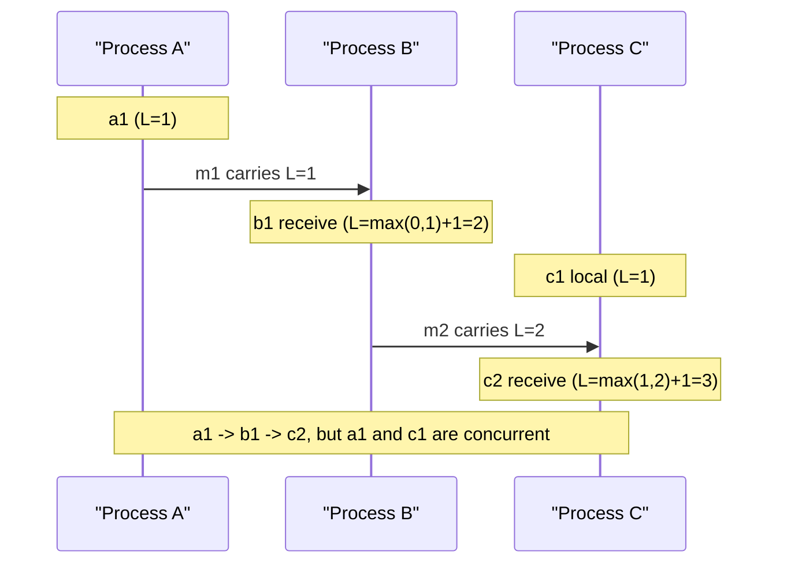

## In one minute
- Logical clocks order events by causality instead of by physical time. They answer "could A have influenced B?" without trusting any machine's wall clock.
- The foundation is the happens-before relation: A happens before B if they are on the same process in that order, or A is a send and B the matching receive, or a chain of those links them.
- Lamport clocks give a single counter per process. They are cheap and consistent with causality, but cannot detect concurrency.
- Vector clocks keep one counter per process. They detect concurrency exactly, at a cost that grows with the number of processes.
- Hybrid logical clocks combine physical time with a logical counter, giving timestamps near wall time that still respect causality.

## How it works

### Why not physical time
Clocks on different machines disagree and can jump. If node A stamps an event at 10:00:00.005 and node B, 8 ms behind, stamps a later event that depends on it at 10:00:00.002, sorting by timestamp puts effect before cause. Often we need only an order that never contradicts causality.

### Happens-before
Define `a -> b` when a and b are on the same process and a came first, or a sends a message that b receives, or there is some c with `a -> c` and `c -> b` ([Lamport 1978](https://lamport.azurewebsites.net/pubs/time-clocks.pdf)). If neither `a -> b` nor `b -> a`, the events are *concurrent*: neither could have known about the other. This is a partial order. Many pairs of events are simply unordered.

### Lamport clocks
Each process keeps an integer. It increments before each local event or send, attaches the value to messages, and on receive sets its counter to `max(local, received) + 1`. This guarantees that if `a -> b`, then `L(a) < L(b)`. The converse does not hold: `L(a) < L(b)` does not mean a caused b. Breaking ties by process ID produces a total order consistent with causality, which is enough for mutual exclusion, totally ordered broadcast, and replicated state machines. Raft's terms are the same idea; the Raft paper calls them a logical clock ([Raft paper](https://raft.github.io/raft.pdf)).

### Vector clocks
Each process keeps a vector with one entry per process. It increments its own entry on each event, sends the whole vector, and on receive takes the element-wise maximum and then increments its own entry. Now `V(a) < V(b)` (every entry less than or equal, at least one strictly less) if and only if `a -> b`. If neither vector dominates, the events are concurrent. This lets a replicated store detect conflicting writes instead of silently picking one, which is how Amazon's Dynamo kept concurrent shopping-cart versions for the application to merge ([Dynamo paper](https://www.allthingsdistributed.com/files/amazon-dynamo-sosp2007.pdf)).

### Hybrid logical clocks
An HLC timestamp is a pair `(l, c)`: `l` tracks the largest physical time seen, and `c` is a counter that breaks ties when physical time has not advanced. It fits in 64 bits, stays within the clock skew bound of real time, and respects happens-before ([Kulkarni et al.](https://cse.buffalo.edu/tech-reports/2014-04.pdf)). The catch is that "within the skew bound" is an assumption the operator must make true. If real skew exceeds the bound the database was configured with, HLC databases can return stale reads, and independent testing has shown exactly that. CockroachDB and YugabyteDB use HLCs for transaction timestamps because they need both causal safety and timestamps that mean something to humans and to snapshot reads.

## Down the stack

### Layer 1: The contract
Every logical clock promises the *clock condition*: if `a -> b` then `C(a) < C(b)`. That one implication is testable by recording send and receive pairs and checking that every receive carries a larger stamp than its send. Lamport clocks promise only that. Vector clocks promise the converse too, so comparison answers "before, after or concurrent" exactly. HLCs promise the clock condition plus two bounds from the Kulkarni et al. paper: the logical part `l` never drifts from physical time by more than the clock skew bound, and the counter `c` stays small as long as clocks are roughly in sync. HLCs also promise per-node monotonicity even when the underlying wall clock is stepped backwards, which plain `CLOCK_REALTIME` does not.

### Layer 2: The mechanism
Real implementations differ mostly in encoding and in how they police skew. CockroachDB's `hlc.Timestamp` holds a 64-bit `WallTime` in nanoseconds and a 32-bit `Logical` counter ([timestamp.proto](https://github.com/cockroachdb/cockroach/blob/master/pkg/util/hlc/timestamp.proto)). Each node is configured with a maximum clock offset (500 ms by default, with 250 ms recommended for new multi-region clusters), and a node whose clock is off from at least half of its peers by 80% of that limit shuts itself down rather than hand out misleading timestamps ([CockroachDB FAQ](https://docs.cockroachlabs.com/docs/stable/operational-faqs)). Operators are told to alert on the `clock_offset_meannanos` metric well before that point. Reads use an *uncertainty interval* from the read timestamp up to read timestamp plus max offset: if a value falls inside that window, the reader cannot tell whether it happened before or after, so the transaction restarts at a higher timestamp.

YugabyteDB, following Apache Kudu, packs a hybrid time into one 64-bit word: physical microseconds shifted left by 12 bits, with the low 12 bits as the logical counter ([hybrid_time.h](https://github.com/yugabyte/yugabyte-db/blob/master/src/yb/common/hybrid_time.h)). Its skew bound is the `max_clock_skew_usec` flag, 500 ms by default ([yb-tserver reference](https://docs.yugabyte.com/stable/reference/configuration/yb-tserver/)). The HLC paper suggests a similar split of 48 bits for `l` and 16 for `c`. MongoDB's cluster time is a BSON `Timestamp` of 32-bit seconds and a 32-bit increment, gossiped on every message as `$clusterTime` and signed so that a client cannot push the cluster's clock arbitrarily far forward ([MongoDB docs](https://www.mongodb.com/docs/manual/reference/method/db.runCommand/)).

The update rules are the ones in the Practice section: take the maximum of local `l`, physical time and the message's `l`, then set the counter based on which sources tied for that maximum.

### Layer 3: The machine
The physical input is `clock_gettime(CLOCK_REALTIME)`, about 20 ns through the vDSO. The HLC must use wall time rather than `CLOCK_MONOTONIC` because its values need meaning across machines; monotonicity is then enforced in software by never letting `l` decrease.

Packing `(l, c)` into a single `uint64` matters on the hot path. A timestamp can then be advanced with one 64-bit compare-and-swap instead of a mutex, and compared with one integer comparison. Under heavy concurrency, though, every core is writing the same 64-byte cache line, and each transfer between cores costs tens of nanoseconds, which caps a single shared clock at tens of millions of updates per second. In practice the clock is rarely the bottleneck compared to the network.

Size on the wire is the reason HLC and Lamport clocks dominate. A Lamport counter or HLC is 8 to 12 bytes per message, regardless of cluster size. A vector clock is roughly 8 bytes per participant before compression. A 64-bit Lamport counter incremented a billion times per second would take centuries to overflow, but a 12- or 16-bit HLC counter can overflow if a far-future `l` freezes the physical part and the node keeps generating events, which is one more reason to reject far-future timestamps.

### Why it's built this way
1. Physical clocks drift and can step, so they cannot order causally related events reliably on their own.
2. Pure logical counters fix ordering but lose any link to real time, so "events in the last 10 minutes" and snapshot reads at a wall time become impossible.
3. Combining the two keeps causality and stays within the skew bound, but only if that bound is enforced, hence max-offset checks and node self-termination.
4. Metadata travels on every message and is stored with every version, so implementations pack it into a single 64-bit word and accept that concurrency detection needs the larger vector form.

## Diagram


## Worked example
An order service emits events from 3 processes into a log. Wall clocks skew by up to 15 ms, and dependent events often occur 2 to 5 ms apart, so physical timestamps misorder roughly a third of causally linked pairs in testing.

Option one, Lamport clocks: 8 bytes per event. Consumers sort by `(counter, process_id)`. Every cause sorts before its effect. But two unrelated updates to the same order, one from checkout and one from support, also get an arbitrary order, and the consumer cannot tell they conflicted.

Option two, vector clocks: with 3 processes, 24 bytes per event. The consumer can now see that the checkout and support updates are concurrent and route them to a merge function. With 300 processes, the vector grows to 2.4 KB per event.

Option three, HLC: 8 bytes, causally safe, close to real time, so "events in the last 10 minutes" queries still work. It cannot detect concurrency, so it suits ordering and snapshots, not conflict detection.

## In the wild
- **CockroachDB beta, 2017: skew beyond the bound breaks linearizability.** Jepsen found that a node past the 250 ms offset threshold shuts itself down, but that mechanism can never be perfect: a window of a few seconds remains in which anomalies can occur, and reads can be stale in limited cases. It also found that two transactions with identical HLC timestamps were treated as equivalent by the timestamp cache, which allowed duplicate inserts. Cockroach Labs made its offset detection more aggressive, and newer versions clear the transaction ID on overlapping cache entries with identical timestamps so that a writer is forced to retry ([Jepsen](https://jepsen.io/analyses/cockroachdb-beta-20160829)).
- **YugaByte DB 1.1.9, 2019: hybrid time with too little margin.** In a test combining clock skew with tserver crashes and pauses, Jepsen saw stale reads of 114 of 20,344 inserts, and it could reproduce non-linearizable histories with clock skew alone. The skew bound, `max_clock_skew_usec`, was an undocumented flag at the time, and the node-shutdown safety net only fired at 100 seconds of skew. A separate lock bug that let critical sections run concurrently was fixed in 1.2.0, and the flags were then documented ([Jepsen](https://jepsen.io/analyses/yugabyte-db-1.1.9)).

## Trade-offs
| Clock | Strengths | Weaknesses | Choose when |
|---|---|---|---|
| Physical (NTP) | Human-meaningful, free | Can contradict causality | Logs for humans, coarse ordering |
| Lamport | One integer, total order | Cannot detect concurrency | State machine replication, ordered broadcast |
| Vector | Exact causality and concurrency | Size grows with participants | Conflict detection in multi-writer stores |
| Hybrid logical | Near real time, causal, compact | Needs bounded skew; no concurrency detection | Database transaction timestamps |

## Pitfalls in production
- Treating a Lamport ordering as "this caused that". Fix: remember that only the forward implication holds; use vectors when concurrency matters.
- Vector clocks keyed by client ID, growing without bound. Fix: key by replica, and prune or use dotted version vectors.
- Forgetting to carry the clock through every channel, such as an async queue or a cache, which breaks the happens-before chain. Fix: propagate the timestamp in message metadata on every hop.
- HLCs accepting a remote timestamp far in the future and dragging all clocks forward. Fix: reject messages whose physical part exceeds local time by more than the skew bound.

## Leadership lens
- Ask what the ordering is for. Display order, replication order and conflict detection need different clocks.
- Make the clock a first-class field in event schemas and APIs. Retrofitting it across services is expensive.
- When a design relies on wall-clock ordering, ask for the skew bound and the cost of misordering. Often a logical clock removes the question.

## Check yourself
1. If `L(a) < L(b)` for Lamport timestamps, can you conclude that a happened before b?
   **Answer:** No. Lamport clocks guarantee only that causality implies a smaller timestamp. Concurrent events can have any ordering of timestamps.
2. What can vector clocks tell you that Lamport clocks cannot?
   **Answer:** Whether two events are concurrent. If neither vector dominates the other, neither event could have known about the other.
3. Why would a database choose a hybrid logical clock over a vector clock?
   **Answer:** It needs compact timestamps close to real time for snapshot reads and time-based queries, and it handles conflicts through its own concurrency control rather than by detecting concurrent writes.

## Practice
**Task:** Implement a hybrid logical clock. `HLC()` starts at `(0, 0)`. `now(pt)` is called for a local or send event with the current physical time `pt` and returns the new `(l, c)`. `update(pt, ml, mc)` is called on receiving a message stamped `(ml, mc)` and returns the new `(l, c)`. Rules: `l` becomes the max of the old `l`, `pt` and (on receive) `ml`; `c` increments when `l` did not change source, resets to 0 when physical time took over, and on receive takes the larger counter among sources that share the new `l`, plus 1.

```python starter
class HLC:
    def __init__(self):
        self.l = 0
        self.c = 0

    def now(self, pt):
        # TODO
        raise NotImplementedError

    def update(self, pt, ml, mc):
        # TODO
        raise NotImplementedError
```

```python tests
def test_physical_time_advances():
    h = HLC()
    assert h.now(10) == (10, 0)
    assert h.now(12) == (12, 0)

def test_same_physical_time_bumps_counter():
    h = HLC()
    h.now(10)
    assert h.now(10) == (10, 1)
    assert h.now(9) == (10, 2)

def test_receive_from_future():
    h = HLC()
    h.now(10)
    assert h.update(11, 20, 3) == (20, 4)

def test_receive_tie_with_local():
    h = HLC()
    h.now(20)
    h.now(20)
    assert h.update(15, 20, 5) == (20, 6)

def test_receive_old_message():
    h = HLC()
    h.now(30)
    assert h.update(30, 5, 9) == (30, 1)

def test_physical_wins_on_receive():
    h = HLC()
    h.now(10)
    assert h.update(50, 20, 4) == (50, 0)
```

```python solution
class HLC:
    def __init__(self):
        self.l = 0
        self.c = 0

    def now(self, pt):
        new_l = max(self.l, pt)
        self.c = self.c + 1 if new_l == self.l else 0
        self.l = new_l
        return (self.l, self.c)

    def update(self, pt, ml, mc):
        new_l = max(self.l, ml, pt)
        if new_l == self.l and new_l == ml:
            self.c = max(self.c, mc) + 1
        elif new_l == self.l:
            self.c += 1
        elif new_l == ml:
            self.c = mc + 1
        else:
            self.c = 0
        self.l = new_l
        return (self.l, self.c)
```

```typescript starter
export class HLC {
  l = 0;
  c = 0;

  now(pt: number): [number, number] {
    // TODO
    throw new Error("TODO");
  }

  update(pt: number, ml: number, mc: number): [number, number] {
    // TODO
    throw new Error("TODO");
  }
}
```

```typescript tests
test("physical time advances", () => {
  const h = new HLC();
  assertEqual(h.now(10), [10, 0]);
  assertEqual(h.now(12), [12, 0]);
});

test("same physical time bumps counter", () => {
  const h = new HLC();
  h.now(10);
  assertEqual(h.now(10), [10, 1]);
  assertEqual(h.now(9), [10, 2]);
});

test("receive from future", () => {
  const h = new HLC();
  h.now(10);
  assertEqual(h.update(11, 20, 3), [20, 4]);
});

test("receive tie with local", () => {
  const h = new HLC();
  h.now(20);
  h.now(20);
  assertEqual(h.update(15, 20, 5), [20, 6]);
});

test("receive old message", () => {
  const h = new HLC();
  h.now(30);
  assertEqual(h.update(30, 5, 9), [30, 1]);
});

test("physical wins on receive", () => {
  const h = new HLC();
  h.now(10);
  assertEqual(h.update(50, 20, 4), [50, 0]);
});
```

```typescript solution
export class HLC {
  l = 0;
  c = 0;

  now(pt: number): [number, number] {
    const newL = Math.max(this.l, pt);
    this.c = newL === this.l ? this.c + 1 : 0;
    this.l = newL;
    return [this.l, this.c];
  }

  update(pt: number, ml: number, mc: number): [number, number] {
    const newL = Math.max(this.l, ml, pt);
    if (newL === this.l && newL === ml) this.c = Math.max(this.c, mc) + 1;
    else if (newL === this.l) this.c += 1;
    else if (newL === ml) this.c = mc + 1;
    else this.c = 0;
    this.l = newL;
    return [this.l, this.c];
  }
}
```

```go starter
package practice

import "sync"

// HLC is a hybrid logical clock. The zero value starts at (0, 0).
type HLC struct {
	mu   sync.Mutex
	L, C int64
}

// Now handles a local or send event at physical time pt.
func (h *HLC) Now(pt int64) (int64, int64) {
	// TODO
	panic("TODO")
}

// Update handles receiving a message stamped (ml, mc) at physical time pt.
func (h *HLC) Update(pt, ml, mc int64) (int64, int64) {
	// TODO
	panic("TODO")
}
```

```go tests
package practice

import "testing"

func want(t *testing.T, l, c, wl, wc int64) {
	t.Helper()
	if l != wl || c != wc {
		t.Fatalf("got (%d, %d), want (%d, %d)", l, c, wl, wc)
	}
}

func TestPhysicalTimeAdvances(t *testing.T) {
	h := &HLC{}
	l, c := h.Now(10)
	want(t, l, c, 10, 0)
	l, c = h.Now(12)
	want(t, l, c, 12, 0)
}

func TestSamePhysicalTimeBumpsCounter(t *testing.T) {
	h := &HLC{}
	h.Now(10)
	l, c := h.Now(10)
	want(t, l, c, 10, 1)
	l, c = h.Now(9)
	want(t, l, c, 10, 2)
}

func TestReceiveFromFuture(t *testing.T) {
	h := &HLC{}
	h.Now(10)
	l, c := h.Update(11, 20, 3)
	want(t, l, c, 20, 4)
}

func TestReceiveTieWithLocal(t *testing.T) {
	h := &HLC{}
	h.Now(20)
	h.Now(20)
	l, c := h.Update(15, 20, 5)
	want(t, l, c, 20, 6)
}

func TestReceiveOldMessage(t *testing.T) {
	h := &HLC{}
	h.Now(30)
	l, c := h.Update(30, 5, 9)
	want(t, l, c, 30, 1)
}

func TestPhysicalWinsOnReceive(t *testing.T) {
	h := &HLC{}
	h.Now(10)
	l, c := h.Update(50, 20, 4)
	want(t, l, c, 50, 0)
}
```

```go solution
package practice

import "sync"

// HLC is a hybrid logical clock. The zero value starts at (0, 0).
type HLC struct {
	mu   sync.Mutex
	L, C int64
}

func max64(a, b int64) int64 {
	if a > b {
		return a
	}
	return b
}

// Now handles a local or send event at physical time pt.
func (h *HLC) Now(pt int64) (int64, int64) {
	h.mu.Lock()
	defer h.mu.Unlock()
	newL := max64(h.L, pt)
	if newL == h.L {
		h.C++
	} else {
		h.C = 0
	}
	h.L = newL
	return h.L, h.C
}

// Update handles receiving a message stamped (ml, mc) at physical time pt.
func (h *HLC) Update(pt, ml, mc int64) (int64, int64) {
	h.mu.Lock()
	defer h.mu.Unlock()
	newL := max64(max64(h.L, ml), pt)
	switch {
	case newL == h.L && newL == ml:
		h.C = max64(h.C, mc) + 1
	case newL == h.L:
		h.C++
	case newL == ml:
		h.C = mc + 1
	default:
		h.C = 0
	}
	h.L = newL
	return h.L, h.C
}
```

## Mock interview
**Prompt:** You are designing an event-sourced inventory system with 12 writer services across 2 regions, 20,000 events per second, and consumers that must never apply an effect before its cause. Choose a clock scheme.

- Follow-up: Two regions update the same SKU concurrently. How does your scheme surface that?
- Follow-up: What is the storage cost of your choice over 90 days of retention?
- Follow-up: What happens if one host's physical clock runs 30 seconds fast?

**A strong answer covers:**
- Lamport or HLC for causal total ordering, vector or version vectors where conflicts must be detected.
- Metadata size arithmetic: bytes per event times volume times retention.
- Propagating clocks through every channel, including queues.
- Bounding HLC drift by rejecting far-future timestamps.

## Sources and further study
**Primary**
- [Mattern, Virtual Time and Global States of Distributed Systems (1988)](https://pages.cs.wisc.edu/~remzi/Classes/739/Fall2018/Papers/mattern89.pdf): one of the two independent origins of vector clocks, with Fidge's paper the same year.
- [Ongaro and Ousterhout, In Search of an Understandable Consensus Algorithm (Raft)](https://raft.github.io/raft.pdf): terms as a logical clock inside consensus.
- [Jepsen: CockroachDB beta-20160829](https://jepsen.io/analyses/cockroachdb-beta-20160829): what an HLC database does when skew exceeds its bound.

**Systems docs**
- [CockroachDB operational FAQ](https://docs.cockroachlabs.com/docs/stable/operational-faqs): max offset, self-shutdown and clock monitoring.
- [YugabyteDB yb-tserver flags](https://docs.yugabyte.com/stable/reference/configuration/yb-tserver/): `max_clock_skew_usec` and related clock settings.
- [Apache Cassandra: Dynamo architecture](https://cassandra.apache.org/doc/latest/cassandra/architecture/dynamo.html): a store that chose per-column last-write-wins timestamps over vector clocks.

**Books**
- *Designing Data-Intensive Applications*, Martin Kleppmann and Chris Riccomini, chapter 10 "Consistency and Consensus" (2nd edition), section "ID Generators and Logical Clocks".
- *Database Internals*, Alex Petrov, chapter 11 "Replication and Consistency", section "Ordering".

**Other curricula**
- [Kleppmann, Distributed Systems lecture notes (Cambridge)](https://www.cl.cam.ac.uk/teaching/2122/ConcDisSys/dist-sys-notes.pdf): section 3.3 builds happens-before and section 4.1 derives Lamport and vector clocks from it.
- [donnemartin/system-design-primer](https://github.com/donnemartin/system-design-primer): has no material on logical clocks; its consistency section stops at weak, eventual and strong consistency.

## Watch
- [Distributed Systems 3.3: Causality and happens-before (Martin Kleppmann)](https://www.youtube.com/watch?v=OKHIdpOAxto): the relation every logical clock is built on.
- [Distributed Systems 4.1: Logical time (Martin Kleppmann)](https://www.youtube.com/watch?v=x-D8iFU1d-o): Lamport and vector clocks side by side.
- [CSE138 L2: time and clocks, causality and happens-before (Lindsey Kuper)](https://www.youtube.com/watch?v=3J9lqpMjA2I): a university lecture building the same ideas from scratch.

## Free resources
- [Time, Clocks, and the Ordering of Events in a Distributed System (Lamport)](https://lamport.azurewebsites.net/pubs/time-clocks.pdf): the original paper, still short and readable.
- [Logical Physical Clocks (Kulkarni et al.)](https://cse.buffalo.edu/tech-reports/2014-04.pdf): the hybrid logical clock paper.
- [Living without atomic clocks (Cockroach Labs)](https://www.cockroachlabs.com/blog/living-without-atomic-clocks/): how a production database uses HLCs.
- [Hybrid Clock (Patterns of Distributed Systems)](https://martinfowler.com/articles/patterns-of-distributed-systems/hybrid-clock.html): a pattern write-up with code.
- [Logical clock (Wikipedia)](https://en.wikipedia.org/wiki/Logical_clock): an overview of the clock family.
