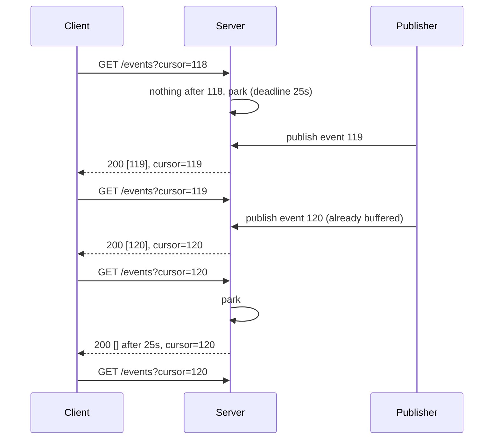

## In one minute
- Long polling is server push built from ordinary HTTP: the client asks "anything new after X?", and the server holds the request open until there is something to say or a timeout passes.
- When the response arrives, the client immediately asks again with an updated cursor, so there is almost always one request waiting at the server.
- Latency is close to a real push channel, and it works through every proxy, firewall and load balancer that speaks HTTP.
- The hard parts are not the waiting: they are the cursor that prevents gaps and duplicates, timeouts that fit under every proxy's idle limit, and reconnect storms.
- Choose it when updates are occasional, clients are diverse or behind restrictive networks, or the consumer is a server (SQS, Consul, Telegram bots). Prefer SSE or WebSockets for high-rate streams.

## How it works

### From polling to long polling
Plain polling asks every few seconds whether anything changed. With a 5-second interval the average delay is 2.5 seconds, and most requests come back empty: 10,000 clients make 2,000 requests per second to learn, usually, that nothing happened.

Long polling moves the waiting to the server. The client sends `GET /events?cursor=118`. If event 119 already exists, the server answers at once. If not, it parks the request and answers the moment event 119 is published, or after, say, 25 seconds with an empty response. Either way the client sends the next request straight away. Delivery delay drops to about one network round trip, and empty responses drop to one per client per timeout period.

### The cursor is the protocol
Between one response and the next request there is a gap of a round trip or more, and events published in that gap must not be lost. So the client never asks "what is new?" but "what is after the last thing I saw?". The server keeps a short, ordered log per channel and answers from it. A response carries the events plus the new cursor; a retry with the same cursor gets the same answer, so duplicates are harmless and nothing falls through the gap.

The cursor also bounds what the server must keep. If a client returns with a cursor older than the retained log, the server says so explicitly (etcd returns a "compacted" error; the Kubernetes API answers `410 Gone` and the client must re-list ([Kubernetes docs](https://kubernetes.io/docs/reference/using-api/api-concepts/#410-gone-responses))) and the client reloads full state. That is the ordering and duplicates problem shape: the same cursor-and-log design appears in Kafka consumer offsets and in database replication slots.

### Where you meet it
Long polling is common between servers, where it is often the best tool. SQS's `ReceiveMessage` with `WaitTimeSeconds=20` (the maximum) is long polling, which is why idle consumers cost almost nothing; note that short polling is the default, so a consumer that never sets the wait time pays for a stream of empty receives ([SQS docs](https://docs.aws.amazon.com/AWSSimpleQueueService/latest/SQSDeveloperGuide/sqs-short-and-long-polling.html)). Consul's blocking queries pass `?index=<X-Consul-Index>&wait=5m` and return when the watched data's index moves past it; the wait defaults to 5 minutes and is capped at 10 ([Consul docs](https://developer.hashicorp.com/consul/api-docs/features/blocking)). Telegram's `getUpdates` takes `offset` and `timeout`. CI runners long-poll for jobs. In browsers, it was the core of Comet-era chat, and Socket.IO still opens every connection on HTTP long polling by default, then tries to upgrade to a WebSocket, so a blocked upgrade quietly leaves the client on polling ([Socket.IO docs](https://socket.io/docs/v4/how-it-works/)).

### The same shape, other transports
Server-Sent Events keep one response open and stream many events through it; WebSockets upgrade the connection to a two-way message channel. Both avoid a request per event. Long polling pays a full request and response per batch, but needs nothing from the network except plain HTTP request-response, and each request is independent, so it can land on any server.

## Down the stack

### Layer 1: The contract
A long-poll endpoint promises: given cursor `c`, return every event with sequence greater than `c`, in order, up to a batch limit, as soon as at least one exists; if none arrives within the wait time, return an empty result with the cursor unchanged. If `c` is older than the retained history, return a distinct error, never a silent partial answer. Delivery is at-least-once from the client's point of view, since a response lost in transit is simply re-fetched with the old cursor; idempotence comes from the cursor, not from the transport. Worst-case latency for an event is one round trip if a request is parked, and up to about two round trips if it lands in the gap between requests.

### Layer 2: The mechanism
The server keeps, per channel, an append-only buffer of `(seq, payload)` and a list of parked waiters `(client, cursor, deadline)`. A request checks the buffer first, which is the step that closes the gap; only if nothing is newer does it park. A publish appends to the buffer and completes every waiter on that channel. A timer wheel or a min-heap keyed by deadline completes waiters that time out, with `200` and an empty list or `204 No Content`.

Real systems differ in the details. Consul returns the index in the `X-Consul-Index` header and adds up to `wait/16` of random jitter to each wait, so watchers do not all wake together. It also tells clients to reset to 0 if the index ever goes backwards. Since Consul 1.10 an optional streaming backend can replace long polling for some queries, the same move Kubernetes made. SQS checks all its storage hosts during a long poll rather than the weighted random sample a short poll reads, which is why it also returns fewer false empties ([SQS docs](https://docs.aws.amazon.com/AWSSimpleQueueService/latest/SQSDeveloperGuide/sqs-short-and-long-polling.html)). Kubernetes started with this pattern and evolved into a streaming watch keyed by `resourceVersion`, one response that never ends. RFC 6202 (2011) records the classic browser problems ([RFC 6202](https://www.rfc-editor.org/rfc/rfc6202#section-5.1)). The old HTTP/1.1 advice of two connections per server had just been relaxed to 6 or 8 in browsers, and a parked request permanently uses one of them, shared across every tab on that origin. Caching must be suppressed with `Cache-Control: no-cache` (today `no-store` is the stricter choice). Over HTTP/2 the parked request is just one stream on a shared connection, so the per-host limit mostly stops mattering.

When the server is a fleet, a publish on node A must wake a waiter parked on node B. The usual answer is a pub/sub backbone (Redis pub/sub, NATS, Kafka) that every node subscribes to for the channels its parked clients care about, the same fan-out design used for WebSocket gateways.

### Layer 3: The machine
A parked request costs an open socket, its kernel buffers (a few KB while idle), the TLS session state (tens of KB in many libraries) and the server's own bookkeeping: a goroutine with a 2 to 8 KB stack in Go, a small promise and closure in Node, but a whole 1 MB-stack thread in a thread-per-request server, which is why long polling killed many early Java and PHP deployments. With `epoll`, 100,000 parked requests cost the CPU nothing until an event or deadline arrives. Each cycle re-sends HTTP headers, often 500 to 1,000 bytes in each direction, unless HTTP/2 HPACK compresses repeats.

Timeouts are set by the network, not the application. AWS ALB closes idle connections after 60 seconds by default ([ALB docs](https://docs.aws.amazon.com/elasticloadbalancing/latest/application/edit-load-balancer-attributes.html#connection-idle-timeout)), nginx's `proxy_read_timeout` is 60 seconds ([nginx docs](https://nginx.org/en/docs/http/ngx_http_proxy_module.html#proxy_read_timeout)), and many corporate proxies and mobile carrier NATs drop idle flows after 30 to 120 seconds without telling anyone. A 25 to 30 second wait stays safely under all of them; RFC 6202 reports experiments with 120 seconds but calls 30 the safer value. On phones every completed poll can wake the cellular radio, which then stays in a high-power state for several seconds, so long waits are kinder to batteries.

### Why it's built this way
1. Plain HTTP is the one thing every network path supports, so push is emulated with requests the server answers late.
2. Requests can be lost and there is a gap between them, so the client names its position with a cursor and the server keeps a short log.
3. Intermediaries kill idle connections at 60 seconds or less, so the server answers empty well before that and the client re-asks.
4. Many clients wake at once after an outage or a broadcast, so waits and reconnects get jitter and backoff.
5. Each event costs a full HTTP exchange, so at high event rates the cost argues for a streaming transport instead.

## Diagram


## Worked example
A logistics dashboard shows live delivery status to 80,000 concurrent dispatchers. Each dispatcher's channel sees about one update per minute; a wait time of 25 seconds is used.

**Plain polling every 5 seconds:** 80,000 / 5 = 16,000 requests per second, of which about 98% are empty, and an average delay of 2.5 seconds.

**Long polling:** each client completes a request when an update arrives (1 per 60 seconds) or when the wait expires. With updates arriving on average every 60 seconds, about 2 of every 3 cycles end in a timeout, so each client makes roughly 3 requests per minute: 80,000 x 3 / 60 = 4,000 requests per second, and updates arrive within one round trip, about 80 ms. At about 1.5 KB of headers per exchange that is 6 MB/s, against 24 MB/s for plain polling.

**Memory:** 80,000 parked requests across 8 Go servers is 10,000 each; at roughly 40 KB per connection including TLS and buffers, that is 400 MB per server. Fine.

**The failure case:** a deploy restarts one server, dropping 10,000 connections at once. If clients reconnect immediately, the remaining 7 servers take 10,000 new TLS handshakes in under a second on top of normal load. Clients that wait a random 0 to 5 seconds first spread that to about 2,000 per second, and the cursor guarantees nobody misses an update while they wait.

## In the wild
- **Roblox, 2021: a newer push mechanism under load.** Roblox was down for 73 hours from 28 October. One root cause was Consul's streaming feature, which Roblox had enabled in place of long-polling blocking queries. Under very high read and write load on 128-core NUMA servers, streaming funnelled updates through a single Go channel, contention blocked KV writes, and median write latency rose from 300 ms to about 2 seconds. Disabling streaming fleet-wide on 30 October brought write latency back to 300 ms ([Roblox](https://about.roblox.com/newsroom/2022/01/roblox-return-to-service-10-28-10-31-2021/)).
- **Kubernetes, 2024: re-lists that knock over the API server.** When watches break, informers fall back to a full LIST, and the API server builds each LIST response in memory before sending a byte. In a test with 400 one-megabyte Secrets, 16 informers were enough to exhaust memory and crash the server. Streaming lists, beta in 1.32, serve the initial state as watch events from the watch cache and held memory at about 2 GB against about 20 GB without them ([Kubernetes blog](https://kubernetes.io/blog/2024/12/17/kube-apiserver-api-streaming/)).

## Trade-offs
| Option | Strengths | Weaknesses | Choose when |
|---|---|---|---|
| Short polling | Trivial, cacheable, stateless | Wasted requests, delay of half the interval | Data changes slowly or staleness is fine |
| Long polling | Near-instant, works on any HTTP path, each request independent | A request per batch, parked connections, timeout tuning | Occasional events, server-to-server consumers, restrictive networks |
| Server-Sent Events | One stream, many events, auto-reconnect with `Last-Event-ID` | One direction only, some proxies buffer responses | Live feeds and notifications to browsers |
| WebSockets | Two-way, low overhead per message | Stateful connections, harder to balance and scale | Chat, games, collaborative editing |
| Webhooks | No connection held at all | Receiver must be reachable and verify signatures | Server-to-server notifications across companies |

## Pitfalls in production
- **No cursor.** "Give me what is new" loses every event published between one response and the next request. Always poll from an explicit sequence number or version.
- **Wait time longer than an intermediary's idle timeout.** The load balancer cuts the request at 60 seconds and the client sees a `504` or a reset, and retries in a loop. Keep the wait under the smallest idle timeout in the path, typically 25 to 30 seconds.
- **Client read timeout shorter than the server wait.** The client gives up on a healthy poll at 10 seconds and retries forever. Set the client timeout to the wait time plus a margin.
- **Reconnect storms.** After a restart or a broadcast, every client re-polls at the same instant. Add jitter to waits and to reconnects, and exponential backoff on errors.
- **Thread-per-request servers.** Each parked request holds a thread and its stack, and the pool is exhausted at a few hundred clients. Use an event loop or async handlers for long-poll endpoints, or isolate them on their own tier.
- **Waking the wrong node.** In a fleet, a publish only wakes waiters on the node that received it. Route publishes through pub/sub so every node holding a relevant waiter hears about it.

## Leadership lens
- Ask where long polling sits in the transport roadmap: it is often the right first step, and a cursor-based API makes a later move to SSE or WebSockets cheap.
- Long-poll endpoints break the usual "requests are short" assumptions in dashboards, autoscaling and load tests; make sure p99 latency alerts exclude intended waits.
- Agree on timeout numbers with the team that owns the load balancers and CDN, and write them down; a quiet change to an idle timeout can break every client.
- Plan deploys for connection-holding services: drain slowly and expect a reconnect wave, or every release looks like an incident.

## Check yourself
1. Why does a long-poll client send a cursor instead of just asking for new events?
   **Answer:** Events can be published in the gap between one response and the next request, or a response can be lost. The cursor lets the server return everything after the last event the client actually saw.
2. A load balancer has a 60-second idle timeout and the server waits 90 seconds. What do clients observe?
   **Answer:** Quiet channels see their requests cut at 60 seconds with a gateway error or reset, then retry, so every idle client generates errors and wasted reconnects instead of clean empty responses.
3. Why is long polling a good fit for SQS consumers but a poor fit for a multiplayer game?
   **Answer:** Queue consumers receive occasional batches and need no persistent connection, so holding a request until work appears is ideal. A game sends many small messages per second in both directions, and paying a full HTTP exchange for each is too slow and expensive.
4. What should the server do when a client's cursor points before the oldest retained event?
   **Answer:** Return an explicit error telling the client to reload full state, never a partial list that silently skips events.

## Practice
**Task:** Implement the core of a long-poll hub. `Hub(timeout, max_batch)` keeps, per channel, events numbered 1, 2, 3 and so on. `poll(client, channel, cursor, now)` returns at once with up to `max_batch` events after `cursor` and the sequence of the last one returned; if there are none, it parks the client with deadline `now + timeout` and returns `None` (TypeScript `null`, Go `false`). A client has at most one parked request: a new poll replaces the old one and goes to the back of the order. `publish(channel, msg)` appends the event and returns a delivery `(client, [msg], seq)` for every client parked on that channel, in park order, unparking them. `tick(now)` unparks and returns, in park order, every client whose deadline is `<= now`.

```python starter
class Hub:
    def __init__(self, timeout, max_batch):
        self.timeout = timeout

    def poll(self, client, channel, cursor, now):
        # TODO
        raise NotImplementedError

    def publish(self, channel, msg):
        # TODO
        raise NotImplementedError

    def tick(self, now):
        # TODO
        raise NotImplementedError
```

```python tests
def test_backlog_returns_immediately_in_batches():
    h = Hub(30, 2)
    for m in ["a", "b", "c"]:
        assert h.publish("c1", m) == []
    assert h.poll("u1", "c1", 0, 0) == (["a", "b"], 2)
    assert h.poll("u1", "c1", 2, 0) == (["c"], 3)

def test_park_then_publish_delivers_once():
    h = Hub(30, 10)
    assert h.poll("u1", "c1", 0, 0) is None
    assert h.publish("c1", "hi") == [("u1", ["hi"], 1)]
    assert h.publish("c1", "again") == [], "delivered waiter is unparked"

def test_channels_are_isolated():
    h = Hub(30, 10)
    assert h.poll("u1", "c2", 0, 0) is None
    assert h.publish("c1", "x") == []
    assert h.publish("c2", "y") == [("u1", ["y"], 1)]

def test_timeout():
    h = Hub(30, 10)
    assert h.poll("u1", "c1", 0, 10) is None
    assert h.tick(39) == []
    assert h.tick(40) == ["u1"]
    assert h.tick(41) == []
    assert h.publish("c1", "late") == []

def test_fan_out_in_park_order():
    h = Hub(30, 10)
    h.poll("u2", "c1", 0, 0)
    h.poll("u1", "c1", 0, 1)
    h.poll("u3", "c1", 0, 2)
    assert h.publish("c1", "m") == [("u2", ["m"], 1), ("u1", ["m"], 1), ("u3", ["m"], 1)]

def test_repoll_replaces_previous_wait():
    h = Hub(30, 10)
    h.poll("u1", "c1", 0, 0)
    h.poll("u2", "c1", 0, 1)
    h.poll("u1", "c1", 0, 5)
    assert h.tick(30) == [], "u1's first deadline was replaced"
    assert h.tick(31) == ["u2"]
    assert h.tick(35) == ["u1"]

def test_cursor_closes_the_gap():
    h = Hub(30, 10)
    h.poll("u1", "c1", 0, 0)
    assert h.publish("c1", "e1") == [("u1", ["e1"], 1)]
    assert h.publish("c1", "e2") == [], "u1 is between requests"
    assert h.publish("c1", "e3") == []
    assert h.poll("u1", "c1", 1, 1) == (["e2", "e3"], 3)
```

```python solution
class Hub:
    def __init__(self, timeout, max_batch):
        self.timeout = timeout
        self.max_batch = max_batch
        self.log = {}
        self.waiters = {}

    def poll(self, client, channel, cursor, now):
        self.waiters.pop(client, None)
        events = self.log.get(channel, [])
        if cursor < len(events):
            batch = events[cursor:cursor + self.max_batch]
            return batch, cursor + len(batch)
        self.waiters[client] = (channel, now + self.timeout)
        return None

    def publish(self, channel, msg):
        events = self.log.setdefault(channel, [])
        events.append(msg)
        seq = len(events)
        out = []
        for client, (ch, _) in list(self.waiters.items()):
            if ch == channel:
                del self.waiters[client]
                out.append((client, [msg], seq))
        return out

    def tick(self, now):
        expired = [c for c, (_, d) in self.waiters.items() if d <= now]
        for c in expired:
            del self.waiters[c]
        return expired
```

```typescript starter
export interface Delivery {
  client: string;
  messages: string[];
  cursor: number;
}

export class Hub {
  constructor(public timeout: number, public maxBatch: number) {}
  poll(client: string, channel: string, cursor: number, now: number): { messages: string[]; cursor: number } | null {
    throw new Error("TODO");
  }
  publish(channel: string, msg: string): Delivery[] {
    throw new Error("TODO");
  }
  tick(now: number): string[] {
    throw new Error("TODO");
  }
}
```

```typescript tests
test("backlog returns immediately in batches", () => {
  const h = new Hub(30, 2);
  for (const m of ["a", "b", "c"]) assertEqual(h.publish("c1", m), []);
  assertEqual(h.poll("u1", "c1", 0, 0), { messages: ["a", "b"], cursor: 2 });
  assertEqual(h.poll("u1", "c1", 2, 0), { messages: ["c"], cursor: 3 });
});
test("park then publish delivers once", () => {
  const h = new Hub(30, 10);
  assertEqual(h.poll("u1", "c1", 0, 0), null);
  assertEqual(h.publish("c1", "hi"), [{ client: "u1", messages: ["hi"], cursor: 1 }]);
  assertEqual(h.publish("c1", "again"), [], "delivered waiter is unparked");
});
test("channels are isolated", () => {
  const h = new Hub(30, 10);
  assertEqual(h.poll("u1", "c2", 0, 0), null);
  assertEqual(h.publish("c1", "x"), []);
  assertEqual(h.publish("c2", "y"), [{ client: "u1", messages: ["y"], cursor: 1 }]);
});
test("timeout", () => {
  const h = new Hub(30, 10);
  assertEqual(h.poll("u1", "c1", 0, 10), null);
  assertEqual(h.tick(39), []);
  assertEqual(h.tick(40), ["u1"]);
  assertEqual(h.tick(41), []);
  assertEqual(h.publish("c1", "late"), []);
});
test("fan out in park order", () => {
  const h = new Hub(30, 10);
  h.poll("u2", "c1", 0, 0);
  h.poll("u1", "c1", 0, 1);
  h.poll("u3", "c1", 0, 2);
  assertEqual(
    h.publish("c1", "m").map((d) => d.client),
    ["u2", "u1", "u3"]
  );
});
test("repoll replaces previous wait", () => {
  const h = new Hub(30, 10);
  h.poll("u1", "c1", 0, 0);
  h.poll("u2", "c1", 0, 1);
  h.poll("u1", "c1", 0, 5);
  assertEqual(h.tick(30), [], "u1's first deadline was replaced");
  assertEqual(h.tick(31), ["u2"]);
  assertEqual(h.tick(35), ["u1"]);
});
test("cursor closes the gap", () => {
  const h = new Hub(30, 10);
  h.poll("u1", "c1", 0, 0);
  assertEqual(h.publish("c1", "e1"), [{ client: "u1", messages: ["e1"], cursor: 1 }]);
  assertEqual(h.publish("c1", "e2"), [], "u1 is between requests");
  assertEqual(h.publish("c1", "e3"), []);
  assertEqual(h.poll("u1", "c1", 1, 1), { messages: ["e2", "e3"], cursor: 3 });
});
```

```typescript solution
export interface Delivery {
  client: string;
  messages: string[];
  cursor: number;
}

export class Hub {
  private log = new Map<string, string[]>();
  private waiters = new Map<string, { channel: string; deadline: number }>();

  constructor(public timeout: number, public maxBatch: number) {}

  poll(client: string, channel: string, cursor: number, now: number): { messages: string[]; cursor: number } | null {
    this.waiters.delete(client);
    const events = this.log.get(channel) ?? [];
    if (cursor < events.length) {
      const batch = events.slice(cursor, cursor + this.maxBatch);
      return { messages: batch, cursor: cursor + batch.length };
    }
    this.waiters.set(client, { channel, deadline: now + this.timeout });
    return null;
  }

  publish(channel: string, msg: string): Delivery[] {
    const events = this.log.get(channel) ?? [];
    events.push(msg);
    this.log.set(channel, events);
    const out: Delivery[] = [];
    for (const [client, w] of Array.from(this.waiters.entries())) {
      if (w.channel === channel) {
        this.waiters.delete(client);
        out.push({ client, messages: [msg], cursor: events.length });
      }
    }
    return out;
  }

  tick(now: number): string[] {
    const expired: string[] = [];
    for (const [client, w] of Array.from(this.waiters.entries())) {
      if (w.deadline <= now) expired.push(client);
    }
    for (const c of expired) this.waiters.delete(c);
    return expired;
  }
}
```

```go starter
package practice

type Response struct {
	Messages []string
	Cursor   int
}

type Delivery struct {
	Client   string
	Messages []string
	Cursor   int
}

type Hub struct{}

func NewHub(timeout int64, maxBatch int) *Hub { return &Hub{} }

func (h *Hub) Poll(client, channel string, cursor int, now int64) (Response, bool) {
	panic("TODO")
}
func (h *Hub) Publish(channel, msg string) []Delivery { panic("TODO") }
func (h *Hub) Tick(now int64) []string              { panic("TODO") }
```

```go tests
package practice

import (
	"reflect"
	"testing"
)

func same(t *testing.T, got, want any) {
	t.Helper()
	if !reflect.DeepEqual(got, want) {
		t.Fatalf("got %#v, want %#v", got, want)
	}
}

func clients(ds []Delivery) []string {
	out := []string{}
	for _, d := range ds {
		out = append(out, d.Client)
	}
	return out
}

func TestBacklogReturnsImmediatelyInBatches(t *testing.T) {
	h := NewHub(30, 2)
	for _, m := range []string{"a", "b", "c"} {
		same(t, len(h.Publish("c1", m)), 0)
	}
	r, ok := h.Poll("u1", "c1", 0, 0)
	same(t, ok, true)
	same(t, r, Response{[]string{"a", "b"}, 2})
	r, _ = h.Poll("u1", "c1", 2, 0)
	same(t, r, Response{[]string{"c"}, 3})
}

func TestParkThenPublishDeliversOnce(t *testing.T) {
	h := NewHub(30, 10)
	if _, ok := h.Poll("u1", "c1", 0, 0); ok {
		t.Fatal("expected park")
	}
	same(t, h.Publish("c1", "hi"), []Delivery{{"u1", []string{"hi"}, 1}})
	same(t, len(h.Publish("c1", "again")), 0)
}

func TestChannelsAreIsolated(t *testing.T) {
	h := NewHub(30, 10)
	h.Poll("u1", "c2", 0, 0)
	same(t, len(h.Publish("c1", "x")), 0)
	same(t, h.Publish("c2", "y"), []Delivery{{"u1", []string{"y"}, 1}})
}

func TestTimeout(t *testing.T) {
	h := NewHub(30, 10)
	h.Poll("u1", "c1", 0, 10)
	same(t, len(h.Tick(39)), 0)
	same(t, h.Tick(40), []string{"u1"})
	same(t, len(h.Tick(41)), 0)
	same(t, len(h.Publish("c1", "late")), 0)
}

func TestFanOutInParkOrder(t *testing.T) {
	h := NewHub(30, 10)
	h.Poll("u2", "c1", 0, 0)
	h.Poll("u1", "c1", 0, 1)
	h.Poll("u3", "c1", 0, 2)
	same(t, clients(h.Publish("c1", "m")), []string{"u2", "u1", "u3"})
}

func TestRepollReplacesPreviousWait(t *testing.T) {
	h := NewHub(30, 10)
	h.Poll("u1", "c1", 0, 0)
	h.Poll("u2", "c1", 0, 1)
	h.Poll("u1", "c1", 0, 5)
	same(t, len(h.Tick(30)), 0)
	same(t, h.Tick(31), []string{"u2"})
	same(t, h.Tick(35), []string{"u1"})
}

func TestCursorClosesTheGap(t *testing.T) {
	h := NewHub(30, 10)
	h.Poll("u1", "c1", 0, 0)
	same(t, h.Publish("c1", "e1"), []Delivery{{"u1", []string{"e1"}, 1}})
	same(t, len(h.Publish("c1", "e2")), 0)
	same(t, len(h.Publish("c1", "e3")), 0)
	r, _ := h.Poll("u1", "c1", 1, 1)
	same(t, r, Response{[]string{"e2", "e3"}, 3})
}
```

```go solution
package practice

import "sync"

type Response struct {
	Messages []string
	Cursor   int
}

type Delivery struct {
	Client   string
	Messages []string
	Cursor   int
}

type waiter struct {
	client, channel string
	deadline        int64
}

type Hub struct {
	mu       sync.Mutex
	timeout  int64
	maxBatch int
	log      map[string][]string
	waiters  []waiter // in park order
}

func NewHub(timeout int64, maxBatch int) *Hub {
	return &Hub{timeout: timeout, maxBatch: maxBatch, log: map[string][]string{}}
}

func (h *Hub) unpark(client string) {
	for i, w := range h.waiters {
		if w.client == client {
			h.waiters = append(h.waiters[:i], h.waiters[i+1:]...)
			return
		}
	}
}

func (h *Hub) Poll(client, channel string, cursor int, now int64) (Response, bool) {
	h.mu.Lock()
	defer h.mu.Unlock()
	h.unpark(client)
	events := h.log[channel]
	if cursor < len(events) {
		end := cursor + h.maxBatch
		if end > len(events) {
			end = len(events)
		}
		batch := append([]string{}, events[cursor:end]...)
		return Response{batch, end}, true
	}
	h.waiters = append(h.waiters, waiter{client, channel, now + h.timeout})
	return Response{}, false
}

func (h *Hub) Publish(channel, msg string) []Delivery {
	h.mu.Lock()
	defer h.mu.Unlock()
	h.log[channel] = append(h.log[channel], msg)
	seq := len(h.log[channel])
	out := []Delivery{}
	kept := h.waiters[:0]
	for _, w := range h.waiters {
		if w.channel == channel {
			out = append(out, Delivery{w.client, []string{msg}, seq})
		} else {
			kept = append(kept, w)
		}
	}
	h.waiters = kept
	return out
}

func (h *Hub) Tick(now int64) []string {
	h.mu.Lock()
	defer h.mu.Unlock()
	out := []string{}
	kept := h.waiters[:0]
	for _, w := range h.waiters {
		if w.deadline <= now {
			out = append(out, w.client)
		} else {
			kept = append(kept, w)
		}
	}
	h.waiters = kept
	return out
}
```

## Mock interview
**Prompt:** Design live notifications for a web and mobile app with 2 million concurrent users. Each user gets a handful of notifications per hour, many users are behind corporate proxies that block WebSockets, and the API runs behind AWS ALBs on a fleet of 40 servers.

- Follow-up: How does a notification published on server 7 reach a user whose request is parked on server 23?
- Follow-up: The ALB is replaced by one with a 30-second idle timeout. What breaks and what do you change?
- Follow-up: At what point would you move these users to SSE or WebSockets, and what would the migration look like?

**A strong answer covers:**
- A cursor-based endpoint backed by a per-user ordered log with bounded retention and an explicit "reload state" error.
- Wait times under every idle timeout in the path, client read timeouts above the wait, and jittered reconnects with backoff.
- A pub/sub backbone so publishes reach whichever node holds the parked request, and a presence map or channel subscriptions per node.
- Capacity per node for parked connections (memory, file descriptors, event loop) and how deploys drain them without a reconnect storm.
- The request rate arithmetic (timeouts plus events per user) compared with SSE or WebSockets, and a transport-agnostic cursor API that allows switching later.

## Sources and further study
**Primary**
- [RFC 6202, section 5: HTTP best practices for long polling](https://www.rfc-editor.org/rfc/rfc6202#section-5): connection limits, timeouts and intermediary behaviour, with the 30-second guidance.
- [KEP-3157: streaming lists for informers](https://www.kubernetes.dev/resources/keps/3157/): the design record for replacing LIST plus watch with one stream.

**Systems docs**
- [AWS: ALB connection idle timeout](https://docs.aws.amazon.com/elasticloadbalancing/latest/application/edit-load-balancer-attributes.html#connection-idle-timeout): the 60-second default and the 1 to 4,000 second range that bound every wait.
- [etcd: watch API and compaction](https://etcd.io/docs/v3.5/learning/api/): revision cursors and what a watcher sees after history is compacted.
- [Socket.IO: How it works](https://socket.io/docs/v4/how-it-works/): long polling first, then the upgrade to WebSocket.

**Books**
- *High Performance Browser Networking*, Ilya Grigorik, chapter 15 "XMLHttpRequest": polling and long polling with XHR and their costs ([read free](https://hpbn.co/xmlhttprequest/)).
- *Designing Data-Intensive Applications* (1st ed.), Martin Kleppmann, chapter 11 "Stream Processing": logs, consumer offsets and why a cursor makes redelivery safe.

**Other curricula**
- [Azure Architecture Center: Asynchronous Request-Reply](https://learn.microsoft.com/en-us/azure/architecture/patterns/async-request-reply): polls a status endpoint after `202 Accepted` and notes long polling as the lower-latency variant.
- [roadmap.sh: Backend](https://roadmap.sh/backend): groups long and short polling with SSE and WebSockets under "Real-Time Data".

## Watch
- [Long Polling and how it differs from Push, Poll and SSE (Hussein Nasser)](https://www.youtube.com/watch?v=J0okraIFPJ0): where long polling sits among the backend communication patterns.
- [The genius of long polling (Hussein Nasser)](https://www.youtube.com/watch?v=5aRamFLgtis): why the pattern works so well for queues and job consumers.
- [HTTP Request vs HTTP Long-Polling vs WebSocket vs Server-Sent Events (Amit Shekhar)](https://www.youtube.com/watch?v=8ksWRX4xV-s): a side-by-side comparison of the four transports.

## Free resources
- [RFC 6202: Known Issues and Best Practices for Long Polling and Streaming](https://www.rfc-editor.org/rfc/rfc6202): the original catalogue of timeouts, connection limits and proxy behaviour.
- [Consul blocking queries](https://developer.hashicorp.com/consul/api-docs/features/blocking): a production long-poll API with index cursors and jitter.
- [Amazon SQS short and long polling](https://docs.aws.amazon.com/AWSSimpleQueueService/latest/SQSDeveloperGuide/sqs-short-and-long-polling.html): how long polling cuts empty responses and cost for queue consumers.
- [Kubernetes API concepts: efficient detection of changes](https://kubernetes.io/docs/reference/using-api/api-concepts/): watches, `resourceVersion` cursors and what happens when history is gone.
- [MDN: Using server-sent events](https://developer.mozilla.org/en-US/docs/Web/API/Server-sent_events/Using_server-sent_events): the streaming alternative and its reconnect model.
- [Telegram Bot API: getUpdates](https://core.telegram.org/bots/api): a simple public long-poll API with `offset` and `timeout`.
