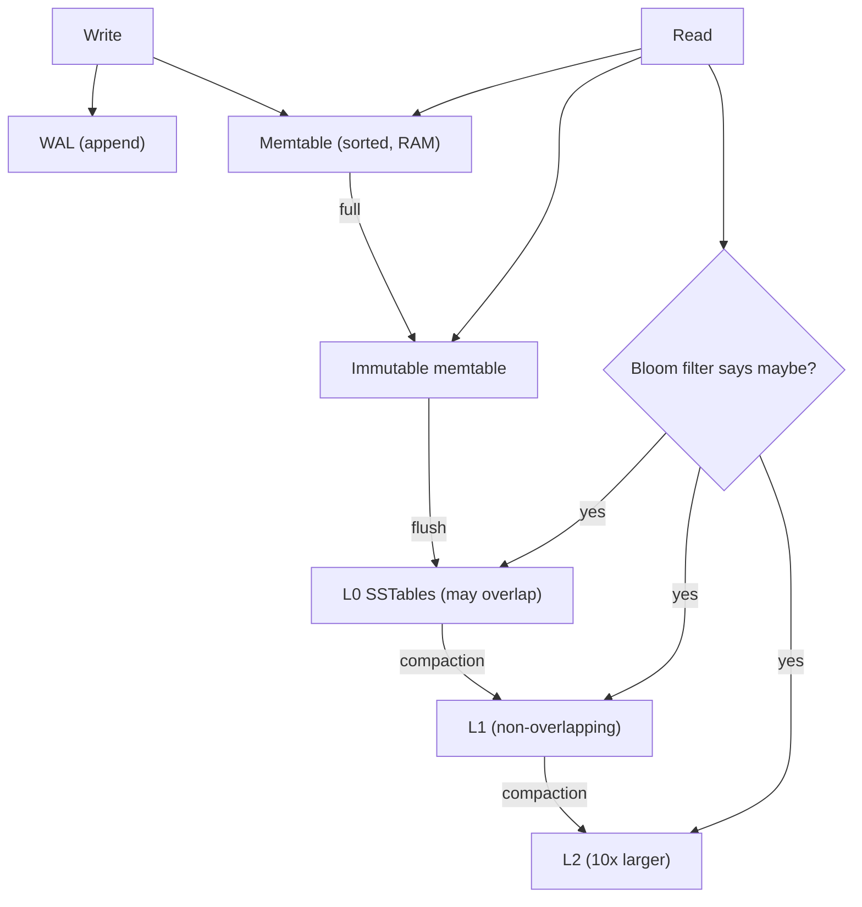

## In one minute
- A log-structured merge tree turns random writes into sequential ones: writes go to a WAL and an in-memory sorted table, which is flushed to disk as an immutable sorted file (SSTable).
- Reads check the memtable, then SSTables from newest to oldest. Bloom filters and sparse indexes keep that from touching every file.
- Background compaction merges SSTables to drop overwritten values and deletes, bounding read cost and disk usage.
- Every LSM design trades three costs against each other: write amplification, read amplification, and space amplification. Compaction strategy is how you pick the balance.
- RocksDB, LevelDB, Cassandra, ScyllaDB, HBase, and the storage layers of CockroachDB and TiKV are LSM trees.

## How it works

### Write path
A write appends to the WAL for durability, then inserts into the *memtable*, a sorted structure in memory (usually a skip list). When the memtable reaches its size limit (RocksDB's `write_buffer_size` defaults to 64 MB; [options.h](https://github.com/facebook/rocksdb/blob/main/include/rocksdb/options.h)), it becomes immutable, a fresh memtable takes writes, and a background thread writes the frozen one to disk as an SSTable in a single sequential pass. The WAL segment for it can then be deleted.

Nothing on disk is ever modified in place. An update is a new version of the key; a delete is a *tombstone* record. The newest version wins.

### SSTables
An SSTable is a file of key-sorted entries, split into blocks of around 4 to 64 KB, each compressed. At the end sit a sparse index (first key of each block), a Bloom filter over all keys, and metadata such as min and max key. A point lookup checks the Bloom filter (about 1% false positives at 10 bits per key), binary-searches the index, and reads one block. RocksDB 6.15 added the Ribbon filter, which reaches the same 1% at about 7 bits per key, saving roughly 30% of filter memory for 3 to 4 times the CPU, mostly paid when filters are built in the background ([RocksDB wiki](https://github.com/facebook/rocksdb/wiki/RocksDB-Bloom-Filter)).

### Read path
A get checks the active memtable, immutable memtables, then SSTables from newest to oldest, stopping at the first hit. A tombstone hit means "not found." Range scans must merge iterators from every overlapping source, which is why scans are the LSM's weakest operation.

### Compaction
Without compaction, file count grows forever, and so do read cost and dead data. Two families dominate:
- **Leveled** (LevelDB, RocksDB default): L0 holds recent flushes; each level below is a set of non-overlapping SSTables about 10 times larger than the one above. Compaction picks a file in level N and merges it with the overlapping files in N+1. Reads touch at most one file per level. Each byte is rewritten roughly 10 times per level it descends, so write amplification is often 10 to 30. Since RocksDB 8.4, `level_compaction_dynamic_level_bytes` defaults to true: level targets are computed from the size of the last level upward, so each level stays about one tenth of the next even as the database grows or shrinks ([RocksDB HISTORY](https://github.com/facebook/rocksdb/blob/main/HISTORY.md)).
- **Size-tiered** (Cassandra's long-time default, RocksDB "universal"): when several SSTables of similar size exist, merge them into one bigger file. Write amplification is low, but a key can live in many files, so reads and space cost more, and a large compaction temporarily needs as much free disk as its inputs.

The choice no longer has to be fixed up front. Cassandra 5.0 (announced October 2024) added the Unified Compaction Strategy ([ASF](https://news.apache.org/foundation/entry/the-apache-software-foundation-announces-apache-cassandra-5-0-the-most-advanced-secure-and-ai-ready-cassandra-yet)), which treats leveled and tiered as two ends of one scale: a single scaling parameter W picks a fan factor, negative values behave leveled and positive values tiered, and W can be changed on a live table. The docs now recommend UCS for most workloads ([Cassandra docs](https://cassandra.apache.org/doc/latest/cassandra/managing/operating/compaction/ucs.html)).

Tombstones are only dropped when compaction reaches the bottom level, or when no older file could still hold the key. Until then they cost space and read time.

### Amplification, in numbers
For a 1 TB leveled store with a 10x fan-out: levels are roughly 1 GB, 10 GB, 100 GB, 1 TB. Space amplification is about 1.1x because only the bottom level holds most data and upper levels hold few duplicates. A point read checks the memtable, a handful of L0 files, and one file per level, but Bloom filters skip most of those, so it usually costs one data block read.

## Down the stack

### Layer 1: The contract
RocksDB promises a sorted key-value map with atomic batched writes (`WriteBatch`), point gets, ordered iterators, and consistent snapshots: an iterator opened at sequence number S sees exactly the writes up to S, even while flushes and compactions rewrite the files underneath. Durability is easy to misread. RocksDB's `WriteOptions::sync` defaults to false: the WAL record is written to the OS but not fsynced, so a write survives a process crash but can be lost on power failure unless `sync=true` or the application calls `SyncWAL` ([RocksDB wiki](https://github.com/facebook/rocksdb/wiki/Basic-Operations)). Latency is a soft promise: if compaction falls behind, writes slow and then stop.

### Layer 2: The mechanism
LevelDB's log format, inherited by RocksDB, splits the WAL into 32 KB blocks. Each record fragment has a 7-byte header (a 4-byte CRC32C checksum, a 2-byte length, and a 1-byte type of FULL, FIRST, MIDDLE, or LAST), so records can span blocks and a torn tail fails its checksum ([LevelDB log format](https://github.com/google/leveldb/blob/main/doc/log_format.md)). Every write gets a 56-bit sequence number, packed with an 8-bit value type (put, delete, merge) into the *internal key*, so multiple versions of one user key sort newest first.

An SSTable (the block-based table format) is a run of data blocks, 4 KB uncompressed by default in RocksDB. Inside a block, keys are prefix-compressed: each entry stores only the bytes that differ from the previous key, and every 16th entry is a *restart point* stored in full, with an array of restart offsets at the block's end so a lookup can binary-search restarts and then scan a few entries. After the data blocks come a filter block (the Bloom filter), an index block with one entry per data block, a metaindex block, and a fixed-size footer with a magic number that points to the index and metaindex ([LevelDB table format](https://github.com/google/leveldb/blob/main/doc/table_format.md)). The set of live files is recorded in the MANIFEST, a log of `VersionEdit` records (file added at level N, file deleted); a flush or compaction publishes its result by appending one edit, which makes the switch atomic.

Back-pressure is explicit: when L0 holds too many overlapping files (RocksDB defaults: slow down at 20, stop at 36), foreground writes are delayed or stalled. A second trigger watches the estimated bytes still waiting to be compacted, slowing writes at 64 GB and stopping them at 256 GB by default ([advanced_options.h](https://github.com/facebook/rocksdb/blob/main/include/rocksdb/advanced_options.h)).

### Layer 3: The machine
Every disk write an LSM issues is sequential: WAL appends, flushes, and compaction outputs. On a spinning disk that avoids the several-millisecond seek per random write. On an SSD it matters differently. Flash erases in blocks of megabytes, and an SSD fed random in-place 4 KiB updates must garbage-collect partially valid erase blocks, multiplying physical writes. LSM files are written once and deleted whole, so whole erase blocks tend to become invalid together and the drive's own write amplification stays low. The engine's write amplification (10 to 30 for leveled compaction) is paid instead in large, efficient I/Os.

Reads are where the machine pushes back. A point lookup that misses memory reads a 4 KB block, decompresses it, and binary-searches restart points. Compaction competes with foreground reads for device bandwidth and CPU (decompress, merge, recompress), so RocksDB offers a rate limiter and direct I/O for compaction (`use_direct_io_for_flush_and_compaction`) so it does not evict hot pages from the page cache.

### Why it's built this way
1. Random small writes are the most expensive operation on both disks and flash, so the LSM buffers writes in memory and emits only sequential files.
2. Buffered writes need crash protection, so a sequential WAL backs the memtable.
3. Immutable files accumulate and overlap, so compaction merges them.
4. Compaction competes with users for I/O and CPU, so it is throttled, and when it falls behind, writes stall rather than reads degrading without bound.
5. Each lookup could touch many files, so per-file Bloom filters and in-memory indexes keep most of them off disk.

## Diagram


## Worked example
A telemetry service ingests 200,000 writes per second of 200-byte records: 40 MB/s of user data. In a B+ tree on the same NVMe drive, each write dirties a random 16 KB page; even with batching, the device would see hundreds of MB/s of random writes.

With RocksDB in leveled mode, the WAL takes 40 MB/s sequentially and memtables flush a 64 MB SSTable every 1.6 seconds. With write amplification of about 15, compaction writes 600 MB/s in total, all sequential and large. That fits on a modern NVMe drive rated for 2 to 3 GB/s, but it consumes endurance: 600 MB/s is about 52 TB per day, so a 7.68 TB drive rated for 1 drive-write per day would wear out in months. Switching the cold, bulk data to universal compaction cuts write amplification to about 5 (200 MB/s) at the cost of up to 2x space while big compactions run.

On the read side, 10 bits per key of Bloom filter for 5 billion keys is about 6 GB of RAM. Without it, a miss might probe 7 files.

## In the wild
- **Discord, 2017: one channel full of tombstones stalls Cassandra.** A channel took about 20 seconds to load because a user had deleted millions of its messages, leaving one. Each read scanned millions of tombstones, and the nodes ran constant 10-second stop-the-world GC pauses until the cause was found. Discord cut the tombstone grace period from 10 days to 2, which nightly repairs made safe, and changed queries to skip buckets known to be empty ([Discord](https://discord.com/blog/how-discord-stores-billions-of-messages)).
- **Discord, 2023: compaction backlog drives a move to ScyllaDB.** The messages cluster grew from 12 Cassandra nodes in 2017 to 177, with hot partitions, GC pauses and compaction that kept falling behind. The final 0.0001% of the migration was blocked by tombstones until those ranges were compacted. After moving to 72 ScyllaDB nodes, p99 latency for historical message reads fell from 40 to 125 ms to 15 ms ([Discord](https://discord.com/blog/how-discord-stores-trillions-of-messages)).
- **Facebook, 2017: MyRocks halves MySQL storage.** Facebook's MySQL fleet held tens of petabytes on flash, and the bottleneck was space, not I/O: CPU sat below 40% on nodes sharded only to fit the data. Switching from InnoDB to MyRocks, the RocksDB-based engine, used about half the storage with higher average transaction throughput and only slightly worse read latency. Dynamic level sizing keeps leveled space amplification near 1.11 ([Dong et al., CIDR 2017](https://www.cidrdb.org/cidr2017/papers/p82-dong-cidr17.pdf)).

## Trade-offs
| Option | Strengths | Weaknesses | Choose when |
|---|---|---|---|
| Leveled compaction | Low space and read amplification | High write amplification | Read-heavy or space-constrained |
| Size-tiered compaction | Low write amplification, high ingest | More space, slower reads, temporary 2x disk | Write-heavy, append-mostly data |
| Time-window compaction | Drops whole files at TTL expiry | Bad for out-of-order or updated data | Time series with TTL |
| B+ tree instead | Fast reads and scans, no compaction debt | Random writes, page-level write amplification | Read-heavy OLTP |
| Key-value separation (WiscKey, BlobDB) | Large values not rewritten by compaction | Extra lookup per read, separate GC | Values over a few KB |

## Pitfalls in production
- **Compaction falls behind.** L0 file count grows until the engine throttles or stalls writes. Alert on pending compaction bytes, and give compaction enough threads and I/O budget.
- **Tombstone build-up.** Queue-like workloads that insert and delete leave piles of tombstones that every range scan must skip. Use range deletes, TTL, or a different data model.
- **Disk fills during compaction.** Size-tiered merges need free space equal to their inputs. Keep 50% headroom or use leveled compaction.
- **Bloom filters do not help scans.** Prefix Bloom filters or a key design that keeps scans narrow are the fix.
- **SSD wear.** High write amplification consumes drive endurance. Measure bytes written per user byte and pick drives accordingly.

## Leadership lens
- Ask for the read/write ratio, key size, value size, and update pattern before accepting an LSM store; these decide compaction choice.
- Compaction is an operational dependency. Budget for monitoring pending bytes, stall counters, and disk headroom.
- Tuning RocksDB has dozens of knobs. Standardize a few profiles across teams instead of letting each team tune from scratch.
- Count drive endurance and cross-AZ replication bandwidth in the cost model, not only capacity.

## Check yourself
1. Why are LSM writes faster than B+ tree writes on the same hardware?
   **Answer:** Writes are buffered in memory and written as large sequential files, instead of dirtying random pages that each need a later random write.
2. Why can a delete make a database larger, temporarily?
   **Answer:** A delete writes a tombstone, and the old value plus the tombstone both remain until compaction merges them at the bottom level.
3. What does leveled compaction buy compared with size-tiered, and what does it cost?
   **Answer:** It bounds reads to one file per level and keeps space overhead near 10%, at the cost of rewriting each byte many more times.
4. Why do Bloom filters help point reads but not range scans?
   **Answer:** A Bloom filter answers "might this exact key be here," while a scan needs every key in an interval from every overlapping file.

## Practice
**Task:** Build a miniature LSM store. `LSM(memtable_limit)` buffers writes in a memtable; when it holds `memtable_limit` keys, it flushes them as an immutable sorted run (a list of `(key, value)` pairs). `delete(key)` writes a tombstone (`None`). `get(key)` checks the memtable, then runs from newest to oldest, and returns `None` for missing or deleted keys. `compact()` merges all runs into one, keeping only the newest version of each key and dropping tombstones. `run_count()` returns the number of on-disk runs.

```python starter
class LSM:
    def __init__(self, memtable_limit):
        self.memtable_limit = memtable_limit

    def put(self, key, value):
        raise NotImplementedError

    def delete(self, key):
        raise NotImplementedError

    def get(self, key):
        raise NotImplementedError

    def compact(self):
        raise NotImplementedError

    def run_count(self):
        raise NotImplementedError
```

```python tests
def test_reads_from_memtable():
    db = LSM(10)
    db.put("a", 1)
    assert db.get("a") == 1
    assert db.run_count() == 0

def test_flush_creates_runs():
    db = LSM(2)
    for i in range(6):
        db.put("k%d" % i, i)
    assert db.run_count() == 3
    assert db.get("k0") == 0 and db.get("k5") == 5

def test_newest_version_wins():
    db = LSM(2)
    db.put("x", 1)
    db.put("y", 1)
    db.put("x", 2)
    db.put("z", 1)
    assert db.get("x") == 2

def test_tombstone_hides_old_value():
    db = LSM(2)
    db.put("x", 1)
    db.put("y", 1)
    db.delete("x")
    assert db.get("x") is None
    assert db.get("missing") is None

def test_compact_merges_and_drops_tombstones():
    db = LSM(2)
    db.put("a", 1)
    db.put("b", 1)
    db.put("a", 2)
    db.delete("b")
    db.put("c", 3)
    db.put("d", 4)
    db.compact()
    assert db.run_count() == 1
    assert db.runs[0] == [("a", 2), ("c", 3), ("d", 4)]
    assert db.get("b") is None
```

```python solution
class LSM:
    def __init__(self, memtable_limit):
        self.memtable_limit = memtable_limit
        self.memtable = {}
        self.runs = []  # oldest first

    def _write(self, key, value):
        self.memtable[key] = value
        if len(self.memtable) >= self.memtable_limit:
            self.runs.append(sorted(self.memtable.items()))
            self.memtable = {}

    def put(self, key, value):
        self._write(key, value)

    def delete(self, key):
        self._write(key, None)

    def get(self, key):
        if key in self.memtable:
            return self.memtable[key]
        for run in reversed(self.runs):
            for k, v in run:
                if k == key:
                    return v
        return None

    def compact(self):
        merged = {}
        for run in self.runs:
            for k, v in run:
                merged[k] = v
        self.runs = [sorted((k, v) for k, v in merged.items() if v is not None)]

    def run_count(self):
        return len(self.runs)
```

```typescript starter
export class LSM {
  runs: [string, number | null][][] = [];
  constructor(public memtableLimit: number) {}
  put(key: string, value: number): void { throw new Error("TODO"); }
  delete(key: string): void { throw new Error("TODO"); }
  get(key: string): number | null { throw new Error("TODO"); }
  compact(): void { throw new Error("TODO"); }
  runCount(): number { throw new Error("TODO"); }
}
```

```typescript tests
test("reads from memtable", () => {
  const db = new LSM(10);
  db.put("a", 1);
  assertEqual(db.get("a"), 1);
  assertEqual(db.runCount(), 0);
});
test("flush creates runs", () => {
  const db = new LSM(2);
  for (let i = 0; i < 6; i++) db.put("k" + i, i);
  assertEqual(db.runCount(), 3);
  assertEqual([db.get("k0"), db.get("k5")], [0, 5]);
});
test("newest version wins", () => {
  const db = new LSM(2);
  db.put("x", 1); db.put("y", 1); db.put("x", 2); db.put("z", 1);
  assertEqual(db.get("x"), 2);
});
test("tombstone hides old value", () => {
  const db = new LSM(2);
  db.put("x", 1); db.put("y", 1); db.delete("x");
  assertEqual(db.get("x"), null);
  assertEqual(db.get("missing"), null);
});
test("compact merges and drops tombstones", () => {
  const db = new LSM(2);
  db.put("a", 1); db.put("b", 1); db.put("a", 2); db.delete("b"); db.put("c", 3); db.put("d", 4);
  db.compact();
  assertEqual(db.runCount(), 1);
  assertEqual(db.runs[0], [["a", 2], ["c", 3], ["d", 4]]);
  assertEqual(db.get("b"), null);
});
```

```typescript solution
type Entry = [string, number | null];

export class LSM {
  runs: Entry[][] = [];
  private mem = new Map<string, number | null>();
  constructor(public memtableLimit: number) {}

  private write(key: string, value: number | null): void {
    this.mem.set(key, value);
    if (this.mem.size >= this.memtableLimit) {
      this.runs.push([...this.mem.entries()].sort((a, b) => (a[0] < b[0] ? -1 : 1)));
      this.mem = new Map();
    }
  }
  put(key: string, value: number): void { this.write(key, value); }
  delete(key: string): void { this.write(key, null); }

  get(key: string): number | null {
    if (this.mem.has(key)) return this.mem.get(key) ?? null;
    for (let i = this.runs.length - 1; i >= 0; i--) {
      const hit = this.runs[i].find((e) => e[0] === key);
      if (hit) return hit[1];
    }
    return null;
  }

  compact(): void {
    const merged = new Map<string, number | null>();
    for (const run of this.runs) for (const [k, v] of run) merged.set(k, v);
    const live = [...merged.entries()].filter((e) => e[1] !== null);
    this.runs = [live.sort((a, b) => (a[0] < b[0] ? -1 : 1))];
  }

  runCount(): number { return this.runs.length; }
}
```

```go starter
package practice

type Entry struct {
	Key     string
	Value   int
	Deleted bool
}

type LSM struct {
	Runs [][]Entry
}

func NewLSM(memtableLimit int) *LSM { return &LSM{} }

func (db *LSM) Put(key string, value int)       { panic("TODO") }
func (db *LSM) Delete(key string)               { panic("TODO") }
func (db *LSM) Get(key string) (int, bool)      { panic("TODO") }
func (db *LSM) Compact()                        { panic("TODO") }
func (db *LSM) RunCount() int                   { panic("TODO") }
```

```go tests
package practice

import (
	"fmt"
	"reflect"
	"testing"
)

func TestReadsFromMemtable(t *testing.T) {
	db := NewLSM(10)
	db.Put("a", 1)
	if v, ok := db.Get("a"); !ok || v != 1 || db.RunCount() != 0 {
		t.Fatal("expected a=1 in memtable")
	}
}

func TestFlushCreatesRuns(t *testing.T) {
	db := NewLSM(2)
	for i := 0; i < 6; i++ {
		db.Put(fmt.Sprintf("k%d", i), i)
	}
	if db.RunCount() != 3 {
		t.Fatalf("runs %d", db.RunCount())
	}
	if v, _ := db.Get("k5"); v != 5 {
		t.Fatal("k5")
	}
}

func TestNewestVersionWins(t *testing.T) {
	db := NewLSM(2)
	db.Put("x", 1)
	db.Put("y", 1)
	db.Put("x", 2)
	db.Put("z", 1)
	if v, _ := db.Get("x"); v != 2 {
		t.Fatalf("x=%d", v)
	}
}

func TestTombstoneHidesOldValue(t *testing.T) {
	db := NewLSM(2)
	db.Put("x", 1)
	db.Put("y", 1)
	db.Delete("x")
	if _, ok := db.Get("x"); ok {
		t.Fatal("x should be deleted")
	}
	if _, ok := db.Get("missing"); ok {
		t.Fatal("missing key found")
	}
}

func TestCompactMergesAndDropsTombstones(t *testing.T) {
	db := NewLSM(2)
	db.Put("a", 1)
	db.Put("b", 1)
	db.Put("a", 2)
	db.Delete("b")
	db.Put("c", 3)
	db.Put("d", 4)
	db.Compact()
	want := []Entry{{"a", 2, false}, {"c", 3, false}, {"d", 4, false}}
	if db.RunCount() != 1 || !reflect.DeepEqual(db.Runs[0], want) {
		t.Fatalf("runs %v", db.Runs)
	}
}
```

```go solution
package practice

import "sort"

type Entry struct {
	Key     string
	Value   int
	Deleted bool
}

type LSM struct {
	Runs  [][]Entry // oldest first
	limit int
	mem   map[string]Entry
}

func NewLSM(memtableLimit int) *LSM {
	return &LSM{limit: memtableLimit, mem: map[string]Entry{}}
}

func sorted(m map[string]Entry, keepDeleted bool) []Entry {
	out := []Entry{}
	for _, e := range m {
		if keepDeleted || !e.Deleted {
			out = append(out, e)
		}
	}
	sort.Slice(out, func(i, j int) bool { return out[i].Key < out[j].Key })
	return out
}

func (db *LSM) write(e Entry) {
	db.mem[e.Key] = e
	if len(db.mem) >= db.limit {
		db.Runs = append(db.Runs, sorted(db.mem, true))
		db.mem = map[string]Entry{}
	}
}

func (db *LSM) Put(key string, value int) { db.write(Entry{Key: key, Value: value}) }
func (db *LSM) Delete(key string)         { db.write(Entry{Key: key, Deleted: true}) }

func (db *LSM) Get(key string) (int, bool) {
	if e, ok := db.mem[key]; ok {
		return e.Value, !e.Deleted
	}
	for i := len(db.Runs) - 1; i >= 0; i-- {
		run := db.Runs[i]
		j := sort.Search(len(run), func(j int) bool { return run[j].Key >= key })
		if j < len(run) && run[j].Key == key {
			return run[j].Value, !run[j].Deleted
		}
	}
	return 0, false
}

func (db *LSM) Compact() {
	merged := map[string]Entry{}
	for _, run := range db.Runs {
		for _, e := range run {
			merged[e.Key] = e
		}
	}
	db.Runs = [][]Entry{sorted(merged, false)}
}

func (db *LSM) RunCount() int { return len(db.Runs) }
```

## Mock interview
**Prompt:** Design the storage engine choice for a metrics ingestion tier taking 1 million points per second (about 100 MB/s) with 30-day retention and mostly recent-time queries.

- Follow-up: Write latency spikes every few minutes and the engine logs "stalling writes." What is happening?
- Follow-up: Disk usage is 2.5x the logical data size. Where is the extra space going?
- Follow-up: Why might time-window compaction beat leveled compaction here, and when would it fail?

**A strong answer covers:**
- Why an LSM fits write-heavy, append-mostly data better than a B+ tree.
- Write, read, and space amplification, with rough numbers for each compaction style.
- Compaction debt: L0 file limits, pending bytes, and how throttling protects the system.
- TTL handled by dropping whole time-bucketed files instead of tombstones.
- Bloom filter memory sizing and SSD endurance in the cost model.

## Sources and further study
**Primary**
- [Dong et al., Optimizing Space Amplification in RocksDB (CIDR 2017)](https://www.cidrdb.org/cidr2017/papers/p82-dong-cidr17.pdf): why Facebook tuned for space, dynamic level sizing, and the MyRocks versus InnoDB comparison.
- [LevelDB table format](https://github.com/google/leveldb/blob/main/doc/table_format.md): the SSTable layout of data blocks, filter and index blocks, and footer.
- [LevelDB log format](https://github.com/google/leveldb/blob/main/doc/log_format.md): the 32 KB block WAL with fragment types and checksums.

**Systems docs**
- [RocksDB wiki: Leveled Compaction](https://github.com/facebook/rocksdb/wiki/Leveled-Compaction): level targets, dynamic level bytes, and how files are picked.
- [RocksDB wiki: Universal Compaction](https://github.com/facebook/rocksdb/wiki/Universal-Compaction): RocksDB's tiered style and its space trade-off.
- [Cassandra: Unified Compaction Strategy](https://cassandra.apache.org/doc/latest/cassandra/managing/operating/compaction/ucs.html): one parameter spanning leveled and tiered, with sharded compaction.

**Books**
- *Database Internals* (1st ed.), Alex Petrov, chapter 7 "Log-Structured Storage": LSM trees, read, write and space amplification, and implementation details such as Bloom filters and skip lists.
- *Designing Data-Intensive Applications* (1st ed.), Martin Kleppmann, chapter 3 "Storage and Retrieval": SSTables and LSM trees built up from a simple append-only log.

**Other curricula**
- [CMU 15-445 lecture notes: Database Storage, Part II (Fall 2024)](https://15445.courses.cs.cmu.edu/fall2024/notes/04-storage2.pdf): presents log-structured storage as an alternative to slotted pages, with MemTables, SSTables and compaction.
- [donnemartin/system-design-primer](https://github.com/donnemartin/system-design-primer): mentions that wide column stores keep keys sorted, but does not explain memtables, SSTables or compaction.

## Watch
- [#04 - Database Storage: Log-Structured Merge Trees and Tuples (CMU Database Group)](https://www.youtube.com/watch?v=IHtVWGhG0Xg): LSM storage explained alongside page-oriented storage.
- [The Secret Sauce Behind NoSQL: LSM Tree (ByteByteGo)](https://www.youtube.com/watch?v=I6jB0nM9SKU): a short visual overview of the write and read paths.

## Free resources
- [The Log-Structured Merge-Tree (O'Neil et al., 1996)](https://www.cs.umb.edu/~poneil/lsmtree.pdf): the original paper.
- [WiscKey (FAST 2016)](https://www.usenix.org/system/files/conference/fast16/fast16-papers-lu.pdf): separating keys from values to cut write amplification on SSDs.
- [Read, write and space amplification: pick 2 (Mark Callaghan)](https://smalldatum.blogspot.com/2015/11/read-write-space-amplification-pick-2_23.html): the framing every LSM tuning discussion uses.
- [Cassandra: Compaction](https://cassandra.apache.org/doc/latest/cassandra/managing/operating/compaction/index.html): size-tiered, leveled, and time-window strategies in practice.
- [RocksDB](https://rocksdb.org/): the most widely deployed LSM engine, with docs and blog posts on tuning.
