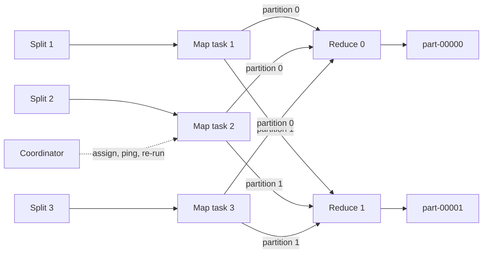

## In one minute
- MapReduce splits a batch job into a **map** phase that turns input records into key/value pairs and a **reduce** phase that folds all values sharing a key into a result.
- Between them sits the **shuffle**: every mapper partitions its output by `hash(key) mod R`, and each of the R reducers pulls its partition from every mapper.
- Fault tolerance comes from determinism and re-execution, not replication of in-flight state: if a worker dies, the coordinator reruns its tasks.
- The model wins on throughput over huge, immutable inputs and loses on latency, iterative algorithms, and anything that needs shared mutable state.

## How it works

### The programming model
You write two pure functions. `map(k1, v1)` emits a list of `(k2, v2)` pairs per input record; `reduce(k2, list[v2])` runs once per distinct intermediate key. The framework owns splitting, scheduling, data movement, retries, and output. Because both functions are deterministic, any task can run twice and produce the same bytes.

### Splits, tasks, and the coordinator
Input lives in a distributed file system in large blocks: the 2004 paper split input into 16 to 64 MB pieces ([Dean and Ghemawat](https://research.google.com/archive/mapreduce-osdi04.pdf)), and HDFS defaults to 128 MB blocks today ([hdfs-default.xml](https://hadoop.apache.org/docs/stable/hadoop-project-dist/hadoop-hdfs/hdfs-default.xml)). The coordinator creates one map task per split and R reduce tasks, and places map tasks on the machine or rack holding the block, because moving code is cheaper than moving terabytes.

### The shuffle
Each mapper buffers output in memory, partitions it into R buckets by `hash(k2) mod R`, sorts each bucket by key, and spills to local disk. An optional **combiner** (a mini-reduce run on the mapper) collapses repeated keys early; for word count it can shrink shuffle volume by 10x or more. When a reducer starts, it fetches its bucket from all M mappers, merge-sorts the M sorted runs, and streams each key group into `reduce`. The shuffle is an all-to-all transfer of M times R files, and it is almost always the bottleneck.

### Failure handling
The coordinator pings workers. A dead worker's completed map tasks are rerun, because their output lived on its local disk. Completed reduce tasks are not rerun, because their output is already in the replicated file system. Reducers write to a temporary file and atomically rename it on commit, so a duplicate task can never leave half a file visible. The paper measured how cheap this is: killing 200 of 1,746 workers in the middle of a terabyte sort made the job only 5% slower ([Dean and Ghemawat](https://research.google.com/archive/mapreduce-osdi04.pdf)).

### Stragglers
One slow disk can hold up a whole job. Near the end of a phase the coordinator launches **backup** copies of in-progress tasks and keeps whichever finishes first, trading a few percent of compute for a much shorter tail. With backup tasks disabled, the paper's sort took 1,283 seconds instead of 891, 44% longer, because five straggling reducers ran for 300 seconds after everything else had finished ([Dean and Ghemawat](https://research.google.com/archive/mapreduce-osdi04.pdf)). Hadoop turns speculative execution on by default for both phases ([mapred-default.xml](https://hadoop.apache.org/docs/stable/hadoop-mapreduce-client/hadoop-mapreduce-client-core/mapred-default.xml)).

### After MapReduce
Real jobs are chains of map and reduce steps, and writing each step by hand is slow. Google's FlumeJava (2010) let engineers write a pipeline over parallel collections, deferred execution, and compiled the plan into an optimised sequence of MapReduces ([Google Research](https://research.google/pubs/flumejava-easy-efficient-data-parallel-pipelines/)). By 2014 Google said it no longer really used MapReduce, which had become cumbersome at a few petabytes, and offered Cloud Dataflow instead ([Data Center Knowledge](https://datacenterknowledge.com/hyperscalers/google-dumps-mapreduce-in-favor-of-new-hyper-scale-analytics-system)). Hadoop MapReduce is still shipped and maintained, but most new batch work runs on Spark, Flink or SQL engines that keep the same ideas: partition by key, shuffle, recompute lost work from immutable input.

## Down the stack

### Layer 1: The contract
Given deterministic `map` and `reduce` functions, the output equals what a single sequential run would produce, even if workers crash, tasks are duplicated, or machines are slow. Each of the R output files contains the keys of one partition in sorted order. A job either commits all R files or the caller treats it as failed. There is no latency promise: a job takes as long as its slowest task, and the framework only promises it will finish if tasks eventually succeed.

### Layer 2: The mechanism
In Hadoop, each map task writes into a circular in-memory buffer (`mapreduce.task.io.sort.mb`, 100 MB by default). At 80 percent full (`mapreduce.map.sort.spill.percent`) ([mapred-default.xml](https://hadoop.apache.org/docs/stable/hadoop-mapreduce-client/hadoop-mapreduce-client-core/mapred-default.xml)), a background thread sorts records by `(partition, key)` and spills a run to local disk, running the combiner on the way. At task end, the spills are merge-sorted into one file per mapper with an index giving the byte offset of each partition. Reducers fetch their partition from each mapper over HTTP (the shuffle handler in the NodeManager), merge in memory until a threshold, then on disk, and finally stream sorted groups into `reduce`. Output goes through an `OutputCommitter`: tasks write under `_temporary/attempt_id/`, and a successful attempt's directory is renamed into place. In YARN the coordinator role is split. Each job's ApplicationMaster tracks its tasks and fails an attempt that reports no progress for 10 minutes (`mapreduce.task.timeout`). The cluster-wide ResourceManager declares a NodeManager lost after 10 minutes without heartbeats (`yarn.nm.liveness-monitor.expiry-interval-ms`), after which its containers count as failed and their map outputs must be regenerated elsewhere ([yarn-default.xml](https://hadoop.apache.org/docs/stable/hadoop-yarn/hadoop-yarn-common/yarn-default.xml)).

### Layer 3: The machine
Spills and merges are sequential I/O: a spinning disk does 100 to 200 MB/s sequentially but only about 100 to 150 random IOPS, so the design avoids random writes entirely. Shuffle fetches are the expensive part. With M = 80,000 mappers and R = 1,000 reducers, there are 80 million partition segments; if each is only 3 KB, each fetch is dominated by a disk seek and a TCP round trip rather than bytes, which is why the framework batches fetches per host and why many small segments make shuffles slow. Output files go to HDFS with three replicas, so every reduce output byte crosses the network twice more through a write pipeline of DataNodes. Map output on local disk is not replicated, which saves that cost and is exactly why lost map output must be recomputed.

### Why it's built this way
1. Commodity machines fail daily at the scale of thousands of nodes, so the system must tolerate failure without a human.
2. Replicating every intermediate byte is too expensive, so intermediate data stays local and the system recomputes it instead.
3. Recompute only works if tasks are deterministic and commit atomically, so the programming model is restricted to pure functions and output uses rename-on-commit.
4. Disks are fast sequentially and slow randomly, so every stage sorts and writes long sequential runs.
5. Networks were the scarcest resource in 2004 clusters (machines with 2 to 4 GB of RAM on 100 Mbit/s or 1 Gbit/s links, with far less bisection bandwidth ([Dean and Ghemawat](https://research.google.com/archive/mapreduce-osdi04.pdf))), so the scheduler moves code to data and combiners shrink the shuffle.

## Diagram


## Worked example
Count page views per URL over 10 TB of access logs.

With 128 MB splits there are about 80,000 map tasks. A 500-node cluster with 8 slots each runs them in 20 waves; at roughly 30 seconds per wave including parsing, map time is about 10 minutes.

Without a combiner, every log line emits `(url, 1)`, roughly 60 bytes, and 10 TB of 200-byte lines is 50 billion records, so 3 TB crosses the network. With a combiner, each mapper emits one record per distinct URL it saw. If a split holds 50,000 distinct URLs, output drops to 3 MB per mapper and 240 GB total. At 10 Gbit/s per node, 500 nodes shuffle 240 GB in a few seconds instead of minutes.

With R = 1,000, each reducer handles about 240 MB. A hot home-page URL is harmless here because the combiner already collapsed it; a join keyed by `user_id` with a few bot accounts would not be so forgiving.

## In the wild
- **Meta, 2021: a deterministic task that was not.** A Spark job decompressing files computed a file size with Scala's `pow`, and on one core of one CPU `Int(1.1^53)` came out as 0, so a non-empty file was skipped and silently vanished from a database. Logs were clean. Fleet-wide testing across hundreds of thousands of machines then found hundreds of CPUs with silent data corruption. Re-execution only helps if the same input really gives the same output ([Dixit et al.](https://arxiv.org/abs/2102.11245)).
- **LinkedIn, 2021: one coordinator for 500 PB.** LinkedIn's largest Hadoop cluster runs 10,000 nodes behind a single NameNode with a 380 GB heap for 1.1 billion namespace objects. A DistCp job (itself a MapReduce job) copying 100 million log files left the NameNode unresponsive to other clients. Fixes included non-fair locking (about 10x lower RPC latency), Observer NameNode reads, and moving small log files to a satellite cluster ([LinkedIn](https://www.linkedin.com/blog/engineering/open-source/the-exabyte-club-linkedin-s-journey-of-scaling-the-hadoop-distr)).
- **Facebook, 2012: the file system under the batch jobs.** Facebook's warehouse ran one HDFS namespace over more than 100 PB. An incident review traced 41% of warehouse issues to HDFS, but found a highly available NameNode would prevent only 10% of them; its larger win was cutting planned downtime for upgrades by about half. The result was AvatarNode, a hot standby coordinated through ZooKeeper ([Facebook](https://engineering.fb.com/2012/06/13/core-infra/under-the-hood-hadoop-distributed-filesystem-reliability-with-namenode-and-avatarnode/)).

## Trade-offs

| Option | Strengths | Weaknesses | Choose when |
|---|---|---|---|
| Classic MapReduce (Hadoop) | Simple model, handles inputs far larger than memory | Every stage hits disk; multi-stage jobs are slow | Huge one-pass jobs on existing Hadoop clusters |
| Spark | In-memory DAG of stages, lineage recovery | Memory tuning; shuffle still the bottleneck | Iterative jobs, ML features |
| SQL engine (BigQuery, Trino) | Optimizer picks joins and partitioning | Less control; pay per byte scanned | Logic that SQL expresses |
| One big machine (DuckDB) | No distribution overhead | Bounded by one machine | Inputs under a few hundred GB |

## Pitfalls in production
- **Key skew.** One hot key sends a huge share of the data to one reducer, which runs for hours while the rest sit idle. Fix it with combiners, salting the key with a random suffix and doing a second aggregation, or a broadcast join for the small side.
- **Non-deterministic map functions.** Calling `now()` or a random source inside `map` means a re-executed task produces different output, and duplicates or gaps appear. Pass timestamps and seeds in as job parameters.
- **Side effects in tasks.** Writing to an external database from `reduce` breaks under retries and speculative execution, producing duplicate writes. Write only to the job's output directory and load downstream idempotently.
- **Wrong R.** Too few reducers spill to disk heavily and limit parallelism; too many produce thousands of tiny output files. Target 128 MB to 1 GB per reducer.

## Leadership lens
- Ask whether the job really needs a distributed engine. Many teams run a cluster for data that fits on one large VM.
- In design review, ask for the shuffle volume estimate and the distribution of the join or group-by key. Those two numbers predict runtime and cost better than node count.
- Require idempotent, overwrite-by-partition outputs so any day can be recomputed safely. This is what makes backfills boring.
- Count the operational cost: upgrades, scheduling, and on-call for failed nightly jobs. Managed services often cost less than the people running a cluster.

## Check yourself
1. Why must a dead worker's completed map tasks be re-executed but not its completed reduce tasks?
   **Answer:** Map output is stored on the worker's local disk and is lost with it, while reduce output is already committed to the replicated distributed file system.
2. Why can a combiner be used for counting but not for computing a median directly?
   **Answer:** A combiner must be associative and commutative so partial results can be merged; sums merge, but a median of medians is not the median.
3. What makes speculative execution safe?
   **Answer:** Deterministic tasks plus atomic commit of output via rename, so whichever copy finishes first wins and the duplicate's output is discarded.

## Practice
**Task:** Implement an in-memory MapReduce runner. `run_mapreduce(records, mapper, reducer, num_reducers)` calls `mapper(record)` to get a list of `(key, value)` pairs, partitions keys with `stable_hash(key) % num_reducers`, sorts keys within each partition, groups values per key, and calls `reducer(key, values)` which returns a single result. Return a list of partitions, each a list of `(key, result)` tuples in sorted key order. Use the provided stable hash (CRC32 in Python, FNV-1a in TypeScript and Go) so the output is deterministic.

```python starter
import zlib

def stable_hash(key):
    return zlib.crc32(str(key).encode())

def run_mapreduce(records, mapper, reducer, num_reducers):
    # TODO: map, partition, sort, group, reduce
    raise NotImplementedError
```

```python tests
def wc_map(line):
    return [(w, 1) for w in line.split()]

def wc_reduce(key, values):
    return sum(values)

def test_word_count_totals():
    out = run_mapreduce(["a b a", "b c"], wc_map, wc_reduce, 2)
    merged = dict(kv for part in out for kv in part)
    assert merged == {"a": 2, "b": 2, "c": 1}

def test_keys_land_in_hash_partition():
    out = run_mapreduce(["p q r s t"], wc_map, wc_reduce, 4)
    for i, part in enumerate(out):
        for k, _ in part:
            assert stable_hash(k) % 4 == i

def test_sorted_within_partition():
    out = run_mapreduce(["d c b a e f"], wc_map, wc_reduce, 1)
    assert [k for k, _ in out[0]] == ["a", "b", "c", "d", "e", "f"]

def test_empty_input():
    assert run_mapreduce([], wc_map, wc_reduce, 2) == [[], []]

def test_reducer_sees_all_values():
    out = run_mapreduce(["k k k"], wc_map, lambda k, vs: len(vs), 1)
    assert out == [[("k", 3)]]
```

```python solution
import zlib
from collections import defaultdict

def stable_hash(key):
    return zlib.crc32(str(key).encode())

def run_mapreduce(records, mapper, reducer, num_reducers):
    parts = [defaultdict(list) for _ in range(num_reducers)]
    for rec in records:
        for k, v in mapper(rec):
            parts[stable_hash(k) % num_reducers][k].append(v)
    out = []
    for groups in parts:
        out.append([(k, reducer(k, groups[k])) for k in sorted(groups)])
    return out
```

```typescript starter
export type Pair = [string, number];
export function stableHash(key: string): number {
  let h = 2166136261;
  for (let i = 0; i < key.length; i++) {
    h ^= key.charCodeAt(i);
    h = Math.imul(h, 16777619) >>> 0;
  }
  return h;
}
export function runMapReduce(records: string[], mapper: (r: string) => Pair[],
    reducer: (k: string, vs: number[]) => number, numReducers: number): Pair[][] {
  throw new Error("TODO");
}
```

```typescript tests
const wcMap = (line: string): Pair[] => line.split(" ").filter(w => w).map(w => [w, 1] as Pair);
const wcReduce = (_k: string, vs: number[]): number => vs.reduce((a, b) => a + b, 0);
test("word count totals", () => {
  const out = runMapReduce(["a b a", "b c"], wcMap, wcReduce, 2);
  const merged: Pair[] = [];
  out.forEach(p => p.forEach(kv => merged.push(kv)));
  merged.sort((x, y) => x[0].localeCompare(y[0]));
  assertEqual(merged, [["a", 2], ["b", 2], ["c", 1]]);
});
test("keys land in their hash partition", () => {
  const out = runMapReduce(["p q r s t"], wcMap, wcReduce, 4);
  out.forEach((p, i) => p.forEach(([k]) => assert(stableHash(k) % 4 === i, k)));
});
test("sorted within partition", () => {
  const out = runMapReduce(["d c b a e f"], wcMap, wcReduce, 1);
  assertEqual(out[0].map(([k]) => k), ["a", "b", "c", "d", "e", "f"]);
});
test("empty input", () => {
  assertEqual(runMapReduce([], wcMap, wcReduce, 2), [[], []]);
});
test("reducer sees all values", () => {
  assertEqual(runMapReduce(["k k k"], wcMap, (_k, vs) => vs.length, 1), [[["k", 3]]]);
});
```

```typescript solution
export type Pair = [string, number];
export function stableHash(key: string): number {
  let h = 2166136261;
  for (let i = 0; i < key.length; i++) {
    h ^= key.charCodeAt(i);
    h = Math.imul(h, 16777619) >>> 0;
  }
  return h;
}
export function runMapReduce(records: string[], mapper: (r: string) => Pair[],
    reducer: (k: string, vs: number[]) => number, numReducers: number): Pair[][] {
  const parts: Map<string, number[]>[] = [];
  for (let i = 0; i < numReducers; i++) parts.push(new Map());
  for (const rec of records) {
    for (const [k, v] of mapper(rec)) {
      const m = parts[stableHash(k) % numReducers];
      const vs = m.get(k) ?? [];
      vs.push(v);
      m.set(k, vs);
    }
  }
  return parts.map(m => [...m.keys()].sort().map(k => [k, reducer(k, m.get(k)!)] as Pair));
}
```

```go starter
package practice

type Pair struct {
	Key   string
	Value int
}

func StableHash(key string) uint32 {
	h := uint32(2166136261)
	for i := 0; i < len(key); i++ {
		h ^= uint32(key[i])
		h *= 16777619
	}
	return h
}

func RunMapReduce(records []string, mapper func(string) []Pair,
	reducer func(string, []int) int, numReducers int) [][]Pair {
	panic("TODO")
}
```

```go tests
package practice

import (
	"reflect"
	"strings"
	"testing"
)

func wcMap(line string) []Pair {
	var out []Pair
	for _, w := range strings.Fields(line) {
		out = append(out, Pair{w, 1})
	}
	return out
}

func wcReduce(_ string, vs []int) int {
	s := 0
	for _, v := range vs {
		s += v
	}
	return s
}

func TestWordCount(t *testing.T) {
	got := map[string]int{}
	for _, p := range RunMapReduce([]string{"a b a", "b c"}, wcMap, wcReduce, 2) {
		for _, kv := range p {
			got[kv.Key] = kv.Value
		}
	}
	if !reflect.DeepEqual(got, map[string]int{"a": 2, "b": 2, "c": 1}) {
		t.Fatalf("got %v", got)
	}
}

func TestHashPartition(t *testing.T) {
	for i, p := range RunMapReduce([]string{"p q r s t"}, wcMap, wcReduce, 4) {
		for _, kv := range p {
			if int(StableHash(kv.Key)%4) != i {
				t.Fatalf("%s in partition %d", kv.Key, i)
			}
		}
	}
}

func TestSortedWithinPartition(t *testing.T) {
	out := RunMapReduce([]string{"d c b a e f"}, wcMap, wcReduce, 1)
	var keys []string
	for _, kv := range out[0] {
		keys = append(keys, kv.Key)
	}
	if strings.Join(keys, "") != "abcdef" {
		t.Fatalf("got %v", keys)
	}
}

func TestEmptyInput(t *testing.T) {
	out := RunMapReduce(nil, wcMap, wcReduce, 2)
	if len(out) != 2 || len(out[0]) != 0 || len(out[1]) != 0 {
		t.Fatalf("got %v", out)
	}
}
```

```go solution
package practice

import "sort"

type Pair struct {
	Key   string
	Value int
}

func StableHash(key string) uint32 {
	h := uint32(2166136261)
	for i := 0; i < len(key); i++ {
		h ^= uint32(key[i])
		h *= 16777619
	}
	return h
}

func RunMapReduce(records []string, mapper func(string) []Pair,
	reducer func(string, []int) int, numReducers int) [][]Pair {
	parts := make([]map[string][]int, numReducers)
	for i := range parts {
		parts[i] = map[string][]int{}
	}
	for _, rec := range records {
		for _, kv := range mapper(rec) {
			m := parts[StableHash(kv.Key)%uint32(numReducers)]
			m[kv.Key] = append(m[kv.Key], kv.Value)
		}
	}
	out := make([][]Pair, numReducers)
	for i, m := range parts {
		keys := make([]string, 0, len(m))
		for k := range m {
			keys = append(keys, k)
		}
		sort.Strings(keys)
		out[i] = []Pair{}
		for _, k := range keys {
			out[i] = append(out[i], Pair{k, reducer(k, m[k])})
		}
	}
	return out
}
```

## Mock interview
**Prompt:** Every night, compute the top 100 search queries per country from 30 TB of query logs within two hours on a shared batch cluster. How do you structure the job?

- Follow-up: How do you stop the United States partition from becoming a straggler?
- Follow-up: A worker dies after finishing half the map tasks. What exactly gets recomputed?
- Follow-up: MapReduce, Spark, or warehouse SQL here, and why?

**A strong answer covers:**
- Two stages: count by `(country, query)` with a combiner, then a top-K per country using a bounded heap.
- Shuffle volume estimate before and after the combiner, and the reducer count derived from it.
- Skew handling for large countries by salting or a two-level aggregation.
- Re-execution of lost map output, atomic output commit, and speculative execution for stragglers.
- An idempotent, partition-overwrite output so failed nights can be rerun.

## Sources and further study
**Primary**
- [Chambers et al., FlumeJava (PLDI 2010)](https://research.google/pubs/flumejava-easy-efficient-data-parallel-pipelines/): how Google stopped hand-writing chains of MapReduces and compiled pipelines into them instead.
- [Dixit et al., Silent Data Corruptions at Scale (2021)](https://arxiv.org/abs/2102.11245): why "deterministic task" is an assumption about hardware as well as code.

**Systems docs**
- [Hadoop mapred-default.xml](https://hadoop.apache.org/docs/stable/hadoop-mapreduce-client/hadoop-mapreduce-client-core/mapred-default.xml): every shuffle, spill, timeout and speculation default in one file.
- [HDFS architecture guide](https://hadoop.apache.org/docs/stable/hadoop-project-dist/hadoop-hdfs/HdfsDesign.html): blocks, replica placement and the NameNode that MapReduce scheduling depends on.

**Books**
- *Designing Data-Intensive Applications*, Martin Kleppmann, chapter 10 "Batch Processing": Unix pipes as the model, MapReduce joins, and what dataflow engines changed (chapter 11 in the 2026 second edition).
- *Streaming Systems*, Tyler Akidau, Slava Chernyak and Reuven Lax, chapter 10 "The Evolution of Large-Scale Data Processing": the line from MapReduce through FlumeJava and MillWheel to Dataflow.

**Other curricula**
- [donnemartin/system-design-primer](https://github.com/donnemartin/system-design-primer): lists the MapReduce paper among its real-world architectures and uses MapReduce jobs in worked solutions, without covering the shuffle or failure handling.
- [roadmap.sh Software Architect](https://roadmap.sh/software-architect): groups "Spark, Hadoop MapReduce" as one big-data node, treating MapReduce as background for Spark.

## Watch
- [Lecture 1: Introduction (MIT 6.824)](https://www.youtube.com/watch?v=cQP8WApzIQQ): Robert Morris walks through the MapReduce paper and why its design choices matter.
- [Matei Zaharia introduces Spark and RDDs (FunctionalTV)](https://www.youtube.com/watch?v=Mz6qyph-xEI): the original pitch for keeping intermediate data in memory instead of on disk.

## Free resources
- [MapReduce: Simplified Data Processing on Large Clusters](https://research.google.com/archive/mapreduce-osdi04.pdf): the original OSDI 2004 paper, short and still the best description of the mechanism.
- [MIT 6.5840 Lab 1: MapReduce](https://pdos.csail.mit.edu/6.824/labs/lab-mr.html): build a coordinator and workers yourself, including crash handling.
- [Hadoop MapReduce Tutorial](https://hadoop.apache.org/docs/stable/hadoop-mapreduce-client/hadoop-mapreduce-client-core/MapReduceTutorial.html): the concrete API, combiners, and job configuration.
- [Resilient Distributed Datasets (NSDI 2012)](https://www.usenix.org/system/files/conference/nsdi12/nsdi12-final138.pdf): the Spark paper, explaining lineage-based recovery as the successor model.
