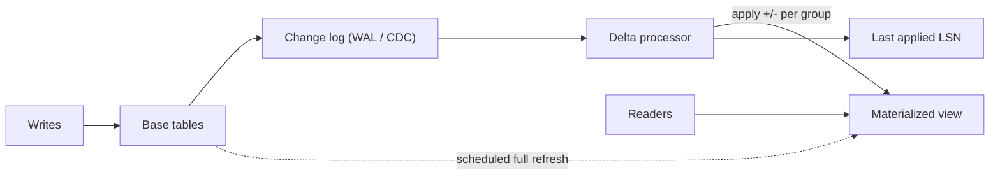

## In one minute
- A materialized view stores the *result* of a query as a physical table, so reads skip the expensive joins and aggregations.
- The core problem is freshness: the view is a copy, and something must keep it in step with the base tables.
- Two maintenance styles: **full refresh** (recompute everything on a schedule) and **incremental maintenance** (apply each base-table change as a delta).
- Use them for expensive, repeated, read-heavy queries where bounded staleness is acceptable.

## How it works

### View versus materialized view
A regular view is a stored query; every read re-executes it. A materialized view runs the query once and persists the rows. You can index it, and reads cost the same as reading any table. The database (or your pipeline) owns the copy, which is the difference from hand-rolled denormalization.

### Full refresh
The simplest strategy reruns the defining query and swaps in the result. In PostgreSQL, `REFRESH MATERIALIZED VIEW` takes a lock that blocks readers during the rebuild; `REFRESH ... CONCURRENTLY` builds a new copy, diffs it against the old one, and applies changes, so readers continue but the refresh takes longer. It needs a unique index on plain columns with no `WHERE` clause, works only on a view that is already populated, and still allows just one refresh at a time per view ([Postgres docs](https://www.postgresql.org/docs/current/sql-refreshmaterializedview.html)). Cost is proportional to the base data, not to what changed. A 30-minute refresh of a 500 GB fact table every hour burns half your I/O to update maybe 1% of rows.

### Incremental maintenance
Incremental view maintenance (IVM) treats each insert, update, or delete on a base table as a delta and computes the effect on the view. For `SUM` and `COUNT` grouped by a key, this is easy: an inserted row adds to its group, a deleted row subtracts, and a group disappears when its count reaches zero. `AVG` is maintained as sum and count. `MIN` and `MAX` are harder: deleting the current minimum forces a rescan of that group. Joins require looking up matching rows on the other side for each delta. Postgres itself has no incremental mode, only full refresh; the `pg_ivm` extension adds one that updates the view in `AFTER` triggers inside the writing transaction, supports `count`, `sum`, `avg`, `min` and `max`, and charges every base-table write for the trigger ([pg_ivm](https://github.com/sraoss/pg_ivm)). The general theory, which handles joins, recursion and nested aggregates, is an active research area ([Budiu et al., DBSP](https://arxiv.org/abs/2203.16684)).

Systems that do this natively include Oracle (fast refresh with materialized view logs, either on demand or at every commit) ([Oracle docs](https://docs.oracle.com/en/database/oracle/oracle-database/19/dwhsg/refreshing-materialized-views.html)), ClickHouse (insert-triggered views that transform each block as it lands), and streaming databases such as Materialize and RisingWave, which maintain views continuously from change streams ([Materialize docs](https://materialize.com/docs/concepts/views/)).

ClickHouse's insert trigger has a sharp edge: the view sees only newly inserted blocks. Rows in the right-hand table of a join do not trigger anything when they change ([ClickHouse docs](https://clickhouse.com/docs/materialized-view/incremental-materialized-view)), and an update or delete on the source is not an insert, so the view never hears about it. For queries that cannot be maintained that way, ClickHouse added *refreshable* materialized views, which rerun the whole query on a schedule (`REFRESH EVERY 1 MINUTE`) and were declared production-ready in release 24.10 in late 2024 ([ClickHouse 24.10](https://clickhouse.com/blog/clickhouse-release-24-10)).

### Staleness and correctness
With scheduled refresh, staleness equals the refresh interval plus refresh duration. With IVM fed by change data capture, staleness is the replication lag of the change stream, usually sub-second. Deltas must be applied exactly once and in order; replaying a delta double-counts. Track the last applied log position (LSN or offset) per view and skip anything at or below it.

## Down the stack

### Layer 1: The contract
A PostgreSQL materialized view promises that a reader sees the complete result of the defining query as of the last successful refresh, never a half-refreshed state, because the refresh runs in one transaction. It promises nothing about freshness: if nobody refreshes, it stays stale forever. With `CONCURRENTLY`, readers are not blocked, but the view must have a unique index. An incremental view built on a change stream promises something different: the view equals the query result as of a specific log position, and lag is the distance between that position and the source's current one.

### Layer 2: The mechanism
A plain `REFRESH MATERIALIZED VIEW` runs the query into a brand-new heap file and swaps it in under an `ACCESS EXCLUSIVE` lock, which blocks even `SELECT`. `REFRESH ... CONCURRENTLY` instead builds the new result in a temporary table, diffs it against the current contents with a full outer join, and applies only the changed rows as deletes and inserts, holding a weaker lock that still allows reads. ClickHouse materialized views are insert triggers: each `INSERT` block into the source table is run through the view's `SELECT`, and the output is written to a target table, often a `SummingMergeTree` or `AggregatingMergeTree` that stores partial aggregates and merges them in the background. Oracle keeps a materialized view log per base table, recording changed rows so a fast refresh can apply only those.

### Layer 3: The machine
A full refresh over a 500 GB fact table reads every page: at 1 GB/s of sequential throughput that is over 8 minutes of pure I/O, before hashing for `GROUP BY` (which spills to temporary files if it outgrows `work_mem`) and before writing the new heap. The whole new contents also go into the WAL, so replicas replay the full refresh too. The concurrent variant does more work: the diff join plus row-by-row writes, each leaving a dead tuple for vacuum. In ClickHouse every insert creates a new on-disk part with one compressed file per column, so thousands of tiny inserts per second create thousands of parts. The default thresholds are `parts_to_delay_insert` = 1,000, after which inserts are slowed, and `parts_to_throw_insert` = 3,000, after which they fail with a "too many parts" error ([ClickHouse docs](https://clickhouse.com/docs/operations/settings/merge-tree-settings)); batching inserts to tens of thousands of rows avoids that. Every materialized view on a table adds its own insert into its target table, so the part count multiplies with the number of views. An incremental upsert per delta costs one index lookup and one WAL record, a few microseconds of CPU, with the `fsync` amortized across a batch.

### Why it's built this way
1. The same expensive aggregation is requested many times, so storing its result is cheaper than recomputing it.
2. A stored result goes stale, so it needs a refresh mechanism.
3. Full recomputation costs grow with total data, not with what changed, so large views move to incremental deltas.
4. Deltas only work for aggregates that can be undone, like sums and counts, so `MIN`, `MAX` and `DISTINCT` need extra state or rescans.
5. Delta consumers crash and replay, so the applied log position is stored atomically with the view rows.

## Diagram


## Worked example
An analytics product shows revenue per merchant per day. The `payments` table has 2 billion rows and grows by 400 per second. The dashboard query (`SUM(amount), COUNT(*) GROUP BY merchant_id, day`) takes 90 seconds, and the dashboard serves 300 requests per second. Running it live is impossible.

A materialized view keyed on `(merchant_id, day)` has about 50 million rows. Reads become indexed point lookups under 5 ms.

- **Full refresh hourly:** about 25 minutes of heavy scanning per hour, and data up to 85 minutes stale. Acceptable for a finance report, not for a merchant watching today's sales.
- **Incremental via CDC:** 400 deltas per second, each a single-row upsert on the view. Staleness is about 1 second, and the load is small. Refunds arrive as negative deltas on the original day.
- **Hybrid:** IVM for freshness plus a weekly full rebuild of the last 90 days to catch any drift from bugs or out-of-band fixes.

## In the wild
- **Cloudflare, 2018: replacing a rollup database with ClickHouse materialized views.** Cloudflare's HTTP analytics took about 6 million requests per second, with peaks near 8 million. The 2014 pipeline rolled minute aggregates up into hours, days and months in a single Postgres "RollupDB" plus a Citus cluster. The replacement wrote raw rows into ClickHouse and maintained breakdowns with `SummingMergeTree` views, with unique counts in a separate `AggregatingMergeTree` view. A first design of eight separate per-breakdown views was dropped because joining them took a 300-line query and querying them in parallel was only slightly faster than the old pipeline ([Cloudflare](https://blog.cloudflare.com/http-analytics-for-6m-requests-per-second-using-clickhouse/)).
- **Cloudflare, 2025: a precomputed query result doubles and takes down the proxy.** A feature file for Bot Management was regenerated every five minutes from a ClickHouse query on `system.columns` that did not filter by database. A permissions change made a second database's metadata visible, the result more than doubled, and the proxy, which allowed 200 features (about 60 were in use), panicked. Core traffic was disrupted for about three hours. Cloudflare's first fix was to validate its own generated files as strictly as user input ([Cloudflare](https://blog.cloudflare.com/18-november-2025-outage/)). A stored query result is only as safe as the query that defines it.

## Trade-offs
| Option | Strengths | Weaknesses | Choose when |
|---|---|---|---|
| Regular view | Always fresh, no storage | Full cost on every read | Query is already cheap |
| Full refresh | Simple, always correct after refresh | Cost tracks data size, stale between runs | Small data or loose freshness |
| Concurrent refresh | Readers not blocked | Slower, needs a unique key | Readers cannot tolerate a lock |
| Incremental (IVM) | Fresh, cost tracks change rate | Limited query shapes, exactly-once needed | Large base, small changes, sums and counts |
| Streaming database | Continuous, complex joins | New system to operate | Many live views over event streams |

## Pitfalls in production
- **Refresh outlasting its interval.** An hourly refresh that takes 70 minutes overlaps itself. Alert on refresh duration and skip a run if the previous one is still going.
- **Blocking refresh.** A non-concurrent refresh locks out readers for minutes. Use the concurrent variant or swap tables atomically.
- **Double-applied deltas.** A consumer restarts and replays a batch, inflating sums. Store the last applied offset in the same transaction as the view update.
- **Unsupported aggregates.** `MIN`, `MAX`, and `DISTINCT` cannot be maintained by pure deltas. Store per-group state or fall back to a group rescan.
- **Nobody knows it is stale.** Users see yesterday's numbers as today's. Expose a "last updated" time with the data.

## Leadership lens
- Agree the staleness budget with the product owner first; it decides full refresh versus IVM.
- Make refresh duration, lag, and drift visible metrics with alerts, the same as replication lag.
- Know who owns the view's correctness when the base schema changes. Views break silently on column renames and type changes.
- Prefer the database's native feature when it covers the query; a hand-built delta pipeline is a service your team now owns.

## Check yourself
1. Why is `SUM` easy to maintain incrementally but `MAX` is not?
   **Answer:** A sum can subtract a deleted row's value, while deleting the current maximum gives no way to know the next largest value without rescanning the group.
2. What determines staleness for a CDC-fed incremental view?
   **Answer:** The lag between a commit on the base table and the delta being applied, which is mostly change-stream lag.
3. Why should the applied offset be stored in the same transaction as the view update?
   **Answer:** Otherwise a crash between the two either loses or replays deltas, and replayed deltas double-count.

## Practice
**Task:** Implement an incrementally maintained view of `SUM(amount)` and `COUNT(*)` grouped by key. `apply(lsn, op, key, amount)` takes a log sequence number, an op of `"insert"` or `"delete"`, a group key and an amount. Ignore any change whose `lsn` is not greater than the last applied one (replays). Remove a group when its count reaches zero. `get(key)` returns `(sum, count)` or `None`, `avg(key)` returns the mean or `None`, and `refresh(rows)` rebuilds from a full list of `(key, amount)` rows, keeping the last LSN.

```python starter
class SumCountView:
    def __init__(self):
        self.last_lsn = 0

    def apply(self, lsn, op, key, amount): raise NotImplementedError
    def get(self, key): raise NotImplementedError
    def avg(self, key): raise NotImplementedError
    def refresh(self, rows): raise NotImplementedError
```

```python tests
def test_insert_accumulates():
    v = SumCountView()
    v.apply(1, "insert", "m1", 10)
    v.apply(2, "insert", "m1", 30)
    assert v.get("m1") == (40, 2)
    assert v.avg("m1") == 20

def test_delete_subtracts_and_removes_empty_group():
    v = SumCountView()
    v.apply(1, "insert", "m1", 10)
    v.apply(2, "delete", "m1", 10)
    assert v.get("m1") is None
    assert v.avg("m1") is None

def test_replay_is_ignored():
    v = SumCountView()
    v.apply(5, "insert", "m1", 10)
    v.apply(5, "insert", "m1", 10)
    v.apply(3, "insert", "m1", 10)
    assert v.get("m1") == (10, 1)

def test_groups_are_independent():
    v = SumCountView()
    v.apply(1, "insert", "a", 1)
    v.apply(2, "insert", "b", 2)
    assert (v.get("a"), v.get("b")) == ((1, 1), (2, 1))

def test_refresh_rebuilds():
    v = SumCountView()
    v.apply(9, "insert", "x", 100)
    v.refresh([("a", 5), ("a", 7)])
    assert v.get("x") is None
    assert v.get("a") == (12, 2)
    v.apply(9, "insert", "a", 1)
    assert v.get("a") == (12, 2)
```

```python solution
class SumCountView:
    def __init__(self):
        self.last_lsn = 0
        self.groups = {}

    def apply(self, lsn, op, key, amount):
        if lsn <= self.last_lsn:
            return
        self.last_lsn = lsn
        sign = 1 if op == "insert" else -1
        s, c = self.groups.get(key, (0, 0))
        s, c = s + sign * amount, c + sign
        if c == 0:
            self.groups.pop(key, None)
        else:
            self.groups[key] = (s, c)

    def get(self, key):
        return self.groups.get(key)

    def avg(self, key):
        g = self.groups.get(key)
        return None if g is None else g[0] / g[1]

    def refresh(self, rows):
        self.groups = {}
        for key, amount in rows:
            s, c = self.groups.get(key, (0, 0))
            self.groups[key] = (s + amount, c + 1)
```

```typescript starter
export type Op = "insert" | "delete";
export class SumCountView {
  lastLsn = 0;
  apply(lsn: number, op: Op, key: string, amount: number): void { throw new Error("TODO"); }
  get(key: string): [number, number] | null { throw new Error("TODO"); }
  avg(key: string): number | null { throw new Error("TODO"); }
  refresh(rows: [string, number][]): void { throw new Error("TODO"); }
}
```

```typescript tests
test("insert accumulates", () => {
  const v = new SumCountView();
  v.apply(1, "insert", "m1", 10);
  v.apply(2, "insert", "m1", 30);
  assertEqual(v.get("m1"), [40, 2]);
  assertEqual(v.avg("m1"), 20);
});
test("delete removes empty group", () => {
  const v = new SumCountView();
  v.apply(1, "insert", "m1", 10);
  v.apply(2, "delete", "m1", 10);
  assertEqual(v.get("m1"), null);
  assertEqual(v.avg("m1"), null);
});
test("replay is ignored", () => {
  const v = new SumCountView();
  v.apply(5, "insert", "m1", 10);
  v.apply(5, "insert", "m1", 10);
  v.apply(3, "insert", "m1", 10);
  assertEqual(v.get("m1"), [10, 1]);
});
test("groups are independent", () => {
  const v = new SumCountView();
  v.apply(1, "insert", "a", 1);
  v.apply(2, "insert", "b", 2);
  assertEqual([v.get("a"), v.get("b")], [[1, 1], [2, 1]]);
});
test("refresh rebuilds and keeps lsn", () => {
  const v = new SumCountView();
  v.apply(9, "insert", "x", 100);
  v.refresh([["a", 5], ["a", 7]]);
  assertEqual(v.get("x"), null);
  assertEqual(v.get("a"), [12, 2]);
  v.apply(9, "insert", "a", 1);
  assertEqual(v.get("a"), [12, 2]);
});
```

```typescript solution
export type Op = "insert" | "delete";
export class SumCountView {
  lastLsn = 0;
  private groups = new Map<string, [number, number]>();
  apply(lsn: number, op: Op, key: string, amount: number): void {
    if (lsn <= this.lastLsn) return;
    this.lastLsn = lsn;
    const sign = op === "insert" ? 1 : -1;
    const [s, c] = this.groups.get(key) ?? [0, 0];
    if (c + sign === 0) this.groups.delete(key);
    else this.groups.set(key, [s + sign * amount, c + sign]);
  }
  get(key: string): [number, number] | null {
    return this.groups.get(key) ?? null;
  }
  avg(key: string): number | null {
    const g = this.groups.get(key);
    return g ? g[0] / g[1] : null;
  }
  refresh(rows: [string, number][]): void {
    this.groups = new Map();
    for (const [key, amount] of rows) {
      const [s, c] = this.groups.get(key) ?? [0, 0];
      this.groups.set(key, [s + amount, c + 1]);
    }
  }
}
```

```go starter
package practice

type Row struct {
	Key    string
	Amount float64
}

type SumCountView struct {
	LastLSN int
}

func NewSumCountView() *SumCountView { return &SumCountView{} }

// Apply takes op "insert" or "delete".
func (v *SumCountView) Apply(lsn int, op, key string, amount float64) { panic("TODO") }

// Get returns sum, count, and whether the group exists.
func (v *SumCountView) Get(key string) (float64, int, bool) { panic("TODO") }

func (v *SumCountView) Avg(key string) (float64, bool) { panic("TODO") }

func (v *SumCountView) Refresh(rows []Row) { panic("TODO") }
```

```go tests
package practice

import "testing"

func TestInsertAccumulates(t *testing.T) {
	v := NewSumCountView()
	v.Apply(1, "insert", "m1", 10)
	v.Apply(2, "insert", "m1", 30)
	s, c, ok := v.Get("m1")
	avg, _ := v.Avg("m1")
	if !ok || s != 40 || c != 2 || avg != 20 {
		t.Fatalf("got %v %v %v %v", s, c, ok, avg)
	}
}

func TestDeleteRemovesEmptyGroup(t *testing.T) {
	v := NewSumCountView()
	v.Apply(1, "insert", "m1", 10)
	v.Apply(2, "delete", "m1", 10)
	if _, _, ok := v.Get("m1"); ok {
		t.Fatal("group should be gone")
	}
	if _, ok := v.Avg("m1"); ok {
		t.Fatal("avg should be absent")
	}
}

func TestReplayIgnored(t *testing.T) {
	v := NewSumCountView()
	v.Apply(5, "insert", "m1", 10)
	v.Apply(5, "insert", "m1", 10)
	v.Apply(3, "insert", "m1", 10)
	if s, c, _ := v.Get("m1"); s != 10 || c != 1 {
		t.Fatalf("got %v %v", s, c)
	}
}

func TestGroupsIndependent(t *testing.T) {
	v := NewSumCountView()
	v.Apply(1, "insert", "a", 1)
	v.Apply(2, "insert", "b", 2)
	sa, _, _ := v.Get("a")
	sb, _, _ := v.Get("b")
	if sa != 1 || sb != 2 {
		t.Fatal("groups mixed")
	}
}

func TestRefresh(t *testing.T) {
	v := NewSumCountView()
	v.Apply(9, "insert", "x", 100)
	v.Refresh([]Row{{"a", 5}, {"a", 7}})
	if _, _, ok := v.Get("x"); ok {
		t.Fatal("x should be gone")
	}
	v.Apply(9, "insert", "a", 1)
	if s, c, _ := v.Get("a"); s != 12 || c != 2 {
		t.Fatalf("got %v %v", s, c)
	}
}
```

```go solution
package practice

type Row struct {
	Key    string
	Amount float64
}

type group struct {
	sum   float64
	count int
}

type SumCountView struct {
	LastLSN int
	groups  map[string]group
}

func NewSumCountView() *SumCountView {
	return &SumCountView{groups: map[string]group{}}
}

// Apply takes op "insert" or "delete".
func (v *SumCountView) Apply(lsn int, op, key string, amount float64) {
	if lsn <= v.LastLSN {
		return
	}
	v.LastLSN = lsn
	sign := 1
	if op == "delete" {
		sign = -1
	}
	g := v.groups[key]
	g.sum += float64(sign) * amount
	g.count += sign
	if g.count == 0 {
		delete(v.groups, key)
	} else {
		v.groups[key] = g
	}
}

// Get returns sum, count, and whether the group exists.
func (v *SumCountView) Get(key string) (float64, int, bool) {
	g, ok := v.groups[key]
	return g.sum, g.count, ok
}

func (v *SumCountView) Avg(key string) (float64, bool) {
	g, ok := v.groups[key]
	if !ok {
		return 0, false
	}
	return g.sum / float64(g.count), true
}

func (v *SumCountView) Refresh(rows []Row) {
	v.groups = map[string]group{}
	for _, r := range rows {
		g := v.groups[r.Key]
		v.groups[r.Key] = group{g.sum + r.Amount, g.count + 1}
	}
}
```

## Mock interview
**Prompt:** A payments company needs a merchant dashboard showing today's revenue, refunds, and transaction count, refreshed within 5 seconds. The payments table holds 3 billion rows and takes 1,000 writes per second. Design the read path.

- Follow-up: The delta consumer crashes mid-batch and restarts. How do you guarantee totals are not double-counted?
- Follow-up: Product now wants "largest single payment today" per merchant. What changes?
- Follow-up: When would you rebuild from scratch instead of trusting the incremental path?

**A strong answer covers:**
- Rejecting a live aggregate query and a full refresh given the size and freshness target.
- CDC-fed incremental maintenance of sum and count per merchant and day.
- Exactly-once application by storing the applied offset atomically with the view rows.
- Per-group state or rescans for `MAX`, since it cannot be maintained by deltas alone.
- A periodic reconciliation rebuild and a visible freshness timestamp.

## Sources and further study
**Primary**
- [Budiu et al., DBSP: Automatic Incremental View Maintenance for Rich Query Languages (2022)](https://arxiv.org/abs/2203.16684): a general method for turning a query into an incremental one, including joins and recursion.

**Systems docs**
- [ClickHouse: incremental materialized views](https://clickhouse.com/docs/materialized-view/incremental-materialized-view): insert triggers, target tables and the join caveat.
- [ClickHouse: refreshable materialized views](https://clickhouse.com/docs/materialized-view/refreshable-materialized-view): scheduled full recomputation, `APPEND` mode and dependencies between views.
- [Oracle: refreshing materialized views](https://docs.oracle.com/en/database/oracle/oracle-database/19/dwhsg/refreshing-materialized-views.html): complete versus fast refresh, materialized view logs, and on-commit refresh.
- [pg_ivm](https://github.com/sraoss/pg_ivm): incremental maintenance for Postgres through triggers, with its list of unsupported query features.
- [Materialize: views and indexes](https://materialize.com/docs/concepts/views/): a streaming database that keeps view results up to date as changes arrive.

**Books**
- *Designing Data-Intensive Applications* (1st ed.), Martin Kleppmann, chapter 3 "Storage and Retrieval" (data cubes and materialized views under column-oriented storage) and chapter 12 "The Future of Data Systems" (section "Unbundling Databases": derived views maintained from a log).

**Other curricula**
- [donnemartin/system-design-primer](https://github.com/donnemartin/system-design-primer): mentions materialized views in one line as the database-managed way to keep denormalized copies consistent.
- [roadmap.sh: System Design](https://roadmap.sh/system-design): includes Materialized View as its own node, alongside Denormalization and Index Table.

## Watch
- [Materialized views explained (ClickHouse)](https://www.youtube.com/watch?v=-A3EtQgDn_0): incremental versus refreshable materialized views in a columnar engine.

## Free resources
- [PostgreSQL: Materialized Views](https://www.postgresql.org/docs/current/rules-materializedviews.html): how they work in Postgres and when to use them.
- [PostgreSQL: REFRESH MATERIALIZED VIEW](https://www.postgresql.org/docs/current/sql-refreshmaterializedview.html): the locking difference with `CONCURRENTLY`.
- [Azure Architecture Center: Materialized View pattern](https://learn.microsoft.com/en-us/azure/architecture/patterns/materialized-view): the pattern applied across stores.
- [ClickHouse: Materialized views](https://clickhouse.com/docs/en/materialized-view): insert-time transformation in practice.
- [Wikipedia: Materialized view](https://en.wikipedia.org/wiki/Materialized_view): background and vendor support.
