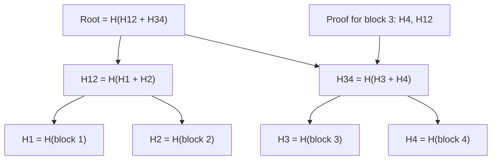

## In one minute
- A Merkle tree hashes data blocks at the leaves, then hashes pairs of hashes upward until a single **root hash** remains. The root commits to every byte below it: change anything and the root changes.
- Two parties can compare large datasets by comparing roots, then descending only into subtrees whose hashes differ. Finding a few differences among millions of items costs a few kilobytes of hashes, not a full transfer.
- A client can verify that one item belongs to a dataset with a **proof** of about `log2(n)` sibling hashes, with no need to download the rest.
- That is why Merkle trees appear in replica repair (Dynamo, Cassandra, Riak), Git, certificate transparency logs, blockchains, BitTorrent, IPFS, and file systems like ZFS.

## How it works

### Building the tree
Split the data into ordered blocks: file chunks, key ranges, log entries, or transactions. Each leaf is `H(block)`. Each internal node is `H(left || right)`, the hash of its two children's hashes concatenated. Repeat until one hash remains. With a cryptographic hash such as SHA-256, nobody can find a different set of blocks with the same root.

Two details matter in practice. First, **domain separation**: certificate transparency hashes leaves as `H(0x00 || data)` and internal nodes as `H(0x01 || left || right)`, so a crafted leaf can never be confused with an internal node. RFC 6962 defined this in 2013; RFC 9162 (CT version 2.0, 2021) formally obsoletes it but keeps the same tree hash ([RFC 9162](https://www.rfc-editor.org/rfc/rfc9162)). Second, **odd counts**: when a level has an odd number of nodes, some designs duplicate the last one. Bitcoin does this, and it let two different transaction lists produce the same root, a flaw tracked as CVE-2012-2459 ([Bitcoin wiki](https://en.bitcoin.it/wiki/Common_Vulnerabilities_and_Exposures)). The CT RFCs instead split `n` items at the largest power of two smaller than `n`, giving an unbalanced but unambiguous tree.

### Inclusion proofs
To prove block `i` is in a tree with root `R`, send the sibling hash at every level on the path from leaf `i` to the root. The verifier hashes the block, combines it with each sibling in the right order, and checks the result equals `R`. For a million leaves that is 20 hashes, 640 bytes with SHA-256. The verifier needs only to trust the root, which is small enough to sign, publish, or pin.

Certificate transparency also uses **consistency proofs**, showing that a later root extends an earlier one without rewriting history. Clients keep old tree heads, so they can check that no old record was altered or reordered without re-reading the log ([transparency.dev](https://transparency.dev/verifiable-data-structures/)).

### Comparing replicas (anti-entropy)
Two replicas each build a tree whose leaves hash the rows in fixed sub-ranges of the key space. They exchange roots; if they match, the replicas are identical. Otherwise they recurse only into mismatching children and stream just the differing leaf ranges. Network cost is proportional to the differences times the tree depth, not to data size.

Dynamo introduced this for background repair, keeping one tree per key range on each node, and Cassandra and Riak use it too. The cost moves to building the tree, which reads and hashes every row. Dynamo's paper names the other cost: when a node joins or leaves, many key ranges change and their trees must be rebuilt ([DeCandia et al., section 4.7](https://www.allthingsdistributed.com/files/amazon-dynamo-sosp2007.pdf)).

### Content addressing
Git, IPFS, and container images generalise the tree to a DAG: objects are named by the hash of their contents, so identical content is stored once and a commit hash pins a whole file tree.

## Down the stack

### Layer 1: The contract
With a collision-resistant hash, two equal roots mean equal data, and any change anywhere changes the root. An inclusion proof convinces anyone holding a trusted root that an item is at a given position, using `log2(n)` hashes. A tree comparison finds every differing leaf range while transferring a number of hashes proportional to the differences times the depth. None of this says anything about *which* replica is correct; the repair policy decides that.

### Layer 2: The mechanism
In Cassandra, `nodetool repair` starts a session per token range. The coordinator asks each replica to build a Merkle tree over its data for the range, hashing rows into leaves, and compares the returned trees pairwise. Replicas then stream the mismatching ranges to each other. Plain `nodetool repair` is incremental by default and covers only data written since the last incremental repair; `--full` covers everything ([Cassandra repair docs](https://cassandra.apache.org/doc/latest/cassandra/managing/operating/repair.html)). Tree size is bounded by memory, not a fixed depth: `repair_session_space` defaults to 1/16 of the heap ([cassandra.yaml](https://cassandra.apache.org/doc/latest/cassandra/managing/configuration/cass_yaml_file.html)). Repair used to need an external scheduler; Cassandra 6.0 adds a built-in one, backported to 5.0.8 and off by default ([Auto Repair](https://cassandra.apache.org/doc/latest/cassandra/managing/operating/auto_repair.html)).

Git's tree object is a concrete Merkle node: a header `tree <size>\0`, then entries of `<mode> <name>\0` followed by the 20-byte binary SHA-1 of the child (or 32 bytes in SHA-256 repositories), stored zlib-compressed under `.git/objects/`. Git plans to make SHA-256 the default for new repositories in Git 3.0, which has no release date, citing practical SHA-1 attacks ([Git BreakingChanges](https://git-scm.com/docs/BreakingChanges)). Certificate Transparency logs publish a Signed Tree Head containing the tree size, a timestamp, the SHA-256 root, and a signature, and serve `get-proof-by-hash` and `get-sth-consistency` endpoints for inclusion and consistency proofs. Newer logs use the Static CT API instead: the same hashes, but published as cacheable "tiles" of 256 hashes from which clients compute proofs themselves ([C2SP](https://c2sp.org/static-ct-api)). Chrome and Safari now accept these logs, still alongside at least one classic RFC 6962 log ([Let's Encrypt](https://letsencrypt.org/2025/06/11/reflections-on-a-year-of-sunlight.html)).

### Layer 3: The machine
Hashing is fast relative to disks. SHA-256 runs at roughly 400 to 500 MB/s per core in software and 1.5 to 2 GB/s with the SHA extensions on modern x86 and ARM cores, so building a tree over 2 TB is bound by how fast you are willing to read the disk, not by hashing. That read competes with live traffic for IOPS and page cache, which is why repairs are throttled.

Memory and network are small by comparison. A tree with 2^20 leaves of 32 bytes is 32 MB per range, and only mismatching paths are exchanged. Verifying a 20-step proof is 20 hashes of 65-byte inputs, a few microseconds. Streaming is the expensive part: Cassandra 4.0 added zero-copy streaming that sends whole SSTable files with kernel-level copies instead of re-serialising rows, cutting CPU per streamed byte.

### Why it's built this way
1. Comparing data directly means moving it, so replicas compare hashes instead.
2. One hash over everything only says "different", so hashes are arranged in a tree to localise the difference in `log n` steps.
3. Building leaves requires reading every byte, so trees are built in scheduled, throttled validation passes.
4. Leaf size trades memory against overstreaming, so systems tune depth and repair sub-ranges more often instead of building ever-larger trees.

## Diagram


## Worked example
A Cassandra-style cluster stores 2 TB per replica, about 4 billion rows of roughly 500 bytes. A weekly repair must bring three replicas back in sync after hinted handoff and read repair have missed some writes.

Each replica builds a Merkle tree per token range with depth 15: 32,768 leaves. Each leaf covers about 122,000 rows. Building requires reading all 2 TB; at a sustained 200 MB/s of spare disk bandwidth that is close to 3 hours per replica, which is why repair is scheduled and throttled. The finished tree is 32,768 leaves times 32 bytes, about 1 MB, plus internal nodes, so exchanging trees costs a few MB.

Suppose 1,000 rows differ, scattered randomly. Up to 1,000 leaves mismatch. Each mismatching leaf means the whole 122,000-row range is streamed, about 61 MB, so 1,000 leaves stream roughly 61 GB to fix 500 KB of real differences. This is **overstreaming**, a known operational pain of coarse trees.

The fixes all reduce the range per leaf: deeper trees (depth 20 gives about 4,000 rows per leaf, so about 2 GB streamed, but 32 times the tree memory), repairing smaller sub-ranges one at a time, or incremental repair that only covers data written since the last repair. Running repair more often also helps, because fewer differences accumulate between runs.

## In the wild
- **DigiCert, 2021: one flipped bit ends a CT log.** On 30 June, Cert Spotter found that the root computed from the first 65,569,149 entries of the Yeti 2022 log did not match its signed tree head. Entry 65,562,066 had "shifted one bit" before signing. Matching the bad hash would require a SHA-256 preimage and a corrected head would contradict the published one, so the log was made read-only. Certificates survived because browsers require SCTs from several logs ([Andrew Ayer](https://www.agwa.name/blog/post/how_ct_logs_fail)).
- **Bitcoin, 2012: duplicated leaves collide.** Because Bitcoin duplicates the last hash on odd levels, a block with a repeated transaction has the same Merkle root as the valid block. Announced on 14 May 2012 as CVE-2012-2459, rated easy to exploit, with network-split risk; fixed in 0.4.6, 0.5.5, 0.6.0.7 and 0.6.1rc2 ([Bitcoin wiki](https://en.bitcoin.it/wiki/Common_Vulnerabilities_and_Exposures)).
- **CWI and Google, 2017: SHAttered.** The first practical SHA-1 collision took about 6,500 CPU-years and 110 GPU-years of computation. Git, whose Merkle DAG trusts SHA-1, added collision detection, and its project now plans SHA-256 as the default for new repositories ([SHAttered](https://shattered.io/), [Git BreakingChanges](https://git-scm.com/docs/BreakingChanges)).

## Trade-offs
| Option | Strengths | Weaknesses | Choose when |
|---|---|---|---|
| Merkle tree comparison | Bandwidth proportional to differences, works between untrusted parties | Building requires reading all data; coarse leaves overstream | Large replicas that are mostly in sync |
| Full data transfer or checksum per row | Simple, exact | Transfers or compares everything | Small datasets, or a fresh replica |
| Change log / CDC replay | Ships only changes, cheap | Needs a durable, complete log; gaps are invisible | You already have a reliable replication log |
| Inclusion proofs with signed root | Clients verify items without trusting the server | Root must be distributed and trusted out of band | Transparency logs, verifiable downloads |

## Pitfalls in production
- **Ambiguous tree shapes.** Duplicating the last node on odd levels or omitting domain separation allows different inputs to share a root. Follow RFC 6962 style construction.
- **Overstreaming.** Coarse leaves turn a few differing rows into gigabytes of transfer. Size leaf ranges from the expected difference rate and repair often.
- **Trees built from different snapshots.** If replicas hash data at different moments, in-flight writes look like differences. Build from comparable snapshots or tolerate and re-check small differences.
- **A signed root you cannot reproduce.** Once a tree head is signed and published, any corruption under it is permanent, because nobody can find data that hashes to the bad value. Verify the recomputed root before signing, on separate hardware if you can.
- **Repair storms.** Building trees reads everything; running repair on all nodes at once saturates disks and raises latency. Schedule, throttle, and stagger repairs per range.

## Leadership lens
- Ask how replicas detect silent divergence today. If the answer is "they don't", background Merkle repair or periodic checksumming is cheap insurance.
- Treat repair as a capacity cost: budget disk bandwidth and time windows, and alert when a range has not been repaired within its deadline, because missed repairs can resurrect deleted data in tombstone-based stores.
- When designing verifiable logs or downloads, specify the hash construction in a document; interoperability and security depend on exact byte layouts.

## Check yourself
1. Why does comparing two replicas with Merkle trees cost bandwidth proportional to the differences rather than the data size?
   **Answer:** Matching subtrees are pruned as soon as their hashes agree, so only paths leading to differing leaves are explored, each costing a handful of hashes per level.
2. Why does RFC 6962 hash leaves and internal nodes with different prefixes?
   **Answer:** Without separation, an attacker could present an internal node's two child hashes as if they were a leaf's data, producing a different dataset with the same root.
3. A proof for one item in a tree of a billion leaves has how many hashes, and why so few?
   **Answer:** About 30, because each level halves the remaining leaves and the proof needs only one sibling per level.

## Practice
**Task:** Implement RFC 6962-style Merkle trees with a given hash `H(s)` (8-hex-digit FNV-1a, standing in for SHA-256). A leaf hash is `H("\x00" + data)`, an internal node is `H("\x01" + left + right)`, and the empty tree is `H("")`. For `n > 1` items, split at `k`, the largest power of two less than `n`. Implement `root(items)`, `proof(items, i)` returning sibling steps from the leaf upward as `(hash, sibling_is_left)` pairs, `verify(data, steps, root_hash)`, and `diff(a, b)` that returns the sorted indices where two equal-length lists differ by descending only into subtrees whose hashes differ. TypeScript: `root`, `proof`, `verify`, `diff`; Go: `Root`, `Proof` returning `[]Step`, `Verify`, `Diff`.

```python starter
def H(s):
    h = 2166136261
    for c in s.encode():
        h = ((h ^ c) * 16777619) & 0xFFFFFFFF
    return "%08x" % h

def root(items):
    raise NotImplementedError

def proof(items, i):
    raise NotImplementedError

def verify(data, steps, root_hash):
    raise NotImplementedError

def diff(a, b):
    raise NotImplementedError
```

```python tests
def test_empty_and_single():
    assert root([]) == H("")
    assert root(["x"]) == H("\x00x")

def test_root_detects_change_and_order():
    items = ["a", "b", "c", "d", "e"]
    assert root(items) != root(["a", "b", "c", "d", "E"])
    assert root(items) != root(["b", "a", "c", "d", "e"])

def test_two_leaf_root():
    assert root(["a", "b"]) == H("\x01" + H("\x00a") + H("\x00b"))

def test_proofs_verify_for_odd_size():
    items = ["t%d" % i for i in range(7)]
    r = root(items)
    for i in range(7):
        assert verify(items[i], proof(items, i), r)
    assert len(proof(items, 6)) == 2
    assert len(proof(["x"] * 1024, 5)) == 10

def test_tampering_fails():
    items = ["t%d" % i for i in range(7)]
    p = proof(items, 3)
    assert not verify("forged", p, root(items))
    assert not verify(items[3], p, root(items[:6]))

def test_diff_finds_changed_leaves():
    a = ["r%d" % i for i in range(32)]
    b = list(a)
    b[3], b[17] = "x", "y"
    assert diff(a, b) == [3, 17]
    assert diff(a, list(a)) == []
```

```python solution
def H(s):
    h = 2166136261
    for c in s.encode():
        h = ((h ^ c) * 16777619) & 0xFFFFFFFF
    return "%08x" % h

def _split(n):
    k = 1
    while k * 2 < n:
        k *= 2
    return k

def root(items):
    if not items:
        return H("")
    if len(items) == 1:
        return H("\x00" + items[0])
    k = _split(len(items))
    return H("\x01" + root(items[:k]) + root(items[k:]))

def proof(items, i):
    if len(items) <= 1:
        return []
    k = _split(len(items))
    if i < k:
        return proof(items[:k], i) + [(root(items[k:]), False)]
    return proof(items[k:], i - k) + [(root(items[:k]), True)]

def verify(data, steps, root_hash):
    h = H("\x00" + data)
    for sib, sib_is_left in steps:
        h = H("\x01" + sib + h) if sib_is_left else H("\x01" + h + sib)
    return h == root_hash

def diff(a, b, offset=0):
    if root(a) == root(b):
        return []
    if len(a) == 1:
        return [offset]
    k = _split(len(a))
    return diff(a[:k], b[:k], offset) + diff(a[k:], b[k:], offset + k)
```

```typescript starter
export function H(s: string): string {
  let h = 2166136261;
  for (let i = 0; i < s.length; i++) h = Math.imul(h ^ s.charCodeAt(i), 16777619) >>> 0;
  return h.toString(16).padStart(8, "0");
}
export type Step = [string, boolean];
export function root(items: string[]): string { throw new Error("TODO"); }
export function proof(items: string[], i: number): Step[] { throw new Error("TODO"); }
export function verify(data: string, steps: Step[], rootHash: string): boolean { throw new Error("TODO"); }
export function diff(a: string[], b: string[]): number[] { throw new Error("TODO"); }
```

```typescript tests
const ts = (n: number, p = "t") => Array.from({ length: n }, (_, i) => p + i);
test("empty and single", () => {
  assertEqual([root([]), root(["x"])], [H(""), H("\u0000x")]);
});
test("root detects change and order", () => {
  const items = ["a", "b", "c", "d", "e"];
  assert(root(items) !== root(["a", "b", "c", "d", "E"]), "change");
  assert(root(items) !== root(["b", "a", "c", "d", "e"]), "order");
});
test("two leaf root", () => {
  assertEqual(root(["a", "b"]), H("\u0001" + H("\u0000a") + H("\u0000b")));
});
test("proofs verify for odd size", () => {
  const items = ts(7), r = root(items);
  for (let i = 0; i < 7; i++) assert(verify(items[i], proof(items, i), r), "index " + i);
  assertEqual(proof(items, 6).length, 2);
  assertEqual(proof(new Array(1024).fill("x"), 5).length, 10);
});
test("tampering fails", () => {
  const items = ts(7), p = proof(items, 3);
  assert(!verify("forged", p, root(items)), "forged data");
  assert(!verify(items[3], p, root(items.slice(0, 6))), "wrong root");
});
test("diff finds changed leaves", () => {
  const a = ts(32, "r"), b = a.slice();
  b[3] = "x"; b[17] = "y";
  assertEqual(diff(a, b), [3, 17]);
  assertEqual(diff(a, a.slice()), []);
});
```

```typescript solution
export function H(s: string): string {
  let h = 2166136261;
  for (let i = 0; i < s.length; i++) h = Math.imul(h ^ s.charCodeAt(i), 16777619) >>> 0;
  return h.toString(16).padStart(8, "0");
}
export type Step = [string, boolean];
function split(n: number): number {
  let k = 1;
  while (k * 2 < n) k *= 2;
  return k;
}
export function root(items: string[]): string {
  if (items.length === 0) return H("");
  if (items.length === 1) return H("\u0000" + items[0]);
  const k = split(items.length);
  return H("\u0001" + root(items.slice(0, k)) + root(items.slice(k)));
}
export function proof(items: string[], i: number): Step[] {
  if (items.length <= 1) return [];
  const k = split(items.length);
  if (i < k) return [...proof(items.slice(0, k), i), [root(items.slice(k)), false]];
  return [...proof(items.slice(k), i - k), [root(items.slice(0, k)), true]];
}
export function verify(data: string, steps: Step[], rootHash: string): boolean {
  let h = H("\u0000" + data);
  for (const [sib, left] of steps) h = left ? H("\u0001" + sib + h) : H("\u0001" + h + sib);
  return h === rootHash;
}
export function diff(a: string[], b: string[], offset = 0): number[] {
  if (root(a) === root(b)) return [];
  if (a.length === 1) return [offset];
  const k = split(a.length);
  return [...diff(a.slice(0, k), b.slice(0, k), offset), ...diff(a.slice(k), b.slice(k), offset + k)];
}
```

```go starter
package practice

import "fmt"

// H is an 8-hex-digit FNV-1a hash standing in for SHA-256.
func H(s string) string {
	h := uint32(2166136261)
	for i := 0; i < len(s); i++ {
		h = (h ^ uint32(s[i])) * 16777619
	}
	return fmt.Sprintf("%08x", h)
}

// Step is one sibling hash on a proof path.
type Step struct {
	Hash string
	Left bool
}

func Root(items []string) string                            { panic("TODO") }
func Proof(items []string, i int) []Step                    { panic("TODO") }
func Verify(data string, steps []Step, rootHash string) bool { panic("TODO") }
func Diff(a, b []string) []int                              { panic("TODO") }
```

```go tests
package practice

import (
	"fmt"
	"reflect"
	"testing"
)

func items(n int, p string) []string {
	out := make([]string, n)
	for i := range out {
		out[i] = fmt.Sprint(p, i)
	}
	return out
}

func TestEmptyAndSingle(t *testing.T) {
	if Root(nil) != H("") || Root([]string{"x"}) != H("\x00x") {
		t.Fatal("base cases")
	}
}

func TestRootDetectsChangeAndOrder(t *testing.T) {
	r := Root([]string{"a", "b", "c", "d", "e"})
	if r == Root([]string{"a", "b", "c", "d", "E"}) || r == Root([]string{"b", "a", "c", "d", "e"}) {
		t.Fatal("root did not change")
	}
}

func TestTwoLeafRoot(t *testing.T) {
	if Root([]string{"a", "b"}) != H("\x01"+H("\x00a")+H("\x00b")) {
		t.Fatal("two leaf")
	}
}

func TestProofsVerify(t *testing.T) {
	it := items(7, "t")
	r := Root(it)
	for i := range it {
		if !Verify(it[i], Proof(it, i), r) {
			t.Fatal("index", i)
		}
	}
	big := make([]string, 1024)
	if len(Proof(it, 6)) != 2 || len(Proof(big, 5)) != 10 {
		t.Fatal("proof length")
	}
}

func TestTamperingFails(t *testing.T) {
	it := items(7, "t")
	p := Proof(it, 3)
	if Verify("forged", p, Root(it)) || Verify(it[3], p, Root(it[:6])) {
		t.Fatal("tampering accepted")
	}
}

func TestDiff(t *testing.T) {
	a := items(32, "r")
	b := append([]string(nil), a...)
	b[3], b[17] = "x", "y"
	if got := Diff(a, b); !reflect.DeepEqual(got, []int{3, 17}) {
		t.Fatal(got)
	}
	if got := Diff(a, append([]string(nil), a...)); len(got) != 0 {
		t.Fatal(got)
	}
}
```

```go solution
package practice

import "fmt"

// H is an 8-hex-digit FNV-1a hash standing in for SHA-256.
func H(s string) string {
	h := uint32(2166136261)
	for i := 0; i < len(s); i++ {
		h = (h ^ uint32(s[i])) * 16777619
	}
	return fmt.Sprintf("%08x", h)
}

// Step is one sibling hash on a proof path.
type Step struct {
	Hash string
	Left bool
}

func split(n int) int {
	k := 1
	for k*2 < n {
		k *= 2
	}
	return k
}

func Root(items []string) string {
	switch len(items) {
	case 0:
		return H("")
	case 1:
		return H("\x00" + items[0])
	}
	k := split(len(items))
	return H("\x01" + Root(items[:k]) + Root(items[k:]))
}

func Proof(items []string, i int) []Step {
	if len(items) <= 1 {
		return nil
	}
	k := split(len(items))
	if i < k {
		return append(Proof(items[:k], i), Step{Root(items[k:]), false})
	}
	return append(Proof(items[k:], i-k), Step{Root(items[:k]), true})
}

func Verify(data string, steps []Step, rootHash string) bool {
	h := H("\x00" + data)
	for _, s := range steps {
		if s.Left {
			h = H("\x01" + s.Hash + h)
		} else {
			h = H("\x01" + h + s.Hash)
		}
	}
	return h == rootHash
}

func diffAt(a, b []string, offset int) []int {
	if Root(a) == Root(b) {
		return nil
	}
	if len(a) == 1 {
		return []int{offset}
	}
	k := split(len(a))
	return append(diffAt(a[:k], b[:k], offset), diffAt(a[k:], b[k:], offset+k)...)
}

func Diff(a, b []string) []int {
	out := diffAt(a, b, 0)
	if out == nil {
		out = []int{}
	}
	return out
}
```

## Mock interview
**Prompt:** You operate a multi-region object store with 3 replicas of 500 million objects per bucket. Replication is asynchronous and occasionally loses updates. Design a background process that finds and fixes divergence without copying everything.

- Follow-up: What do the leaves of your tree represent, and how do you choose their granularity?
- Follow-up: Objects keep changing while you build the tree. How do you avoid reporting false differences?
- Follow-up: How would you let a customer verify that an object they downloaded matches what the bucket claims to hold?

**A strong answer covers:**
- Trees per key range with leaves over fixed sub-ranges, and a sizing argument linking leaf size to expected differences and overstreaming.
- Root exchange and top-down descent across regions, with a bandwidth estimate in hashes per level.
- Snapshot or version-bounded tree builds, plus a re-check before repair to ignore in-flight writes.
- Throttled, staggered scheduling and a deadline per range so deletes and tombstones are reconciled in time.
- Signed roots and inclusion proofs for customer verification, with domain-separated hashing.

## Sources and further study
**Primary**
- [RFC 9162: Certificate Transparency Version 2.0](https://www.rfc-editor.org/rfc/rfc9162): the current tree hash, proof definitions and v2 API, obsoleting RFC 6962.
- [C2SP: Static CT API](https://c2sp.org/static-ct-api): tile-based publication of the same Merkle tree, now used by new production logs.

**Systems docs**
- [Cassandra: Auto Repair](https://cassandra.apache.org/doc/latest/cassandra/managing/operating/auto_repair.html): the built-in repair scheduler, its repair types and history table.
- [Cassandra: cassandra.yaml](https://cassandra.apache.org/doc/latest/cassandra/managing/configuration/cass_yaml_file.html): `repair_session_space` and `concurrent_merkle_tree_requests`, the knobs that bound tree memory.
- [Git: BreakingChanges](https://git-scm.com/docs/BreakingChanges): why Git is moving new repositories from SHA-1 to SHA-256.

**Books**
- *Database Internals*, Alex Petrov, chapter 12 "Anti-Entropy and Dissemination": Merkle trees next to read repair, hinted handoff and bitmap version vectors.
- *Designing Data-Intensive Applications* (1st edition), Martin Kleppmann, chapter 5 "Replication", section "Leaderless Replication": where read repair and background anti-entropy fit.

**Other curricula**
- [transparency.dev: Verifiable data structures](https://transparency.dev/verifiable-data-structures/): frames Merkle trees as verifiable logs and maps, with inclusion, consistency and audit roles.
- [donnemartin/system-design-primer](https://github.com/donnemartin/system-design-primer): does not cover Merkle trees; replica repair is not discussed.

## Watch
- [CSE138 L14: Dynamo, Merkle trees, quorum consistency (Lindsey Kuper)](https://www.youtube.com/watch?v=9KX2wvAgVSo): a university lecture on how Dynamo uses Merkle trees for anti-entropy.
- [Merkle Tree with real world examples (Gaurav Sen)](https://www.youtube.com/watch?v=qHMLy5JjbjQ): construction, proofs, and where the structure shows up in practice.

## Free resources
- [RFC 6962: Certificate Transparency](https://www.rfc-editor.org/rfc/rfc6962): the precise Merkle tree hash, audit path, and consistency proof definitions.
- [DeCandia et al.: Dynamo (SOSP 2007)](https://www.allthingsdistributed.com/files/amazon-dynamo-sosp2007.pdf): section 4.7 describes Merkle-tree anti-entropy between replicas.
- [Apache Cassandra: Repair](https://cassandra.apache.org/doc/latest/cassandra/managing/operating/repair.html): how repair builds and compares trees, and incremental and full repair options.
- [Pro Git: Git Objects](https://git-scm.com/book/en/v2/Git-Internals-Git-Objects): content addressing and hash-linked trees in everyday tooling.
- [Wikipedia: Merkle tree](https://en.wikipedia.org/wiki/Merkle_tree): background, history, and the second-preimage issue.
