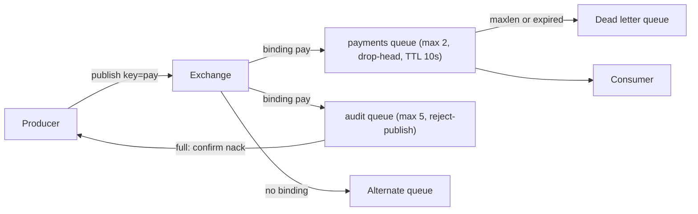

## In one minute
- A message broker is the server that sits between producers and consumers and owns messages while they are in transit: it accepts them, stores them, routes them, and delivers them under a stated contract.
- Queues and topics are what a broker offers. The broker's real work is the policy around them: confirms to producers, acks from consumers, flow control, expiry, length limits, dead-lettering and replication.
- Brokers split into two designs. **Smart brokers** (RabbitMQ, ActiveMQ, Azure Service Bus) track every message and route per message. **Log brokers** (Kafka, Pulsar, Redpanda) append to partitions and let consumers track their own position.
- A broker centralises failure as well as routing. Its limits, alarms and overflow policies decide what happens to producers and messages when consumers fall behind, so those settings are design decisions, not defaults to ignore.
- The protocol (AMQP 0-9-1, AMQP 1.0, MQTT, STOMP, the Kafka protocol) fixes many of these semantics, so choosing a broker is largely choosing a protocol.

## How it works

### What a broker does
Without a broker, a producer must know every recipient, retry each one, and hold undelivered messages itself. A broker takes that over with four jobs: **accept** (authenticate the producer and confirm receipt), **store** (durably, until delivered or expired), **route** (decide which queues or subscriptions get a copy), and **deliver** (hand messages to consumers, track acks, and redeliver).

The Message Queues and Pub/Sub lessons cover the two delivery shapes a broker exposes. This lesson is about the machine that implements them and the policies that sit around them.

The same structure is older than software brokers. An email server is a store-and-forward broker: Postfix accepts mail over SMTP, puts it in its incoming queue, moves it to the active queue for delivery, parks failed deliveries in the deferred queue for retry, and after `maximal_queue_lifetime` (5 days by default) bounces it back to the sender, which is dead-lettering by another name. The partial-failure and overload shapes are identical: what to do with a message nobody can take right now.

### Smart broker or log broker
A **smart broker** keeps state per message. RabbitMQ knows which messages in a queue are ready, which are unacked and by which channel, how many times each was delivered, and when each expires. That enables per-message routing, priorities, delays, TTLs and dead-lettering, and lets consumers stay simple. The cost is bookkeeping per message, which caps throughput per queue and makes deep backlogs expensive.

A **log broker** keeps state per partition. Kafka appends records and serves reads by offset; it does not know whether any single record was processed. Consumers commit one offset per partition. That makes the broker cheap per message and makes replay trivial, but per-message retry, delay and dead-lettering move into consumer code.

The line between the two has blurred. RabbitMQ added streams, an append-only log that consumers read without removing messages and can replay from an offset or a timestamp ([RabbitMQ streams](https://www.rabbitmq.com/docs/streams)). Kafka 4.2 went the other way: its share groups, production-ready since February 2026, keep a lock and a delivery count per record, so a Kafka cluster can act as a work queue ([Kafka 4.2 release](https://kafka.apache.org/blog/2026/02/17/apache-kafka-4.2.0-release-announcement/)). Pick the design by access pattern, then check which product offers it.

### Policies on the broker
Every serious broker exposes the same set of decisions, whatever it calls them:
- **Publisher confirms**: the broker tells the producer when a message is safely stored (AMQP `confirm.select`, Kafka `acks`).
- **Mandatory routing**: what happens to a message that matches no queue. RabbitMQ drops it silently unless the producer sets `mandatory` (the broker returns it) or the exchange has an alternate exchange.
- **Length limits and overflow**: when a queue is full, drop the oldest message or reject the new one. RabbitMQ drops the oldest by default, which surprises teams that expected the producer to hear about it ([RabbitMQ length limits](https://www.rabbitmq.com/docs/maxlength)).
- **Expiry**: a TTL per queue or per message, after which the message is discarded or dead-lettered.
- **Dead-lettering**: where messages go when rejected, expired, dropped for length, or delivered too many times (see the Dead Letter Queues lesson).

### Where brokers sit
Most systems run a central cluster; larger estates link clusters across regions (RabbitMQ federation and shovels, Kafka MirrorMaker 2). Inside a cluster, replication now runs on consensus logs. RabbitMQ 4.0 removed classic queue mirroring entirely after three years of deprecation, leaving quorum queues and streams as the replicated types ([RabbitMQ 4.0.1 release notes](https://github.com/rabbitmq/rabbitmq-server/releases/tag/v4.0.1)). Kafka 4.0 (March 2025) likewise runs entirely without ZooKeeper and keeps its metadata in its own Raft log, KRaft ([Kafka 4.0 release](https://kafka.apache.org/blog/2025/03/18/apache-kafka-4.0.0-release-announcement/)). Brokerless libraries such as ZeroMQ keep routing but drop storage, trading durability for latency.

## Down the stack

### Layer 1: The contract
A broker with publisher confirms promises that once it acks a message, the message is stored with the configured durability (on disk, and on a quorum of replicas for replicated queues) and will be delivered at least once to each queue it was routed to, unless a declared policy removes it: TTL expiry, a length limit with drop-head, or a delivery limit. A rejected publish (a `basic.nack` under reject-publish overflow, or a returned unroutable message) means the broker did not take responsibility, and the producer must retry or handle it. Every removal by policy is either silent or dead-lettered, depending on configuration; the contract is only as good as that configuration.

### Layer 2: The mechanism
AMQP 0-9-1 makes the policies concrete as queue arguments: `x-max-length` or `x-max-length-bytes`, `x-overflow` set to `drop-head`, `reject-publish` or `reject-publish-dlx`, `x-message-ttl`, `x-dead-letter-exchange` and `x-dead-letter-routing-key`, and on quorum queues `x-delivery-limit`. Since RabbitMQ 4.0 that limit defaults to 20 rather than unlimited, so a message redelivered 20 times is dropped, or dead-lettered if a dead-letter exchange is set ([RabbitMQ quorum queues](https://www.rabbitmq.com/docs/quorum-queues)). Upgrading teams that relied on endless requeue lose messages silently unless they add a DLX. When a message is dead-lettered, RabbitMQ adds an `x-death` header recording the source queue, the reason (`rejected`, `expired`, `maxlen` or `delivery_limit`) and a count, so the consumer of the dead-letter queue knows what happened ([RabbitMQ dead lettering](https://www.rabbitmq.com/docs/dlx)).

Expiry has a subtle mechanism. A classic queue with a per-queue TTL expires from the head, which is exact because every message has the same TTL and messages arrive in order. With per-message TTLs, a long-lived message at the head can shield already-expired messages behind it until it is consumed or expires itself.

Flow control is protocol-specific. AMQP 0-9-1 relies on TCP backpressure and the broker blocking publishing connections (`connection.blocked`) when a memory or disk alarm fires. AMQP 1.0 uses explicit **link credit**: the receiver sends a `flow` frame granting N credits, and the sender may send N `transfer` frames, settled by `disposition` frames ([AMQP 1.0 spec](https://docs.oasis-open.org/amqp/core/v1.0/os/amqp-core-overview-v1.0-os.html)). This is no longer niche: RabbitMQ 4.0 made AMQP 1.0 a core protocol that is always on. Kafka has no per-message flow control at all; consumers pull batches by byte limits such as `fetch.max.bytes`.

Replication differs too: RabbitMQ quorum queues confirm once a Raft majority has the message, while Kafka followers fetch from the partition leader and `acks=all` waits for every in-sync replica.

### Layer 3: The machine
In RabbitMQ every queue is an Erlang process, scheduled on the BEAM's per-core schedulers. One queue's throughput is bounded by one process handling messages serially, typically tens of thousands per second, so throughput comes from many queues, not one big one. Messages pass between connection, channel and queue processes with an internal credit-flow scheme, so a slow queue process slows the publishing connection rather than letting mailboxes grow without limit.

A quorum queue confirm costs a Raft round trip plus a write to the log, which RabbitMQ syncs to disk in batches: roughly 1 to 2 ms across availability zones before disk time. Kafka, by default, does not `fsync` per write. It acknowledges once the record is in the page cache of all in-sync replicas and relies on replication rather than the disk for durability; its docs advise leaving the forced-flush settings off ([Kafka topic configs](https://kafka.apache.org/42/configuration/topic-configs/)), which is why Kafka sustains hundreds of MB per second per broker with sequential writes.

The broker's memory is the shared resource every tenant competes for. A RabbitMQ node raises a memory alarm at its high watermark, 60% of detected RAM by default ([RabbitMQ memory](https://www.rabbitmq.com/docs/memory)). Memory and disk alarms are cluster-wide: once one node is over, every node blocks every publishing connection, while connections that only consume keep going ([RabbitMQ alarms](https://www.rabbitmq.com/docs/alarms)). A single unconsumed queue growing to millions of messages on one node can therefore stall unrelated producers on all of them, which is the strongest argument for length limits on every queue.

### Why it's built this way
1. Producers should not track consumers or hold undelivered messages, so an intermediary takes custody and confirms it.
2. Custody means storage, and storage is finite, so brokers need limits, expiry, and a defined fate for messages that hit them.
3. Tracking every message enables rich routing but costs bookkeeping per message, so high-volume systems moved to logs that track one offset per consumer.
4. A shared broker turns one tenant's backlog into everyone's memory pressure, so brokers block publishers at the edge and isolate tenants with per-queue limits.

## Diagram


## Worked example
A food-delivery company runs one RabbitMQ cluster of three nodes with 16 GB of RAM each, shared by 40 teams. Orders publish 3,000 messages per second at dinner peak, average 2 KB.

The promotions team's consumer crashes on Friday at 18:00. Its queue receives 1,500 messages per second and nobody notices. After an hour it holds 5.4 million messages, about 11 GB of payload. Messages are paged to disk, but the queue index and in-flight data push the node's memory past its high watermark. The alarm is cluster-wide, so all three nodes block publishing connections. The order service stops being able to publish, even though it connects to a different node. A promotions outage has become an ordering outage.

The fix is policy, set centrally. Promotions are worthless after 15 minutes, so the queue gets `x-message-ttl` of 900,000 ms, which caps the backlog at 15 × 60 × 1,500 = 1.35 million messages, about 2.7 GB. That is still too much for a shared node, so `x-max-length-bytes` of 512 MB with `drop-head` bounds it at about 260,000 messages, dead-lettering the overflow to a small capped queue for inspection. The order queues, where every message matters, get `reject-publish` instead: if they fill, producers receive `basic.nack` and can retry or alert, rather than losing orders silently. Finally, an alarm on consumer count reaching zero for any queue catches the crash in the first minute.

## In the wild
- **Jepsen, 2014: RabbitMQ mirrored queues lose acknowledged messages.** Under random network partitions, with publisher confirms on and `pause_minority` set, a rejoining node threw away its queue state and took the primary's. About 35% of acknowledged enqueues (1,312 messages) were lost, with 24 duplicate deliveries. The analysis advised against automatic partition handling for data that matters. Classic mirroring was later deprecated and, in RabbitMQ 4.0, removed in favour of Raft-based quorum queues ([Jepsen](https://aphyr.com/posts/315-call-me-maybe-rabbitmq)).
- **Cloudflare, 2023: a "highly available" control plane depended on single-site Kafka.** When the PDX-04 facility lost power, services designed to survive losing a site turned out to rely on Kafka and ClickHouse that ran only there. Most control-plane services moved to the disaster-recovery site in about 6 hours, analytics and logs took about 41, and some logs were lost for good. Cloudflare now requires generally available products to use the HA cluster and tests removing whole facilities ([Cloudflare](https://blog.cloudflare.com/post-mortem-on-cloudflare-control-plane-and-analytics-outage/)).
- **Honeycomb, 2025: a Kafka cluster loses redundancy and fills its disks.** About a quarter of event partitions in the EU cluster were left without a leader, unbalanced brokers filled their disks, and ingest was switched off with under 5% disk left. Customers saw about 6 hours of full ingest outage and SLO processing delayed by about 18 hours. The team rehearsed and then ran a full move to a new cluster, producers first and consumers after ([Honeycomb](https://status.honeycomb.io/incidents/pjzh0mtqw3vt)).

## Trade-offs
| Option | Strengths | Weaknesses | Choose when |
|---|---|---|---|
| Smart broker (RabbitMQ, ActiveMQ, Service Bus) | Per-message routing, TTL, priorities, DLX, simple consumers | Per-message bookkeeping, deep backlogs hurt, per-queue ceiling | Task distribution and routing at moderate volume |
| Log broker (Kafka, Pulsar, Redpanda) | Huge throughput, replay, many consumers cheaply | No per-message retry or delay, partitions limit parallelism | Event streams, CDC, analytics feeds |
| Managed broker (SQS/SNS, Google Pub/Sub, Amazon MQ) | No operations, elastic | Fewer knobs, per-request cost, vendor semantics | Teams without broker expertise |
| Brokerless (ZeroMQ, NATS core) | Lowest latency, no central storage | No durability, peers handle failure | Ephemeral signals inside one system |

## Pitfalls in production
- **Unroutable messages vanish.** A typo in a binding means publishes succeed and go nowhere. Publish with `mandatory`, or attach an alternate exchange and alarm on its depth.
- **Confirms off "for speed".** Without confirms, a broker crash loses whatever was in flight and the producer never knows. Turn on confirms and batch them; the throughput cost is small next to the risk.
- **No limits on any queue.** One abandoned queue fills memory and blocks every publisher in the cluster. Set length or byte limits on every queue by policy, with drop-head for disposable data and reject-publish for data that must not be lost.
- **Requeue loops.** A consumer that rejects with requeue on a permanent error spins forever. Use a delivery limit and dead-lettering, as quorum queues do with `x-delivery-limit`.
- **One broker for everything.** Mixing critical and best-effort workloads on one cluster couples their failures. Separate clusters by criticality. Virtual hosts with limits help with queue and connection counts, but they do not contain a memory alarm, which is cluster-wide.

## Leadership lens
- Treat broker policy (limits, TTLs, overflow, dead-lettering) as reviewed configuration owned by a platform team, applied by default to every queue, rather than per-team arguments that are easy to forget.
- In design review, ask for each message type: what happens when the queue is full, when the consumer is down for an hour, and when the broker node dies. Each answer should name a setting.
- A shared broker is a shared failure domain. Decide which workloads may share a cluster, and budget for separate clusters where an outage in one team's consumer must not stop orders or payments.
- Pick a smart broker or a log broker from the access pattern, not fashion: per-message routing and retries favour the first, replay and very high volume the second. Running both is common and acceptable.

## Check yourself
1. A RabbitMQ publish to an exchange with no matching binding returns no error. Why, and how do you detect it?
   **Answer:** By default, AMQP 0-9-1 discards unroutable messages, and a confirm only means the broker handled the publish. Set `mandatory` so the broker returns it, or configure an alternate exchange and monitor it.
2. When should a queue use drop-head rather than reject-publish?
   **Answer:** Drop-head suits data whose value decays, such as telemetry or promotions, where the newest message matters most. Reject-publish suits data that must not be lost silently, because it pushes the problem back to the producer as a nack.
3. Why can one team's stalled consumer stop another team's producer on the same RabbitMQ cluster?
   **Answer:** The backlog grows one node's memory past its high watermark, and because memory alarms are cluster-wide, every node then blocks all publishing connections, not just the one feeding the backlog.
4. Why is a log broker cheaper per message than a smart broker?
   **Answer:** It stores one offset per consumer group and partition instead of per-message delivery state, so there is no per-message ack write, and reads are sequential and cache-friendly.

## Practice
**Task:** Implement a broker's queue policies with an injected clock (a function returning seconds). `declare_queue(name, max_length, overflow, ttl, dlq)` creates a queue; `max_length` 0 means unlimited, `overflow` is `"drop-head"` or `"reject-publish"`, `ttl` 0 means no expiry, and `dlq` is a dead-letter queue name or `""`. `bind(key, queue)` adds a direct binding and `set_alternate(queue)` names the queue for unroutable messages. Before any operation touches a queue, it expires messages whose age (`now - enqueued_at`) is at least `ttl`, from the head. `publish(key, body)` routes to the bound queues in binding order (each once), or to the alternate queue if none match, returning `"returned"` if there is neither; for a full queue, drop-head removes the oldest message and then appends, and reject-publish skips that queue. It returns `"nack"` if any target queue rejected, otherwise `"ack"`. `get(queue)` pops the oldest body or returns `None` (`null`, Go `"", false`), and `depth(queue)` counts messages. Every message removed by expiry or drop-head is recorded in `deaths()` as `(body, queue, reason)` with reason `"expired"` or `"maxlen"`, and appended to the queue's `dlq` if set, ignoring that queue's limits.

```python starter
class Broker:
    def __init__(self, clock):
        self.clock = clock

    def declare_queue(self, name, max_length, overflow, ttl, dlq):
        # TODO
        raise NotImplementedError

    def bind(self, key, queue):
        # TODO
        raise NotImplementedError

    def set_alternate(self, queue):
        # TODO
        raise NotImplementedError

    def publish(self, key, body):
        # TODO
        raise NotImplementedError

    def get(self, queue):
        # TODO
        raise NotImplementedError

    def depth(self, queue):
        # TODO
        raise NotImplementedError

    def deaths(self):
        # TODO
        raise NotImplementedError
```

```python tests
class Clock:
    def __init__(self):
        self.t = 0

    def __call__(self):
        return self.t


def test_direct_routing_and_unroutable():
    b = Broker(Clock())
    b.declare_queue("q1", 0, "drop-head", 0, "")
    b.declare_queue("q2", 0, "drop-head", 0, "")
    b.bind("pay", "q1")
    b.bind("pay", "q2")
    b.bind("pay", "q1")
    assert b.publish("pay", "p1") == "ack"
    assert b.depth("q1") == 1 and b.depth("q2") == 1
    assert b.publish("nope", "x") == "returned"


def test_alternate_queue_catches_unroutable():
    b = Broker(Clock())
    b.declare_queue("alt", 0, "drop-head", 0, "")
    b.set_alternate("alt")
    assert b.publish("typo", "x") == "ack"
    assert b.get("alt") == "x"
    assert b.get("alt") is None


def test_drop_head_dead_letters_oldest():
    b = Broker(Clock())
    b.declare_queue("dead", 0, "drop-head", 0, "")
    b.declare_queue("q", 2, "drop-head", 0, "dead")
    b.bind("k", "q")
    for m in ["m1", "m2", "m3"]:
        assert b.publish("k", m) == "ack"
    assert [b.get("q"), b.get("q")] == ["m2", "m3"]
    assert b.deaths() == [("m1", "q", "maxlen")]
    assert b.get("dead") == "m1"


def test_reject_publish_nacks_but_other_queue_accepts():
    b = Broker(Clock())
    b.declare_queue("small", 1, "reject-publish", 0, "")
    b.declare_queue("big", 0, "drop-head", 0, "")
    b.bind("k", "small")
    b.bind("k", "big")
    assert b.publish("k", "a") == "ack"
    assert b.publish("k", "b") == "nack"
    assert b.get("small") == "a" and b.get("small") is None
    assert b.depth("big") == 2
    assert b.deaths() == []


def test_ttl_expiry_dead_letters_on_get():
    c = Clock()
    b = Broker(c)
    b.declare_queue("dead", 0, "drop-head", 0, "")
    b.declare_queue("q", 0, "drop-head", 10, "dead")
    b.bind("k", "q")
    b.publish("k", "old")
    c.t = 5
    b.publish("k", "new")
    c.t = 10
    assert b.get("q") == "new"
    assert b.deaths() == [("old", "q", "expired")]
    assert b.get("dead") == "old"


def test_depth_purges_expired():
    c = Clock()
    b = Broker(c)
    b.declare_queue("q", 0, "drop-head", 3, "")
    b.bind("k", "q")
    b.publish("k", "a")
    b.publish("k", "b")
    c.t = 2
    assert b.depth("q") == 2
    c.t = 3
    assert b.depth("q") == 0
    assert len(b.deaths()) == 2


def test_expiry_runs_before_length_check():
    c = Clock()
    b = Broker(c)
    b.declare_queue("q", 1, "reject-publish", 10, "")
    b.bind("k", "q")
    b.publish("k", "a")
    c.t = 10
    assert b.publish("k", "b") == "ack", "a expired, so there is room"
    assert b.deaths() == [("a", "q", "expired")]
    assert b.get("q") == "b"
```

```python solution
from collections import deque


class Broker:
    def __init__(self, clock):
        self.clock = clock
        self.queues = {}
        self.bindings = {}
        self.alternate = ""
        self.dead = []

    def declare_queue(self, name, max_length, overflow, ttl, dlq):
        self.queues[name] = {"max": max_length, "overflow": overflow, "ttl": ttl,
                             "dlq": dlq, "msgs": deque()}

    def bind(self, key, queue):
        targets = self.bindings.setdefault(key, [])
        if queue not in targets:
            targets.append(queue)

    def set_alternate(self, queue):
        self.alternate = queue

    def _kill(self, name, body, reason):
        self.dead.append((body, name, reason))
        dlq = self.queues[name]["dlq"]
        if dlq:
            self.queues[dlq]["msgs"].append((body, self.clock()))

    def _expire(self, name):
        q = self.queues[name]
        if q["ttl"] <= 0:
            return
        now = self.clock()
        while q["msgs"] and now - q["msgs"][0][1] >= q["ttl"]:
            body, _ = q["msgs"].popleft()
            self._kill(name, body, "expired")

    def publish(self, key, body):
        targets = self.bindings.get(key, [])
        if not targets:
            if not self.alternate:
                return "returned"
            targets = [self.alternate]
        result = "ack"
        for name in targets:
            self._expire(name)
            q = self.queues[name]
            if q["max"] > 0 and len(q["msgs"]) >= q["max"]:
                if q["overflow"] == "reject-publish":
                    result = "nack"
                    continue
                old, _ = q["msgs"].popleft()
                self._kill(name, old, "maxlen")
            q["msgs"].append((body, self.clock()))
        return result

    def get(self, queue):
        self._expire(queue)
        msgs = self.queues[queue]["msgs"]
        if not msgs:
            return None
        return msgs.popleft()[0]

    def depth(self, queue):
        self._expire(queue)
        return len(self.queues[queue]["msgs"])

    def deaths(self):
        return list(self.dead)
```

```typescript starter
export type Death = [string, string, string];

export class Broker {
  constructor(public clock: () => number) {}
  declareQueue(name: string, maxLength: number, overflow: string, ttl: number, dlq: string): void {
    throw new Error("TODO");
  }
  bind(key: string, queue: string): void {
    throw new Error("TODO");
  }
  setAlternate(queue: string): void {
    throw new Error("TODO");
  }
  publish(key: string, body: string): string {
    throw new Error("TODO");
  }
  get(queue: string): string | null {
    throw new Error("TODO");
  }
  depth(queue: string): number {
    throw new Error("TODO");
  }
  deaths(): Death[] {
    throw new Error("TODO");
  }
}
```

```typescript tests
function mk() {
  const c = { t: 0 };
  return { b: new Broker(() => c.t), c };
}

test("direct routing and unroutable", () => {
  const { b } = mk();
  b.declareQueue("q1", 0, "drop-head", 0, "");
  b.declareQueue("q2", 0, "drop-head", 0, "");
  b.bind("pay", "q1");
  b.bind("pay", "q2");
  b.bind("pay", "q1");
  assertEqual(b.publish("pay", "p1"), "ack");
  assertEqual([b.depth("q1"), b.depth("q2")], [1, 1]);
  assertEqual(b.publish("nope", "x"), "returned");
});
test("alternate queue catches unroutable", () => {
  const { b } = mk();
  b.declareQueue("alt", 0, "drop-head", 0, "");
  b.setAlternate("alt");
  assertEqual(b.publish("typo", "x"), "ack");
  assertEqual(b.get("alt"), "x");
  assertEqual(b.get("alt"), null);
});
test("drop head dead letters oldest", () => {
  const { b } = mk();
  b.declareQueue("dead", 0, "drop-head", 0, "");
  b.declareQueue("q", 2, "drop-head", 0, "dead");
  b.bind("k", "q");
  for (const m of ["m1", "m2", "m3"]) assertEqual(b.publish("k", m), "ack");
  assertEqual([b.get("q"), b.get("q")], ["m2", "m3"]);
  assertEqual(b.deaths(), [["m1", "q", "maxlen"]]);
  assertEqual(b.get("dead"), "m1");
});
test("reject publish nacks but other queue accepts", () => {
  const { b } = mk();
  b.declareQueue("small", 1, "reject-publish", 0, "");
  b.declareQueue("big", 0, "drop-head", 0, "");
  b.bind("k", "small");
  b.bind("k", "big");
  assertEqual(b.publish("k", "a"), "ack");
  assertEqual(b.publish("k", "b"), "nack");
  assertEqual([b.get("small"), b.get("small")], ["a", null]);
  assertEqual(b.depth("big"), 2);
  assertEqual(b.deaths(), []);
});
test("ttl expiry dead letters on get", () => {
  const { b, c } = mk();
  b.declareQueue("dead", 0, "drop-head", 0, "");
  b.declareQueue("q", 0, "drop-head", 10, "dead");
  b.bind("k", "q");
  b.publish("k", "old");
  c.t = 5;
  b.publish("k", "new");
  c.t = 10;
  assertEqual(b.get("q"), "new");
  assertEqual(b.deaths(), [["old", "q", "expired"]]);
  assertEqual(b.get("dead"), "old");
});
test("depth purges expired", () => {
  const { b, c } = mk();
  b.declareQueue("q", 0, "drop-head", 3, "");
  b.bind("k", "q");
  b.publish("k", "a");
  b.publish("k", "b");
  c.t = 2;
  assertEqual(b.depth("q"), 2);
  c.t = 3;
  assertEqual(b.depth("q"), 0);
  assertEqual(b.deaths().length, 2);
});
test("expiry runs before length check", () => {
  const { b, c } = mk();
  b.declareQueue("q", 1, "reject-publish", 10, "");
  b.bind("k", "q");
  b.publish("k", "a");
  c.t = 10;
  assertEqual(b.publish("k", "b"), "ack", "a expired, so there is room");
  assertEqual(b.deaths(), [["a", "q", "expired"]]);
  assertEqual(b.get("q"), "b");
});
```

```typescript solution
export type Death = [string, string, string];

interface Queue {
  max: number;
  overflow: string;
  ttl: number;
  dlq: string;
  msgs: [string, number][];
}

export class Broker {
  private queues = new Map<string, Queue>();
  private bindings = new Map<string, string[]>();
  private alternate = "";
  private dead: Death[] = [];

  constructor(public clock: () => number) {}

  declareQueue(name: string, maxLength: number, overflow: string, ttl: number, dlq: string): void {
    this.queues.set(name, { max: maxLength, overflow, ttl, dlq, msgs: [] });
  }

  bind(key: string, queue: string): void {
    const t = this.bindings.get(key) ?? [];
    if (!t.includes(queue)) t.push(queue);
    this.bindings.set(key, t);
  }

  setAlternate(queue: string): void {
    this.alternate = queue;
  }

  private kill(name: string, body: string, reason: string): void {
    this.dead.push([body, name, reason]);
    const dlq = this.queues.get(name)!.dlq;
    if (dlq) this.queues.get(dlq)!.msgs.push([body, this.clock()]);
  }

  private expire(name: string): void {
    const q = this.queues.get(name)!;
    if (q.ttl <= 0) return;
    const now = this.clock();
    while (q.msgs.length > 0 && now - q.msgs[0][1] >= q.ttl) {
      const [body] = q.msgs.shift()!;
      this.kill(name, body, "expired");
    }
  }

  publish(key: string, body: string): string {
    let targets = this.bindings.get(key) ?? [];
    if (targets.length === 0) {
      if (!this.alternate) return "returned";
      targets = [this.alternate];
    }
    let result = "ack";
    for (const name of targets) {
      this.expire(name);
      const q = this.queues.get(name)!;
      if (q.max > 0 && q.msgs.length >= q.max) {
        if (q.overflow === "reject-publish") {
          result = "nack";
          continue;
        }
        const [old] = q.msgs.shift()!;
        this.kill(name, old, "maxlen");
      }
      q.msgs.push([body, this.clock()]);
    }
    return result;
  }

  get(queue: string): string | null {
    this.expire(queue);
    const m = this.queues.get(queue)!.msgs.shift();
    return m ? m[0] : null;
  }

  depth(queue: string): number {
    this.expire(queue);
    return this.queues.get(queue)!.msgs.length;
  }

  deaths(): Death[] {
    return this.dead.map((d) => [d[0], d[1], d[2]] as Death);
  }
}
```

```go starter
package practice

type Death struct {
	Body   string
	Queue  string
	Reason string
}

type Broker struct {
	clock func() int
}

func NewBroker(clock func() int) *Broker { return &Broker{clock: clock} }

func (b *Broker) DeclareQueue(name string, maxLength int, overflow string, ttl int, dlq string) {
	panic("TODO")
}
func (b *Broker) Bind(key, queue string)             { panic("TODO") }
func (b *Broker) SetAlternate(queue string)          { panic("TODO") }
func (b *Broker) Publish(key, body string) string    { panic("TODO") }
func (b *Broker) Get(queue string) (string, bool)    { panic("TODO") }
func (b *Broker) Depth(queue string) int             { panic("TODO") }
func (b *Broker) Deaths() []Death                    { panic("TODO") }
```

```go tests
package practice

import (
	"reflect"
	"testing"
)

func mk() (*Broker, *int) {
	t := 0
	return NewBroker(func() int { return t }), &t
}

func same(t *testing.T, got, want interface{}) {
	t.Helper()
	if !reflect.DeepEqual(got, want) {
		t.Fatalf("got %v, want %v", got, want)
	}
}

func get(b *Broker, q string) string {
	v, ok := b.Get(q)
	if !ok {
		return "<none>"
	}
	return v
}

func TestDirectRoutingAndUnroutable(t *testing.T) {
	b, _ := mk()
	b.DeclareQueue("q1", 0, "drop-head", 0, "")
	b.DeclareQueue("q2", 0, "drop-head", 0, "")
	b.Bind("pay", "q1")
	b.Bind("pay", "q2")
	b.Bind("pay", "q1")
	same(t, b.Publish("pay", "p1"), "ack")
	same(t, []int{b.Depth("q1"), b.Depth("q2")}, []int{1, 1})
	same(t, b.Publish("nope", "x"), "returned")
}

func TestAlternateQueueCatchesUnroutable(t *testing.T) {
	b, _ := mk()
	b.DeclareQueue("alt", 0, "drop-head", 0, "")
	b.SetAlternate("alt")
	same(t, b.Publish("typo", "x"), "ack")
	same(t, get(b, "alt"), "x")
	same(t, get(b, "alt"), "<none>")
}

func TestDropHeadDeadLettersOldest(t *testing.T) {
	b, _ := mk()
	b.DeclareQueue("dead", 0, "drop-head", 0, "")
	b.DeclareQueue("q", 2, "drop-head", 0, "dead")
	b.Bind("k", "q")
	for _, m := range []string{"m1", "m2", "m3"} {
		same(t, b.Publish("k", m), "ack")
	}
	same(t, []string{get(b, "q"), get(b, "q")}, []string{"m2", "m3"})
	same(t, b.Deaths(), []Death{{"m1", "q", "maxlen"}})
	same(t, get(b, "dead"), "m1")
}

func TestRejectPublishNacksButOtherQueueAccepts(t *testing.T) {
	b, _ := mk()
	b.DeclareQueue("small", 1, "reject-publish", 0, "")
	b.DeclareQueue("big", 0, "drop-head", 0, "")
	b.Bind("k", "small")
	b.Bind("k", "big")
	same(t, b.Publish("k", "a"), "ack")
	same(t, b.Publish("k", "b"), "nack")
	same(t, []string{get(b, "small"), get(b, "small")}, []string{"a", "<none>"})
	same(t, b.Depth("big"), 2)
	same(t, len(b.Deaths()), 0)
}

func TestTTLExpiryDeadLettersOnGet(t *testing.T) {
	b, now := mk()
	b.DeclareQueue("dead", 0, "drop-head", 0, "")
	b.DeclareQueue("q", 0, "drop-head", 10, "dead")
	b.Bind("k", "q")
	b.Publish("k", "old")
	*now = 5
	b.Publish("k", "new")
	*now = 10
	same(t, get(b, "q"), "new")
	same(t, b.Deaths(), []Death{{"old", "q", "expired"}})
	same(t, get(b, "dead"), "old")
}

func TestDepthPurgesExpired(t *testing.T) {
	b, now := mk()
	b.DeclareQueue("q", 0, "drop-head", 3, "")
	b.Bind("k", "q")
	b.Publish("k", "a")
	b.Publish("k", "b")
	*now = 2
	same(t, b.Depth("q"), 2)
	*now = 3
	same(t, b.Depth("q"), 0)
	same(t, len(b.Deaths()), 2)
}

func TestExpiryRunsBeforeLengthCheck(t *testing.T) {
	b, now := mk()
	b.DeclareQueue("q", 1, "reject-publish", 10, "")
	b.Bind("k", "q")
	b.Publish("k", "a")
	*now = 10
	same(t, b.Publish("k", "b"), "ack")
	same(t, b.Deaths(), []Death{{"a", "q", "expired"}})
	same(t, get(b, "q"), "b")
}
```

```go solution
package practice

import "sync"

type Death struct {
	Body   string
	Queue  string
	Reason string
}

type stored struct {
	body string
	at   int
}

type queue struct {
	max      int
	overflow string
	ttl      int
	dlq      string
	msgs     []stored
}

type Broker struct {
	mu        sync.Mutex
	clock     func() int
	queues    map[string]*queue
	bindings  map[string][]string
	alternate string
	dead      []Death
}

func NewBroker(clock func() int) *Broker {
	return &Broker{clock: clock, queues: map[string]*queue{}, bindings: map[string][]string{}}
}

func (b *Broker) DeclareQueue(name string, maxLength int, overflow string, ttl int, dlq string) {
	b.mu.Lock()
	defer b.mu.Unlock()
	b.queues[name] = &queue{max: maxLength, overflow: overflow, ttl: ttl, dlq: dlq}
}

func (b *Broker) Bind(key, q string) {
	b.mu.Lock()
	defer b.mu.Unlock()
	for _, x := range b.bindings[key] {
		if x == q {
			return
		}
	}
	b.bindings[key] = append(b.bindings[key], q)
}

func (b *Broker) SetAlternate(q string) {
	b.mu.Lock()
	defer b.mu.Unlock()
	b.alternate = q
}

func (b *Broker) kill(name, body, reason string) {
	b.dead = append(b.dead, Death{body, name, reason})
	if dlq := b.queues[name].dlq; dlq != "" {
		d := b.queues[dlq]
		d.msgs = append(d.msgs, stored{body, b.clock()})
	}
}

func (b *Broker) expire(name string) {
	q := b.queues[name]
	if q.ttl <= 0 {
		return
	}
	now := b.clock()
	for len(q.msgs) > 0 && now-q.msgs[0].at >= q.ttl {
		body := q.msgs[0].body
		q.msgs = q.msgs[1:]
		b.kill(name, body, "expired")
	}
}

func (b *Broker) Publish(key, body string) string {
	b.mu.Lock()
	defer b.mu.Unlock()
	targets := b.bindings[key]
	if len(targets) == 0 {
		if b.alternate == "" {
			return "returned"
		}
		targets = []string{b.alternate}
	}
	result := "ack"
	for _, name := range targets {
		b.expire(name)
		q := b.queues[name]
		if q.max > 0 && len(q.msgs) >= q.max {
			if q.overflow == "reject-publish" {
				result = "nack"
				continue
			}
			old := q.msgs[0].body
			q.msgs = q.msgs[1:]
			b.kill(name, old, "maxlen")
		}
		q.msgs = append(q.msgs, stored{body, b.clock()})
	}
	return result
}

func (b *Broker) Get(name string) (string, bool) {
	b.mu.Lock()
	defer b.mu.Unlock()
	b.expire(name)
	q := b.queues[name]
	if len(q.msgs) == 0 {
		return "", false
	}
	body := q.msgs[0].body
	q.msgs = q.msgs[1:]
	return body, true
}

func (b *Broker) Depth(name string) int {
	b.mu.Lock()
	defer b.mu.Unlock()
	b.expire(name)
	return len(b.queues[name].msgs)
}

func (b *Broker) Deaths() []Death {
	b.mu.Lock()
	defer b.mu.Unlock()
	return append([]Death{}, b.dead...)
}
```

## Mock interview
**Prompt:** Your company runs one shared RabbitMQ cluster for 60 services, carrying 20,000 messages per second at peak, from payments to marketing emails. Twice this quarter one team's backlog has blocked publishers across the cluster. Propose a broker strategy for the next year.

- Follow-up: What exact policies would you apply to every queue by default, and which queues get exceptions?
- Follow-up: A node dies during peak. What happens to unconfirmed publishes and unacked deliveries, and what must producers and consumers do?
- Follow-up: The data team wants to replay last week's order events. Does that belong on this cluster?

**A strong answer covers:**
- Default policies for length or byte limits, TTLs for perishable data, dead-lettering with capped DLQs, and delivery limits, applied centrally.
- Separation by criticality: payments and orders isolated from best-effort traffic in their own cluster, since a memory alarm on any node blocks publishers across the whole cluster, virtual hosts included.
- Quorum queues, publisher confirms and manual acks for critical flows, and idempotent consumers to absorb redelivery after failover.
- Replay and analytics moved to a log broker such as Kafka, fed from the same events, rather than stretching the smart broker.
- Alerting on consumer count zero, oldest message age, and memory headroom per node.

## Sources and further study
**Primary**
- [Jepsen: RabbitMQ (Kyle Kingsbury, 2014)](https://aphyr.com/posts/315-call-me-maybe-rabbitmq): how mirrored queues lost confirmed messages under partitions, and why a broker is not a lock service.
- [KIP-932: Queues for Kafka](https://cwiki.apache.org/confluence/display/KAFKA/KIP-932:+Queues+for+Kafka): how a log broker gained per-record locks, delivery counts and acknowledgements.

**Systems docs**
- [RabbitMQ: Memory and disk alarms](https://www.rabbitmq.com/docs/alarms): which connections are blocked, and why the alarms are cluster-wide.
- [RabbitMQ: Quorum queues](https://www.rabbitmq.com/docs/quorum-queues): Raft replication, the default delivery limit and poison-message handling.
- [RabbitMQ: Queue length limits](https://www.rabbitmq.com/docs/maxlength): drop-head, reject-publish and reject-publish-dlx, and what confirms report.
- [Apache Kafka topic configuration](https://kafka.apache.org/42/configuration/topic-configs/): retention, `min.insync.replicas` and the flush settings the docs recommend leaving alone.

**Books**
- *Designing Data-Intensive Applications* (1st ed.), Martin Kleppmann, Ch 11 "Stream Processing": the "Transmitting Event Streams" section contrasts AMQP-style brokers with partitioned logs.
- *System Design Interview, Volume 2*, Alex Xu and Sahn Lam, Ch 4 "Distributed Message Queue": an interview walkthrough of building a log-based broker.

**Other curricula**
- [Azure Architecture Center: Publisher-Subscriber pattern](https://learn.microsoft.com/en-us/azure/architecture/patterns/publisher-subscriber): frames the broker as the input and output channels between senders and subscribers, with issues such as poison messages and duplicates.
- [donnemartin/system-design-primer](https://github.com/donnemartin/system-design-primer): names Redis, RabbitMQ and SQS as brokers in one line each, noting that Redis can lose messages; it does not discuss broker policies.

## Watch
- [RabbitMQ & Kafka (VMware Tanzu)](https://www.youtube.com/watch?v=7Faly8jORIw): a smart broker and a log broker compared, and when to pick each.
- [RabbitMQ vs Kafka, trade-offs to choose one over the other (Tech Primers)](https://www.youtube.com/watch?v=GMmRtSFQ5Z0): the two broker designs compared through an event-driven case study.

## Free resources
- [AMQP 0-9-1 model explained (RabbitMQ)](https://www.rabbitmq.com/tutorials/amqp-concepts): exchanges, bindings, queues, acknowledgements and the broker's responsibilities.
- [AMQP 1.0 core specification overview (OASIS)](https://docs.oasis-open.org/amqp/core/v1.0/os/amqp-core-overview-v1.0-os.html): links, credit-based flow control and settlement in the standard protocol.
- [Apache Kafka design documentation](https://kafka.apache.org/documentation/): why a log broker leaves offsets to consumers and relies on the page cache.
- [Message Broker (Enterprise Integration Patterns)](https://www.enterpriseintegrationpatterns.com/patterns/messaging/MessageBroker.html): the classic description of the broker as a hub that decouples destinations.
- [Avoiding insurmountable queue backlogs (AWS Builders' Library)](https://aws.amazon.com/builders-library/avoiding-insurmountable-queue-backlogs/): how shared queueing infrastructure isolates tenants and sheds stale work.
