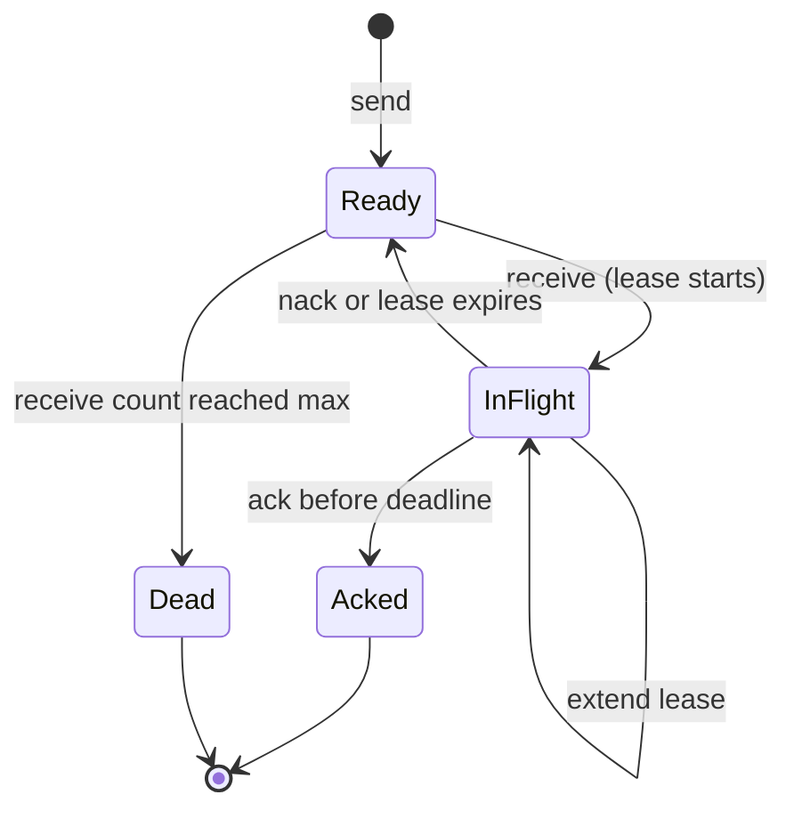

## In one minute
- A message queue is a durable buffer between producers and consumers. Each message is meant to be processed by exactly one consumer from a pool of competing consumers (point-to-point).
- It decouples the two sides in time, rate and failure: producers keep accepting work while consumers are slow, deploying or down, and a burst becomes a backlog instead of a wall of errors.
- Delivery works by **lease and acknowledge**: a consumer takes a message, it becomes invisible to others, and it is removed only on ack. If the consumer dies, the lease expires and someone else gets it. That is at-least-once delivery.
- Ordering is the expensive guarantee. Real systems order per key (a message group or partition) and pay with head-of-line blocking inside that key.
- A queue's health is the **age of its oldest message** and the gap between arrival and completion rates, not its depth alone.

## How it works

### Point-to-point and competing consumers
A producer sends a message and moves on. The queue stores it durably and hands it to one of N consumers that pull from it. Adding consumers adds throughput, because they compete for messages rather than each receiving a copy. That is the defining difference from pub/sub (see the Pub/Sub lesson), where every subscription gets its own copy.

This is the overload and partial-failure problem shape. A queue lets the slow or failing side of a system fall behind without the fast side noticing. The same structure appears in the Linux kernel: a listening socket has an accept queue sized by the `listen()` backlog (capped by `net.core.somaxconn`, 4096 by default since kernel 5.4). Handshaken connections wait there for `accept()`, and when it is full the kernel drops new ones. Both fail the same way: too small a buffer sheds work, too large a one hides an outage behind latency.

### Lease, ack, redelivery
A message moves through a small state machine. It is **ready** after it is sent. A receive moves it to **in flight**, leased to one consumer until a deadline. SQS calls this the visibility timeout: 30 seconds by default, and extensions can never push it past 12 hours from the first receive ([SQS visibility timeout](https://docs.aws.amazon.com/AWSSimpleQueueService/latest/SQSDeveloperGuide/sqs-visibility-timeout.html)). RabbitMQ calls the message unacknowledged and guards it with `consumer_timeout`, 30 minutes by default; when it fires, the broker closes the whole channel and requeues everything that channel held ([RabbitMQ consumers](https://www.rabbitmq.com/docs/consumers)). An **ack** deletes it. A **nack**, or an expired lease, makes it ready again and increments its receive count. After too many receives it goes to a dead letter queue (see the Dead Letter Queues lesson).

The broker cannot tell a slow consumer from a dead one, so once the lease runs out it redelivers. A merely slow consumer then finds its ack rejected while another consumer holds the same message. SQS standard queues go further and say a message may occasionally arrive twice even inside the visibility timeout. Duplicates are therefore part of the contract, which is why the Delivery Semantics lesson ends at at-least-once plus idempotent handlers (see the Idempotency lesson).

### Ordering and its price
A FIFO queue with one consumer is strictly ordered and has the throughput of one consumer. Add a second and message 2 can finish before message 1; any retry also reorders.

The practical answer is ordering per key. SQS FIFO calls the key a message group ID: while any message from group `order-42` is in flight, no other message from that group is handed out, but other groups flow freely. Kafka gets the same effect with partitions. The cost is **head-of-line blocking**: one slow or poisoned message stalls everything behind it in its group until it is acked or dead-lettered. Key by what truly needs order, such as one customer's ledger, not all payments. A FIFO queue without high-throughput mode is also capped at 300 calls per second per API action, or 3,000 messages per second with batches of 10 ([SQS quotas](https://docs.aws.amazon.com/AWSSimpleQueueService/latest/SQSDeveloperGuide/quotas-messages.html)).

Fairness is a different problem from order. In a queue shared by many tenants, one tenant's burst fills the backlog and everyone else waits behind it. Since July 2025 SQS standard queues treat a `MessageGroupId` as a tenant label: when one tenant holds far more in-flight messages than the rest, SQS hands out the other tenants' messages first, without promising any order ([SQS fair queues](https://docs.aws.amazon.com/AWSSimpleQueueService/latest/SQSDeveloperGuide/sqs-fair-queues.html)). Elsewhere you get the same effect with one queue per tenant class and a worker that polls them in turn.

### Flow control
Consumers pull, so the queue never pushes more than they ask for. **Prefetch** (RabbitMQ's `basic.qos`, or up to 10 messages per SQS receive) caps how many unacked messages a consumer may hold: too low and it idles between round trips, too high and one consumer hoards work while others starve. **Long polling** (SQS `WaitTimeSeconds` up to 20) holds an empty receive open until a message arrives, cutting empty responses and cost.

On the producer side, a bounded queue is backpressure: when full, it rejects or blocks the producer instead of growing forever. Google's SRE book gives the same advice for request queues inside servers: under steady load, keep the queue at half the thread pool or less, so excess work is rejected early instead of waiting until it is useless ([Google SRE book](https://sre.google/sre-book/addressing-cascading-failures/)).

## Down the stack

### Layer 1: The contract
Once the broker acknowledges a send, the message survives a broker crash (for durable queues) and will be delivered to some consumer at least once. It stays until it is acked, exceeds its maximum receive count, or ages past retention (4 days by default in SQS, at most 14, per the [SQS quotas](https://docs.aws.amazon.com/AWSSimpleQueueService/latest/SQSDeveloperGuide/quotas-messages.html)). While leased, no other consumer receives it; after the lease expires it can be redelivered, so a consumer must finish and ack within the lease or extend it. Standard queues promise no order. FIFO queues promise order within a group, and only while consumers ack in order. Nothing promises exactly-once processing.

### Layer 2: The mechanism
Underneath, a queue is two structures: a ready list in arrival order, and an in-flight set indexed by lease deadline (a heap or timer wheel) so expired leases can be found without scanning. Each message carries an ID, a receive count, and a per-delivery token: SQS returns a new receipt handle on every receive, and only the latest handle can delete the message, which is how a slow consumer's late ack is rejected. RabbitMQ numbers deliveries per channel with a `delivery-tag` and acks with `basic.ack` or `basic.nack` with `requeue`.

Redis Streams show the structure plainly. `XREADGROUP` moves entries into the consumer group's **pending entries list** (PEL), with owner, delivery count and last-delivery time. `XACK` removes them. `XAUTOCLAIM` transfers entries idle longer than a threshold to another consumer, which is lease expiry done by the client ([Redis Streams](https://redis.io/docs/latest/develop/data-types/streams/)).

Kafka now has the same state machine. Share groups ("queues for Kafka", KIP-932) became production-ready in Kafka 4.2 in February 2026 ([Kafka 4.2 release](https://kafka.apache.org/blog/2026/02/17/apache-kafka-4.2.0-release-announcement/)). Consumers in a share group read the same partitions at once. Each record they fetch is locked to them for 30 seconds by default and carries a delivery count. The consumer answers ACCEPT, RELEASE (try again) or REJECT (never again). After 5 deliveries by default the record is archived, not redelivered, and redeliveries can arrive after later offsets ([KIP-932](https://cwiki.apache.org/confluence/display/KAFKA/KIP-932:+Queues+for+Kafka)). That is a lease-and-ack queue on top of a log.

A relational database can be a queue too. With Postgres's `SELECT ... FOR UPDATE SKIP LOCKED` (since 9.5), each worker locks the first ready row nobody else holds, so workers do not serialise on the head of the table ([Postgres SELECT](https://www.postgresql.org/docs/current/sql-select.html)). The ack is a `DELETE` in the same transaction as the work, which gives exactly-once effects when the work touches the same database.

### Layer 3: The machine
Every message costs at least two durable writes: the send, and the ack that deletes it. A log such as Kafka avoids the second by storing a consumer offset once per batch, which is a big part of why logs are cheaper per message. A durable send means an `fsync`: tens of microseconds on an NVMe drive with power-loss protection, and milliseconds on drives without it. Brokers therefore group-commit, batching many messages into one `fsync`, and producers batch sends to amortise round trips (an SQS batch carries up to 10 messages).

Queues are fastest when nearly empty. RabbitMQ classic queues page old messages to disk as the backlog grows, adding disk reads exactly when the system is behind. In Postgres, each lease `UPDATE` and ack `DELETE` leaves a dead tuple, so a long-running transaction that holds back vacuum makes every dequeue scan past dead rows.

### Why it's built this way
1. Producers and consumers fail, deploy and scale on different schedules, so a durable buffer sits between them.
2. A consumer can crash halfway through work, and nobody can tell slow from dead, so delivery is a lease that expires instead of a delete on hand-off. That makes duplicates unavoidable.
3. Each delivery and ack is a durable write and a round trip, so brokers group-commit, batch and prefetch.
4. Strict global order would mean one consumer, so ordering is scoped to a key and its cost stays inside that key.
5. Memory, disk and patience are finite, so queues get length limits, retention, and dead-lettering.

## Diagram


## Worked example
A photo service generates thumbnails. Uploads average 300 per second and peak at 1,500 per second for 10 minutes after a marketing push. A job takes 200 ms on one core, and the fleet runs 100 single-core workers, so capacity is 100 × 5 = 500 jobs per second.

During the peak the queue grows at 1,500 − 500 = 1,000 messages per second, reaching 600,000 messages after 10 minutes. By Little's law, a message arriving at the end waits about 600,000 / 500 = 1,200 seconds, 20 minutes. Afterwards the spare capacity is 500 − 300 = 200 per second, so draining takes 3,000 seconds, 50 minutes. Depth alone (600,000) does not tell you whether that is acceptable; the age of the oldest message (20 minutes) does. If thumbnails must appear within 2 minutes, autoscale on age and be ready to triple the fleet to 300 workers within a minute or two, or throttle the push at the source.

The p99 job takes 2 seconds, so a 30-second visibility timeout leaves slack. A 3-second one would redeliver on every GC pause, doubling work exactly during the peak.

Cost on SQS standard at about $0.40 per million requests: 300 per second is 26 million messages a day. Sending, receiving and deleting one at a time is 78 million requests, about $31 a day. Batching 10 per call cuts that to roughly $3, plus empty receives, which long polling keeps small.

## In the wild
- **Slack, about 2016: a full Redis job queue could neither enqueue nor dequeue.** Database contention slowed job execution until the Redis-backed queue hit its memory limit. New jobs were refused, so every feature that used the queue failed. Dequeuing also needed spare memory to move a job onto an in-flight list, so the queue stayed stuck after the database recovered and needed lengthy manual repair. At the time the queue ran over 1.4 billion jobs on busy days, peaking at 33,000 per second. Slack put Kafka in front of Redis as a durable buffer, so enqueues keep working during a backlog ([Slack Engineering](https://slack.engineering/scaling-slacks-job-queue/)).
- **AWS, 2025: queued retries push EC2's lease manager into congestive collapse.** After the DynamoDB DNS failure on 19–20 October, EC2's DropletWorkflow Manager had to re-establish leases with a huge fleet of hosts at once. Lease attempts timed out, their retries were queued, and the service stopped making progress. Engineers throttled incoming work and restarted hosts to clear the queues; launches recovered at 5:28 AM PDT, and every EC2 API was normal only by 1:50 PM. AWS's fix is to rate-limit incoming work based on the size of the waiting queue ([AWS](https://aws.amazon.com/message/101925/)).
- **GitHub, 2018: a backlog outlives its usefulness.** During the 24-hour degradation after a 43-second network partition, more than 5 million webhook events and 80,000 Pages builds queued up, and about 200,000 webhook payloads passed their internal TTL and were dropped. A backlog that drains too late is the stale-work problem in the Pitfalls below ([GitHub](https://github.blog/2018-10-30-oct21-post-incident-analysis/)).

## Trade-offs
| Option | Strengths | Weaknesses | Choose when |
|---|---|---|---|
| Managed queue (SQS, Cloud Tasks) | No servers, scales without planning, DLQ built in | Per-request cost, polling latency, limited ordering | Decoupling services in one cloud |
| Broker queue (RabbitMQ, ActiveMQ) | Low latency push, prefetch, rich routing | You run it; deep backlogs hurt; one queue has a throughput ceiling | Task queues at moderate scale with routing needs |
| Database as queue (Postgres `SKIP LOCKED`) | Enqueue in the same transaction as business data; no new system | Vacuum and lock overhead past thousands per second | Jobs tied to database writes, modest rates |
| Log used as queue (Kafka, Redis Streams) | Replay, cheap per message, ordered partitions | Consumer groups cap parallelism at the partition count and have no per-message retry; Kafka share groups (4.2+) add both but give up order | High volume, ordered processing, replay needed |

## Pitfalls in production
- **Lease shorter than processing.** Work regularly outlives the visibility timeout, so every slow job runs twice or more and load spirals. Set the lease from p99 processing time with margin, and extend it from a heartbeat for long jobs.
- **Requeue at the head forever.** A `basic.nack` with `requeue=true` on a message that always fails puts it straight back, and consumers spin on it at full CPU. Cap receives and dead-letter, and add a delay before retry.
- **Scaling on depth.** A depth of 10,000 is fine for a fast consumer and a crisis for a slow one. Alarm and autoscale on age of oldest message (SQS exposes `ApproximateAgeOfOldestMessage`).
- **Stale backlog.** After a 6-hour outage the queue replays 6 hours of password-reset emails nobody wants. Give messages a deadline and drop expired ones at the consumer.
- **One hot ordering key.** All messages share a group ID such as the tenant name, and the largest tenant serialises everyone. Order only what must be ordered and choose a finer key.

## Leadership lens
- Ask what the oldest acceptable message age is for each queue, and make that the alarm and the autoscaling target. It turns "the queue is big" into a business decision.
- Require every consumer to be idempotent before it ships. Duplicates are part of the contract, and retrofitting idempotency after a double-charge is expensive.
- A Postgres-backed queue is often the right first step for a small team because it removes a whole system to operate. Write down the rate (a few thousand jobs per second) at which you would move off it.

## Check yourself
1. A consumer finishes a job in 45 seconds with a 30-second visibility timeout. What happens to its ack and why?
   **Answer:** The lease expired at 30 seconds and the message became visible, so another consumer may already hold it with a new receipt. The old receipt is stale and the delete fails or is ignored, and the job runs twice.
2. Why does adding consumers to a FIFO queue with a single message group not increase throughput?
   **Answer:** Only one message from a group can be in flight at a time, so the group is processed serially no matter how many consumers exist. Parallelism comes from having many groups.
3. Why is a high prefetch count risky for slow, uneven jobs?
   **Answer:** One consumer reserves many messages while others sit idle, and if it crashes all of them wait for their leases to expire before anyone else can work on them.
4. Why do message queues usually cost more per message than a log like Kafka?
   **Answer:** A queue tracks state per message, so each ack is another durable write and round trip. A log stores one offset per consumer group and commits it per batch.

## Practice
**Task:** Build a FIFO queue with message groups and leases. `GroupQueue(visibility, max_receives, clock)` takes a lease length in seconds and a clock function returning the current time. `send(group, body)` returns IDs `m1`, `m2`, and so on. `receive()` first returns every in-flight message whose deadline is at or before now to ready (it keeps its position), then scans messages in send order and leases the first ready message whose group has nothing in flight: if that message's receive count already equals `max_receives` it is moved to the DLQ instead and the scan continues; otherwise its count increments, its deadline becomes `now + visibility`, and `(id, body)` is returned (TypeScript `{id, body}` or `null`, Go `(Message, bool)`). `ack(id)` and `nack(id)` (back to ready immediately, count kept) return true only for a message currently in flight after expiring leases; `extend(id, seconds)` sets its deadline to `now + seconds` under the same rule. `dlq()` lists dead-lettered IDs in order.

```python starter
class GroupQueue:
    def __init__(self, visibility, max_receives, clock):
        self.visibility = visibility
        self.max_receives = max_receives
        self.clock = clock

    def send(self, group, body):
        # TODO
        raise NotImplementedError

    def receive(self):
        # TODO
        raise NotImplementedError

    def ack(self, mid):
        # TODO
        raise NotImplementedError

    def nack(self, mid):
        # TODO
        raise NotImplementedError

    def extend(self, mid, seconds):
        # TODO
        raise NotImplementedError

    def dlq(self):
        # TODO
        raise NotImplementedError
```

```python tests
class Clock:
    def __init__(self):
        self.t = 0

    def __call__(self):
        return self.t


def make(visibility=30, max_receives=3):
    c = Clock()
    return GroupQueue(visibility, max_receives, c), c


def test_group_blocks_while_in_flight():
    q, c = make()
    q.send("A", "a1")
    q.send("B", "b1")
    q.send("A", "a2")
    assert q.receive() == ("m1", "a1")
    assert q.receive() == ("m2", "b1")
    assert q.receive() is None, "A is locked by m1"
    assert q.ack("m1")
    assert q.receive() == ("m3", "a2")


def test_oldest_eligible_first_across_groups():
    q, c = make()
    for g, b in [("A", "1"), ("B", "2"), ("B", "3"), ("C", "4")]:
        q.send(g, b)
    got = [q.receive()[0] for _ in range(3)]
    assert got == ["m1", "m2", "m4"]


def test_lease_expiry_redelivers_and_rejects_late_ack():
    q, c = make(visibility=30)
    q.send("A", "x")
    q.receive()
    c.t = 29
    assert q.receive() is None
    c.t = 30
    assert not q.ack("m1"), "lease expired at 30"
    assert q.receive() == ("m1", "x")


def test_nack_keeps_position_in_group():
    q, c = make()
    q.send("A", "first")
    q.send("A", "second")
    q.receive()
    assert q.nack("m1")
    assert q.receive() == ("m1", "first")


def test_extend_lease():
    q, c = make(visibility=30)
    q.send("A", "x")
    q.receive()
    c.t = 20
    assert q.extend("m1", 30)
    c.t = 40
    assert q.receive() is None
    c.t = 45
    assert q.ack("m1")
    assert q.receive() is None


def test_dead_letter_unblocks_group():
    q, c = make(max_receives=2)
    q.send("A", "poison")
    q.send("A", "ok")
    for _ in range(2):
        assert q.receive()[0] == "m1"
        q.nack("m1")
    assert q.receive() == ("m2", "ok")
    assert q.dlq() == ["m1"]


def test_unknown_and_double_ack():
    q, c = make()
    assert not q.ack("m9")
    q.send("A", "x")
    q.receive()
    assert q.ack("m1")
    assert not q.ack("m1")
    assert not q.nack("m1")
    assert not q.extend("m1", 10)
```

```python solution
class GroupQueue:
    def __init__(self, visibility, max_receives, clock):
        self.visibility = visibility
        self.max_receives = max_receives
        self.clock = clock
        self.next_id = 1
        self.order = []
        self.msgs = {}
        self.dead = []

    def send(self, group, body):
        mid = "m" + str(self.next_id)
        self.next_id += 1
        self.msgs[mid] = {"group": group, "body": body, "count": 0, "deadline": None}
        self.order.append(mid)
        return mid

    def _expire(self):
        now = self.clock()
        for m in self.msgs.values():
            if m["deadline"] is not None and m["deadline"] <= now:
                m["deadline"] = None

    def receive(self):
        self._expire()
        locked = set(m["group"] for m in self.msgs.values() if m["deadline"] is not None)
        for mid in list(self.order):
            m = self.msgs[mid]
            if m["group"] in locked:
                continue
            if m["count"] >= self.max_receives:
                self.order.remove(mid)
                del self.msgs[mid]
                self.dead.append(mid)
                continue
            m["count"] += 1
            m["deadline"] = self.clock() + self.visibility
            return (mid, m["body"])
        return None

    def _in_flight(self, mid):
        self._expire()
        m = self.msgs.get(mid)
        return m is not None and m["deadline"] is not None

    def ack(self, mid):
        if not self._in_flight(mid):
            return False
        self.order.remove(mid)
        del self.msgs[mid]
        return True

    def nack(self, mid):
        if not self._in_flight(mid):
            return False
        self.msgs[mid]["deadline"] = None
        return True

    def extend(self, mid, seconds):
        if not self._in_flight(mid):
            return False
        self.msgs[mid]["deadline"] = self.clock() + seconds
        return True

    def dlq(self):
        return list(self.dead)
```

```typescript starter
export interface Message {
  id: string;
  body: string;
}

export class GroupQueue {
  constructor(public visibility: number, public maxReceives: number, public clock: () => number) {}
  send(group: string, body: string): string {
    throw new Error("TODO");
  }
  receive(): Message | null {
    throw new Error("TODO");
  }
  ack(id: string): boolean {
    throw new Error("TODO");
  }
  nack(id: string): boolean {
    throw new Error("TODO");
  }
  extend(id: string, seconds: number): boolean {
    throw new Error("TODO");
  }
  dlq(): string[] {
    throw new Error("TODO");
  }
}
```

```typescript tests
function setup(visibility = 30, maxReceives = 3) {
  const c = { t: 0 };
  const q = new GroupQueue(visibility, maxReceives, () => c.t);
  return { q, c };
}

test("group blocks while in flight", () => {
  const { q } = setup();
  q.send("A", "a1");
  q.send("B", "b1");
  q.send("A", "a2");
  assertEqual(q.receive(), { id: "m1", body: "a1" });
  assertEqual(q.receive(), { id: "m2", body: "b1" });
  assertEqual(q.receive(), null, "A is locked by m1");
  assert(q.ack("m1"));
  assertEqual(q.receive(), { id: "m3", body: "a2" });
});
test("oldest eligible first across groups", () => {
  const { q } = setup();
  for (const [g, b] of [["A", "1"], ["B", "2"], ["B", "3"], ["C", "4"]]) q.send(g, b);
  const got: string[] = [];
  for (let i = 0; i < 3; i++) got.push(q.receive()!.id);
  assertEqual(got, ["m1", "m2", "m4"]);
});
test("lease expiry redelivers and rejects late ack", () => {
  const { q, c } = setup(30);
  q.send("A", "x");
  q.receive();
  c.t = 29;
  assertEqual(q.receive(), null);
  c.t = 30;
  assert(!q.ack("m1"), "lease expired at 30");
  assertEqual(q.receive(), { id: "m1", body: "x" });
});
test("nack keeps position in group", () => {
  const { q } = setup();
  q.send("A", "first");
  q.send("A", "second");
  q.receive();
  assert(q.nack("m1"));
  assertEqual(q.receive(), { id: "m1", body: "first" });
});
test("extend lease", () => {
  const { q, c } = setup(30);
  q.send("A", "x");
  q.receive();
  c.t = 20;
  assert(q.extend("m1", 30));
  c.t = 40;
  assertEqual(q.receive(), null);
  c.t = 45;
  assert(q.ack("m1"));
  assertEqual(q.receive(), null);
});
test("dead letter unblocks group", () => {
  const { q } = setup(30, 2);
  q.send("A", "poison");
  q.send("A", "ok");
  for (let i = 0; i < 2; i++) {
    assertEqual(q.receive()!.id, "m1");
    q.nack("m1");
  }
  assertEqual(q.receive(), { id: "m2", body: "ok" });
  assertEqual(q.dlq(), ["m1"]);
});
test("unknown and double ack", () => {
  const { q } = setup();
  assert(!q.ack("m9"));
  q.send("A", "x");
  q.receive();
  assert(q.ack("m1"));
  assert(!q.ack("m1"));
  assert(!q.nack("m1"));
  assert(!q.extend("m1", 10));
});
```

```typescript solution
export interface Message {
  id: string;
  body: string;
}

interface Entry {
  group: string;
  body: string;
  count: number;
  deadline: number | null;
}

export class GroupQueue {
  private nextId = 1;
  private order: string[] = [];
  private msgs = new Map<string, Entry>();
  private dead: string[] = [];

  constructor(public visibility: number, public maxReceives: number, public clock: () => number) {}

  send(group: string, body: string): string {
    const id = "m" + this.nextId++;
    this.msgs.set(id, { group, body, count: 0, deadline: null });
    this.order.push(id);
    return id;
  }

  private expire(): void {
    const now = this.clock();
    for (const m of this.msgs.values()) {
      if (m.deadline !== null && m.deadline <= now) m.deadline = null;
    }
  }

  private remove(id: string): void {
    this.order = this.order.filter((x) => x !== id);
    this.msgs.delete(id);
  }

  receive(): Message | null {
    this.expire();
    const locked = new Set<string>();
    for (const m of this.msgs.values()) if (m.deadline !== null) locked.add(m.group);
    for (const id of [...this.order]) {
      const m = this.msgs.get(id)!;
      if (locked.has(m.group)) continue;
      if (m.count >= this.maxReceives) {
        this.remove(id);
        this.dead.push(id);
        continue;
      }
      m.count++;
      m.deadline = this.clock() + this.visibility;
      return { id, body: m.body };
    }
    return null;
  }

  private inFlight(id: string): Entry | null {
    this.expire();
    const m = this.msgs.get(id);
    return m && m.deadline !== null ? m : null;
  }

  ack(id: string): boolean {
    if (!this.inFlight(id)) return false;
    this.remove(id);
    return true;
  }

  nack(id: string): boolean {
    const m = this.inFlight(id);
    if (!m) return false;
    m.deadline = null;
    return true;
  }

  extend(id: string, seconds: number): boolean {
    const m = this.inFlight(id);
    if (!m) return false;
    m.deadline = this.clock() + seconds;
    return true;
  }

  dlq(): string[] {
    return [...this.dead];
  }
}
```

```go starter
package practice

type Message struct {
	ID   string
	Body string
}

type GroupQueue struct {
	visibility  int
	maxReceives int
	clock       func() int
}

func NewGroupQueue(visibility, maxReceives int, clock func() int) *GroupQueue {
	return &GroupQueue{visibility: visibility, maxReceives: maxReceives, clock: clock}
}

func (q *GroupQueue) Send(group, body string) string         { panic("TODO") }
func (q *GroupQueue) Receive() (Message, bool)               { panic("TODO") }
func (q *GroupQueue) Ack(id string) bool                     { panic("TODO") }
func (q *GroupQueue) Nack(id string) bool                    { panic("TODO") }
func (q *GroupQueue) Extend(id string, seconds int) bool     { panic("TODO") }
func (q *GroupQueue) DLQ() []string                          { panic("TODO") }
```

```go tests
package practice

import (
	"reflect"
	"testing"
)

func setup(visibility, maxReceives int) (*GroupQueue, *int) {
	t := 0
	return NewGroupQueue(visibility, maxReceives, func() int { return t }), &t
}

func want(t *testing.T, q *GroupQueue, id, body string) {
	t.Helper()
	m, ok := q.Receive()
	if !ok || m.ID != id || m.Body != body {
		t.Fatalf("got %v %v, want %s %s", m, ok, id, body)
	}
}

func wantNone(t *testing.T, q *GroupQueue) {
	t.Helper()
	if m, ok := q.Receive(); ok {
		t.Fatalf("expected nothing, got %v", m)
	}
}

func TestGroupBlocksWhileInFlight(t *testing.T) {
	q, _ := setup(30, 3)
	q.Send("A", "a1")
	q.Send("B", "b1")
	q.Send("A", "a2")
	want(t, q, "m1", "a1")
	want(t, q, "m2", "b1")
	wantNone(t, q)
	if !q.Ack("m1") {
		t.Fatal("ack m1")
	}
	want(t, q, "m3", "a2")
}

func TestOldestEligibleFirstAcrossGroups(t *testing.T) {
	q, _ := setup(30, 3)
	for _, p := range [][2]string{{"A", "1"}, {"B", "2"}, {"B", "3"}, {"C", "4"}} {
		q.Send(p[0], p[1])
	}
	got := []string{}
	for i := 0; i < 3; i++ {
		m, _ := q.Receive()
		got = append(got, m.ID)
	}
	if !reflect.DeepEqual(got, []string{"m1", "m2", "m4"}) {
		t.Fatalf("got %v", got)
	}
}

func TestLeaseExpiryRedeliversAndRejectsLateAck(t *testing.T) {
	q, now := setup(30, 3)
	q.Send("A", "x")
	q.Receive()
	*now = 29
	wantNone(t, q)
	*now = 30
	if q.Ack("m1") {
		t.Fatal("lease expired at 30")
	}
	want(t, q, "m1", "x")
}

func TestNackKeepsPositionInGroup(t *testing.T) {
	q, _ := setup(30, 3)
	q.Send("A", "first")
	q.Send("A", "second")
	q.Receive()
	if !q.Nack("m1") {
		t.Fatal("nack m1")
	}
	want(t, q, "m1", "first")
}

func TestExtendLease(t *testing.T) {
	q, now := setup(30, 3)
	q.Send("A", "x")
	q.Receive()
	*now = 20
	if !q.Extend("m1", 30) {
		t.Fatal("extend")
	}
	*now = 40
	wantNone(t, q)
	*now = 45
	if !q.Ack("m1") {
		t.Fatal("ack within extended lease")
	}
	wantNone(t, q)
}

func TestDeadLetterUnblocksGroup(t *testing.T) {
	q, _ := setup(30, 2)
	q.Send("A", "poison")
	q.Send("A", "ok")
	for i := 0; i < 2; i++ {
		want(t, q, "m1", "poison")
		q.Nack("m1")
	}
	want(t, q, "m2", "ok")
	if !reflect.DeepEqual(q.DLQ(), []string{"m1"}) {
		t.Fatalf("dlq %v", q.DLQ())
	}
}

func TestUnknownAndDoubleAck(t *testing.T) {
	q, _ := setup(30, 3)
	if q.Ack("m9") {
		t.Fatal("unknown")
	}
	q.Send("A", "x")
	q.Receive()
	if !q.Ack("m1") || q.Ack("m1") || q.Nack("m1") || q.Extend("m1", 10) {
		t.Fatal("double ack handling")
	}
}
```

```go solution
package practice

import (
	"strconv"
	"sync"
)

type Message struct {
	ID   string
	Body string
}

type entry struct {
	group    string
	body     string
	count    int
	inFlight bool
	deadline int
}

type GroupQueue struct {
	mu          sync.Mutex
	visibility  int
	maxReceives int
	clock       func() int
	nextID      int
	order       []string
	msgs        map[string]*entry
	dead        []string
}

func NewGroupQueue(visibility, maxReceives int, clock func() int) *GroupQueue {
	return &GroupQueue{visibility: visibility, maxReceives: maxReceives, clock: clock,
		nextID: 1, msgs: map[string]*entry{}, dead: []string{}}
}

func (q *GroupQueue) Send(group, body string) string {
	q.mu.Lock()
	defer q.mu.Unlock()
	id := "m" + strconv.Itoa(q.nextID)
	q.nextID++
	q.msgs[id] = &entry{group: group, body: body}
	q.order = append(q.order, id)
	return id
}

func (q *GroupQueue) expire() {
	now := q.clock()
	for _, m := range q.msgs {
		if m.inFlight && m.deadline <= now {
			m.inFlight = false
		}
	}
}

func (q *GroupQueue) remove(id string) {
	out := q.order[:0]
	for _, x := range q.order {
		if x != id {
			out = append(out, x)
		}
	}
	q.order = out
	delete(q.msgs, id)
}

func (q *GroupQueue) Receive() (Message, bool) {
	q.mu.Lock()
	defer q.mu.Unlock()
	q.expire()
	locked := map[string]bool{}
	for _, m := range q.msgs {
		if m.inFlight {
			locked[m.group] = true
		}
	}
	ids := append([]string(nil), q.order...)
	for _, id := range ids {
		m := q.msgs[id]
		if locked[m.group] {
			continue
		}
		if m.count >= q.maxReceives {
			q.remove(id)
			q.dead = append(q.dead, id)
			continue
		}
		m.count++
		m.inFlight = true
		m.deadline = q.clock() + q.visibility
		return Message{ID: id, Body: m.body}, true
	}
	return Message{}, false
}

func (q *GroupQueue) inFlight(id string) *entry {
	q.expire()
	m, ok := q.msgs[id]
	if !ok || !m.inFlight {
		return nil
	}
	return m
}

func (q *GroupQueue) Ack(id string) bool {
	q.mu.Lock()
	defer q.mu.Unlock()
	if q.inFlight(id) == nil {
		return false
	}
	q.remove(id)
	return true
}

func (q *GroupQueue) Nack(id string) bool {
	q.mu.Lock()
	defer q.mu.Unlock()
	m := q.inFlight(id)
	if m == nil {
		return false
	}
	m.inFlight = false
	return true
}

func (q *GroupQueue) Extend(id string, seconds int) bool {
	q.mu.Lock()
	defer q.mu.Unlock()
	m := q.inFlight(id)
	if m == nil {
		return false
	}
	m.deadline = q.clock() + seconds
	return true
}

func (q *GroupQueue) DLQ() []string {
	q.mu.Lock()
	defer q.mu.Unlock()
	return append([]string{}, q.dead...)
}
```

## Mock interview
**Prompt:** Design the job queue behind an invoice-generation service. Customers trigger 2,000 invoices per second at month end and 50 per second otherwise; each invoice takes 1 to 30 seconds to render, and invoices for one customer must be numbered in order.

- Follow-up: A worker is paused for 40 seconds by a long GC while rendering. Walk through what the queue and the other workers do.
- Follow-up: One customer has 300,000 invoices at month end. What happens to everyone else, and how do you fix it?
- Follow-up: Would you build this on SQS FIFO, RabbitMQ, Kafka or Postgres? What would change your answer?

**A strong answer covers:**
- Lease length from p99 render time, heartbeats to extend long renders, and idempotent rendering keyed by invoice ID so a duplicate delivery is harmless.
- Ordering scoped to what needs it: assign invoice numbers in a transaction at enqueue time, so rendering itself can run in parallel without a per-customer lock.
- Capacity planning with Little's law, autoscaling on age of oldest message, and a bounded receive count with an alerted DLQ.
- Fairness across customers: per-customer groups or sub-queues so one large customer cannot starve the rest.

## Sources and further study
**Primary**
- [KIP-932: Queues for Kafka](https://cwiki.apache.org/confluence/display/KAFKA/KIP-932:+Queues+for+Kafka): the design of share groups, acquisition locks, delivery counts and the ACCEPT, RELEASE and REJECT outcomes.
- [Apache Kafka 4.2.0 release announcement](https://kafka.apache.org/blog/2026/02/17/apache-kafka-4.2.0-release-announcement/): share groups declared production-ready, plus the RENEW acknowledgement for long jobs.

**Systems docs**
- [Amazon SQS message quotas](https://docs.aws.amazon.com/AWSSimpleQueueService/latest/SQSDeveloperGuide/quotas-messages.html): retention, the 1 MiB message size, batch size and FIFO throughput limits in one table.
- [Amazon SQS fair queues](https://docs.aws.amazon.com/AWSSimpleQueueService/latest/SQSDeveloperGuide/sqs-fair-queues.html): how SQS detects a noisy tenant and what fairness does not promise.
- [RabbitMQ: Consumers](https://www.rabbitmq.com/docs/consumers): the delivery acknowledgement timeout, prefetch and consumer capacity.

**Books**
- *Designing Distributed Systems* (2nd ed.), Brendan Burns, Ch 11 "Work Queue Systems": a generic work queue, a worked thumbnailer, and scaling workers dynamically.
- *Designing Data-Intensive Applications* (2nd ed.), Martin Kleppmann and Chris Riccomini, Ch 12 "Stream Processing": its "Transmitting Event Streams" section sets per-message brokers against log-based ones.
- *Site Reliability Engineering*, Google, Ch 22 "Addressing Cascading Failures": [read free](https://sre.google/sre-book/addressing-cascading-failures/), including how big a server's request queue should be.

**Other curricula**
- [donnemartin/system-design-primer](https://github.com/donnemartin/system-design-primer): treats queues under "Asynchronism" with short notes on message queues, task queues and back pressure, and flags SQS's possible duplicate delivery; it does not cover leases or ordering.
- [roadmap.sh: System Design](https://roadmap.sh/system-design): lists Message Queues, Task Queues and Queue-Based Load Leveling as separate nodes under asynchronism and cloud patterns.

## Watch
- [Message Queues in System Design Interviews w/ Meta Staff Engineer (Hello Interview)](https://www.youtube.com/watch?v=1ISRd0bS714): when to reach for a queue and the follow-up questions interviewers ask about it.
- [Publish-Subscribe Pattern vs Message Queues vs Request Response (Hussein Nasser)](https://www.youtube.com/watch?v=DXTHb9TqJOs): the three communication styles side by side, with their costs.

## Free resources
- [Amazon SQS visibility timeout](https://docs.aws.amazon.com/AWSSimpleQueueService/latest/SQSDeveloperGuide/sqs-visibility-timeout.html): the lease model, in-flight limits and how to extend a lease.
- [Avoiding insurmountable queue backlogs (AWS Builders' Library)](https://aws.amazon.com/builders-library/avoiding-insurmountable-queue-backlogs/): how Amazon handles backlogs, fairness and stale work in multi-tenant queues.
- [Competing Consumers pattern (Azure Architecture Center)](https://learn.microsoft.com/en-us/azure/architecture/patterns/competing-consumers): the pattern, its ordering and poison-message issues.
- [Redis Streams](https://redis.io/docs/latest/develop/data-types/streams/): consumer groups, the pending entries list and claiming idle messages.
- [Postgres job queues and failure by MVCC (Brandur Leach)](https://brandur.org/postgres-queues): how a database-backed queue degrades when vacuum falls behind.
- [Point-to-Point Channel (Enterprise Integration Patterns)](https://www.enterpriseintegrationpatterns.com/patterns/messaging/PointToPointChannel.html): the classic definition of one message, one receiver.
