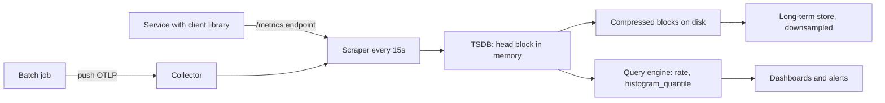

## In one minute
- A metric is a numeric time series identified by a name and a set of labels, sampled or aggregated at regular intervals. Metrics are cheap to store and fast to query because they are pre-aggregated.
- Three primitive types cover most needs: **counters** (only go up, such as requests served), **gauges** (go up and down, such as queue depth), and **histograms** (bucketed distributions, such as latency).
- Cost is driven by **cardinality**: the number of unique label combinations. One careless label can multiply series count by a million.
- Instrument with a method: **RED** (rate, errors, duration) for request-driven services and **USE** (utilization, saturation, errors) for resources. Google's four golden signals are RED plus saturation ([Grafana, RED method](https://grafana.com/blog/2018/08/02/the-red-method-how-to-instrument-your-services/)).
- Percentiles cannot be averaged. Aggregate histograms, then compute quantiles.

## How it works

### The data model
A series looks like `http_requests_total{service="checkout", method="POST", status="500"}`. Each series is a stream of `(timestamp, value)` samples, typically every 10 to 60 seconds. Time series databases compress these extremely well: Gorilla-style encoding stores timestamps as delta-of-deltas and values as XOR against the previous value. Facebook's Gorilla paper measured 1.37 bytes per point against 16 raw ([Gorilla, VLDB 2015](https://www.vldb.org/pvldb/vol8/p1816-teller.pdf)), and Prometheus averages 1 to 2 bytes per sample ([Prometheus storage](https://prometheus.io/docs/prometheus/latest/storage/)). Name metrics in base units (seconds, bytes) and end counters in `_total` ([Prometheus naming](https://prometheus.io/docs/practices/naming/)).

### Push versus pull
In the **pull** model (Prometheus), the server scrapes an HTTP endpoint on every target and notices when one is down. In the **push** model (StatsD, OTLP to a collector), the application sends metrics outward, which suits short-lived jobs and serverless. The line has blurred: since 3.0 (November 2024) Prometheus can itself receive OTLP pushes on `/api/v1/otlp/v1/metrics` once started with `--web.enable-otlp-receiver` ([Prometheus OTLP guide](https://prometheus.io/docs/guides/opentelemetry/)).

Push brings a second difference: **temporality**. Prometheus counters are cumulative (every sample repeats the same start time), while OpenTelemetry SDKs may send delta points that each cover only the last interval ([OTel metrics data model](https://opentelemetry.io/docs/specs/otel/metrics/data-model/)). A delta point that gets lost is lost data rather than a wider interval, and Prometheus needs a conversion option to ingest deltas ([Prometheus feature flags](https://prometheus.io/docs/prometheus/latest/feature_flags/)).

### Counters and rates
A counter is a monotonically increasing total since process start. You query its rate over a window: `rate(http_requests_total[5m])`. Counters survive scrape loss gracefully, since a missed scrape just lengthens the interval, and the query engine handles resets when a process restarts.

### Histograms and percentiles
A histogram keeps a counter per bucket (`le="0.1"`, `le="0.25"`, and so on) plus a sum and count. To compute p99 across 200 instances, sum the bucket rates across instances, then interpolate within the bucket where the 99th percentile falls. Accuracy depends on bucket boundaries, so put boundaries near your SLO thresholds. Precomputed client-side summaries give exact per-instance quantiles but cannot be combined across instances ([Prometheus histograms](https://prometheus.io/docs/practices/histograms/)). Native (exponential) histograms remove the bucket-choice problem: boundaries grow by a fixed factor, with `2^scale` buckets per power of two, so a higher scale means finer resolution ([OTel metrics data model](https://opentelemetry.io/docs/specs/otel/metrics/data-model/)). They were experimental for years and became stable in Prometheus 3.8; from 3.9 the feature flag does nothing and each scrape config must set `scrape_native_histograms: true` ([Prometheus native histograms](https://prometheus.io/docs/specs/native_histograms/)).

### Cardinality
Total series is roughly the product of each label's distinct values. `method` (5) times `status` (10) times `route` (50) times 300 pods is 750,000 series for one metric. Add `user_id` and it becomes unbounded. Each active series costs memory in the TSDB (a few KB in Prometheus), so cardinality, not sample count, is what crashes metric systems. Prometheus's own guidance is never to put unbounded values such as user IDs or email addresses in labels ([Prometheus naming](https://prometheus.io/docs/practices/naming/)).

## Down the stack

### Layer 1: The contract
A metrics system promises that a series is identified exactly by its name and label set, that samples for a series are stored in timestamp order at the scrape or push resolution, and that queries over a range return values computed from those samples. It does not promise every event is counted: a sample summarises an interval, and a scrape that fails leaves a gap. Counter semantics promise that `rate()` is correct across process restarts, because a drop in value is treated as a reset. Recent data is typically queryable within one scrape interval.

### Layer 2: The mechanism
Prometheus keeps the last two to three hours in a **head block** in memory. Each series has an entry in an in-memory index mapping label pairs to series IDs through postings lists, and each series appends samples to a chunk of up to 120 samples (or two hours) ([Vernekar, Prometheus TSDB](https://ganeshvernekar.com/blog/prometheus-tsdb-the-head-block/)), compressed with the Gorilla scheme: the timestamp is stored as a delta-of-delta (zero bits when the scrape interval is regular), and the value as an XOR with the previous value, storing only the meaningful bits. Since v2.19, full chunks are written to disk and memory-mapped, so only the open chunk per series stays in RAM. All incoming samples are also appended to a **write-ahead log** in 128 MB segments for crash recovery ([Prometheus storage](https://prometheus.io/docs/prometheus/latest/storage/)), and local retention defaults to 15 days. Every two hours the head is cut into an immutable block directory with a `chunks/` folder, an `index` file, and `meta.json`, and older blocks are compacted into larger ones. A query resolves label matchers by intersecting postings lists, then decodes only the chunks overlapping the time range.

### Layer 3: The machine
The XOR scheme exploits how floats change slowly: if a counter goes from 10,452 to 10,460, the XOR has few significant bits, often encoded in under 2 bytes, compared with 16 bytes for a raw timestamp and float pair. At about 1.3 bytes per sample, a million series at 15-second resolution (5,760 samples each per day) take roughly 7.5 GB per day on disk. Memory is the binding resource: each active series costs its label strings, index postings, and an open chunk, roughly 3 to 8 KB, so 10 million active series need tens of GB of RAM regardless of how few samples they hold. WAL writes are sequential and batched, so ingestion of hundreds of thousands of samples per second needs only modest disk throughput, but WAL replay after a crash reads every segment and can take minutes on large heads.

### Why it's built this way
1. Operators need cheap, fast answers to "how much, how fast" across fleets, so data is aggregated into numeric samples instead of stored as events.
2. Consecutive samples are similar, so delta and XOR encoding shrink them by roughly ten times.
3. Recent data is queried most and changes constantly, so it lives in memory with a WAL for durability.
4. Each unique label set needs its own index entry and open chunk, so cardinality, not sample volume, sets the cost.

## Diagram


## Worked example
A checkout service runs 300 pods and serves 12,000 requests per second. The team instruments RED metrics:

```python
REQS = Counter("http_requests_total", "Requests", ["route", "method", "code"])
LAT = Histogram("http_request_seconds", "Latency", ["route"],
                buckets=[.025, .05, .1, .25, .5, 1, 2.5])

def handle(route, method, fn):
    with LAT.labels(route).time():
        code = fn()
    REQS.labels(route, method, str(code)).inc()
```

Cardinality: 40 routes, 3 methods, 8 status codes gives 960 counter series per pod, though only about 150 combinations occur in practice. The histogram has 40 routes times 10 series (8 buckets including `+Inf`, plus sum and count), so 400. Per pod roughly 550 series, times 300 pods is 165,000 series. At 15-second scrapes that is 11,000 samples per second, trivial for one Prometheus server.

A developer proposes adding `customer_id` (2 million values) to the counter. Even if each pod only sees 20,000 customers a day, that is 6 million new series per day, enough to exhaust memory. The answer is to keep per-customer analysis in logs or traces, or a dedicated analytics store.

The SLO is "99 percent of requests under 250 ms". Because 0.25 is a bucket boundary, the fraction of fast requests is exact: `sum(rate(bucket{le="0.25"}))` divided by `sum(rate(count))`. No interpolation needed.

## In the wild
- **Cloudflare, 2023: guarding 916 Prometheus servers against one bad label.** Cloudflare runs about 4.9 billion series across 916 Prometheus instances, the largest holding about 30 million. A metric that suddenly gains a high-cardinality label can exhaust memory and crash a server. Their defences: a default `sample_limit` of 200 series per scrape, a patch so that going over the limit drops only the new series instead of failing the whole scrape, a hard cap on total series in the TSDB head, and a CI check of capacity before anyone's limit is raised ([Cloudflare](https://blog.cloudflare.com/how-cloudflare-runs-prometheus-at-scale/)).
- **Uber, 2018: rebuilding the metrics store as M3.** Uber outgrew a sharded Graphite cluster (manual resharding, no replication, so one dead disk lost metrics for good) and then Cassandra (compaction burned CPU and I/O on data that never changes). M3 handled over 6.6 billion series, aggregating about 500 million metrics per second down to 20 million persisted, with per-metric retention and downsampling applied at ingest rather than at compaction ([Uber](https://www.uber.com/en-IL/blog/m3/)).

## Trade-offs

| Option | Strengths | Weaknesses | Choose when |
|---|---|---|---|
| Pull (Prometheus scrape) | Detects down targets, simple clients, central control | Needs service discovery; awkward for short jobs | Long-running services in Kubernetes |
| Push (OTLP, StatsD) | Works for serverless, batch, and behind NAT | Silent when a source dies; needs aggregation tier | Ephemeral workloads |
| Fixed-bucket histograms | Aggregatable, cheap | Accuracy limited by buckets | Latency SLOs with known thresholds |
| Client-side summaries | Exact per-instance quantiles | Cannot aggregate across instances | Single-instance diagnostics only |
| High-cardinality events (wide events) | Arbitrary slicing by any field | Storage and query cost much higher | Debugging unknown unknowns alongside metrics |

## Pitfalls in production
- **Cardinality explosion.** A label holding user IDs, URLs with IDs, or error messages creates millions of series and the TSDB runs out of memory. Use route templates, bounded enums, and per-metric series limits.
- **Averaging percentiles.** A dashboard averages p99 across pods and shows a number that is not the fleet p99. Aggregate bucket counters first, then compute the quantile.
- **Gauges for counts.** Exporting per-interval counts as gauges loses data when scrapes fail. Use counters and `rate()`.
- **Bad bucket boundaries.** Buckets at 1, 5, 10 seconds for a 200 ms service make p99 meaningless. Choose boundaries around your SLO, or use native histograms.
- **Missing saturation signals.** Dashboards show CPU at 40 percent while a thread pool is full. Instrument queue depths, pool usage, and connection limits directly.

## Leadership lens
- Standardise naming, units (seconds, bytes), and required labels through a shared library, so every service gets RED metrics for free.
- Put cardinality budgets per team and alert when a metric's series count jumps.
- Decide what belongs in metrics versus logs versus traces. Metrics answer "how much and how fast"; per-entity questions go elsewhere.
- Plan retention and downsampling: raw resolution for 2 to 4 weeks, 5-minute rollups for a year is common.

## Check yourself
1. Why are counters preferred over gauges for request counts?
   **Answer:** A counter's rate can be computed over any window and missed scrapes only widen the interval, whereas per-interval gauges lose whatever happened between missed samples.
2. Why can you not average p99 values across instances?
   **Answer:** Percentiles are not linear; the fleet p99 depends on the full distribution, so you must combine bucket counts and compute the quantile from the merged histogram.
3. What determines the memory cost of a metric in a TSDB?
   **Answer:** The number of active series, which is the product of distinct values across its labels, not the number of samples.

## Practice
**Task:** Implement `histogram_quantile(q, buckets)` in the style of Prometheus. `buckets` is a list of `(upper_bound, cumulative_count)` pairs sorted by bound, with the last bound `float("inf")`. Find the bucket where rank `q * total` falls and linearly interpolate between that bucket's lower bound (the previous bound, or 0 for the first) and its upper bound. If the rank lands in the `+Inf` bucket, return the highest finite bound. Return `None` if the total count is 0. Also write `merge(*hists)` that sums cumulative counts bucket by bucket across instances with identical bounds.

```python starter
def histogram_quantile(q, buckets):
    # TODO
    raise NotImplementedError

def merge(*hists):
    # TODO
    raise NotImplementedError
```

```python tests
INF = float("inf")
H = [(0.1, 50), (0.25, 90), (0.5, 100), (INF, 100)]

def test_median_interpolates():
    assert abs(histogram_quantile(0.5, H) - 0.1) < 1e-9

def test_p90_on_boundary():
    assert abs(histogram_quantile(0.9, H) - 0.25) < 1e-9

def test_p95_inside_bucket():
    assert abs(histogram_quantile(0.95, H) - 0.375) < 1e-9

def test_inf_bucket_returns_last_finite():
    h = [(0.1, 1), (INF, 10)]
    assert histogram_quantile(0.99, h) == 0.1

def test_empty_returns_none():
    assert histogram_quantile(0.5, [(0.1, 0), (INF, 0)]) is None

def test_merge_sums_counts():
    a = [(0.1, 1), (INF, 2)]
    b = [(0.1, 3), (INF, 5)]
    assert merge(a, b) == [(0.1, 4), (INF, 7)]
```

```python solution
def histogram_quantile(q, buckets):
    total = buckets[-1][1]
    if total == 0:
        return None
    rank = q * total
    prev_bound, prev_count = 0.0, 0
    for bound, count in buckets:
        if count >= rank:
            if bound == float("inf"):
                return prev_bound
            if count == prev_count:
                return bound
            return prev_bound + (bound - prev_bound) * (rank - prev_count) / (count - prev_count)
        prev_bound, prev_count = bound, count
    return prev_bound

def merge(*hists):
    out = []
    for i, (bound, _) in enumerate(hists[0]):
        out.append((bound, sum(h[i][1] for h in hists)))
    return out
```

```typescript starter
export type Bucket = [number, number];
export function histogramQuantile(q: number, buckets: Bucket[]): number | null {
  throw new Error("TODO");
}
export function merge(...hists: Bucket[][]): Bucket[] {
  throw new Error("TODO");
}
```

```typescript tests
const H: Bucket[] = [[0.1, 50], [0.25, 90], [0.5, 100], [Infinity, 100]];
const near = (a: number | null, b: number) => a !== null && Math.abs(a - b) < 1e-9;
test("median interpolates", () => assert(near(histogramQuantile(0.5, H), 0.1), "p50"));
test("p90 on boundary", () => assert(near(histogramQuantile(0.9, H), 0.25), "p90"));
test("p95 inside bucket", () => assert(near(histogramQuantile(0.95, H), 0.375), "p95"));
test("inf bucket returns last finite", () =>
  assertEqual(histogramQuantile(0.99, [[0.1, 1], [Infinity, 10]]), 0.1));
test("empty returns null", () =>
  assertEqual(histogramQuantile(0.5, [[0.1, 0], [Infinity, 0]]), null));
test("merge sums counts", () => {
  const m = merge([[0.1, 1], [Infinity, 2]], [[0.1, 3], [Infinity, 5]]);
  assertEqual(m.map(b => b[1]), [4, 7]);
});
```

```typescript solution
export type Bucket = [number, number];
export function histogramQuantile(q: number, buckets: Bucket[]): number | null {
  const total = buckets[buckets.length - 1][1];
  if (total === 0) return null;
  const rank = q * total;
  let prevBound = 0, prevCount = 0;
  for (const [bound, count] of buckets) {
    if (count >= rank) {
      if (bound === Infinity) return prevBound;
      if (count === prevCount) return bound;
      return prevBound + (bound - prevBound) * (rank - prevCount) / (count - prevCount);
    }
    prevBound = bound; prevCount = count;
  }
  return prevBound;
}
export function merge(...hists: Bucket[][]): Bucket[] {
  return hists[0].map(([bound], i) => [bound, hists.reduce((s, h) => s + h[i][1], 0)] as Bucket);
}
```

```go starter
package practice

type Bucket struct {
	Bound float64 // math.Inf(1) for the last bucket
	Count float64
}

// HistogramQuantile returns the estimate and false when the histogram is empty.
func HistogramQuantile(q float64, buckets []Bucket) (float64, bool) {
	panic("TODO")
}

func Merge(hists ...[]Bucket) []Bucket {
	panic("TODO")
}
```

```go tests
package practice

import (
	"math"
	"testing"
)

var inf = math.Inf(1)
var h = []Bucket{{0.1, 50}, {0.25, 90}, {0.5, 100}, {inf, 100}}

func near(t *testing.T, q, want float64) {
	t.Helper()
	got, ok := HistogramQuantile(q, h)
	if !ok || math.Abs(got-want) > 1e-9 {
		t.Fatalf("q=%v got %v want %v", q, got, want)
	}
}

func TestMedian(t *testing.T) { near(t, 0.5, 0.1) }
func TestP90(t *testing.T)    { near(t, 0.9, 0.25) }
func TestP95(t *testing.T)    { near(t, 0.95, 0.375) }

func TestInfBucket(t *testing.T) {
	if got, _ := HistogramQuantile(0.99, []Bucket{{0.1, 1}, {inf, 10}}); got != 0.1 {
		t.Fatalf("got %v", got)
	}
}

func TestEmpty(t *testing.T) {
	if _, ok := HistogramQuantile(0.5, []Bucket{{0.1, 0}, {inf, 0}}); ok {
		t.Fatal("expected not ok")
	}
}

func TestMerge(t *testing.T) {
	m := Merge([]Bucket{{0.1, 1}, {inf, 2}}, []Bucket{{0.1, 3}, {inf, 5}})
	if m[0].Count != 4 || m[1].Count != 7 {
		t.Fatalf("got %v", m)
	}
}
```

```go solution
package practice

import "math"

type Bucket struct {
	Bound float64
	Count float64
}

func HistogramQuantile(q float64, buckets []Bucket) (float64, bool) {
	total := buckets[len(buckets)-1].Count
	if total == 0 {
		return 0, false
	}
	rank := q * total
	prevBound, prevCount := 0.0, 0.0
	for _, b := range buckets {
		if b.Count >= rank {
			if math.IsInf(b.Bound, 1) {
				return prevBound, true
			}
			if b.Count == prevCount {
				return b.Bound, true
			}
			return prevBound + (b.Bound-prevBound)*(rank-prevCount)/(b.Count-prevCount), true
		}
		prevBound, prevCount = b.Bound, b.Count
	}
	return prevBound, true
}

func Merge(hists ...[]Bucket) []Bucket {
	out := make([]Bucket, len(hists[0]))
	for i, b := range hists[0] {
		out[i].Bound = b.Bound
		for _, h := range hists {
			out[i].Count += h[i].Count
		}
	}
	return out
}
```

## Mock interview
**Prompt:** You are setting the metrics standard for 150 services moving to Kubernetes, about 20,000 pods. Design the instrumentation and the metrics backend, and explain how you keep it affordable.

- Follow-up: A team's new metric added 4 million series overnight. How do you detect and contain it?
- Follow-up: Leadership wants a fleet-wide p99 latency per endpoint. How do you compute it correctly?
- Follow-up: When would you push metrics instead of scraping?

**A strong answer covers:**
- A shared library that emits RED metrics with standard names, units, and bounded labels.
- Series count estimates, cardinality budgets, and limits enforced at ingestion.
- Histograms aggregated before quantiles, with buckets aligned to SLO thresholds.
- Sharded or horizontally scalable storage with retention tiers and downsampling.
- Push via a collector for batch and serverless, pull for long-lived services.

## Sources and further study
**Primary**
- [OpenTelemetry metrics data model](https://opentelemetry.io/docs/specs/otel/metrics/data-model/): delta versus cumulative temporality and the exponential histogram layout.
- [Prometheus native histograms specification](https://prometheus.io/docs/specs/native_histograms/): the bucket schema and the 3.8 and 3.9 changes that made them stable.

**Systems docs**
- [Prometheus storage](https://prometheus.io/docs/prometheus/latest/storage/): blocks, WAL segments, retention flags and bytes per sample.
- [Prometheus 3.0 release notes](https://prometheus.io/blog/2024/11/14/prometheus-3-0/): the OTLP receiver, UTF-8 names and Remote Write 2.0.
- [Prometheus metric and label naming](https://prometheus.io/docs/practices/naming/): base units, suffixes and the rule against unbounded labels.
- [Ganesh Vernekar, Prometheus TSDB: the head block](https://ganeshvernekar.com/blog/prometheus-tsdb-the-head-block/): a maintainer's walk through chunks, memory-mapping and the WAL.

**Books**
- *Site Reliability Engineering*, Beyer et al., chapter 10 "Practical Alerting from Time-Series Data": Borgmon, the design Prometheus descends from.
- *Systems Performance* (2nd edition), Brendan Gregg, chapter 4 "Observability Tools": where resource metrics come from on a Linux host.

**Other curricula**
- [Azure Architecture Center: monitoring and diagnostics](https://learn.microsoft.com/en-us/azure/architecture/best-practices/monitoring): frames metrics by scenario (health, performance, SLA, usage) and stresses consistent instrumentation.
- [Grafana: the RED method](https://grafana.com/blog/2018/08/02/the-red-method-how-to-instrument-your-services/): Tom Wilkie's per-service method and how it relates to USE and the golden signals.
- [donnemartin/system-design-primer](https://github.com/donnemartin/system-design-primer): mentions metrics only for load balancing and latency numbers, with no instrumentation section.

## Watch
- [The RED Method: How To Instrument Your Services (Tom Wilkie, CNCF)](https://www.youtube.com/watch?v=TJLpYXbnfQ4): the origin of RED and how to apply it consistently.
- [Understanding Prometheus Metric Types (PromLabs)](https://www.youtube.com/watch?v=fhx0ehppMGM): counters, gauges, summaries, and histograms explained by a Prometheus co-founder.

## Free resources
- [Prometheus data model](https://prometheus.io/docs/concepts/data_model/): metric names, labels, and series identity.
- [Prometheus histograms and summaries](https://prometheus.io/docs/practices/histograms/): when to use each and how quantile estimation errs.
- [Gorilla: A Fast, Scalable, In-Memory Time Series Database (VLDB 2015)](https://www.vldb.org/pvldb/vol8/p1816-teller.pdf): the compression scheme most TSDBs now use.
- [The USE Method (Brendan Gregg)](https://www.brendangregg.com/usemethod.html): a checklist for resource-level instrumentation.
