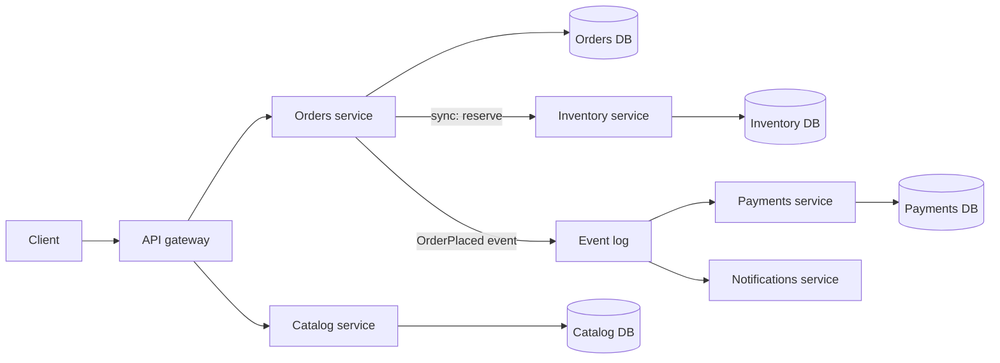

## In one minute
- Microservices split a system into independently deployable services, each owning one business capability and its own data.
- The main payoff is organisational: teams ship on their own schedule without coordinating a shared release. The technical scaling benefit is secondary.
- The price is a distributed system: network calls fail, data is no longer in one transaction, and you need tracing, contracts, and platform tooling to stay sane.
- Service boundaries should follow business capabilities (bounded contexts), not technical layers. Bad boundaries create a distributed monolith that has the costs of both styles.

## How it works

### Boundaries and data ownership
Lewis and Fowler's 2014 article, which named the style, lists organisation around business capabilities and decentralised data management among its nine common traits ([martinfowler.com](https://martinfowler.com/articles/microservices.html)). Each service owns a cohesive capability such as Catalog, Pricing, Orders, or Payments, and it is the only writer to its database. Other services read that data through the owner's API or through events it publishes. If two services share a table, they are coupled at the schema level and cannot deploy independently, which defeats the point. A useful test: can the owning team change its schema on a Tuesday afternoon without telling anyone? If not, the boundary is leaking.

### Communication
Services talk synchronously (HTTP/JSON or gRPC) when the caller needs an answer now, and asynchronously (a log or queue such as Kafka or SQS) when it only needs to announce a fact. Synchronous chains multiply latency and failure probability. If a request fans through five services that are each 99.9% available, the chain is at best about 99.5% available, and its p99 latency is driven by the slowest hop. Asynchronous events decouple availability but add eventual consistency and harder debugging.

### Consistency across services
There is no cross-service ACID transaction. Multi-step business operations use a **saga**: a sequence of local transactions, each with a compensating action if a later step fails. To publish an event reliably alongside a database write, use the **transactional outbox**: write the event to an outbox table in the same local transaction, then relay it to the broker. The relay can crash after publishing but before marking the row sent, so it may publish twice, and consumers must be idempotent ([microservices.io](https://microservices.io/patterns/data/transactional-outbox.html)).

### The platform you now need
Independent deploys require per-service CI/CD pipelines, service discovery, centralised logs, distributed tracing with propagated trace IDs, consistent timeouts and retries, and versioned API contracts. Teams usually build or buy this as an internal platform. Without it, every team reinvents it badly. Fowler's short list of what must exist before the first split is rapid provisioning, basic monitoring and rapid application deployment ([Microservice Prerequisites](https://martinfowler.com/bliki/MicroservicePrerequisites.html)).

Boundaries also follow the org chart whether you plan it or not. Conway's law (1968) says a system's structure mirrors the communication structure of the teams that build it ([Fowler on Conway's Law](https://martinfowler.com/bliki/ConwaysLaw.html)), so a service owned by two teams drifts toward two services or a coordination bottleneck. Microsoft's guidance puts it as each service implementing one business capability inside a bounded context, with its own data store ([Azure Architecture Center](https://learn.microsoft.com/en-us/azure/architecture/guide/architecture-styles/)).

## Down the stack

### Layer 1: The contract
A call to another service promises much less than a function call. It may succeed, fail, or time out with the outcome unknown, so the callee may or may not have done the work. Retries give at-least-once execution unless the callee deduplicates. There is no atomicity across services: a local commit in Orders says nothing about Payments. Latency has a floor of one network round trip plus serialisation and a long tail driven by queueing, garbage collection, and retransmits.

### Layer 2: The mechanism
Most internal calls are gRPC over HTTP/2 or JSON over HTTP/1.1. A gRPC call is a `HEADERS` frame with `:path /orders.v1.Orders/Get` and a `grpc-timeout` header carrying the caller's remaining deadline, then `DATA` frames holding length-prefixed protobuf messages (1 byte compressed flag, 4 bytes big-endian length), and finally trailers with `grpc-status`, which is sent even on success ([gRPC over HTTP/2](https://github.com/grpc/grpc/blob/master/doc/PROTOCOL-HTTP2.md)). Deadline propagation means each hop subtracts elapsed time and passes the rest on. Discovery in Kubernetes maps a Service name to an `EndpointSlice` of ready pod IPs; kube-proxy programs iptables or nftables rules that DNAT the virtual ClusterIP to one of them. The IPVS mode that many older guides recommend is deprecated since Kubernetes 1.35 and due for removal in 1.43; nftables is the recommended replacement and is expected to become the default ([Kubernetes docs](https://kubernetes.io/docs/reference/networking/virtual-ips/)). The transactional outbox is just an `outbox` table written in the same database transaction, read by a relay or by change data capture.

### Layer 3: The machine
An in-process call costs nanoseconds. A same-zone network call costs roughly 100 to 500 microseconds round trip, and a cross-zone call 0.5 to 2 ms, plus cloud data-transfer charges per GB in each direction. Each hop serialises and parses the payload (a few microseconds per KB for protobuf, several times more for JSON), makes `sendmsg` and `epoll_wait` syscalls, and crosses the kernel TCP stack twice. New connections pay a TCP handshake, a TLS handshake, and slow start from an initial window of 10 segments (about 14 KB), which is why clients keep pooled, long-lived HTTP/2 connections. One lost packet stalls every multiplexed stream on that TCP connection until retransmission, a source of p99 spikes.

### Why it's built this way
1. Teams need to ship independently, so code is split into separately deployed processes.
2. Separate processes cannot share memory or a transaction, so each service owns its data and communicates by messages.
3. Messages cross a network that is a thousand times slower than memory and fails partially, so APIs are coarse-grained and every call needs a deadline.
4. Partial failure leaves outcomes unknown, so operations must be idempotent and multi-step work uses sagas.
5. Connection setup is expensive, so services reuse multiplexed connections, accepting head-of-line effects in exchange.

## Diagram


## Worked example
A retailer runs a monolith with 60 engineers. Releases happen weekly, take a 3-hour freeze, and roughly one in eight is rolled back because an unrelated change broke checkout.

They extract Catalog first: it is read-heavy (8,000 QPS reads, 20 writes per second), has a clear owner, and few inbound dependencies. The new service gets its own Postgres plus a Redis cache and deploys 15 times a week. The monolith calls it with a 150 ms timeout and falls back to a stale cached copy.

Next is Orders. Checkout now spans Orders, Inventory, and Payments. A synchronous version would chain three calls with p99s of 40, 60, and 250 ms, about 350 ms worst case before retries. They instead reserve inventory synchronously (the user must know stock exists) and run payment capture asynchronously from an `OrderPlaced` event, with a compensating `ReleaseInventory` step if capture fails.

Cost check: 12 services, each with 3 replicas for availability, plus tracing, a broker cluster, and a platform team of 4. Infrastructure spend rises about 35%. The win is deploy frequency rising from weekly to dozens per day and change failure rate dropping, because each blast radius is smaller.

## In the wild
- **Roblox, 2021: one shared discovery cluster takes everything down.** Every backend service, and the monitoring, depended on a single Consul cluster. A new streaming feature caused contention under load and a bloated BoltDB freelist slowed Raft, so the platform was down for 73 hours. Roblox split Consul into dedicated clusters per critical service and removed the monitoring dependency ([Roblox](https://about.roblox.com/newsroom/2022/01/roblox-return-to-service-10-28-10-31-2021)).
- **Spotify, 2022: managed discovery plus a client bug.** A Google Cloud Traffic Director outage combined with a gRPC client bug broke discovery for the services that used it, and users worldwide were logged out for about 2 hours 23 minutes. Most services use Spotify's DNS-based discovery; the affected ones were reverted to it ([Spotify Engineering](https://engineering.atspotify.com/2022/03/incident-report-spotify-outage-on-march-8/)).
- **Uber, 2020: too many services, regrouped into domains.** Around 2,200 critical microservices made a simple integration need 10 touch points. Domain-Oriented Microservice Architecture grouped them into about 70 domains with one gateway each, and Uber reports platform onboarding time dropping 25 to 50% ([Uber Engineering](https://www.uber.com/en-GB/blog/microservice-architecture/)).

## Trade-offs
| Option | Strengths | Weaknesses | Choose when |
|---|---|---|---|
| Monolith | One deploy, ACID transactions, easy debugging | Team contention, all-or-nothing scaling and releases | Small team, unclear domain, early product |
| Modular monolith | Enforced module boundaries, still one deploy | Shared runtime and release train | Medium team that wants boundaries before distribution |
| Microservices | Independent deploys and scaling, fault isolation | Network failures, eventual consistency, platform cost | Many teams, stable domain boundaries, mature ops |

## Pitfalls in production
- **Distributed monolith.** Services must deploy in lockstep because they share schemas or chatty synchronous APIs. Redraw boundaries around capabilities and move shared data behind one owner.
- **Retry storms.** Every layer retries 3 times, so a five-hop chain can amplify one failing call into 243 requests at the bottom ([AWS Builders' Library](https://aws.amazon.com/builders-library/timeouts-retries-and-backoff-with-jitter/)). Retry only at one layer, use budgets and jittered backoff.
- **Missing timeouts.** A default 30-second client timeout lets one slow dependency exhaust thread pools upstream. Set explicit timeouts below the caller's own deadline and propagate deadlines.
- **Lost events.** Writing to the database then publishing to the broker in two steps drops events on crashes. Use an outbox or change data capture.
- **Untraceable failures.** Logs exist per service but nobody can follow a request. Propagate a trace ID from the edge and make tracing part of the service template.

## Leadership lens
- Ask what problem the split solves. If the answer is not team autonomy or a genuinely different scaling or reliability profile, a modular monolith is usually cheaper.
- Demand a dependency graph for every new service: who calls it, what it calls, and what happens when each dependency is down.
- Budget for the platform: templates, pipelines, observability, and an on-call model. Each new service is a long-term operational liability.
- Align boundaries with team ownership. A service owned by three teams will behave like a monolith with extra latency.
- Watch the count. Uber reached about 2,200 critical services, where debugging one problem meant working through around 50 services across 12 teams, and it regrouped them into about 70 domains behind gateways ([Uber Engineering](https://www.uber.com/en-GB/blog/microservice-architecture/)).

## Check yourself
1. Why does a shared database between two services undermine independent deployment?
   **Answer:** Any schema change must be coordinated with every service that reads or writes those tables, so deploys become coupled even though the code is separate.
2. Five synchronous hops each have 99.9% availability. What is the best-case availability of the chain, and what can you do about it?
   **Answer:** About 99.5%, because failures compound multiplicatively. Cut hops off the critical path with async events, caching, or fallbacks.
3. Why use a saga instead of a distributed transaction?
   **Answer:** Two-phase commit across services couples their availability and holds locks across the network. Sagas use local transactions plus compensations, trading atomicity for availability.

## Practice
**Task:** Write `deploy_order(deps)` that takes a dict mapping each service name to the list of services it depends on, and returns a list of services in a safe deployment order (dependencies first). When several services are ready at the same time, emit them in alphabetical order so the result is deterministic. Services that appear only as dependencies must still be included. If the graph has a cycle, raise `ValueError`, since a cycle means the services cannot be deployed independently.

```python starter
def deploy_order(deps):
    # TODO: topological sort with alphabetical tie-break, ValueError on cycles
    raise NotImplementedError
```

```python tests
def test_chain():
    assert deploy_order({"web": ["orders"], "orders": ["db"], "db": []}) == ["db", "orders", "web"]

def test_alphabetical_tie_break():
    assert deploy_order({"b": [], "a": [], "c": ["a", "b"]}) == ["a", "b", "c"]

def test_implicit_dependency_included():
    assert deploy_order({"api": ["auth"]}) == ["auth", "api"]

def test_cycle_raises():
    try:
        deploy_order({"a": ["b"], "b": ["a"]})
        assert False, "expected ValueError"
    except ValueError:
        pass

def test_empty():
    assert deploy_order({}) == []
```

```python solution
import heapq

def deploy_order(deps):
    nodes = set(deps)
    for ds in deps.values():
        nodes.update(ds)
    indeg = {n: 0 for n in nodes}
    users = {n: [] for n in nodes}
    for svc, ds in deps.items():
        for d in set(ds):
            indeg[svc] += 1
            users[d].append(svc)
    ready = [n for n in nodes if indeg[n] == 0]
    heapq.heapify(ready)
    order = []
    while ready:
        n = heapq.heappop(ready)
        order.append(n)
        for u in users[n]:
            indeg[u] -= 1
            if indeg[u] == 0:
                heapq.heappush(ready, u)
    if len(order) != len(nodes):
        raise ValueError("dependency cycle")
    return order
```

```typescript starter
export function deployOrder(deps: Record<string, string[]>): string[] {
  throw new Error("TODO");
}
```

```typescript tests
test("chain", () => {
  assertEqual(deployOrder({ web: ["orders"], orders: ["db"], db: [] }), ["db", "orders", "web"]);
});
test("alphabetical tie-break", () => {
  assertEqual(deployOrder({ b: [], a: [], c: ["a", "b"] }), ["a", "b", "c"]);
});
test("implicit dependency included", () => {
  assertEqual(deployOrder({ api: ["auth"] }), ["auth", "api"]);
});
test("cycle throws", () => {
  let threw = false;
  try { deployOrder({ a: ["b"], b: ["a"] }); } catch (e) { threw = true; }
  assert(threw, "expected an error on a cycle");
});
test("empty", () => {
  assertEqual(deployOrder({}), []);
});
```

```typescript solution
export function deployOrder(deps: Record<string, string[]>): string[] {
  const nodes = new Set<string>(Object.keys(deps));
  for (const ds of Object.values(deps)) ds.forEach((d) => nodes.add(d));
  const indeg = new Map<string, number>();
  const users = new Map<string, string[]>();
  nodes.forEach((n) => { indeg.set(n, 0); users.set(n, []); });
  for (const [svc, ds] of Object.entries(deps)) {
    for (const d of new Set(ds)) {
      indeg.set(svc, indeg.get(svc)! + 1);
      users.get(d)!.push(svc);
    }
  }
  const ready = [...nodes].filter((n) => indeg.get(n) === 0);
  const order: string[] = [];
  while (ready.length > 0) {
    ready.sort();
    const n = ready.shift()!;
    order.push(n);
    for (const u of users.get(n)!) {
      indeg.set(u, indeg.get(u)! - 1);
      if (indeg.get(u) === 0) ready.push(u);
    }
  }
  if (order.length !== nodes.size) throw new Error("dependency cycle");
  return order;
}
```

```go starter
package practice

// DeployOrder returns services in dependency order, or an error on a cycle.
func DeployOrder(deps map[string][]string) ([]string, error) {
	panic("TODO")
}
```

```go tests
package practice

import (
	"reflect"
	"testing"
)

func TestChain(t *testing.T) {
	got, err := DeployOrder(map[string][]string{"web": {"orders"}, "orders": {"db"}, "db": {}})
	if err != nil || !reflect.DeepEqual(got, []string{"db", "orders", "web"}) {
		t.Fatalf("got %v, %v", got, err)
	}
}

func TestTieBreak(t *testing.T) {
	got, _ := DeployOrder(map[string][]string{"b": {}, "a": {}, "c": {"a", "b"}})
	if !reflect.DeepEqual(got, []string{"a", "b", "c"}) {
		t.Fatalf("got %v", got)
	}
}

func TestImplicitDependency(t *testing.T) {
	got, _ := DeployOrder(map[string][]string{"api": {"auth"}})
	if !reflect.DeepEqual(got, []string{"auth", "api"}) {
		t.Fatalf("got %v", got)
	}
}

func TestCycle(t *testing.T) {
	if _, err := DeployOrder(map[string][]string{"a": {"b"}, "b": {"a"}}); err == nil {
		t.Fatal("expected error on cycle")
	}
}

func TestEmpty(t *testing.T) {
	got, err := DeployOrder(map[string][]string{})
	if err != nil || len(got) != 0 {
		t.Fatalf("got %v, %v", got, err)
	}
}
```

```go solution
package practice

import (
	"errors"
	"sort"
)

// DeployOrder returns services in dependency order, or an error on a cycle.
func DeployOrder(deps map[string][]string) ([]string, error) {
	indeg := map[string]int{}
	users := map[string][]string{}
	for svc, ds := range deps {
		if _, ok := indeg[svc]; !ok {
			indeg[svc] = 0
		}
		seen := map[string]bool{}
		for _, d := range ds {
			if seen[d] {
				continue
			}
			seen[d] = true
			if _, ok := indeg[d]; !ok {
				indeg[d] = 0
			}
			indeg[svc]++
			users[d] = append(users[d], svc)
		}
	}
	var ready []string
	for n, k := range indeg {
		if k == 0 {
			ready = append(ready, n)
		}
	}
	order := []string{}
	for len(ready) > 0 {
		sort.Strings(ready)
		n := ready[0]
		ready = ready[1:]
		order = append(order, n)
		for _, u := range users[n] {
			indeg[u]--
			if indeg[u] == 0 {
				ready = append(ready, u)
			}
		}
	}
	if len(order) != len(indeg) {
		return nil, errors.New("dependency cycle")
	}
	return order, nil
}
```

## Mock interview
**Prompt:** Your company has a 400k-line monolith, 80 engineers in 9 teams, and weekly releases that often roll back. Leadership wants "microservices". Lay out how you would decide what to extract, in what order, and what must exist before the first service goes live.

- Follow-up: How would you handle checkout, which touches orders, inventory, and payments, without a distributed transaction?
- Follow-up: A dependency goes slow and the whole site degrades. What protections should every service have?
- Follow-up: When would you recommend a modular monolith instead?

**A strong answer covers:**
- Boundaries drawn from business capabilities and team ownership, with each service owning its data.
- Extraction order driven by low coupling and high change rate, starting with a low-risk read-heavy capability.
- Platform prerequisites: CI/CD per service, tracing, logging, service templates with timeouts and retries.
- Sagas with compensation and the transactional outbox for cross-service workflows.
- Explicit availability math for synchronous chains and use of async events to shorten them.
- Willingness to say no when the problem is release process rather than architecture.

## Sources and further study
**Primary**
- [Introducing Domain-Oriented Microservice Architecture (Uber, 2020)](https://www.uber.com/en-GB/blog/microservice-architecture/): what changes after a few thousand services.
- [Roblox return to service, October 2021](https://about.roblox.com/newsroom/2022/01/roblox-return-to-service-10-28-10-31-2021): a detailed postmortem of a shared platform dependency failing.

**Systems docs**
- [Kubernetes: Virtual IPs and Service proxies](https://kubernetes.io/docs/reference/networking/virtual-ips/): kube-proxy's iptables, nftables and deprecated IPVS modes.
- [gRPC over HTTP/2](https://github.com/grpc/grpc/blob/master/doc/PROTOCOL-HTTP2.md): the wire format behind most internal service calls.
- [Pattern: Transactional outbox (microservices.io)](https://microservices.io/patterns/data/transactional-outbox.html): reliable event publishing, its relay options and the duplicate-message caveat.

**Books**
- *Building Microservices* (2nd edition), Sam Newman, chapter 2 "How to Model Microservices" and chapter 6 "Workflow": boundaries, coupling types, and why sagas replace two-phase commit.
- *Fundamentals of Software Architecture* (2nd edition), Mark Richards and Neal Ford, chapter 18 "Microservices Architecture": topology, data topologies and common risks.
- *Site Reliability Engineering*, Beyer et al. (Google), chapter 22 "Addressing Cascading Failures": overload, retries and deadlines across service chains.

**Other curricula**
- [donnemartin/system-design-primer](https://github.com/donnemartin/system-design-primer): defines microservices as independently deployable small services under its application layer section, with a short note on service discovery; it does not cover sagas or data ownership.
- [Azure Architecture Center: architecture styles](https://learn.microsoft.com/en-us/azure/architecture/guide/architecture-styles/): frames microservices by their constraints (single responsibility, independence, private data) and warns they suit organisations with mature DevOps.

## Watch
- [Microservices, Martin Fowler (GOTO 2014)](https://www.youtube.com/watch?v=wgdBVIX9ifA): the defining characteristics and the prerequisites that teams skip.
- [Mastering Chaos: A Netflix Guide to Microservices (InfoQ)](https://www.youtube.com/watch?v=CZ3wIuvmHeM): operational lessons from running hundreds of services at scale.
- [When To Use Microservices (And When Not To!) (GOTO)](https://www.youtube.com/watch?v=GBTdnfD6s5Q): Sam Newman and Martin Fowler on the decision itself.

## Free resources
- [Microservices (martinfowler.com)](https://martinfowler.com/articles/microservices.html): the article that named the style and its common traits.
- [Microservice Prerequisites](https://martinfowler.com/bliki/MicroservicePrerequisites.html): the operational capabilities you need before splitting.
- [Microservice Trade-Offs](https://martinfowler.com/articles/microservice-trade-offs.html): a balanced look at what you gain and what you pay.
- [Microservices pattern language (microservices.io)](https://microservices.io/patterns/microservices.html): catalogue of related patterns such as saga, outbox, and API gateway.
- [Azure Architecture Center: Microservices](https://learn.microsoft.com/en-us/azure/architecture/microservices/): practical guidance on domain analysis and service design.
