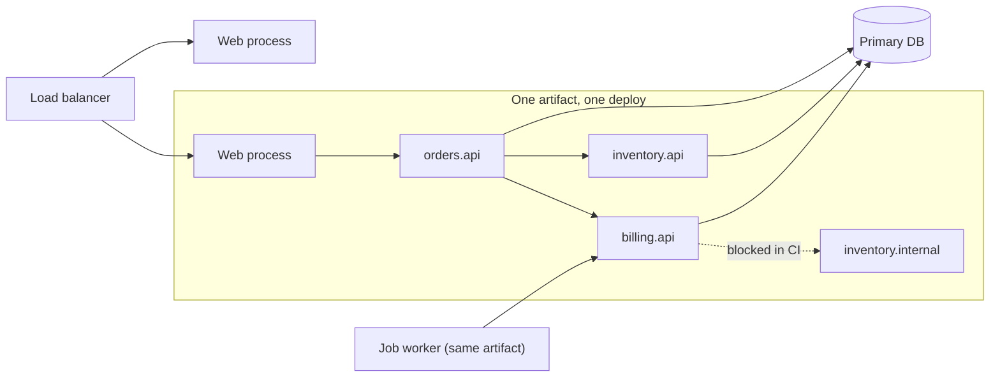

## In one minute
- A monolith is one deployable unit: one codebase, built into one artifact, running as one process type, usually against one primary database.
- Its strengths are physical: calls between parts are function calls measured in nanoseconds, and a business operation can be one database transaction.
- Its weaknesses are organisational: every team shares one build, one release train and one blast radius, and boundaries erode unless something enforces them.
- "Monolith" describes deployment, not code quality. A modular monolith has strong internal boundaries and still ships as one unit; a big ball of mud is a monolith without them.
- Most successful systems start as monoliths, and many large ones (Shopify, GitHub, Basecamp) stay that way on purpose.

## How it works

### One process, many capabilities
A typical monolith is a Rails, Django, Spring or Go application that serves the web UI, the public API and the admin screens, and runs background jobs from the same codebase. Scaling it means running more identical copies behind a load balancer, often with different process roles (web, worker, scheduler) started from the same artifact with different flags. Every copy can do everything, so capacity planning is one number: requests per second per instance.

### Why teams choose it
In a new product nobody fully understands the domain yet. Moving a concept between modules in a monolith is an IDE refactor; between services it is an API migration across two pipelines. That is Martin Fowler's "monolith first" argument: you cannot draw good service boundaries until you know where they are ([MonolithFirst](https://martinfowler.com/bliki/MonolithFirst.html)). Chris Richardson's pattern catalogue lists the same forces from the other side: a monolith is simple to develop, test and deploy at first, and the costs (slow builds, one technology stack, scaling everything together) arrive as the team and codebase grow ([microservices.io](https://microservices.io/patterns/monolithic.html)). You also get one debugger session, one stack trace across every layer, and transactions that commit or roll back as a whole.

### Where it hurts
Problems grow with headcount, not traffic. Build and test times grow with the codebase. A broken test in billing blocks a deploy of search. A memory leak in report generation takes down checkout because they share a heap. Scaling is all-or-nothing: every instance carries every feature's code and memory.

The deepest problem is coupling. In one address space, nothing stops `orders` from reaching into `billing`'s internal tables or private classes. Each shortcut is cheap on the day it is written, and after a few years every change touches everything. This is the **multi-step consistency** problem shape turned inside out: the monolith makes consistency easy, and the price is that everything becomes entangled with everything else.

### The modular monolith
The answer that keeps the strengths is to enforce boundaries inside the deployable. Split the code into modules aligned to business capabilities (catalog, orders, billing), give each a small public API, declare which modules may depend on which, and make the build fail when code breaks the rules. Shopify did this with its Rails monolith and built Packwerk to check package dependencies statically; its public-API (privacy) checker was extracted into the packwerk-extensions project ([Packwerk](https://github.com/Shopify/packwerk)). When Shopify took stock in 2020, the monolith held over 2.8 million lines of Ruby in 37 components, and every component depended on more than half of the others. A runtime call-graph tool took over an hour per run and gave noisy results, so it switched to static analysis of constant references that runs in a few minutes and can block a pull request ([Shopify Engineering](https://shopify.engineering/shopify-monolith)). Java has the Java Platform Module System and ArchUnit tests; Go has `internal/` directories that the `go` command refuses to import from outside the tree rooted at their parent ([Go 1.4 release notes](https://go.dev/doc/go1.4#internalpackages)). Data gets the same treatment: each module owns its tables, and other modules read them only through its API.

A modular monolith is also the cheapest path to services later. When a module has a clean API and owns its data, extracting it with the strangler fig pattern is mostly plumbing. The same boundary discipline shows up in a second domain: a large frontend app split into feature folders with lint rules banning cross-feature imports has exactly this shape.

## Down the stack

### Layer 1: The contract
Inside a monolith, a module call has function-call semantics: it either returns or throws, it never half-arrives, and it shares the caller's transaction, thread and deadline. A deploy is atomic from the code's point of view: every module is at the same version, so no API versioning is needed between them. The contract with operations is "one artifact, one rollback": reverting a release reverts every module together, which is both a safety net and a constraint, because you cannot roll back billing without also rolling back search.

### Layer 2: The mechanism
The monolith's moving parts are the module graph, the build, and the process model. The module graph is enforced by tooling: Packwerk reads `package.yml` files that list each package's declared dependencies and reports any constant reference that is not declared; ArchUnit expresses rules like "classes in `..billing..` may only be accessed by `..orders.api..`" as unit tests ([ArchUnit user guide](https://www.archunit.org/userguide/html/000_Index.html)); the `go` build tool rejects imports of another tree's `internal` package. The build caches per module (Bazel, Gradle build cache) so a change to billing reruns only billing's tests and its dependents. The process model is usually a pre-forking server: Puma or Unicorn boots the app once, then forks workers, and Gunicorn does the same for Python. A single database transaction can span modules because they share one connection: `BEGIN`, insert the order, decrement stock, write the ledger row, `COMMIT`.

### Layer 3: The machine
A direct function call costs about 1 to 5 ns; an in-process interface call a few ns more. The same call as an RPC inside one data centre costs 200 us to 1 ms once you add serialisation, a syscall per send and receive, kernel network stack, a round trip, and parsing. A request that touches 10 modules pays 10 ns in a monolith and 5 to 10 ms as services. Pre-forking saves memory through copy-on-write: a Rails app that occupies 600 MB after boot can fork 8 workers that share most of those pages, so the box needs perhaps 1.5 GB instead of 4.8 GB, until the garbage collector touches objects and the kernel copies the 4 KB pages it writes. Large heaps cost GC time: a JVM monolith with a 16 GB heap needs a concurrent collector such as G1 or ZGC to keep pauses in the low milliseconds. Each instance holds its own database pool, so 60 instances with 20 connections each means 1,200 connections, far above Postgres's default `max_connections` of typically 100 ([Postgres docs](https://www.postgresql.org/docs/current/runtime-config-connection.html)), which is why big monoliths sit behind PgBouncer.

### Why it's built this way
1. Network calls are thousands of times slower than function calls and can fail halfway, so keeping collaborating code in one process is the cheapest and most reliable default.
2. One process means one deploy, so the whole codebase moves together and teams share a release train.
3. Shared address space makes every internal symbol reachable, so boundaries must be enforced by tools in the build, not by the runtime.
4. Process memory is expensive, so monolith runtimes fork after boot and share pages copy-on-write, and pool database connections to protect the database.

## Diagram


## Worked example
An online store runs a Django monolith: 300,000 lines, 45 engineers in 6 teams, 2,000 requests per second at peak. Each instance handles about 100 requests per second, so 20 web instances plus 6 job workers. Checkout touches orders, pricing, inventory, billing and notifications. In-process, the cross-module calls cost microseconds in total; the 120 ms checkout latency is almost all database time and the payment provider call. The whole checkout is one transaction, so a failed stock decrement rolls back the order and the ledger row with no compensation logic.

Real monoliths run at this scale and far beyond: GitHub's Rails application is nearly two million lines, more than 1,000 engineers work in it daily, and it deploys up to 20 times a day ([GitHub blog](https://github.blog/engineering/architecture-optimization/building-github-with-ruby-and-rails/)).

The pain is elsewhere. CI takes 38 minutes because every change runs all 22,000 tests, 4 of last quarter's 11 rollbacks were caused by another team's change, and a memory leak in CSV export once took down checkout.

The team chooses a modular monolith instead of a split. Step one is a dependency map: a static scan finds 1,900 cross-module imports, 340 of them into another module's internals, and two cycles (orders and billing import each other; inventory, catalog and pricing form a triangle). They declare allowed dependencies, baseline existing violations so the build fails only on new ones, and burn the baseline down by about 30 a week. Module-aware test selection cuts median CI to 9 minutes, and CSV export moves to the job worker role, off the web heap. A year later inventory needs its own scaling profile; with a clean API and its own tables, extracting it takes one team six weeks.

## In the wild
- **Shopify, 2020: measuring a 2.8-million-line monolith.** Shopify's analysis of the dependency graph found that every component depended on over half of the others, with many cycles; the main monolith has 37 components. Packwerk, run on about a third of components, enforces declared dependencies statically in minutes, and the team describes the main codebase as a modular monolith and splits out services only deliberately ([Shopify Engineering](https://shopify.engineering/shopify-monolith)).
- **Istio, 2020: a control plane goes back to one binary.** Istio 1.5 folded Pilot, Galley, Citadel and the sidecar injector into a single `istiod`. The parts were all Go, run by one team, always released together and never tested at mixed versions, and cost was dominated by one feature, so separate services bought little ([Istio](https://istio.io/latest/blog/2020/istiod/)).
- **Amazon Prime Video, 2023: monitoring service moves into one process.** A stream-quality monitor built from Step Functions, Lambda and S3 hit a hard scaling limit at about 5% of expected load because of per-second state transitions and S3 calls for every frame. Packing the same components into one ECS process cut infrastructure cost by over 90% ([Prime Video Tech, archived](http://web.archive.org/web/20240805183535/https://www.primevideotech.com/video-streaming/scaling-up-the-prime-video-audio-video-monitoring-service-and-reducing-costs-by-90)).

## Trade-offs
| Option | Strengths | Weaknesses | Choose when |
|---|---|---|---|
| Unstructured monolith | Fastest to start, any refactor is local | Coupling grows unchecked, every change risky | Prototypes, very small teams |
| Modular monolith | Function-call speed, ACID across modules, enforced boundaries | Shared build, release train and runtime | Most products up to a few hundred engineers |
| Monolith with role-split processes | Isolates jobs from web traffic, simple to adopt | Same artifact, still one release | Background work hurting request latency |
| Microservices | Independent deploys and scaling per team | Network failures, distributed data, platform cost | Many teams with stable boundaries and real scaling differences |
| Distributed monolith | None worth having | Network costs plus lockstep deploys | Never by choice; a sign boundaries are wrong |

## Pitfalls in production
- **Boundaries by convention only.** "Please use the public API" lasts until the first deadline. Enforce module rules in CI with a baseline of existing violations, and fail builds on new ones.
- **Shared tables across modules.** Two modules writing the same table means neither can change its schema alone. Assign one owner per table and route everyone else through that module's API.
- **One heap, one fate.** A leak or CPU spike in a rarely used feature takes down the whole site. Run heavy or risky work in separate process roles from the same artifact, with their own limits.
- **Slow CI as the hidden tax.** When the suite takes an hour, people batch changes and rollbacks get bigger. Use module-aware test selection and build caching.
- **Connection pool explosion.** Scaling out instances multiplies database connections until the database runs out. Put a pooler such as PgBouncer in front and size pools per role.
- **Splitting too early.** Breaking a monolith into services before the domain is understood produces a distributed monolith. Get the module boundaries right first; extraction is easy afterwards.
- **Splitting what always ships together.** Components that are released together, written in one language and owned by one team gain little from being separate services. Istio merged its control-plane services back into one binary for exactly these reasons ([Istio](https://istio.io/latest/blog/2020/istiod/)).

## Leadership lens
- Ask what problem a proposed split solves. Team contention and release coupling can often be fixed with modules, test selection and deploy tooling at a fraction of the cost of a platform for services.
- Make module ownership explicit, as code owners per module directory, so every boundary has someone who approves changes to it.
- Track a few health metrics: CI time, deploys per day, rollbacks caused by another team, and the count of boundary violations. They show when the monolith is becoming a bottleneck, long before an outage does.

## Check yourself
1. Why can a monolith do in one transaction what microservices need a saga for?
   **Answer:** All modules share one process and one database connection, so the order insert, stock decrement and ledger write can sit between one `BEGIN` and `COMMIT`. Separate services own separate databases and can only coordinate with messages and compensation.
2. What distinguishes a modular monolith from a big ball of mud, given that both deploy as one unit?
   **Answer:** Enforced boundaries: each module has a public API, owns its data and declares its dependencies, and the build rejects violations. The deployment model is the same.
3. A pre-forked Rails app uses 600 MB per worker according to `top`, yet the host has far less memory than 8 times that. How?
   **Answer:** Workers share the parent's pages copy-on-write, so `top` counts shared pages in every worker. Only pages a worker writes, for example through garbage collection, become private copies.
4. Why are dependency cycles between modules a warning sign even when everything works?
   **Answer:** A cycle means neither module can change, test or be extracted without the other, so they are one module in disguise. It also blocks module-aware test selection, because a change on either side affects both.

## Practice
**Task:** Write a module-boundary checker like the one a modular monolith runs in CI. `modules` maps each module name to `allowed` (modules it may depend on) and `public` (dotted path prefixes that form its public API, such as `billing.api`). `imports` is a list of `(from_module, target)` pairs, where `target` is a dotted path whose first segment is the target module. For each import: ignore it if the target module is `from_module` itself; report `unknown:<from>-><target>` if the target module is not in `modules`; report `forbidden:<from>-><target_module>` if it is not in `from_module`'s `allowed` list; otherwise report `private:<from>-><target>` unless `target` equals a public prefix or starts with a public prefix followed by a dot. Then build the module graph from every import to a known, different module (including forbidden ones) and report each group of two or more modules that can all reach each other as `cycle:` followed by the sorted names joined by commas. Return all findings deduplicated and sorted.

```python starter
def check(modules, imports):
    # TODO
    raise NotImplementedError
```

```python tests
MODS = {
    "orders": {"allowed": ["billing", "inventory"], "public": ["orders.api"]},
    "billing": {"allowed": [], "public": ["billing.api"]},
    "inventory": {"allowed": [], "public": ["inventory.api", "inventory.events"]},
}

def test_clean_imports():
    imps = [("orders", "billing.api.charge"), ("orders", "inventory.events"), ("orders", "orders.internal.x")]
    assert check(MODS, imps) == []

def test_private_import():
    assert check(MODS, [("orders", "billing.internal.ledger")]) == ["private:orders->billing.internal.ledger"]

def test_prefix_must_match_whole_segment():
    assert check(MODS, [("orders", "billing.apix.y")]) == ["private:orders->billing.apix.y"]

def test_forbidden_and_unknown():
    imps = [("billing", "inventory.api.reserve"), ("billing", "inventory.api.release"), ("orders", "search.api")]
    assert check(MODS, imps) == ["forbidden:billing->inventory", "unknown:orders->search.api"]

def test_cycle_includes_forbidden_edges():
    imps = [("orders", "billing.api"), ("billing", "orders.api.get")]
    assert check(MODS, imps) == ["cycle:billing,orders", "forbidden:billing->orders"]

def test_two_separate_cycles():
    mods = {m: {"allowed": ["a", "b", "c", "d", "e"], "public": [m]} for m in "abcde"}
    imps = [("a", "b.x"), ("b", "c.x"), ("c", "a.x"), ("d", "e.x"), ("e", "d.x"), ("c", "d.x")]
    assert check(mods, imps) == ["cycle:a,b,c", "cycle:d,e"]

def test_no_cycle_in_chain():
    mods = {m: {"allowed": ["a", "b", "c"], "public": [m]} for m in "abc"}
    assert check(mods, [("a", "b"), ("b", "c"), ("a", "c")]) == []
```

```python solution
def check(modules, imports):
    findings = set()
    edges = {m: set() for m in modules}
    for frm, target in imports:
        mod = target.split(".")[0]
        if mod == frm:
            continue
        if mod not in modules:
            findings.add("unknown:%s->%s" % (frm, target))
            continue
        edges.setdefault(frm, set()).add(mod)
        if mod not in modules[frm]["allowed"]:
            findings.add("forbidden:%s->%s" % (frm, mod))
            continue
        ok = any(target == p or target.startswith(p + ".") for p in modules[mod]["public"])
        if not ok:
            findings.add("private:%s->%s" % (frm, target))

    def reach(start):
        seen, stack = set(), [start]
        while stack:
            for nxt in edges.get(stack.pop(), ()):
                if nxt not in seen:
                    seen.add(nxt)
                    stack.append(nxt)
        return seen

    reachable = {m: reach(m) for m in edges}
    done = set()
    for m in sorted(edges):
        if m in done:
            continue
        group = sorted(n for n in reachable[m] if m in reachable.get(n, ()))
        if len(group) >= 2:
            done.update(group)
            findings.add("cycle:" + ",".join(group))
    return sorted(findings)
```

```typescript starter
export type Module = { allowed: string[]; public: string[] };

export function check(modules: Record<string, Module>, imports: [string, string][]): string[] {
  throw new Error("TODO");
}
```

```typescript tests
const MODS: Record<string, Module> = {
  orders: { allowed: ["billing", "inventory"], public: ["orders.api"] },
  billing: { allowed: [], public: ["billing.api"] },
  inventory: { allowed: [], public: ["inventory.api", "inventory.events"] },
};

function openMods(names: string[]): Record<string, Module> {
  const out: Record<string, Module> = {};
  for (const n of names) out[n] = { allowed: names, public: [n] };
  return out;
}

test("clean imports", () => {
  assertEqual(check(MODS, [["orders", "billing.api.charge"], ["orders", "inventory.events"], ["orders", "orders.internal.x"]]), []);
});
test("private import", () => {
  assertEqual(check(MODS, [["orders", "billing.internal.ledger"]]), ["private:orders->billing.internal.ledger"]);
});
test("prefix must match whole segment", () => {
  assertEqual(check(MODS, [["orders", "billing.apix.y"]]), ["private:orders->billing.apix.y"]);
});
test("forbidden and unknown", () => {
  const imps: [string, string][] = [["billing", "inventory.api.reserve"], ["billing", "inventory.api.release"], ["orders", "search.api"]];
  assertEqual(check(MODS, imps), ["forbidden:billing->inventory", "unknown:orders->search.api"]);
});
test("cycle includes forbidden edges", () => {
  assertEqual(check(MODS, [["orders", "billing.api"], ["billing", "orders.api.get"]]), ["cycle:billing,orders", "forbidden:billing->orders"]);
});
test("two separate cycles", () => {
  const imps: [string, string][] = [["a", "b.x"], ["b", "c.x"], ["c", "a.x"], ["d", "e.x"], ["e", "d.x"], ["c", "d.x"]];
  assertEqual(check(openMods(["a", "b", "c", "d", "e"]), imps), ["cycle:a,b,c", "cycle:d,e"]);
});
test("no cycle in chain", () => {
  assertEqual(check(openMods(["a", "b", "c"]), [["a", "b"], ["b", "c"], ["a", "c"]]), []);
});
```

```typescript solution
export type Module = { allowed: string[]; public: string[] };

export function check(modules: Record<string, Module>, imports: [string, string][]): string[] {
  const findings = new Set<string>();
  const edges = new Map<string, Set<string>>();
  for (const m of Object.keys(modules)) edges.set(m, new Set());
  for (const [frm, target] of imports) {
    const mod = target.split(".")[0];
    if (mod === frm) continue;
    if (!(mod in modules)) {
      findings.add(`unknown:${frm}->${target}`);
      continue;
    }
    if (!edges.has(frm)) edges.set(frm, new Set());
    edges.get(frm)!.add(mod);
    if (!modules[frm].allowed.includes(mod)) {
      findings.add(`forbidden:${frm}->${mod}`);
      continue;
    }
    const ok = modules[mod].public.some((p) => target === p || target.startsWith(p + "."));
    if (!ok) findings.add(`private:${frm}->${target}`);
  }

  const reach = (start: string): Set<string> => {
    const seen = new Set<string>();
    const stack = [start];
    while (stack.length > 0) {
      for (const nxt of edges.get(stack.pop()!) ?? []) {
        if (!seen.has(nxt)) {
          seen.add(nxt);
          stack.push(nxt);
        }
      }
    }
    return seen;
  };

  const reachable = new Map<string, Set<string>>();
  for (const m of edges.keys()) reachable.set(m, reach(m));
  const done = new Set<string>();
  for (const m of Array.from(edges.keys()).sort()) {
    if (done.has(m)) continue;
    const group = Array.from(reachable.get(m)!).filter((n) => reachable.get(n)?.has(m)).sort();
    if (group.length >= 2) {
      for (const g of group) done.add(g);
      findings.add("cycle:" + group.join(","));
    }
  }
  return Array.from(findings).sort();
}
```

```go starter
package practice

type Module struct {
	Allowed []string
	Public  []string
}

func Check(modules map[string]Module, imports [][2]string) []string {
	panic("TODO")
}
```

```go tests
package practice

import (
	"reflect"
	"testing"
)

var mods = map[string]Module{
	"orders":    {Allowed: []string{"billing", "inventory"}, Public: []string{"orders.api"}},
	"billing":   {Allowed: []string{}, Public: []string{"billing.api"}},
	"inventory": {Allowed: []string{}, Public: []string{"inventory.api", "inventory.events"}},
}

func openMods(names ...string) map[string]Module {
	out := map[string]Module{}
	for _, n := range names {
		out[n] = Module{Allowed: names, Public: []string{n}}
	}
	return out
}

func expect(t *testing.T, got, want []string) {
	t.Helper()
	if len(got) == 0 && len(want) == 0 {
		return
	}
	if !reflect.DeepEqual(got, want) {
		t.Fatalf("got %v, want %v", got, want)
	}
}

func TestCleanImports(t *testing.T) {
	expect(t, Check(mods, [][2]string{{"orders", "billing.api.charge"}, {"orders", "inventory.events"}, {"orders", "orders.internal.x"}}), nil)
}

func TestPrivateImport(t *testing.T) {
	expect(t, Check(mods, [][2]string{{"orders", "billing.internal.ledger"}}), []string{"private:orders->billing.internal.ledger"})
}

func TestPrefixMustMatchWholeSegment(t *testing.T) {
	expect(t, Check(mods, [][2]string{{"orders", "billing.apix.y"}}), []string{"private:orders->billing.apix.y"})
}

func TestForbiddenAndUnknown(t *testing.T) {
	imps := [][2]string{{"billing", "inventory.api.reserve"}, {"billing", "inventory.api.release"}, {"orders", "search.api"}}
	expect(t, Check(mods, imps), []string{"forbidden:billing->inventory", "unknown:orders->search.api"})
}

func TestCycleIncludesForbiddenEdges(t *testing.T) {
	expect(t, Check(mods, [][2]string{{"orders", "billing.api"}, {"billing", "orders.api.get"}}), []string{"cycle:billing,orders", "forbidden:billing->orders"})
}

func TestTwoSeparateCycles(t *testing.T) {
	imps := [][2]string{{"a", "b.x"}, {"b", "c.x"}, {"c", "a.x"}, {"d", "e.x"}, {"e", "d.x"}, {"c", "d.x"}}
	expect(t, Check(openMods("a", "b", "c", "d", "e"), imps), []string{"cycle:a,b,c", "cycle:d,e"})
}

func TestNoCycleInChain(t *testing.T) {
	expect(t, Check(openMods("a", "b", "c"), [][2]string{{"a", "b"}, {"b", "c"}, {"a", "c"}}), nil)
}
```

```go solution
package practice

import (
	"fmt"
	"sort"
	"strings"
)

type Module struct {
	Allowed []string
	Public  []string
}

func contains(list []string, s string) bool {
	for _, x := range list {
		if x == s {
			return true
		}
	}
	return false
}

func Check(modules map[string]Module, imports [][2]string) []string {
	findings := map[string]bool{}
	edges := map[string]map[string]bool{}
	for m := range modules {
		edges[m] = map[string]bool{}
	}
	for _, imp := range imports {
		from, target := imp[0], imp[1]
		mod := strings.SplitN(target, ".", 2)[0]
		if mod == from {
			continue
		}
		dst, known := modules[mod]
		if !known {
			findings[fmt.Sprintf("unknown:%s->%s", from, target)] = true
			continue
		}
		if edges[from] == nil {
			edges[from] = map[string]bool{}
		}
		edges[from][mod] = true
		if !contains(modules[from].Allowed, mod) {
			findings[fmt.Sprintf("forbidden:%s->%s", from, mod)] = true
			continue
		}
		ok := false
		for _, p := range dst.Public {
			if target == p || strings.HasPrefix(target, p+".") {
				ok = true
			}
		}
		if !ok {
			findings[fmt.Sprintf("private:%s->%s", from, target)] = true
		}
	}

	reach := func(start string) map[string]bool {
		seen := map[string]bool{}
		stack := []string{start}
		for len(stack) > 0 {
			cur := stack[len(stack)-1]
			stack = stack[:len(stack)-1]
			for nxt := range edges[cur] {
				if !seen[nxt] {
					seen[nxt] = true
					stack = append(stack, nxt)
				}
			}
		}
		return seen
	}

	names := make([]string, 0, len(edges))
	reachable := map[string]map[string]bool{}
	for m := range edges {
		names = append(names, m)
		reachable[m] = reach(m)
	}
	sort.Strings(names)
	done := map[string]bool{}
	for _, m := range names {
		if done[m] {
			continue
		}
		group := []string{}
		for n := range reachable[m] {
			if reachable[n][m] {
				group = append(group, n)
			}
		}
		if len(group) >= 2 {
			sort.Strings(group)
			for _, g := range group {
				done[g] = true
			}
			findings["cycle:"+strings.Join(group, ",")] = true
		}
	}

	out := []string{}
	for f := range findings {
		out = append(out, f)
	}
	sort.Strings(out)
	return out
}
```

## Mock interview
**Prompt:** A 7-year-old Rails monolith serves 5,000 requests per second for a marketplace. 120 engineers in 14 teams share it; CI takes 50 minutes and deploys are queued for hours. The CTO asks whether to move to microservices. What do you recommend and how do you execute it?

- Follow-up: How would you find out where the real module boundaries are in the existing code?
- Follow-up: Background jobs regularly exhaust database connections and slow down the site. What do you change?
- Follow-up: Which single module would you extract first if you had to, and what would make it a good candidate?

**A strong answer covers:**
- Diagnosis first: separate organisational pain (CI, deploy queue, ownership) from technical pain (scaling, isolation) before choosing a fix.
- A modular monolith plan: capability-aligned modules, declared dependencies, public APIs, data ownership, and CI enforcement with a shrinking baseline.
- Build and deploy improvements: module-aware test selection, build caching, and a merge queue, with target numbers.
- Process roles from one artifact to isolate jobs from web traffic, plus connection pooling sized against the database's limits.
- Criteria for extraction: a module with a clean API, its own data, few inbound dependencies and a genuinely different scaling or reliability need.

## Sources and further study
**Primary**
- [Under Deconstruction: The State of Shopify's Monolith (2020)](https://shopify.engineering/shopify-monolith): what boundary enforcement looks like after years of work, with numbers.
- [Building GitHub with Ruby and Rails (2023)](https://github.blog/engineering/architecture-optimization/building-github-with-ruby-and-rails/): a two-million-line monolith that upgrades Rails nearly every week.
- [Introducing istiod (Istio, 2020)](https://istio.io/latest/blog/2020/istiod/): a reasoned case for merging microservices back into one deployable.

**Systems docs**
- [Go: internal packages (Go 1.4 release notes)](https://go.dev/doc/go1.4#internalpackages): the compiler-toolchain rule that turns a directory into a boundary.
- [ArchUnit user guide](https://www.archunit.org/userguide/html/000_Index.html): layer and package access rules written as JUnit tests.
- [PostgreSQL: connections and authentication](https://www.postgresql.org/docs/current/runtime-config-connection.html): `max_connections` and why it is set at server start.

**Books**
- *Fundamentals of Software Architecture* (2nd edition), Mark Richards and Neal Ford, chapter 11 "The Modular Monolith Architecture Style": topology, data topologies and common risks.
- *Building Microservices* (2nd edition), Sam Newman, chapter 3 "Splitting the Monolith": have a goal, migrate incrementally, and why the monolith is rarely the enemy.

**Other curricula**
- [Azure Architecture Center: architecture styles](https://learn.microsoft.com/en-us/azure/architecture/guide/architecture-styles/): has no monolith style as such; N-tier and Web-Queue-Worker are its deployable-unit styles, and it warns both can grow into a big ball of mud.

## Watch
- [Deconstructing the Monolith (Kirsten Westeinde, Shopify, Craft Conference 2022)](https://www.youtube.com/watch?v=gyZDWsLk_Ac): how Shopify turned its Rails monolith into enforced components instead of splitting it.
- [The Secret Life of Monoliths (GitHub Satellite 2017)](https://www.youtube.com/watch?v=CBJMCt9bAbM): a Shopify engineer on running and deploying a very large monolith.

## Free resources
- [Deconstructing the Monolith (Shopify Engineering)](https://shopify.engineering/deconstructing-monolith-designing-software-maximizes-developer-productivity): why Shopify chose a modular monolith and how it defined components.
- [Packwerk (GitHub)](https://github.com/Shopify/packwerk): the open-source tool that enforces package dependencies in a Ruby monolith.
- [MonolithFirst (Martin Fowler)](https://martinfowler.com/bliki/MonolithFirst.html): the argument for starting with a monolith until boundaries are understood.
- [Pattern: Monolithic Architecture (microservices.io)](https://microservices.io/patterns/monolithic.html): forces, benefits and drawbacks stated precisely.
- [Scaling up the Prime Video audio/video monitoring service and reducing costs by 90% (archived)](http://web.archive.org/web/20240805183535/https://www.primevideotech.com/video-streaming/scaling-up-the-prime-video-audio-video-monitoring-service-and-reducing-costs-by-90): a team moving distributed components back into one process.
- [Goodbye Microservices (Twilio Segment)](https://www.twilio.com/en-us/blog/developers/best-practices/goodbye-microservices): why Segment consolidated hundreds of small services into one.
