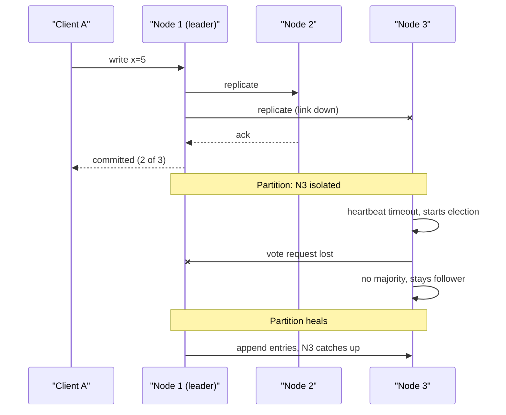

## In one minute
- A network partition is any failure that leaves two groups of healthy nodes unable to exchange messages, while each group can still talk to itself and often to clients.
- From inside a node, a partition looks exactly like a slow peer or a crashed peer. The only tool you have is a timeout, and a timeout is a guess.
- During a partition every replicated system must choose, per operation, between refusing work (consistency) and accepting work that may conflict (availability).
- Partitions are not rare. Switch reboots, misconfigured firewalls, saturated links, GC pauses and asymmetric routes all produce them, often for seconds and sometimes for hours.
- Design for the partition first, then for how the system heals and reconciles after it.

## How it works

### What actually breaks
A clean partition splits a cluster into two sides with no traffic between them. Real partitions are messier. A *partial* partition lets A talk to B and B talk to C, but not A to C. An *asymmetric* partition lets packets flow one way only, so a node keeps receiving heartbeats but its replies vanish. A *grey* partition drops 30% of packets, which passes health checks but times out real requests.

Common causes include switch failures, routing changes, a firewall edit that blocks one port, a full conntrack table, and long stop-the-world pauses. To its peers, a 20-second JVM pause looks the same as a 20-second network cut.

The damage is out of proportion to how simple the trigger is. A study of 136 partition-caused failures across 25 widely used systems found 80% catastrophic (data loss was the most common), 90% silent, and 88% triggerable by isolating a single node; 29% came from partial partitions, which most designs never consider ([Alquraan et al., OSDI 2018](https://www.usenix.org/conference/osdi18/presentation/alquraan)).

### Why you cannot tell
A node that sends a request and hears nothing has three possibilities: the request was lost, the remote node crashed or stalled, or the reply was lost. In the third case the remote side may have already applied the write. This is why a timed-out write has an *unknown* outcome, and why retries must be idempotent.

Failure detectors turn silence into suspicion. With 1-second heartbeats and a 5-second timeout, a dead node is noticed in about 5 seconds, but a node that pauses for 6 seconds is also declared dead. Adaptive detectors such as phi-accrual track heartbeat inter-arrival times and raise suspicion gradually instead of flipping at a fixed threshold.

### The choice during a partition
CAP states that while partitioned you cannot have both linearizable reads and writes and a response from every non-failed node. In practice the choice is made per operation. A quorum system with 5 replicas requires 3 acknowledgements. The side holding 3 replicas keeps working; the side holding 2 refuses writes. That is the consistent choice. A leaderless store that accepts writes on both sides and merges later is the available choice, and it needs a merge rule: last-writer-wins, version vectors with application merge, or CRDTs.

PACELC adds the part CAP leaves out: even without a partition, you trade latency against consistency, because waiting for a remote quorum costs a round trip.

### Healing
When the partition ends, minority-side nodes see a newer term and discard uncommitted writes. Available-mode systems run anti-entropy (Merkle-tree comparison, read repair, hinted handoff) to exchange missed updates. Healing is where data loss usually appears, because your merge rule now runs on real data.

## Down the stack

### Layer 1: The contract
The network itself promises almost nothing. IP is best effort: packets may be dropped, duplicated, reordered or delayed without bound. TCP upgrades this to an ordered, deduplicated byte stream per connection, but it never promises *when* bytes arrive, and it reports a dead path only after its own retransmission budget runs out. Everything above is built on that weak contract.

A majority-quorum store such as etcd then promises something precise enough to test with a Jepsen nemesis: at most one leader per term, an acknowledged write is never lost, and a linearizable read never returns a value older than the last acknowledged write. During a partition the minority side does not violate this; it simply fails requests, usually as a timeout or an explicit "no leader" error. A leaderless store such as Cassandra at consistency level ONE makes the opposite promise: any reachable replica answers, and convergence happens later. Labels like "CP" and "AP" hide this per-operation detail, which is why Kleppmann argues for naming the exact guarantee instead ([Kleppmann](https://martin.kleppmann.com/2015/05/11/please-stop-calling-databases-cp-or-ap.html)).

### Layer 2: The mechanism
In etcd's Raft library, the leader sends `MsgHeartbeat` every heartbeat interval (100 ms by default) and followers start an election if they hear nothing for the election timeout (1000 ms by default, randomized per node so two followers rarely time out together). The docs tie both to measured round-trip time: heartbeat about 0.5 to 1.5x RTT, election timeout at least 10x RTT ([etcd tuning](https://etcd.io/docs/v3.6/tuning/)). Two extensions matter for partitions. *PreVote* makes an isolated node first ask "would you vote for me?" with `MsgPreVote` without bumping its term, so a node cut off for an hour does not return with term 900 and force a needless election. etcd has turned PreVote on by default since 3.5 ([etcd configuration](https://etcd.io/docs/v3.6/op-guide/configuration/)). *CheckQuorum* makes a leader step down if it has not heard from a majority within an election timeout, which is how a leader stranded on the minority side stops claiming leadership.

Leaderless systems use different machinery. Cassandra gossips state once per second and feeds heartbeat arrival times into a phi-accrual detector; a peer is convicted when phi exceeds `phi_convict_threshold` (default 8). Writes for a down replica are stored as hints for up to `max_hint_window` (3 hours by default) ([cassandra.yaml reference](https://cassandra.apache.org/doc/latest/cassandra/managing/configuration/cass_yaml_file.html)), and longer outages are repaired by comparing Merkle trees of token ranges.

### Layer 3: The machine
When a link silently drops packets, TCP does not fail fast. Linux starts with a retransmission timeout of about 1 s for a new connection, never goes below 200 ms (`TCP_RTO_MIN`), doubles on each retry, and with the default `net.ipv4.tcp_retries2 = 15` gives up after at least 924.6 s, roughly 15 minutes. Idle connections are worse: default keepalive waits 2 hours before the first probe ([kernel docs](https://docs.kernel.org/networking/ip-sysctl.html)). This is why every consensus system runs its own millisecond-scale heartbeats and why clients should set `TCP_USER_TIMEOUT` ([RFC 5482](https://www.rfc-editor.org/rfc/rfc5482.html)), which caps how long sent data may stay unacknowledged, or application deadlines.

The numbers that set timeouts: in-rack RTT is tens of microseconds, cross-AZ RTT is typically around 1 ms, and cross-region RTT is 30 to 150 ms. A heartbeat is a few dozen bytes of payload plus 40 to 60 bytes of TCP/IP headers, so frequency is cheap; the real cost is false positives. Local causes mimic partitions: a full conntrack table makes the kernel log `nf_conntrack: table full, dropping packet` and silently drop new flows, and a multi-second GC pause stops a node from sending heartbeats while its sockets look healthy. When testing, `iptables -j DROP` reproduces a real partition (silence), while `-j REJECT` sends an immediate error and hides the timeout behaviour you need to test.

### Why it's built this way
1. Signals cross shared, buffered hardware, so delay has no upper bound and a node cannot tell slow from dead.
2. Because detection is a guess, safety cannot depend on it; it rests on terms and the fact that any two majorities share a node.
3. Because majorities must intersect, the minority side must refuse writes, and every write pays at least one round trip to a quorum.
4. Because TCP's own failure detection takes minutes, systems layer their own heartbeats on top and tune them to measured RTT, accepting some false elections for faster recovery.

## Diagram


## Worked example
A payments ledger runs 5 replicas across 3 availability zones: 2 in AZ-a, 2 in AZ-b, 1 in AZ-c. Writes need 3 acks. Normal p99 commit latency is 4 ms.

A fibre cut isolates AZ-a. The leader was in AZ-a. Its side has 2 replicas, so it cannot commit; after its lease expires (say 2 s) it stops serving. AZ-b and AZ-c together have 3 replicas, elect a new leader after a randomized 150 to 300 ms election timeout (the range the [Raft paper](https://raft.github.io/raft.pdf) uses as its example), and resume. Total write unavailability is roughly lease expiry plus election, about 2.5 s.

Compare 4 replicas across 2 AZs. An AZ-level partition leaves 2 and 2, neither side has a majority, and the whole system stops.

At 12,000 writes per second, 2.5 s of unavailability means 30,000 retried writes. With backoff and idempotency keys, none are lost or duplicated.

## In the wild
- **Cloudflare, 2020: a half-broken switch splits etcd's votes.** On 2 November a switch kept its control-plane protocols up while it stopped forwarding packets properly. etcd node 1 lost its link to the leader, node 3, but could still reach node 2, which could still reach node 3. Node 1 kept calling elections and voting for itself while node 2 kept voting for node 3, so no leader won and the cluster went read-only. The database manager then promoted a replica, a rebuild bug overloaded the new primary, and the API and dashboard were degraded for 6h33m, with API success as low as 75% ([Cloudflare](https://blog.cloudflare.com/a-byzantine-failure-in-the-real-world/)).
- **GitHub, 2018: 43 seconds of partition, 24 hours of repair.** Replacing failing optical equipment cut the US East hub off from the primary East Coast data center for 43 seconds. Orchestrator, using Raft, promoted West Coast MySQL primaries in that window, so writes landed on both coasts; one busy cluster had 954 writes that never replicated. Service was degraded for 24h11m while GitHub restored from backup and replayed data, and it committed to configuring Orchestrator so it no longer promotes primaries across regional boundaries ([GitHub](https://github.blog/news-insights/company-news/oct21-post-incident-analysis/)).

## Trade-offs
| Option | Strengths | Weaknesses | Choose when |
|---|---|---|---|
| Majority quorum (CP) | No divergent writes, simple reasoning | Minority side is down; cross-AZ latency on every write | Money, inventory, locks, metadata |
| Accept writes everywhere (AP) | Every reachable node serves | Conflicts, merge logic, possible lost updates | Carts, presence, counters, user-facing caches |
| Read-only degraded mode | Serves reads on minority side | Stale reads, more code paths | Catalogs, profiles, config |
| Short failure timeout | Fast failover | False positives, flapping leaders | Stable low-latency networks |

## Pitfalls in production
- Even replica counts or two-AZ deployments, which turn a single partition into a full outage. Fix: odd counts over at least three failure domains, or a lightweight witness node in a third site.
- Health checks that test a different path than real traffic, so a grey failure passes checks while requests fail. Fix: check the dependency path users take and alarm on request error rates, not only on pings.
- Treating a timeout as a failure and blindly retrying a non-idempotent write. Fix: idempotency keys and server-side deduplication.
- Never testing partitions. Fix: inject them with iptables or Toxiproxy in staging and run Jepsen-style checks, including partial partitions where A reaches B and B reaches C but A cannot reach C.
- Partial partitions that stall elections. When one member can reach only some peers, it keeps calling elections that split the vote, and the cluster can sit with no leader. Fix: enable PreVote and CheckQuorum, and alert on leader changes per minute.

## Leadership lens
- For each data type, write down whether it stops or diverges under partition. Make the product owner sign off on the AP choices, since they own the merge semantics users will see.
- Ask in design review: where are the failure domains, what is the quorum size, and which side survives an AZ loss?
- Budget for the reconciliation path. Merge code runs rarely, so it is the least tested code in the system.

## Check yourself
1. Why does a write that times out have an unknown outcome rather than a failed one?
   **Answer:** The request may have reached the server and been applied, with only the response lost. The client cannot distinguish that from a lost request, so retries must be safe to repeat.
2. A 4-node cluster is split 2 and 2 by a partition. Which side can commit with majority quorum?
   **Answer:** Neither. A majority of 4 is 3, so both sides stall, which is why odd cluster sizes are preferred.
3. How does PACELC extend CAP?
   **Answer:** It says that even with no partition (Else), a system trades Latency against Consistency, because consistent operations wait for remote acknowledgements.

## Practice
**Task:** Write `leader_candidates(nodes, cut)` for a cluster that uses majority quorum. `nodes` is a list of node names and `cut` is a list of pairs whose direct link is down (links are symmetric, so `("a", "b")` also blocks b to a). A node can become leader only if it can directly reach a strict majority of the cluster, counting itself. Return the sorted list of nodes that could win an election. This models clean, partial, and even-split partitions.

```python starter
def leader_candidates(nodes, cut):
    # TODO
    raise NotImplementedError
```

```python tests
def test_no_partition():
    assert leader_candidates(["a", "b", "c"], []) == ["a", "b", "c"]

def test_clean_split_majority_side():
    cut = [(x, y) for x in ["a", "b"] for y in ["c", "d", "e"]]
    assert leader_candidates(["a", "b", "c", "d", "e"], cut) == ["c", "d", "e"]

def test_even_split_has_no_leader():
    cut = [("a", "c"), ("a", "d"), ("b", "c"), ("b", "d")]
    assert leader_candidates(["a", "b", "c", "d"], cut) == []

def test_partial_partition_reversed_pair():
    assert leader_candidates(["a", "b", "c"], [("c", "a")]) == ["a", "b", "c"]

def test_isolated_node():
    assert leader_candidates(["a", "b", "c"], [("a", "b"), ("c", "a")]) == ["b", "c"]

def test_empty_cluster():
    assert leader_candidates([], []) == []
```

```python solution
def leader_candidates(nodes, cut):
    blocked = set()
    for a, b in cut:
        blocked.add((a, b))
        blocked.add((b, a))
    need = len(nodes) // 2 + 1
    out = []
    for n in nodes:
        reach = sum(1 for m in nodes if m == n or (n, m) not in blocked)
        if reach >= need:
            out.append(n)
    return sorted(out)
```

```typescript starter
export function leaderCandidates(nodes: string[], cut: [string, string][]): string[] {
  // TODO
  throw new Error("TODO");
}
```

```typescript tests
test("no partition", () => {
  assertEqual(leaderCandidates(["a", "b", "c"], []), ["a", "b", "c"]);
});

test("clean split majority side", () => {
  const cut: [string, string][] = [];
  for (const x of ["a", "b"]) for (const y of ["c", "d", "e"]) cut.push([x, y]);
  assertEqual(leaderCandidates(["a", "b", "c", "d", "e"], cut), ["c", "d", "e"]);
});

test("even split has no leader", () => {
  const cut: [string, string][] = [["a", "c"], ["a", "d"], ["b", "c"], ["b", "d"]];
  assertEqual(leaderCandidates(["a", "b", "c", "d"], cut), []);
});

test("partial partition reversed pair", () => {
  assertEqual(leaderCandidates(["a", "b", "c"], [["c", "a"]]), ["a", "b", "c"]);
});

test("isolated node", () => {
  assertEqual(leaderCandidates(["a", "b", "c"], [["a", "b"], ["c", "a"]]), ["b", "c"]);
});

test("empty cluster", () => {
  assertEqual(leaderCandidates([], []), []);
});
```

```typescript solution
export function leaderCandidates(nodes: string[], cut: [string, string][]): string[] {
  const blocked = new Set<string>();
  for (const [a, b] of cut) {
    blocked.add(a + "\u0000" + b);
    blocked.add(b + "\u0000" + a);
  }
  const need = Math.floor(nodes.length / 2) + 1;
  const out: string[] = [];
  for (const n of nodes) {
    let reach = 0;
    for (const m of nodes) {
      if (m === n || !blocked.has(n + "\u0000" + m)) reach++;
    }
    if (reach >= need) out.push(n);
  }
  return out.sort();
}
```

```go starter
package practice

// LeaderCandidates returns the sorted nodes that can reach a strict majority.
func LeaderCandidates(nodes []string, cut [][2]string) []string {
	// TODO
	panic("TODO")
}
```

```go tests
package practice

import "testing"

func sameList(a, b []string) bool {
	if len(a) != len(b) {
		return false
	}
	for i := range a {
		if a[i] != b[i] {
			return false
		}
	}
	return true
}

func TestNoPartition(t *testing.T) {
	got := LeaderCandidates([]string{"a", "b", "c"}, nil)
	if !sameList(got, []string{"a", "b", "c"}) {
		t.Fatalf("got %v", got)
	}
}

func TestCleanSplitMajoritySide(t *testing.T) {
	var cut [][2]string
	for _, x := range []string{"a", "b"} {
		for _, y := range []string{"c", "d", "e"} {
			cut = append(cut, [2]string{x, y})
		}
	}
	got := LeaderCandidates([]string{"a", "b", "c", "d", "e"}, cut)
	if !sameList(got, []string{"c", "d", "e"}) {
		t.Fatalf("got %v", got)
	}
}

func TestEvenSplitHasNoLeader(t *testing.T) {
	cut := [][2]string{{"a", "c"}, {"a", "d"}, {"b", "c"}, {"b", "d"}}
	got := LeaderCandidates([]string{"a", "b", "c", "d"}, cut)
	if len(got) != 0 {
		t.Fatalf("got %v, want none", got)
	}
}

func TestPartialPartitionReversedPair(t *testing.T) {
	got := LeaderCandidates([]string{"a", "b", "c"}, [][2]string{{"c", "a"}})
	if !sameList(got, []string{"a", "b", "c"}) {
		t.Fatalf("got %v", got)
	}
}

func TestIsolatedNode(t *testing.T) {
	got := LeaderCandidates([]string{"a", "b", "c"}, [][2]string{{"a", "b"}, {"c", "a"}})
	if !sameList(got, []string{"b", "c"}) {
		t.Fatalf("got %v", got)
	}
}

func TestEmptyCluster(t *testing.T) {
	if got := LeaderCandidates(nil, nil); len(got) != 0 {
		t.Fatalf("got %v", got)
	}
}
```

```go solution
package practice

import "sort"

// LeaderCandidates returns the sorted nodes that can reach a strict majority.
func LeaderCandidates(nodes []string, cut [][2]string) []string {
	blocked := make(map[[2]string]bool)
	for _, p := range cut {
		blocked[[2]string{p[0], p[1]}] = true
		blocked[[2]string{p[1], p[0]}] = true
	}
	need := len(nodes)/2 + 1
	out := []string{}
	for _, n := range nodes {
		reach := 0
		for _, m := range nodes {
			if m == n || !blocked[[2]string{n, m}] {
				reach++
			}
		}
		if reach >= need {
			out = append(out, n)
		}
	}
	sort.Strings(out)
	return out
}
```

## Mock interview
**Prompt:** You run a 3-region key-value store serving 50,000 reads and 8,000 writes per second for user session data and account balances. A transatlantic link fails and isolates one region for 20 minutes. Walk through what happens and how you designed for it.

- Follow-up: How does the isolated region's leader know it should stop accepting writes?
- Follow-up: The partition is asymmetric: the isolated region still receives heartbeats but its acks are dropped. What happens?
- Follow-up: Would you treat sessions and balances the same way during the partition?

**A strong answer covers:**
- Majority quorum placement so that any single-region loss leaves a working majority.
- Leader leases with expiry shorter than the election timeout, so an old leader stops before a new one starts.
- Separate CP handling for balances and AP handling with merge rules for sessions.
- Idempotent client retries with backoff during the failover window.
- Reconciliation and anti-entropy after healing, plus metrics on divergence.

## Sources and further study
**Primary**
- [Alquraan et al., An Analysis of Network-Partitioning Failures in Cloud Systems (OSDI 2018)](https://www.usenix.org/conference/osdi18/presentation/alquraan): 136 real failures across 25 systems, and the case for testing partial partitions.
- [Ongaro and Ousterhout, In Search of an Understandable Consensus Algorithm (Raft)](https://raft.github.io/raft.pdf): terms, randomized election timeouts and why the minority side cannot commit.
- [Ongaro, Consensus: Bridging Theory and Practice (PhD thesis)](https://web.stanford.edu/~ouster/cgi-bin/papers/OngaroPhD.pdf): where PreVote and leader step-down on lost quorum are specified.

**Systems docs**
- [etcd: tuning](https://etcd.io/docs/v3.6/tuning/): heartbeat and election timeouts sized from round-trip time.
- [Cassandra: cassandra.yaml reference](https://cassandra.apache.org/doc/latest/cassandra/managing/configuration/cass_yaml_file.html): phi-accrual conviction and hinted handoff settings.
- [Linux ip-sysctl documentation](https://docs.kernel.org/networking/ip-sysctl.html): retransmission and keepalive defaults that make TCP slow to notice a cut.

**Books**
- *Designing Data-Intensive Applications* (1st ed.), Martin Kleppmann, Ch 8 "The Trouble with Distributed Systems": unreliable networks, timeouts and unbounded delays.
- *Designing Data-Intensive Applications* (1st ed.), Martin Kleppmann, Ch 9 "Consistency and Consensus": linearizability, the real cost of CAP, and consensus under partition.

**Other curricula**
- [donnemartin/system-design-primer](https://github.com/donnemartin/system-design-primer): teaches partitions through the CAP theorem as a binary CP-or-AP choice; it does not cover partial or asymmetric partitions.

## Watch
- [Distributed Systems 2.4: Fault tolerance (Martin Kleppmann)](https://www.youtube.com/watch?v=43TDfUNsM3E): system models, failure detectors and why timeouts are guesses.
- [L16: The CAP Theorem (Distributed Systems Course)](https://www.youtube.com/watch?v=k-Yaq8AHlFA): a careful walk through the CAP argument under partition.

## Free resources
- [The Network is Reliable (Aphyr)](https://aphyr.com/posts/288-the-network-is-reliable): a catalogue of real partition incidents across major companies.
- [Please stop calling databases CP or AP (Kleppmann)](https://martin.kleppmann.com/2015/05/11/please-stop-calling-databases-cp-or-ap.html): why the CAP labels mislead and what to say instead.
- [Jepsen analyses](https://jepsen.io/analyses): how real databases behave when partitions are injected.
- [PACELC theorem (Wikipedia)](https://en.wikipedia.org/wiki/PACELC_theorem): background on the latency versus consistency extension.
- [Leader election in distributed systems (AWS Builders' Library)](https://aws.amazon.com/builders-library/leader-election-in-distributed-systems/): practical lease-based leadership under failures.
