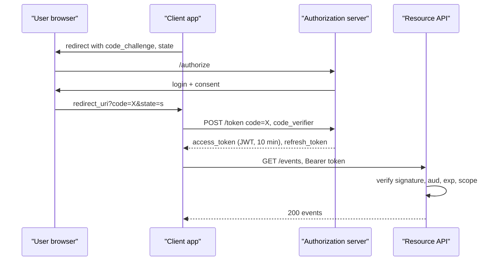

## In one minute
- OAuth 2.0 is a *delegated authorization* framework: a user lets an application act on their behalf at an API, without giving it their password.
- The authorization server issues an *access token* (short-lived) and often a *refresh token* (long-lived) to the client; the resource server checks the token.
- The authorization code flow with PKCE is the default for web, mobile and single-page apps; client credentials covers service-to-service.
- OAuth says nothing about who the user is; OpenID Connect adds an ID token for authentication.
- Most real breaches come from sloppy details: redirect URI matching, token storage, missing PKCE, over-broad scopes.

## How it works

### Roles
The *resource owner* is the user. The *client* is the app requesting access. The *authorization server* (AS) authenticates the user, asks for consent and issues tokens. The *resource server* (RS) is the API that accepts tokens. Scopes name the permissions requested, such as `calendar.read`.

### Authorization code flow with PKCE
1. The client generates a random `code_verifier` and sends the user's browser to the AS with `client_id`, `redirect_uri`, `scope`, `state` and `code_challenge = BASE64URL(SHA256(code_verifier))` with `code_challenge_method=S256` ([RFC 7636 §4.2](https://www.rfc-editor.org/rfc/rfc7636#section-4.2)). The `plain` method, where the challenge equals the verifier, exists only for clients that cannot hash; GitHub, for one, refuses it ([GitHub docs](https://docs.github.com/en/apps/oauth-apps/building-oauth-apps/authorizing-oauth-apps)).
2. The user logs in and consents. The AS redirects back to `redirect_uri` with a one-time `code` and the same `state`.
3. The client checks `state` (CSRF protection), then calls the AS token endpoint directly with the `code` and the original `code_verifier`.
4. The AS checks the code is unused, unexpired (typically 60 seconds), bound to this client and redirect URI, and that the verifier hashes to the stored challenge. It returns an access token and maybe a refresh token.

The code travels through the browser, where it can leak via logs or malicious apps. PKCE makes a stolen code useless without the verifier, which never left the client. The OAuth Security BCP, RFC 9700 (January 2025), says public clients MUST use PKCE and confidential clients SHOULD; clients SHOULD NOT use the implicit flow; and the resource owner password grant, where the app collects the user's password itself, MUST NOT be used ([RFC 9700 §2](https://www.rfc-editor.org/rfc/rfc9700#section-2)). OAuth 2.1, which folds these rules into one document and requires PKCE for all clients using the code flow, was still an Internet-Draft (revision 16, September 2026) at the time of writing ([draft-ietf-oauth-v2-1](https://datatracker.ietf.org/doc/draft-ietf-oauth-v2-1/)).

### Other grants
*Client credentials*: a backend authenticates as itself (secret, mTLS or signed JWT) and gets a token, no user involved. *Device authorization* ([RFC 8628](https://www.rfc-editor.org/rfc/rfc8628)): a TV shows a short code, the user approves on a phone, and the TV polls, every 5 seconds unless told otherwise, backing off when the server answers `slow_down`. *Refresh token*: exchange for a new access token; with rotation, each use returns a new refresh token and reuse of an old one signals theft and revokes the family. RFC 9700 requires refresh tokens issued to public clients to be either rotated or sender-constrained.

### Token formats and validation
Access tokens are either *opaque* (the RS calls the AS introspection endpoint, [RFC 7662](https://www.rfc-editor.org/rfc/rfc7662)) or *self-contained JWTs* (the RS checks the signature with the AS's published keys, plus `iss`, `aud`, `exp` and scopes). JWTs avoid a network hop per request but cannot be revoked before expiry, so keep them short-lived (5 to 15 minutes). Opaque tokens can be revoked instantly but put the AS on the hot path.

## Down the stack

### Layer 1: The contract
The authorization server promises to issue tokens only after authenticating the user and recording consent for the requested scopes. An authorization code is single-use, short-lived (RFC 6749 recommends at most 10 minutes; 30 to 60 seconds is common), and bound to the client and redirect URI that requested it ([RFC 6749 §4.1.2](https://www.rfc-editor.org/rfc/rfc6749#section-4.1.2)). If a code is redeemed twice, RFC 9700 says the server should revoke every token already issued from it, because one of the two callers is an attacker. A resource server promises to honour a token only if its signature, issuer, audience, expiry and scopes all check out. Plain access tokens are *bearer* tokens: whoever holds one can use it, which is the property every other defence works around.

### Layer 2: The mechanism
The token request is a form-encoded POST: `grant_type=authorization_code`, `code`, `redirect_uri`, `code_verifier`, plus client authentication for confidential clients. The JSON response holds `access_token`, `token_type: Bearer`, `expires_in`, an optional `refresh_token` and the granted `scope`. A JWT access token is three base64url segments, header, claims and signature; the header names the algorithm (`ES256`, `RS256`) and a key id `kid`, which the resource server looks up in the JSON Web Key Set published at the server's `jwks_uri`. Refresh token rotation stores tokens in families: each refresh issues a child and invalidates the parent, and presenting an already-used token revokes the whole family. Sender-constrained tokens bind a token to a key the client holds, so a stolen token alone is useless. With DPoP the client signs a small JWT per request, covering the HTTP method, URL and a hash of the token, and the token carries a `cnf` claim with the key's thumbprint ([RFC 9449](https://www.rfc-editor.org/rfc/rfc9449)); with mutual TLS the binding is to the client certificate ([RFC 8705](https://www.rfc-editor.org/rfc/rfc8705)). A client that talks to several authorization servers also needs mix-up defence: the AS returns an `iss` parameter on the redirect and the client compares it with the server it started with ([RFC 9207](https://www.rfc-editor.org/rfc/rfc9207)).

### Layer 3: The machine
Verifying an ES256 signature costs roughly 50 to 100 microseconds of CPU and RS256 verification about 20 to 50; RSA *signing* is the expensive side, around a millisecond for a 2048-bit key, which only the authorization server pays. A JWT with a few claims is 800 to 1,500 bytes and rides in every request's `Authorization` header; HTTP/2 header compression can index it, but proxies with 8 KB header limits reject tokens bloated with group lists. The PKCE verifier is 32 random bytes from the kernel CSPRNG (`getrandom`), 43 characters once base64url-encoded, giving 256 bits an attacker cannot guess. Expiry checks compare against the local clock, so servers allow a minute or two of skew and depend on NTP.

### Why it's built this way
1. Users should not give passwords to every app, so a trusted server issues limited tokens instead.
2. The only channel between an arbitrary app and the authorization server is a browser redirect, which leaks easily, so the redirect carries a short-lived code and a back-channel exchange plus PKCE turns it into tokens.
3. Many resource servers at high request rates cannot all call the authorization server, so tokens are signed and self-contained.
4. Self-contained tokens cannot be recalled, so they are kept short-lived and renewed with refresh tokens.
5. Bearer tokens work like cash, so high-value APIs bind tokens to client keys.

## Diagram



## Worked example
A SaaS product has 2 million users, 600,000 daily active, and an API serving 25,000 requests per second.

Opaque tokens with introspection would add 25,000 introspection calls per second to the AS, each 2 to 5 ms, and make the AS a single point of failure for every API call. A cache of introspection results for 60 seconds cuts this to roughly one call per active token per minute, but delays revocation by up to a minute.

Instead the team uses signed JWT access tokens with a 10-minute lifetime. API gateways verify ES256 signatures locally (around 50 microseconds each) using keys fetched from the AS's JWKS endpoint and cached. Each active session refreshes about every 10 minutes: 600,000 users active for an average 2 hours is 7.2 million refreshes per day, about 83 per second on average and maybe 400 at peak. That is the AS's real load.

Revocation: when an admin disables a user, their refresh token is revoked immediately, and the access token lives at most 10 more minutes. High-risk endpoints also check a small deny list of revoked sessions.

## In the wild
- **GitHub, 2022: OAuth tokens stolen from two integrators.** An attacker called GitHub's API with OAuth user tokens issued to the Heroku Dashboard and Travis CI apps, listed victims' organizations and cloned private repositories, including npm's, where they found an AWS key. GitHub's own systems were not breached; the tokens came from the integrators. GitHub revoked tokens and asked both integrators to revoke theirs ([GitHub](https://github.blog/2022-04-15-security-alert-stolen-oauth-user-tokens/)). Heroku later said the attacker got in through a compromised machine-account token, and it revoked every token of its Dashboard GitHub integration ([Heroku](https://www.heroku.com/blog/april-2022-incident-review)).
- **Salesloft Drift, 2025: one integration's tokens opened many Salesforce orgs.** From 8 to 18 August, an actor used stolen OAuth tokens for the Drift chat app to run bulk queries against many companies' Salesforce instances, then searched the exported records for AWS keys, passwords and Snowflake tokens. All Drift tokens were revoked on 20 August and the app was pulled from the AppExchange ([Google Threat Intelligence](https://cloud.google.com/blog/topics/threat-intelligence/data-theft-salesforce-instances-via-salesloft-drift)).

## Trade-offs

| Option | Strengths | Weaknesses | Choose when |
| --- | --- | --- | --- |
| JWT access tokens | Local validation, no AS hop | Revocation waits for expiry | High-QPS APIs, many resource servers |
| Opaque tokens + introspection | Instant revocation, no data in token | AS on hot path, extra latency | Lower QPS, high-risk actions |
| Refresh token rotation | Detects stolen refresh tokens | Race conditions on parallel refresh | Public clients (SPAs, mobile) |
| Client credentials | Simple service auth | No user context | Machine-to-machine calls |

## Pitfalls in production
- **Loose redirect URI matching.** Prefix or wildcard matching lets attackers redirect codes to their own pages. Require exact string matching of registered URIs; RFC 9700 allows only one exception, a varying port on `localhost` for native apps.
- **Missing `state` or PKCE.** Enables CSRF login and code injection. Enforce both on every flow.
- **Tokens in localStorage.** Any XSS can read them. Keep tokens on a backend (backend-for-frontend pattern) and give the browser an HttpOnly cookie.
- **Not checking `aud`.** A token for one API is accepted by another. Validate audience and issuer, not just the signature.
- **Using access tokens as identity.** OAuth access tokens are not meant for the client to read. Use OIDC ID tokens to learn who logged in.
- **Long-lived third-party grants nobody reviews.** An integration's refresh token is a standing key to your users' data. Let users and admins list and revoke grants, support token revocation ([RFC 7009](https://www.rfc-editor.org/rfc/rfc7009)), and alert on unusual bulk reads by one client.

## Leadership lens
- Buy or adopt a mature authorization server; writing one is a security product, not a feature.
- Define scope naming and granularity early, since scopes become part of every client integration.
- Ask in review: what is the maximum time a stolen token stays useful, and is that acceptable for this API?

## Check yourself
1. What attack does PKCE stop that `state` does not?
   **Answer:** Authorization code interception: an attacker who steals the code cannot redeem it without the code verifier. `state` only stops cross-site request forgery of the callback.
2. Why are JWT access tokens kept short-lived?
   **Answer:** Resource servers validate them locally and cannot see revocation, so expiry is the main bound on how long a leaked or revoked token works.
3. Why is OAuth alone not a login protocol?
   **Answer:** An access token says what a client may do at an API, not who the user is or that they just authenticated; OIDC's ID token carries that.

## Practice
**Task:** Implement the code-exchange core of an authorization server with PKCE. `AuthServer(clock, new_code)` takes a clock returning seconds and a function returning fresh code strings. `authorize(client_id, redirect_uri, challenge)` stores and returns a code valid for 60 seconds. `token(code, client_id, redirect_uri, verifier)` returns `"ok"` only if the code exists, is unused, is unexpired, matches the client and redirect URI exactly, and `sha256(verifier).hexdigest()` equals the challenge; otherwise it returns `"invalid_grant"`. A code is consumed on its first redemption attempt, success or failure. (Real PKCE uses base64url of the hash; hex keeps this within the allowed modules.)

```python starter
import hashlib

class AuthServer:
    def __init__(self, clock, new_code):
        pass

    def authorize(self, client_id, redirect_uri, challenge):
        raise NotImplementedError

    def token(self, code, client_id, redirect_uri, verifier):
        raise NotImplementedError
```

```python tests
import hashlib

def setup():
    now = [0]
    n = [0]
    def new_code():
        n[0] += 1
        return "c" + str(n[0])
    ch = hashlib.sha256(b"verifier-123").hexdigest()
    return AuthServer(lambda: now[0], new_code), now, ch

def test_happy_path():
    s, _, ch = setup()
    code = s.authorize("app", "https://app/cb", ch)
    assert s.token(code, "app", "https://app/cb", "verifier-123") == "ok"

def test_code_single_use():
    s, _, ch = setup()
    code = s.authorize("app", "https://app/cb", ch)
    s.token(code, "app", "https://app/cb", "verifier-123")
    assert s.token(code, "app", "https://app/cb", "verifier-123") == "invalid_grant"

def test_wrong_verifier_burns_code():
    s, _, ch = setup()
    code = s.authorize("app", "https://app/cb", ch)
    assert s.token(code, "app", "https://app/cb", "guess") == "invalid_grant"
    assert s.token(code, "app", "https://app/cb", "verifier-123") == "invalid_grant"

def test_redirect_must_match_exactly():
    s, _, ch = setup()
    code = s.authorize("app", "https://app/cb", ch)
    assert s.token(code, "app", "https://app/cb/evil", "verifier-123") == "invalid_grant"

def test_expired_code():
    s, now, ch = setup()
    code = s.authorize("app", "https://app/cb", ch)
    now[0] = 61
    assert s.token(code, "app", "https://app/cb", "verifier-123") == "invalid_grant"
```

```python solution
import hashlib

class AuthServer:
    def __init__(self, clock, new_code):
        self.clock, self.new_code = clock, new_code
        self.codes = {}

    def authorize(self, client_id, redirect_uri, challenge):
        code = self.new_code()
        self.codes[code] = (client_id, redirect_uri, challenge, self.clock() + 60)
        return code

    def token(self, code, client_id, redirect_uri, verifier):
        entry = self.codes.pop(code, None)
        if entry is None:
            return "invalid_grant"
        cid, uri, challenge, expires = entry
        digest = hashlib.sha256(verifier.encode()).hexdigest()
        if self.clock() > expires or cid != client_id or uri != redirect_uri or digest != challenge:
            return "invalid_grant"
        return "ok"
```

```typescript starter
// hash is injected (the browser has no synchronous SHA-256 without imports).
export class AuthServer {
  constructor(clock: () => number, newCode: () => string, hash: (s: string) => string) {}
  authorize(clientId: string, redirectUri: string, challenge: string): string {
    throw new Error("TODO");
  }
  token(code: string, clientId: string, redirectUri: string, verifier: string): string {
    throw new Error("TODO");
  }
}
```

```typescript tests
const fakeHash = (s: string): string => "h(" + s + ")";
function setup() {
  const now = { t: 0 };
  let n = 0;
  const s = new AuthServer(() => now.t, () => "c" + ++n, fakeHash);
  return { s, now, ch: fakeHash("verifier-123") };
}
test("happy path", () => {
  const { s, ch } = setup();
  const code = s.authorize("app", "https://app/cb", ch);
  assertEqual(s.token(code, "app", "https://app/cb", "verifier-123"), "ok");
});
test("code single use", () => {
  const { s, ch } = setup();
  const code = s.authorize("app", "https://app/cb", ch);
  s.token(code, "app", "https://app/cb", "verifier-123");
  assertEqual(s.token(code, "app", "https://app/cb", "verifier-123"), "invalid_grant");
});
test("wrong verifier burns code", () => {
  const { s, ch } = setup();
  const code = s.authorize("app", "https://app/cb", ch);
  assertEqual(s.token(code, "app", "https://app/cb", "guess"), "invalid_grant");
  assertEqual(s.token(code, "app", "https://app/cb", "verifier-123"), "invalid_grant");
});
test("redirect must match exactly", () => {
  const { s, ch } = setup();
  const code = s.authorize("app", "https://app/cb", ch);
  assertEqual(s.token(code, "app", "https://app/cb/evil", "verifier-123"), "invalid_grant");
});
test("expired code", () => {
  const { s, now, ch } = setup();
  const code = s.authorize("app", "https://app/cb", ch);
  now.t = 61;
  assertEqual(s.token(code, "app", "https://app/cb", "verifier-123"), "invalid_grant");
});
```

```typescript solution
// hash is injected (the browser has no synchronous SHA-256 without imports).
export class AuthServer {
  private codes = new Map<string, { clientId: string; uri: string; challenge: string; expires: number }>();
  constructor(private clock: () => number, private newCode: () => string, private hash: (s: string) => string) {}
  authorize(clientId: string, redirectUri: string, challenge: string): string {
    const code = this.newCode();
    this.codes.set(code, { clientId, uri: redirectUri, challenge, expires: this.clock() + 60 });
    return code;
  }
  token(code: string, clientId: string, redirectUri: string, verifier: string): string {
    const e = this.codes.get(code);
    this.codes.delete(code);
    if (!e) return "invalid_grant";
    const ok = this.clock() <= e.expires && e.clientId === clientId && e.uri === redirectUri &&
      this.hash(verifier) === e.challenge;
    return ok ? "ok" : "invalid_grant";
  }
}
```

```go starter
package practice

type AuthServer struct{}

func NewAuthServer(clock func() int64, newCode func() string) *AuthServer {
	return &AuthServer{}
}

func (s *AuthServer) Authorize(clientID, redirectURI, challenge string) string {
	panic("TODO")
}

// Token returns "ok" or "invalid_grant". The challenge is hex(sha256(verifier)).
func (s *AuthServer) Token(code, clientID, redirectURI, verifier string) string {
	panic("TODO")
}
```

```go tests
package practice

import (
	"crypto/sha256"
	"encoding/hex"
	"strconv"
	"testing"
)

func setup() (*AuthServer, *int64, string) {
	now := int64(0)
	n := 0
	sum := sha256.Sum256([]byte("verifier-123"))
	s := NewAuthServer(func() int64 { return now }, func() string { n++; return "c" + strconv.Itoa(n) })
	return s, &now, hex.EncodeToString(sum[:])
}

const cb = "https://app/cb"

func TestHappyPath(t *testing.T) {
	s, _, ch := setup()
	if got := s.Token(s.Authorize("app", cb, ch), "app", cb, "verifier-123"); got != "ok" {
		t.Fatal(got)
	}
}

func TestSingleUse(t *testing.T) {
	s, _, ch := setup()
	code := s.Authorize("app", cb, ch)
	s.Token(code, "app", cb, "verifier-123")
	if got := s.Token(code, "app", cb, "verifier-123"); got != "invalid_grant" {
		t.Fatal(got)
	}
}

func TestWrongVerifierBurnsCode(t *testing.T) {
	s, _, ch := setup()
	code := s.Authorize("app", cb, ch)
	a := s.Token(code, "app", cb, "guess")
	b := s.Token(code, "app", cb, "verifier-123")
	if a != "invalid_grant" || b != "invalid_grant" {
		t.Fatal(a, b)
	}
}

func TestRedirectExact(t *testing.T) {
	s, _, ch := setup()
	if got := s.Token(s.Authorize("app", cb, ch), "app", cb+"/evil", "verifier-123"); got != "invalid_grant" {
		t.Fatal(got)
	}
}

func TestExpired(t *testing.T) {
	s, now, ch := setup()
	code := s.Authorize("app", cb, ch)
	*now = 61
	if got := s.Token(code, "app", cb, "verifier-123"); got != "invalid_grant" {
		t.Fatal(got)
	}
}
```

```go solution
package practice

import (
	"crypto/sha256"
	"encoding/hex"
)

type grant struct {
	clientID, uri, challenge string
	expires                  int64
}

type AuthServer struct {
	clock   func() int64
	newCode func() string
	codes   map[string]grant
}

func NewAuthServer(clock func() int64, newCode func() string) *AuthServer {
	return &AuthServer{clock, newCode, map[string]grant{}}
}

func (s *AuthServer) Authorize(clientID, redirectURI, challenge string) string {
	code := s.newCode()
	s.codes[code] = grant{clientID, redirectURI, challenge, s.clock() + 60}
	return code
}

// Token returns "ok" or "invalid_grant". The challenge is hex(sha256(verifier)).
func (s *AuthServer) Token(code, clientID, redirectURI, verifier string) string {
	g, ok := s.codes[code]
	delete(s.codes, code)
	if !ok {
		return "invalid_grant"
	}
	sum := sha256.Sum256([]byte(verifier))
	if s.clock() > g.expires || g.clientID != clientID || g.uri != redirectURI || hex.EncodeToString(sum[:]) != g.challenge {
		return "invalid_grant"
	}
	return "ok"
}
```

## Mock interview
**Prompt:** Design authorization for a public API that third-party apps use on behalf of 2 million users, plus your own SPA and mobile apps, at 25,000 API requests per second.

- Follow-up: Which flow does each client type use, and why PKCE everywhere?
- Follow-up: A user reports their account was used after they revoked an app. Explain how, and how you would shrink that window.
- Follow-up: JWTs or opaque tokens? Defend the choice with numbers.

**A strong answer covers:**
- Authorization code with PKCE for user-facing clients, client credentials for services.
- Exact redirect URI matching, `state`, and scope design with consent.
- Token lifetime and revocation trade-off, refresh rotation and reuse detection.
- Local JWT validation with JWKS caching and key rotation handling.
- Token storage in browsers via a backend-for-frontend.

## Sources and further study
**Primary**
- [The OAuth 2.1 Authorization Framework (Internet-Draft)](https://datatracker.ietf.org/doc/draft-ietf-oauth-v2-1/): RFC 6749 plus a decade of security fixes in one document.
- [RFC 9449: OAuth 2.0 Demonstrating Proof of Possession (DPoP)](https://www.rfc-editor.org/rfc/rfc9449): sender-constrained tokens without mutual TLS.
- [RFC 9207: OAuth 2.0 Authorization Server Issuer Identification](https://www.rfc-editor.org/rfc/rfc9207): the `iss` parameter that stops mix-up attacks.
- [RFC 8628: OAuth 2.0 Device Authorization Grant](https://www.rfc-editor.org/rfc/rfc8628): the TV and CLI flow, with polling and `slow_down`.

**Systems docs**
- [GitHub Docs: Authorizing OAuth apps](https://docs.github.com/en/apps/oauth-apps/building-oauth-apps/authorizing-oauth-apps): a real provider's web flow with S256-only PKCE and the device flow.
- [Auth0: Refresh Token Rotation](https://auth0.com/docs/secure/tokens/refresh-tokens/refresh-token-rotation): token families and automatic reuse detection in a production authorization server.

**Books**
- *Building Microservices* (2nd ed.), Sam Newman, Ch 11 "Security": human and service-to-service authentication, and the confused deputy problem that delegated tokens address.

**Other curricula**
- [OWASP OAuth 2.0 Cheat Sheet](https://cheatsheetseries.owasp.org/cheatsheets/OAuth2_Cheat_Sheet.html): the Security BCP turned into a checklist for client and server builders.
- [Azure Architecture Center: Federated Identity pattern](https://learn.microsoft.com/en-us/azure/architecture/patterns/federated-identity): frames OAuth and OIDC as delegating authentication to an IdP, with authorization code plus PKCE as the worked example.

## Watch
- [OAuth 2.0 and OpenID Connect in plain English (OktaDev)](https://www.youtube.com/watch?v=996OiexHze0): a well-known walkthrough of flows and terminology.
- [An Illustrated Guide to OAuth and OpenID Connect (OktaDev)](https://www.youtube.com/watch?v=t18YB3xDfXI): short visual explanation of the code flow.

## Free resources
- [RFC 6749: The OAuth 2.0 Authorization Framework](https://www.rfc-editor.org/rfc/rfc6749): the base specification.
- [RFC 7636: PKCE](https://www.rfc-editor.org/rfc/rfc7636): the code challenge mechanism.
- [RFC 9700: OAuth 2.0 Security Best Current Practice](https://www.rfc-editor.org/rfc/rfc9700): current guidance, including dropping implicit flow.
- [RFC 9068: JWT Profile for Access Tokens](https://www.rfc-editor.org/rfc/rfc9068): standard claims and validation rules.
