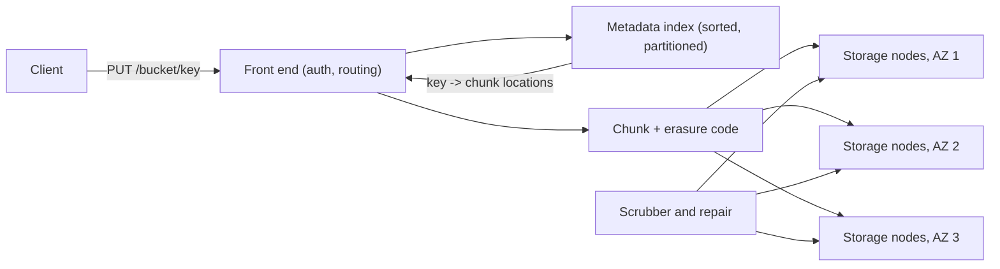

## In one minute
- Object storage keeps immutable blobs (objects) addressed by a bucket and key, with metadata, through a simple HTTP API: PUT, GET, DELETE, LIST.
- There are no real directories, no in-place updates, and in the standard classes no appends or renames. You replace whole objects, which lets the system scale to trillions of objects and exabytes.
- Internally it separates a metadata index (key to object location) from the data layer, which stores chunks with replication or erasure coding across failure domains.
- Amazon S3 is designed for 11 nines of durability and has offered strong read-after-write consistency since 2020; throughput comes from parallelism, not from fast single requests.
- It is the default home for backups, media, logs, data lakes, and model artifacts, because it is cheap per GB and needs no capacity planning.

## How it works

### The API model
A bucket is a namespace; a key is any string, like `logs/2026/10/15/app-01.gz`. The slashes are only characters. Tools display folders by listing with a prefix and a delimiter, which groups keys into "common prefixes." An object is written in full by one PUT (up to 5 GB), or by a *multipart upload* that sends parts in parallel (5 MiB to 5 GiB each, the last part smaller, up to 10,000 parts) and commits them atomically with a final call ([S3 limits](https://docs.aws.amazon.com/AmazonS3/latest/userguide/qfacts.html)). Until the commit, readers see the old object or nothing. The largest S3 object was 5 TB for most of the service's life; since December 2025 it is 50 TB, about 48.8 TiB ([AWS announcement](https://aws.amazon.com/about-aws/whats-new/2025/12/amazon-s3-maximum-object-size-50-tb/)), so 10,000 parts now means parts of several GiB for the biggest objects.

Optional features layer on top: versioning (every PUT creates a new version; DELETE adds a *delete marker*), lifecycle rules (move to colder tiers after N days, expire old versions), object lock for write-once compliance, and event notifications to queues or functions.

### Inside: three layers
**Front end.** Stateless HTTP servers authenticate requests (signed with HMAC keys), apply bucket policies, and route.

**Metadata index.** A distributed, sorted key-value store maps `(bucket, key, version)` to object metadata: size, checksum, storage class, and the list of data chunks with their locations. It is partitioned by key range, and partitions split as they get hot. This is why listing is a sorted range scan and why prefixes affect throughput.

**Data layer.** Large objects are cut into chunks and spread across many storage nodes. Hot storage classes use replication or wide erasure codes across at least three availability zones; cold classes use more aggressive coding and slower media. Background processes continuously scrub data by checksum and repair lost fragments.

### Consistency
A PUT returns only after the data is durable and the metadata write committed. With strong consistency, a GET or LIST immediately after a successful PUT sees the new object. There is no multi-object transaction, and concurrent PUTs to the same key resolve by last writer wins. Conditional writes (`If-Match` on ETag, `If-None-Match: *`) on PutObject, CompleteMultipartUpload and CopyObject, plus conditional deletes, make compare-and-swap patterns possible ([S3 conditional requests](https://docs.aws.amazon.com/AmazonS3/latest/userguide/conditional-requests.html)). S3 only gained create-only writes in August 2024 ([AWS announcement](https://aws.amazon.com/about-aws/whats-new/2024/08/amazon-s3-conditional-writes/)), which is why older designs put a lock table in a database beside the bucket.

### Performance model
AWS quotes roughly 100 to 200 milliseconds for small-object latency and for the first byte of larger ones ([S3 performance](https://docs.aws.amazon.com/AmazonS3/latest/userguide/optimizing-performance.html)), and a single connection moves tens of MB/s. Throughput comes from many parallel requests: byte-range GETs for large objects and many concurrent PUTs, aligned to part boundaries where possible. Each prefix partition supports thousands of requests per second (S3 documents at least 3,500 writes and 5,500 reads per second per partitioned prefix), and the system adds partitions gradually as load grows, returning 503 Slow Down while it does.

### The zonal exception
Newer single-zone classes relax the rules for latency-sensitive work. S3 Express One Zone stores data in one availability zone, in *directory buckets* with session-based auth, and targets single-digit millisecond access ([S3 Express One Zone](https://docs.aws.amazon.com/AmazonS3/latest/userguide/directory-bucket-high-performance.html)). It also breaks two classic rules: a PUT with `x-amz-write-offset-bytes` appends to an existing object, up to 10,000 appends ([append docs](https://docs.aws.amazon.com/AmazonS3/latest/userguide/directory-buckets-objects-append.html)), and `RenameObject` (June 2025) renames atomically in milliseconds without moving data ([rename docs](https://docs.aws.amazon.com/AmazonS3/latest/userguide/directory-buckets-objects-rename.html)). The price is durability scope: nothing is copied to another zone, so a zone outage makes the data unavailable and a destroyed zone loses it. Treat it like a fast cache or a scratch tier, not the system of record.

## Down the stack

### Layer 1: The contract
S3 promises strong read-after-write consistency for PUTs and DELETEs of individual objects, including LIST results and metadata changes, since December 2020 ([S3 consistency](https://aws.amazon.com/s3/consistency/)). A successful PUT means the whole object is stored, never a partial one. Durability is stated as a design target of eleven nines per object per year, with objects stored across at least three availability zones in the standard classes, and availability as 99.99% design and a separate SLA ([S3 data protection](https://docs.aws.amazon.com/AmazonS3/latest/userguide/DataDurability.html)). These are different promises: an object can be temporarily unreachable without being lost. Integrity is checkable end to end: AWS's own clients now compute a checksum on every upload, CRC64NVME by default, the service recomputes it and rejects the upload on a mismatch, and other algorithms (CRC32C, SHA-256 and more) are available ([S3 integrity](https://docs.aws.amazon.com/AmazonS3/latest/userguide/checking-object-integrity.html)). Concurrent writers get last-writer-wins unless they use conditional writes (`If-None-Match: *` to create only if absent, `If-Match` on an ETag to compare-and-swap).

### Layer 2: The mechanism
AWS has described parts of S3's internals publicly. Its storage nodes run ShardStore, a key-value store written in Rust and checked with lightweight formal methods that kept 16 bugs out of production ([SOSP 2021](https://www.amazon.science/publications/using-lightweight-formal-methods-to-validate-a-key-value-storage-node-in-amazon-s3)), and objects are Reed-Solomon coded into *k* data and *m* parity shards ([Warfield, 2023](https://www.allthingsdistributed.com/2023/07/building-and-operating-a-pretty-big-storage-system.html)). It uses an LSM tree for its index and places shard data in large on-disk extents written sequentially, reclaiming space by copying live data out of an extent and resetting it. Open-source systems show the same pattern in more detail.

In Ceph's RADOS Gateway, an object becomes a *head* RADOS object holding metadata and the first part of the data, plus tail objects in fixed stripes (4 MB by default). A bucket index, stored in the object map of index objects and sharded so that one bucket's listing does not hit a single key-value instance, maps names to heads. RADOS places objects with CRUSH, a deterministic hash over the cluster map, so clients compute locations without asking a directory, and BlueStore writes data directly to raw devices with metadata in an embedded RocksDB. MinIO groups drives into erasure sets, stores each object's metadata in an `xl.meta` file alongside its erasure-coded parts, and inlines very small objects into that metadata file to save an I/O.

### Layer 3: The machine
Bulk object storage runs mostly on large hard drives because cost per terabyte dominates. A hard drive delivers around 120 random operations per second, about the same as when S3 launched in 2006, while capacity has grown enormously ([Warfield, 2023](https://www.allthingsdistributed.com/2023/07/building-and-operating-a-pretty-big-storage-system.html)), so as drives grow, IOPS per terabyte falls. S3 calls the resulting problem *heat*: requests landing on one disk at once, which it fights by spreading each customer's objects over a very large number of drives. The design responses are visible everywhere: pack small objects into large extents written sequentially, keep metadata in an LSM tree on faster media or in memory, spread every object across many drives so one request's I/O is parallel, and smooth hot spots by spreading a bucket's keys across many partitions.

On the network side, a single TCP stream's throughput is bounded by its congestion window divided by round-trip time, and a request also pays TLS and authentication. That is why the SDKs split large transfers into many parallel ranged GETs and multipart PUTs over several connections. Time to first byte sums front-end routing, a metadata lookup, and a hard-drive read, hence tens to hundreds of milliseconds. Hitting single digits, as the zonal classes do, means removing hops: one zone, co-located compute, and a session credential instead of signing every request from scratch.

### Why it's built this way
1. Storage cost per byte decides the economics, so data sits on dense hard drives behind erasure coding rather than replicas on SSD.
2. Hard drives have few IOPS per terabyte, so writes are packed into large sequential extents and each object is spread over many spindles.
3. A flat namespace without in-place updates or rename makes metadata a sorted key-value map that partitions cleanly by key range.
4. Single streams and single drives are slow, so throughput comes from parallel requests, ranged reads, and multipart uploads.
5. Corruption can occur anywhere along the path, so checksums travel with the data from client to disk and back, and background scrubbing repairs what decays.

## Diagram


## Worked example
A video platform stores 2 PB of original uploads and 6 PB of transcoded renditions, adding 40 TB per day. Each upload averages 1.5 GB.

**Upload path.** Clients get a pre-signed URL from the API and upload directly to the bucket with multipart, 64 MB parts, 8 in parallel. At around 20 MB/s per part stream, a 1.5 GB file finishes in about 10 seconds on a good connection, and a failed part is retried alone. The application servers never touch the bytes.

**Cost.** At roughly 0.02 USD per GB-month for standard storage, 8 PB costs about 160,000 USD per month. A lifecycle rule moves originals older than 90 days to an infrequent-access tier at around half the price, and renditions not watched in a year to an archive tier. That cuts storage spend by about 40%, at the price of retrieval fees and hours of delay for archived originals, which the business accepts.

**Delivery.** Viewers never read from the bucket directly. A CDN fronts it, so 95% of byte traffic is served from edge caches, and request costs and egress from object storage stay small.

**Hot prefix.** Transcoders initially wrote every output under `renditions/` with keys starting by date. All writes hit one key range and got throttled (HTTP 503 SlowDown). Prefixing keys with a short hash of the video id spread writes across partitions.

## In the wild
- **AWS, 2017: a typo takes S3's index offline in US-East.** While debugging the billing system, an engineer ran a capacity-removal command with a mistyped argument and removed far more servers than intended, including capacity behind the index subsystem (object metadata and locations) and the placement subsystem. Both needed a full restart, which had not been done in a large region for years, and S3 in us-east-1 was down for about four hours, taking EC2 launches, EBS restores, Lambda and AWS's own status page with it. AWS made the tool remove capacity slowly with minimum-capacity floors and sped up splitting the index into cells ([AWS summary](https://aws.amazon.com/message/41926/)).
- **Cloudflare, 2025: one abuse ticket disables all of R2.** Handling a phishing report, an operator disabled the whole production R2 Gateway service instead of one bucket, because the admin tooling did not flag internal accounts. Every R2 operation failed for 59 minutes, Images, Stream and Vectorize failed with it, and recovery was slow because the tooling itself depended on R2; no stored data was lost. Cloudflare added Admin API guardrails for internal accounts and listed two-party approval for ad-hoc disables as in progress ([Cloudflare postmortem](https://blog.cloudflare.com/cloudflare-incident-on-february-6-2025/)).
- **Microsoft Azure, 2014: a config flag loops the Blob front ends.** A performance change meant for Table storage front ends was switched on across production at once, including Blob front ends, where a bug sent them into an infinite loop. Storage was intermittently unreachable in several regions for about ten hours, and some VMs took until two days later to recover. The flag was reverted within 30 minutes, but stuck front ends had to be restarted; Azure's deployment tooling now enforces staged rollout instead of relying on people ([Azure RCA](https://azure.microsoft.com/en-us/blog/final-root-cause-analysis-and-improvement-areas-nov-18-azure-storage-service-interruption/)).

## Trade-offs
| Option | Strengths | Weaknesses | Choose when |
|---|---|---|---|
| Object storage | Cheapest durable storage, no capacity planning, huge parallel throughput | High per-request latency, no in-place updates; appends and atomic rename only in zonal classes | Blobs, backups, data lakes, media |
| Block storage (EBS, persistent disks) | Low latency, random writes, any file system | Tied to one host and zone, capacity provisioned | Databases, boot volumes |
| Shared file storage (EFS, NFS) | POSIX semantics, many clients | Cost per GB higher, throughput limits | Legacy apps needing a shared file system |
| Self-hosted (Ceph RGW, MinIO) | Data on your hardware, no egress fees | You run durability and upgrades | Regulated or on-premises environments |

## Pitfalls in production
- **Treating keys as a file system.** Renaming a "folder" means copying and deleting every object. Design keys so they never need renaming, and keep logical names in a database.
- **Listing as a query engine.** Listing millions of keys to find recent ones is slow and costly. Keep an index in a database or use inventory reports.
- **Public buckets by accident.** Misconfigured policies have caused many data leaks. Block public access at the account level and grant access via pre-signed URLs.
- **Small objects at high volume.** Request costs dominate when objects are a few KB. Batch small records into larger objects.
- **Unbounded versions.** Versioning without lifecycle rules keeps every overwrite forever. Expire noncurrent versions after a set period.

## Leadership lens
- Model costs on four axes: storage per GB, requests, retrieval from cold tiers, and egress. Egress often surprises teams most.
- Define bucket ownership, encryption, and access policy as code, reviewed like any production change.
- Decide retention and lifecycle at design time, including legal holds, rather than after the bill grows.
- Use the object store's guarantees deliberately: conditional writes for coordination, events for pipelines, and multipart for anything over 100 MB.

## Check yourself
1. Why can object storage scale further than a file system?
   **Answer:** Objects are immutable and addressed by flat keys, so there is no directory tree to lock, no in-place updates to coordinate, and metadata can be range-partitioned freely.
2. Why does a single GET feel slow while bulk transfers are fast?
   **Answer:** Each request pays tens to hundreds of milliseconds of latency, but many requests run in parallel across partitions and nodes, so aggregate throughput is very high.
3. What does a DELETE do in a versioned bucket?
   **Answer:** It adds a delete marker as the newest version, so GET returns not found while older versions remain retrievable until removed.
4. Why can keys that all start with today's date cause throttling?
   **Answer:** The metadata index is partitioned by key range, so sequential keys concentrate load on one partition until it splits.

## Practice
**Task:** Implement a versioned bucket. `put(key, data)` stores a new version and returns its version id (an integer that increases across the whole bucket, starting at 1). `delete(key)` adds a delete marker and returns its version id. `get(key, version=None)` returns the data of the latest version, or of the given version, and `None` if that is a delete marker or missing. `list(prefix, delimiter)` returns `(keys, common_prefixes)`: live keys starting with `prefix`, where any key containing `delimiter` after the prefix is rolled up into `prefix + part + delimiter`. Both lists are sorted and unique; an empty delimiter means no grouping.

```python starter
class Bucket:
    def put(self, key, data):
        raise NotImplementedError

    def delete(self, key):
        raise NotImplementedError

    def get(self, key, version=None):
        raise NotImplementedError

    def list(self, prefix, delimiter):
        raise NotImplementedError
```

```python tests
def test_put_get_and_overwrite():
    b = Bucket()
    v1 = b.put("a.txt", "one")
    v2 = b.put("a.txt", "two")
    assert v2 > v1
    assert b.get("a.txt") == "two"
    assert b.get("a.txt", v1) == "one"

def test_delete_marker_hides_but_keeps_versions():
    b = Bucket()
    v1 = b.put("k", "data")
    b.delete("k")
    assert b.get("k") is None
    assert b.get("k", v1) == "data"

def test_missing_key():
    b = Bucket()
    assert b.get("nope") is None
    assert b.list("", "/") == ([], [])

def test_list_with_delimiter():
    b = Bucket()
    for k in ["logs/2026/a", "logs/2026/b", "logs/2025/c", "logs/readme", "img/x.png"]:
        b.put(k, "x")
    assert b.list("logs/", "/") == (["logs/readme"], ["logs/2025/", "logs/2026/"])
    assert b.list("", "/") == ([], ["img/", "logs/"])

def test_list_without_delimiter_skips_deleted():
    b = Bucket()
    b.put("a/1", "x")
    b.put("a/2", "x")
    b.delete("a/1")
    assert b.list("a/", "") == (["a/2"], [])
```

```python solution
class Bucket:
    def __init__(self):
        self.versions = {}  # key -> list of (version_id, data or None)
        self.counter = 0

    def _add(self, key, data):
        self.counter += 1
        self.versions.setdefault(key, []).append((self.counter, data))
        return self.counter

    def put(self, key, data):
        return self._add(key, data)

    def delete(self, key):
        return self._add(key, None)

    def get(self, key, version=None):
        vs = self.versions.get(key, [])
        if version is None:
            return vs[-1][1] if vs else None
        for vid, data in vs:
            if vid == version:
                return data
        return None

    def list(self, prefix, delimiter):
        keys, prefixes = set(), set()
        for key in self.versions:
            if not key.startswith(prefix) or self.get(key) is None:
                continue
            rest = key[len(prefix):]
            if delimiter and delimiter in rest:
                prefixes.add(prefix + rest.split(delimiter)[0] + delimiter)
            else:
                keys.add(key)
        return sorted(keys), sorted(prefixes)
```

```typescript starter
export class Bucket {
  put(key: string, data: string): number { throw new Error("TODO"); }
  delete(key: string): number { throw new Error("TODO"); }
  get(key: string, version?: number): string | null { throw new Error("TODO"); }
  list(prefix: string, delimiter: string): [string[], string[]] { throw new Error("TODO"); }
}
```

```typescript tests
test("put get and overwrite", () => {
  const b = new Bucket();
  const v1 = b.put("a.txt", "one");
  const v2 = b.put("a.txt", "two");
  assert(v2 > v1, "versions increase");
  assertEqual(b.get("a.txt"), "two");
  assertEqual(b.get("a.txt", v1), "one");
});
test("delete marker hides but keeps versions", () => {
  const b = new Bucket();
  const v1 = b.put("k", "data");
  b.delete("k");
  assertEqual(b.get("k"), null);
  assertEqual(b.get("k", v1), "data");
});
test("missing key", () => {
  const b = new Bucket();
  assertEqual(b.get("nope"), null);
  assertEqual(b.list("", "/"), [[], []]);
});
test("list with delimiter", () => {
  const b = new Bucket();
  for (const k of ["logs/2026/a", "logs/2026/b", "logs/2025/c", "logs/readme", "img/x.png"]) b.put(k, "x");
  assertEqual(b.list("logs/", "/"), [["logs/readme"], ["logs/2025/", "logs/2026/"]]);
  assertEqual(b.list("", "/"), [[], ["img/", "logs/"]]);
});
test("list without delimiter skips deleted", () => {
  const b = new Bucket();
  b.put("a/1", "x");
  b.put("a/2", "x");
  b.delete("a/1");
  assertEqual(b.list("a/", ""), [["a/2"], []]);
});
```

```typescript solution
export class Bucket {
  private versions = new Map<string, [number, string | null][]>();
  private counter = 0;

  private add(key: string, data: string | null): number {
    this.counter++;
    if (!this.versions.has(key)) this.versions.set(key, []);
    this.versions.get(key)!.push([this.counter, data]);
    return this.counter;
  }
  put(key: string, data: string): number { return this.add(key, data); }
  delete(key: string): number { return this.add(key, null); }

  get(key: string, version?: number): string | null {
    const vs = this.versions.get(key) ?? [];
    if (version === undefined) return vs.length ? vs[vs.length - 1][1] : null;
    const hit = vs.find((v) => v[0] === version);
    return hit ? hit[1] : null;
  }

  list(prefix: string, delimiter: string): [string[], string[]] {
    const keys = new Set<string>(), prefixes = new Set<string>();
    for (const key of this.versions.keys()) {
      if (!key.startsWith(prefix) || this.get(key) === null) continue;
      const rest = key.slice(prefix.length);
      if (delimiter && rest.includes(delimiter)) prefixes.add(prefix + rest.split(delimiter)[0] + delimiter);
      else keys.add(key);
    }
    return [[...keys].sort(), [...prefixes].sort()];
  }
}
```

```go starter
package practice

type Bucket struct{}

func NewBucket() *Bucket { return &Bucket{} }

func (b *Bucket) Put(key, data string) int                          { panic("TODO") }
func (b *Bucket) Delete(key string) int                             { panic("TODO") }
func (b *Bucket) Get(key string, version int) (string, bool)        { panic("TODO") }
func (b *Bucket) List(prefix, delimiter string) ([]string, []string) { panic("TODO") }
```

```go tests
package practice

import (
	"reflect"
	"testing"
)

// Get with version 0 means "latest".

func TestPutGetAndOverwrite(t *testing.T) {
	b := NewBucket()
	v1 := b.Put("a.txt", "one")
	v2 := b.Put("a.txt", "two")
	if v2 <= v1 {
		t.Fatal("versions must increase")
	}
	if d, ok := b.Get("a.txt", 0); !ok || d != "two" {
		t.Fatalf("latest %q", d)
	}
	if d, ok := b.Get("a.txt", v1); !ok || d != "one" {
		t.Fatalf("v1 %q", d)
	}
}

func TestDeleteMarkerHidesButKeepsVersions(t *testing.T) {
	b := NewBucket()
	v1 := b.Put("k", "data")
	b.Delete("k")
	if _, ok := b.Get("k", 0); ok {
		t.Fatal("deleted key visible")
	}
	if d, ok := b.Get("k", v1); !ok || d != "data" {
		t.Fatal("old version lost")
	}
}

func TestMissingKey(t *testing.T) {
	b := NewBucket()
	if _, ok := b.Get("nope", 0); ok {
		t.Fatal("missing key found")
	}
	keys, prefixes := b.List("", "/")
	if len(keys) != 0 || len(prefixes) != 0 {
		t.Fatal("expected empty listing")
	}
}

func TestListWithDelimiter(t *testing.T) {
	b := NewBucket()
	for _, k := range []string{"logs/2026/a", "logs/2026/b", "logs/2025/c", "logs/readme", "img/x.png"} {
		b.Put(k, "x")
	}
	keys, prefixes := b.List("logs/", "/")
	if !reflect.DeepEqual(keys, []string{"logs/readme"}) || !reflect.DeepEqual(prefixes, []string{"logs/2025/", "logs/2026/"}) {
		t.Fatalf("got %v %v", keys, prefixes)
	}
	keys, prefixes = b.List("", "/")
	if len(keys) != 0 || !reflect.DeepEqual(prefixes, []string{"img/", "logs/"}) {
		t.Fatalf("got %v %v", keys, prefixes)
	}
}

func TestListWithoutDelimiterSkipsDeleted(t *testing.T) {
	b := NewBucket()
	b.Put("a/1", "x")
	b.Put("a/2", "x")
	b.Delete("a/1")
	keys, prefixes := b.List("a/", "")
	if !reflect.DeepEqual(keys, []string{"a/2"}) || len(prefixes) != 0 {
		t.Fatalf("got %v %v", keys, prefixes)
	}
}
```

```go solution
package practice

import (
	"sort"
	"strings"
)

type version struct {
	id      int
	data    string
	deleted bool
}

type Bucket struct {
	versions map[string][]version
	counter  int
}

func NewBucket() *Bucket { return &Bucket{versions: map[string][]version{}} }

func (b *Bucket) add(key string, v version) int {
	b.counter++
	v.id = b.counter
	b.versions[key] = append(b.versions[key], v)
	return v.id
}

func (b *Bucket) Put(key, data string) int { return b.add(key, version{data: data}) }
func (b *Bucket) Delete(key string) int    { return b.add(key, version{deleted: true}) }

func (b *Bucket) Get(key string, ver int) (string, bool) {
	vs := b.versions[key]
	for i := len(vs) - 1; i >= 0; i-- {
		if ver == 0 || vs[i].id == ver {
			return vs[i].data, !vs[i].deleted
		}
	}
	return "", false
}

func (b *Bucket) List(prefix, delimiter string) ([]string, []string) {
	keySet, prefixSet := map[string]bool{}, map[string]bool{}
	for key := range b.versions {
		if _, live := b.Get(key, 0); !live || !strings.HasPrefix(key, prefix) {
			continue
		}
		rest := key[len(prefix):]
		if i := strings.Index(rest, delimiter); delimiter != "" && i >= 0 {
			prefixSet[prefix+rest[:i]+delimiter] = true
		} else {
			keySet[key] = true
		}
	}
	return sortedKeys(keySet), sortedKeys(prefixSet)
}

func sortedKeys(m map[string]bool) []string {
	out := []string{}
	for k := range m {
		out = append(out, k)
	}
	sort.Strings(out)
	return out
}
```

## Mock interview
**Prompt:** Design an S3-like object store for a private cloud: 50 PB at launch, 200,000 requests per second at peak, objects from 1 KB to 5 TB, and 11 nines of durability across three data centres.

- Follow-up: How does the metadata layer scale, and how do you keep LIST fast?
- Follow-up: A whole data centre is offline for a day. What happens to reads, writes, and durability?
- Follow-up: How do you handle billions of 1 KB objects efficiently?

**A strong answer covers:**
- Separation of stateless front ends, a range-partitioned metadata store, and a chunk data layer.
- Erasure coding across data centres, with the storage overhead and repair math.
- Multipart upload, atomic commit of metadata, and strong read-after-write consistency.
- Background scrubbing, checksums end to end, and prioritised repair.
- Packing small objects into larger extents, with compaction for deleted space.

## Sources and further study
**Primary**
- [Bornholt et al., Using lightweight formal methods to validate a key-value storage node in Amazon S3 (SOSP 2021)](https://www.amazon.science/publications/using-lightweight-formal-methods-to-validate-a-key-value-storage-node-in-amazon-s3): how S3 checks ShardStore against a model, and the bugs it caught.
- [AWS: S3 maximum object size raised to 50 TB (2025)](https://aws.amazon.com/about-aws/whats-new/2025/12/amazon-s3-maximum-object-size-50-tb/): the current object size limit and the old one.

**Systems docs**
- [S3: conditional requests](https://docs.aws.amazon.com/AmazonS3/latest/userguide/conditional-requests.html): create-only writes, compare-and-swap and conditional deletes.
- [S3: checking object integrity](https://docs.aws.amazon.com/AmazonS3/latest/userguide/checking-object-integrity.html): the checksum algorithms and default client behaviour.
- [S3 Express One Zone](https://docs.aws.amazon.com/AmazonS3/latest/userguide/directory-bucket-high-performance.html): directory buckets, session auth and single-zone durability.
- [S3: data protection](https://docs.aws.amazon.com/AmazonS3/latest/userguide/DataDurability.html): durability, zone placement and which classes survive a zone loss.

**Books**
- *System Design Interview, Volume 2*, Alex Xu and Sahn Lam, Ch 9 "S3-like Object Storage": a whole-system interview walk-through of data store, metadata and versioning.
- *Site Reliability Engineering*, Beyer et al., Ch 26 "Data Integrity: What You Read Is What You Wrote": why durability needs backups, soft deletes and restore tests on top of replication.

**Other curricula**
- [Azure Architecture Center: choose a storage service](https://learn.microsoft.com/en-us/azure/architecture/guide/technology-choices/storage-options): frames Blob Storage as the default for unstructured data, with Data Lake Storage adding a hierarchical namespace for analytics.
- [donnemartin/system-design-primer](https://github.com/donnemartin/system-design-primer): mentions object storage only as advice to keep large blobs out of the database and store their location instead.

## Watch
- [How AWS S3 is built (The Pragmatic Engineer)](https://www.youtube.com/watch?v=5vL6aCvgQXU): an S3 leader on scale, durability practices, and consistency.

## Free resources
- [Building and operating a pretty big storage system called S3 (All Things Distributed)](https://www.allthingsdistributed.com/2023/07/building-and-operating-a-pretty-big-storage-system.html): S3's scale, heat management, and engineering culture.
- [Amazon S3 strong consistency](https://aws.amazon.com/s3/consistency/): what read-after-write consistency means for S3 clients.
- [S3: Best practices for performance](https://docs.aws.amazon.com/AmazonS3/latest/userguide/optimizing-performance.html): request rates per prefix, parallelism, and byte-range fetches.
- [S3: Multipart upload overview](https://docs.aws.amazon.com/AmazonS3/latest/userguide/mpuoverview.html): limits and lifecycle of multipart uploads.
- [f4: Facebook's warm BLOB storage (OSDI 2014)](https://www.usenix.org/system/files/conference/osdi14/osdi14-paper-muralidhar.pdf): moving warm blobs from replication to erasure coding.
- [Finding a needle in Haystack (OSDI 2010)](https://www.usenix.org/legacy/event/osdi10/tech/full_papers/Beaver.pdf): packing billions of small photos into large files.
