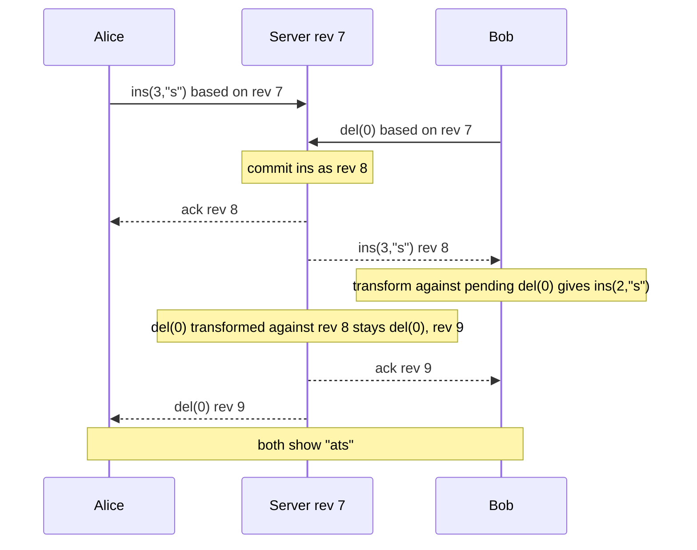

## In one minute
- Operational Transformation (OT) lets several users edit the same document at once. Each edit applies locally immediately, and remote edits are *transformed* to account for edits that happened concurrently.
- The core is a `transform(a, b)` function: given two operations made against the same document state, it rewrites `a` so it has the intended effect after `b` has already been applied.
- Production OT (Google Docs, the Wave lineage, ShareDB) relies on a **central server** that assigns a single order to operations, which keeps the algorithm tractable.
- Compared with CRDTs, OT keeps document metadata small and fits a server-centric product, but needs a server in the loop and careful transform functions for every pair of operation types.

## How it works

### The problem transform solves
Alice and Bob both see `"cat"`. Alice inserts `"s"` at position 3 to make `"cats"`. Bob deletes position 0 to make `"at"`. If Bob applies Alice's operation unchanged, he inserts at index 3 of `"at"`, which is past the end. Alice's operation must be shifted left by one, because Bob's delete removed a character before it. After transform, both sides reach `"ats"`.

### Transform rules for text
For insert versus insert at different positions, the later position shifts right by the length of the earlier insert. At the same position a deterministic tie-break such as site ID decides which goes first, and both sides must use the same rule. Insert versus delete shifts the insert left if the delete was before it. Delete versus delete of the same character becomes a no-op on the second side. Real systems use *retain/insert/delete* sequences that span the whole document, which compose and transform efficiently. Formatting adds a third kind of change: Google Docs reduces every edit to inserting text, deleting text, or applying a style to a range, and a style range grows when text is inserted inside it ([Google Drive blog](https://drive.googleblog.com/2010/09/whats-different-about-new-google-docs_22.html)).

### Convergence property
The requirement, often called TP1, is that for concurrent `a` and `b`, applying `a` then `transform(b, a)` gives the same document as `b` then `transform(a, b)`. Peer-to-peer OT without a central order also needs TP2, a much harder property about transforming against different sequences. Many published algorithms were later shown to violate TP2. A 2003 study ran the published string transformation functions through a theorem prover, found counterexamples (Sun's set, for example, violates TP2), and concluded that all of them were incorrect or over-specified; even a plain string has 123 cases to check each time a function changes ([Imine et al.](https://www.lri.fr/~mbl/ENS/CSCW/2013/papers/Imine-ECSCW03.pdf)). So production systems avoid peer-to-peer OT.

### Client-server OT
The server keeps the authoritative document and a revision counter. A client sends an operation tagged with the revision it was based on. If the server is now at a later revision, it transforms the incoming op against every op committed since that revision, applies it, assigns the next revision, and broadcasts it. Each client keeps at most one operation *in flight* and buffers further local edits. When the server's acknowledgment arrives it sends the buffer. Remote operations arriving meanwhile are transformed against the in-flight and buffered ops before being applied locally. Because the server defines a single total order, only TP1 is needed. Google Wave added the one-in-flight rule to Jupiter's design so the server keeps a single history instead of a state space per client, at the cost of clients seeing others' edits in chunks about one round trip apart ([Wave OT whitepaper](https://svn.apache.org/repos/asf/incubator/wave/whitepapers/operational-transform/operational-transform.html)). In distributed-systems terms, OT needs total order broadcast, which means a designated leader or a consensus protocol ([Kleppmann's lecture notes](https://www.cl.cam.ac.uk/teaching/2122/ConcDisSys/dist-sys-notes.pdf)).

### Beyond plain text
Rich text adds formatting attributes on ranges. Structured documents like spreadsheets or JSON need transforms for operations on paths. Every new operation type multiplies the transform pairs you must write and test.

Newer designs blur the line between OT and CRDTs. Eg-walker (EuroSys 2025) stores a plain operation log like OT but builds a temporary CRDT only while merging concurrent branches, which its authors report uses an order of magnitude less steady-state memory than CRDTs and merges long-running branches orders of magnitude faster than OT ([Gentle and Kleppmann](https://arxiv.org/abs/2409.14252)).

## Down the stack

### Layer 1: The contract
Client-server OT promises three things. Local edits apply immediately, so typing latency is a memory write, not a round trip. The server assigns every accepted operation a revision number, giving one total order that all clients replay. Once the system is quiet, every client's document equals the server's document at the latest revision. It does not promise that the merged text matches what both users meant, only that it is deterministic and the same everywhere. It also depends on the server: a client offline for an hour keeps editing locally, but its changes are not shared and not durable until the server accepts them, possibly after transforming them against thousands of operations.

### Layer 2: The mechanism
The design descends from Xerox PARC's Jupiter system (Nichols et al., UIST 1995) and was popularised by Google Wave and Google Docs. Google Docs stores each document as a revision log of changes and renders it by replaying that log ([Google Drive blog](https://drive.googleblog.com/2010/09/whats-different-about-new-google-docs_22.html)). Open-source implementations show the moving parts. In ot.js an operation is a list of components spanning the whole document: `retain(n)`, `insert(str)`, `delete(n)`. Two functions do all the work: `compose(a, b)` merges consecutive operations into one, and `transform(a, b)` returns the pair `(a', b')` that satisfies TP1. The client is a three-state machine: *Synchronized*, *AwaitingConfirm* (one operation in flight), and *AwaitingWithBuffer* (one in flight plus a composed buffer of later edits). When the ack arrives, the buffer is sent; when a remote operation arrives, it is transformed against the in-flight and buffered operations before it touches the editor ([ot.js](https://github.com/Operational-Transformation/ot.js)).

ShareDB, a Node.js server, applies the same idea to JSON documents. Each submit carries the document version it was based on. The server loads the operations committed since that version from its op log, transforms the incoming operation against them, and commits it with an atomic "insert version v+1 only if it does not already exist" in the backing database. That conditional write is the serialization point; a concurrent submit that loses the race is retransformed and retried, up to a configurable retry limit ([ShareDB source](https://github.com/share/sharedb/blob/master/lib/submit-request.js)). Snapshots let a client load a document without replaying its entire history.

### Layer 3: The machine
Operations are small. A keystroke as JSON is a few dozen bytes, and over WebSocket a small client-to-server frame adds about 6 bytes of header including the 4-byte masking key that every client frame must carry ([RFC 6455](https://www.rfc-editor.org/rfc/rfc6455#section-5.2)), so typing traffic is negligible. The one-operation-in-flight rule also gives natural batching: with a 150 ms round trip, all keystrokes typed during that window are composed into a single buffered operation, so the message rate adapts to latency instead of growing with typing speed.

The real limits sit on the server. Every operation on a document must pass through one ordering point, so a document's write throughput is bounded by one process and one conditional database write per revision, typically a millisecond or a few. Transform cost is linear in the number of concurrent operations: a client reconnecting after a long offline session can force the server to transform its edits against thousands of revisions. Positions are another trap: JavaScript strings index UTF-16 code units, so an emoji is two positions, and a server that counts characters in a different unit corrupts text silently.

### Why it's built this way
1. Users notice input lag above roughly 100 ms, and network round trips often exceed that, so edits must apply locally first and be reconciled later.
2. Reconciling concurrent edits without a referee requires TP2, which many published algorithms got wrong, so a central server imposes one order and only TP1 is needed.
3. A central order makes each document a single serialization point, so documents are sharded by ID and each one's op log is an append-only table keyed by version.
4. History grows with every keystroke, so servers store periodic snapshots and clients compose pending edits to keep both transform cost and message counts low.

## Diagram


## Worked example
A collaborative editor hosts documents with up to 50 simultaneous editors, each typing about 5 keystrokes per second. Clients batch keystrokes into one operation every 100 ms, so each editor sends up to 10 ops per second, and a busy document receives 500 ops per second.

Server work per op: transform against all ops committed since the client's base revision. With 100 ms client RTT, a client is about 50 revisions behind at that rate (500/s × 0.1 s), so about 50 transforms per op, each taking microseconds. One document needs a few ms of CPU per second, but all of it must happen on the single node that owns that document, so documents are sharded by ID with one owner each.

Storage: the op log grows about 50 bytes per op, so 500 ops/s for a one-hour session is 90 MB. The server snapshots the document every 1,000 revisions and keeps the log for history and undo. A client reconnecting after 10 minutes offline with 300 local edits sends them as one composed op, which the server transforms against the 300,000 ops committed since; for long gaps, rebasing against a snapshot diff is cheaper.

Failure case: the document's owner node crashes. A new owner loads the last snapshot plus the log tail from durable storage. Clients resend their in-flight ops with the same IDs, and the server deduplicates by `(clientId, seq)` so a retried op is not applied twice.

## In the wild
- **Google Docs, 2010: OT behind the rebuilt editor.** When Google relaunched Docs with real-time collaboration, it described each document as a revision log of three change types (insert text, delete text, apply style), with every editor sending changes through the server and transforming incoming ones against its own. A style range transformed against an insertion inside it simply grows ([Google Drive blog](https://drive.googleblog.com/2010/09/whats-different-about-new-google-docs_22.html)).
- **CKEditor 5, 2018: tree-shaped OT inside a 42 person-year project.** Textbook OT has insert, delete and set-attribute on a linear model, which was not enough for rich text. CKEditor added rename, split, merge, insert-text and marker operations, range-based operations, operation breaking, a graveyard root for removed nodes and selective undo. After four years of work, the team reported that the whole of CKEditor 5, collaboration included, had taken about 42 person-years, with 12,500 tests at 100% coverage ([CKEditor](https://ckeditor.com/blog/Lessons-learned-from-creating-a-rich-text-editor-with-real-time-collaboration/)).
- **Figma, 2019: choosing not to use OT.** Figma judged OT unnecessarily complex for a tree of design objects. Its server is the authority, each property uses last-writer-wins ordered by arrival at the server, reparenting that would create a cycle is rejected, and child order uses fractional indexes. Offline clients download a fresh copy on reconnect and reapply their edits ([Figma](https://www.figma.com/blog/how-figmas-multiplayer-technology-works/)).

## Trade-offs
| Option | Strengths | Weaknesses | Choose when |
|---|---|---|---|
| Client-server OT | Small metadata, mature, simple clients | Server required for every edit, per-document owner | Online-first editors with a central backend |
| Peer-to-peer OT | No server ordering | TP2 is hard to get right | Rarely; prefer CRDTs |
| Sequence CRDT | Offline and peer-to-peer, no server logic | Larger metadata, possible interleaving | Local-first or multi-region active writes |
| Server-authoritative LWW per property | Very simple | Not suitable for character-level text | Design tools, forms, object trees |
| Locking sections | Trivial to build | Users block each other | Low concurrency workflows |

## Pitfalls in production
- Transform functions with an untested edge case cause permanent divergence between clients. Property-test TP1 with random concurrent op pairs and compare document hashes on every ack.
- Clients that send many in-flight ops lose the simple invariant. Enforce one in flight plus one buffered composed op.
- Undo is not simply "invert my last op"; it must be transformed against later remote edits. Treat undo as a new op built from the inverted op, transformed forward.
- A hot document overloads its single owner. Cap editors per document and rate-limit cursors and presence separately from content ops.
- Retries without op IDs double-apply edits after a reconnect. Assign `(clientId, seq)` and deduplicate on the server.

## Leadership lens
- The real choice is OT versus CRDT: OT if you are online-first with a strong backend, a CRDT if offline or peer-to-peer editing is core.
- Prefer an existing engine to writing transforms yourself: ShareDB with its OT types, or ProseMirror's collab module, whose central authority simply rejects a stale submission and makes the client rebase its steps and retry rather than transforming on the server ([ProseMirror guide](https://prosemirror.net/docs/guide/)).
- Ask how divergence is detected in production: checksums in acks and a forced resync path are mandatory.
- Plan document ownership, failover, and snapshotting as first-class infrastructure, not as an afterthought to the editor UI.

## Check yourself
1. Why does client-server OT need only TP1 while peer-to-peer OT needs TP2 as well?
   **Answer:** The server imposes one total order, so every op is transformed along the same path. Without it, ops can be transformed against concurrent sequences in different orders, which TP2 must reconcile.
2. Why must the tie-break for two inserts at the same position be deterministic and shared?
   **Answer:** Each side resolves the tie independently; if they choose differently the texts diverge permanently.
3. Why does a client keep only one operation in flight?
   **Answer:** It lets the client know exactly which server revision its op was based on and transform incoming ops against a single known pending op plus a buffer.
4. What happens if a transform shifts an insert incorrectly by one?
   **Answer:** Clients silently diverge and stay diverged until a checksum or resync detects it.

## Practice
**Task:** Implement OT for a plain string with single-character operations. An op is `("ins", pos, ch, site)`, `("del", pos, site)`, or `("noop",)`. `apply(doc, op)` returns the new string. `transform(a, b)` returns `a` rewritten to apply after `b`, where both were made on the same document. Inserts at the same position are ordered by lower site first. Deleting the same position twice becomes a no-op. The tests check that `apply(apply(d, a), transform(b, a)) == apply(apply(d, b), transform(a, b))`.

```python starter
def apply(doc, op):
    # TODO
    return doc


def transform(a, b):
    # TODO
    return a
```

```python tests
def converge(doc, a, b):
    left = apply(apply(doc, a), transform(b, a))
    right = apply(apply(doc, b), transform(a, b))
    return left, right

def test_insert_vs_delete_before():
    left, right = converge("cat", ("ins", 3, "s", 1), ("del", 0, 2))
    assert left == right == "ats"

def test_inserts_same_position_tie_break():
    left, right = converge("ab", ("ins", 1, "X", 1), ("ins", 1, "Y", 2))
    assert left == right == "aXYb"

def test_delete_same_char_twice():
    left, right = converge("abc", ("del", 1, 1), ("del", 1, 2))
    assert left == right == "ac"

def test_delete_vs_insert_before():
    left, right = converge("abc", ("del", 2, 1), ("ins", 0, "Z", 2))
    assert left == right == "Zab"

def test_insert_at_deleted_position():
    left, right = converge("abc", ("ins", 1, "Q", 1), ("del", 1, 2))
    assert left == right == "aQc"

def test_noop_applies_cleanly():
    assert apply("abc", ("noop",)) == "abc"
```

```python solution
def apply(doc, op):
    if op[0] == "ins":
        return doc[:op[1]] + op[2] + doc[op[1]:]
    if op[0] == "del":
        return doc[:op[1]] + doc[op[1] + 1:]
    return doc


def transform(a, b):
    if a[0] == "noop" or b[0] == "noop":
        return a
    if a[0] == "ins":
        pos = a[1]
        if b[0] == "ins" and (b[1] < pos or (b[1] == pos and b[3] < a[3])):
            pos += 1
        elif b[0] == "del" and b[1] < pos:
            pos -= 1
        return ("ins", pos, a[2], a[3])
    pos = a[1]
    if b[0] == "ins" and b[1] <= pos:
        pos += 1
    elif b[0] == "del":
        if b[1] == pos:
            return ("noop",)
        if b[1] < pos:
            pos -= 1
    return ("del", pos, a[2])
```

```typescript starter
// kind "ins" uses pos, ch, site; "del" uses pos, site; "noop" uses none.
export interface Op {
  kind: "ins" | "del" | "noop";
  pos: number;
  ch: string;
  site: number;
}

export function ins(pos: number, ch: string, site: number): Op {
  return { kind: "ins", pos, ch, site };
}

export function del(pos: number, site: number): Op {
  return { kind: "del", pos, ch: "", site };
}

export const NOOP: Op = { kind: "noop", pos: 0, ch: "", site: 0 };

export function apply(doc: string, op: Op): string {
  throw new Error("TODO");
}

export function transform(a: Op, b: Op): Op {
  throw new Error("TODO");
}
```

```typescript tests
function converge(doc: string, a: Op, b: Op): [string, string] {
  return [apply(apply(doc, a), transform(b, a)), apply(apply(doc, b), transform(a, b))];
}

test("insert vs delete before", () => {
  assertEqual(converge("cat", ins(3, "s", 1), del(0, 2)), ["ats", "ats"]);
});

test("inserts same position tie break", () => {
  assertEqual(converge("ab", ins(1, "X", 1), ins(1, "Y", 2)), ["aXYb", "aXYb"]);
});

test("delete same char twice", () => {
  assertEqual(converge("abc", del(1, 1), del(1, 2)), ["ac", "ac"]);
});

test("delete vs insert before", () => {
  assertEqual(converge("abc", del(2, 1), ins(0, "Z", 2)), ["Zab", "Zab"]);
});

test("insert at deleted position", () => {
  assertEqual(converge("abc", ins(1, "Q", 1), del(1, 2)), ["aQc", "aQc"]);
});

test("noop applies cleanly", () => {
  assertEqual(apply("abc", NOOP), "abc");
});
```

```typescript solution
export interface Op {
  kind: "ins" | "del" | "noop";
  pos: number;
  ch: string;
  site: number;
}

export function ins(pos: number, ch: string, site: number): Op {
  return { kind: "ins", pos, ch, site };
}

export function del(pos: number, site: number): Op {
  return { kind: "del", pos, ch: "", site };
}

export const NOOP: Op = { kind: "noop", pos: 0, ch: "", site: 0 };

export function apply(doc: string, op: Op): string {
  if (op.kind === "ins") return doc.slice(0, op.pos) + op.ch + doc.slice(op.pos);
  if (op.kind === "del") return doc.slice(0, op.pos) + doc.slice(op.pos + 1);
  return doc;
}

export function transform(a: Op, b: Op): Op {
  if (a.kind === "noop" || b.kind === "noop") return a;
  let pos = a.pos;
  if (a.kind === "ins") {
    if (b.kind === "ins" && (b.pos < pos || (b.pos === pos && b.site < a.site))) pos++;
    else if (b.kind === "del" && b.pos < pos) pos--;
    return ins(pos, a.ch, a.site);
  }
  if (b.kind === "ins" && b.pos <= pos) pos++;
  else if (b.kind === "del") {
    if (b.pos === pos) return NOOP;
    if (b.pos < pos) pos--;
  }
  return del(pos, a.site);
}
```

```go starter
package practice

type Kind int

const (
	Noop Kind = iota
	Ins
	Del
)

// Op is a single-character edit. Ch is used only by Ins.
type Op struct {
	Kind Kind
	Pos  int
	Ch   string
	Site int
}

func Apply(doc string, op Op) string {
	panic("TODO")
}

func Transform(a, b Op) Op {
	panic("TODO")
}
```

```go tests
package practice

import "testing"

func converge(doc string, a, b Op) (string, string) {
	return Apply(Apply(doc, a), Transform(b, a)), Apply(Apply(doc, b), Transform(a, b))
}

func check(t *testing.T, doc string, a, b Op, want string) {
	t.Helper()
	l, r := converge(doc, a, b)
	if l != want || r != want {
		t.Fatalf("got %q and %q, want %q", l, r, want)
	}
}

func TestInsertVsDeleteBefore(t *testing.T) {
	check(t, "cat", Op{Kind: Ins, Pos: 3, Ch: "s", Site: 1}, Op{Kind: Del, Pos: 0, Site: 2}, "ats")
}

func TestInsertsSamePositionTieBreak(t *testing.T) {
	check(t, "ab", Op{Kind: Ins, Pos: 1, Ch: "X", Site: 1}, Op{Kind: Ins, Pos: 1, Ch: "Y", Site: 2}, "aXYb")
}

func TestDeleteSameCharTwice(t *testing.T) {
	check(t, "abc", Op{Kind: Del, Pos: 1, Site: 1}, Op{Kind: Del, Pos: 1, Site: 2}, "ac")
}

func TestDeleteVsInsertBefore(t *testing.T) {
	check(t, "abc", Op{Kind: Del, Pos: 2, Site: 1}, Op{Kind: Ins, Pos: 0, Ch: "Z", Site: 2}, "Zab")
}

func TestInsertAtDeletedPosition(t *testing.T) {
	check(t, "abc", Op{Kind: Ins, Pos: 1, Ch: "Q", Site: 1}, Op{Kind: Del, Pos: 1, Site: 2}, "aQc")
}

func TestNoopAppliesCleanly(t *testing.T) {
	if got := Apply("abc", Op{Kind: Noop}); got != "abc" {
		t.Fatalf("got %q", got)
	}
}
```

```go solution
package practice

type Kind int

const (
	Noop Kind = iota
	Ins
	Del
)

type Op struct {
	Kind Kind
	Pos  int
	Ch   string
	Site int
}

func Apply(doc string, op Op) string {
	switch op.Kind {
	case Ins:
		return doc[:op.Pos] + op.Ch + doc[op.Pos:]
	case Del:
		return doc[:op.Pos] + doc[op.Pos+1:]
	}
	return doc
}

func Transform(a, b Op) Op {
	if a.Kind == Noop || b.Kind == Noop {
		return a
	}
	pos := a.Pos
	if a.Kind == Ins {
		if b.Kind == Ins && (b.Pos < pos || (b.Pos == pos && b.Site < a.Site)) {
			pos++
		} else if b.Kind == Del && b.Pos < pos {
			pos--
		}
		return Op{Kind: Ins, Pos: pos, Ch: a.Ch, Site: a.Site}
	}
	if b.Kind == Ins && b.Pos <= pos {
		pos++
	} else if b.Kind == Del {
		if b.Pos == pos {
			return Op{Kind: Noop}
		}
		if b.Pos < pos {
			pos--
		}
	}
	return Op{Kind: Del, Pos: pos, Site: a.Site}
}
```

## Mock interview
**Prompt:** Design the real-time collaboration backend for a document editor where up to 100 people edit one document and 2 million documents are open at peak. Edits must appear for others within 200 ms.

- Follow-up: how does a client that was offline for 5 minutes rejoin without losing edits?
- Follow-up: the server owning a hot document crashes; walk through recovery.
- Follow-up: would you switch to a CRDT, and what would you gain or lose?

**A strong answer covers:**
- Client-server OT with revisions, one in-flight op per client, and transform on the server.
- Sharding documents to owner nodes with a routing layer and sticky WebSocket connections.
- Durable op log plus periodic snapshots, and deduplication by client op IDs on retry.
- Checksums to detect divergence, with a forced resync path.
- Separating presence and cursor traffic from content ops.
- A reasoned OT versus CRDT comparison: offline support, metadata size, server cost.

## Sources and further study
**Primary**
- [Imine, Molli, Oster and Rusinowitch, Proving Correctness of Transformation Functions in Real-Time Groupware (ECSCW 2003)](https://www.lri.fr/~mbl/ENS/CSCW/2013/papers/Imine-ECSCW03.pdf): theorem-prover counterexamples to the classic TP1 and TP2 transformation functions.
- [Gentle and Kleppmann, Collaborative Text Editing with Eg-walker (EuroSys 2025)](https://arxiv.org/abs/2409.14252): an operation log like OT with CRDT-style merging only when branches meet.
- [Weidner and Kleppmann, The Art of the Fugue](https://arxiv.org/abs/2305.00583): interleaving anomalies that affect OT and CRDTs alike.

**Systems docs**
- [ot.js](https://github.com/Operational-Transformation/ot.js): a compact reference for `TextOperation`, `compose`, `transform` and the three-state client.
- [ShareDB submit path](https://github.com/share/sharedb/blob/master/lib/submit-request.js): fetch, transform to the current version, atomic commit, and retry on a lost race.
- [ProseMirror guide: Collaborative editing](https://prosemirror.net/docs/guide/): a central authority that accepts or rejects steps, with clients rebasing locally.

**Books**
- *Designing Data-Intensive Applications* (1st ed.), Martin Kleppmann, Ch 5 "Replication": collaborative editing as multi-leader replication, and automatic conflict resolution.

**Other curricula**
- [Kleppmann, Concurrent and Distributed Systems lecture notes (Cambridge)](https://www.cl.cam.ac.uk/teaching/2122/ConcDisSys/dist-sys-notes.pdf): introduces OT with a worked transform and explains why it needs total order broadcast, then contrasts text CRDTs.
- [donnemartin/system-design-primer](https://github.com/donnemartin/system-design-primer): does not cover collaborative editing; its nearest material is master-master replication and conflict resolution.

## Watch
- [Distributed Systems 8.1: Collaboration software (Martin Kleppmann)](https://www.youtube.com/watch?v=OqqliwwG0SM): OT and CRDTs side by side, with the transform convergence property.
- [New algorithms for collaborative text editing (Strange Loop 2023)](https://www.youtube.com/watch?v=Mr0a5KyD6BU): why OT needs a server and how newer approaches compare.
- [Collaborative text editing without CRDTs or OT (Local-First Conf)](https://www.youtube.com/watch?v=5CFrpd0sG-g): a server-ordered alternative that clarifies what OT is really buying.

## Free resources
- [Google Wave operational transform whitepaper](https://svn.apache.org/repos/asf/incubator/wave/whitepapers/operational-transform/operational-transform.html): the client-server OT design that shaped later editors.
- [Collaborative editing in ProseMirror (Marijn Haverbeke)](https://marijnhaverbeke.nl/blog/collaborative-editing.html): a pragmatic, server-ordered approach to rich-text collaboration.
- [ShareDB](https://share.github.io/sharedb/): a production OT backend with documented operation types.
- [How Figma's multiplayer technology works](https://www.figma.com/blog/how-figmas-multiplayer-technology-works/): why Figma chose something simpler than OT for a tree of objects.
- [Operational transformation (Wikipedia)](https://en.wikipedia.org/wiki/Operational_transformation): history, TP1/TP2, and the family of algorithms.
