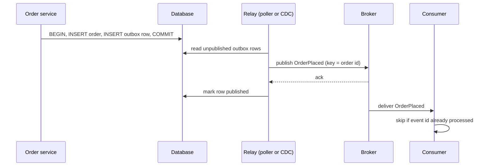

## In one minute
- A service often needs to change its database *and* publish an event. Doing both directly (a "dual write") loses or invents events whenever one succeeds and the other fails.
- The outbox pattern writes the event into an `outbox` table in the same local transaction as the business change. A separate relay later reads the table and publishes to the broker.
- The guarantee becomes: if the change commits, the event is eventually published at least once; if it rolls back, the event never exists.
- Consumers must be idempotent, because the relay can publish the same event more than once.

## How it works

### The dual-write problem
Consider `INSERT order; COMMIT; publish OrderPlaced`. If the process crashes after the commit but before the publish, downstream services never learn about the order. Reverse the order and a crash after publishing but before commit announces an order that does not exist. Wrapping both in a distributed transaction (2PC with the broker) is possible in theory but rarely supported well and couples availability. The outbox avoids the problem by making the event part of the data the database already commits atomically ([microservices.io](https://microservices.io/patterns/data/transactional-outbox.html)).

### Writing to the outbox
In the same transaction as the business change, insert a row into `outbox` with an id, the aggregate type and id (for example `order`, `8812`), an event type, and the payload. The commit makes both durable together. The service's request path does not talk to the broker at all, so a broker outage no longer fails user requests; events just queue up in the table.

### Relaying: polling or log tailing
A **polling publisher** queries unpublished rows in order, publishes them, then marks them published or deletes them. It is simple and works with any database, but adds query load and latency equal to the poll interval. **Transaction log tailing** uses change data capture: a connector such as Debezium reads inserts to the outbox table from the database's replication log and publishes them. Latency is lower and there is no polling load, but you now run a CDC pipeline.

Two variants are worth knowing. In a NoSQL store without multi-item transactions, the outbox becomes a field on the record itself, which a change stream then publishes ([microservices.io](https://microservices.io/patterns/data/transactional-outbox.html)). In PostgreSQL you can skip the table entirely: `pg_logical_emit_message(true, prefix, content)` writes a message into the WAL as part of the current transaction, so it appears in the logical decoding stream only if the transaction commits, and nothing needs deleting afterwards ([Postgres docs](https://www.postgresql.org/docs/current/functions-admin.html)).

### Ordering and duplicates
The relay can crash after publishing and before recording that it did, so on restart it publishes again: delivery is at-least-once. Consumers keep a record of processed event ids (an "inbox" table) and skip repeats, or make their updates naturally idempotent. To preserve order per entity, publish with the aggregate id as the partition key so all events for one order land on one partition, and never let the relay publish a later event for an aggregate before an earlier failed one.

### Housekeeping
The outbox grows with every write. Delete published rows promptly, or partition the table by time and drop old partitions, to avoid bloat that slows both the relay and the business tables' vacuum.

## Down the stack

### Layer 1: The contract
The outbox pattern promises: an event exists if and only if its business transaction committed; every committed event is published at least once, eventually, as long as the relay and broker eventually run; and events for the same aggregate are published in commit order, provided the relay preserves order and partitions by aggregate. It does not promise exactly-once delivery or a latency bound; latency is whatever the relay achieves.

### Layer 2: The mechanism
A common schema, and the default the Debezium outbox event router expects, has columns `id`, `aggregatetype`, `aggregateid`, `type`, and `payload`. The router reads each insert from the change stream and sends it to the topic `outbox.event.<aggregatetype>` by default, using `aggregateid` as the message key, so all events for one aggregate share a Kafka partition. It drops `DELETE` events on the outbox table, so the relay's cleanup produces no extra messages, and it exposes the row `id` so consumers can deduplicate ([Debezium docs](https://debezium.io/documentation/reference/stable/transformations/outbox-event-router.html)). A polling relay typically runs `SELECT ... FROM outbox WHERE published_at IS NULL ORDER BY id LIMIT 100 FOR UPDATE SKIP LOCKED`, so several relay instances can work without taking the same rows. One subtle trap: sequence values are allocated when a row is inserted, not when its transaction commits, so a row with id 101 can commit after the relay has already processed id 102. A relay that keeps a "highest id seen" cursor will skip 101 forever; selecting by an unpublished flag, or tailing the log in commit order, avoids this. On the broker side, `enable.idempotence=true` and `acks=all` stop producer retries from adding duplicates of their own. Both have been the Java producer's defaults since Kafka 3.0, so older advice to switch them on is now mostly about checking nobody switched them off ([KIP-679](https://cwiki.apache.org/confluence/display/KAFKA/KIP-679%3A+Producer+will+enable+the+strongest+delivery+guarantee+by+default)). They do not help with the relay's own crash-and-resend duplicates, which carry a new producer session.

### Layer 3: The machine
The outbox insert rides on the business transaction's commit: one extra heap tuple, one extra index entry, and perhaps 200 to 500 bytes more WAL, all flushed by the same `fsync`. That is why the pattern adds almost no latency to the request. Deleting or updating published rows creates dead tuples that vacuum must reclaim; at 5,000 events per second that is 430 million dead tuples per day. Log tailing uses a logical replication slot, which makes PostgreSQL retain WAL until the connector confirms it, even when nobody is connected ([Postgres docs](https://www.postgresql.org/docs/current/logicaldecoding-explanation.html)); if the connector is down for a day at 20 MB per second of WAL, the primary holds about 1.7 TB of extra WAL and can fill its disk. The cap, `max_slot_wal_keep_size`, defaults to -1, meaning unlimited ([Postgres docs](https://www.postgresql.org/docs/current/runtime-config-replication.html)). A polling relay at a 100 ms interval adds an average of 50 ms of delay plus query time; CDC pipelines usually deliver in tens of milliseconds.

### Why it's built this way
1. A database and a broker cannot commit atomically together without 2PC, so events are stored where the business data is.
2. The database already guarantees atomic commits, so putting the event in the same transaction ties its fate to the change.
3. Something must move events to the broker, and it can crash between sending and recording, so delivery is at-least-once.
4. At-least-once delivery creates duplicates, so consumers deduplicate by event id.
5. The outbox grows with every write and retained WAL fills disks, so cleanup and connector lag must be monitored.

## Diagram


## Worked example
An order service handles 2,000 orders per second, each producing one `OrderPlaced` event of about 1 KB. Previously it committed and then published directly to Kafka. During a 4-minute broker incident, the publish calls failed after commit, and about 480,000 orders never reached the fulfilment service. Reconciling them took two days.

With the outbox: each order transaction inserts one more 1 KB row, adding under 0.2 ms to commit time. A relay with two instances polls every 50 ms, fetches up to 500 rows using `SKIP LOCKED`, publishes them in a batch, and deletes them. Normal end-to-end delay is under 100 ms. During the same broker incident, rows accumulate: 2,000 per second for 240 seconds is 480,000 rows, about 500 MB. When the broker recovers, the relay drains them at 20,000 per second in about 25 seconds. No order is lost.

The fulfilment service receives a few hundred duplicates after a relay restart; its inbox table (event id primary key, checked in the same transaction as its own update) drops them. An alert fires when the oldest unpublished row is more than 30 seconds old.

## In the wild
- **Brandur Leach, 2017: transactionally staged job drains.** Enqueuing background jobs into Redis inside a Postgres transaction let workers run jobs before commit (and keep jobs for rolled-back work), while enqueuing after commit lost jobs on a crash. The fix was a `staged_jobs` table written in the business transaction, drained by a single enqueuer that selects a batch in a repeatable-read transaction, sends it to Sidekiq, then deletes up to the last id sent. Delivery became at least once, so job handlers had to tolerate repeats ([brandur.org](https://brandur.org/job-drain)).
- **Segment, 2017: what deduplicating at the consumer actually costs.** About 0.6% of ingested events arrived more than once, largely from clients on flaky mobile networks resending what the server had already received. Segment partitioned Kafka by message id and gave each worker an embedded RocksDB store of seen ids with a four-week window. After three months it held about 60 billion keys in 1.5 TB on disk, across roughly 200 billion messages. An outbox consumer's inbox table is the same idea at smaller scale ([Segment via Twilio](https://www.twilio.com/en-us/blog/insights/exactly-once-delivery)).

## Trade-offs
| Option | Strengths | Weaknesses | Choose when |
|---|---|---|---|
| Direct dual write | Simplest, lowest latency | Loses or invents events on failure | Never for events others depend on |
| Outbox with polling relay | Works with any database, easy to understand | Poll load, latency equal to interval | Moderate volume, no CDC infrastructure |
| Outbox with log tailing (CDC) | Low latency, no polling load | CDC pipeline to run, WAL retention risk | High volume, CDC already in place |
| Event sourcing | Events are the source of truth | Big change in data model | Domain benefits from full history |
| 2PC with broker | Atomic in theory | Poor support, blocking, coupling | Almost never in modern stacks |

## Pitfalls in production
- **Skipped rows from id cursors.** A relay that tracks "last id processed" misses rows that commit out of id order. Select by an unpublished flag or use log tailing.
- **Outbox bloat.** Millions of published rows slow the relay query and vacuum. Delete promptly or drop time partitions, and index the unpublished rows.
- **WAL retention from a stalled connector.** A broken CDC connector makes the primary keep WAL until the disk fills. A healthy one can do it too: if the outbox is quiet while other tables or databases on the server are busy, the slot only advances when an outbox change arrives, so Debezium recommends periodic heartbeat events (`heartbeat.interval.ms`) ([Debezium docs](https://debezium.io/documentation/reference/stable/connectors/postgresql.html)). Alert on replication slot lag and set a maximum retained WAL size.
- **Non-idempotent consumers.** Duplicate events double-ship or double-charge. Store processed event ids in the consumer's transaction.
- **Order broken by parallel relays.** Two relay workers publish events for the same order out of sequence. Partition work by aggregate id, or use a single ordered stream per partition.
- **Payloads that leak internal schema.** Publishing table rows directly couples consumers to your schema. Publish explicit, versioned event contracts.

## Leadership lens
- Make "no dual writes" a team rule for events that other services depend on, and check for it in code review.
- Choose polling or CDC based on volume and existing platform; a shared CDC platform amortizes its cost across teams.
- Require metrics for outbox depth, oldest unpublished age, relay errors, and replication slot lag, with alerts.
- Treat event payloads as public APIs with versioning and ownership, not as copies of table rows.

## Check yourself
1. Why does publishing after commit not solve the dual-write problem?
   **Answer:** A crash between the commit and the publish leaves a committed change with no event, and nothing remembers to send it.
2. Why do outbox consumers need to be idempotent?
   **Answer:** The relay may publish an event and crash before recording that it did, so the event is published again on restart.
3. Why can a relay that reads rows with `id > last_seen_id` lose events?
   **Answer:** Ids are assigned at insert time but transactions commit in a different order, so a lower id can become visible after the relay has moved past it.

## Practice
**Task:** Build an outbox with a relay and an idempotent consumer. `Outbox.place_order(order_id, amount, fail=False)` writes the order and an `OrderPlaced` event (`{"id", "order_id", "amount"}`, ids from 1) atomically; with `fail=True` it raises `RuntimeError` and writes neither. `relay(publish, batch, crash_before_mark=False)` publishes unpublished events in id order, up to `batch`, marking each published after `publish(event)` returns `True`; it stops at the first `False`. With `crash_before_mark`, it returns right after the first successful publish without marking. It returns how many it marked. `pending()` lists unpublished ids. `Consumer.handle(event)` applies each event id once, returning `False` for duplicates; `applied` lists applied order ids.

```python starter
class Outbox:
    def __init__(self):
        self.orders = {}

    def place_order(self, order_id, amount, fail=False): raise NotImplementedError
    def relay(self, publish, batch, crash_before_mark=False): raise NotImplementedError
    def pending(self): raise NotImplementedError

class Consumer:
    def __init__(self):
        self.applied = []

    def handle(self, event): raise NotImplementedError
```

```python tests
def broker():
    sent = []
    def publish(e):
        sent.append(e["id"])
        return True
    return sent, publish

def test_order_and_event_written_together():
    ob = Outbox()
    ob.place_order("o1", 50)
    assert ob.orders == {"o1": 50}
    assert ob.pending() == [1]

def test_failed_transaction_writes_nothing():
    ob = Outbox()
    try:
        ob.place_order("o1", 50, fail=True)
    except RuntimeError:
        pass
    assert ob.orders == {} and ob.pending() == []

def test_relay_publishes_in_order_and_respects_batch():
    ob = Outbox()
    for i in range(3):
        ob.place_order("o%d" % i, i)
    sent, publish = broker()
    assert ob.relay(publish, 2) == 2
    assert sent == [1, 2] and ob.pending() == [3]

def test_publish_failure_stops_and_preserves_order():
    ob = Outbox()
    for i in range(3):
        ob.place_order("o%d" % i, i)
    assert ob.relay(lambda e: e["id"] != 2, 10) == 1
    assert ob.pending() == [2, 3]
    sent, publish = broker()
    ob.relay(publish, 10)
    assert sent == [2, 3]

def test_crash_causes_duplicate_that_consumer_drops():
    ob, c = Outbox(), Consumer()
    ob.place_order("o1", 10)
    deliver = lambda e: c.handle(e) or True
    assert ob.relay(deliver, 10, crash_before_mark=True) == 0
    assert ob.relay(deliver, 10) == 1
    assert c.applied == ["o1"]

def test_consumer_reports_duplicates():
    c = Consumer()
    e = {"id": 7, "order_id": "o7", "amount": 1}
    assert c.handle(e) is True
    assert c.handle(e) is False
```

```python solution
class Outbox:
    def __init__(self):
        self.orders = {}
        self.events = []
        self.next_id = 1

    def place_order(self, order_id, amount, fail=False):
        event = {"id": self.next_id, "order_id": order_id, "amount": amount}
        if fail:
            raise RuntimeError("transaction rolled back")
        self.orders[order_id] = amount
        self.events.append({"event": event, "published": False})
        self.next_id += 1
        return event["id"]

    def relay(self, publish, batch, crash_before_mark=False):
        marked = 0
        for row in [r for r in self.events if not r["published"]][:batch]:
            if not publish(row["event"]):
                break
            if crash_before_mark:
                return marked
            row["published"] = True
            marked += 1
        return marked

    def pending(self):
        return [r["event"]["id"] for r in self.events if not r["published"]]

class Consumer:
    def __init__(self):
        self.applied = []
        self.seen = set()

    def handle(self, event):
        if event["id"] in self.seen:
            return False
        self.seen.add(event["id"])
        self.applied.append(event["order_id"])
        return True
```

```typescript starter
export interface OrderEvent { id: number; orderId: string; amount: number }
export class Outbox {
  orders = new Map<string, number>();
  placeOrder(orderId: string, amount: number, fail = false): number { throw new Error("TODO"); }
  relay(publish: (e: OrderEvent) => boolean, batch: number, crashBeforeMark = false): number {
    throw new Error("TODO");
  }
  pending(): number[] { throw new Error("TODO"); }
}
export class Consumer {
  applied: string[] = [];
  handle(e: OrderEvent): boolean { throw new Error("TODO"); }
}
```

```typescript tests
function broker(): [number[], (e: OrderEvent) => boolean] {
  const sent: number[] = [];
  return [sent, (e: OrderEvent) => { sent.push(e.id); return true; }];
}
test("order and event written together", () => {
  const ob = new Outbox();
  ob.placeOrder("o1", 50);
  assertEqual([...ob.orders.entries()], [["o1", 50]]);
  assertEqual(ob.pending(), [1]);
});
test("failed transaction writes nothing", () => {
  const ob = new Outbox();
  let threw = false;
  try { ob.placeOrder("o1", 50, true); } catch (e) { threw = !(e instanceof Error && e.message === "TODO"); }
  assert(threw, "expected a rollback error");
  assertEqual([ob.orders.size, ob.pending()], [0, []]);
});
test("relay publishes in order and respects batch", () => {
  const ob = new Outbox();
  for (let i = 0; i < 3; i++) ob.placeOrder("o" + i, i);
  const [sent, publish] = broker();
  assertEqual(ob.relay(publish, 2), 2);
  assertEqual([sent, ob.pending()], [[1, 2], [3]]);
});
test("publish failure stops and preserves order", () => {
  const ob = new Outbox();
  for (let i = 0; i < 3; i++) ob.placeOrder("o" + i, i);
  assertEqual(ob.relay(e => e.id !== 2, 10), 1);
  assertEqual(ob.pending(), [2, 3]);
  const [sent, publish] = broker();
  ob.relay(publish, 10);
  assertEqual(sent, [2, 3]);
});
test("crash causes duplicate that consumer drops", () => {
  const ob = new Outbox(), c = new Consumer();
  ob.placeOrder("o1", 10);
  const deliver = (e: OrderEvent) => { c.handle(e); return true; };
  assertEqual(ob.relay(deliver, 10, true), 0);
  assertEqual(ob.relay(deliver, 10), 1);
  assertEqual(c.applied, ["o1"]);
});
test("consumer reports duplicates", () => {
  const c = new Consumer();
  const e = { id: 7, orderId: "o7", amount: 1 };
  assertEqual([c.handle(e), c.handle(e)], [true, false]);
});
```

```typescript solution
export interface OrderEvent { id: number; orderId: string; amount: number }
export class Outbox {
  orders = new Map<string, number>();
  private events: { event: OrderEvent; published: boolean }[] = [];
  private nextId = 1;
  placeOrder(orderId: string, amount: number, fail = false): number {
    const event = { id: this.nextId, orderId, amount };
    if (fail) throw new Error("transaction rolled back");
    this.orders.set(orderId, amount);
    this.events.push({ event, published: false });
    this.nextId++;
    return event.id;
  }
  relay(publish: (e: OrderEvent) => boolean, batch: number, crashBeforeMark = false): number {
    let marked = 0;
    for (const row of this.events.filter(r => !r.published).slice(0, batch)) {
      if (!publish(row.event)) break;
      if (crashBeforeMark) return marked;
      row.published = true;
      marked++;
    }
    return marked;
  }
  pending(): number[] {
    return this.events.filter(r => !r.published).map(r => r.event.id);
  }
}
export class Consumer {
  applied: string[] = [];
  private seen = new Set<number>();
  handle(e: OrderEvent): boolean {
    if (this.seen.has(e.id)) return false;
    this.seen.add(e.id);
    this.applied.push(e.orderId);
    return true;
  }
}
```

```go starter
package practice

type OrderEvent struct {
	ID      int
	OrderID string
	Amount  int
}

type Outbox struct {
	Orders map[string]int
}

func NewOutbox() *Outbox { return &Outbox{Orders: map[string]int{}} }

// PlaceOrder returns the event id, or an error (writing nothing) when fail is true.
func (o *Outbox) PlaceOrder(orderID string, amount int, fail bool) (int, error) {
	panic("TODO")
}

func (o *Outbox) Relay(publish func(OrderEvent) bool, batch int, crashBeforeMark bool) int {
	panic("TODO")
}

func (o *Outbox) Pending() []int { panic("TODO") }

type Consumer struct {
	Applied []string
}

func NewConsumer() *Consumer { return &Consumer{} }

func (c *Consumer) Handle(e OrderEvent) bool { panic("TODO") }
```

```go tests
package practice

import (
	"fmt"
	"reflect"
	"testing"
)

func broker() (*[]int, func(OrderEvent) bool) {
	sent := &[]int{}
	return sent, func(e OrderEvent) bool {
		*sent = append(*sent, e.ID)
		return true
	}
}

func TestOrderAndEventTogether(t *testing.T) {
	ob := NewOutbox()
	if _, err := ob.PlaceOrder("o1", 50, false); err != nil {
		t.Fatal(err)
	}
	if ob.Orders["o1"] != 50 || !reflect.DeepEqual(ob.Pending(), []int{1}) {
		t.Fatal("order or event missing")
	}
}

func TestFailedTransactionWritesNothing(t *testing.T) {
	ob := NewOutbox()
	if _, err := ob.PlaceOrder("o1", 50, true); err == nil {
		t.Fatal("expected error")
	}
	if len(ob.Orders) != 0 || len(ob.Pending()) != 0 {
		t.Fatal("rollback left data behind")
	}
}

func TestRelayOrderAndBatch(t *testing.T) {
	ob := NewOutbox()
	for i := 0; i < 3; i++ {
		ob.PlaceOrder(fmt.Sprintf("o%d", i), i, false)
	}
	sent, publish := broker()
	if n := ob.Relay(publish, 2, false); n != 2 {
		t.Fatalf("marked %d", n)
	}
	if !reflect.DeepEqual(*sent, []int{1, 2}) || !reflect.DeepEqual(ob.Pending(), []int{3}) {
		t.Fatalf("sent %v pending %v", *sent, ob.Pending())
	}
}

func TestPublishFailureStops(t *testing.T) {
	ob := NewOutbox()
	for i := 0; i < 3; i++ {
		ob.PlaceOrder(fmt.Sprintf("o%d", i), i, false)
	}
	if n := ob.Relay(func(e OrderEvent) bool { return e.ID != 2 }, 10, false); n != 1 {
		t.Fatalf("marked %d", n)
	}
	sent, publish := broker()
	ob.Relay(publish, 10, false)
	if !reflect.DeepEqual(*sent, []int{2, 3}) {
		t.Fatalf("sent %v", *sent)
	}
}

func TestCrashDuplicateDropped(t *testing.T) {
	ob, c := NewOutbox(), NewConsumer()
	ob.PlaceOrder("o1", 10, false)
	deliver := func(e OrderEvent) bool { c.Handle(e); return true }
	if ob.Relay(deliver, 10, true) != 0 || ob.Relay(deliver, 10, false) != 1 {
		t.Fatal("unexpected mark counts")
	}
	if !reflect.DeepEqual(c.Applied, []string{"o1"}) {
		t.Fatalf("applied %v", c.Applied)
	}
}

func TestConsumerReportsDuplicates(t *testing.T) {
	c := NewConsumer()
	e := OrderEvent{7, "o7", 1}
	if !c.Handle(e) || c.Handle(e) {
		t.Fatal("duplicate not detected")
	}
}
```

```go solution
package practice

import "errors"

type OrderEvent struct {
	ID      int
	OrderID string
	Amount  int
}

type row struct {
	event     OrderEvent
	published bool
}

type Outbox struct {
	Orders map[string]int
	rows   []*row
	nextID int
}

func NewOutbox() *Outbox { return &Outbox{Orders: map[string]int{}, nextID: 1} }

// PlaceOrder returns the event id, or an error (writing nothing) when fail is true.
func (o *Outbox) PlaceOrder(orderID string, amount int, fail bool) (int, error) {
	if fail {
		return 0, errors.New("transaction rolled back")
	}
	e := OrderEvent{o.nextID, orderID, amount}
	o.Orders[orderID] = amount
	o.rows = append(o.rows, &row{event: e})
	o.nextID++
	return e.ID, nil
}

func (o *Outbox) Relay(publish func(OrderEvent) bool, batch int, crashBeforeMark bool) int {
	marked, seen := 0, 0
	for _, r := range o.rows {
		if r.published {
			continue
		}
		if seen == batch || !publish(r.event) {
			break
		}
		seen++
		if crashBeforeMark {
			return marked
		}
		r.published = true
		marked++
	}
	return marked
}

func (o *Outbox) Pending() []int {
	out := []int{}
	for _, r := range o.rows {
		if !r.published {
			out = append(out, r.event.ID)
		}
	}
	return out
}

type Consumer struct {
	Applied []string
	seen    map[int]bool
}

func NewConsumer() *Consumer { return &Consumer{seen: map[int]bool{}} }

func (c *Consumer) Handle(e OrderEvent) bool {
	if c.seen[e.ID] {
		return false
	}
	c.seen[e.ID] = true
	c.Applied = append(c.Applied, e.OrderID)
	return true
}
```

## Mock interview
**Prompt:** Your payments service writes to PostgreSQL and then publishes `PaymentCaptured` to Kafka. Finance reports that about 1 in 50,000 captured payments never reaches the ledger service, and occasionally the ledger has an entry for a payment that was rolled back. Diagnose and redesign.

- Follow-up: Polling or CDC for the relay at 10,000 events per second? Justify with numbers.
- Follow-up: After a relay restart the ledger double-posts entries. Where is the bug and how do you fix it?
- Follow-up: How do you guarantee that events for the same payment arrive in order?

**A strong answer covers:**
- Naming the dual-write problem and both failure directions (lost events and phantom events).
- Writing the event to an outbox table in the same transaction, and the resulting guarantee.
- Relay design trade-offs: poll interval, `SKIP LOCKED`, commit-order traps, CDC with replication slot monitoring.
- At-least-once delivery with idempotent consumers using an inbox table or natural idempotency.
- Partitioning by aggregate id for ordering, plus metrics on outbox depth and age.

## Sources and further study
**Primary**
- [KIP-679: Producer will enable the strongest delivery guarantee by default](https://cwiki.apache.org/confluence/display/KAFKA/KIP-679%3A+Producer+will+enable+the+strongest+delivery+guarantee+by+default): the Kafka 3.0 change to `acks=all` and idempotent producers.
- [Helland, Life beyond Distributed Transactions (CIDR 2007)](https://www.cidrdb.org/cidr2007/papers/cidr07p15.pdf): why messages between entities must be retried and processed idempotently.

**Systems docs**
- [PostgreSQL: pg_logical_emit_message](https://www.postgresql.org/docs/current/functions-admin.html): a transactional WAL message that can replace an outbox table for log-tailing relays.
- [PostgreSQL: Logical Decoding Concepts](https://www.postgresql.org/docs/current/logicaldecoding-explanation.html): how slots retain WAL even when no consumer is connected.
- [Debezium connector for PostgreSQL](https://debezium.io/documentation/reference/stable/connectors/postgresql.html): WAL disk consumption, heartbeats and at-least-once behaviour after faults.

**Books**
- *Designing Data-Intensive Applications* (1st edition), Martin Kleppmann, chapter 11 "Stream Processing", section "Databases and Streams": dual writes, change data capture and keeping derived systems in sync.
- *Understanding Distributed Systems* (2nd edition), Roberto Vitillo, chapter "Asynchronous transactions": the outbox and sagas as alternatives to atomic commit.

**Other curricula**
- [Azure Architecture Center: Transactional Outbox with Azure Cosmos DB](https://learn.microsoft.com/en-us/azure/architecture/databases/guide/transactional-out-box-cosmos): the NoSQL variant, using a single-partition transactional batch, the change feed, TTL cleanup and broker-side duplicate detection.

## Watch
- [What is the Transactional Outbox Pattern? (Confluent)](https://www.youtube.com/watch?v=5YLpjPmsPCA): the dual-write problem and how the outbox solves it with Kafka.

## Free resources
- [microservices.io: Transactional outbox](https://microservices.io/patterns/data/transactional-outbox.html): the pattern, its forces, and related patterns.
- [microservices.io: Transaction log tailing](https://microservices.io/patterns/data/transaction-log-tailing.html): the CDC-based relay option.
- [Debezium: Outbox Event Router](https://debezium.io/documentation/reference/stable/transformations/outbox-event-router.html): the outbox table format and routing options.
- [Debezium blog: Reliable microservices data exchange with the outbox pattern](https://debezium.io/blog/2019/02/19/reliable-microservices-data-exchange-with-the-outbox-pattern/): an end-to-end implementation walk-through.
- [AWS Prescriptive Guidance: Transactional outbox](https://docs.aws.amazon.com/prescriptive-guidance/latest/cloud-design-patterns/transactional-outbox.html): the pattern on AWS, including duplicate handling.
