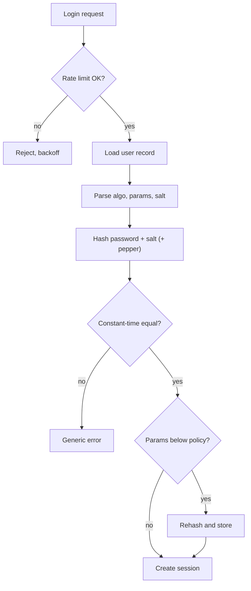

## In one minute
- Store passwords only as the output of a slow, salted, memory-hard hash such as Argon2id, scrypt, or bcrypt. Never encrypt them and never use a fast hash like SHA-256 alone.
- The salt makes every hash unique so precomputed tables and cross-user cracking fail; the work factor makes each guess expensive.
- The work factor is a dial between login latency and attacker cost. Tune it to your hardware and raise it over time, rehashing on successful login.
- Modern policy favours length, breached-password screening, and rate limiting over composition rules and forced periodic rotation.
- The password store is only one layer. Credential stuffing, phishing, and reset flows cause more account takeovers than hash cracking.

## How it works

### Why hashing, not encryption
Encryption is reversible by whoever holds the key. A password check only needs to compare, so store a one-way function. If the database leaks, the attacker must guess passwords one at a time.

### Why slow
A modern GPU computes billions of SHA-256 hashes per second. An eight-character lowercase password has about 200 billion possibilities, cracked in seconds. A password hash is deliberately expensive: bcrypt with cost 12 takes around 250 ms on a server core, and Argon2id also demands memory (for example 64 MB per hash), which defeats the massive parallelism of GPUs and ASICs.

### Salt and pepper
A salt is 16 random bytes generated per password and stored next to the hash; the Argon2 RFC calls 128 bits sufficient for all applications ([RFC 9106](https://www.rfc-editor.org/rfc/rfc9106.html)), and NIST's floor is 32 bits. Two users with the same password get different hashes, and an attacker cannot crack all users at once. A pepper is an extra secret held outside the database, for example in a KMS or HSM, and mixed in by HMAC before or after hashing. If only the database leaks, hashes cannot be attacked at all without the pepper. The catch is rotation: a pepper cannot be removed from a stored hash without the plaintext, so replacing a leaked pepper means every affected user must reset ([OWASP Password Storage](https://cheatsheetseries.owasp.org/cheatsheets/Password_Storage_Cheat_Sheet.html)). Plan a version id per pepper from day one.

### Encoded format and upgrades
Store algorithm, parameters, salt, and hash together, as in `$argon2id$v=19$m=65536,t=3,p=1$salt$hash`. On login, after a successful verify, compare parameters with current policy and rehash if they are weaker. Django does exactly this by default, upgrading both the algorithm and the work factor on login, and warns never to remove an old hasher from the list or those users can no longer log in ([Django docs](https://docs.djangoproject.com/en/stable/topics/auth/passwords/)). Users who never log in can be upgraded by wrapping their old hash: store `argon2(old_md5_hash)` and verify by computing the inner hash first. Know the residual risk: if the same users' raw MD5 hashes leak from an old backup or another site, an attacker can crack the fast inner hash and skip Argon2 entirely, a trick called password shucking. Mixing a pepper into the wrap, and forcing a reset for long-dormant accounts, closes it.

### Verification
Compare hashes in constant time so response timing does not reveal how many bytes matched. Return the same error and similar timing for "unknown user" and "wrong password", to avoid user enumeration.

### Policy
Require a minimum length (NIST now says 15 when the password is the only factor, 8 with MFA), allow at least 64 characters, screen against breached-password lists, and drop composition rules and scheduled expiry. The final SP 800-63B-4 (July 2025) turns several of these into hard rules: composition rules and periodic changes are prohibited, so are password hints and security questions, the whole password must be verified with no truncation, password managers and autofill must be allowed, and failed attempts must be capped at 100 in a row per account ([NIST SP 800-63B-4](https://pages.nist.gov/800-63-4/sp800-63b.html), [CSRC record](https://csrc.nist.gov/pubs/sp/800/63/b/4/final)).

## Down the stack
### Layer 1: The contract
A password hash promises that verification succeeds only for the original password, apart from a negligible collision chance, and that the stored record gives an attacker nothing better than guessing, at a fixed cost per guess. The verifier promises that its running time does not depend on how many characters of a guess were right. The encoded string promises enough metadata (algorithm, parameters, salt) to verify the record years later, even after the defaults have changed.

### Layer 2: The mechanism
bcrypt runs Blowfish's expensive key setup 2^cost times, alternating the salt and password into the key schedule, then encrypts the constant string "OrpheanBeholderScryDoubt" 64 times. Its output looks like `$2b$12$` followed by a 22-character salt and a 31-character hash in a custom base-64 alphabet, and it only reads the first 72 bytes of input. Argon2id fills `m` KiB of memory with 1 KiB blocks, each computed by a BLAKE2b-based compression function from the previous block and a pseudo-randomly chosen earlier block. The first half of the first pass picks reference blocks independently of the password, which resists side channels; the rest picks them from the data, which resists time-memory trade-offs. It makes `t` passes over memory in `p` parallel lanes. PBKDF2 simply iterates HMAC; OWASP currently suggests 600,000 iterations of HMAC-SHA-256. For Argon2id, OWASP's floor is 19 MiB, two passes and one lane, while RFC 9106 recommends 64 MiB, three passes and four lanes when 2 GiB per hash is not affordable ([OWASP Password Storage](https://cheatsheetseries.owasp.org/cheatsheets/Password_Storage_Cheat_Sheet.html), [RFC 9106](https://www.rfc-editor.org/rfc/rfc9106.html)).

### Layer 3: The machine
A single high-end GPU computes on the order of 20 billion SHA-256 hashes per second, and about a thousand bcrypt hashes per second at cost 12. A stock RTX 4090 benchmarks at about 22 billion SHA-256 per second and 184,000 bcrypt per second at cost 5; each extra cost step halves that, so cost 12 lands near 1,400 ([hashcat benchmark](https://gist.github.com/Chick3nman/32e662a5bb63bc4f51b847bb422222fd)). Memory changes the picture: a GPU with 24 GB can only hold about 375 concurrent Argon2id instances at 64 MiB each, far fewer than its thousands of cores. Each such hash with three passes moves roughly 400 MB through memory, so at 1 TB/s of bandwidth the card manages only a few thousand guesses per second. On the server, each login allocates 64 MiB, which the kernel backs with zeroed pages on first touch, so hashing also costs page faults and memory bandwidth. Comparing hashes with an ordinary string compare returns at the first differing byte; that difference is a few nanoseconds, but over many requests on a fast network it can be measured.

### Why it's built this way
Attackers have massively parallel hardware while defenders compute one hash per login, so the hash must be expensive in the resource attackers scale worst, which is memory. Precomputed tables amortise work across victims, so every record gets its own salt. Hardware keeps getting faster, so the cost is a parameter stored with each hash and raised over time.

## Diagram


## Worked example
A consumer app has 50 million users and peaks at 2,000 logins per second.

With Argon2id at 64 MB memory and 3 iterations, one hash costs about 100 ms of CPU and 64 MB of RAM for its duration. At 2,000 logins per second, that is 200 CPU cores busy and 2,000 x 0.1 s = 200 concurrent hashes, using 12.8 GB of RAM. Dedicated auth hosts with 32 cores each mean about 7 hosts at full load, so 10 to 12 for headroom.

Attacker side: if the database leaks, a GPU that does 20 billion SHA-256 guesses per second might manage a few thousand Argon2id guesses per second at these parameters. Testing a 100-million-word list against one user takes about 8 hours; against all 50 million users, with unique salts, roughly 45,000 years. Weak passwords still fall, which is why breached-password screening at signup matters.

Upgrading from unsalted SHA-1: wrap every hash as `argon2id(sha1)` on day one, then rehash to plain Argon2id as users log in.

## In the wild
- **Meta, 2019: plaintext passwords in internal logs.** A routine review in January 2019 found that some user passwords had been written in readable form to internal storage, despite a login path designed to mask them: hundreds of millions of Facebook Lite users, tens of millions of other Facebook users and, after an April update, millions of Instagram users. Perfect hashing in the database did not help, because the leak happened before the hash. Meta fixed the logging and reviewed how other secrets such as access tokens were stored ([Meta](https://about.fb.com/news/2019/03/keeping-passwords-secure/)).
- **Okta, 2024: bcrypt's 72-byte limit skipped the password check.** From 23 July to 30 October 2024, Okta's AD/LDAP delegated authentication built a cache key by bcrypt-hashing `userId + username + password`. With a username of 52 characters or more, a user with a cached login and no MFA could be authenticated from cache while the AD agent was unreachable without the right password. Okta replaced bcrypt with PBKDF2 for the cache key ([Okta advisory](https://trust.okta.com/security-advisories/okta-ad-ldap-delegated-authentication-username/)).
- **Snowflake customers, 2024: stolen passwords, no MFA, about 165 organisations.** Mandiant tracked UNC5537 logging in to customer instances with credentials harvested by infostealer malware, some from as early as 2020 and never rotated. At least 79.7% of the accounts used had prior exposure, and none had MFA or network allow lists. No hash was cracked: the passwords were simply valid ([Google Threat Intelligence](https://cloud.google.com/blog/topics/threat-intelligence/unc5537-snowflake-data-theft-extortion)).

## Trade-offs
| Option | Strengths | Weaknesses | Choose when |
| --- | --- | --- | --- |
| Argon2id | Memory-hard, tunable, current recommendation | Memory cost per login, newer library support | Default for new systems |
| scrypt | Memory-hard, widely available | Parameters harder to tune | Argon2 unavailable |
| bcrypt | Battle-tested, everywhere | 72-byte input limit, not memory-hard | Legacy stacks, constrained platforms |
| PBKDF2 | FIPS-approved, ubiquitous | Not memory-hard, needs very high iterations | Compliance requires FIPS |
| Passkeys (no password) | Phishing-resistant, nothing to crack | Recovery flows, device coverage | Where users and platforms support it |

## Pitfalls in production
- Fast hashes (MD5, SHA-256) even with salt crack quickly on GPUs. Migrate by wrapping legacy hashes and rehashing on login.
- Logging request bodies captures plaintext passwords. Redact credentials at the framework level and test it.
- Login errors that differ for unknown users enable enumeration. Use one message and similar timing.
- Unbounded password length lets attackers send megabyte inputs to burn CPU. Cap input length, for example 1,024 bytes. For bcrypt's 72-byte limit, either enforce 72 bytes or pre-hash carefully: raw digest bytes can contain a NUL that truncates input, and an unkeyed pre-hash enables shucking, so OWASP suggests base64 of HMAC-SHA-384 keyed with a pepper.
- Feeding bcrypt anything other than the password. Concatenating a user id and username in front of the password can push the password past byte 72, where bcrypt ignores it (see Okta under In the wild).
- Reset tokens stored in plaintext or valid for days are as good as passwords. Store them hashed, expire within an hour, single use.

## Leadership lens
- Benchmark the hash on production hardware and set parameters to a latency target, such as 100 to 250 ms.
- Treat authentication as its own service with capacity planning; hash cost is real compute.
- Track account takeover sources. Usually stuffing and phishing dominate, so invest in MFA and bot defence, not only stronger hashing.

## Check yourself
1. Why does a unique salt not slow down cracking a single targeted password?
   **Answer:** The attacker still hashes guesses one by one for that user; salt only stops precomputed tables and attacking many users with each guess. Slowness comes from the work factor.
2. Why is memory hardness useful against attackers but a cost for defenders?
   **Answer:** GPUs and ASICs have little fast memory per core, so requiring 64 MB per hash cuts their parallelism. The defender pays that memory for every concurrent login.
3. How can you upgrade users with legacy MD5 hashes who never log in?
   **Answer:** Wrap the stored MD5 output in the new algorithm now, and verify by computing MD5 then the new hash; replace with a direct hash at next login.
4. Why does modern guidance drop forced periodic password changes?
   **Answer:** Users respond with predictable variations, which weakens passwords. Changing on evidence of compromise is more effective.

## Practice
**Task:** Build a toy password store that shows the moving parts: salt, iterated stretching, an encoded format, constant-time comparison, and rehash on login. The stretch function is 64-bit FNV-1a, which is not a cryptographic hash, so never use it for real passwords. `fnv64(data)` hashes bytes (offset 14695981039346656037, prime 1099511628211, modulo 2^64). `hash_password(pw, salt_hex, iterations)` computes `h = fnv64(salt_bytes + pw_bytes)`, then `iterations - 1` more times `h = fnv64(h as 8 big-endian bytes + pw_bytes)`, and returns `"fnv64i$" + iterations + "$" + salt_hex + "$" + 16-digit lowercase hex of h`. `verify(pw, encoded, current_iterations)` returns `(ok, needs_rehash)`, with `needs_rehash` true only when `ok` and the stored iterations are below current; malformed input returns `(False, False)`. `ct_equal(a, b)` compares strings without stopping at the first difference.

```python starter
def ct_equal(a, b):
    raise NotImplementedError

def fnv64(data):
    raise NotImplementedError

def hash_password(pw, salt_hex, iterations):
    raise NotImplementedError

def verify(pw, encoded, current_iterations):
    raise NotImplementedError
```

```python tests
SALT = "a1b2c3d4e5f60718"

def test_fnv_known_values():
    assert fnv64(b"") == 14695981039346656037
    assert fnv64(b"a") == 0xaf63dc4c8601ec8c

def test_format():
    parts = hash_password("hunter22", SALT, 5).split("$")
    assert parts[0] == "fnv64i" and parts[1] == "5" and parts[2] == SALT and len(parts[3]) == 16

def test_salt_and_iterations_change_hash():
    assert hash_password("pw", SALT, 3) != hash_password("pw", "00" * 8, 3)
    assert hash_password("pw", SALT, 3) != hash_password("pw", SALT, 4)

def test_verify_ok_and_wrong():
    e = hash_password("correct horse", SALT, 10)
    assert verify("correct horse", e, 10) == (True, False)
    assert verify("Correct horse", e, 10) == (False, False)

def test_needs_rehash_and_malformed():
    e = hash_password("pw", SALT, 2)
    assert verify("pw", e, 10) == (True, True)
    assert verify("nope", e, 10) == (False, False)
    assert verify("pw", "md5$abc", 10) == (False, False)

def test_ct_equal():
    assert ct_equal("abc", "abc") and not ct_equal("abc", "abd") and not ct_equal("abc", "ab")
```

```python solution
def ct_equal(a, b):
    if len(a) != len(b):
        return False
    diff = 0
    for x, y in zip(a, b):
        diff |= ord(x) ^ ord(y)
    return diff == 0

def fnv64(data):
    h = 14695981039346656037
    for b in data:
        h = ((h ^ b) * 1099511628211) & 0xFFFFFFFFFFFFFFFF
    return h

def hash_password(pw, salt_hex, iterations):
    p = pw.encode()
    h = fnv64(bytes.fromhex(salt_hex) + p)
    for _ in range(iterations - 1):
        h = fnv64(h.to_bytes(8, "big") + p)
    return "fnv64i$" + str(iterations) + "$" + salt_hex + "$" + format(h, "016x")

def verify(pw, encoded, current_iterations):
    parts = encoded.split("$")
    if len(parts) != 4 or parts[0] != "fnv64i" or not parts[1].isdigit():
        return (False, False)
    iters = int(parts[1])
    ok = ct_equal(hash_password(pw, parts[2], iters), encoded)
    return (ok, ok and iters < current_iterations)
```

```typescript starter
export function ctEqual(a: string, b: string): boolean {
  throw new Error("TODO");
}

export function fnv64(data: number[]): bigint {
  throw new Error("TODO");
}

export function hashPassword(pw: string, saltHex: string, iterations: number): string {
  throw new Error("TODO");
}

export function verify(pw: string, encoded: string, currentIterations: number): [boolean, boolean] {
  throw new Error("TODO");
}
```

```typescript tests
const SALT = "a1b2c3d4e5f60718";

test("fnv known values", () => {
  assert(fnv64([]) === BigInt("14695981039346656037"), "empty");
  assert(fnv64([97]) === BigInt("0xaf63dc4c8601ec8c"), "a");
});

test("format", () => {
  const parts = hashPassword("hunter22", SALT, 5).split("$");
  assert(parts[0] === "fnv64i" && parts[1] === "5" && parts[2] === SALT && parts[3].length === 16, "format");
});

test("salt and iterations change hash", () => {
  assert(hashPassword("pw", SALT, 3) !== hashPassword("pw", "0000000000000000", 3), "salt");
  assert(hashPassword("pw", SALT, 3) !== hashPassword("pw", SALT, 4), "iterations");
});

test("verify ok and wrong", () => {
  const e = hashPassword("correct horse", SALT, 10);
  assertEqual(verify("correct horse", e, 10), [true, false]);
  assertEqual(verify("Correct horse", e, 10), [false, false]);
});

test("needs rehash and malformed", () => {
  const e = hashPassword("pw", SALT, 2);
  assertEqual(verify("pw", e, 10), [true, true]);
  assertEqual(verify("nope", e, 10), [false, false]);
  assertEqual(verify("pw", "md5$abc", 10), [false, false]);
});

test("ct equal", () => {
  assert(ctEqual("abc", "abc") && !ctEqual("abc", "abd") && !ctEqual("abc", "ab"), "ctEqual");
});
```

```typescript solution
const MASK = (BigInt(1) << BigInt(64)) - BigInt(1);

export function ctEqual(a: string, b: string): boolean {
  if (a.length !== b.length) return false;
  let diff = 0;
  for (let i = 0; i < a.length; i++) diff |= a.charCodeAt(i) ^ b.charCodeAt(i);
  return diff === 0;
}

export function fnv64(data: number[]): bigint {
  let h = BigInt("14695981039346656037");
  const prime = BigInt("1099511628211");
  for (const b of data) h = ((h ^ BigInt(b)) * prime) & MASK;
  return h;
}

function bytesOf(s: string): number[] {
  return Array.from(s, (c) => c.charCodeAt(0));
}

export function hashPassword(pw: string, saltHex: string, iterations: number): string {
  const p = bytesOf(pw);
  const salt: number[] = [];
  for (let i = 0; i < saltHex.length; i += 2) salt.push(parseInt(saltHex.slice(i, i + 2), 16));
  let h = fnv64(salt.concat(p));
  for (let i = 1; i < iterations; i++) {
    const be: number[] = [];
    for (let k = 7; k >= 0; k--) be.push(Number((h >> BigInt(8 * k)) & BigInt(255)));
    h = fnv64(be.concat(p));
  }
  return "fnv64i$" + iterations + "$" + saltHex + "$" + h.toString(16).padStart(16, "0");
}

export function verify(pw: string, encoded: string, currentIterations: number): [boolean, boolean] {
  const parts = encoded.split("$");
  if (parts.length !== 4 || parts[0] !== "fnv64i" || !/^[0-9]+$/.test(parts[1])) return [false, false];
  const iters = parseInt(parts[1], 10);
  const ok = ctEqual(hashPassword(pw, parts[2], iters), encoded);
  return [ok, ok && iters < currentIterations];
}
```

```go starter
package practice

func CtEqual(a, b string) bool { panic("TODO") }

func Fnv64(data []byte) uint64 { panic("TODO") }

func HashPassword(pw, saltHex string, iterations int) string { panic("TODO") }

func Verify(pw, encoded string, currentIterations int) (bool, bool) { panic("TODO") }
```

```go tests
package practice

import (
	"strings"
	"testing"
)

const salt = "a1b2c3d4e5f60718"

func TestFnvKnownValues(t *testing.T) {
	if Fnv64(nil) != 14695981039346656037 || Fnv64([]byte("a")) != 0xaf63dc4c8601ec8c {
		t.Fatal("fnv64 wrong")
	}
}

func TestFormat(t *testing.T) {
	p := strings.Split(HashPassword("hunter22", salt, 5), "$")
	if len(p) != 4 || p[0] != "fnv64i" || p[1] != "5" || p[2] != salt || len(p[3]) != 16 {
		t.Fatalf("got %v", p)
	}
}

func TestSaltAndIterations(t *testing.T) {
	if HashPassword("pw", salt, 3) == HashPassword("pw", "0000000000000000", 3) || HashPassword("pw", salt, 3) == HashPassword("pw", salt, 4) {
		t.Fatal("salt or iterations ignored")
	}
}

func TestVerify(t *testing.T) {
	e := HashPassword("correct horse", salt, 10)
	if ok, re := Verify("correct horse", e, 10); !ok || re {
		t.Fatal("should verify without rehash")
	}
	if ok, _ := Verify("Correct horse", e, 10); ok {
		t.Fatal("wrong password accepted")
	}
}

func TestRehashAndMalformed(t *testing.T) {
	e := HashPassword("pw", salt, 2)
	if ok, re := Verify("pw", e, 10); !ok || !re {
		t.Fatal("should need rehash")
	}
	if ok, re := Verify("nope", e, 10); ok || re {
		t.Fatal("wrong password")
	}
	if ok, re := Verify("pw", "md5$abc", 10); ok || re {
		t.Fatal("malformed accepted")
	}
}

func TestCtEqual(t *testing.T) {
	if !CtEqual("abc", "abc") || CtEqual("abc", "abd") || CtEqual("abc", "ab") {
		t.Fatal("CtEqual wrong")
	}
}
```

```go solution
package practice

import (
	"encoding/binary"
	"encoding/hex"
	"fmt"
	"strconv"
	"strings"
)

func CtEqual(a, b string) bool {
	if len(a) != len(b) {
		return false
	}
	var diff byte
	for i := 0; i < len(a); i++ {
		diff |= a[i] ^ b[i]
	}
	return diff == 0
}

func Fnv64(data []byte) uint64 {
	h := uint64(14695981039346656037)
	for _, b := range data {
		h ^= uint64(b)
		h *= 1099511628211
	}
	return h
}

func HashPassword(pw, saltHex string, iterations int) string {
	salt, _ := hex.DecodeString(saltHex)
	p := []byte(pw)
	h := Fnv64(append(salt, p...))
	buf := make([]byte, 8)
	for i := 1; i < iterations; i++ {
		binary.BigEndian.PutUint64(buf, h)
		h = Fnv64(append(append([]byte{}, buf...), p...))
	}
	return fmt.Sprintf("fnv64i$%d$%s$%016x", iterations, saltHex, h)
}

func Verify(pw, encoded string, currentIterations int) (bool, bool) {
	parts := strings.Split(encoded, "$")
	if len(parts) != 4 || parts[0] != "fnv64i" {
		return false, false
	}
	iters, err := strconv.Atoi(parts[1])
	if err != nil || iters < 1 {
		return false, false
	}
	ok := CtEqual(HashPassword(pw, parts[2], iters), encoded)
	return ok, ok && iters < currentIterations
}
```

## Mock interview
**Prompt:** You inherit a login system for 30 million users that stores unsalted SHA-1 hashes and handles 1,500 logins per second at peak. Design the migration and the target password storage and login protections.

- Follow-up: How do you protect users who will not log in for a year?
- Follow-up: How many servers does Argon2id need at peak, and how do you stop it becoming a DoS vector?
- Follow-up: Attackers start a credential stuffing campaign with 50,000 IPs. What helps?

**A strong answer covers:**
- Wrapping legacy hashes immediately and rehashing on login, with encoded parameters per record.
- Argon2id parameter choice benchmarked to a latency target, plus capacity math.
- Pepper in a KMS or HSM, constant-time comparison, generic errors, input length limits.
- Breached-password screening, rate limiting, bot detection, and MFA or passkeys.
- Secure reset tokens and redaction of credentials from logs.

## Sources and further study
**Primary**
- [Provos and Mazières, A Future-Adaptable Password Scheme (USENIX 1999)](https://www.usenix.org/legacy/events/usenix99/provos/provos.pdf): the bcrypt paper and the idea of a tunable cost stored with the hash.
- [RFC 7914: The scrypt Password-Based Key Derivation Function](https://www.rfc-editor.org/rfc/rfc7914.html): the first widely used memory-hard design and its N, r, p parameters.
- [RFC 8018: PKCS #5 v2.1](https://www.rfc-editor.org/rfc/rfc8018.html): the PBKDF2 specification still required in FIPS environments.

**Systems docs**
- [Django: Password management](https://docs.djangoproject.com/en/stable/topics/auth/passwords/): a production framework's hasher list, automatic upgrade on login and wrapped legacy hashers.
- [Spring Security: Password storage](https://docs.spring.io/spring-security/reference/features/authentication/password-storage.html): the `{id}` prefix format that lets one store hold several algorithms during a migration.
- [Have I Been Pwned: API v3](https://haveibeenpwned.com/API/v3): the Pwned Passwords range API used for breached-password screening.
- [Okta: AD/LDAP delegated authentication advisory](https://trust.okta.com/security-advisories/okta-ad-ldap-delegated-authentication-username/): a short, real example of the bcrypt truncation pitfall.

**Books**
- *Building Secure and Reliable Systems*, Adkins et al., chapter 1 "The Intersection of Security and Reliability": opens with "On Passwords and Power Drills", the outage of Google's own internal password manager. [Free online](https://google.github.io/building-secure-and-reliable-systems/raw/ch01.html).
- *Computer Networking: A Top-Down Approach* (8th edition), Kurose and Ross, chapter 8 "Security in Computer Networks": hashing, integrity and authentication protocols underneath password login.

**Other curricula**
- [roadmap.sh backend roadmap](https://roadmap.sh/backend): lists bcrypt and scrypt as hashing algorithms to know, without parameters or migration.
- [donnemartin/system-design-primer](https://github.com/donnemartin/system-design-primer): has no section on password storage; its security notes stop at encryption and least privilege.

## Watch
- [How NOT to Store Passwords! (Computerphile)](https://www.youtube.com/watch?v=8ZtInClXe1Q): why plaintext, encryption, and fast hashes fail.
- [System Design: How to store passwords in the database? (ByteByteGo)](https://www.youtube.com/watch?v=zt8Cocdy15c): salting and slow hashing in a few minutes.

## Free resources
- [OWASP Password Storage Cheat Sheet](https://cheatsheetseries.owasp.org/cheatsheets/Password_Storage_Cheat_Sheet.html): recommended algorithms and parameters, peppering, and legacy upgrades.
- [NIST SP 800-63B (rev. 4)](https://pages.nist.gov/800-63-4/sp800-63b.html): current guidance on password length, screening, and rotation.
- [RFC 9106: Argon2](https://www.rfc-editor.org/rfc/rfc9106.html): the Argon2 specification with recommended parameter sets.
- [Validating Leaked Passwords with k-Anonymity (Cloudflare)](https://blog.cloudflare.com/validating-leaked-passwords-with-k-anonymity/): how to check breached passwords without revealing them.
