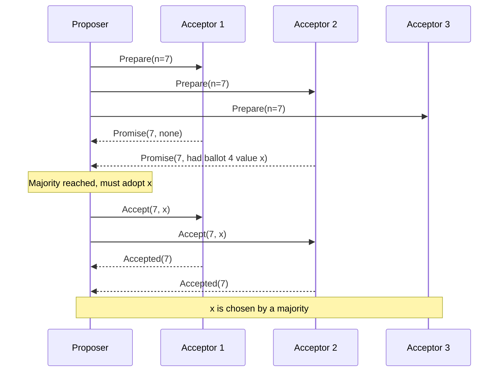

## In one minute
- Paxos lets a group of unreliable machines agree on one value, even if messages are lost, delayed, or reordered and a minority of nodes crash.
- It runs in two phases: *prepare/promise* reserves a ballot number with a majority, and *accept/accepted* asks that majority to store a value under that ballot.
- Safety comes from one rule: a proposer that hears about an already-accepted value must re-propose that value, not its own.
- Liveness is not guaranteed. Two proposers can keep pre-empting each other forever, so real systems add a stable leader (Multi-Paxos).
- You rarely implement it yourself. It lives inside Spanner, Chubby, and Cassandra LWT, and Raft is a stricter Multi-Paxos that differs mainly in how it elects a leader ([Howard and Mortier](https://arxiv.org/abs/2004.05074)).

## How it works

### Roles and the quorum idea
There are three roles, usually co-located on every node: **proposers** suggest values, **acceptors** vote and remember, and **learners** find out what was chosen. A value is *chosen* once a majority of acceptors have accepted it under the same ballot. Any two majorities of N acceptors overlap in at least one node, and that overlap carries knowledge from one ballot to the next. With 5 acceptors you tolerate 2 failures; with 3 you tolerate 1. Five is the common production choice: a typical Chubby cell runs five replicas ([Paxos Made Live](https://static.googleusercontent.com/media/research.google.com/en//archive/paxos_made_live.pdf)).

### Phase 1: prepare and promise
A proposer picks a ballot number `n` that is unique and higher than any it has used. A common choice is `(round, nodeId)` compared lexicographically. It sends `Prepare(n)` to the acceptors. An acceptor that has not promised anything higher replies `Promise(n, acceptedBallot, acceptedValue)` and records that it will ignore any ballot below `n`. That promise must be written to stable storage before replying, or a reboot will let it break the promise. Lamport is explicit that an acceptor must remember its highest promise and highest accepted proposal even if it fails and restarts ([Paxos Made Simple](https://lamport.azurewebsites.net/pubs/paxos-simple.pdf)).

### Phase 2: accept and accepted
With promises from a majority, the proposer looks at the replies. If any acceptor reported a previously accepted value, the proposer must use the value with the highest accepted ballot. Only if none did may it use its own value. It sends `Accept(n, v)`. An acceptor accepts unless it has since promised a higher ballot, persists `(n, v)`, and notifies learners. Once a majority accept, `v` is chosen and can never change, because every later ballot's Phase 1 will hit at least one acceptor that holds `v`.

### Why liveness can fail
Proposer A finishes Phase 1 with ballot 5. Before its Accept lands, B finishes Phase 1 with ballot 6, so A's Accept is rejected. A retries with 7, which kills B's Accept, and so on. This is the FLP impossibility result in practice. Paxos always keeps safety and gets liveness from randomised backoff or a single distinguished proposer. Lamport notes that any reliable way to elect that proposer must use randomness or real time, such as timeouts, while safety holds whether or not the election works ([Paxos Made Simple](https://lamport.azurewebsites.net/pubs/paxos-simple.pdf)).

### Multi-Paxos
A replicated log needs one Paxos instance per slot. Running both phases for every slot costs two round trips per write. Multi-Paxos elects a leader that runs Phase 1 once for all future slots, then issues only Phase 2 for each new entry. Steady state is one round trip to a majority. Phase 1 reruns only on leader change.

Majorities are sufficient but not necessary. Flexible Paxos showed that only quorums from *different* phases must intersect, so with N acceptors any Phase 1 quorum of size Q1 and Phase 2 quorum of size Q2 work when Q1 + Q2 > N ([Howard, Malkhi and Spiegelman](https://arxiv.org/abs/1608.06696)). Because Phase 1 is rare in Multi-Paxos, a system can shrink the Phase 2 quorum that every write pays for and enlarge the Phase 1 quorum it pays for only on leader change.

## Down the stack

### Layer 1: The contract
Single-decree Paxos makes three safety promises: only a proposed value can be chosen, at most one value is chosen, and a learner never learns a value that was not chosen. They hold under loss, duplication, reordering, delay, and crash-recovery, provided acceptors keep state on stable storage and nobody lies. It makes no liveness promise: a value is chosen only once a single proposer runs both phases against a majority without being pre-empted.

Multi-Paxos turns this into a replicated log. Each slot is fixed once chosen, the state machine applies slots in index order, and a client sees success only after a majority has durably accepted the entry. The latency envelope is one round trip plus one disk flush per write in steady state, two round trips after a leader change, and an unavailability window bounded by the failure-detection timeout. A timed-out request has an unknown outcome, not a failed one.

### Layer 2: The mechanism
Lamport labels the steps Phase 1(a), 1(b), 2(a) and 2(b), so implementations call the messages 1a (Prepare), 1b (Promise), 2a (Accept) and 2b (Accepted). An acceptor needs three fields per slot: `promised`, `acceptedBallot`, `acceptedValue`. Ballots are usually packed into a 64-bit integer as `(round << 16) | nodeId` so they compare with one instruction and are unique without coordination.

The Multi-Paxos trick is that `promised` is kept once per acceptor rather than per slot. A single 1a then reserves every future slot, and the 1b reply carries all accepted-but-not-known-committed entries above the leader's commit point. The new leader re-proposes the highest-ballot value it finds for each slot and fills slots nobody accepted with a no-op, so the log has no permanent holes. Commit knowledge is piggybacked on the next 2a, much like Raft's `leaderCommit`.

Real systems add what the paper omits. "Paxos Made Live" describes Chubby's layer: a master lease so reads can be served locally, snapshots to truncate the log, checksums because disks really do return corrupt data, and a rule that a replica with lost state rejoins without voting. It catches up as a non-voting member and starts sending promises again only after it has seen one complete Paxos instance that began after it started rebuilding, so it cannot renege on a promise it forgot ([Paxos Made Live](https://static.googleusercontent.com/media/research.google.com/en//archive/paxos_made_live.pdf)). Spanner runs a Paxos state machine per tablet, with long-lived leaders holding time-based leases that default to 10 seconds ([Spanner, OSDI 2012](https://static.googleusercontent.com/media/research.google.com/en//archive/spanner-osdi2012.pdf)). Cassandra's lightweight transactions run Paxos per partition with state in the `system.paxos` table; the classic implementation needs four round trips for a write (prepare, read, propose, commit). Cassandra 4.1 added a reworked protocol (CEP-14) that needs two round trips for an uncontended write, but it is opt-in: `paxos_variant` still defaults to `v1`, and switching to `v2` takes a full repair and a rolling restart ([cassandra.yaml](https://github.com/apache/cassandra/blob/trunk/conf/cassandra.yaml)). Check which variant a cluster actually runs before quoting LWT latency.

### Layer 3: The machine
Every 1b and 2b must follow a durable write: append, then `fdatasync`, then reply. A datacenter NVMe drive with power-loss-protected cache can acknowledge a flush in tens of microseconds; a consumer SSD without that protection may take a millisecond or more; a spinning disk costs several milliseconds of rotation; networked block storage adds a network hop on top. So implementations group-commit: entries arriving in a short window share one 2a and one flush.

An Accept with an 8-byte ballot, an 8-byte slot and a 100-byte command fits in one TCP segment on a 1,500-byte MTU. Latency is therefore set by distance: roughly 0.1 to 0.5 ms round trip inside a zone, about a millisecond or two between zones, and tens to over a hundred milliseconds between regions, since light in fibre covers about 200 km per millisecond. The leader also sends every byte to N-1 peers, so its NIC becomes the throughput ceiling before the protocol does. A long GC pause on the leader looks like a crash, so lease timeouts sit well above observed pauses.

### Why it's built this way
1. Networks drop and delay packets and no timeout can tell a slow node from a dead one (FLP), so safety must depend only on quorum intersection, never on timing.
2. A majority is the smallest set guaranteed to overlap every other majority, so 2f+1 nodes tolerate f failures and every write fans out to all of them.
3. Overlap carries information only if acceptors remember, so each reply waits for a disk flush, and flush latency is amortised with batching and group commit.
4. Two round trips per value and duelling proposers are too slow, so Multi-Paxos keeps a stable leader and runs Phase 1 rarely, reintroducing timing (leases) for liveness and local reads but not for safety.

## Diagram


## Worked example
Five acceptors over three zones in one region, RTT 1 ms, fsync about 0.2 ms. A leader running Multi-Paxos commits a log entry with one round trip to the fastest 2 of 4 peers plus an fsync: roughly 1.5 ms p50. Batching 100 entries per Accept reaches tens of thousands of commits per second; the leader's NIC and disk become the bottleneck.

Now the leader dies. Followers wait for a lease to lapse (say 2 s), one wins Phase 1 with a higher ballot, and it discovers slot 9,812 has value `"debit 40"` accepted by two acceptors under the old ballot. It must re-propose `"debit 40"` in slot 9,812 even though no client was told it succeeded. Write unavailability is about 2 to 3 s, dominated by the lease timeout, not by Paxos messages.

## In the wild
- **Google Chubby, 2007: Paxos replicas drift apart anyway.** The Paxos Made Live team added a periodic consistency check: the master submits a checksum request through the log, every replica checksums its database at the same log position, and they compare. In production it caught three inconsistencies: one operator error, one unexplained (likely a hardware memory error) and one suspected errant memory write. They then kept a second database of checksums and verified every access against it ([Paxos Made Live](https://static.googleusercontent.com/media/research.google.com/en//archive/paxos_made_live.pdf)).
- **ScyllaDB, 2020: LWT split-brain under membership changes.** Scylla runs a Paxos variant with three round trips per lightweight transaction. Jepsen found a healthy-cluster split-brain caused by a row-hash bug (fixed in 4.2), and further split-brain when nodes were added or removed, traced to repair streaming from too few replicas, list-element IDs taken from the local clock, and concurrent membership changes the code assumed were sequential. Some of these were still open at publication ([Jepsen](https://jepsen.io/analyses/scylla-4.2-rc3)).
- **Google, 2020: a Paxos leader that cannot write takes down login.** Quota automation wrongly cut the storage quota of the User ID Service's account database, so its Paxos leader could no longer commit writes. For 47 minutes authentication failed across Google, and Cloud APIs that needed OAuth returned errors (BigQuery streaming about 75%). Fixes included guarding quota changes against fast global cuts ([Google Cloud status](https://status.cloud.google.com/incident/zall/20013)).

## Trade-offs
| Option | Strengths | Weaknesses | Choose when |
|---|---|---|---|
| Basic Paxos per decision | Simple proof, no leader needed | 2 RTT per value, duelling proposers | One-off decisions such as config epochs |
| Multi-Paxos | 1 RTT steady state, flexible log holes | Underspecified; every team fills gaps differently | Building a storage engine with an expert team |
| Raft | Fully specified, many tested libraries | Strict leader, log must be contiguous | Almost any new replicated service |
| EPaxos / leaderless | No leader hotspot, good WAN latency | Complex dependency tracking, hard to verify | Geo-distributed writes from every region |

## Pitfalls in production
- Acceptors that reply before fsync can forget a promise after a crash and let two values be chosen. Persist promised and accepted ballots before every reply.
- Ballot numbers that are not globally unique (two nodes using plain counters) break safety. Encode the node id into the ballot.
- A wiped or corrupted disk makes an acceptor forget its votes, which is equivalent to lying. Checksum state and make a wiped replica rejoin as a new member that catches up before voting.
- Duelling leaders spike latency during network flaps. Use randomised exponential backoff and a leader lease so followers do not start Phase 1 while the leader is healthy.
- Membership changes done as an ordinary config edit can create two disjoint majorities. Change membership through the log itself, one node at a time or with joint consensus. Jepsen found exactly this class of split-brain in ScyllaDB's Paxos-based LWT when nodes were added or removed concurrently ([Jepsen](https://jepsen.io/analyses/scylla-4.2-rc3)).

## Leadership lens
- The real question is which proven consensus product to depend on: etcd, ZooKeeper, Spanner, or a Raft library. Writing your own needs a formal model and months of fault injection. Many teams need only a leader, and Amazon reports that leases from an existing coordination service are its most common way to get one ([AWS Builders' Library](https://builder.aws.com/content/3Ev0vH0hfkcUizISUWYTvHibtcp/leader-election-in-distributed-systems)).
- Ask in review: how many failures do we tolerate, where are the replicas, and what is the write p99 when the leader is in the far region?
- Make sure clients treat a timeout as "unknown outcome" and retry idempotently; Paxos may still commit a write the client never heard about.

## Check yourself
1. Why must a proposer adopt the highest-ballot accepted value it hears in Phase 1?
   **Answer:** That value may already be chosen by a majority, and the overlap guarantees the proposer would hear it. Re-proposing it ensures a later ballot cannot overwrite a chosen value.
2. Why does an acceptor need stable storage for promises, not only for accepted values?
   **Answer:** If it forgets a promise after reboot it can accept a lower ballot's value, letting an old proposer complete a value that a newer ballot never saw.
3. Where does Multi-Paxos save latency compared with Basic Paxos?
   **Answer:** The leader runs Phase 1 once for all future slots, so each new entry needs only the Accept round trip.
4. What does a five-node group lose when two nodes are down and a third is slow?
   **Answer:** Writes stall until the slow node answers, because a majority of three is required and there is no spare.

## Practice
**Task:** Implement single-decree Paxos. `Acceptor` has `prepare(n)` and `accept(n, value)`. `prepare` returns `(True, accepted_n, accepted_value)` (with `None`s if nothing was accepted) or `(False, None, None)` if an equal or higher ballot was already promised. `accept` returns `True` if `n` is at least the promised ballot, and records the value. `propose(acceptors, n, value)` runs both phases against reachable acceptors (an unreachable one is `None`) and returns the chosen value, or `None` if either phase misses a majority of the full list.

```python starter
class Acceptor:
    def prepare(self, n):
        # TODO
        return (False, None, None)

    def accept(self, n, value):
        # TODO
        return False


def propose(acceptors, n, value):
    # TODO
    return None
```

```python tests
def test_single_proposer_chooses_own_value():
    accs = [Acceptor(), Acceptor(), Acceptor()]
    assert propose(accs, 1, "A") == "A"

def test_later_proposer_adopts_chosen_value():
    accs = [Acceptor(), Acceptor(), Acceptor()]
    propose(accs, 1, "A")
    assert propose(accs, 2, "B") == "A"

def test_lower_ballot_rejected():
    a = Acceptor()
    assert a.prepare(5)[0]
    assert a.prepare(3)[0] is False
    assert a.accept(3, "x") is False

def test_partial_accept_recovered():
    accs = [Acceptor(), Acceptor(), Acceptor()]
    accs[0].prepare(1)
    accs[0].accept(1, "X")
    assert propose([accs[0], accs[1], None], 2, "Y") == "X"

def test_minority_fails():
    assert propose([Acceptor(), None, None], 1, "A") is None

def test_prepare_reports_accepted():
    a = Acceptor()
    a.prepare(1)
    a.accept(1, "v")
    assert a.prepare(2) == (True, 1, "v")
```

```python solution
class Acceptor:
    def __init__(self):
        self.promised = None
        self.accepted_n = None
        self.accepted_value = None

    def prepare(self, n):
        if self.promised is not None and n <= self.promised:
            return (False, None, None)
        self.promised = n
        return (True, self.accepted_n, self.accepted_value)

    def accept(self, n, value):
        if self.promised is not None and n < self.promised:
            return False
        self.promised = n
        self.accepted_n = n
        self.accepted_value = value
        return True


def propose(acceptors, n, value):
    majority = len(acceptors) // 2 + 1
    promised = []
    for a in acceptors:
        if a is not None:
            ok, an, av = a.prepare(n)
            if ok:
                promised.append((a, an, av))
    if len(promised) < majority:
        return None
    best_n, v = None, value
    for _, an, av in promised:
        if an is not None and (best_n is None or an > best_n):
            best_n, v = an, av
    acks = sum(1 for a, _, _ in promised if a.accept(n, v))
    return v if acks >= majority else None
```

```typescript starter
export interface PrepareResult {
  ok: boolean;
  acceptedN: number | null;
  acceptedValue: string | null;
}

export class Acceptor {
  prepare(n: number): PrepareResult {
    throw new Error("TODO");
  }

  accept(n: number, value: string): boolean {
    throw new Error("TODO");
  }
}

export function propose(acceptors: (Acceptor | null)[], n: number, value: string): string | null {
  throw new Error("TODO");
}
```

```typescript tests
test("single proposer chooses own value", () => {
  const accs = [new Acceptor(), new Acceptor(), new Acceptor()];
  assertEqual(propose(accs, 1, "A"), "A");
});

test("later proposer adopts chosen value", () => {
  const accs = [new Acceptor(), new Acceptor(), new Acceptor()];
  propose(accs, 1, "A");
  assertEqual(propose(accs, 2, "B"), "A");
});

test("lower ballot rejected", () => {
  const a = new Acceptor();
  assert(a.prepare(5).ok, "first prepare ok");
  assert(!a.prepare(3).ok, "lower prepare rejected");
  assert(!a.accept(3, "x"), "lower accept rejected");
});

test("partial accept recovered", () => {
  const accs = [new Acceptor(), new Acceptor(), new Acceptor()];
  accs[0].prepare(1);
  accs[0].accept(1, "X");
  assertEqual(propose([accs[0], accs[1], null], 2, "Y"), "X");
});

test("minority fails", () => {
  assertEqual(propose([new Acceptor(), null, null], 1, "A"), null);
});

test("prepare reports accepted", () => {
  const a = new Acceptor();
  a.prepare(1);
  a.accept(1, "v");
  assertEqual(a.prepare(2), { ok: true, acceptedN: 1, acceptedValue: "v" });
});
```

```typescript solution
export interface PrepareResult {
  ok: boolean;
  acceptedN: number | null;
  acceptedValue: string | null;
}

export class Acceptor {
  private promised: number | null = null;
  private acceptedN: number | null = null;
  private acceptedValue: string | null = null;

  prepare(n: number): PrepareResult {
    if (this.promised !== null && n <= this.promised) {
      return { ok: false, acceptedN: null, acceptedValue: null };
    }
    this.promised = n;
    return { ok: true, acceptedN: this.acceptedN, acceptedValue: this.acceptedValue };
  }

  accept(n: number, value: string): boolean {
    if (this.promised !== null && n < this.promised) return false;
    this.promised = n;
    this.acceptedN = n;
    this.acceptedValue = value;
    return true;
  }
}

export function propose(acceptors: (Acceptor | null)[], n: number, value: string): string | null {
  const majority = Math.floor(acceptors.length / 2) + 1;
  const promised: [Acceptor, PrepareResult][] = [];
  for (const a of acceptors) {
    if (a === null) continue;
    const r = a.prepare(n);
    if (r.ok) promised.push([a, r]);
  }
  if (promised.length < majority) return null;
  let bestN: number | null = null;
  let v = value;
  for (const [, r] of promised) {
    if (r.acceptedN !== null && (bestN === null || r.acceptedN > bestN)) {
      bestN = r.acceptedN;
      v = r.acceptedValue as string;
    }
  }
  let acks = 0;
  for (const [a] of promised) if (a.accept(n, v)) acks++;
  return acks >= majority ? v : null;
}
```

```go starter
package practice

type PrepareResult struct {
	OK            bool
	HasAccepted   bool
	AcceptedN     int
	AcceptedValue string
}

type Acceptor struct{}

func (a *Acceptor) Prepare(n int) PrepareResult {
	panic("TODO")
}

func (a *Acceptor) Accept(n int, value string) bool {
	panic("TODO")
}

// Propose returns the chosen value and true, or "" and false if no majority.
// A nil entry is an unreachable acceptor.
func Propose(acceptors []*Acceptor, n int, value string) (string, bool) {
	panic("TODO")
}
```

```go tests
package practice

import "testing"

func three() []*Acceptor { return []*Acceptor{{}, {}, {}} }

func TestSingleProposerChoosesOwnValue(t *testing.T) {
	if v, ok := Propose(three(), 1, "A"); !ok || v != "A" {
		t.Fatalf("got %q %v", v, ok)
	}
}

func TestLaterProposerAdoptsChosenValue(t *testing.T) {
	accs := three()
	Propose(accs, 1, "A")
	if v, ok := Propose(accs, 2, "B"); !ok || v != "A" {
		t.Fatalf("got %q %v", v, ok)
	}
}

func TestLowerBallotRejected(t *testing.T) {
	a := &Acceptor{}
	if !a.Prepare(5).OK {
		t.Fatal("first prepare should succeed")
	}
	if a.Prepare(3).OK || a.Accept(3, "x") {
		t.Fatal("lower ballot should be rejected")
	}
}

func TestPartialAcceptRecovered(t *testing.T) {
	accs := three()
	accs[0].Prepare(1)
	accs[0].Accept(1, "X")
	if v, ok := Propose([]*Acceptor{accs[0], accs[1], nil}, 2, "Y"); !ok || v != "X" {
		t.Fatalf("got %q %v", v, ok)
	}
}

func TestMinorityFails(t *testing.T) {
	if _, ok := Propose([]*Acceptor{{}, nil, nil}, 1, "A"); ok {
		t.Fatal("minority must not choose")
	}
}

func TestPrepareReportsAccepted(t *testing.T) {
	a := &Acceptor{}
	a.Prepare(1)
	a.Accept(1, "v")
	want := PrepareResult{OK: true, HasAccepted: true, AcceptedN: 1, AcceptedValue: "v"}
	if got := a.Prepare(2); got != want {
		t.Fatalf("got %+v", got)
	}
}
```

```go solution
package practice

type PrepareResult struct {
	OK            bool
	HasAccepted   bool
	AcceptedN     int
	AcceptedValue string
}

type Acceptor struct {
	hasPromised   bool
	promised      int
	hasAccepted   bool
	acceptedN     int
	acceptedValue string
}

func (a *Acceptor) Prepare(n int) PrepareResult {
	if a.hasPromised && n <= a.promised {
		return PrepareResult{}
	}
	a.hasPromised, a.promised = true, n
	return PrepareResult{OK: true, HasAccepted: a.hasAccepted, AcceptedN: a.acceptedN, AcceptedValue: a.acceptedValue}
}

func (a *Acceptor) Accept(n int, value string) bool {
	if a.hasPromised && n < a.promised {
		return false
	}
	a.hasPromised, a.promised = true, n
	a.hasAccepted, a.acceptedN, a.acceptedValue = true, n, value
	return true
}

func Propose(acceptors []*Acceptor, n int, value string) (string, bool) {
	majority := len(acceptors)/2 + 1
	var promised []*Acceptor
	bestN, haveBest, v := 0, false, value
	for _, a := range acceptors {
		if a == nil {
			continue
		}
		r := a.Prepare(n)
		if !r.OK {
			continue
		}
		promised = append(promised, a)
		if r.HasAccepted && (!haveBest || r.AcceptedN > bestN) {
			bestN, haveBest, v = r.AcceptedN, true, r.AcceptedValue
		}
	}
	if len(promised) < majority {
		return "", false
	}
	acks := 0
	for _, a := range promised {
		if a.Accept(n, v) {
			acks++
		}
	}
	if acks < majority {
		return "", false
	}
	return v, true
}
```

## Mock interview
**Prompt:** You run a metadata service for a storage system: 5 replicas across 3 zones, 20k writes per second, and a requirement that no acknowledged write is ever lost. Explain how you would reach agreement on each write and what happens when the leader's zone fails.

- Follow-up: how does the new leader handle log slots the old leader had partly replicated?
- Follow-up: what breaks if an acceptor's disk is silently wiped and it rejoins?
- Follow-up: would you use Multi-Paxos, Raft, or a managed store like etcd, and why?

**A strong answer covers:**
- Majority quorums, the overlap argument, and why 5 nodes tolerate 2 failures.
- Multi-Paxos with a leased leader, one RTT per write, and batching to hit 20k/s.
- New leader runs Phase 1 and re-proposes any accepted values it finds before serving.
- Durable promises, unique ballots, and treating a wiped replica as a new member.
- Client timeouts as unknown outcomes with idempotent retry.
- A bias toward a proven library or service over a custom implementation.

## Sources and further study
**Primary**
- [Ongaro and Ousterhout, In Search of an Understandable Consensus Algorithm (Raft)](https://raft.github.io/raft.pdf): the strong-leader alternative, with randomized election timers and joint-consensus membership changes.
- [Howard and Mortier, Paxos vs Raft (2020)](https://arxiv.org/abs/2004.05074): shows the two differ mainly in leader election and that Raft's clarity is largely presentation.
- [Corbett et al., Spanner (OSDI 2012)](https://static.googleusercontent.com/media/research.google.com/en//archive/spanner-osdi2012.pdf): Paxos per tablet, leader leases and how TrueTime builds on them.

**Systems docs**
- [Apache Cassandra: cassandra.yaml `paxos_variant`](https://github.com/apache/cassandra/blob/trunk/conf/cassandra.yaml): round trips per LWT read and write for each Paxos variant, and the upgrade steps.
- [CEP-14: Paxos Improvements](https://cwiki.apache.org/confluence/display/CASSANDRA/CEP-14%3A+Paxos+Improvements): the design for two-round-trip writes and one-round-trip reads in Cassandra 4.1.

**Books**
- *Designing Data-Intensive Applications* (1st ed.), Martin Kleppmann, Ch 9 "Consistency and Consensus": linearizability, ordering guarantees, and consensus as the basis for distributed transactions.
- *Database Internals*, Alex Petrov, Ch 14 "Consensus" (with FLP impossibility in Ch 8): atomic broadcast, Paxos, Raft and Byzantine consensus side by side.

**Other curricula**
- [AWS Builders' Library: Leader election in distributed systems](https://builder.aws.com/content/3Ev0vH0hfkcUizISUWYTvHibtcp/leader-election-in-distributed-systems): treats Paxos as one option and focuses on leases, heartbeats and doing work only while you hold the lease.
- [Azure Architecture Center: Leader Election pattern](https://learn.microsoft.com/en-us/azure/architecture/patterns/leader-election): frames election as a distributed mutex on a blob lease and points to Raft or ZooKeeper for the general case.

## Watch
- [The Paxos Algorithm (Google TechTalks)](https://www.youtube.com/watch?v=d7nAGI_NZPk): a whiteboard walk through both phases and Multi-Paxos.
- [Paxos lecture (Diego Ongaro)](https://www.youtube.com/watch?v=JEpsBg0AO6o): the Raft author's Paxos lecture, clear on ballots and log slots.
- [Paxos Agreement (Computerphile)](https://www.youtube.com/watch?v=s8JqcZtvnsM): a short intuition-first introduction.

## Free resources
- [Paxos Made Simple](https://lamport.azurewebsites.net/pubs/paxos-simple.pdf): Lamport's own short derivation of the protocol.
- [Paxos Made Live](https://static.googleusercontent.com/media/research.google.com/en//archive/paxos_made_live.pdf): what Google learned turning Paxos into Chubby's storage layer.
- [Flexible Paxos](https://arxiv.org/abs/1608.06696): shows only Phase 1 and Phase 2 quorums need to intersect.
- [Paxos pattern (martinfowler.com)](https://martinfowler.com/articles/patterns-of-distributed-systems/paxos.html): code-level walkthrough in the Patterns of Distributed Systems series.
- [Paxos (Wikipedia)](https://en.wikipedia.org/wiki/Paxos_(computer_science)): good background on variants and history.
