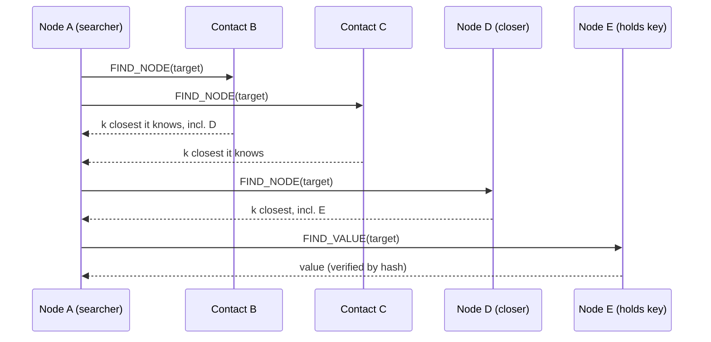

## In one minute
- In a peer-to-peer system every node is both client and server. Capacity grows with participants instead of with a central fleet you pay for.
- The hard problems are discovery (how do I find the peer that has what I want?), churn (peers join and leave constantly), and trust (peers can lie, cheat, or attack).
- Structured overlays such as Kademlia use a distributed hash table (DHT) to find any key in O(log N) hops. Unstructured overlays flood or gossip queries and trade efficiency for simplicity.
- Most production P2P is hybrid: a central tracker, bootstrap list, or signalling server for coordination, and direct peer links for the heavy data transfer.

## How it works

### Discovery: from flooding to DHTs
Early file-sharing networks flooded queries to neighbours with a hop limit. That works for popular content and fails for rare items while generating traffic proportional to network size. A DHT assigns every node and every key an ID in the same space (for example 160-bit hashes). Each key is stored on the nodes whose IDs are "closest" to it. In Kademlia, closeness is the XOR of two IDs read as an integer ([Maymounkov and Mazières](https://www.scs.stanford.edu/~dm/home/papers/kpos.pdf)). Newer systems keep the scheme but widen the space: the IPFS DHT hashes peer IDs and keys with SHA-256 into a 256-bit space ([IPFS docs](https://docs.ipfs.tech/concepts/dht/)). XOR distance is symmetric and has a useful property: for a given target, the bit position of the first difference tells you how far away a node is.

### Routing tables and lookups
A Kademlia node keeps up to *k* contacts (commonly 20) for each distance range, called a k-bucket: one bucket for nodes that differ in the top bit, one for nodes that share the top bit but differ in the next, and so on. To find a key, the node asks the *alpha* (the paper suggests 3) closest contacts it knows for nodes even closer to the target, then asks those, in parallel. Each round at least halves the remaining distance, so a lookup in a network of 10 million nodes takes about 23 rounds in the worst case and far fewer in practice because buckets near the target are dense.

### Churn and resilience
Peers disappear without notice. Kademlia prefers long-lived contacts: when a bucket is full and a new node appears, it pings the oldest entry and only replaces it if it fails to answer. The rule comes from Gnutella traces, where the longer a node had been up, the likelier it was to stay up another hour. Values are replicated to the *k* closest nodes, which republish them every hour, and the original publisher must republish every 24 hours or the value expires ([Kademlia paper](https://www.scs.stanford.edu/~dm/home/papers/kpos.pdf)).

Peers behind NAT churn the routing table without being useful in it, because nobody can dial them. IPFS therefore starts every node as a DHT client that can query but not answer, and switches it to server mode only when it detects it is publicly dialable ([IPFS docs](https://docs.ipfs.tech/concepts/dht/)).

### Data transfer and NAT
BitTorrent splits a file into pieces (often 256 KB to 4 MB), each verified by a SHA-1 hash in the metadata ([BEP 3](https://www.bittorrent.org/beps/bep_0003.html)). BitTorrent v2 replaces that with SHA-256 and a Merkle tree per file built over 16 KiB blocks, so identical files share a root hash across torrents; hybrid torrents carry both formats so old and new clients share one swarm ([BEP 52](https://www.bittorrent.org/beps/bep_0052.html)). Peers exchange piece availability, request the rarest pieces first to spread them, and reciprocate upload to those who upload to them (tit-for-tat). Most peers sit behind NAT, so systems use hole punching via a rendezvous server, or relays when punching fails. WebRTC uses the same idea through ICE, which gathers local, STUN-discovered and TURN-relayed addresses and probes pairs of them until one works ([RFC 8445](https://www.rfc-editor.org/rfc/rfc8445.html)).

### Trust
Anyone can join, so an attacker can create thousands of identities (a Sybil attack) and surround a key. Defences include deriving IDs from verifiable data, limiting contacts per IP prefix, and verifying content by hash instead of trusting the peer that served it. Prefix limits are not enough on their own: Heilman and colleagues showed that a botnet of 4,600 bots, or an operator holding 32 distinct /24 blocks, could eclipse a public Bitcoin node with at least 85% probability ([USENIX Security 2015](https://www.usenix.org/conference/usenixsecurity15/technical-sessions/presentation/heilman)).

## Down the stack

### Layer 1: The contract
A Kademlia lookup promises to return the *k* live nodes closest to a key that it can find, in O(log N) rounds, with high probability rather than certainty: under heavy churn or attack it can miss. Stored values are best-effort and expire unless republished. Content integrity is not promised by peers at all; it comes from hashes the client already trusts. A BitTorrent download promises that every completed piece matches its SHA-1 hash from the metainfo file, or in v2 the per-file SHA-256 Merkle root.

### Layer 2: The mechanism
Kademlia defines four RPCs: `PING`, `STORE`, `FIND_NODE`, and `FIND_VALUE`. BitTorrent's Mainline DHT implements them as KRPC messages: small bencoded dictionaries sent over UDP with a transaction ID `t`, a type `y` (query, response, or error), and query names such as `ping`, `find_node`, `get_peers`, and `announce_peer`. A `get_peers` response includes a token that the requester must present in a later `announce_peer`, which stops nodes from announcing on behalf of others ([BEP 5](https://www.bittorrent.org/beps/bep_0005.html)). Peers then connect over TCP or uTP and exchange a 68-byte handshake (protocol string, 8 reserved bytes, 20-byte info hash, 20-byte peer ID). After that, every message is a 4-byte length prefix and a 1-byte ID: `choke`, `unchoke`, `interested`, `have`, `bitfield`, `request`, `piece`, `cancel`. Requests ask for 16 KiB blocks within a piece.

### Layer 3: The machine
DHT traffic uses UDP because a lookup is a few hundred bytes per RPC: one datagram each way, no handshake, no connection state on either side. The NAT standard says a UDP mapping must not expire in under two minutes and recommends five ([RFC 4787](https://www.rfc-editor.org/rfc/rfc4787.html)), but clients cannot assume their router complies, so they send keepalives well inside that window or lose reachability. Bulk transfer often uses uTP over UDP, with a target delay of 100 ms ([BEP 29](https://www.bittorrent.org/beps/bep_0029.html)); the IETF wrote the same idea down as LEDBAT, an Experimental RFC that caps the target at 100 ms ([RFC 6817](https://www.rfc-editor.org/rfc/rfc6817.html)). It measures one-way queuing delay and backs off as delay approaches the target, so a torrent yields to the household's video calls instead of filling the router buffer. Pieces arrive out of order, so clients preallocate files to avoid fragmentation and buffer writes to reduce random I/O. Hashing a 4 MB piece takes a few milliseconds of CPU.

### Why it's built this way
1. There is no central index, so every node needs a way to route toward any key using only local knowledge.
2. Nodes leave constantly, so each distance range keeps several contacts and lookups query several nodes in parallel.
3. Lookup messages are tiny and frequent, so they use UDP to avoid connection setup costs.
4. Peers are untrusted, so data is verified against hashes from a trusted source.
5. Uplinks are shared with other household traffic, so transfer protocols use delay-based congestion control that yields early.

## Diagram


## Worked example
A game studio ships a 60 GB patch to 2 million players in the first 24 hours. That is 2,000,000 x 60 GB = 120,000,000 GB, or 120 PB. Served purely from a CDN at $0.02 per GB, it costs about $2.4 million.

With a hybrid P2P launcher, the CDN seeds the first copies and players exchange pieces. Pieces are 4 MB, so the patch has 15,360 pieces, each with a 20-byte hash in a 300 KB metadata file signed by the studio. If players upload on average 1.5 times what they download from peers and peers serve 75% of traffic, CDN egress drops to 30 PB, saving about $1.8 million.

The costs: the launcher must handle NAT traversal (a relay fleet for the 10 to 20% of peers that cannot connect directly), must cap upload so it does not ruin players' connections, and must verify every piece by hash so a malicious peer cannot inject modified code. Players on metered connections need an opt-out.

## In the wild
- **Skype, 2010: a client crash takes out the supernodes.** On 22 December an overloaded offline-messaging cluster sent slow replies, and Windows client 5.0.0152, run by about half of all users, crashed on them. About 40% of those clients failed, including 25 to 30% of public supernodes, and restarting clients drove supernode traffic to about 100 times normal. The network was unstable for about 24 hours until Skype injected hundreds of dedicated supernodes ([Skype blog, archived](http://web.archive.org/web/20130203084104/http://blogs.skype.com:80/en/2010/12/cio_update.html)).
- **Bitcoin, 2015: eclipse attacks on the peer network.** Researchers showed an attacker with enough IP addresses could monopolise all eight outgoing and up to 117 incoming connections of a public node, then feed it a false view of the chain; 400 bots were enough against their live test nodes. Three of their countermeasures shipped in Bitcoin Core 0.10.1 ([Heilman et al.](https://www.usenix.org/system/files/conference/usenixsecurity15/sec15-paper-heilman.pdf)).

## Trade-offs
| Option | Strengths | Weaknesses | Choose when |
|---|---|---|---|
| Client-server | Simple, controllable, easy to secure | Central cost and capacity, single point of control | Most applications |
| Hybrid P2P (tracker plus peers) | Offloads bandwidth, central control of membership | Still needs coordination servers, NAT complexity | Large file distribution, live video, games |
| Structured DHT | O(log N) lookup, no central index | Churn maintenance, Sybil exposure | Decentralised storage and naming |
| Unstructured gossip or flooding | Simple, robust to churn | High message cost, poor for rare items | Small networks, epidemic broadcast |

## Pitfalls in production
- **NAT and firewalls.** Many peers cannot accept inbound connections. Provide hole punching through a rendezvous server and fall back to relays, and measure the relay percentage.
- **Free riders.** Peers download without uploading. Use reciprocity (tit-for-tat) or reputation, and seed from infrastructure for cold content.
- **Poisoned content.** Peers serve corrupted pieces. Verify every piece against a hash from a signed manifest, and ban peers that send bad data.
- **Sybil and eclipse attacks.** An attacker surrounds a node with fake identities. Limit contacts per network prefix, prefer long-lived contacts, and use multiple bootstrap sources.
- **Churn storms.** A client release restarts millions of peers at once, flushing routing tables. Stagger restarts and persist routing tables across restarts.

## Leadership lens
- Ask whether the bandwidth savings justify the engineering cost. P2P makes sense when distribution cost dominates and clients have spare upload capacity.
- Keep authority central where it matters: signed manifests, membership, and revocation.
- Plan for the user's network and battery: upload caps, metered connection detection, and transparent opt-out.
- Instrument from day one: peer ratio, relay usage, lookup latency, and failed piece verifications.

## Check yourself
1. Why does Kademlia prefer old contacts over new ones in a full bucket?
   **Answer:** Nodes that have been online a long time are statistically likely to stay online, and keeping them also makes the routing table harder for an attacker to flood with fresh identities.
2. How does BitTorrent stop a malicious peer from corrupting a download?
   **Answer:** Every piece has a hash in the metadata, so the client verifies each piece on arrival and discards and re-requests bad ones.
3. Why do most P2P systems still run servers?
   **Answer:** Bootstrapping, NAT traversal, relaying, and trusted metadata need stable, reachable, authoritative endpoints.

## Practice
**Task:** Implement Kademlia's two core distance helpers on integer IDs. `bucket_index(self_id, other_id)` returns the position (0 is the lowest bit) of the highest bit where the two IDs differ, which is the k-bucket the other node belongs in, or -1 if the IDs are equal. `closest(peers, target, k)` returns up to `k` peer IDs sorted by XOR distance to `target`, nearest first. Peer IDs are distinct non-negative integers, so distances never tie.

```python starter
def bucket_index(self_id, other_id):
    # TODO
    raise NotImplementedError

def closest(peers, target, k):
    # TODO
    raise NotImplementedError
```

```python tests
def test_bucket_index_basic():
    assert bucket_index(0b1000, 0b0000) == 3
    assert bucket_index(0b1010, 0b1011) == 0

def test_bucket_index_equal():
    assert bucket_index(42, 42) == -1

def test_closest_order():
    assert closest([1, 2, 3, 8, 12], 0b1001, 3) == [8, 12, 1]

def test_closest_k_larger_than_peers():
    assert closest([5, 6], 4, 10) == [5, 6]

def test_closest_includes_exact_match():
    assert closest([7, 100, 3], 7, 1) == [7]

def test_closest_empty():
    assert closest([], 3, 2) == []
```

```python solution
def bucket_index(self_id, other_id):
    return (self_id ^ other_id).bit_length() - 1

def closest(peers, target, k):
    return sorted(peers, key=lambda p: p ^ target)[:k]
```

```typescript starter
export function bucketIndex(selfId: number, otherId: number): number {
  throw new Error("TODO");
}

export function closest(peers: number[], target: number, k: number): number[] {
  throw new Error("TODO");
}
```

```typescript tests
test("bucket index basic", () => {
  assertEqual(bucketIndex(0b1000, 0b0000), 3);
  assertEqual(bucketIndex(0b1010, 0b1011), 0);
});
test("bucket index equal", () => {
  assertEqual(bucketIndex(42, 42), -1);
});
test("closest order", () => {
  assertEqual(closest([1, 2, 3, 8, 12], 0b1001, 3), [8, 12, 1]);
});
test("k larger than peers", () => {
  assertEqual(closest([5, 6], 4, 10), [5, 6]);
});
test("exact match first", () => {
  assertEqual(closest([7, 100, 3], 7, 1), [7]);
});
test("empty", () => {
  assertEqual(closest([], 3, 2), []);
});
```

```typescript solution
export function bucketIndex(selfId: number, otherId: number): number {
  let x = (selfId ^ otherId) >>> 0;
  let i = -1;
  while (x > 0) { x = x >>> 1; i++; }
  return i;
}

export function closest(peers: number[], target: number, k: number): number[] {
  return [...peers]
    .sort((a, b) => ((a ^ target) >>> 0) - ((b ^ target) >>> 0))
    .slice(0, k);
}
```

```go starter
package practice

// BucketIndex returns the highest differing bit position, or -1 if equal.
func BucketIndex(selfID, otherID uint64) int {
	panic("TODO")
}

// Closest returns up to k peers sorted by XOR distance to target.
func Closest(peers []uint64, target uint64, k int) []uint64 {
	panic("TODO")
}
```

```go tests
package practice

import (
	"reflect"
	"testing"
)

func TestBucketIndexBasic(t *testing.T) {
	if BucketIndex(0b1000, 0) != 3 || BucketIndex(0b1010, 0b1011) != 0 {
		t.Fatal("wrong bucket index")
	}
}

func TestBucketIndexEqual(t *testing.T) {
	if BucketIndex(42, 42) != -1 {
		t.Fatal("equal IDs should give -1")
	}
}

func TestClosestOrder(t *testing.T) {
	got := Closest([]uint64{1, 2, 3, 8, 12}, 0b1001, 3)
	if !reflect.DeepEqual(got, []uint64{8, 12, 1}) {
		t.Fatalf("got %v", got)
	}
}

func TestClosestKLarge(t *testing.T) {
	got := Closest([]uint64{5, 6}, 4, 10)
	if !reflect.DeepEqual(got, []uint64{5, 6}) {
		t.Fatalf("got %v", got)
	}
}

func TestClosestDoesNotMutate(t *testing.T) {
	peers := []uint64{100, 7, 3}
	Closest(peers, 7, 1)
	if !reflect.DeepEqual(peers, []uint64{100, 7, 3}) {
		t.Fatal("input slice was modified")
	}
}

func TestClosestEmpty(t *testing.T) {
	if got := Closest(nil, 3, 2); len(got) != 0 {
		t.Fatalf("got %v", got)
	}
}
```

```go solution
package practice

import (
	"math/bits"
	"sort"
)

// BucketIndex returns the highest differing bit position, or -1 if equal.
func BucketIndex(selfID, otherID uint64) int {
	return bits.Len64(selfID^otherID) - 1
}

// Closest returns up to k peers sorted by XOR distance to target.
func Closest(peers []uint64, target uint64, k int) []uint64 {
	out := append([]uint64(nil), peers...)
	sort.Slice(out, func(i, j int) bool { return out[i]^target < out[j]^target })
	if k < len(out) {
		out = out[:k]
	}
	return out
}
```

## Mock interview
**Prompt:** Design the distribution system for a 40 GB game update to 5 million players worldwide within 48 hours, keeping CDN cost under 30% of a pure CDN approach.

- Follow-up: How do players behind strict NATs participate?
- Follow-up: How do you ensure a malicious peer cannot ship modified game code?
- Follow-up: How would you decide whether to use a central tracker or a DHT for peer discovery?

**A strong answer covers:**
- Bandwidth and cost arithmetic for pure CDN versus hybrid.
- Piece size choice, signed manifest of piece hashes, and per-piece verification.
- Tracker for controlled membership with DHT as an optional fallback.
- NAT traversal with hole punching and a sized relay fleet.
- Rarest-first piece selection, reciprocity, and CDN seeding for cold starts.
- User-facing controls: upload caps, metered connection handling, opt-out.

## Sources and further study
**Primary**
- [Heilman et al., Eclipse Attacks on Bitcoin's Peer-to-Peer Network (USENIX Security 2015)](https://www.usenix.org/system/files/conference/usenixsecurity15/sec15-paper-heilman.pdf): how many addresses it takes to isolate a node, and countermeasures.
- [RFC 6817: LEDBAT](https://www.rfc-editor.org/rfc/rfc6817.html): the delay-based congestion control that lets bulk P2P traffic yield.
- [RFC 4787: NAT behavioral requirements for unicast UDP](https://www.rfc-editor.org/rfc/rfc4787.html): mapping and filtering behaviour, and the mapping-timer rules hole punching depends on.

**Systems docs**
- [BEP 52: The BitTorrent Protocol Specification v2](https://www.bittorrent.org/beps/bep_0052.html): SHA-256, per-file Merkle trees and hybrid torrents.
- [BEP 29: uTorrent transport protocol](https://www.bittorrent.org/beps/bep_0029.html): uTP's header and delay-based congestion control.
- [RFC 8445: Interactive Connectivity Establishment](https://www.rfc-editor.org/rfc/rfc8445.html): the candidate gathering and connectivity checks WebRTC uses to get through NATs.

**Books**
- *Computer Networking: A Top-Down Approach* (8th edition), Kurose and Ross, chapter 2 "Application Layer": P2P file distribution set against client-server distribution.
- *High Performance Browser Networking*, Ilya Grigorik, chapter 18 "WebRTC": establishing a peer-to-peer connection with ICE, STUN and TURN ([read free](https://hpbn.co/webrtc/)).

**Other curricula**
- [donnemartin/system-design-primer](https://github.com/donnemartin/system-design-primer): does not cover peer-to-peer or DHTs; it frames every system as clients talking to a server fleet, which is itself a useful contrast.

## Watch
- [Kademlia, a Distributed Hash Table implementation (Arpit Bhayani)](https://www.youtube.com/watch?v=_kCHOpINA5g): a walk through the paper's routing and lookup design.
- [Kademlia, Explained (number 0)](https://www.youtube.com/watch?v=1QdKhNpsj8M): a visual explanation of XOR distance and k-buckets.

## Free resources
- [Kademlia: A Peer-to-peer Information System Based on the XOR Metric](https://pdos.csail.mit.edu/~petar/papers/maymounkov-kademlia-lncs.pdf): the original paper, short and readable.
- [Chord: A Scalable Peer-to-peer Lookup Service](https://pdos.csail.mit.edu/papers/chord:sigcomm01/chord_sigcomm.pdf): the classic ring-based DHT for comparison.
- [The BitTorrent Protocol Specification (BEP 3)](https://www.bittorrent.org/beps/bep_0003.html): pieces, hashes, and the peer wire protocol.
- [BitTorrent DHT Protocol (BEP 5)](https://www.bittorrent.org/beps/bep_0005.html): how BitTorrent uses Kademlia to find peers without a tracker.
- [IPFS: Distributed Hash Tables](https://docs.ipfs.tech/concepts/dht/): a modern DHT used for content routing.
