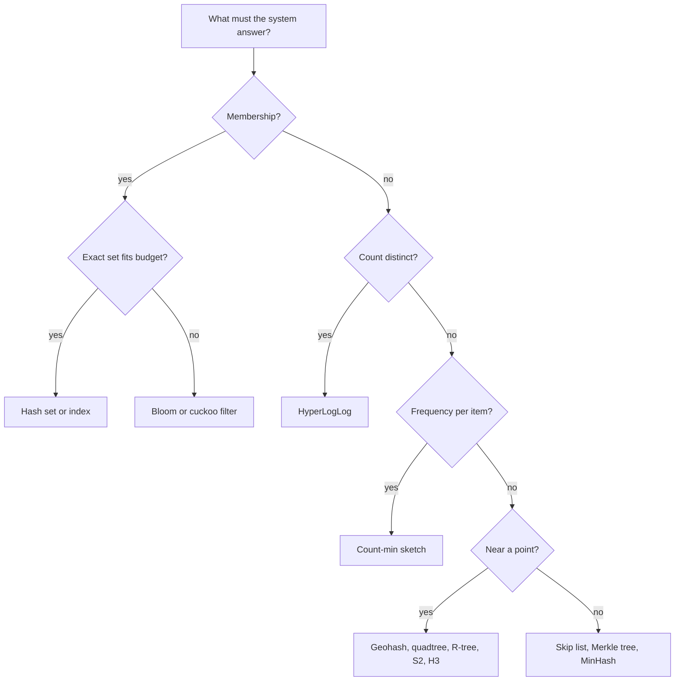

## In one minute
- At scale, the textbook structures (a hash set, a sorted array, a full scan) still give the right answer, but they cost too much memory, too much network or too much time per query.
- The structures in this section trade a little of something you can afford to lose, usually exactness, for orders of magnitude less space or time.
- Each one answers one question well: is this item present, how many distinct items, how often has this item appeared, how similar are these sets, what is near this point, what is the next key in order, or do these two copies match.
- Their errors are bounded and usually one-sided, which is what makes them safe to build on: a Bloom filter never says "absent" for something present, and a count-min sketch never undercounts.
- Many of them are mergeable, so shards and time windows can be summarised separately and combined later.

## How it works

### The question decides the structure
Before reaching for a clever structure, write down the exact question, over how many items, and how wrong the answer may be. Teams skip the last part. "Unique visitors today, within 1%?" is 12 KB of HyperLogLog registers in Redis ([Redis docs](https://redis.io/docs/latest/develop/data-types/probabilistic/hyperloglogs/)). "Exactly how many?" may need gigabytes.

| Question | Structure | Memory for a typical setting | Error | Lesson |
|---|---|---|---|---|
| Have I seen this key? | Bloom filter | About 1.2 MB for 1 million keys at 1% false positives | False positives only | Bloom Filters |
| Have I seen it, and can I delete it? | Cuckoo filter | Similar to Bloom at low false-positive rates | False positives only | Cuckoo Filter |
| How many distinct items? | HyperLogLog | 12 KB for about 0.8% standard error, at any count | Relative, two-sided | HyperLogLog |
| How often has this item appeared? | Count-min sketch | About 54 KB for 0.1% of total count error at 99% confidence | Overestimates only | Count-Min Sketch |
| How similar are two sets? | MinHash | A few hundred integers per set | Shrinks with signature length | MinHash |
| What is near this point? | Geohash, quadtree, R-tree, S2 or H3 | An index over the points | Exact after a filter step | Geohash, Quad Trees, R-Trees, S2 and H3 |
| What comes next in key order? | Skip list | About 1.33 pointers per key at p = 1/4 | Exact | Skip Lists |
| Do these two replicas match? | Merkle tree | One hash per node | Exact, with negligible collision risk | Merkle Trees |

One newer family is worth knowing even though it has no lesson of its own. When a set is built once and never changes, such as the keys in an immutable file, static filters beat both Bloom and cuckoo on space. Xor filters sit within 23% of the theoretical minimum, binary fuse filters within 13%, against 44% for a Bloom filter ([Graf and Lemire](https://arxiv.org/abs/2201.01174)). Ribbon filters make the same trade, and RocksDB ships them ([RocksDB wiki](https://github.com/facebook/rocksdb/wiki/RocksDB-Bloom-Filter)).

Two databases-section lessons belong to the same family: LSM Trees, which make writes sequential and lean on Bloom filters to skip files, and B-Trees and B+ Trees, which shape an index to the disk page. Consistent Hashing applies the same thinking to placing keys on machines.

### Three tricks underneath
Nearly every structure here combines three ideas.

**Hashing to spread items uniformly.** A good hash turns any key into random-looking bits, so a fixed-size array can summarise an unbounded stream: Bloom filters set hashed bits, HyperLogLog picks a register and counts leading zeros, count-min increments hashed counters.

**Accepting collisions and bounding their effect.** Two items may land on the same bit or counter. The structure is designed so collisions push the error in one known direction (Bloom: a false "maybe present"; count-min: a count that is too high) and the size parameter controls how often.

**Summaries that merge.** Bloom filters with the same parameters combine with bitwise OR, HyperLogLogs by register-wise maximum, count-min sketches by adding counters. Each shard or hour builds its own summary, and a query merges them without touching raw data.

The spatial and ordered structures use **hierarchical subdivision** instead: split space or key order into levels so a query descends a few levels rather than scanning. Geohash and S2 turn two dimensions into a one-dimensional key that a B-tree can index.

### Recognising the problem shape
This section is the "finding things fast" and "trust but verify" shapes at large scale. The membership question appears in a crawler checking if a URL was fetched and in a password service checking a breached-password list. The cardinality question appears in analytics, in a query planner estimating distinct values, and in counting distinct source IPs during an attack.

## Down the stack

### Layer 1: The contract
Each probabilistic structure promises an error bound as a function of its size, and the bound is precise enough to test. A Bloom filter with `m` bits, `n` items and `k` hash functions has a false-positive rate near `(1 - e^(-kn/m))^k`, minimised at `k = (m/n) ln 2`, giving about 9.6 bits per key for 1% and 14.4 for 0.1% ([Broder and Mitzenmacher](https://www.eecs.harvard.edu/~michaelm/postscripts/im2005b.pdf)). It never returns a false negative, unless items are deleted, which a plain Bloom filter does not support. HyperLogLog with `m` registers has a relative standard error of about `1.04 / sqrt(m)`, so 16,384 registers give 0.81% whether the true count is ten thousand or ten billion ([Flajolet et al.](https://algo.inria.fr/flajolet/Publications/FlFuGaMe07.pdf)). A count-min sketch with width `ceil(e / eps)` and depth `ceil(ln(1 / delta))` overestimates any item's count by at most `eps` times the total count, with probability at least `1 - delta` ([Cormode and Muthukrishnan](https://dsf.berkeley.edu/cs286/papers/countmin-latin2004.pdf)).

These bounds assume random hashing, not adversaries; untrusted input needs seeded or keyed hashes.

### Layer 2: The mechanism
The concrete layouts are small and specific. Redis stores a HyperLogLog as 16,384 six-bit registers, 12,288 bytes in the dense encoding, and uses a sparse run-length encoding while most registers are still zero; `PFMERGE` takes the per-register maximum ([antirez](http://antirez.com/news/75)). BigQuery exposes HyperLogLog++ sketches directly: `HLL_COUNT.INIT` takes a precision from 10 to 24, default 15, and the sketches can be stored and merged later, which plain `APPROX_COUNT_DISTINCT` cannot do ([BigQuery docs](https://docs.cloud.google.com/bigquery/docs/reference/standard-sql/hll_functions)). RocksDB attaches a filter to each SST file; the Bloom implementation introduced with `format_version=5` (RocksDB 6.6) confines each key's probes to a single 64-byte cache line, and the Ribbon filter added in 6.15 saves about 30% of filter memory for 3 to 4 times the build CPU ([RocksDB wiki](https://github.com/facebook/rocksdb/wiki/RocksDB-Bloom-Filter)). Cassandra keeps a Bloom filter per SSTable, off-heap, and lets you set `bloom_filter_fp_chance` per table: 0.01 by default, 0.1 under leveled compaction ([Cassandra docs](https://cassandra.apache.org/doc/latest/cassandra/managing/operating/bloom_filters.html)). Redis sorted sets use a skip list with span counters so rank queries are logarithmic. Git and Certificate Transparency logs are Merkle trees: change one byte in one file and every hash up to the root changes.

### Layer 3: The machine
These structures win because of the memory hierarchy. An L1 cache hit costs about 1 ns, L2 about 4 ns, a main memory reference about 100 ns. A 12 KB HyperLogLog fits in a 32 or 48 KB L1 data cache, so updating it is a hash plus one cache-resident write. A plain Bloom filter with `k = 7` touches up to 7 random cache lines, about 700 ns if they miss, which is why blocked Bloom filters keep all probes in one 64-byte line for a small rise in false positives.

Exact structures pay per-entry overhead that dwarfs the key. A 64-bit ID is 8 bytes, but a Java `HashSet<Long>` spends around 50 bytes per entry on the boxed `Long`, hash node and table slot. A billion distinct IDs is tens of gigabytes; the HyperLogLog is still 12 KB. The network shows the same gap: merging HyperLogLogs from 200 shards moves 2.4 MB, while merging exact sets moves the data.

### Why it's built this way
1. **Memory is fast but small, and the data is huge.** So keep a compact summary in memory and the full data elsewhere.
2. **Exact answers need state proportional to the data.** So for questions that tolerate error, trade exactness for state proportional to the accuracy wanted.
3. **Unbounded error is useless.** So choose structures whose error is bounded, tunable by size, and ideally one-sided, so a cheap "no" can skip expensive work safely.
4. **Data is spread across machines and time.** So prefer summaries that merge by OR, max or sum, and compute global answers from partial ones.

## Diagram


## Worked example
An ad platform reports daily unique users per campaign for 50,000 campaigns, plus weekly uniques that are not the sum of daily ones because the same user appears on several days.

**Exact.** Campaigns average 400,000 unique users a day. A hash set of 64-bit IDs at about 40 bytes per entry in a compact native implementation needs `50,000 × 400,000 × 40` bytes, which is 800 GB per day, and weekly uniques need the union of seven sets per campaign.

**HyperLogLog.** At precision 14, each campaign-day is 12 KB: `50,000 × 12 KB` is 600 MB per day, with 0.81% standard error. A weekly figure is the register-wise maximum of seven daily sketches, still 12 KB and still 0.81%. Ninety days of history is 54 GB, small enough for an ordinary database column.

**When to stay exact.** Billing charges per unique user and must reconcile. The team keeps HyperLogLog for dashboards and computes exact uniques for invoiced campaigns in a nightly batch over raw logs: approximate for interactive questions, exact for money.

**A second question.** The platform must not show a user the same ad twice a day. A Bloom filter over `user:ad` pairs costs 9.6 bits per pair at 1% false positives. A false positive wrongly skips an ad, costing a little revenue but never annoying the user, so the one-sided error points the right way. The practice task turns this reasoning into a sizing tool.

## In the wild
- **Mozilla, 2025: certificate revocation for every browser in about 300 kB a day.** Firefox 137 turned on CRLite for desktop users. It pushes the revocation status of every certificate as a compact set-membership filter, so the browser no longer makes a blocking OCSP call, which cost about 100 ms at the median. The first design used multi-level cascades of Bloom filters, whose bandwidth was too high; the shipped version uses a partitioned two-level cascade of Ribbon filters. As CRLite took over 80% of checks, median TLS handshake time fell from 56.4 ms to 39.9 ms ([Mozilla Hacks](https://hacks.mozilla.org/2025/08/crlite-fast-private-and-comprehensive-certificate-revocation-checking-in-firefox/)).
- **Ethereum, 2024: a Bloom filter that outgrew its size.** Every Ethereum block header carries a fixed 256-byte logs Bloom filter ([consensus specs](https://github.com/ethereum/consensus-specs/blob/master/specs/bellatrix/beacon-chain.md)), sized when blocks held far fewer logs. EIP-7668 proposes emptying it because, at current gas limits, its false-positive rate is so high that filtering saves little, and most apps already query history through off-chain indexers ([EIP-7668](https://eips.ethereum.org/EIPS/eip-7668)). It is the "sized for today's count" pitfall at protocol scale, where the size cannot change without a hard fork.

## Trade-offs
| Option | Strengths | Weaknesses | Choose when |
|---|---|---|---|
| Exact hash set or index | No error, supports any later query | Memory grows with data, plus per-entry overhead | Data fits, or answers must reconcile exactly |
| Bloom or cuckoo filter | Bits per key, one-sided error, fast | No listing, plain Bloom cannot delete | Cheap "definitely not" in front of expensive lookups |
| HyperLogLog | Fixed tiny size, mergeable | Only counts, cannot list items | Distinct counts across shards and windows |
| Count-min sketch | Fixed size, mergeable, never undercounts | Overestimates rare items under heavy load | Heavy hitters and rate tracking |
| Sampling | Simple, supports many queries | Misses rare items; error depends on sample | Exploratory analytics on huge datasets |

## Pitfalls in production
- **No error budget written down.** A stakeholder compares a sketch to an exact report and files a bug. Agree the tolerated error first, and label approximate numbers.
- **Sizing for today's count.** A Bloom filter sized for 10 million keys that receives 50 million has a false-positive rate above 80%. Size for growth, monitor the fill ratio, or use a scalable variant that adds layers.
- **Merging incompatible summaries.** HyperLogLogs with different precision or seed cannot merge. Version parameters with the data.
- **Weak or attacker-controlled hashing.** Predictable hashes let crafted inputs collide and skew counts or fill filters. Use a strong seeded hash for untrusted input.
- **Sketches where exactness matters.** Billing and blocking decisions need exact answers. Use sketches to narrow candidates, then confirm.

## Leadership lens
- Ask every proposal for a sketch to state the question, the error bound, which direction the error goes, and who is harmed by a wrong answer.
- These structures can turn an 800 GB problem into 600 MB. Weigh that against the cost of explaining approximate numbers.
- Standardise on one library, such as Apache DataSketches or Redis's built-in types, so parameters and serialisation are consistent across teams. Check versions when you do: since Redis 8, Bloom, cuckoo, count-min, top-k and t-digest ship in the core server, and the separate RedisBloom module is no longer released ([RedisBloom](https://github.com/RedisBloom/RedisBloom)).

## Check yourself
1. Why is a one-sided error more useful than a two-sided one of the same size?
   **Answer:** A one-sided structure gives one answer you can trust completely. A Bloom filter's "absent" is always right, so it can safely skip a disk read, and only the "maybe" answers pay for the exact check.
2. Why does HyperLogLog use the same memory for ten thousand and ten billion distinct items?
   **Answer:** It stores a fixed number of registers, each holding the longest run of leading zeros seen; the error depends on the register count, not on the number of items.
3. Two services each keep an hourly Bloom filter. How do you answer "seen in either hour" without the raw keys?
   **Answer:** If both filters use the same size and hash functions, OR them bit by bit; the result is the filter of the union. With different parameters you cannot merge them.
4. Why can't a count-min sketch tell you which items are the most frequent on its own?
   **Answer:** It only answers point queries for items you name. Finding heavy hitters needs a small heap of candidates updated as items stream past.

## Practice
**Task:** Build a memory-cost comparator. `exact_bytes(n, key_bytes, overhead_bytes)` is `n × (key_bytes + overhead_bytes)`. `bloom_bytes(n, p)` computes `m = ceil(-n ln p / (ln 2)^2)` bits and returns `ceil(m / 8)`; reject `n < 1` or `p` outside the open interval (0, 1). `hll_bytes(rel_err)` finds the smallest precision `b` from 4 to 18 with `1.04 / sqrt(2^b) <= rel_err` and returns `2^b × 6 / 8` (six-bit registers); reject if no precision is accurate enough. `cms_bytes(eps, delta, counter_bytes)` returns `ceil(e / eps) × ceil(ln(1 / delta)) × counter_bytes`. `choose(question, n, key_bytes, overhead_bytes, err, budget)` takes `"membership"`, `"cardinality"` or `"frequency"` (reject anything else). The exact cost is `exact_bytes(n, key_bytes, overhead_bytes)`, plus 8 bytes per item for frequency counters; if it fits within `budget`, return `"exact"`. Otherwise return `"bloom"` (using `bloom_bytes(n, err)`), `"hyperloglog"` (using `hll_bytes(err)`) or `"count-min"` (using `cms_bytes(err, 0.01, 4)`) if that fits, and `"none"` if nothing does.

```python starter
def exact_bytes(n, key_bytes, overhead_bytes):
    # TODO
    raise NotImplementedError

def bloom_bytes(n, p):
    # TODO
    raise NotImplementedError

def hll_bytes(rel_err):
    # TODO
    raise NotImplementedError

def cms_bytes(eps, delta, counter_bytes):
    # TODO
    raise NotImplementedError

def choose(question, n, key_bytes, overhead_bytes, err, budget):
    # TODO
    raise NotImplementedError
```

```python tests
def raises(fn):
    try:
        fn()
        return False
    except ValueError:
        return True

def test_exact_and_bloom():
    assert exact_bytes(1000000, 16, 32) == 48000000
    assert bloom_bytes(1000000, 0.01) == 1198133
    assert bloom_bytes(1000, 0.001) == 1798
    assert bloom_bytes(10, 0.5) == 2

def test_bloom_rejects_bad_input():
    assert raises(lambda: bloom_bytes(0, 0.01))
    assert raises(lambda: bloom_bytes(100, 0.0))
    assert raises(lambda: bloom_bytes(100, 1.0))

def test_hll_sizes():
    assert hll_bytes(0.3) == 12
    assert hll_bytes(0.02) == 3072
    assert hll_bytes(0.01) == 12288
    assert hll_bytes(0.005) == 49152
    assert raises(lambda: hll_bytes(0.001))

def test_cms_sizes():
    assert cms_bytes(0.001, 0.01, 4) == 54380
    assert cms_bytes(0.01, 0.05, 4) == 3264

def test_choose_prefers_exact_when_it_fits():
    assert choose("membership", 1000000, 16, 32, 0.01, 100000000) == "exact"

def test_choose_approximate():
    assert choose("membership", 1000000, 16, 32, 0.01, 2000000) == "bloom"
    assert choose("cardinality", 200000000, 8, 32, 0.01, 1000000) == "hyperloglog"
    assert choose("frequency", 1000000, 16, 32, 0.001, 1000000) == "count-min"

def test_choose_none_and_unknown():
    assert choose("membership", 1000000, 16, 32, 0.01, 1000000) == "none"
    assert choose("frequency", 1000000, 16, 32, 0.001, 50000) == "none"
    assert raises(lambda: choose("similarity", 10, 8, 8, 0.1, 10))
```

```python solution
import math

def exact_bytes(n, key_bytes, overhead_bytes):
    return n * (key_bytes + overhead_bytes)

def bloom_bytes(n, p):
    if n < 1 or not (0 < p < 1):
        raise ValueError("need n >= 1 and 0 < p < 1")
    m = math.ceil(-n * math.log(p) / (math.log(2) ** 2))
    return -(-m // 8)

def hll_bytes(rel_err):
    for b in range(4, 19):
        if 1.04 / math.sqrt(2 ** b) <= rel_err:
            return (2 ** b) * 6 // 8
    raise ValueError("error target too small")

def cms_bytes(eps, delta, counter_bytes):
    width = math.ceil(math.e / eps)
    depth = math.ceil(math.log(1 / delta))
    return width * depth * counter_bytes

def choose(question, n, key_bytes, overhead_bytes, err, budget):
    exact = exact_bytes(n, key_bytes, overhead_bytes)
    if question == "membership":
        name, approx = "bloom", lambda: bloom_bytes(n, err)
    elif question == "cardinality":
        name, approx = "hyperloglog", lambda: hll_bytes(err)
    elif question == "frequency":
        exact += 8 * n
        name, approx = "count-min", lambda: cms_bytes(err, 0.01, 4)
    else:
        raise ValueError("unknown question")
    if exact <= budget:
        return "exact"
    return name if approx() <= budget else "none"
```

```typescript starter
export function exactBytes(n: number, keyBytes: number, overheadBytes: number): number {
  throw new Error("TODO");
}

export function bloomBytes(n: number, p: number): number {
  throw new Error("TODO");
}

export function hllBytes(relErr: number): number {
  throw new Error("TODO");
}

export function cmsBytes(eps: number, delta: number, counterBytes: number): number {
  throw new Error("TODO");
}

export function choose(question: string, n: number, keyBytes: number, overheadBytes: number, err: number, budget: number): string {
  throw new Error("TODO");
}
```

```typescript tests
function fails(fn: () => unknown): boolean {
  try { fn(); return false; } catch (e) { return true; }
}

test("exact and bloom", () => {
  assertEqual(exactBytes(1000000, 16, 32), 48000000);
  assertEqual(bloomBytes(1000000, 0.01), 1198133);
  assertEqual(bloomBytes(1000, 0.001), 1798);
  assertEqual(bloomBytes(10, 0.5), 2);
});
test("bloom rejects bad input", () => {
  assert(fails(() => bloomBytes(0, 0.01)), "n = 0");
  assert(fails(() => bloomBytes(100, 0)), "p = 0");
  assert(fails(() => bloomBytes(100, 1)), "p = 1");
});
test("hll sizes", () => {
  assertEqual([hllBytes(0.3), hllBytes(0.02), hllBytes(0.01), hllBytes(0.005)], [12, 3072, 12288, 49152]);
  assert(fails(() => hllBytes(0.001)), "too precise");
});
test("cms sizes", () => {
  assertEqual(cmsBytes(0.001, 0.01, 4), 54380);
  assertEqual(cmsBytes(0.01, 0.05, 4), 3264);
});
test("choose prefers exact when it fits", () => {
  assertEqual(choose("membership", 1000000, 16, 32, 0.01, 100000000), "exact");
});
test("choose approximate", () => {
  assertEqual(choose("membership", 1000000, 16, 32, 0.01, 2000000), "bloom");
  assertEqual(choose("cardinality", 200000000, 8, 32, 0.01, 1000000), "hyperloglog");
  assertEqual(choose("frequency", 1000000, 16, 32, 0.001, 1000000), "count-min");
});
test("choose none and unknown", () => {
  assertEqual(choose("membership", 1000000, 16, 32, 0.01, 1000000), "none");
  assertEqual(choose("frequency", 1000000, 16, 32, 0.001, 50000), "none");
  assert(fails(() => choose("similarity", 10, 8, 8, 0.1, 10)), "unknown question");
});
```

```typescript solution
export function exactBytes(n: number, keyBytes: number, overheadBytes: number): number {
  return n * (keyBytes + overheadBytes);
}

export function bloomBytes(n: number, p: number): number {
  if (n < 1 || !(p > 0 && p < 1)) throw new Error("need n >= 1 and 0 < p < 1");
  const m = Math.ceil((-n * Math.log(p)) / (Math.LN2 * Math.LN2));
  return Math.ceil(m / 8);
}

export function hllBytes(relErr: number): number {
  for (let b = 4; b <= 18; b++) {
    if (1.04 / Math.sqrt(Math.pow(2, b)) <= relErr) return (Math.pow(2, b) * 6) / 8;
  }
  throw new Error("error target too small");
}

export function cmsBytes(eps: number, delta: number, counterBytes: number): number {
  return Math.ceil(Math.E / eps) * Math.ceil(Math.log(1 / delta)) * counterBytes;
}

export function choose(question: string, n: number, keyBytes: number, overheadBytes: number, err: number, budget: number): string {
  let exact = exactBytes(n, keyBytes, overheadBytes);
  let name: string;
  let approx: () => number;
  if (question === "membership") { name = "bloom"; approx = () => bloomBytes(n, err); }
  else if (question === "cardinality") { name = "hyperloglog"; approx = () => hllBytes(err); }
  else if (question === "frequency") { exact += 8 * n; name = "count-min"; approx = () => cmsBytes(err, 0.01, 4); }
  else throw new Error("unknown question");
  if (exact <= budget) return "exact";
  return approx() <= budget ? name : "none";
}
```

```go starter
package practice

func ExactBytes(n, keyBytes, overheadBytes int64) int64 {
	panic("TODO")
}

func BloomBytes(n int64, p float64) (int64, error) {
	panic("TODO")
}

func HLLBytes(relErr float64) (int64, error) {
	panic("TODO")
}

func CMSBytes(eps, delta float64, counterBytes int64) int64 {
	panic("TODO")
}

func Choose(question string, n, keyBytes, overheadBytes int64, err float64, budget int64) (string, error) {
	panic("TODO")
}
```

```go tests
package practice

import "testing"

func TestExactAndBloom(t *testing.T) {
	if ExactBytes(1000000, 16, 32) != 48000000 {
		t.Fatal("exact")
	}
	cases := []struct {
		n    int64
		p    float64
		want int64
	}{{1000000, 0.01, 1198133}, {1000, 0.001, 1798}, {10, 0.5, 2}}
	for _, c := range cases {
		got, err := BloomBytes(c.n, c.p)
		if err != nil || got != c.want {
			t.Fatalf("bloom(%d, %v) = %d %v, want %d", c.n, c.p, got, err, c.want)
		}
	}
}

func TestBloomRejectsBadInput(t *testing.T) {
	if _, err := BloomBytes(0, 0.01); err == nil {
		t.Fatal("n = 0 accepted")
	}
	if _, err := BloomBytes(100, 0); err == nil {
		t.Fatal("p = 0 accepted")
	}
	if _, err := BloomBytes(100, 1); err == nil {
		t.Fatal("p = 1 accepted")
	}
}

func TestHLLSizes(t *testing.T) {
	cases := map[float64]int64{0.3: 12, 0.02: 3072, 0.01: 12288, 0.005: 49152}
	for e, want := range cases {
		got, err := HLLBytes(e)
		if err != nil || got != want {
			t.Fatalf("hll(%v) = %d %v, want %d", e, got, err, want)
		}
	}
	if _, err := HLLBytes(0.001); err == nil {
		t.Fatal("too precise accepted")
	}
}

func TestCMSSizes(t *testing.T) {
	if CMSBytes(0.001, 0.01, 4) != 54380 || CMSBytes(0.01, 0.05, 4) != 3264 {
		t.Fatal("cms sizes")
	}
}

func TestChoosePrefersExact(t *testing.T) {
	if got, _ := Choose("membership", 1000000, 16, 32, 0.01, 100000000); got != "exact" {
		t.Fatalf("got %s", got)
	}
}

func TestChooseApproximate(t *testing.T) {
	if got, _ := Choose("membership", 1000000, 16, 32, 0.01, 2000000); got != "bloom" {
		t.Fatalf("membership got %s", got)
	}
	if got, _ := Choose("cardinality", 200000000, 8, 32, 0.01, 1000000); got != "hyperloglog" {
		t.Fatalf("cardinality got %s", got)
	}
	if got, _ := Choose("frequency", 1000000, 16, 32, 0.001, 1000000); got != "count-min" {
		t.Fatalf("frequency got %s", got)
	}
}

func TestChooseNoneAndUnknown(t *testing.T) {
	if got, _ := Choose("membership", 1000000, 16, 32, 0.01, 1000000); got != "none" {
		t.Fatalf("membership got %s", got)
	}
	if got, _ := Choose("frequency", 1000000, 16, 32, 0.001, 50000); got != "none" {
		t.Fatalf("frequency got %s", got)
	}
	if _, err := Choose("similarity", 10, 8, 8, 0.1, 10); err == nil {
		t.Fatal("unknown question accepted")
	}
}
```

```go solution
package practice

import (
	"errors"
	"math"
)

func ExactBytes(n, keyBytes, overheadBytes int64) int64 {
	return n * (keyBytes + overheadBytes)
}

func BloomBytes(n int64, p float64) (int64, error) {
	if n < 1 || !(p > 0 && p < 1) {
		return 0, errors.New("need n >= 1 and 0 < p < 1")
	}
	m := int64(math.Ceil(-float64(n) * math.Log(p) / (math.Ln2 * math.Ln2)))
	return (m + 7) / 8, nil
}

func HLLBytes(relErr float64) (int64, error) {
	for b := 4; b <= 18; b++ {
		regs := int64(1) << b
		if 1.04/math.Sqrt(float64(regs)) <= relErr {
			return regs * 6 / 8, nil
		}
	}
	return 0, errors.New("error target too small")
}

func CMSBytes(eps, delta float64, counterBytes int64) int64 {
	width := int64(math.Ceil(math.E / eps))
	depth := int64(math.Ceil(math.Log(1 / delta)))
	return width * depth * counterBytes
}

func Choose(question string, n, keyBytes, overheadBytes int64, err float64, budget int64) (string, error) {
	exact := ExactBytes(n, keyBytes, overheadBytes)
	var name string
	var approx int64
	switch question {
	case "membership":
		name = "bloom"
		b, e := BloomBytes(n, err)
		if e != nil {
			return "", e
		}
		approx = b
	case "cardinality":
		name = "hyperloglog"
		h, e := HLLBytes(err)
		if e != nil {
			return "", e
		}
		approx = h
	case "frequency":
		exact += 8 * n
		name = "count-min"
		approx = CMSBytes(err, 0.01, 4)
	default:
		return "", errors.New("unknown question")
	}
	if exact <= budget {
		return "exact", nil
	}
	if approx <= budget {
		return name, nil
	}
	return "none", nil
}
```

## Mock interview
**Prompt:** A video platform with 300 million daily viewers wants three things on its creator dashboard: unique viewers per video per day, the top 100 videos by views in the last hour, and a check that stops recommending a video a user has already watched. Propose data structures for each, with sizes and error bounds.

- Follow-up: Creators compare the dashboard's unique viewers with their own exported data and see a 1% gap. How do you handle it?
- Follow-up: The "already watched" filter for a heavy user fills up over a year. What happens to its false-positive rate, and what do you do?
- Follow-up: When would you abandon the sketches and compute exact answers?

**A strong answer covers:**
- HyperLogLog per video per day, merged for weekly or regional totals, with the 12 KB and 0.81% numbers.
- Count-min sketch plus a heap for hourly heavy hitters, with width and depth tied to an error target.
- A per-user Bloom or cuckoo filter for watched videos, sized for growth, rotated or rebuilt periodically.
- The direction of each error and why it is acceptable: a skipped recommendation is cheap, an inflated count is labelled.
- Exact batch computation over raw logs where money or contracts depend on the number.

## Sources and further study
**Primary**
- [Bloom: Space/Time Trade-offs in Hash Coding with Allowable Errors (CACM, 1970)](https://dl.acm.org/doi/10.1145/362686.362692): the original membership filter.
- [Cormode and Muthukrishnan: An Improved Data Stream Summary, the Count-Min Sketch (LATIN 2004)](https://dsf.berkeley.edu/cs286/papers/countmin-latin2004.pdf): the frequency sketch and its width and depth bounds.
- [Graf and Lemire: Binary Fuse Filters (JEA, 2022)](https://arxiv.org/abs/2201.01174): static filters within 13% of the space lower bound.

**Systems docs**
- [BigQuery HyperLogLog++ functions](https://docs.cloud.google.com/bigquery/docs/reference/standard-sql/hll_functions): storable, mergeable cardinality sketches in a warehouse.
- [Cassandra: Bloom filters](https://cassandra.apache.org/doc/latest/cassandra/managing/operating/bloom_filters.html): a per-table false-positive knob and its memory cost.
- [RedisBloom README](https://github.com/RedisBloom/RedisBloom): which probabilistic types moved into core Redis 8.

**Books**
- *Designing Data-Intensive Applications* (1st ed.), Martin Kleppmann, Ch 3: Storage and Retrieval, where Bloom filters keep LSM reads cheap.
- *Database Internals* (1st ed.), Alex Petrov, Ch 7: Log-Structured Storage, implementation details of per-table filters.

**Other curricula**
- [Stanford CS166: Data Structures](https://web.stanford.edu/class/cs166/): treats sketches, cuckoo hashing and cuckoo filters as hashing problems with provable error bounds.

## Watch
- [Data Structures for Big Data in Interviews (Hello Interview)](https://www.youtube.com/watch?v=IgyU0iFIoqM): where Bloom filters, count-min sketch and HyperLogLog fit in system design.
- [Bloom Filters, Algorithms You Should Know #2 (ByteByteGo)](https://www.youtube.com/watch?v=V3pzxngeLqw): a short visual explanation of the most common filter.
- [HyperLogLog Hit Counter (Computerphile)](https://www.youtube.com/watch?v=B_PexYrEcEw): the leading-zeros intuition behind cardinality estimation.

## Free resources
- [Redis probabilistic data types](https://redis.io/docs/latest/develop/data-types/probabilistic/): production Bloom, cuckoo, HyperLogLog, count-min and top-k structures with sizing guidance.
- [Apache DataSketches](https://datasketches.apache.org/): a library of mergeable sketches with documented accuracy.
- [Network Applications of Bloom Filters: A Survey (Broder and Mitzenmacher)](https://www.eecs.harvard.edu/~michaelm/postscripts/im2005b.pdf): the standard survey of Bloom filter uses and variants.
- [HyperLogLog (Flajolet et al.)](https://algo.inria.fr/flajolet/Publications/FlFuGaMe07.pdf): the original algorithm and its error analysis.
- [RocksDB Bloom Filter (RocksDB wiki)](https://github.com/facebook/rocksdb/wiki/RocksDB-Bloom-Filter): bits per key and cache-local filter layouts in a real storage engine.
- [Redis new data structure: the HyperLogLog (antirez)](http://antirez.com/news/75): how Redis fits HyperLogLog into 12 KB with a sparse encoding.
