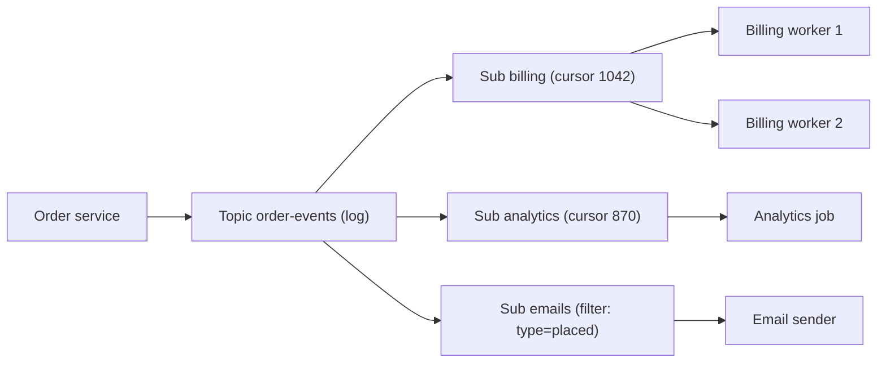

## In one minute
- In publish/subscribe, a publisher sends a message to a **topic**, and every **subscription** to that topic gets its own copy. The publisher does not know who, or how many, the subscribers are.
- Fan-out happens across subscriptions; inside one subscription, consumers usually compete like a message queue (see the Message Queues lesson). That pairing is the core idea in Google Pub/Sub, SNS with SQS, Kafka consumer groups and MQTT 5 shared subscriptions.
- There are two families. **Ephemeral** pub/sub (Redis `PUBLISH`, NATS core, MQTT QoS 0) delivers only to subscribers connected right now. **Durable** pub/sub keeps a backlog per subscription, so a subscriber that is down catches up later.
- Subscribers choose what they get by topic hierarchy with wildcards, or by attribute filters. Matching has to be fast, because it runs once per message for every subscription.
- Fan-out multiplies cost: bandwidth, copies or cursors, and retention that the slowest subscriber pins.

## How it works

### Topics, subscriptions and subscribers
Three names keep the model straight. A **topic** is the named stream publishers write to. A **subscription** is a named, independent view of that topic with its own position and its own unacknowledged messages. A **subscriber** is a process attached to a subscription. When the billing team and the analytics team both need `order-events`, each gets its own subscription; billing can run five consumers that share the work, and analytics can be down for an hour without touching billing.

This is the fan-out problem shape. Kubernetes shows it in a second domain: controllers watch resources through the API server, each watch carries its own `resourceVersion` cursor, and a watcher that falls too far behind gets `410 Gone` and must relist. With etcd 3, the history kept is the last 5 minutes by default ([Kubernetes API concepts](https://kubernetes.io/docs/reference/using-api/api-concepts/)). That is a subscription whose cursor fell off the end of retention.

### Ephemeral versus durable
Ephemeral pub/sub is a router. Redis `PUBLISH` returns the number of clients that received the message, and a client that reconnects one second later has missed it forever; Redis documents its pub/sub as at-most-once ([Redis pub/sub](https://redis.io/docs/latest/develop/pubsub/)). It is ideal for signals where only the latest state matters: cache invalidation hints, presence, live cursor positions, "wake up and check the database" nudges.

Ephemeral fan-out still has a scaling trap. In a Redis Cluster, a classic `PUBLISH` is broadcast to every node over the cluster bus, so adding shards adds traffic instead of capacity. Redis 7.0 added sharded pub/sub (`SPUBLISH`, `SSUBSCRIBE`), which hashes each channel to one slot and keeps its messages inside that shard.

Durable pub/sub stores messages until each subscription acknowledges them or retention expires. A new subscription normally starts at "now": Google Pub/Sub does not deliver messages published before the subscription existed ([Google Pub/Sub subscriptions](https://docs.cloud.google.com/pubsub/docs/subscription-overview)), and a Kafka consumer group with `auto.offset.reset=latest` starts at the end of the log. The usual mistake is deploying the producer before the subscription exists and losing the first hour of events.

### Choosing what to receive
**Topic hierarchies with wildcards** encode routing into the topic name. MQTT uses `/` as the separator, `+` for exactly one level and `#` for any number of trailing levels, so `factory/+/temp` matches `factory/line3/temp`, and `factory/#` matches everything under `factory`, including `factory` itself. NATS uses `.` with `*` and `>`; AMQP topic exchanges use `.` with `*` and `#` (see the RabbitMQ lesson). MQTT also hides topics that start with `$`, such as `$SYS/broker/load`, from filters whose first level is a wildcard, so a `#` subscriber does not drown in broker internals ([MQTT 5.0](https://docs.oasis-open.org/mqtt/mqtt/v5.0/os/mqtt-v5.0-os.html)).

**Attribute filters** match on message metadata instead, such as SNS filter policies (`{"region": ["eu-west-1"]}`, see [SNS message filtering](https://docs.aws.amazon.com/sns/latest/dg/sns-message-filtering.html)) or Google Pub/Sub filter expressions. They keep topic names simple but are evaluated per message per subscription.

**Retained messages** solve the late-joiner problem for state. An MQTT publish with the retain flag replaces the broker's stored "last value" for that topic, and a new subscriber immediately receives the retained message for every topic its filter matches. A thermostat display that subscribes to `home/+/temp` gets every room's current temperature at once instead of waiting for the next reading.

### Push or pull
Durable systems deliver either by **pull** (subscribers fetch, which gives natural flow control) or by **push** (the broker calls an HTTPS endpoint, Lambda or queue, and treats a 2xx as an ack). Push is convenient across organisational boundaries and behaves much like webhooks (see the Webhooks lesson); pull scales better for heavy consumers because they control their own rate.

## Down the stack

### Layer 1: The contract
Durable pub/sub promises that every message published after a subscription is created is delivered at least once to that subscription, independently of every other subscription, until it is acked or ages past retention. In Google Pub/Sub that is seven days by default, configurable from 10 minutes to 31 days, and an unacked message is redelivered after its ack deadline, 10 seconds by default and at most 600 ([Pub/Sub API reference](https://docs.cloud.google.com/pubsub/docs/reference/rest/v1/projects.subscriptions)). Order is not promised unless you use an ordering key or partition key, and then only per key and per subscription. One subscriber's failure must not slow or lose messages for another. Ephemeral pub/sub promises only at-most-once delivery to subscribers connected at publish time. Neither promises that subscribers see a message at the same moment.

### Layer 2: The mechanism
There are two ways to implement fan-out. **Copy on publish** writes a copy, or a reference, into each subscription's own queue: SNS delivering to SQS queues, a RabbitMQ fanout exchange enqueueing into each bound queue. Each subscription then has normal per-message ack state, filtering and dead-lettering. **Shared log with cursors** writes the message once and gives each subscription a position. Kafka stores each group's committed offset in the internal `__consumer_offsets` topic. Pulsar keeps a cursor per subscription with a mark-delete position plus ranges of individually acknowledged messages beyond it, so out-of-order acks do not force redelivery ([Pulsar messaging concepts](https://pulsar.apache.org/docs/next/concepts-messaging/)).

Wildcard matching uses a trie keyed by topic level. Brokers such as Mosquitto and EMQX store subscriptions in a tree where each node has children for literal levels plus `+` and `#` edges. Matching `factory/line3/temp` walks one path per level and branches at most into the wildcard edges, so cost grows with topic depth, not with the number of subscriptions.

MQTT delivery state is per client session. QoS 1 uses `PUBLISH` and `PUBACK` and may duplicate; QoS 2 adds `PUBREC`, `PUBREL` and `PUBCOMP` so each side can discard duplicates by packet identifier. A session started with `Clean Start = 0` and a session expiry interval keeps queueing QoS 1 and 2 messages while the client is offline.

### Layer 3: The machine
Fan-out multiplies egress bytes: a 1 KB message to 10,000 subscribers is 10 MB on the wire, and the NIC and TLS encryption pay for every copy. Copy on publish also multiplies storage writes; a shared log writes once and lets readers share the page cache, and Kafka sends file data to sockets with `sendfile` without copying it through user space. The price is that a subscriber reading hours behind pulls cold segments from disk and evicts hot ones that up-to-date readers need.

Slow ephemeral subscribers are handled brutally, by design. Redis buffers outgoing pub/sub messages per client and, with the default `client-output-buffer-limit pubsub 32mb 8mb 60` ([redis.conf](https://raw.githubusercontent.com/redis/redis/unstable/redis.conf)), disconnects a client whose buffer exceeds 32 MB, or stays over 8 MB for 60 seconds. The messages in that buffer are lost. The broker protects its memory, and the subscriber has to resynchronise from a source of truth.

### Why it's built this way
1. Producers should not change when a new consumer appears, so they address a topic, not recipients.
2. Consumers run at different speeds and fail independently, so each subscription needs its own position and ack state.
3. Copying every message N times is expensive in disk and memory, so high fan-out systems store once and keep N cursors, while systems needing per-message filters and DLQs per subscriber accept the copies.
4. Storage is finite, so retention is bounded, and the system must choose between dropping a slow subscriber's backlog and letting it pin storage for everyone. Mature systems drop the subscriber, not the stream.

## Diagram


## Worked example
A sports app sends live scores. Matches publish 50 updates per second in total, each about 400 bytes, on topics like `scores/football/m123`. Two million phones are connected to 40 gateway servers, 50,000 each, and a cup final has 500,000 watchers.

If each phone were a durable subscription, the broker would track 2 million cursors and back up messages for phones that went to sleep. Instead the design uses two tiers. Each gateway holds one subscription to `scores/#` on the internal broker, so a goal in the final is published once and fanned out 40 times. Each gateway then fans out to its own sockets: on average 12,500 local watchers of the final, 5 MB per goal per gateway, about 40 ms at 1 Gbit/s. The heavy fan-out happens in the cheap, ephemeral last mile.

Phones that reconnect do not replay missed updates; the score is state, not history. The broker retains the last message per match topic, so a reconnecting gateway, or a phone that opens the app mid-match, gets the current score immediately. The events that truly need durability, such as push notifications for goals, statistics and the archive, are three durable subscriptions on the internal log. If the archive job stops for 2 hours, it falls 50 × 400 B × 7,200 s, about 144 MB, behind: trivial to retain and replay.

## In the wild
- **Discord, 2017: fan-out from one process to 30,000 sessions.** Each Discord server (guild) is an Erlang process that sends every event to every connected session process. That was fine for small groups, but busy guilds reached about 30,000 concurrent users, and each `send` cost 30 to 70 microseconds, so publishing one event took 900 ms to 2.1 s and guilds fell behind at peak. Discord's Manifold library groups recipients by node and sends one batch per node, where local workers finish the fan-out, keeping order while spreading the CPU cost ([Discord](https://discord.com/blog/how-discord-scaled-elixir-to-5-000-000-concurrent-users)).
- **AWS, 2020: the stream everyone subscribes to goes down.** Adding capacity to Kinesis Data Streams front-end servers pushed each server past the operating system's thread limit, because every server kept a thread for each of its peers. Kinesis was impaired for about 17 hours, and the services built on it as a shared event backbone were hit too: Cognito, CloudWatch, Lambda and EventBridge, and through EventBridge, ECS and EKS. Fixes included fewer, larger servers, thread alarms and faster cellularisation ([AWS](https://aws.amazon.com/message/11201/)).
- **GitHub, 2018: push subscribers miss a window.** After a 43-second partition forced a cross-coast database failover, GitHub ran degraded for 24 hours. More than 5 million webhook events queued, and about 200,000 webhook payloads expired before they could be delivered, so those subscribers never received them ([GitHub](https://github.blog/2018-10-30-oct21-post-incident-analysis/)).

## Trade-offs
| Option | Strengths | Weaknesses | Choose when |
|---|---|---|---|
| Ephemeral (Redis pub/sub, NATS core, MQTT QoS 0) | Microsecond routing, no storage, simple | Offline or slow subscribers lose messages | Signals, presence, live state with a source of truth elsewhere |
| Copy per subscription (SNS to SQS, RabbitMQ fanout) | Per-subscriber acks, filters, DLQs, retry | Storage and requests multiply with subscriber count | Few subscribers, each with its own retry and failure policy |
| Shared log with cursors (Kafka, Pulsar) | Write once, replay, cheap to add subscribers | Ordering and parallelism per partition, coarse acks | Many subscribers, high volume, replay needed |
| Managed pub/sub (Google Pub/Sub) | No capacity planning, push or pull, filters | Per-message cost, limited replay window | Cloud-native services without a streaming platform team |

## Pitfalls in production
- **Subscription created after the producer starts.** Messages published in between are gone for that subscription. Create subscriptions as part of infrastructure, before deploying producers, and backfill from the source of truth if needed.
- **One slow subscriber, invisible.** Analytics falls days behind and its backlog expires silently. Alarm on oldest unacked message age per subscription, not on the topic.
- **Over-broad wildcards.** A debugging subscriber on `#` receives the whole firehose and falls over, or a filter matches far more than intended after topic names change. Review topic naming as an API and restrict wildcard subscriptions with ACLs.
- **Ephemeral treated as durable.** A cache-invalidation channel on Redis pub/sub silently drops messages when a client reconnects or exceeds its buffer limit, and stale data lives forever. Pair ephemeral signals with TTLs or periodic resync.
- **Fan-out cost surprises.** One SNS topic feeding 30 SQS queues turns 1,000 publishes per second into 30,000 deliveries. Count subscriptions when estimating cost and load.

## Leadership lens
- Treat topics and their message schemas as public APIs with owners, versioning rules and a deprecation process. Subscribers you have never heard of will depend on them.
- Ask each team which subscriptions it owns and what lag it tolerates; make that per-subscription age the alarm.
- Decide explicitly whether each stream is state (latest value wins, ephemeral and retained is enough) or history (every event matters, needs durable subscriptions). The two cost very different amounts.
- Limit who can create wildcard subscriptions on shared topics; a single careless consumer can become the slowest subscriber that pins retention for everyone.

## Check yourself
1. Billing and analytics both subscribe to `order-events`. Billing runs three consumers. How many times is each message processed?
   **Answer:** Once by billing, by whichever of its three consumers gets it, and once by analytics. Fan-out is across subscriptions; competition is within one.
2. Why does an MQTT broker match subscriptions with a trie rather than testing each filter?
   **Answer:** Testing every filter costs time proportional to the number of subscriptions per message. A trie walk costs time proportional to topic depth, plus the wildcard branches at each level.
3. When is a retained message a better fix for a late subscriber than durable replay?
   **Answer:** When the topic carries state where only the latest value matters, such as a temperature or a score. The newcomer needs the current value, not every past change.
4. Why can one lagging subscriber hurt others on a shared log?
   **Answer:** It reads cold data from disk, evicting page-cache pages that up-to-date readers need, and if retention is tied to the slowest cursor it forces the log to keep growing.

## Practice
**Task:** Build a small durable pub/sub hub with MQTT topic filters. `topic_matches(filter, topic)` splits both on `/`; `+` matches exactly one level, `#` (always the last level) matches its parent and any number of further levels, and a topic whose first level starts with `$` never matches a filter whose first level is `+` or `#`. `Hub` keeps an append-only log with offsets from 0. `publish(topic, payload, retain=False)` appends and returns the offset; with `retain`, it also stores the payload as the topic's retained value, and an empty retained payload clears it. `subscribe(name, filter)` creates a subscription whose cursor is the current end of the log and returns the matching retained `(topic, payload)` pairs sorted by topic. `poll(name, max_n)` returns up to `max_n` matching `(offset, topic, payload)` entries from the cursor, then moves the cursor just past the last returned entry, or to the end of the log if fewer than `max_n` matched. `lag(name)` counts matching entries from the cursor to the end. `trim()` drops log entries below the smallest cursor (all entries if there are no subscriptions) and returns how many it dropped; offsets never change. `seek(name, offset)` moves a cursor, clamped to the range of offsets still held, and returns the new cursor.

```python starter
def topic_matches(flt, topic):
    # TODO
    raise NotImplementedError


class Hub:
    def __init__(self):
        pass

    def publish(self, topic, payload, retain=False):
        # TODO
        raise NotImplementedError

    def subscribe(self, name, flt):
        # TODO
        raise NotImplementedError

    def poll(self, name, max_n):
        # TODO
        raise NotImplementedError

    def lag(self, name):
        # TODO
        raise NotImplementedError

    def trim(self):
        # TODO
        raise NotImplementedError

    def seek(self, name, offset):
        # TODO
        raise NotImplementedError
```

```python tests
def test_wildcards():
    cases = [
        ("a/+/c", "a/b/c", True),
        ("a/+/c", "a/b/d/c", False),
        ("a/#", "a", True),
        ("a/#", "a/b/c", True),
        ("#", "x/y", True),
        ("+", "x/y", False),
        ("a/+", "a/", True),
        ("a/b", "a/b", True),
        ("a/b", "a/c", False),
    ]
    for f, t, want in cases:
        assert topic_matches(f, t) == want, (f, t)


def test_dollar_topics_hidden_from_leading_wildcards():
    assert not topic_matches("#", "$SYS/load")
    assert not topic_matches("+/load", "$SYS/load")
    assert topic_matches("$SYS/#", "$SYS/load")


def test_fan_out_to_independent_subscriptions():
    h = Hub()
    h.subscribe("all", "home/#")
    h.subscribe("temps", "home/+/temp")
    h.publish("home/kitchen/temp", "21")
    h.publish("home/door", "open")
    assert h.poll("all", 10) == [(0, "home/kitchen/temp", "21"), (1, "home/door", "open")]
    assert h.poll("temps", 10) == [(0, "home/kitchen/temp", "21")]
    assert h.poll("temps", 10) == []


def test_late_subscriber_gets_retained_not_history():
    h = Hub()
    h.publish("home/kitchen/temp", "20", retain=True)
    h.publish("home/bath/temp", "24", retain=True)
    h.publish("home/kitchen/temp", "21", retain=True)
    h.publish("home/door", "open")
    got = h.subscribe("s", "home/+/temp")
    assert got == [("home/bath/temp", "24"), ("home/kitchen/temp", "21")]
    assert h.poll("s", 10) == []
    h.publish("home/bath/temp", "", retain=True)
    assert h.subscribe("t", "home/+/temp") == [("home/kitchen/temp", "21")]


def test_poll_batches_and_lag():
    h = Hub()
    h.subscribe("s", "a/+")
    for i in range(5):
        h.publish("a/" + str(i), str(i))
        h.publish("b/" + str(i), "x")
    assert h.lag("s") == 5
    assert [e[0] for e in h.poll("s", 2)] == [0, 2]
    assert h.lag("s") == 3
    assert [e[0] for e in h.poll("s", 10)] == [4, 6, 8]
    assert h.lag("s") == 0


def test_trim_is_gated_by_slowest_and_seek_clamps():
    h = Hub()
    h.subscribe("fast", "#")
    h.subscribe("slow", "#")
    for i in range(4):
        h.publish("t", str(i))
    h.poll("fast", 10)
    h.poll("slow", 1)
    assert h.trim() == 1
    assert h.seek("fast", 0) == 1, "offset 0 was trimmed"
    assert [e[0] for e in h.poll("fast", 10)] == [1, 2, 3]
    assert h.seek("slow", 99) == 4
    assert h.trim() == 3
    h.publish("t", "4")
    assert h.poll("slow", 10) == [(4, "t", "4")]
```

```python solution
def topic_matches(flt, topic):
    f = flt.split("/")
    t = topic.split("/")
    if topic.startswith("$") and f[0] in ("+", "#"):
        return False
    for i, part in enumerate(f):
        if part == "#":
            return True
        if i >= len(t):
            return False
        if part != "+" and part != t[i]:
            return False
    return len(f) == len(t)


class Hub:
    def __init__(self):
        self.start = 0
        self.log = []
        self.retained = {}
        self.subs = {}

    def end(self):
        return self.start + len(self.log)

    def publish(self, topic, payload, retain=False):
        off = self.end()
        self.log.append((off, topic, payload))
        if retain:
            if payload == "":
                self.retained.pop(topic, None)
            else:
                self.retained[topic] = payload
        return off

    def subscribe(self, name, flt):
        self.subs[name] = {"filter": flt, "cursor": self.end()}
        return sorted((t, p) for t, p in self.retained.items() if topic_matches(flt, t))

    def poll(self, name, max_n):
        s = self.subs[name]
        out = []
        for e in self.log[s["cursor"] - self.start:]:
            if topic_matches(s["filter"], e[1]):
                out.append(e)
                if len(out) == max_n:
                    s["cursor"] = e[0] + 1
                    return out
        s["cursor"] = self.end()
        return out

    def lag(self, name):
        s = self.subs[name]
        return sum(1 for e in self.log[s["cursor"] - self.start:] if topic_matches(s["filter"], e[1]))

    def trim(self):
        low = min([s["cursor"] for s in self.subs.values()] or [self.end()])
        n = low - self.start
        self.log = self.log[n:]
        self.start = low
        return n

    def seek(self, name, offset):
        c = max(self.start, min(offset, self.end()))
        self.subs[name]["cursor"] = c
        return c
```

```typescript starter
export type Entry = [number, string, string];

export function topicMatches(filter: string, topic: string): boolean {
  throw new Error("TODO");
}

export class Hub {
  publish(topic: string, payload: string, retain = false): number {
    throw new Error("TODO");
  }
  subscribe(name: string, filter: string): [string, string][] {
    throw new Error("TODO");
  }
  poll(name: string, maxN: number): Entry[] {
    throw new Error("TODO");
  }
  lag(name: string): number {
    throw new Error("TODO");
  }
  trim(): number {
    throw new Error("TODO");
  }
  seek(name: string, offset: number): number {
    throw new Error("TODO");
  }
}
```

```typescript tests
function offsets(es: Entry[]): number[] {
  return es.map((e) => e[0]);
}

test("wildcards", () => {
  const cases: [string, string, boolean][] = [
    ["a/+/c", "a/b/c", true],
    ["a/+/c", "a/b/d/c", false],
    ["a/#", "a", true],
    ["a/#", "a/b/c", true],
    ["#", "x/y", true],
    ["+", "x/y", false],
    ["a/+", "a/", true],
    ["a/b", "a/b", true],
    ["a/b", "a/c", false],
  ];
  for (const [f, t, want] of cases) assertEqual(topicMatches(f, t), want, f + " " + t);
});
test("dollar topics hidden from leading wildcards", () => {
  assert(!topicMatches("#", "$SYS/load"));
  assert(!topicMatches("+/load", "$SYS/load"));
  assert(topicMatches("$SYS/#", "$SYS/load"));
});
test("fan out to independent subscriptions", () => {
  const h = new Hub();
  h.subscribe("all", "home/#");
  h.subscribe("temps", "home/+/temp");
  h.publish("home/kitchen/temp", "21");
  h.publish("home/door", "open");
  assertEqual(h.poll("all", 10), [[0, "home/kitchen/temp", "21"], [1, "home/door", "open"]]);
  assertEqual(h.poll("temps", 10), [[0, "home/kitchen/temp", "21"]]);
  assertEqual(h.poll("temps", 10), []);
});
test("late subscriber gets retained not history", () => {
  const h = new Hub();
  h.publish("home/kitchen/temp", "20", true);
  h.publish("home/bath/temp", "24", true);
  h.publish("home/kitchen/temp", "21", true);
  h.publish("home/door", "open");
  assertEqual(h.subscribe("s", "home/+/temp"), [["home/bath/temp", "24"], ["home/kitchen/temp", "21"]]);
  assertEqual(h.poll("s", 10), []);
  h.publish("home/bath/temp", "", true);
  assertEqual(h.subscribe("t", "home/+/temp"), [["home/kitchen/temp", "21"]]);
});
test("poll batches and lag", () => {
  const h = new Hub();
  h.subscribe("s", "a/+");
  for (let i = 0; i < 5; i++) {
    h.publish("a/" + i, String(i));
    h.publish("b/" + i, "x");
  }
  assertEqual(h.lag("s"), 5);
  assertEqual(offsets(h.poll("s", 2)), [0, 2]);
  assertEqual(h.lag("s"), 3);
  assertEqual(offsets(h.poll("s", 10)), [4, 6, 8]);
  assertEqual(h.lag("s"), 0);
});
test("trim is gated by slowest and seek clamps", () => {
  const h = new Hub();
  h.subscribe("fast", "#");
  h.subscribe("slow", "#");
  for (let i = 0; i < 4; i++) h.publish("t", String(i));
  h.poll("fast", 10);
  h.poll("slow", 1);
  assertEqual(h.trim(), 1);
  assertEqual(h.seek("fast", 0), 1, "offset 0 was trimmed");
  assertEqual(offsets(h.poll("fast", 10)), [1, 2, 3]);
  assertEqual(h.seek("slow", 99), 4);
  assertEqual(h.trim(), 3);
  h.publish("t", "4");
  assertEqual(h.poll("slow", 10), [[4, "t", "4"]]);
});
```

```typescript solution
export type Entry = [number, string, string];

export function topicMatches(filter: string, topic: string): boolean {
  const f = filter.split("/");
  const t = topic.split("/");
  if (topic.startsWith("$") && (f[0] === "+" || f[0] === "#")) return false;
  for (let i = 0; i < f.length; i++) {
    if (f[i] === "#") return true;
    if (i >= t.length) return false;
    if (f[i] !== "+" && f[i] !== t[i]) return false;
  }
  return f.length === t.length;
}

interface Sub {
  filter: string;
  cursor: number;
}

export class Hub {
  private start = 0;
  private log: Entry[] = [];
  private retained = new Map<string, string>();
  private subs = new Map<string, Sub>();

  private end(): number {
    return this.start + this.log.length;
  }

  publish(topic: string, payload: string, retain = false): number {
    const off = this.end();
    this.log.push([off, topic, payload]);
    if (retain) {
      if (payload === "") this.retained.delete(topic);
      else this.retained.set(topic, payload);
    }
    return off;
  }

  subscribe(name: string, filter: string): [string, string][] {
    this.subs.set(name, { filter, cursor: this.end() });
    const out: [string, string][] = [];
    for (const [t, p] of this.retained) if (topicMatches(filter, t)) out.push([t, p]);
    return out.sort((a, b) => (a[0] < b[0] ? -1 : a[0] > b[0] ? 1 : 0));
  }

  poll(name: string, maxN: number): Entry[] {
    const s = this.subs.get(name)!;
    const out: Entry[] = [];
    for (const e of this.log.slice(s.cursor - this.start)) {
      if (!topicMatches(s.filter, e[1])) continue;
      out.push(e);
      if (out.length === maxN) {
        s.cursor = e[0] + 1;
        return out;
      }
    }
    s.cursor = this.end();
    return out;
  }

  lag(name: string): number {
    const s = this.subs.get(name)!;
    return this.log.slice(s.cursor - this.start).filter((e) => topicMatches(s.filter, e[1])).length;
  }

  trim(): number {
    let low = this.end();
    for (const s of this.subs.values()) low = Math.min(low, s.cursor);
    const n = low - this.start;
    this.log = this.log.slice(n);
    this.start = low;
    return n;
  }

  seek(name: string, offset: number): number {
    const c = Math.max(this.start, Math.min(offset, this.end()));
    this.subs.get(name)!.cursor = c;
    return c;
  }
}
```

```go starter
package practice

type Entry struct {
	Offset  int
	Topic   string
	Payload string
}

type Retained struct {
	Topic   string
	Payload string
}

func TopicMatches(filter, topic string) bool { panic("TODO") }

type Hub struct{}

func NewHub() *Hub { return &Hub{} }

func (h *Hub) Publish(topic, payload string, retain bool) int { panic("TODO") }
func (h *Hub) Subscribe(name, filter string) []Retained      { panic("TODO") }
func (h *Hub) Poll(name string, maxN int) []Entry             { panic("TODO") }
func (h *Hub) Lag(name string) int                            { panic("TODO") }
func (h *Hub) Trim() int                                      { panic("TODO") }
func (h *Hub) Seek(name string, offset int) int               { panic("TODO") }
```

```go tests
package practice

import (
	"reflect"
	"strconv"
	"testing"
)

func offsets(es []Entry) []int {
	out := []int{}
	for _, e := range es {
		out = append(out, e.Offset)
	}
	return out
}

func check(t *testing.T, got, want interface{}) {
	t.Helper()
	if !reflect.DeepEqual(got, want) {
		t.Fatalf("got %v, want %v", got, want)
	}
}

func TestWildcards(t *testing.T) {
	cases := []struct {
		f, topic string
		want     bool
	}{
		{"a/+/c", "a/b/c", true},
		{"a/+/c", "a/b/d/c", false},
		{"a/#", "a", true},
		{"a/#", "a/b/c", true},
		{"#", "x/y", true},
		{"+", "x/y", false},
		{"a/+", "a/", true},
		{"a/b", "a/b", true},
		{"a/b", "a/c", false},
	}
	for _, c := range cases {
		if TopicMatches(c.f, c.topic) != c.want {
			t.Fatalf("%s %s", c.f, c.topic)
		}
	}
}

func TestDollarTopicsHiddenFromLeadingWildcards(t *testing.T) {
	if TopicMatches("#", "$SYS/load") || TopicMatches("+/load", "$SYS/load") || !TopicMatches("$SYS/#", "$SYS/load") {
		t.Fatal("$ topic rule")
	}
}

func TestFanOutToIndependentSubscriptions(t *testing.T) {
	h := NewHub()
	h.Subscribe("all", "home/#")
	h.Subscribe("temps", "home/+/temp")
	h.Publish("home/kitchen/temp", "21", false)
	h.Publish("home/door", "open", false)
	check(t, h.Poll("all", 10), []Entry{{0, "home/kitchen/temp", "21"}, {1, "home/door", "open"}})
	check(t, h.Poll("temps", 10), []Entry{{0, "home/kitchen/temp", "21"}})
	check(t, h.Poll("temps", 10), []Entry{})
}

func TestLateSubscriberGetsRetainedNotHistory(t *testing.T) {
	h := NewHub()
	h.Publish("home/kitchen/temp", "20", true)
	h.Publish("home/bath/temp", "24", true)
	h.Publish("home/kitchen/temp", "21", true)
	h.Publish("home/door", "open", false)
	check(t, h.Subscribe("s", "home/+/temp"), []Retained{{"home/bath/temp", "24"}, {"home/kitchen/temp", "21"}})
	check(t, h.Poll("s", 10), []Entry{})
	h.Publish("home/bath/temp", "", true)
	check(t, h.Subscribe("t", "home/+/temp"), []Retained{{"home/kitchen/temp", "21"}})
}

func TestPollBatchesAndLag(t *testing.T) {
	h := NewHub()
	h.Subscribe("s", "a/+")
	for i := 0; i < 5; i++ {
		h.Publish("a/"+strconv.Itoa(i), strconv.Itoa(i), false)
		h.Publish("b/"+strconv.Itoa(i), "x", false)
	}
	check(t, h.Lag("s"), 5)
	check(t, offsets(h.Poll("s", 2)), []int{0, 2})
	check(t, h.Lag("s"), 3)
	check(t, offsets(h.Poll("s", 10)), []int{4, 6, 8})
	check(t, h.Lag("s"), 0)
}

func TestTrimIsGatedBySlowestAndSeekClamps(t *testing.T) {
	h := NewHub()
	h.Subscribe("fast", "#")
	h.Subscribe("slow", "#")
	for i := 0; i < 4; i++ {
		h.Publish("t", strconv.Itoa(i), false)
	}
	h.Poll("fast", 10)
	h.Poll("slow", 1)
	check(t, h.Trim(), 1)
	check(t, h.Seek("fast", 0), 1)
	check(t, offsets(h.Poll("fast", 10)), []int{1, 2, 3})
	check(t, h.Seek("slow", 99), 4)
	check(t, h.Trim(), 3)
	h.Publish("t", "4", false)
	check(t, h.Poll("slow", 10), []Entry{{4, "t", "4"}})
}
```

```go solution
package practice

import (
	"sort"
	"strings"
	"sync"
)

type Entry struct {
	Offset  int
	Topic   string
	Payload string
}

type Retained struct {
	Topic   string
	Payload string
}

func TopicMatches(filter, topic string) bool {
	f := strings.Split(filter, "/")
	t := strings.Split(topic, "/")
	if strings.HasPrefix(topic, "$") && (f[0] == "+" || f[0] == "#") {
		return false
	}
	for i, part := range f {
		if part == "#" {
			return true
		}
		if i >= len(t) {
			return false
		}
		if part != "+" && part != t[i] {
			return false
		}
	}
	return len(f) == len(t)
}

type sub struct {
	filter string
	cursor int
}

type Hub struct {
	mu       sync.Mutex
	start    int
	log      []Entry
	retained map[string]string
	subs     map[string]*sub
}

func NewHub() *Hub {
	return &Hub{retained: map[string]string{}, subs: map[string]*sub{}}
}

func (h *Hub) end() int { return h.start + len(h.log) }

func (h *Hub) Publish(topic, payload string, retain bool) int {
	h.mu.Lock()
	defer h.mu.Unlock()
	off := h.end()
	h.log = append(h.log, Entry{off, topic, payload})
	if retain {
		if payload == "" {
			delete(h.retained, topic)
		} else {
			h.retained[topic] = payload
		}
	}
	return off
}

func (h *Hub) Subscribe(name, filter string) []Retained {
	h.mu.Lock()
	defer h.mu.Unlock()
	h.subs[name] = &sub{filter: filter, cursor: h.end()}
	out := []Retained{}
	for t, p := range h.retained {
		if TopicMatches(filter, t) {
			out = append(out, Retained{t, p})
		}
	}
	sort.Slice(out, func(i, j int) bool { return out[i].Topic < out[j].Topic })
	return out
}

func (h *Hub) Poll(name string, maxN int) []Entry {
	h.mu.Lock()
	defer h.mu.Unlock()
	s := h.subs[name]
	out := []Entry{}
	for _, e := range h.log[s.cursor-h.start:] {
		if !TopicMatches(s.filter, e.Topic) {
			continue
		}
		out = append(out, e)
		if len(out) == maxN {
			s.cursor = e.Offset + 1
			return out
		}
	}
	s.cursor = h.end()
	return out
}

func (h *Hub) Lag(name string) int {
	h.mu.Lock()
	defer h.mu.Unlock()
	s := h.subs[name]
	n := 0
	for _, e := range h.log[s.cursor-h.start:] {
		if TopicMatches(s.filter, e.Topic) {
			n++
		}
	}
	return n
}

func (h *Hub) Trim() int {
	h.mu.Lock()
	defer h.mu.Unlock()
	low := h.end()
	for _, s := range h.subs {
		if s.cursor < low {
			low = s.cursor
		}
	}
	n := low - h.start
	h.log = append([]Entry{}, h.log[n:]...)
	h.start = low
	return n
}

func (h *Hub) Seek(name string, offset int) int {
	h.mu.Lock()
	defer h.mu.Unlock()
	c := offset
	if c > h.end() {
		c = h.end()
	}
	if c < h.start {
		c = h.start
	}
	h.subs[name].cursor = c
	return c
}
```

## Mock interview
**Prompt:** Design the event distribution for a ride-hailing platform. The trip service emits 20,000 trip events per second; 15 internal teams consume them (billing, fraud, ETA models, notifications, analytics), and the rider app needs live trip status on 3 million concurrent connections.

- Follow-up: The fraud team's consumer falls 6 hours behind during an incident. What happens to the other 14 teams and to storage?
- Follow-up: A new team joins and needs the last 3 days of events. How do they get them?
- Follow-up: Why not give each rider app connection its own durable subscription?

**A strong answer covers:**
- A durable, partitioned log keyed by trip ID for internal consumers, one subscription (consumer group) per team, and ordering per trip.
- Retention sized by time, not by the slowest reader, with per-subscription lag alarms and a replay or backfill path for new and recovering subscribers.
- A separate ephemeral last-mile tier: gateways subscribe to trip topics for their connected riders, and reconnecting apps fetch current trip state instead of replaying events.
- Topic and schema ownership, compatibility rules, and ACLs on who can subscribe to what.
- Fan-out cost estimates: bytes per event times subscriptions, and gateway egress at peak.

## Sources and further study
**Primary**
- [Eugster et al., The Many Faces of Publish/Subscribe (ACM Computing Surveys, 2003)](https://www.cs.princeton.edu/courses/archive/spr17/cos598D/PublishSubscribe03.pdf): the classic survey that frames pub/sub as decoupling in space, time and synchronisation, and compares topic and content filtering.

**Systems docs**
- [Redis pub/sub](https://redis.io/docs/latest/develop/pubsub/): at-most-once delivery, pattern subscriptions and sharded pub/sub in Redis 7.
- [Google Pub/Sub subscription API reference](https://docs.cloud.google.com/pubsub/docs/reference/rest/v1/projects.subscriptions): retention, ack deadlines, filters and exactly-once delivery as fields you set.
- [Kubernetes API concepts](https://kubernetes.io/docs/reference/using-api/api-concepts/): watches, resource versions and the 410 Gone relist.
- [Apache Kafka topic configuration](https://kafka.apache.org/42/configuration/topic-configs/): time-based retention (7 days by default), which is what a lagging consumer group races against.

**Books**
- *Designing Distributed Systems* (2nd ed.), Brendan Burns, Ch 12 "Event-Driven Batch Processing": its "Publisher/Subscriber Infrastructure" section, with a hands-on Kafka deployment.
- *Designing Data-Intensive Applications* (2nd ed.), Martin Kleppmann and Chris Riccomini, Ch 12 "Stream Processing": its "Transmitting Event Streams" section covers delivering one stream to many consumers, by broker and by log.

**Other curricula**
- [Azure Architecture Center: Publisher-Subscriber pattern](https://learn.microsoft.com/en-us/azure/architecture/patterns/publisher-subscriber): one input channel, one output channel per subscriber, and a checklist of issues (ordering, poison messages, expiry, schema evolution, backpressure).
- [roadmap.sh: System Design](https://roadmap.sh/system-design): lists Publisher/Subscriber as a messaging pattern next to queue-based load leveling and competing consumers.

## Watch
- [What is the Publisher Subscriber Model? (Gaurav Sen)](https://www.youtube.com/watch?v=FMhbR_kQeHw): why services move from direct calls to pub/sub, and what that costs.
- [Pub Sub Model, MQTT Essentials Part 3 (HiveMQ)](https://www.youtube.com/watch?v=HCzQJMdHcy0): decoupling in space, time and synchronisation, as MQTT applies it.

## Free resources
- [Google Cloud Pub/Sub overview](https://cloud.google.com/pubsub/docs/overview): topics, subscriptions, push and pull, and the delivery contract.
- [Google Cloud Pub/Sub subscriptions](https://cloud.google.com/pubsub/docs/subscription-overview): subscription types, acknowledgement deadlines, retention and filtering.
- [MQTT Version 5.0 (OASIS standard)](https://docs.oasis-open.org/mqtt/mqtt/v5.0/os/mqtt-v5.0-os.html): the normative rules for topic filters, wildcards, retained messages and shared subscriptions.
- [Apache Pulsar messaging concepts](https://pulsar.apache.org/docs/next/concepts-messaging/): subscription types, cursors and acknowledgement in a log-based system.
- [Amazon SNS message filtering](https://docs.aws.amazon.com/sns/latest/dg/sns-message-filtering.html): attribute-based filter policies as an alternative to topic hierarchies.
- [NATS subject-based messaging](https://docs.nats.io/nats-concepts/subjects): another hierarchy and wildcard syntax, with naming advice.
