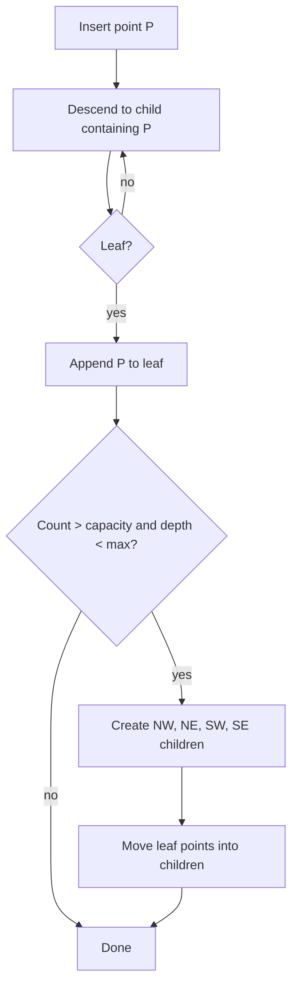

## In one minute
- A quadtree recursively splits a 2D region into four equal quadrants, but only where there is data. Empty ocean stays one big node; Manhattan becomes many small ones.
- Each leaf holds up to a fixed number of points (the capacity, often 50 to 500). When a leaf overflows it splits into four children and pushes its points down.
- Range and nearest-neighbour queries walk only the nodes whose boxes intersect the search area, so cost tracks local density rather than total data size.
- It is usually an in-memory structure inside a service, rebuilt or updated from a durable store. That makes it fast and adaptive, but you own its consistency, memory, and rebuild time.

## How it works

### Structure
Every node owns an axis-aligned box. A leaf stores a list of points. An internal node stores no points, only four children: north-west, north-east, south-west, south-east, each covering exactly a quarter of the parent. The root covers the whole domain, for example the world in latitude and longitude, or a projected map in metres.

This is the **point-region (PR) quadtree**, the variant most location services use. Splits happen at the box centre, not at a data point, so the shape depends only on which points exist, not on insertion order. The original quadtree of Finkel and Bentley split at each inserted point instead, so its shape did depend on order ([Finkel and Bentley, 1974](https://doi.org/10.1007/BF00288933)); Samet's survey names and compares the variants ([Samet, 1984](https://doi.org/10.1145/356924.356930)).

### Insert
Descend to the leaf whose box contains the point and append it. If the leaf now exceeds capacity, create four children and push its points down. A maximum depth is essential: 600 points with identical coordinates (a stadium, a warehouse) can never be separated, so without a cap you recurse until the stack dies. At max depth a leaf simply grows.

### Range query
Start at the root. Skip any subtree whose box misses the rectangle, test points in leaves, and recurse into internal nodes. Pruning is what makes this fast: a 2 km search in a planet-wide tree touches a few dozen nodes.

### Nearest neighbours
For k-nearest, keep a priority queue keyed by the minimum distance from the query point to each node's box. Pop the closest entry; a leaf pushes its points with exact distances, an internal node pushes its children. Stop after popping k points. This "distance browsing" algorithm works for any hierarchical spatial index, R-trees included, and can return neighbours one at a time without fixing k in advance ([Hjaltason and Samet, 1999](https://doi.org/10.1145/320248.320255)). This best-first search visits the fewest nodes and handles nearest points in a neighbouring quadrant, where grid and geohash approaches stumble.

### Delete and update
Deletion is a leaf operation; when four siblings together hold fewer than the capacity, merge them back into one leaf. A moving object is delete plus insert, but most updates stay in the same leaf and can be done in place.

### Depth and memory
With N points and capacity C there are roughly N / C leaves, and depth grows with the density contrast between sparse and dense regions. Twenty levels of a world quadtree reach cells about 38 m wide at the equator, which is exactly the width of a level-20 web map tile ([Bing Maps tile system](https://learn.microsoft.com/en-us/bingmaps/articles/bing-maps-tile-system)).

## Down the stack

### Layer 1: The contract
A range query returns exactly the points inside the rectangle, and a best-first k-nearest search returns the true k nearest points. Both guarantees hold only for the snapshot the query reads. Because the tree usually lives in a service's memory, freshness is whatever the update path provides: "changes visible within 10 minutes" for snapshot rebuilds, or seconds with a change stream. Memory use is roughly linear in the number of points, and query time grows with local density, not total size.

### Layer 2: The mechanism
`d3-quadtree` stores internal nodes as sparse 4-element arrays of children and leaves as small objects holding a datum. Coincident points are chained in a linked list through a `next` field instead of splitting forever, which is an alternative to a depth cap ([d3-quadtree docs](https://d3js.org/d3-quadtree)). Its `visit` callback walks nodes in pre-order and lets the caller prune a subtree by returning true, which is how range and nearest-neighbour searches are built on it.

Lucene's spatial module took a different route with `QuadPrefixTree`: each quadtree cell becomes a string token, and shapes are indexed as the set of cell tokens that cover them, so an inverted index can answer spatial queries. Elasticsearch used this for `geo_shape` (21 levels by default, 29 at most) but deprecated prefix trees in 6.6 because of the precision trade-off; shapes are now split into triangles and stored in a BKD tree ([Elasticsearch 7.x docs](https://www.elastic.co/guide/en/elasticsearch/reference/7.x/geo-shape.html)). Older guides that tell you to tune `tree_levels` are describing the legacy path.

A **linear quadtree** stores only leaves, keyed by their Morton code, in a B-tree. Web map tiles are the best-known case: a Bing "quadkey" interleaves the tile's X and Y bits into base-4 digits, its length is the zoom level, and a tile's key starts with its parent's key, so tiles sit in an ordinary B-tree index ([Bing Maps tile system](https://learn.microsoft.com/en-us/bingmaps/articles/bing-maps-tile-system)). Postgres also ships a disk-based quadtree: SP-GiST's default operator class for points, `quad_point_ops`, which supports `<->` nearest-neighbour ordering ([Postgres docs](https://www.postgresql.org/docs/current/spgist.html)).

### Layer 3: The machine
A pointer-based quadtree is a chain of dependent loads. Each level needs the child pointer before it can fetch the child, so a 20-level descent that misses cache costs about 20 times 80 to 100 ns, near 2 us. In practice the top 10 levels stay hot in L2 and L3 cache, and only the last few levels miss.

Node layout matters. Four 8-byte child pointers plus a 32-byte box is 64 bytes, one cache line, before allocator headers. Storing nodes in one flat array with 32-bit child indices halves the pointer size and keeps siblings adjacent. In garbage-collected runtimes, a snapshot rebuild that allocates half a million node objects every 10 minutes pushes the old generation hard; arrays of primitives avoid most of that. The swap itself is a single atomic reference store, and readers on the old tree finish undisturbed.

### Why it's built this way
1. Point density varies by orders of magnitude between oceans and city centres, so cells must adapt instead of being fixed.
2. Adaptive cells mean a pointer-linked tree, which is natural in memory and awkward in a database.
3. In-memory state must be rebuilt and replicated, so services use snapshot builds and atomic swaps.
4. Pointer chasing is slow on modern CPUs, so fast implementations flatten the tree into arrays or Morton-ordered leaves.

## Diagram


## Worked example
A local-search service indexes 40 million businesses worldwide and answers "top 20 near me" at 15,000 QPS.

With capacity 100, the tree has around 400,000 leaves and about 530,000 nodes in total. Each point is an 8-byte ID plus two 8-byte floats, so 24 bytes; 40 million points is just under 1 GB, and node overhead adds perhaps 50 MB. That fits in the memory of a single serving host, so each replica holds the whole tree and queries never cross the network.

A KNN query for 20 results visits 6 to 15 leaves and computes up to 1,500 exact distances, 20 to 50 microseconds on one core. At 15,000 QPS the index needs under one core; serialisation, ranking, and the network cost more.

The hard part is freshness. Businesses change at about 50 updates per second. Two common designs:

- Rebuild the tree from a snapshot every 10 minutes on a background thread, then swap a pointer. Building 40 million points takes about 30 seconds on one core. Simple and lock-free for readers, but changes take up to 10 minutes to appear.
- Apply a change stream directly with fine-grained locks per leaf. Fresh within seconds, but harder to test and to reason about under concurrent split and merge.

Most teams start with snapshot-and-swap and add an overlay of recent changes if they need faster freshness.

## In the wild
- **Elastic, 2019: quadtree cells give way to triangles.** Elasticsearch had indexed `geo_shape` fields as quadtree or geohash prefix-tree cells, and tuning tree depth against index size was hard enough that some users never found a workable setting. From 7.0 the default became a triangle mesh in a BKD tree, with 1 cm accuracy and several times faster indexing; in one development test a polygon became 8 triangle terms instead of 1,105,889 quad cells ([Elastic](https://www.elastic.co/blog/bkd-backed-geo-shapes-in-elasticsearch-precision-efficiency-speed)). Covering shapes with fixed cells is the weak spot of cell-based quadtree indexes.
- **Uber, 2016: no spatial tree at all.** Uber's geofence lookup service, its highest-QPS service at the time, chose not to index fences with an R-tree or S2. Because the business is city-centric, it first scans city geofences, then only that city's fences, cutting the search from tens of thousands of polygons to hundreds. On New Year's Eve 2015 it served 170,000 QPS on 40 machines at 35% CPU, under 5 ms at p95 ([Uber](https://www.uber.com/en-DE/blog/go-geofence-highest-query-per-second-service/)). Check whether a natural coarse partition already does the tree's job.

## Trade-offs
| Option | Strengths | Weaknesses | Choose when |
|---|---|---|---|
| PR quadtree in memory | Adapts to density, fast KNN, simple code | You own build, memory, replication, and freshness | Read-heavy, data fits in RAM, density varies a lot |
| Geohash index in a database | No custom service, durable, easy to shard | Fixed cell size, edge effects, more candidates in dense areas | Moderate scale, simple radius queries |
| R-tree (PostGIS, SQLite) | Indexes shapes, not just points; disk-backed | Overlapping boxes, write cost, database-bound | Polygons and lines, or data larger than RAM |
| Fixed grid | Trivial, O(1) cell lookup | Wastes memory in empty areas, overloads dense cells | Bounded area with fairly uniform density |

## Pitfalls in production
- **No depth cap.** Duplicate coordinates cause infinite splitting. Cap depth at 20 to 25 and let deep leaves exceed capacity.
- **Using degrees as if they were metres.** A box that is 0.01 degrees square is 1.1 km wide at the equator and 0.4 km wide in Helsinki. Compute distances with haversine, or build the tree on a projected plane.
- **Antimeridian blindness.** A search near 180 degrees longitude must wrap. Split the query rectangle into two when it crosses the line.
- **Long rebuilds blocking reads.** Building under a global lock stalls queries for seconds. Build a new tree off to the side and swap an atomic reference.

## Leadership lens
- Ask whether the data fits in RAM on one host with headroom for two copies during a swap. If not, you are designing a sharded spatial service, which is a much bigger project.
- Decide freshness explicitly. "Within 10 minutes" and "within 2 seconds" lead to very different designs and on-call burdens.
- Track leaf count, max depth, and points-per-leaf as metrics. A sudden jump in max depth usually means bad input data, such as millions of points at (0, 0).

## Check yourself
1. Why does a PR quadtree's shape not depend on insertion order?
   **Answer:** It always splits at the geometric centre of a box, so the final set of leaves is determined only by which points exist, not by the order they arrived.
2. A range query near a quadrant boundary returns correct results without any neighbour logic. Why, when geohash needs 8 neighbours?
   **Answer:** The query tests box intersection at every level, so every node that overlaps the search rectangle is visited regardless of which side of a boundary it is on.
3. What breaks if you choose a capacity of 1?
   **Answer:** The tree becomes very deep with many tiny nodes, pointer-chasing dominates query time, memory overhead per point explodes, and duplicate points can only be handled by the depth cap.

## Practice
**Task:** Build a point-region quadtree class `QuadTree(x0, y0, x1, y1, capacity, max_depth)` with `insert(x, y, item)` and `query(qx0, qy0, qx1, qy1)` that returns a sorted list of items whose points lie inside the closed query rectangle. Leaves split into four equal children when they exceed `capacity`, unless they are already at `max_depth`. Also expose `depth()` returning the deepest level of the tree (root is 0). Points on a split line belong to the higher-coordinate child. TypeScript and Go use the same class shape (`QuadTree`, `insert`/`Insert`, `query`/`Query`, `depth`/`Depth`).

```python starter
class QuadTree:
    def __init__(self, x0, y0, x1, y1, capacity=4, max_depth=8):
        # TODO
        pass

    def insert(self, x, y, item):
        raise NotImplementedError

    def query(self, qx0, qy0, qx1, qy1):
        raise NotImplementedError

    def depth(self):
        raise NotImplementedError
```

```python tests
def test_empty_query():
    t = QuadTree(0, 0, 100, 100)
    assert t.query(0, 0, 100, 100) == []

def test_basic_range():
    t = QuadTree(0, 0, 100, 100, capacity=2)
    for i, (x, y) in enumerate([(10, 10), (20, 20), (80, 80), (90, 10), (55, 55)]):
        t.insert(x, y, i)
    assert t.query(0, 0, 50, 50) == [0, 1]
    assert t.query(50, 50, 100, 100) == [2, 4]

def test_splits_increase_depth():
    t = QuadTree(0, 0, 100, 100, capacity=1)
    t.insert(10, 10, "a")
    assert t.depth() == 0
    t.insert(90, 90, "b")
    assert t.depth() == 1

def test_duplicates_respect_max_depth():
    t = QuadTree(0, 0, 100, 100, capacity=1, max_depth=5)
    for i in range(50):
        t.insert(7, 7, i)
    assert t.depth() == 5
    assert len(t.query(7, 7, 7, 7)) == 50

def test_boundary_inclusive():
    t = QuadTree(0, 0, 100, 100, capacity=1)
    t.insert(50, 50, "mid")
    t.insert(0, 0, "corner")
    assert t.query(50, 50, 60, 60) == ["mid"]
    assert t.query(0, 0, 0, 0) == ["corner"]

def test_many_points_match_brute_force():
    import random
    rng = random.Random(7)
    pts = [(rng.uniform(0, 100), rng.uniform(0, 100)) for _ in range(500)]
    t = QuadTree(0, 0, 100, 100, capacity=8)
    for i, (x, y) in enumerate(pts):
        t.insert(x, y, i)
    want = sorted(i for i, (x, y) in enumerate(pts) if 20 <= x <= 45 and 30 <= y <= 70)
    assert t.query(20, 30, 45, 70) == want
```

```python solution
class QuadTree:
    def __init__(self, x0, y0, x1, y1, capacity=4, max_depth=8, level=0):
        self.box = (x0, y0, x1, y1)
        self.capacity, self.max_depth, self.level = capacity, max_depth, level
        self.points, self.kids = [], None

    def _child(self, x, y):
        x0, y0, x1, y1 = self.box
        mx, my = (x0 + x1) / 2, (y0 + y1) / 2
        return self.kids[(1 if x >= mx else 0) + (2 if y >= my else 0)]

    def insert(self, x, y, item):
        if self.kids:
            return self._child(x, y).insert(x, y, item)
        self.points.append((x, y, item))
        if len(self.points) > self.capacity and self.level < self.max_depth:
            x0, y0, x1, y1 = self.box
            mx, my = (x0 + x1) / 2, (y0 + y1) / 2
            args = (self.capacity, self.max_depth, self.level + 1)
            self.kids = [QuadTree(x0, y0, mx, my, *args), QuadTree(mx, y0, x1, my, *args),
                         QuadTree(x0, my, mx, y1, *args), QuadTree(mx, my, x1, y1, *args)]
            pts, self.points = self.points, []
            for px, py, it in pts:
                self._child(px, py).insert(px, py, it)

    def _collect(self, q, out):
        x0, y0, x1, y1 = self.box
        if q[2] < x0 or q[0] > x1 or q[3] < y0 or q[1] > y1:
            return
        for px, py, it in self.points:
            if q[0] <= px <= q[2] and q[1] <= py <= q[3]:
                out.append(it)
        for k in self.kids or []:
            k._collect(q, out)

    def query(self, qx0, qy0, qx1, qy1):
        out = []
        self._collect((qx0, qy0, qx1, qy1), out)
        return sorted(out)

    def depth(self):
        if not self.kids:
            return self.level
        return max(k.depth() for k in self.kids)
```

```typescript starter
export class QuadTree {
  constructor(x0: number, y0: number, x1: number, y1: number, capacity = 4, maxDepth = 8) {}
  insert(x: number, y: number, item: number | string): void {
    throw new Error("TODO");
  }
  query(qx0: number, qy0: number, qx1: number, qy1: number): (number | string)[] {
    throw new Error("TODO");
  }
  depth(): number {
    throw new Error("TODO");
  }
}
```

```typescript tests
const sortItems = (a: (number | string)[]) => a.slice().sort((p, q) => (p < q ? -1 : p > q ? 1 : 0));
test("empty query", () => {
  assertEqual(new QuadTree(0, 0, 100, 100).query(0, 0, 100, 100), []);
});
test("basic range", () => {
  const t = new QuadTree(0, 0, 100, 100, 2);
  [[10, 10], [20, 20], [80, 80], [90, 10], [55, 55]].forEach(([x, y], i) => t.insert(x, y, i));
  assertEqual(t.query(0, 0, 50, 50), [0, 1]);
  assertEqual(t.query(50, 50, 100, 100), [2, 4]);
});
test("splits increase depth", () => {
  const t = new QuadTree(0, 0, 100, 100, 1);
  t.insert(10, 10, "a");
  assertEqual(t.depth(), 0);
  t.insert(90, 90, "b");
  assertEqual(t.depth(), 1);
});
test("duplicates respect max depth", () => {
  const t = new QuadTree(0, 0, 100, 100, 1, 5);
  for (let i = 0; i < 50; i++) t.insert(7, 7, i);
  assertEqual(t.depth(), 5);
  assertEqual(t.query(7, 7, 7, 7).length, 50);
});
test("boundary inclusive", () => {
  const t = new QuadTree(0, 0, 100, 100, 1);
  t.insert(50, 50, "mid");
  t.insert(0, 0, "corner");
  assertEqual(t.query(50, 50, 60, 60), ["mid"]);
  assertEqual(t.query(0, 0, 0, 0), ["corner"]);
});
test("matches brute force", () => {
  let seed = 7;
  const rnd = () => { seed = (seed * 1103515245 + 12345) % 2147483648; return (seed / 2147483648) * 100; };
  const pts: [number, number][] = [];
  for (let i = 0; i < 500; i++) pts.push([rnd(), rnd()]);
  const t = new QuadTree(0, 0, 100, 100, 8);
  pts.forEach(([x, y], i) => t.insert(x, y, i));
  const want: number[] = [];
  pts.forEach(([x, y], i) => { if (x >= 20 && x <= 45 && y >= 30 && y <= 70) want.push(i); });
  assertEqual(sortItems(t.query(20, 30, 45, 70)), sortItems(want));
});
```

```typescript solution
type Item = number | string;
export class QuadTree {
  private points: [number, number, Item][] = [];
  private kids: QuadTree[] | null = null;
  constructor(private x0: number, private y0: number, private x1: number, private y1: number,
              private capacity = 4, private maxDepth = 8, private level = 0) {}
  private child(x: number, y: number): QuadTree {
    const mx = (this.x0 + this.x1) / 2, my = (this.y0 + this.y1) / 2;
    return this.kids![(x >= mx ? 1 : 0) + (y >= my ? 2 : 0)];
  }
  insert(x: number, y: number, item: Item): void {
    if (this.kids) return this.child(x, y).insert(x, y, item);
    this.points.push([x, y, item]);
    if (this.points.length > this.capacity && this.level < this.maxDepth) {
      const { x0, y0, x1, y1, capacity: c, maxDepth: m } = this;
      const mx = (x0 + x1) / 2, my = (y0 + y1) / 2, l = this.level + 1;
      this.kids = [new QuadTree(x0, y0, mx, my, c, m, l), new QuadTree(mx, y0, x1, my, c, m, l),
                   new QuadTree(x0, my, mx, y1, c, m, l), new QuadTree(mx, my, x1, y1, c, m, l)];
      const pts = this.points;
      this.points = [];
      for (const [px, py, it] of pts) this.child(px, py).insert(px, py, it);
    }
  }
  private collect(q: number[], out: Item[]): void {
    if (q[2] < this.x0 || q[0] > this.x1 || q[3] < this.y0 || q[1] > this.y1) return;
    for (const [px, py, it] of this.points)
      if (q[0] <= px && px <= q[2] && q[1] <= py && py <= q[3]) out.push(it);
    for (const k of this.kids ?? []) k.collect(q, out);
  }
  query(qx0: number, qy0: number, qx1: number, qy1: number): Item[] {
    const out: Item[] = [];
    this.collect([qx0, qy0, qx1, qy1], out);
    return out.sort((p, q) => (p < q ? -1 : p > q ? 1 : 0));
  }
  depth(): number {
    return this.kids ? Math.max(...this.kids.map(k => k.depth())) : this.level;
  }
}
```

```go starter
package practice

// QuadTree is a point-region quadtree storing int items.
type QuadTree struct{}

// NewQuadTree creates a tree over [x0,x1] x [y0,y1].
func NewQuadTree(x0, y0, x1, y1 float64, capacity, maxDepth int) *QuadTree {
	return &QuadTree{}
}

// Insert adds item at (x, y).
func (t *QuadTree) Insert(x, y float64, item int) { panic("TODO") }

// Query returns sorted items inside the closed rectangle.
func (t *QuadTree) Query(qx0, qy0, qx1, qy1 float64) []int { panic("TODO") }

// Depth returns the deepest level (root is 0).
func (t *QuadTree) Depth() int { panic("TODO") }
```

```go tests
package practice

import (
	"math/rand"
	"reflect"
	"sort"
	"testing"
)

func TestEmptyQuery(t *testing.T) {
	if got := NewQuadTree(0, 0, 100, 100, 4, 8).Query(0, 0, 100, 100); len(got) != 0 {
		t.Fatalf("got %v", got)
	}
}

func TestBasicRange(t *testing.T) {
	q := NewQuadTree(0, 0, 100, 100, 2, 8)
	for i, p := range [][2]float64{{10, 10}, {20, 20}, {80, 80}, {90, 10}, {55, 55}} {
		q.Insert(p[0], p[1], i)
	}
	if got := q.Query(0, 0, 50, 50); !reflect.DeepEqual(got, []int{0, 1}) {
		t.Fatalf("got %v", got)
	}
	if got := q.Query(50, 50, 100, 100); !reflect.DeepEqual(got, []int{2, 4}) {
		t.Fatalf("got %v", got)
	}
}

func TestSplitsIncreaseDepth(t *testing.T) {
	q := NewQuadTree(0, 0, 100, 100, 1, 8)
	q.Insert(10, 10, 1)
	if q.Depth() != 0 {
		t.Fatal("want depth 0")
	}
	q.Insert(90, 90, 2)
	if q.Depth() != 1 {
		t.Fatal("want depth 1")
	}
}

func TestDuplicatesRespectMaxDepth(t *testing.T) {
	q := NewQuadTree(0, 0, 100, 100, 1, 5)
	for i := 0; i < 50; i++ {
		q.Insert(7, 7, i)
	}
	if q.Depth() != 5 || len(q.Query(7, 7, 7, 7)) != 50 {
		t.Fatalf("depth %d", q.Depth())
	}
}

func TestBoundaryInclusive(t *testing.T) {
	q := NewQuadTree(0, 0, 100, 100, 1, 8)
	q.Insert(50, 50, 1)
	q.Insert(0, 0, 2)
	if got := q.Query(50, 50, 60, 60); !reflect.DeepEqual(got, []int{1}) {
		t.Fatalf("got %v", got)
	}
	if got := q.Query(0, 0, 0, 0); !reflect.DeepEqual(got, []int{2}) {
		t.Fatalf("got %v", got)
	}
}

func TestMatchesBruteForce(t *testing.T) {
	r := rand.New(rand.NewSource(7))
	q := NewQuadTree(0, 0, 100, 100, 8, 8)
	var want []int
	for i := 0; i < 500; i++ {
		x, y := r.Float64()*100, r.Float64()*100
		q.Insert(x, y, i)
		if x >= 20 && x <= 45 && y >= 30 && y <= 70 {
			want = append(want, i)
		}
	}
	sort.Ints(want)
	if got := q.Query(20, 30, 45, 70); !reflect.DeepEqual(got, want) {
		t.Fatalf("mismatch: %d vs %d", len(got), len(want))
	}
}
```

```go solution
package practice

import "sort"

type point struct {
	x, y float64
	item int
}

// QuadTree is a point-region quadtree storing int items.
type QuadTree struct {
	x0, y0, x1, y1          float64
	capacity, maxDepth, lvl int
	points                  []point
	kids                    []*QuadTree
}

// NewQuadTree creates a tree over [x0,x1] x [y0,y1].
func NewQuadTree(x0, y0, x1, y1 float64, capacity, maxDepth int) *QuadTree {
	return &QuadTree{x0: x0, y0: y0, x1: x1, y1: y1, capacity: capacity, maxDepth: maxDepth}
}

func (t *QuadTree) child(x, y float64) *QuadTree {
	i := 0
	if x >= (t.x0+t.x1)/2 {
		i++
	}
	if y >= (t.y0+t.y1)/2 {
		i += 2
	}
	return t.kids[i]
}

// Insert adds item at (x, y).
func (t *QuadTree) Insert(x, y float64, item int) {
	if t.kids != nil {
		t.child(x, y).Insert(x, y, item)
		return
	}
	t.points = append(t.points, point{x, y, item})
	if len(t.points) > t.capacity && t.lvl < t.maxDepth {
		mx, my := (t.x0+t.x1)/2, (t.y0+t.y1)/2
		mk := func(a, b, c, d float64) *QuadTree {
			k := NewQuadTree(a, b, c, d, t.capacity, t.maxDepth)
			k.lvl = t.lvl + 1
			return k
		}
		t.kids = []*QuadTree{mk(t.x0, t.y0, mx, my), mk(mx, t.y0, t.x1, my), mk(t.x0, my, mx, t.y1), mk(mx, my, t.x1, t.y1)}
		pts := t.points
		t.points = nil
		for _, p := range pts {
			t.child(p.x, p.y).Insert(p.x, p.y, p.item)
		}
	}
}

func (t *QuadTree) collect(q [4]float64, out *[]int) {
	if q[2] < t.x0 || q[0] > t.x1 || q[3] < t.y0 || q[1] > t.y1 {
		return
	}
	for _, p := range t.points {
		if q[0] <= p.x && p.x <= q[2] && q[1] <= p.y && p.y <= q[3] {
			*out = append(*out, p.item)
		}
	}
	for _, k := range t.kids {
		k.collect(q, out)
	}
}

// Query returns sorted items inside the closed rectangle.
func (t *QuadTree) Query(qx0, qy0, qx1, qy1 float64) []int {
	out := []int{}
	t.collect([4]float64{qx0, qy0, qx1, qy1}, &out)
	sort.Ints(out)
	return out
}

// Depth returns the deepest level (root is 0).
func (t *QuadTree) Depth() int {
	best := t.lvl
	for _, k := range t.kids {
		if d := k.Depth(); d > best {
			best = d
		}
	}
	return best
}
```

## Mock interview
**Prompt:** Design the "restaurants near me" backend for a delivery app with 5 million restaurants, 30,000 searches per second at peak, and restaurant open/closed status changing a few hundred times per second. Explain where a quadtree fits and how it stays fresh.

- Follow-up: How much memory does the index need, and can every replica hold it?
- Follow-up: A replica restarts during peak. What happens to its traffic and how long until it is useful?
- Follow-up: When would you replace the quadtree with geohash buckets in Redis or a PostGIS index?

**A strong answer covers:**
- Separating the slow-changing location index from fast-changing attributes like open status, which are filtered after candidate retrieval.
- A memory estimate (about 24 bytes per point plus node overhead) showing the tree fits on one host, so full replication beats sharding.
- Snapshot build plus atomic swap, with a delta overlay or change stream if seconds-level freshness is required.
- Readiness gating and a serialised snapshot to keep cold start short.
- Depth caps, antimeridian handling, and haversine distance for correctness.

## Sources and further study
**Primary**
- [Finkel and Bentley, Quad Trees: A Data Structure for Retrieval on Composite Keys (Acta Informatica, 1974)](https://doi.org/10.1007/BF00288933): the original point quadtree.
- [Samet, The Quadtree and Related Hierarchical Data Structures (ACM Computing Surveys, 1984)](https://doi.org/10.1145/356924.356930): the standard survey of point, PR and region quadtrees.
- [Hjaltason and Samet, Distance Browsing in Spatial Databases (ACM TODS, 1999)](https://doi.org/10.1145/320248.320255): the best-first nearest-neighbour algorithm used on quadtrees and R-trees.

**Systems docs**
- [PostgreSQL: SP-GiST indexes](https://www.postgresql.org/docs/current/spgist.html): a disk-based quadtree and k-d tree inside a general-purpose database.
- [Bing Maps tile system](https://learn.microsoft.com/en-us/bingmaps/articles/bing-maps-tile-system): quadkeys as a linear quadtree for map tiles, with the resolution of every level.
- [Lucene QuadPrefixTree](https://lucene.apache.org/core/9_0_0/spatial-extras/org/apache/lucene/spatial/prefix/tree/QuadPrefixTree.html): the cell-token approach that search engines used before BKD trees.

**Books**
- *System Design Interview, Volume 2*, Alex Xu and Sahn Lam, chapter 1 "Proximity Service": an in-memory quadtree built at server start-up, with memory and rebuild estimates.
- *Designing Data-Intensive Applications* (2nd ed.), Kleppmann and Riccomini, chapter 4 "Storage and Retrieval": multidimensional indexes and why ordinary B-trees cannot answer 2D ranges alone.

**Other curricula**
- [donnemartin/system-design-primer](https://github.com/donnemartin/system-design-primer): has no quadtree or geospatial-index section; it treats location only as a way to shard users.

## Watch
- [Designing a location database: QuadTrees and Hilbert Curves (Gaurav Sen)](https://www.youtube.com/watch?v=OcUKFIjhKu0): quadtrees in a location service and how space-filling curves relate.
- [Proximity Search & Geospatial Indexes Explained (Hello Interview)](https://www.youtube.com/watch?v=dQXdSxn7d1g): where quadtrees sit next to geohash and R-trees in a design.

## Free resources
- [Wikipedia: Quadtree](https://en.wikipedia.org/wiki/Quadtree): the variants (point, PR, region) and their complexity.
- [Quadtree visualisation (Jim Kang)](https://jimkang.com/quadtreevis/): an interactive view of splits as points are added.
- [d3-quadtree](https://d3js.org/d3-quadtree): a compact, well-documented production implementation with a readable API.
- [Wikipedia: Z-order curve](https://en.wikipedia.org/wiki/Z-order_curve): how a quadtree's leaves map to a one-dimensional key order.
