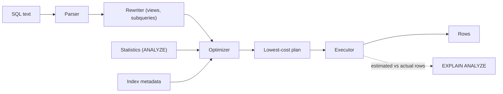

## In one minute
- SQL says *what* you want; the planner decides *how*, by enumerating candidate plans and picking the one with the lowest estimated cost.
- Estimates come from statistics (row counts, distinct values, common values, histograms). Bad statistics produce bad plans, and many "the database got slow" incidents are a plan change, not a hardware problem.
- Your levers: indexes that match the access pattern, predicates the planner can reason about, and fresh statistics.
- Read the actual plan (`EXPLAIN ANALYZE`) first. A large gap between estimated and actual rows points straight at the problem.

## How it works

### From text to plan
The database parses the statement, rewrites it (expanding views, flattening simple subqueries), and hands a logical tree to the optimizer. The optimizer picks an access path per table (sequential, index, index-only, or bitmap scan), a join order, and a join algorithm (nested loop, hash, or merge). Join orders grow factorially, so planners use dynamic programming for small joins, an idea that goes back to System R ([Selinger et al., 1979](https://courses.cs.duke.edu/compsci516/cps216/spring03/papers/selinger-etal-1979.pdf)), and heuristics past a threshold (PostgreSQL switches to genetic search at 12 tables). A quieter limit bites first: Postgres only reorders explicit `JOIN`s while the list stays within `join_collapse_limit`, 8 by default, so a 10-way join written with `JOIN` syntax keeps part of the order you wrote ([Postgres docs](https://www.postgresql.org/docs/current/runtime-config-query.html)).

### Cost model and cardinality
Each plan node gets a cost from estimated page reads and per-row CPU work, with random reads priced above sequential ones. The decisive input is **cardinality**: how many rows each step yields. `ANALYZE` samples the table and stores null fraction, distinct count, a most-common-values list, and a histogram of the rest. The planner multiplies selectivities as if predicates were independent, which fails for correlated columns: `city = 'Paris' AND country = 'FR'` is underestimated by orders of magnitude. Multi-column statistics (`CREATE STATISTICS`) fix known correlated pairs ([Postgres docs](https://www.postgresql.org/docs/current/planner-stats.html)).

### Why misestimates hurt
A nested loop with an indexed inner side is ideal when the outer side yields 10 rows. If reality is 500,000 rows, the same plan does 500,000 random probes where a hash join would read each side once. Errors compound up the tree, so a 10x miss at the bottom can become 10,000x at the top. The Join Order Benchmark study found that every major engine it tested routinely produced large cardinality errors on multi-join queries, and that these errors mattered far more to plan quality than the cost model did ([Leis et al., VLDB 2015](https://www.vldb.org/pvldb/vol9/p204-leis.pdf)).

### Indexes and query shapes
A B-tree on `(tenant_id, created_at)` serves `WHERE tenant_id = ? ORDER BY created_at DESC LIMIT 50` with a short range scan and no sort, but does not help a filter on `created_at` alone. Wrapping a column in a function (`lower(email)`) hides it from a plain index. A **covering index** holding every selected column skips the table heap. Deep `OFFSET` pagination reads and discards every skipped row; keyset pagination (`WHERE id > last_seen`) does not. ORM N+1 patterns issue one query per parent row; batch them.

## Down the stack

### Layer 1: The contract
The optimizer promises one thing: whatever plan it picks returns the same rows as the SQL you wrote. It promises nothing about speed, about plan stability across `ANALYZE` runs or version upgrades, or about row order unless you write `ORDER BY`. `EXPLAIN` shows estimates; `EXPLAIN (ANALYZE, BUFFERS)` runs the query and reports actual rows, loops, time per node, and pages hit in cache versus read. From Postgres 18, `EXPLAIN ANALYZE` includes the buffer counts without asking ([Postgres 18 release notes](https://www.postgresql.org/docs/18/release-18.html)). Even an unchanged table can get a different plan after `ANALYZE`, because each run draws a new random sample ([Postgres docs](https://www.postgresql.org/docs/current/sql-analyze.html)). Anything you rely on beyond result equivalence, such as "this query uses that index", is an observation, not a guarantee.

### Layer 2: The mechanism
PostgreSQL keeps per-column statistics in `pg_statistic` (readable through `pg_stats`): `null_frac`, `n_distinct`, `most_common_vals` with `most_common_freqs`, `histogram_bounds`, and `correlation` between physical and logical order. `ANALYZE` samples 300 times `default_statistics_target` rows, so 30,000 rows at the default of 100, whatever the table size. Costs are in abstract units set by `seq_page_cost` (1.0), `random_page_cost` (4.0), `cpu_tuple_cost` (0.01), `cpu_index_tuple_cost` (0.005) and `cpu_operator_cost` (0.0025) ([Postgres docs](https://www.postgresql.org/docs/current/runtime-config-query.html)). Join order is searched with dynamic programming over subsets of relations until `geqo_threshold` (12), then by a genetic algorithm. Prepared statements get custom plans for the first five executions, then switch to a generic plan if its estimated cost is not much worse ([Postgres docs](https://www.postgresql.org/docs/current/sql-prepare.html)), which is exactly where skewed parameters get hurt; `plan_cache_mode = force_custom_plan` turns the switch off. Postgres has no hint syntax of its own: forcing a join order or index takes the `pg_hint_plan` extension, which reads hints from a comment in the query ([pg_hint_plan](https://github.com/ossc-db/pg_hint_plan)).

### Layer 3: The machine
Data lives in 8 KB pages. A page in `shared_buffers` costs well under a microsecond to reach; one in the OS page cache costs a syscall and a copy, a few microseconds; one on local NVMe about 100 µs; one on network block storage 0.5 to 2 ms. The default `random_page_cost` of 4 is not a disk measurement: the docs say a truly random read costs much more than four sequential ones, and 4 assumes most index reads hit cache. Many SSD deployments lower it toward 1.1, which makes index scans look cheaper and changes plans. Sorts get `work_mem` (4 MB by default) per node, and hash tables get `work_mem` times `hash_mem_multiplier` (2.0 by default, so 8 MB) ([Postgres docs](https://www.postgresql.org/docs/current/runtime-config-resource.html)); past that they spill batches to temporary files, turning a 50 ms join into seconds of disk I/O. Index-only scans skip the heap only for pages marked all-visible in the visibility map, which vacuum sets, so a table that vacuum cannot keep up with quietly loses index-only scans.

### Why it's built this way
1. Random I/O costs much more than sequential I/O, so the planner needs a cost model that tells scans from index probes.
2. Counting rows exactly would cost as much as running the query, so the planner estimates from a fixed-size sample.
3. A sample cannot capture every correlation between columns, so the planner assumes independence and sometimes misses by orders of magnitude.
4. Searching every join order is factorial, so exhaustive search stops at a threshold and heuristics take over.
5. Planning itself costs CPU on every call, so plans are cached, and a cached plan can be wrong for the next parameter.

## Diagram


## Worked example
An `orders` table holds 200 million rows (80 GB). The dashboard filters `customer_id = ?` and the last 30 days, ordered by `created_at DESC LIMIT 20`. With only an index on `created_at`, the planner walks the last 30 days of that index (about 6 million entries), fetching heap rows until it finds 20 matches. Active customers return in 3 ms; quiet ones take 4 seconds. "Only some users complain" is the signature.

`CREATE INDEX ON orders (customer_id, created_at DESC) INCLUDE (total, status)` turns this into an index-only scan of about 20 entries, with P99 under 2 ms for everyone. The cost is roughly 8 GB of index and one more B-tree update per insert, measurable WAL volume at 3,000 inserts per second. Usually worth it for a hot read path, but it is a trade.

## In the wild
- **PlanetScale customer, 2026: the planner drops an index overnight.** With no deploy, failover or change in traffic, a Postgres primary went from about 20% to 100% CPU. One query pattern, at the same volume as before, went from milliseconds to the 10-second timeout and took almost half of all database time, because the planner had stopped using its index. The customer blocked that query pattern with a resource budget, the database recovered within about 15 minutes, and the root cause was investigated afterwards ([PlanetScale](https://planetscale.com/blog/when-the-postgres-query-planner-goes-rogue)).
- **GitHub, 2021: one bad query plus retries holds a primary down.** On 10 August an edge case in one of GitHub's busiest applications generated a poorly performing query against a MySQL primary. Application retry and queueing logic kept the load up, so the primary could not recover on its own and writes to that cluster failed for 1 hour 17 minutes. GitHub fixed the query and changed the retry logic ([GitHub](https://github.blog/2021-09-01-github-availability-report-august-2021/)).

## Trade-offs
| Option | Strengths | Weaknesses | Choose when |
|---|---|---|---|
| Composite index | Large, predictable speedup | Slower writes, more storage | A hot query has a stable shape |
| Rewrite the query | No write cost, often the biggest win | Code change; ORM may resist | Plan shows avoidable sorts or scans |
| Better statistics | Fixes many queries at once | Useless if no good plan exists | Estimates and actuals diverge |
| Plan hints | Immediate, deterministic | Freezes a plan that ages badly | Emergency mitigation |
| Cache or precompute | Removes the query from the hot path | Staleness, invalidation | Expensive and read often |

## Pitfalls in production
- **Plan flips after growth.** A table crosses a threshold and the planner switches to a sequential scan overnight. Alert on latency per query fingerprint, not just database CPU.
- **Generic plans for skewed values.** A prepared statement planned for a rare value is reused for a common one. Force custom plans for skewed columns.
- **Index sprawl.** One index per incident, none removed, and inserts cost triple. Audit index usage counters and drop unused ones.
- **Testing on small data.** Fast on 10,000 staging rows, pathological in production. Test plans against production-sized data.
- **Analytics on the primary.** A one-hour report holds a snapshot that blocks vacuum and bloats hot tables. Route it to a replica.

## Leadership lens
- Make slow-query logs and per-fingerprint latency part of the platform, so regressions show up as a dashboard diff rather than a ticket.
- In design review, ask for a feature's top five queries and the index serving each. If nobody can name them, the schema is not ready.
- Treat index builds on large tables as risky deploys: build concurrently and off-peak.
- Give shared databases an owner for query health, or every team optimizes locally while the whole degrades.

## Check yourself
1. Why can a query become 1,000 times slower with no code or schema change?
   **Answer:** Data growth or skew shifts the statistics, the estimate crosses a threshold, and the planner picks an access path or join that is far worse for the real row counts.
2. An index on `(created_at, customer_id)` exists, but a filter on `customer_id` alone still scans. Why?
   **Answer:** The B-tree is ordered by its leading column, so one customer's entries are scattered across the whole index.
3. What does a large estimated-versus-actual gap in `EXPLAIN ANALYZE` tell you?
   **Answer:** Statistics are wrong for that predicate (stale, skewed, or correlated), so every plan choice above that node is suspect.

## Practice
**Task:** Build a planner's row estimator. `stats` is a dict with `rows`, `pages`, `n_distinct`, `mcv` (list of `(value, frequency)` pairs) and `histogram` (equal-depth bucket bounds covering the non-MCV rows). Implement `estimate_eq(stats, v)` and `estimate_lt(stats, v)` (rows strictly below `v`, interpolating linearly inside a bucket), both rounded to integers. Then `choose_plan(stats, est_rows)`: sequential cost is `pages + rows * 0.01`, index cost is `est_rows * 4.01`; return `"index"` only if strictly cheaper, else `"seq"`.

```python starter
def estimate_eq(stats, v):
    # TODO
    raise NotImplementedError

def estimate_lt(stats, v):
    # TODO
    raise NotImplementedError

def choose_plan(stats, est_rows):
    # TODO
    raise NotImplementedError
```

```python tests
S = {"rows": 10000, "pages": 1000, "n_distinct": 101,
     "mcv": [(5, 0.3)], "histogram": [0, 10, 20, 30, 40]}

def test_mcv_equality():
    assert estimate_eq(S, 5) == 3000

def test_non_mcv_equality():
    assert estimate_eq(S, 7) == 70

def test_range_on_boundary_counts_mcv():
    assert estimate_lt(S, 20) == 6500

def test_range_interpolates():
    assert estimate_lt(S, 25) == 7375

def test_range_outside_histogram():
    assert estimate_lt(S, -1) == 0
    assert estimate_lt(S, 100) == 10000

def test_plan_choice():
    assert choose_plan(S, 70) == "index"
    assert choose_plan(S, 3000) == "seq"
```

```python solution
def _mcv_sum(stats):
    return sum(f for _, f in stats["mcv"])

def estimate_eq(stats, v):
    for x, f in stats["mcv"]:
        if x == v:
            return round(f * stats["rows"])
    others = stats["n_distinct"] - len(stats["mcv"])
    if others <= 0:
        return 0
    return round((1 - _mcv_sum(stats)) / others * stats["rows"])

def estimate_lt(stats, v):
    h = stats["histogram"]
    k = len(h) - 1
    frac = 0.0
    for i in range(k):
        if v >= h[i + 1]:
            frac += 1 / k
        elif v > h[i]:
            frac += (v - h[i]) / (h[i + 1] - h[i]) / k
    below = sum(f for x, f in stats["mcv"] if x < v)
    return round((frac * (1 - _mcv_sum(stats)) + below) * stats["rows"])

def choose_plan(stats, est_rows):
    seq = stats["pages"] + stats["rows"] * 0.01
    return "index" if est_rows * 4.01 < seq else "seq"
```

```typescript starter
export interface Stats {
  rows: number; pages: number; nDistinct: number;
  mcv: [number, number][]; histogram: number[];
}
export function estimateEq(stats: Stats, v: number): number {
  throw new Error("TODO");
}
export function estimateLt(stats: Stats, v: number): number {
  throw new Error("TODO");
}
export function choosePlan(stats: Stats, estRows: number): "index" | "seq" {
  throw new Error("TODO");
}
```

```typescript tests
const S: Stats = { rows: 10000, pages: 1000, nDistinct: 101, mcv: [[5, 0.3]], histogram: [0, 10, 20, 30, 40] };
test("mcv equality", () => assertEqual(estimateEq(S, 5), 3000));
test("non-mcv equality", () => assertEqual(estimateEq(S, 7), 70));
test("range on boundary counts mcv", () => assertEqual(estimateLt(S, 20), 6500));
test("range interpolates", () => assertEqual(estimateLt(S, 25), 7375));
test("range outside histogram", () => {
  assertEqual(estimateLt(S, -1), 0);
  assertEqual(estimateLt(S, 100), 10000);
});
test("plan choice", () => {
  assertEqual(choosePlan(S, 70), "index");
  assertEqual(choosePlan(S, 3000), "seq");
});
```

```typescript solution
export interface Stats {
  rows: number; pages: number; nDistinct: number;
  mcv: [number, number][]; histogram: number[];
}
const mcvSum = (s: Stats) => s.mcv.reduce((a, [, f]) => a + f, 0);
export function estimateEq(stats: Stats, v: number): number {
  const hit = stats.mcv.find(([x]) => x === v);
  if (hit) return Math.round(hit[1] * stats.rows);
  const others = stats.nDistinct - stats.mcv.length;
  if (others <= 0) return 0;
  return Math.round(((1 - mcvSum(stats)) / others) * stats.rows);
}
export function estimateLt(stats: Stats, v: number): number {
  const h = stats.histogram, k = h.length - 1;
  let frac = 0;
  for (let i = 0; i < k; i++) {
    if (v >= h[i + 1]) frac += 1 / k;
    else if (v > h[i]) frac += (v - h[i]) / (h[i + 1] - h[i]) / k;
  }
  const below = stats.mcv.filter(([x]) => x < v).reduce((a, [, f]) => a + f, 0);
  return Math.round((frac * (1 - mcvSum(stats)) + below) * stats.rows);
}
export function choosePlan(stats: Stats, estRows: number): "index" | "seq" {
  const seq = stats.pages + stats.rows * 0.01;
  return estRows * 4.01 < seq ? "index" : "seq";
}
```

```go starter
package practice

type MCV struct {
	Value, Freq float64
}

type Stats struct {
	Rows, Pages, NDistinct float64
	MCV                    []MCV
	Histogram              []float64
}

func EstimateEq(s Stats, v float64) int { panic("TODO") }

func EstimateLt(s Stats, v float64) int { panic("TODO") }

func ChoosePlan(s Stats, estRows int) string { panic("TODO") }
```

```go tests
package practice

import "testing"

var S = Stats{Rows: 10000, Pages: 1000, NDistinct: 101,
	MCV: []MCV{{5, 0.3}}, Histogram: []float64{0, 10, 20, 30, 40}}

func TestMCVEquality(t *testing.T) {
	if got := EstimateEq(S, 5); got != 3000 {
		t.Fatalf("got %d", got)
	}
}

func TestNonMCVEquality(t *testing.T) {
	if got := EstimateEq(S, 7); got != 70 {
		t.Fatalf("got %d", got)
	}
}

func TestRangeOnBoundary(t *testing.T) {
	if got := EstimateLt(S, 20); got != 6500 {
		t.Fatalf("got %d", got)
	}
}

func TestRangeInterpolates(t *testing.T) {
	if got := EstimateLt(S, 25); got != 7375 {
		t.Fatalf("got %d", got)
	}
}

func TestRangeOutside(t *testing.T) {
	if EstimateLt(S, -1) != 0 || EstimateLt(S, 100) != 10000 {
		t.Fatal("bounds wrong")
	}
}

func TestPlanChoice(t *testing.T) {
	if ChoosePlan(S, 70) != "index" || ChoosePlan(S, 3000) != "seq" {
		t.Fatal("wrong plan")
	}
}
```

```go solution
package practice

import "math"

type MCV struct {
	Value, Freq float64
}

type Stats struct {
	Rows, Pages, NDistinct float64
	MCV                    []MCV
	Histogram              []float64
}

func mcvSum(s Stats) float64 {
	sum := 0.0
	for _, m := range s.MCV {
		sum += m.Freq
	}
	return sum
}

func EstimateEq(s Stats, v float64) int {
	for _, m := range s.MCV {
		if m.Value == v {
			return int(math.Round(m.Freq * s.Rows))
		}
	}
	others := s.NDistinct - float64(len(s.MCV))
	if others <= 0 {
		return 0
	}
	return int(math.Round((1 - mcvSum(s)) / others * s.Rows))
}

func EstimateLt(s Stats, v float64) int {
	h, k := s.Histogram, float64(len(s.Histogram)-1)
	frac := 0.0
	for i := 0; i+1 < len(h); i++ {
		if v >= h[i+1] {
			frac += 1 / k
		} else if v > h[i] {
			frac += (v - h[i]) / (h[i+1] - h[i]) / k
		}
	}
	below := 0.0
	for _, m := range s.MCV {
		if m.Value < v {
			below += m.Freq
		}
	}
	return int(math.Round((frac*(1-mcvSum(s)) + below) * s.Rows))
}

func ChoosePlan(s Stats, estRows int) string {
	if float64(estRows)*4.01 < s.Pages+s.Rows*0.01 {
		return "index"
	}
	return "seq"
}
```

## Mock interview
**Prompt:** Your multi-tenant SaaS runs on one Postgres primary with 2 TB of data and 15,000 queries per second. After a routine release, P99 for the "recent activity" endpoint went from 40 ms to 3 seconds, but only for some tenants. Walk me through diagnosis and fix.

- Follow-up: The plan shows a nested loop estimated at 50 rows that actually produced 400,000. What happened, and what do you change?
- Follow-up: The right index takes two hours to build on a hot table. How do you ship it safely?
- Follow-up: When would you precompute the result instead of tuning the query?

**A strong answer covers:**
- Separating a plan change from a load change, using per-fingerprint latency and plan history.
- Comparing estimated with actual rows per node in `EXPLAIN ANALYZE`.
- Tenant skew as the cause of "only some users", and how statistics and generic plans interact with it.
- A composite or covering index matched to filter and sort order, with its write cost.
- Concurrent index builds off-peak, and hints only as a temporary mitigation.

## Sources and further study
**Primary**
- [Selinger et al., Access Path Selection in a Relational Database Management System (SIGMOD 1979)](https://courses.cs.duke.edu/compsci516/cps216/spring03/papers/selinger-etal-1979.pdf): the System R optimizer, which introduced cost-based access paths and dynamic programming over join orders.
- [Leis et al., How Good Are Query Optimizers, Really? (VLDB 2015)](https://www.vldb.org/pvldb/vol9/p204-leis.pdf): the Join Order Benchmark, measuring how wrong real cardinality estimates are and what that costs.

**Systems docs**
- [PostgreSQL: Query Planning settings](https://www.postgresql.org/docs/current/runtime-config-query.html): cost constants, GEQO, collapse limits and `plan_cache_mode`.
- [PostgreSQL: ANALYZE](https://www.postgresql.org/docs/current/sql-analyze.html): sampling, statistics targets and why plans can change between runs.
- [pg_hint_plan](https://github.com/ossc-db/pg_hint_plan): the extension teams use to pin a plan in Postgres, and its hint grammar.

**Books**
- *Database Internals*, Alex Petrov, chapter 1 "Introduction and Overview" (section "DBMS Architecture"): where the parser, optimizer and execution engine sit relative to storage.
- *Designing Data-Intensive Applications* (1st ed.), Martin Kleppmann, chapter 2 "Data Models and Query Languages": why declarative queries leave the access path to the optimizer.

**Other curricula**
- [donnemartin/system-design-primer](https://github.com/donnemartin/system-design-primer): frames this as "SQL tuning": benchmark, turn on the slow query log, tighten the schema and add indexes; it does not cover plans or statistics.
- [roadmap.sh: System Design](https://roadmap.sh/system-design): includes SQL Tuning as its own node, alongside Denormalization and Index Table.

## Watch
- [Database Query Optimizers Part 1 (CMU Database Group)](https://www.youtube.com/watch?v=b53huOGcsZ8): Andy Pavlo on rule-based and cost-based plan search.
- [Query Optimization Part 2 (CMU Database Group)](https://www.youtube.com/watch?v=azTHRpzl10o): cardinality estimation and why estimates go wrong.

## Free resources
- [PostgreSQL: Using EXPLAIN](https://www.postgresql.org/docs/current/using-explain.html): reading plan nodes, costs, and actual row counts.
- [PostgreSQL: Statistics Used by the Planner](https://www.postgresql.org/docs/current/planner-stats.html): what the planner knows and how extended statistics help.
- [Use The Index, Luke](https://use-the-index-luke.com/): a free, vendor-neutral book on indexes and SQL.
- [MySQL: EXPLAIN Output Format](https://dev.mysql.com/doc/refman/8.0/en/explain-output.html): the same ideas from the MySQL side.
