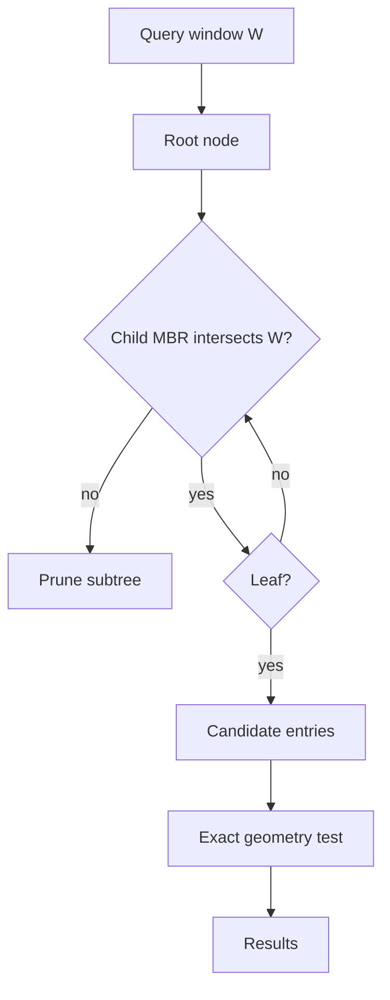

## In one minute
- An R-tree is a balanced, disk-friendly tree, like a B-tree, whose keys are bounding rectangles instead of numbers. Each internal entry stores the minimum bounding rectangle (MBR) of everything beneath it.
- It indexes shapes, not just points: polygons, lines, and boxes. That is why it powers spatial indexes in PostGIS (through GiST), SQLite, Oracle Spatial, and many in-memory libraries.
- Sibling rectangles may overlap, so a search can descend several paths. Index quality is mostly about keeping overlap and dead space low.
- Queries are two-phase: the index returns candidates whose boxes intersect; an exact geometry test removes false positives.

## How it works

### Shape of the tree
Each node fits in one page, typically 4 to 8 KB, holding between m and M entries (M is the fanout, often 50 to 200; m is about 40 percent of M, the value the R\*-tree authors found retrieved best ([Beckmann et al., 1990](https://infolab.usc.edu/csci599/Fall2001/paper/rstar-tree.pdf))). A leaf entry is (MBR, object id). An internal entry is (MBR, child pointer), where the MBR covers every rectangle in that child. All leaves sit at the same depth. With a fanout of 100, four levels address 100 million objects.

Unlike a quadtree, an R-tree does not divide space; it groups objects. Sibling boxes can overlap, and some space is covered by no child at all.

### Search
To find everything intersecting a window, recurse into every child whose MBR intersects it and report matching leaf entries. Heavy sibling overlap makes the search fan out into many subtrees, which is the main way R-tree performance degrades.

Nearest-neighbour search uses a priority queue ordered by the minimum distance from the query point to each MBR, popping nodes and entries in distance order. PostGIS exposes this as the `<->` operator in `ORDER BY`.

### Insert
Choose a leaf by descending from the root, at each level picking the child whose MBR needs the least enlargement to include the new rectangle (ties broken by smaller area). Add the entry and enlarge MBRs on the way back up. If the leaf overflows M entries, split it.

The split decides quality. Guttman's **quadratic split** seeds two groups with the pair of entries that would waste the most area together, then assigns the rest greedily ([Guttman, 1984](http://www-db.deis.unibo.it/courses/SI-LS/papers/Gut84.pdf)). The **R\*-tree** chooses splits that minimise overlap and perimeter, and before splitting it reinserts the 30 percent of entries farthest from the node's centre. Forced reinsertion lets the tree reorganise as data arrives. It costs CPU, but in the paper's tests it raised disk accesses per insert by only about 4 percent, because fewer splits happen ([Beckmann et al., 1990](https://infolab.usc.edu/csci599/Fall2001/paper/rstar-tree.pdf)). Most engines use R\* heuristics.

### Bulk loading
Building by repeated inserts gives a mediocre tree. For static or batch data, **Sort-Tile-Recursive (STR)** packing is better: sort entries by x centre, cut them into vertical slabs, sort each slab by y, and fill nodes completely. Repeat on the node boxes until one root remains. Packed trees have nearly 100 percent node utilisation and little overlap, and loading is a sort rather than millions of random page writes. Its authors measured up to 50 percent fewer disk accesses than Hilbert-curve packing on uniform or mildly skewed data, but about the same on highly skewed data ([Leutenegger et al., 1997](https://archive.org/details/nasa_techdoc_19970016975)).

Postgres now does this kind of packing itself. `CREATE INDEX` on GiST uses a sorted build by default when the operator class provides a `sortsupport` function, and otherwise switches to a buffered build once the index outgrows `effective_cache_size` ([Postgres docs](https://www.postgresql.org/docs/current/gist.html)). PostGIS added Hilbert-sorted builds in 3.2 and turned them on by default in 3.3 for Postgres 15 and later ([PostGIS NEWS](https://github.com/postgis/postgis/blob/master/NEWS)); see In the wild for why it took two releases.

Deletes shrink MBRs upward and reinsert the orphans of any node that underflows, which is expensive, so many systems tolerate underfill and rebuild periodically.

## Down the stack

### Layer 1: The contract
The index promises a **superset**: every object whose bounding box intersects the query box is returned. It does not promise that the shapes intersect; the refine step does that. In PostGIS the index is crash-safe and transactional like any Postgres index, readers never block writers, and `ORDER BY geom <-> point LIMIT k` returns true nearest neighbours by walking the tree best-first ([PostGIS workshop](https://postgis.net/workshops/postgis-intro/knn.html)).

### Layer 2: The mechanism
PostGIS implements its R-tree on GiST, Postgres's generalised search tree. The 2D operator class stores each key as a `BOX2DF`: four 4-byte floats, 16 bytes, rounded outward so the float box always contains the true double-precision box. GiST calls a fixed set of support functions. Five are required: `consistent` (can this subtree match the query?), `union` (the parent box), `penalty` (how much a box grows if an entry is added, used to choose a subtree), `picksplit` (divide an overflowing page) and `same`. Optional ones include `distance` for KNN ordering and `sortsupport` for fast builds ([Postgres docs](https://www.postgresql.org/docs/current/gist.html)). GiST is not PostGIS's only choice: it also supports SP-GiST, a space-partitioning quadtree or k-d tree, and BRIN, which stores one box per range of table blocks and is tiny but only works on spatially sorted, rarely updated tables ([PostGIS docs](https://postgis.net/docs/using_postgis_dbmanagement.html)).

SQLite's R*Tree module is a virtual table backed by three shadow tables: `%_node` holds node blobs, `%_parent` maps nodes to parents, and `%_rowid` maps rows to leaves. It also stores 32-bit float coordinates and rounds boxes outward, trading a few false positives for smaller nodes. The rounding has a catch: overlap queries never miss an entry, but a "contained within" query can drop an entry whose edge lies on the query's edge, so SQLite tells you to grow such query boxes by 0.000012 percent ([SQLite docs](https://www.sqlite.org/rtree.html)).

### Layer 3: The machine
A Postgres page is 8 KB. An index tuple is an 8-byte header plus the 16-byte key, plus a 4-byte line pointer, so about 28 bytes, and a page holds roughly 250 entries at 90 percent fill. Reading a page from shared buffers costs well under a microsecond; from NVMe about 100 us; from a network disk often 1 ms or more. Inside a page, testing 250 boxes is 1,000 float comparisons, around a microsecond.

Writes cost more than they look. Every changed page is logged to the write-ahead log, and the first change to a page after a checkpoint writes the full 8 KB page image. An insert that splits a node touches the leaf, its new sibling, and the parent, so a bulk of random inserts right after a checkpoint can multiply WAL volume several times over.

### Why it's built this way
1. Storage is read in pages, so nodes are page-sized with high fanout to keep trees shallow.
2. Shapes have extent and cannot be cut cleanly, so the tree groups objects and lets boxes overlap rather than partitioning space.
3. Overlap makes searches fan out, so split and insert heuristics such as R\* fight it.
4. Smaller keys mean more entries per page and fewer levels, so engines store 4-byte floats rounded outward and rely on the refine step for exactness.

## Diagram


## Worked example
A property platform stores 150 million land-parcel polygons in PostGIS and serves map viewport queries at 3,000 QPS.

A 2D GiST entry is a 16-byte float box plus tuple header and line pointer, about 28 bytes, so an 8 KB page holds roughly 250 entries. That is 600,000 leaf pages, about 5 GB, in a tree 4 levels deep. The upper levels are about 2,400 pages, under 20 MB, which always stay in shared buffers, so a viewport query usually costs a handful of leaf reads.

A street-zoom viewport returns, say, 1,400 candidates by bounding box; the exact `ST_Intersects` check discards about 15 percent. Latency is 4 ms at p50 and 25 ms at p99, dominated by fetching heap rows for the geometry check.

Two things hurt. First, a handful of huge polygons (national parks, a coastline) have MBRs covering vast areas, so they appear as candidates in thousands of queries and bloat internal-node boxes. Splitting them with `ST_Subdivide` into pieces of at most 256 vertices, its default ([PostGIS docs](https://postgis.net/docs/ST_Subdivide.html)), cut p99 by half in this scenario. Second, a nightly import of 2 million changed parcels via row-by-row inserts degraded the tree over months. Building a fresh index concurrently and swapping it restored the original query times.

## In the wild
- **PostGIS, 2021–2022: a faster index build that made queries slower.** Postgres 14 let GiST indexes be built by sorting, and PostGIS 3.2 shipped Hilbert-sorted builds for geometry. Sorting packs pages by curve order rather than by choosing good splits, which left more overlap between pages, so the team found query performance regressed and shipped 3.2 with the feature off by default. Once Postgres 15's sorted build began using `picksplit` to partition each page, PostGIS 3.3 enabled it by default ([PostGIS NEWS](https://github.com/postgis/postgis/blob/master/NEWS), [opclass comment](https://github.com/postgis/postgis/blob/master/postgis/postgis.sql.in)). Build speed and query speed are separate things to measure.
- **SQLite, 2019: a malformed R\*Tree reads past the heap.** CVE-2019-8457 (CVSS 9.8) was a heap out-of-bounds read in `rtreenode()` when handling invalid rtree tables, affecting SQLite 3.6.0 through 3.27.2 ([NVD](https://nvd.nist.gov/vuln/detail/CVE-2019-8457)). The R\*Tree's state lives in ordinary shadow tables, so an untrusted database file can hand the module corrupt nodes. SQLite's `SQLITE_DBCONFIG_DEFENSIVE` flag now blocks SQL that could deliberately corrupt the file ([SQLite docs](https://www.sqlite.org/c3ref/c_dbconfig_defensive.html)).

## Trade-offs
| Option | Strengths | Weaknesses | Choose when |
|---|---|---|---|
| R-tree / R\*-tree (PostGIS GiST, SQLite) | Indexes arbitrary shapes, disk-based, KNN support | Overlap degrades search, inserts costlier than B-tree | Polygons, lines, or mixed geometry in a database |
| STR-packed static R-tree | Minimal overlap, compact, fast to build | Rebuild needed to change data | Read-only or batch-refreshed datasets |
| Quadtree | Simple, no overlap, adapts to density | Shapes span many cells, mostly in memory | Points in a custom in-memory service |
| Geohash / S2 / H3 cells in a B-tree | Works in any key-value store, easy to shard | Shapes need many cells to cover, approximate | Distributed stores without spatial indexing |

## Pitfalls in production
- **Huge or long thin geometries.** A river or a country boundary produces an MBR that is mostly empty space and overlaps everything. Subdivide large geometries before indexing.
- **Forgetting the refine step.** Code that trusts the bounding-box operator (`&&` in PostGIS) returns false positives. Always apply the exact predicate after the index filter.
- **Degradation from incremental loads.** Years of inserts and deletes leave a tree with high overlap and underfilled nodes. Reindex concurrently on a schedule, or bulk load into a new table and swap.
- **Mixing SRIDs or using degrees for distance.** An index in EPSG:4326 measures in degrees. Use geography types or a projected SRID for distance predicates, or the index cannot be used and results are wrong.

## Leadership lens
- Ask what shapes are indexed and how their size is distributed. A long tail of huge geometries is the most common cause of slow spatial queries.
- Decide whether the dataset is mostly static. If so, prefer bulk loading and periodic rebuilds over incremental maintenance.
- Treat spatial index rebuilds as planned operations with a runbook: concurrent build, disk headroom of at least the index size, and validation queries before swapping.

## Check yourself
1. Why can an R-tree search visit more than one child at the same level, when a B-tree lookup visits exactly one?
   **Answer:** Sibling MBRs can overlap, so a query window may intersect several of them, and each must be explored because any could contain matches.
2. What does forced reinsertion in the R\*-tree buy, and what does it cost?
   **Answer:** Reinserting the outermost entries before splitting lets them find better homes, reducing overlap and improving query speed; the cost is extra work and page writes on inserts.
3. Why does STR bulk loading produce a better tree than inserting the same data one row at a time?
   **Answer:** It sorts all entries spatially first and fills nodes completely in tile order, so nodes are full, groups are tight, and overlap is minimal; incremental inserts make local greedy choices that cannot be undone.

## Practice
**Task:** Build a static R-tree with Sort-Tile-Recursive packing. `build(rects, cap)` takes a list of `(id, min_x, min_y, max_x, max_y)` and returns a root node (or `None` for empty input); each node holds at most `cap` entries. `search(root, q)` takes a query box `(min_x, min_y, max_x, max_y)` and returns `(sorted_ids, nodes_visited)`, counting every node whose entries were examined. Boxes that touch count as intersecting. `root_box(root)` returns the root MBR. TypeScript and Go use `build`/`Build`, `search`/`Search`, `rootBox`/`RootBox`.

```python starter
import math

def build(rects, cap=4):
    raise NotImplementedError

def search(root, q):
    raise NotImplementedError

def root_box(root):
    raise NotImplementedError
```

```python tests
def grid():
    return [(i * 15 + j, i * 5, j * 5, i * 5 + 3, j * 5 + 3) for i in range(20) for j in range(15)]

def brute(rects, q):
    return sorted(r[0] for r in rects if r[1] <= q[2] and q[0] <= r[3] and r[2] <= q[3] and q[1] <= r[4])

def test_empty():
    assert build([]) is None
    assert search(None, (0, 0, 1, 1)) == ([], 0)

def test_single():
    root = build([(9, 1, 1, 2, 2)])
    assert search(root, (2, 2, 5, 5)) == ([9], 1)

def test_matches_brute_force():
    rects = grid()
    root = build(rects, 4)
    q = (12, 7, 31, 22)
    assert search(root, q)[0] == brute(rects, q)

def test_root_box_covers_all():
    assert root_box(build(grid(), 4)) == (0, 0, 98, 73)

def test_query_outside_visits_root_only():
    assert search(build(grid(), 4), (200, 200, 300, 300)) == ([], 1)

def test_small_query_prunes():
    ids, visited = search(build(grid(), 4), (40, 40, 41, 41))
    assert ids == [8 * 15 + 8]
    assert visited <= 12
```

```python solution
import math

def _union(boxes):
    return (min(b[0] for b in boxes), min(b[1] for b in boxes),
            max(b[2] for b in boxes), max(b[3] for b in boxes))

def _pack(entries, cap, leaf):
    p = math.ceil(len(entries) / cap)
    slab = math.ceil(math.sqrt(p)) * cap
    es = sorted(entries, key=lambda e: e[0][0] + e[0][2])
    nodes = []
    for i in range(0, len(es), slab):
        part = sorted(es[i:i + slab], key=lambda e: e[0][1] + e[0][3])
        for j in range(0, len(part), cap):
            ch = part[j:j + cap]
            nodes.append({"leaf": leaf, "box": _union([e[0] for e in ch]), "entries": ch})
    return nodes

def build(rects, cap=4):
    if not rects:
        return None
    level, leaf = [((r[1], r[2], r[3], r[4]), r[0]) for r in rects], True
    while True:
        nodes = _pack(level, cap, leaf)
        if len(nodes) == 1:
            return nodes[0]
        level, leaf = [(n["box"], n) for n in nodes], False

def _hits(a, b):
    return a[0] <= b[2] and b[0] <= a[2] and a[1] <= b[3] and b[1] <= a[3]

def search(root, q):
    if root is None:
        return [], 0
    out, visited, stack = [], 0, [root]
    while stack:
        node = stack.pop()
        visited += 1
        for box, payload in node["entries"]:
            if _hits(box, q):
                if node["leaf"]:
                    out.append(payload)
                else:
                    stack.append(payload)
    return sorted(out), visited

def root_box(root):
    return root["box"]
```

```typescript starter
export type Rect = [number, number, number, number, number];
export type Box = [number, number, number, number];
export interface RNode { leaf: boolean; box: Box; entries: [Box, number | RNode][] }
export function build(rects: Rect[], cap = 4): RNode | null {
  throw new Error("TODO");
}
export function search(root: RNode | null, q: Box): [number[], number] {
  throw new Error("TODO");
}
export function rootBox(root: RNode): Box {
  throw new Error("TODO");
}
```

```typescript tests
function grid(): Rect[] {
  const out: Rect[] = [];
  for (let i = 0; i < 20; i++) for (let j = 0; j < 15; j++) out.push([i * 15 + j, i * 5, j * 5, i * 5 + 3, j * 5 + 3]);
  return out;
}
function brute(rects: Rect[], q: Box): number[] {
  return rects.filter(r => r[1] <= q[2] && q[0] <= r[3] && r[2] <= q[3] && q[1] <= r[4]).map(r => r[0]).sort((a, b) => a - b);
}
test("empty", () => {
  assertEqual(build([]), null);
  assertEqual(search(null, [0, 0, 1, 1]), [[], 0]);
});
test("single", () => {
  assertEqual(search(build([[9, 1, 1, 2, 2]]), [2, 2, 5, 5]), [[9], 1]);
});
test("matches brute force", () => {
  const q: Box = [12, 7, 31, 22];
  assertEqual(search(build(grid(), 4), q)[0], brute(grid(), q));
});
test("root box covers all", () => {
  assertEqual(rootBox(build(grid(), 4)!), [0, 0, 98, 73]);
});
test("outside query visits root only", () => {
  assertEqual(search(build(grid(), 4), [200, 200, 300, 300]), [[], 1]);
});
test("small query prunes", () => {
  const [ids, visited] = search(build(grid(), 4), [40, 40, 41, 41]);
  assertEqual(ids, [128]);
  assert(visited <= 12, "visited " + visited);
});
```

```typescript solution
export type Rect = [number, number, number, number, number];
export type Box = [number, number, number, number];
export interface RNode { leaf: boolean; box: Box; entries: [Box, number | RNode][] }
const union = (bs: Box[]): Box => [Math.min(...bs.map(b => b[0])), Math.min(...bs.map(b => b[1])),
  Math.max(...bs.map(b => b[2])), Math.max(...bs.map(b => b[3]))];
function pack(entries: [Box, number | RNode][], cap: number, leaf: boolean): RNode[] {
  const slab = Math.ceil(Math.sqrt(Math.ceil(entries.length / cap))) * cap;
  const es = entries.slice().sort((a, b) => a[0][0] + a[0][2] - (b[0][0] + b[0][2]));
  const nodes: RNode[] = [];
  for (let i = 0; i < es.length; i += slab) {
    const part = es.slice(i, i + slab).sort((a, b) => a[0][1] + a[0][3] - (b[0][1] + b[0][3]));
    for (let j = 0; j < part.length; j += cap) {
      const ch = part.slice(j, j + cap);
      nodes.push({ leaf, box: union(ch.map(e => e[0])), entries: ch });
    }
  }
  return nodes;
}
export function build(rects: Rect[], cap = 4): RNode | null {
  if (rects.length === 0) return null;
  let level: [Box, number | RNode][] = rects.map(r => [[r[1], r[2], r[3], r[4]], r[0]]);
  let leaf = true;
  for (;;) {
    const nodes = pack(level, cap, leaf);
    if (nodes.length === 1) return nodes[0];
    level = nodes.map(n => [n.box, n]);
    leaf = false;
  }
}
const hits = (a: Box, b: Box) => a[0] <= b[2] && b[0] <= a[2] && a[1] <= b[3] && b[1] <= a[3];
export function search(root: RNode | null, q: Box): [number[], number] {
  if (!root) return [[], 0];
  const out: number[] = [], stack: RNode[] = [root];
  let visited = 0;
  while (stack.length) {
    const node = stack.pop()!;
    visited++;
    for (const [box, p] of node.entries) {
      if (!hits(box, q)) continue;
      if (node.leaf) out.push(p as number); else stack.push(p as RNode);
    }
  }
  return [out.sort((a, b) => a - b), visited];
}
export function rootBox(root: RNode): Box {
  return root.box;
}
```

```go starter
package practice

// Box is minX, minY, maxX, maxY.
type Box [4]float64

// Rect is an indexed rectangle.
type Rect struct {
	ID  int
	Box Box
}

// Node is an R-tree node.
type Node struct{}

// Build packs rects into an R-tree with STR. Returns nil for empty input.
func Build(rects []Rect, cap int) *Node { panic("TODO") }

// Search returns sorted ids intersecting q and the number of nodes visited.
func Search(root *Node, q Box) ([]int, int) { panic("TODO") }

// RootBox returns the root MBR.
func RootBox(root *Node) Box { panic("TODO") }
```

```go tests
package practice

import (
	"reflect"
	"sort"
	"testing"
)

func grid() []Rect {
	var out []Rect
	for i := 0; i < 20; i++ {
		for j := 0; j < 15; j++ {
			x, y := float64(i*5), float64(j*5)
			out = append(out, Rect{i*15 + j, Box{x, y, x + 3, y + 3}})
		}
	}
	return out
}

func TestEmpty(t *testing.T) {
	if Build(nil, 4) != nil {
		t.Fatal("want nil")
	}
	if ids, v := Search(nil, Box{0, 0, 1, 1}); len(ids) != 0 || v != 0 {
		t.Fatal("want empty")
	}
}

func TestSingle(t *testing.T) {
	ids, v := Search(Build([]Rect{{9, Box{1, 1, 2, 2}}}, 4), Box{2, 2, 5, 5})
	if !reflect.DeepEqual(ids, []int{9}) || v != 1 {
		t.Fatalf("got %v %d", ids, v)
	}
}

func TestMatchesBruteForce(t *testing.T) {
	q := Box{12, 7, 31, 22}
	want := []int{}
	for _, r := range grid() {
		b := r.Box
		if b[0] <= q[2] && q[0] <= b[2] && b[1] <= q[3] && q[1] <= b[3] {
			want = append(want, r.ID)
		}
	}
	sort.Ints(want)
	if got, _ := Search(Build(grid(), 4), q); !reflect.DeepEqual(got, want) {
		t.Fatalf("got %v want %v", got, want)
	}
}

func TestRootBox(t *testing.T) {
	if got := RootBox(Build(grid(), 4)); got != (Box{0, 0, 98, 73}) {
		t.Fatalf("got %v", got)
	}
}

func TestOutsideVisitsRootOnly(t *testing.T) {
	if ids, v := Search(Build(grid(), 4), Box{200, 200, 300, 300}); len(ids) != 0 || v != 1 {
		t.Fatalf("got %v %d", ids, v)
	}
}

func TestSmallQueryPrunes(t *testing.T) {
	ids, v := Search(Build(grid(), 4), Box{40, 40, 41, 41})
	if !reflect.DeepEqual(ids, []int{128}) || v > 12 {
		t.Fatalf("got %v visited %d", ids, v)
	}
}
```

```go solution
package practice

import (
	"math"
	"sort"
)

// Box is minX, minY, maxX, maxY.
type Box [4]float64

// Rect is an indexed rectangle.
type Rect struct {
	ID  int
	Box Box
}

type entry struct {
	box   Box
	id    int
	child *Node
}

// Node is an R-tree node.
type Node struct {
	leaf    bool
	box     Box
	entries []entry
}

func union(es []entry) Box {
	b := es[0].box
	for _, e := range es[1:] {
		b = Box{math.Min(b[0], e.box[0]), math.Min(b[1], e.box[1]), math.Max(b[2], e.box[2]), math.Max(b[3], e.box[3])}
	}
	return b
}

func pack(es []entry, cap int, leaf bool) []*Node {
	slab := int(math.Ceil(math.Sqrt(math.Ceil(float64(len(es))/float64(cap))))) * cap
	sort.SliceStable(es, func(i, j int) bool { return es[i].box[0]+es[i].box[2] < es[j].box[0]+es[j].box[2] })
	var nodes []*Node
	for i := 0; i < len(es); i += slab {
		part := append([]entry(nil), es[i:min(i+slab, len(es))]...)
		sort.SliceStable(part, func(a, b int) bool { return part[a].box[1]+part[a].box[3] < part[b].box[1]+part[b].box[3] })
		for j := 0; j < len(part); j += cap {
			ch := part[j:min(j+cap, len(part))]
			nodes = append(nodes, &Node{leaf: leaf, box: union(ch), entries: ch})
		}
	}
	return nodes
}

// Build packs rects into an R-tree with STR. Returns nil for empty input.
func Build(rects []Rect, cap int) *Node {
	if len(rects) == 0 {
		return nil
	}
	var level []entry
	for _, r := range rects {
		level = append(level, entry{box: r.Box, id: r.ID})
	}
	leaf := true
	for {
		nodes := pack(level, cap, leaf)
		if len(nodes) == 1 {
			return nodes[0]
		}
		level = level[:0:0]
		for _, n := range nodes {
			level = append(level, entry{box: n.box, child: n})
		}
		leaf = false
	}
}

// Search returns sorted ids intersecting q and the number of nodes visited.
func Search(root *Node, q Box) ([]int, int) {
	out := []int{}
	if root == nil {
		return out, 0
	}
	visited, stack := 0, []*Node{root}
	for len(stack) > 0 {
		n := stack[len(stack)-1]
		stack = stack[:len(stack)-1]
		visited++
		for _, e := range n.entries {
			if e.box[0] <= q[2] && q[0] <= e.box[2] && e.box[1] <= q[3] && q[1] <= e.box[3] {
				if n.leaf {
					out = append(out, e.id)
				} else {
					stack = append(stack, e.child)
				}
			}
		}
	}
	sort.Ints(out)
	return out, visited
}

// RootBox returns the root MBR.
func RootBox(root *Node) Box { return root.box }
```

## Mock interview
**Prompt:** You run a logistics platform that must answer "which delivery zones contain this address" and "which zones does this route pass through" for 400,000 hand-drawn polygons, at 10,000 lookups per second. Design the spatial lookup layer.

- Follow-up: How does the index choose candidate zones, and why is that not the final answer?
- Follow-up: Ten zones are enormous regional catch-alls. What does that do to the index and how do you fix it?
- Follow-up: Zones are edited a few times a day. Would you keep an incrementally updated R-tree or rebuild it?

**A strong answer covers:**
- An R-tree (PostGIS GiST or an in-process STR tree) as the filter, with exact point-in-polygon or line-intersection as the refine step.
- Sizing: 400,000 entries at fanout 100 is a 3-level tree that fits in memory, so in-process replicas are realistic.
- Huge polygons inflate parent MBRs and match every query; subdivide them or index them separately.
- Rare edits favour rebuilding a packed tree and swapping it atomically over incremental R\* inserts.
- Correct handling of coordinate systems and of points exactly on a zone boundary.

## Sources and further study
**Primary**
- [Beckmann, Kriegel, Schneider and Seeger, The R\*-tree (SIGMOD 1990)](https://infolab.usc.edu/csci599/Fall2001/paper/rstar-tree.pdf): overlap-minimising splits, forced reinsertion, and the 40 percent minimum fill.
- [Leutenegger, Edgington and Lopez, STR: A Simple and Efficient Algorithm for R-Tree Packing (1997)](https://archive.org/details/nasa_techdoc_19970016975): Sort-Tile-Recursive packing compared with Hilbert packing on real GIS data.
- [Hjaltason and Samet, Distance Browsing in Spatial Databases (ACM TODS, 1999)](https://doi.org/10.1145/320248.320255): the best-first nearest-neighbour search behind `<->`.

**Systems docs**
- [PostgreSQL: GiST indexes](https://www.postgresql.org/docs/current/gist.html): the support-function contract and the sorted and buffered build methods.
- [PostGIS: spatial indexes](https://postgis.net/docs/using_postgis_dbmanagement.html): when to choose GiST, BRIN or SP-GiST for geometry.
- [Flatbush](https://github.com/mourner/flatbush): a static, Hilbert-packed R-tree in one flat array, a good model for in-process read-only indexes.

**Books**
- *Designing Data-Intensive Applications* (2nd ed.), Kleppmann and Riccomini, chapter 4 "Storage and Retrieval": R-trees among the multidimensional indexes.
- *Database Internals* (1st ed.), Alex Petrov, chapter 2 "B-Tree Basics": the page-sized, high-fanout node design that R-trees inherit.
- *System Design Interview, Volume 2*, Alex Xu and Sahn Lam, chapter 3 "Google Maps": map tiles, geocoding and routing, the larger system that spatial indexes serve.

**Other curricula**
- [donnemartin/system-design-primer](https://github.com/donnemartin/system-design-primer): no R-tree or spatial-index coverage, so it does not prepare you for polygon lookups.

## Watch
- [A Very Simple Explanation of R-Trees (William Boguslawski)](https://www.youtube.com/watch?v=d8_KcVsaMrI): MBR nesting and search shown with a working demo.
- [Proximity Search & Geospatial Indexes Explained (Hello Interview)](https://www.youtube.com/watch?v=dQXdSxn7d1g): how R-trees compare with geohash and quadtrees in design discussions.

## Free resources
- [Guttman: R-Trees, a Dynamic Index Structure for Spatial Searching (1984)](http://www-db.deis.unibo.it/courses/SI-LS/papers/Gut84.pdf): the original paper, short and readable.
- [Wikipedia: R-tree](https://en.wikipedia.org/wiki/R-tree): variants, bulk loading, and complexity.
- [Wikipedia: R\*-tree](https://en.wikipedia.org/wiki/R*-tree): the split and reinsertion heuristics most engines use.
- [PostGIS workshop: Spatial Indexing](https://postgis.net/workshops/postgis-intro/indexing.html): how GiST R-trees are used, and the filter-then-refine pattern in SQL.
- [SQLite R*Tree Module](https://www.sqlite.org/rtree.html): a small, embeddable R-tree with clear documentation of its query model.
