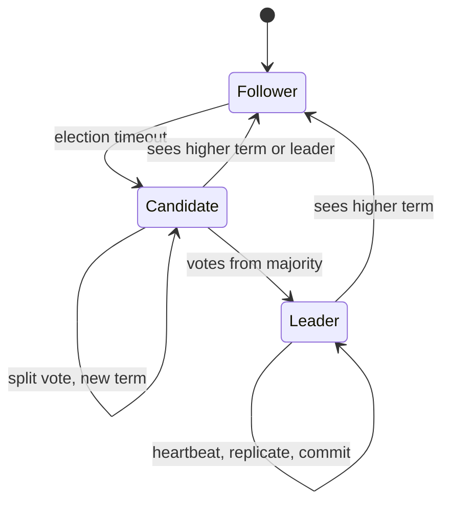

## In one minute
- Raft keeps a replicated log identical on a majority of servers, so every replica applies the same commands in the same order.
- Time is split into numbered **terms**. Each term has at most one leader, chosen by majority vote, and only the leader accepts writes.
- The leader appends entries to followers with `AppendEntries`; an entry is **committed** once stored on a majority, and only then applied and acknowledged.
- Two checks make it safe: a voter refuses candidates with a less up-to-date log, and followers reject appends whose previous entry does not match.
- It is what etcd, Consul, CockroachDB, TiKV, and Kafka's KRaft use, so its behaviour shapes the availability of most of your control plane.

## How it works

### Roles and terms
Every server is a follower, candidate, or leader. Terms are logical clocks that only increase. Any message carrying a higher term makes the receiver adopt that term and step down to follower. Each server persists `currentTerm`, `votedFor`, and its log before answering RPCs.

### Leader election
A follower that hears nothing from a leader for an *election timeout*, randomised in a range such as 150 to 300 ms ([Raft paper](https://raft.github.io/raft.pdf)), increments its term, votes for itself, and sends `RequestVote` to all peers. A peer grants its vote if it has not voted in this term and the candidate's log is at least as up to date as its own: a higher last-entry term wins, and with equal terms the longer log wins. A candidate with a majority becomes leader and immediately sends heartbeats. Randomised timeouts make split votes rare; when one happens, everyone times out again at different moments.

### Log replication
Clients send commands to the leader. It appends the entry locally with the current term and index, then sends `AppendEntries(prevIndex, prevTerm, entries, leaderCommit)`. A follower rejects the call unless its entry at `prevIndex` has term `prevTerm`. On rejection the leader moves `nextIndex` for that follower back and retries; on success the follower deletes any conflicting suffix and appends. This *log matching* property means that if two logs agree at one index and term, they agree on everything before it.

### Commit rule
The leader marks an index committed once a majority stores it **and** the entry is from the leader's current term. Older-term entries become committed indirectly when a current-term entry after them commits. Without this rule a new leader could count replicas of an old entry, commit it, crash, and have a different leader overwrite it; Figure 8 of the paper shows the exact sequence.

### Membership and snapshots
Logs cannot grow forever, so each server snapshots its state machine and discards the prefix. A lagging follower receives `InstallSnapshot`. Adding or removing servers goes through the log, either one server at a time or with joint consensus, so two disjoint majorities never exist.

## Down the stack

### Layer 1: The contract
Raft's paper lists five properties (its Figure 3) you can test with a fault injector: at most one leader per term, a leader never overwrites its own log, two logs that share an index and term agree on every earlier entry, every committed entry appears in every later leader's log, and no two servers apply different commands at the same index. On top of that, a Raft-backed store such as etcd offers linearizable writes, and linearizable reads only if the read goes through the leader with a quorum check. A follower read without that check is serializable and may be stale. Progress needs a live majority; failover costs roughly one election timeout plus a vote round, and in-flight client requests come back with unknown outcome.

### Layer 2: The mechanism
etcd's Raft library is the most widely copied design. It no longer lives inside the etcd repository: etcd v3.6 moved it to its own repo and renamed the module `go.etcd.io/raft/v3` ([etcd v3.6 changelog](https://github.com/etcd-io/etcd/blob/main/CHANGELOG/CHANGELOG-3.6.md)), so older import paths and blog posts that say `go.etcd.io/etcd/raft` are out of date. It is a deterministic state machine with no I/O: the application calls `Step(msg)` and `Tick()`, then drains a `Ready` struct containing `HardState` (term, vote, commit), new `Entries` to persist, `Messages` to send, `CommittedEntries` to apply and an optional `Snapshot`. The ordering rule is strict: persist `HardState` and `Entries` before sending the messages that depend on them, and only then call `Advance()` ([etcd-io/raft](https://github.com/etcd-io/raft)). Message types include `MsgApp`, `MsgAppResp`, `MsgVote`, `MsgPreVote`, `MsgHeartbeat` and `MsgSnap`.

Production additions matter more than the base algorithm. **PreVote** makes a would-be candidate ask whether it could win before bumping its term, so a node returning from a partition cannot depose a healthy leader (section 9.6 of [Ongaro's dissertation](https://web.stanford.edu/~ouster/cgi-bin/papers/OngaroPhD.pdf)). etcd turns it on by default (`--pre-vote=true` in v3.6) ([etcd docs](https://etcd.io/docs/v3.6/op-guide/configuration/)). **CheckQuorum** makes a leader step down if it has not heard from a majority within an election timeout. **ReadIndex** serves linearizable reads by recording the commit index, confirming leadership with one heartbeat round, and waiting for the state machine to catch up, all without writing to the log. Flow control caps in-flight `MsgApp`s per follower so a slow follower cannot blow up leader memory. The apply side writes into a bbolt B+tree keyed by MVCC revision.

### Layer 3: The machine
The commit path is network plus `fdatasync`. etcd's WAL is a series of preallocated 64 MB segment files; each record carries a type, a CRC and the protobuf payload, and preallocation means appends do not need to update file size metadata on every sync. The leader can write to its own disk in parallel with sending `MsgApp` to followers, so a commit costs roughly max(local flush, fastest-majority round trip plus their flush). etcd's own guidance treats a WAL fsync p99 above about 10 ms as a sign of trouble ([etcd FAQ](https://etcd.io/docs/v3.6/faq/)), which is why shared or burstable cloud disks cause leader churn: a stalled flush delays heartbeats, followers time out, and a new election starts.

Batching is what makes throughput reasonable. Many proposals that arrive while a flush is running are written and synced together, and a single `MsgApp` carries many entries up to a configured byte limit. Snapshots bound recovery time: after a configured number of applied entries the state machine is snapshotted and the WAL prefix released, so restart replays megabytes, not gigabytes. etcd v3.6 cut that default from 100,000 to 10,000 entries ([etcd v3.6 changelog](https://github.com/etcd-io/etcd/blob/main/CHANGELOG/CHANGELOG-3.6.md)); the tuning guide notes a lower count helps when memory or disk use is too high, and settings copied from older guides may be ten times too high. Because every member stores the full dataset in memory-mapped bbolt pages, etcd keeps a backend quota of a few gigabytes; a request is also capped (1.5 MiB by default) so one large value cannot stall replication for everyone ([etcd docs](https://etcd.io/docs/v3.6/dev-guide/limit/)).

### Why it's built this way
1. Consensus bugs come from ambiguity, so Raft forces a strong leader and a contiguous log, trading some flexibility for a protocol people can implement correctly.
2. A single leader means every write crosses one machine's NIC and disk, so batching, pipelining and parallel local fsync are required to reach useful throughput.
3. Votes and log entries must survive crashes, so the WAL is synced before any reply, and disk latency directly sets commit latency and election stability.
4. Timeouts are the only failure detector, and they misfire under GC pauses and partitions, so PreVote and CheckQuorum exist to stop needless elections.
5. Logs grow without bound, so snapshots and compaction exist, and a lagging follower is sent a snapshot instead of the missing entries.

## Diagram


## Worked example
A 3-node etcd cluster in one region: RTT 0.5 ms, WAL fsync 1 ms on good SSDs. A write costs the leader's fsync in parallel with one follower round trip plus that follower's fsync, so commit is about 2 ms p50. With 5 nodes the leader still only needs 2 followers, so latency barely moves, but each write now ships to 4 peers and leader egress roughly doubles.

Failure case: heartbeat 100 ms, election timeout 1,000 ms (etcd defaults; the tuning guide asks for a heartbeat near the member round trip and an election timeout at least ten times it, up to 50 s for global clusters ([etcd tuning](https://etcd.io/docs/v3.6/tuning/))). The leader's host freezes. After about 1 s, followers time out, one wins in a single round trip, and writes resume at roughly 1.1 s. A slow disk gives a different picture: fsync p99 of 800 ms delays heartbeats, followers time out, and you see repeated elections even though nothing has crashed. etcd's guidance to put the WAL on dedicated SSD exists for exactly this reason.

Read cost: a deposed leader serving from memory can return stale data. *ReadIndex* adds one heartbeat round (about 0.5 ms); *lease reads* skip it but assume bounded clock drift.

## In the wild
- **Cloudflare, 2020: partial connectivity stalls etcd.** On 2 November a switch in a control-plane rack half-failed: LACP and BGP stayed up while data-plane traffic was impaired. etcd node 1 could not reach the leader, node 3, but could reach node 2, which could still reach node 3. Node 1 kept starting elections and voting for itself while node 2 kept voting for node 3, so no usable leader emerged and the cluster went read-only. The database manager, which relied on etcd, promoted replicas, a bug forced every replica to be rebuilt, and API and dashboard availability suffered for 6 hours 33 minutes ([Cloudflare](https://blog.cloudflare.com/a-byzantine-failure-in-the-real-world/)).
- **Roblox, 2021: slow Raft writes take down a platform for 73 hours.** Roblox's single Consul cluster served every backend service. Consul's new streaming feature added contention on one Go channel under heavy load, and BoltDB's freelist had bloated so that a 4.2 GB log store held only 489 MB of live data, with every append rewriting a 7.8 MB freelist. Median KV writes went from under 300 ms to about 2 s and some leaders were persistently slow. Fixes included compacting BoltDB, moving to bbolt, dedicated Consul clusters for critical services and telemetry that does not depend on Consul ([Roblox](https://about.roblox.com/newsroom/2022/01/roblox-return-to-service-10-28-10-31-2021)).

## Trade-offs
| Option | Strengths | Weaknesses | Choose when |
|---|---|---|---|
| 3 voters | Lowest write fan-out | Survives only 1 failure | Single-region control planes |
| 5 voters | Survives 2 failures or a zone plus a node | More egress, slower elections | Critical metadata across 3 zones |
| Non-voting learners | Extra read replicas, no quorum cost | Reads may lag | Read scale or a remote standby |
| ReadIndex reads | Linearizable without clock assumptions | One RTT per read batch | Default for correctness |
| Lease reads | Local reads, no RTT | Unsafe if clocks drift past the bound | Read-heavy, well-run clock sync |

## Pitfalls in production
- Disk stalls masquerading as network failures cause leader churn. Alert on WAL fsync p99 and keep consensus storage off shared disks.
- A partitioned node keeps incrementing its term, then rejoins and forces a needless election. Enable *PreVote* so a candidate first checks it could win.
- Even-sized clusters add cost without adding tolerance: 4 nodes tolerate 1 failure, the same as 3. Run odd sizes.
- Unbounded log growth fills disks and makes restarts slow. Tune snapshot frequency and compaction, and test `InstallSnapshot` on a large state.
- Replacing nodes by stopping two and starting two can drop below a majority. Change membership one server at a time and wait for catch-up.

## Leadership lens
- Treat the Raft cluster as a tier-0 dependency: its write latency is a floor for every control-plane operation built on it.
- Ask in review where the five voters live, what happens when the leader's zone is lost, and whether reads are linearizable or merely fast.
- Prefer a mature library (etcd/raft, hashicorp/raft) and spend effort on Jepsen-style fault injection, not on writing consensus.
- Keep large payloads out of the log; store blobs elsewhere and replicate only references.

## Check yourself
1. Why does a voter reject a candidate whose log is shorter but whose last term is equal?
   **Answer:** The candidate may be missing committed entries. Electing it could let it overwrite entries a majority already holds.
2. Why can a leader not commit an older-term entry just by counting replicas?
   **Answer:** A later leader with a newer last term could still be elected without that entry and overwrite it. Committing a current-term entry first makes the prefix safe.
3. What does PreVote prevent?
   **Answer:** A rejoining isolated node with an inflated term forcing a healthy leader to step down.
4. Why does a 5-node cluster not commit faster than a 3-node one?
   **Answer:** Commit needs a majority acknowledgment, so latency is set by the second-fastest follower; adding nodes adds fan-out, not speed.

## Practice
**Task:** Implement a Raft follower's two RPC handlers as pure functions on a state dict `{"term", "voted_for", "log", "commit"}`. `log` is a list of entry terms where index `i` (1-based) is `log[i-1]`. `request_vote(state, term, candidate, last_index, last_term)` returns `True` if it grants the vote. `append_entries(state, term, prev_index, prev_term, entries, leader_commit)` returns `True` on success, truncates any conflicting suffix, appends new entries, and sets `commit` to `min(leader_commit, prev_index + len(entries))` when that is higher. Both adopt a higher term and clear `voted_for`.

```python starter
def request_vote(state, term, candidate, last_index, last_term):
    # TODO
    return False


def append_entries(state, term, prev_index, prev_term, entries, leader_commit):
    # TODO
    return False
```

```python tests
def fresh(log=None, term=1):
    return {"term": term, "voted_for": None, "log": list(log or []), "commit": 0}

def test_grants_vote_to_up_to_date_candidate():
    s = fresh([1, 1])
    assert request_vote(s, 2, "b", 2, 1)
    assert s["term"] == 2 and s["voted_for"] == "b"

def test_one_vote_per_term():
    s = fresh()
    assert request_vote(s, 2, "b", 0, 0)
    assert not request_vote(s, 2, "c", 0, 0)

def test_rejects_stale_log_and_stale_term():
    s = fresh([1, 2], term=2)
    assert not request_vote(s, 3, "b", 5, 1)
    assert not request_vote(s, 1, "c", 9, 9)

def test_append_rejects_mismatched_prev():
    s = fresh([1, 1])
    assert not append_entries(s, 2, 2, 2, [2], 0)

def test_append_truncates_conflict():
    s = fresh([1, 1, 1, 1])
    assert append_entries(s, 3, 2, 1, [3], 0)
    assert s["log"] == [1, 1, 3]

def test_commit_advances_but_not_past_log():
    s = fresh([1])
    assert append_entries(s, 1, 1, 1, [1, 1], 10)
    assert s["log"] == [1, 1, 1] and s["commit"] == 3

def test_duplicate_append_keeps_later_entries():
    s = fresh([1, 1, 1])
    assert append_entries(s, 1, 1, 1, [1], 0)
    assert s["log"] == [1, 1, 1]
```

```python solution
def _adopt(state, term):
    if term > state["term"]:
        state["term"] = term
        state["voted_for"] = None


def request_vote(state, term, candidate, last_index, last_term):
    if term < state["term"]:
        return False
    _adopt(state, term)
    log = state["log"]
    my_last_term = log[-1] if log else 0
    up_to_date = (last_term, last_index) >= (my_last_term, len(log))
    if state["voted_for"] in (None, candidate) and up_to_date:
        state["voted_for"] = candidate
        return True
    return False


def append_entries(state, term, prev_index, prev_term, entries, leader_commit):
    if term < state["term"]:
        return False
    _adopt(state, term)
    log = state["log"]
    if prev_index > len(log) or (prev_index > 0 and log[prev_index - 1] != prev_term):
        return False
    for i, t in enumerate(entries):
        idx = prev_index + i
        if idx < len(log) and log[idx] != t:
            del log[idx:]
        if idx >= len(log):
            log.append(t)
    last_new = prev_index + len(entries)
    if leader_commit > state["commit"]:
        state["commit"] = max(state["commit"], min(leader_commit, last_new))
    return True
```

```typescript starter
export interface State {
  term: number;
  votedFor: string | null;
  log: number[];
  commit: number;
}

export function requestVote(state: State, term: number, candidate: string, lastIndex: number, lastTerm: number): boolean {
  throw new Error("TODO");
}

export function appendEntries(state: State, term: number, prevIndex: number, prevTerm: number, entries: number[], leaderCommit: number): boolean {
  throw new Error("TODO");
}
```

```typescript tests
function fresh(log: number[] = [], term = 1): State {
  return { term, votedFor: null, log: [...log], commit: 0 };
}

test("grants vote to up-to-date candidate", () => {
  const s = fresh([1, 1]);
  assert(requestVote(s, 2, "b", 2, 1), "vote granted");
  assert(s.term === 2 && s.votedFor === "b", "term and vote recorded");
});

test("one vote per term", () => {
  const s = fresh();
  assert(requestVote(s, 2, "b", 0, 0), "first vote");
  assert(!requestVote(s, 2, "c", 0, 0), "second vote refused");
});

test("rejects stale log and stale term", () => {
  const s = fresh([1, 2], 2);
  assert(!requestVote(s, 3, "b", 5, 1), "stale log");
  assert(!requestVote(s, 1, "c", 9, 9), "stale term");
});

test("append rejects mismatched prev", () => {
  const s = fresh([1, 1]);
  assert(!appendEntries(s, 2, 2, 2, [2], 0), "prev term mismatch");
});

test("append truncates conflict", () => {
  const s = fresh([1, 1, 1, 1]);
  assert(appendEntries(s, 3, 2, 1, [3], 0), "append ok");
  assertEqual(s.log, [1, 1, 3]);
});

test("commit advances but not past log", () => {
  const s = fresh([1]);
  assert(appendEntries(s, 1, 1, 1, [1, 1], 10), "append ok");
  assertEqual(s.log, [1, 1, 1]);
  assertEqual(s.commit, 3);
});

test("duplicate append keeps later entries", () => {
  const s = fresh([1, 1, 1]);
  assert(appendEntries(s, 1, 1, 1, [1], 0), "append ok");
  assertEqual(s.log, [1, 1, 1]);
});
```

```typescript solution
export interface State {
  term: number;
  votedFor: string | null;
  log: number[];
  commit: number;
}

function adopt(state: State, term: number): void {
  if (term > state.term) {
    state.term = term;
    state.votedFor = null;
  }
}

export function requestVote(state: State, term: number, candidate: string, lastIndex: number, lastTerm: number): boolean {
  if (term < state.term) return false;
  adopt(state, term);
  const log = state.log;
  const myLastTerm = log.length ? log[log.length - 1] : 0;
  const upToDate = lastTerm > myLastTerm || (lastTerm === myLastTerm && lastIndex >= log.length);
  if ((state.votedFor === null || state.votedFor === candidate) && upToDate) {
    state.votedFor = candidate;
    return true;
  }
  return false;
}

export function appendEntries(state: State, term: number, prevIndex: number, prevTerm: number, entries: number[], leaderCommit: number): boolean {
  if (term < state.term) return false;
  adopt(state, term);
  const log = state.log;
  if (prevIndex > log.length || (prevIndex > 0 && log[prevIndex - 1] !== prevTerm)) return false;
  entries.forEach((t, i) => {
    const idx = prevIndex + i;
    if (idx < log.length && log[idx] !== t) log.length = idx;
    if (idx >= log.length) log.push(t);
  });
  const lastNew = prevIndex + entries.length;
  if (leaderCommit > state.commit) {
    state.commit = Math.max(state.commit, Math.min(leaderCommit, lastNew));
  }
  return true;
}
```

```go starter
package practice

// State is a follower's state. Log[i-1] is the term of entry i.
// VotedFor == "" means no vote this term.
type State struct {
	Term     int
	VotedFor string
	Log      []int
	Commit   int
}

func RequestVote(s *State, term int, candidate string, lastIndex, lastTerm int) bool {
	panic("TODO")
}

func AppendEntries(s *State, term, prevIndex, prevTerm int, entries []int, leaderCommit int) bool {
	panic("TODO")
}
```

```go tests
package practice

import (
	"reflect"
	"testing"
)

func fresh(log []int, term int) *State {
	return &State{Term: term, Log: append([]int{}, log...)}
}

func TestGrantsVoteToUpToDateCandidate(t *testing.T) {
	s := fresh([]int{1, 1}, 1)
	if !RequestVote(s, 2, "b", 2, 1) || s.Term != 2 || s.VotedFor != "b" {
		t.Fatalf("got %+v", s)
	}
}

func TestOneVotePerTerm(t *testing.T) {
	s := fresh(nil, 1)
	if !RequestVote(s, 2, "b", 0, 0) {
		t.Fatal("first vote should be granted")
	}
	if RequestVote(s, 2, "c", 0, 0) {
		t.Fatal("second vote in same term should be refused")
	}
}

func TestRejectsStaleLogAndStaleTerm(t *testing.T) {
	s := fresh([]int{1, 2}, 2)
	if RequestVote(s, 3, "b", 5, 1) || RequestVote(s, 1, "c", 9, 9) {
		t.Fatal("stale candidate got a vote")
	}
}

func TestAppendRejectsMismatchedPrev(t *testing.T) {
	if AppendEntries(fresh([]int{1, 1}, 1), 2, 2, 2, []int{2}, 0) {
		t.Fatal("mismatched prev accepted")
	}
}

func TestAppendTruncatesConflict(t *testing.T) {
	s := fresh([]int{1, 1, 1, 1}, 1)
	if !AppendEntries(s, 3, 2, 1, []int{3}, 0) || !reflect.DeepEqual(s.Log, []int{1, 1, 3}) {
		t.Fatalf("log %v", s.Log)
	}
}

func TestCommitAdvancesButNotPastLog(t *testing.T) {
	s := fresh([]int{1}, 1)
	if !AppendEntries(s, 1, 1, 1, []int{1, 1}, 10) || !reflect.DeepEqual(s.Log, []int{1, 1, 1}) || s.Commit != 3 {
		t.Fatalf("got %+v", s)
	}
}

func TestDuplicateAppendKeepsLaterEntries(t *testing.T) {
	s := fresh([]int{1, 1, 1}, 1)
	if !AppendEntries(s, 1, 1, 1, []int{1}, 0) || !reflect.DeepEqual(s.Log, []int{1, 1, 1}) {
		t.Fatalf("log %v", s.Log)
	}
}
```

```go solution
package practice

type State struct {
	Term     int
	VotedFor string
	Log      []int
	Commit   int
}

func adopt(s *State, term int) {
	if term > s.Term {
		s.Term = term
		s.VotedFor = ""
	}
}

func RequestVote(s *State, term int, candidate string, lastIndex, lastTerm int) bool {
	if term < s.Term {
		return false
	}
	adopt(s, term)
	myLastTerm := 0
	if len(s.Log) > 0 {
		myLastTerm = s.Log[len(s.Log)-1]
	}
	upToDate := lastTerm > myLastTerm || (lastTerm == myLastTerm && lastIndex >= len(s.Log))
	if (s.VotedFor == "" || s.VotedFor == candidate) && upToDate {
		s.VotedFor = candidate
		return true
	}
	return false
}

func AppendEntries(s *State, term, prevIndex, prevTerm int, entries []int, leaderCommit int) bool {
	if term < s.Term {
		return false
	}
	adopt(s, term)
	if prevIndex > len(s.Log) || (prevIndex > 0 && s.Log[prevIndex-1] != prevTerm) {
		return false
	}
	for i, t := range entries {
		idx := prevIndex + i
		if idx < len(s.Log) && s.Log[idx] != t {
			s.Log = s.Log[:idx]
		}
		if idx >= len(s.Log) {
			s.Log = append(s.Log, t)
		}
	}
	lastNew := prevIndex + len(entries)
	if leaderCommit > s.Commit {
		c := leaderCommit
		if lastNew < c {
			c = lastNew
		}
		if c > s.Commit {
			s.Commit = c
		}
	}
	return true
}
```

## Mock interview
**Prompt:** Your platform's service registry runs on a 5-node Raft cluster spread over 3 zones and handles 3k writes and 50k reads per second. Users report occasional 2-second write stalls with no node failures. Walk through how you would diagnose and fix it.

- Follow-up: how would you make the 50k reads per second linearizable without overloading the leader?
- Follow-up: one zone goes dark for 10 minutes and then returns; what happens to terms and leadership?
- Follow-up: when would you add learners instead of more voters?

**A strong answer covers:**
- Stalls with no crashes point to elections triggered by slow fsync, GC pauses, or saturated links; check leader-change metrics and WAL latency.
- Election timeout and heartbeat tuning relative to disk and network p99.
- ReadIndex with batching, or follower reads with ReadIndex, versus lease reads and their clock assumption.
- PreVote and CheckQuorum to stop isolated nodes from disrupting the cluster.
- Majority math across 3 zones (2-2-1) and what survives a zone loss.
- Learners for read scale-out and remote catch-up without raising the commit quorum.

## Sources and further study
**Primary**
- [Ongaro and Ousterhout, In Search of an Understandable Consensus Algorithm (USENIX ATC 2014)](https://www.usenix.org/conference/atc14/technical-sessions/presentation/ongaro): the conference version, talk and slides, which won Best Paper.
- [Howard and Mortier, Paxos vs Raft: have we reached consensus on distributed consensus? (2020)](https://arxiv.org/abs/2004.05074): shows how close the two protocols are once described in the same terms.

**Systems docs**
- [etcd-io/raft](https://github.com/etcd-io/raft): the standalone Go library behind etcd, CockroachDB and others, and its Ready/Advance contract.
- [etcd tuning](https://etcd.io/docs/v3.6/tuning/): heartbeat, election timeout and snapshot settings and how to size them to the network.
- [etcd learner design](https://etcd.io/docs/v3.6/learning/design-learner/): why non-voting members exist and how they catch up safely.
- [hashicorp/raft](https://github.com/hashicorp/raft): HashiCorp's Raft library, used by Consul, with its own take on snapshots and transport.

**Books**
- *Database Internals*, Alex Petrov, chapter 14 "Consensus": Raft next to Paxos, with leader election, log replication and failure scenarios.
- *Designing Data-Intensive Applications* (1st edition), Martin Kleppmann, chapter 9 "Consistency and Consensus": where Raft sits among total order broadcast and epoch-based protocols.

**Other curricula**
- [MIT 6.5840 Lab 3: Raft](https://pdos.csail.mit.edu/6.824/labs/lab-raft1.html): frames Raft as something you build and break, with tests for election, persistence and log agreement under faults.
- [Azure Architecture Center: Leader Election pattern](https://learn.microsoft.com/en-us/azure/architecture/patterns/leader-election): mentions Raft only as one of several election algorithms behind a lease-based mutex.

## Watch
- [Designing for Understandability: The Raft Consensus Algorithm (Diego Ongaro)](https://www.youtube.com/watch?v=vYp4LYbnnW8): the authors' own walk through election, replication, and safety.
- [Distributed Systems 6.2: Raft (Martin Kleppmann)](https://www.youtube.com/watch?v=uXEYuDwm7e4): a Cambridge lecture that steps through Raft's pseudocode.
- [Lecture 6: Fault Tolerance: Raft (MIT 6.824)](https://www.youtube.com/watch?v=64Zp3tzNbpE): Robert Morris on election and log details students get wrong.

## Free resources
- [In Search of an Understandable Consensus Algorithm](https://raft.github.io/raft.pdf): the extended Raft paper; Figure 2 is the whole protocol on one page.
- [Raft website](https://raft.github.io/): interactive visualisation and a list of implementations.
- [The Secret Lives of Data: Raft](https://thesecretlivesofdata.com/raft/): animated intuition for elections and replication.
- [Ongaro's PhD dissertation](https://web.stanford.edu/~ouster/cgi-bin/papers/OngaroPhD.pdf): covers PreVote, membership changes, and log compaction in depth.
- [Jepsen: etcd 3.4.3](https://jepsen.io/analyses/etcd-3.4.3): what fault injection found in a production Raft system.
- [MIT 6.5840 Distributed Systems](https://pdos.csail.mit.edu/6.824/): course whose labs have you build Raft and test it under failure.
