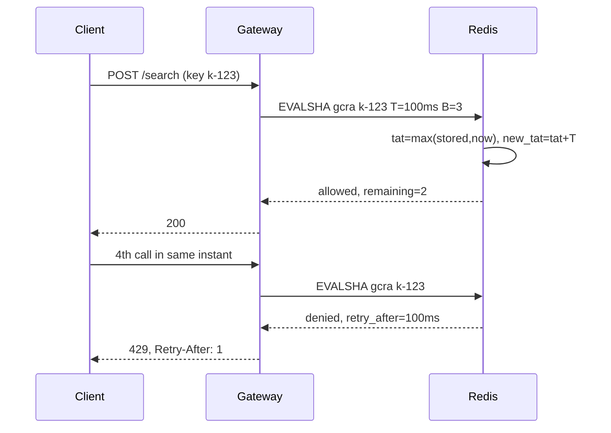

## In one minute
- Rate limiting caps how much work one caller (a user, API key, tenant or IP) can ask of a system in a period, so one caller cannot starve the rest or run up the bill.
- Every algorithm answers the same question, "is this request within a sustained rate plus some burst?", and differs in memory per key, accuracy at window edges, and how cheaply it runs in a shared store.
- GCRA, the generic cell rate algorithm, gives token-bucket behaviour while storing a single timestamp per key, which is why Redis modules and many CDNs use it.
- Rate limiting protects fairness between callers; load shedding protects the server's capacity. Production systems need both, and they are configured differently.
- A good limit is a contract: the client gets `429`, a `Retry-After` and ideally its remaining quota, so well-behaved clients slow down instead of retrying blindly.

## How it works

### What you are limiting, and by what key
A limit is a rule of the form "key K may use R units per period with burst B". The key decides who is being made fair to whom: per API key for partners, per user for a consumer app, per tenant for a SaaS, per IP only as a last resort for anonymous traffic, since thousands of users can share one carrier NAT address. Cost-weighted units are often better than request counts: a search that scans a million rows can cost 50 units while a point read costs 1.

### The algorithm families
A **fixed window counter** increments `count[key, floor(now / 60s)]`. It is one integer per key, but a client can send its full quota at 0:59 and again at 1:00, twice the rate across the boundary. A **sliding window log** keeps every timestamp in the window and is exact, but memory grows with the limit. A **sliding window counter** blends the previous and current fixed windows, weighting the previous one by how much of it still overlaps; it is cheap and close enough for most APIs.

A **token bucket** refills at rate R up to capacity B and spends a token per request, which states burst and sustained rate separately. A **leaky bucket** has two readings: as a meter it is the same as a token bucket, and as a queue it smooths traffic by delaying requests rather than rejecting them, which suits outbound calls to a fragile partner but adds latency.

**GCRA** is the leaky bucket meter written as arithmetic. Instead of storing tokens and a last-refill time, it stores one number per key: the *theoretical arrival time* (TAT), when the bucket would be empty if the caller stopped now. Each allowed request pushes TAT forward by the emission interval T = period / rate. A request is allowed if TAT, after the push, is no further than T x B into the future.

### Concurrency limits are different
Rate limits count arrivals; concurrency limits count requests in flight. A caller making 10 requests per second of 30-second report exports holds 300 server slots, which a rate limit never notices. Limit expensive endpoints by concurrency as well, and release the slot in a `finally` block or with a lease that expires.

### The problem shapes
Rate limiting is the **overload** and **contention** shapes: many callers contend for one capacity, and the limiter decides who gets it. It appears far from HTTP. A job queue limits how fast one tenant's jobs are dequeued, a database limits connections per role, and an AI agent framework limits tool calls per task so a looping agent cannot exhaust a paid API in a minute.

## Down the stack

### Layer 1: The contract
For a limit of rate R per period with burst B, the limiter promises that over any interval of length t, a key is allowed at most B + R x t / period requests, and that a key that has been idle long enough can always send B requests back to back. A rejected request costs nothing: it does not consume quota. The response is `429 Too Many Requests` ([RFC 6585](https://www.rfc-editor.org/rfc/rfc6585.html)) with `Retry-After`, which may be a number of seconds or an HTTP date ([RFC 9110](https://www.rfc-editor.org/rfc/rfc9110.html#name-retry-after)). Many APIs add quota headers. Many, GitHub among them, still use informal `x-ratelimit-limit`, `-remaining` and `-reset` headers ([GitHub docs](https://docs.github.com/en/rest/using-the-rest-api/rate-limits-for-the-rest-api)); the IETF's replacement is still an Internet-Draft (version -11, May 2026) and defines two fields, `RateLimit-Policy` (quota `q` per window `w`) and `RateLimit` (remaining `r`, seconds to reset `t`) ([IETF draft](https://datatracker.ietf.org/doc/draft-ietf-httpapi-ratelimit-headers/)). A distributed limiter usually weakens this to "approximately, within one sync interval or one per node", and the design review should state the slack in numbers.

### Layer 2: The mechanism
GCRA per request, with T the emission interval and tau = T x B:

```text
tat     = max(stored_tat or now, now)
new_tat = tat + T * cost
if new_tat - now > tau: deny, retry_after = new_tat - tau - now
else: store new_tat, remaining = floor((tau - (new_tat - now)) / T)
```

There is no refill loop and no second field, so the update is one read and one conditional write. In Redis it runs as a Lua script through `EVALSHA`, which executes atomically: the server blocks all other work while a script runs ([Redis docs](https://redis.io/docs/latest/develop/programmability/eval-intro/)). The script should read the time with `TIME` so all gateway nodes share one clock. That is safe on Redis 5.0 and later, where replicas receive the script's writes rather than re-running it; on older versions a write after `TIME` was refused unless the script first switched to effects replication. The [redis-cell](https://github.com/brandur/redis-cell) module packages this as `CL.THROTTLE key max_burst count period quantity`, returning whether the call was limited, the limit, the remaining quota, the retry-after and the reset time. Set a key TTL of about tau so idle keys disappear.

Cloudflare's sliding window counter keeps two counters per key and estimates `previous x (window - elapsed) / window + current`. They measured it over 400 million requests from 270,000 sources and found 0.003% of requests wrongly allowed or limited, with the estimated rate on average 6% off the real one ([Cloudflare](https://blog.cloudflare.com/counting-things-a-lot-of-different-things/)). Envoy offers both styles: `local_ratelimit` is a token bucket in each proxy, and global limiting sends descriptors such as `("api_key", "k-123"), ("path", "/search")` to a rate limit service over gRPC (`ShouldRateLimit`), which keeps counters in Redis ([Envoy docs](https://www.envoyproxy.io/docs/envoy/latest/intro/arch_overview/other_features/global_rate_limiting)). Stripe runs four limiters side by side, all token buckets in Redis: request rate, concurrent requests, and two load shedders that reserve capacity for critical traffic ([Stripe](https://stripe.com/blog/rate-limiters)).

### Layer 3: The machine
A same-zone Redis round trip is roughly 0.2 to 0.5 ms, and one Redis core handles on the order of 100,000 small scripts per second. At 200,000 requests per second, central checking on every request needs a sharded cluster and adds a network hop to every request, which is why gateways check locally first and centrally only for keys with strict contracts. Memory is dominated by Redis per-key overhead, around 50 to 90 bytes for a small string with a TTL, not by GCRA's 8-byte timestamp: 10 million active keys cost about 1 GB, where a sliding log of 1,000 timestamps per key would need about 80 GB.

Time is the subtle part. Wall clocks on different gateway nodes can differ by milliseconds or jump when NTP steps them, and a limiter that trusts each node's clock can over-allow after a backwards jump. Use the store's clock for shared state, and a monotonic clock (`CLOCK_MONOTONIC`) for local buckets.

### Why it's built this way
1. Capacity is shared and some callers misbehave, so each caller gets a budget instead of first come, first served.
2. Real traffic is bursty, so the budget has two numbers, a sustained rate and a burst, rather than a hard per-second cap.
3. The check runs on every request, so the state per key must be tiny and the update a single atomic step, which is GCRA's appeal.
4. A central store adds latency and a dependency, so most enforcement is local and approximate, with central checks only where accuracy is paid for.
5. Rejections are only useful if clients react, so the protocol returns when to retry and how much quota is left.

## Diagram


## Worked example
A partner API sells plans of 600 requests per minute with a burst of 30. The emission interval is 60,000 / 600 = 100 ms, and tau is 100 x 30 = 3,000 ms.

A partner's batch job wakes at t = 0 and fires 40 requests at once. The first 30 are allowed: after the 30th, TAT is 3,000 ms ahead, exactly tau. The 31st would push TAT to 3,100 ms, so it is denied with `retry_after` = 3,100 - 3,000 = 100 ms. Denied requests do not move TAT. If the job then sends one request every 100 ms, every one is allowed with 0 remaining: it is running at exactly the sustained rate. If it pauses for 2 seconds, TAT falls back toward now and 20 requests of burst become available again.

Compare a fixed one-minute window of 600. The same job could send 600 requests at 0:59.9 and 600 more at 1:00.0, 1,200 requests in 100 ms, the kind of spike that the plan was meant to prevent.

Across 20 gateway nodes, a pure local split gives each node 30 requests per minute per partner, which throttles a partner whose traffic lands unevenly. The team runs local buckets at 2x the per-node share to absorb skew, plus a central GCRA in Redis for enterprise partners, about 6,000 scripts per second at peak, well within one shard.

## In the wild
- **PostHog, 2025: an IP-keyed limiter sees one IP.** On 24 October PostHog added IP-based rate limiting to its feature-flag endpoint. The limiter library ignored `X-Forwarded-For` by default, so it saw every request as coming from the internal load balancer and put the whole world in one bucket. About 97% of flag evaluations got 429s for 72 minutes until the limiter was turned off; the lasting fix was to trust the forwarded header from that load balancer ([PostHog](https://posthog.com/handbook/company/post-mortems/2025-10-21-feature-flags-recurring-outages)).
- **Discord, 2026: a per-host limit that was not re-tuned.** On 25 March a scale-down dropped 17% of gateway sessions ungracefully and clients reconnected at once. The gateway's start-session rate limit was the intended backpressure, but it was a per-host limit that had not been re-tuned after a move to Kubernetes, where more pods meant more total capacity got through. Gateway memory spiked, nodes ran out of memory, and voice and video were degraded from 12:13 to 15:30 PDT ([Discord](https://discord.com/blog/behind-the-scenes-of-the-3-25-26-voice-outage)).
- **Slack, 2022: a rate limit as the recovery tool.** When a cache rollout left Slack's database tier overloaded on 22 February, responders throttled client boot requests so already-connected users could keep working. Their first increase was too large and pushed the databases back over the edge; smaller steps, plus moving a query to replicas, let caches refill until the boot limit was back to normal ([Slack](https://slack.engineering/slacks-incident-on-2-22-22/)).

## Trade-offs
| Option | Strengths | Weaknesses | Choose when |
|---|---|---|---|
| Fixed window counter | One integer per key, trivial in any store | Allows 2x the rate across window edges | Coarse daily or hourly quotas |
| Sliding window log | Exact | Memory grows with the limit | Low limits where exactness matters, such as login attempts |
| Sliding window counter | Two counters, smooth, good accuracy | Approximate; assumes even spread in the previous window | High-volume APIs with per-minute limits |
| Token bucket or GCRA | Separate burst and rate, tiny state, GCRA is one timestamp | Burst must be tuned; needs an atomic update | Most API rate limits |
| Leaky bucket as queue | Smooth output, no rejections | Adds latency, needs a queue | Outbound calls to a fragile dependency |
| Concurrency limit | Catches slow, expensive requests | Needs reliable release of slots | Reports, exports, long queries |

## Pitfalls in production
- **Limiting by IP alone.** Mobile carriers and offices put thousands of users behind one address, so one heavy user throttles all of them. Key by API key, user or tenant, and use IP only for anonymous traffic.
- **Read-then-write races.** Two nodes read count 99 of 100 and both allow. Do the check and update atomically, with a Lua script, an `INCR` and compare, or a single-key transaction.
- **Failing closed when Redis is down.** The limiter's store goes away and every request gets 429. Fail open to a local limiter with a conservative share, and alert.
- **No `Retry-After`.** Clients retry immediately in tight loops, so rejected traffic exceeds the original load. Return when to retry, and publish client guidance on backoff with jitter. AWS's updated SDK retry behavior (opt-in in 2026 until it becomes the default), for example, backs off from a 1-second base on throttling errors against 50 ms for other transient errors ([AWS SDK docs](https://docs.aws.amazon.com/sdkref/latest/guide/feature-retry-behavior.html)).
- **Keying on the proxy's address.** Behind a load balancer every request arrives from the balancer's IP, so an IP-keyed limiter puts all users in one bucket. Read the client address from `X-Forwarded-For` only when it is set by a proxy you trust.
- **Per-node limits that ignore fleet size.** Autoscaling from 10 to 40 nodes quadruples the effective limit. Derive local shares from the current node count or use a central store for strict limits.
- **Counting rejected requests against quota.** A client that is limited keeps getting pushed further into the future and never recovers. Only allowed requests should consume quota.

## Leadership lens
- Treat limits as part of the product: plans, published numbers, response headers and a way for customers to see their usage. Undocumented limits become support tickets.
- Ask in review which limits protect fairness and which protect capacity, and make sure overload protection does not depend on every caller having a correct quota.
- Decide fail-open versus fail-closed per limit ahead of time: login and payment endpoints may fail closed, general reads should fail open.
- Budget the shared store as critical infrastructure with its own SLO; a limiter outage that blocks all traffic is a self-inflicted full outage.

## Check yourself
1. Why can a fixed one-minute window of 100 allow 200 requests in one second?
   **Answer:** The client sends 100 at the end of one window and 100 at the start of the next. Both windows see 100, so both batches pass.
2. In GCRA, why does a denied request leave the stored TAT unchanged?
   **Answer:** A denial should cost nothing; if it advanced TAT, a client retrying too early would push its own next allowed time further away and could starve itself.
3. A partner sends 5 requests per second, each taking 40 seconds. Which limiter catches this and why?
   **Answer:** A concurrency limiter, because 200 requests are in flight at once. A rate limiter of, say, 10 per second never triggers.
4. Why should a distributed limiter use the store's clock rather than each gateway's clock?
   **Answer:** Gateway clocks differ and can jump, so TAT values written by one node would be interpreted wrongly by another. One clock keeps the arithmetic consistent.

## Practice
**Task:** Implement GCRA for many keys with an injected time. `GCRA(interval_ms, burst)` raises an error if `interval_ms` is not positive or `burst` is below 1. `allow(key, now_ms, cost=1)` returns `(allowed, retry_after_ms, remaining)`. Let `tau = interval_ms * burst` and `tat = max(stored TAT for key, now_ms)`, using `now_ms` for an unknown key; `new_tat = tat + interval_ms * cost`. If `cost > burst` the request can never fit: return `(False, -1, 0)`. Otherwise, if `new_tat - now_ms > tau`, return `(False, new_tat - tau - now_ms, 0)` without changing state; else store `new_tat` and return `(True, 0, (tau - (new_tat - now_ms)) // interval_ms)`. Keys are independent. The Go version guards state with a `sync.Mutex`.

```python starter
class GCRA:
    def __init__(self, interval_ms, burst):
        self.interval_ms = interval_ms
        self.burst = burst

    def allow(self, key, now_ms, cost=1):
        # TODO: return (allowed, retry_after_ms, remaining)
        raise NotImplementedError
```

```python tests
def test_rejects_bad_config():
    for args in [(0, 3), (-1, 3), (100, 0)]:
        try:
            GCRA(*args)
            assert False, args
        except ValueError:
            pass

def test_burst_then_deny_with_retry_after():
    g = GCRA(100, 3)
    assert g.allow("k", 0) == (True, 0, 2)
    assert g.allow("k", 0) == (True, 0, 1)
    assert g.allow("k", 0) == (True, 0, 0)
    assert g.allow("k", 0) == (False, 100, 0)
    assert g.allow("k", 40) == (False, 60, 0)

def test_sustained_rate_is_allowed():
    g = GCRA(100, 3)
    for _ in range(3):
        g.allow("k", 0)
    for t in range(100, 1100, 100):
        assert g.allow("k", t) == (True, 0, 0), t

def test_denied_request_does_not_consume():
    g = GCRA(100, 1)
    assert g.allow("k", 0)[0]
    for _ in range(5):
        assert g.allow("k", 50) == (False, 50, 0)
    assert g.allow("k", 100) == (True, 0, 0)

def test_idle_key_recovers_full_burst():
    g = GCRA(100, 3)
    for _ in range(3):
        g.allow("k", 0)
    assert g.allow("k", 10000) == (True, 0, 2)

def test_cost_weighted_requests():
    g = GCRA(100, 5)
    assert g.allow("k", 0, 3) == (True, 0, 2)
    assert g.allow("k", 0, 3) == (False, 100, 0)
    assert g.allow("k", 0, 2) == (True, 0, 0)
    assert g.allow("k", 0, 6) == (False, -1, 0), "can never fit"

def test_keys_are_independent():
    g = GCRA(1000, 1)
    assert g.allow("a", 0)[0]
    assert not g.allow("a", 0)[0]
    assert g.allow("b", 0)[0]
```

```python solution
class GCRA:
    def __init__(self, interval_ms, burst):
        if interval_ms <= 0 or burst < 1:
            raise ValueError("interval_ms must be > 0 and burst >= 1")
        self.interval_ms = interval_ms
        self.burst = burst
        self.tau = interval_ms * burst
        self.tat = {}

    def allow(self, key, now_ms, cost=1):
        if cost > self.burst:
            return (False, -1, 0)
        tat = max(self.tat.get(key, now_ms), now_ms)
        new_tat = tat + self.interval_ms * cost
        if new_tat - now_ms > self.tau:
            return (False, new_tat - self.tau - now_ms, 0)
        self.tat[key] = new_tat
        return (True, 0, (self.tau - (new_tat - now_ms)) // self.interval_ms)
```

```typescript starter
export type Decision = [boolean, number, number];

export class GCRA {
  constructor(public intervalMs: number, public burst: number) {}
  allow(key: string, nowMs: number, cost: number = 1): Decision {
    throw new Error("TODO");
  }
}
```

```typescript tests
test("rejects bad config", () => {
  for (const [i, b] of [[0, 3], [-1, 3], [100, 0]]) {
    let threw = false;
    try {
      new GCRA(i, b);
    } catch (e) {
      threw = true;
    }
    assert(threw, `${i},${b}`);
  }
});
test("burst then deny with retry after", () => {
  const g = new GCRA(100, 3);
  assertEqual(g.allow("k", 0), [true, 0, 2]);
  assertEqual(g.allow("k", 0), [true, 0, 1]);
  assertEqual(g.allow("k", 0), [true, 0, 0]);
  assertEqual(g.allow("k", 0), [false, 100, 0]);
  assertEqual(g.allow("k", 40), [false, 60, 0]);
});
test("sustained rate is allowed", () => {
  const g = new GCRA(100, 3);
  for (let i = 0; i < 3; i++) g.allow("k", 0);
  for (let t = 100; t < 1100; t += 100) assertEqual(g.allow("k", t), [true, 0, 0], String(t));
});
test("denied request does not consume", () => {
  const g = new GCRA(100, 1);
  assert(g.allow("k", 0)[0]);
  for (let i = 0; i < 5; i++) assertEqual(g.allow("k", 50), [false, 50, 0]);
  assertEqual(g.allow("k", 100), [true, 0, 0]);
});
test("idle key recovers full burst", () => {
  const g = new GCRA(100, 3);
  for (let i = 0; i < 3; i++) g.allow("k", 0);
  assertEqual(g.allow("k", 10000), [true, 0, 2]);
});
test("cost weighted requests", () => {
  const g = new GCRA(100, 5);
  assertEqual(g.allow("k", 0, 3), [true, 0, 2]);
  assertEqual(g.allow("k", 0, 3), [false, 100, 0]);
  assertEqual(g.allow("k", 0, 2), [true, 0, 0]);
  assertEqual(g.allow("k", 0, 6), [false, -1, 0], "can never fit");
});
test("keys are independent", () => {
  const g = new GCRA(1000, 1);
  assert(g.allow("a", 0)[0]);
  assert(!g.allow("a", 0)[0]);
  assert(g.allow("b", 0)[0]);
});
```

```typescript solution
export type Decision = [boolean, number, number];

export class GCRA {
  private tau: number;
  private tat = new Map<string, number>();

  constructor(public intervalMs: number, public burst: number) {
    if (intervalMs <= 0 || burst < 1) throw new Error("intervalMs must be > 0 and burst >= 1");
    this.tau = intervalMs * burst;
  }

  allow(key: string, nowMs: number, cost: number = 1): Decision {
    if (cost > this.burst) return [false, -1, 0];
    const tat = Math.max(this.tat.get(key) ?? nowMs, nowMs);
    const newTat = tat + this.intervalMs * cost;
    if (newTat - nowMs > this.tau) return [false, newTat - this.tau - nowMs, 0];
    this.tat.set(key, newTat);
    return [true, 0, Math.floor((this.tau - (newTat - nowMs)) / this.intervalMs)];
  }
}
```

```go starter
package practice

type GCRA struct{}

func NewGCRA(intervalMs, burst int64) (*GCRA, error) { panic("TODO") }

// Allow returns allowed, retryAfterMs and remaining.
func (g *GCRA) Allow(key string, nowMs, cost int64) (bool, int64, int64) {
	panic("TODO")
}
```

```go tests
package practice

import "testing"

func mustNew(t *testing.T, i, b int64) *GCRA {
	t.Helper()
	g, err := NewGCRA(i, b)
	if err != nil {
		t.Fatal(err)
	}
	return g
}

func want(t *testing.T, g *GCRA, key string, now, cost int64, ok bool, retry, rem int64) {
	t.Helper()
	a, r, m := g.Allow(key, now, cost)
	if a != ok || r != retry || m != rem {
		t.Fatalf("Allow(%s,%d,%d) = %v,%d,%d want %v,%d,%d", key, now, cost, a, r, m, ok, retry, rem)
	}
}

func TestRejectsBadConfig(t *testing.T) {
	for _, c := range [][2]int64{{0, 3}, {-1, 3}, {100, 0}} {
		if _, err := NewGCRA(c[0], c[1]); err == nil {
			t.Fatalf("expected error for %v", c)
		}
	}
}

func TestBurstThenDenyWithRetryAfter(t *testing.T) {
	g := mustNew(t, 100, 3)
	want(t, g, "k", 0, 1, true, 0, 2)
	want(t, g, "k", 0, 1, true, 0, 1)
	want(t, g, "k", 0, 1, true, 0, 0)
	want(t, g, "k", 0, 1, false, 100, 0)
	want(t, g, "k", 40, 1, false, 60, 0)
}

func TestSustainedRateIsAllowed(t *testing.T) {
	g := mustNew(t, 100, 3)
	for i := 0; i < 3; i++ {
		g.Allow("k", 0, 1)
	}
	for ts := int64(100); ts < 1100; ts += 100 {
		want(t, g, "k", ts, 1, true, 0, 0)
	}
}

func TestDeniedRequestDoesNotConsume(t *testing.T) {
	g := mustNew(t, 100, 1)
	want(t, g, "k", 0, 1, true, 0, 0)
	for i := 0; i < 5; i++ {
		want(t, g, "k", 50, 1, false, 50, 0)
	}
	want(t, g, "k", 100, 1, true, 0, 0)
}

func TestIdleKeyRecoversFullBurst(t *testing.T) {
	g := mustNew(t, 100, 3)
	for i := 0; i < 3; i++ {
		g.Allow("k", 0, 1)
	}
	want(t, g, "k", 10000, 1, true, 0, 2)
}

func TestCostWeightedRequests(t *testing.T) {
	g := mustNew(t, 100, 5)
	want(t, g, "k", 0, 3, true, 0, 2)
	want(t, g, "k", 0, 3, false, 100, 0)
	want(t, g, "k", 0, 2, true, 0, 0)
	want(t, g, "k", 0, 6, false, -1, 0)
}

func TestKeysAreIndependent(t *testing.T) {
	g := mustNew(t, 1000, 1)
	want(t, g, "a", 0, 1, true, 0, 0)
	want(t, g, "a", 0, 1, false, 1000, 0)
	want(t, g, "b", 0, 1, true, 0, 0)
}
```

```go solution
package practice

import (
	"errors"
	"sync"
)

type GCRA struct {
	mu         sync.Mutex
	intervalMs int64
	burst      int64
	tau        int64
	tat        map[string]int64
}

func NewGCRA(intervalMs, burst int64) (*GCRA, error) {
	if intervalMs <= 0 || burst < 1 {
		return nil, errors.New("intervalMs must be > 0 and burst >= 1")
	}
	return &GCRA{intervalMs: intervalMs, burst: burst, tau: intervalMs * burst, tat: map[string]int64{}}, nil
}

// Allow returns allowed, retryAfterMs and remaining.
func (g *GCRA) Allow(key string, nowMs, cost int64) (bool, int64, int64) {
	g.mu.Lock()
	defer g.mu.Unlock()
	if cost > g.burst {
		return false, -1, 0
	}
	tat, ok := g.tat[key]
	if !ok || tat < nowMs {
		tat = nowMs
	}
	newTat := tat + g.intervalMs*cost
	if newTat-nowMs > g.tau {
		return false, newTat - g.tau - nowMs, 0
	}
	g.tat[key] = newTat
	return true, 0, (g.tau - (newTat - nowMs)) / g.intervalMs
}
```

## Mock interview
**Prompt:** Design rate limiting for a public developer API with 50,000 API keys on three plans (60, 600 and 6,000 requests per minute), served by 30 gateway nodes in two regions at 150,000 requests per second peak. Some endpoints, like bulk export, are far more expensive than others.

- Follow-up: Your Redis cluster for limits has a 5-minute outage. What happens to traffic, and what did you decide in advance?
- Follow-up: A customer complains they are throttled at 400 requests per minute on a 600 plan. How could that happen and how do you debug it?
- Follow-up: Would you choose GCRA, a sliding window counter or a fixed window for this, and why?

**A strong answer covers:**
- Keys and units: per API key, cost-weighted endpoints, and a separate concurrency limit for bulk export.
- Algorithm choice with numbers: emission interval and tau per plan, and why window-edge doubling is unacceptable.
- Local-first enforcement with fleet-aware shares, central atomic checks for strict plans, and the store's clock.
- Fail-open with conservative local limits when the store is down, plus alerting.
- Client contract: `429`, `Retry-After`, quota headers and documented backoff with jitter, and separate load shedding for capacity.

## Sources and further study
**Primary**
- [RFC 6585: Additional HTTP Status Codes](https://www.rfc-editor.org/rfc/rfc6585.html): defines `429 Too Many Requests` and its optional `Retry-After`.
- [RFC 9110: HTTP Semantics, Retry-After](https://www.rfc-editor.org/rfc/rfc9110.html#name-retry-after): both forms of the header, seconds and HTTP date.

**Systems docs**
- [redis-cell](https://github.com/brandur/redis-cell): GCRA as a Redis module, with the `CL.THROTTLE` reply format.
- [Redis: scripting with Lua](https://redis.io/docs/latest/develop/programmability/eval-intro/): atomic execution, `EVALSHA`, and why `TIME` is safe in scripts on current versions.
- [GitHub REST API: rate limits](https://docs.github.com/en/rest/using-the-rest-api/rate-limits-for-the-rest-api): a large public API's limits, headers and guidance for clients.
- [AWS SDKs: retry behavior](https://docs.aws.amazon.com/sdkref/latest/guide/feature-retry-behavior.html): how a well-behaved client reacts to throttling, including an adaptive client-side limiter.

**Books**
- *System Design Interview: An Insider's Guide, Volume 1*, Alex Xu, Ch 4 "Design A Rate Limiter": the algorithm families and a Redis-backed design.
- *Site Reliability Engineering*, Beyer et al. (eds.), Ch 21 "Handling Overload": per-customer limits versus overload protection, and client-side throttling.

**Other curricula**
- [Azure Architecture Center: Rate Limiting pattern](https://learn.microsoft.com/en-us/azure/architecture/patterns/rate-limiting-pattern): frames rate limiting from the client side, pacing your own calls to a throttled service.
- [donnemartin/system-design-primer](https://github.com/donnemartin/system-design-primer): has no rate-limiting chapter; it lists "Design an API rate limiter" as an exercise and links Stripe's post.

## Watch
- [What is Rate Limiting / API Throttling? (Be A Better Dev)](https://www.youtube.com/watch?v=9CIjoWPwAhU): a plain introduction to why APIs throttle and how clients should react.
- [Rate Limiting system design: Token Bucket, Leaky Bucket, Sliding Logs (Tech Dummies)](https://www.youtube.com/watch?v=mhUQe4BKZXs): the main algorithms compared on a whiteboard.
- [System Design Interview: Rate Limiting, local and distributed (System Design Interview)](https://www.youtube.com/watch?v=FU4WlwfS3G0): how a limiter is built and scaled across hosts.

## Free resources
- [Rate limiting, Cells, and GCRA (Brandur Leach)](https://brandur.org/rate-limiting): the clearest walkthrough of GCRA and why it beats naive buckets.
- [Generic cell rate algorithm (Wikipedia)](https://en.wikipedia.org/wiki/Generic_cell_rate_algorithm): the original ATM definition and its equivalence to the leaky bucket.
- [Scaling your API with rate limiters (Stripe)](https://stripe.com/blog/rate-limiters): the four limiter types Stripe runs and how they differ.
- [How we built rate limiting capable of scaling to millions of domains (Cloudflare)](https://blog.cloudflare.com/counting-things-a-lot-of-different-things/): the sliding window counter and its measured accuracy.
- [Envoy global rate limiting](https://www.envoyproxy.io/docs/envoy/latest/intro/arch_overview/other_features/global_rate_limiting): descriptors, local versus global limits, and the rate limit service.
- [RateLimit header fields for HTTP (IETF draft)](https://datatracker.ietf.org/doc/draft-ietf-httpapi-ratelimit-headers/): the emerging standard for telling clients their quota.
