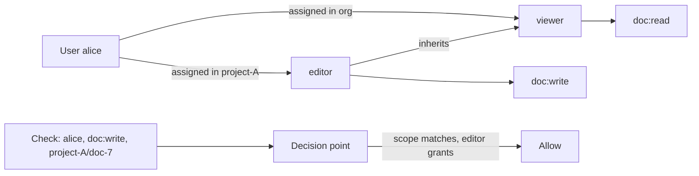

## In one minute
- Role-based access control grants permissions to roles and assigns roles to users, so access is managed by job function rather than person by person.
- A permission is an action on a resource type, such as `invoice:approve`. A check asks: does any role this user holds, directly or by inheritance, grant this permission in this scope?
- Scoping roles to a tenant, project, or resource is what makes RBAC work in multi-tenant products. Global roles alone cannot express "admin of project A only".
- RBAC's weak spot is role explosion: every exception becomes a new role. Attribute rules (ABAC) or relationship graphs (ReBAC) handle per-object and contextual decisions better.
- Authorisation should be enforced centrally and checked on every request, not only in the UI.

## How it works

### Core model
Users map to roles and roles map to permissions. A check unions the permissions of the user's roles and tests membership; the resolved set changes rarely, so cache it. The model was formalised by Ferraiolo and Kuhn at NIST in 1992 and standardised as ANSI/INCITS 359-2004, revised in 2012 ([NIST RBAC project](https://csrc.nist.gov/projects/role-based-access-control)). The classic reference models build up in layers: RBAC0 is users, roles, permissions and sessions; RBAC1 adds hierarchies; RBAC2 adds constraints; RBAC3 has both ([Sandhu et al. 1996](https://csrc.nist.gov/CSRC/media/Projects/Role-Based-Access-Control/documents/sandhu96.pdf)). The session part is often forgotten: a user activates only the roles a task needs, which is the idea behind modern just-in-time elevation of admin roles.

### Hierarchy
Roles can inherit. `billing-admin` inherits `billing-viewer`, so admins get read rights without duplicating them. Keep inheritance acyclic and shallow.

### Scope
In a SaaS product a user may be `owner` in workspace A and `viewer` in workspace B. Role assignments therefore carry a scope: `(user, role, scope)`. Scopes can nest, such as organisation, project, and environment, with assignments at a parent applying to children. The check becomes: find assignments for this user whose scope is the resource's scope or an ancestor.

### Constraints
Separation of duty prevents one person from holding conflicting roles, for example `payment-creator` and `payment-approver`. Static SoD blocks the assignment; dynamic SoD allows both roles but not both actions on the same object.

### Enforcement architecture
A policy decision point (PDP) answers allow or deny for enforcement points in gateways and services. It can be an embedded library, a sidecar, or a central service. The UI may hide buttons, but the server must check every request. Broken access control is the number one category in the OWASP Top 10:2025, and OWASP's data found some form of it in every application tested ([OWASP A01:2025](https://top10.owasp.org/2025/A01_2025-Broken_Access_Control/)).

### When RBAC is not enough
"Users can edit documents they own" or "managers can approve expenses under 5,000 USD from their own reports" are per-object, attribute-based rules. Encoding them as roles leads to one role per document or per amount band. Use ABAC conditions or a relationship-based model, as in Google's Zanzibar, and keep roles for coarse job functions. Zanzibar handles trillions of ACLs and millions of checks per second with p95 latency under 10 ms ([Zanzibar paper](https://research.google/pubs/zanzibar-googles-consistent-global-authorization-system/)); open-source descendants such as OpenFGA and SpiceDB bring the same tuple model to ordinary teams.

## Down the stack
### Layer 1: The contract
An RBAC decision point answers `check(subject, action, resource)` with allow or deny, denying by default when nothing grants access. Given the same policy snapshot it is deterministic. The important and often unstated part is freshness: after a revocation is acknowledged, how long can old grants still be honoured? Google's Zanzibar makes this explicit with consistency tokens ("zookies") so a check is evaluated at a snapshot at least as new as the content it protects, which closes the "new enemy" problem of a check seeing an old ACL with new content ([Pang et al., USENIX ATC 2019](https://www.usenix.org/system/files/atc19-pang.pdf)).

### Layer 2: The mechanism
Kubernetes is a clean reference. A `Role` or `ClusterRole` holds rules made of `apiGroups`, `resources`, `verbs`, and optionally `resourceNames`. A `RoleBinding` attaches subjects (users, groups, service accounts) to a role within one namespace, which is the scope. The authorizer allows a request if any binding grants it; permissions are purely additive with no deny rules, so evaluation order does not matter ([Kubernetes RBAC docs](https://kubernetes.io/docs/reference/access-authn-authz/rbac/)). The same docs warn that wildcards in `resources` or `verbs` silently grant access to resource types and verbs added later. Not every system is union-only: in AWS IAM an explicit deny in any applicable policy overrides every allow, and service control policies and permission boundaries intersect with identity policies ([AWS IAM docs](https://docs.aws.amazon.com/IAM/latest/UserGuide/reference_policies_evaluation-logic.html)). Explicit deny is useful for guardrails ("nobody outside the security team may disable logging") but makes "why was this denied?" harder to answer. It also prevents privilege escalation: you cannot create a binding that grants permissions you do not hold yourself unless you have the `bind` or `escalate` verb. In application code, a fast representation numbers each permission and stores each role as a bitset, so 120 permissions fit in two 64-bit words and a check is a bitwise AND. Relationship-based systems store tuples such as `doc:7#editor@user:alice` and evaluate rewrite rules over them, with special indexes to flatten deeply nested groups.

### Layer 3: The machine
A bitset check touches one cache line and takes a few nanoseconds; a hash set lookup on permission strings costs tens of nanoseconds; a database query costs a millisecond or more. Caching effective permissions for 320,000 users at 2 KB each would be 640 MB per process, so caches are LRU-bounded per instance or kept in a shared store. Putting roles into JWTs avoids lookups but has limits: many proxies reject request headers over 8 KB (nginx returns 400 when one header field exceeds its default 8 KB buffer, per the [nginx docs](https://nginx.org/en/docs/http/ngx_http_core_module.html#large_client_header_buffers)), so tokens carry coarse roles, not full permission lists, and a token's lifetime becomes the worst-case revocation delay. Resolving nested groups is a graph traversal whose depth must be bounded to keep latency predictable.

### Why it's built this way
Organisations reason in job functions, so permissions are grouped into roles. Every request needs a decision, so effective permissions are precomputed and cached. Union-only semantics make policies composable and order independent, at the cost of no explicit deny; systems that need organisation-wide guardrails add a separate deny layer on top, as AWS does. Caching trades freshness for speed, so revocation needs invalidation or consistency tokens. Tenants must never see each other's data, so every assignment carries a scope.

## Diagram


## Worked example
A B2B analytics product has 8,000 customer organisations, an average of 40 users each (320,000 users), and serves 25,000 API requests per second. Every request needs an authorisation check.

The model has 6 built-in roles, enterprise custom roles, about 120 permission strings, and assignments scoped to organisation or project. About 1 million assignment rows fit easily in one indexed table.

Check path: on login the service resolves the user's effective permissions per scope and caches them in the session or a near cache, about 2 KB per user. A check is then a hash lookup, under 10 microseconds. At 25,000 RPS that is trivial CPU. Without caching, 25,000 database queries per second for authorisation alone would dominate the database.

Revocation: cached permissions outlive a removed role until refresh, so pair a 60-second TTL with invalidation events on change, and check high-risk permissions such as `org:delete` live.

After two years, customers have created 14,000 custom roles, many differing by one permission; usage reports let the team consolidate them.

## In the wild
- **First American Financial, 2019: sequential document IDs and no login exposed 885 million records.** Links shared through its EaglePro app ended in a document number, and swapping in another number returned unrelated customers' documents without authentication, back to 2003. The company's own penetration test found it in December 2018 but it was not fixed until a journalist reported it in May 2019. New York's financial regulator fined it $1 million in 2023 for failing to maintain access controls ([NYDFS consent order](https://www.dfs.ny.gov/system/files/documents/2024/10/ea20231127_co_first_american.pdf)), and the SEC separately fined it $487,616 over disclosure controls ([SEC](https://www.sec.gov/news/press-release/2021-102)).
- **Microsoft, 2023: a valid signature from the wrong scope.** Storm-0558 used a consumer (MSA) signing key to forge tokens that enterprise Exchange Online accepted. Microsoft's validation libraries checked the signature but not the key's scope, and the mail team assumed they did both. The fix was libraries that check scope automatically, the same "permission valid, scope unchecked" bug as an IDOR at the identity layer ([MSRC](https://www.microsoft.com/en-us/msrc/blog/2023/09/results-of-major-technical-investigations-for-storm-0558-key-acquisition)).
- **Google Cloud, 2025: one blank policy row took down API authorization worldwide.** Service Control runs policy and quota checks on every Google Cloud API call. A policy row with blank fields hit a new code path with no feature flag and no error handling, and the binary crash-looped in every region within seconds, so external APIs returned 503 for hours. Google promised proper error handling (failing open where needed), incremental propagation of global policy data and feature flags off by default ([Google Cloud status](https://status.cloud.google.com/incidents/ow5i3PPK96RduMcb1SsW)).

## Trade-offs
| Option | Strengths | Weaknesses | Choose when |
| --- | --- | --- | --- |
| Flat RBAC | Simple, auditable, fast checks | Role explosion for fine-grained rules | Internal tools, small permission sets |
| Scoped, hierarchical RBAC | Fits multi-tenant SaaS, clear inheritance | Scope resolution adds complexity | Most B2B products |
| ABAC (attribute rules) | Contextual rules on time, amount, location | Harder to audit "who can do X" | Rules depend on resource or request attributes |
| ReBAC (relationship graph) | Natural for sharing, ownership, nested groups | Needs a graph store and consistency care | Document sharing, social or collaborative apps |

## Pitfalls in production
- Checks only in the UI or gateway, not in the service. Enforce authorisation at the service that owns the data, on every request.
- Insecure direct object references: the role allows `doc:read`, but the code never checks the document belongs to the user's tenant. Always check scope as well as permission.
- Role explosion makes audits impossible. Review role counts and usage, and move per-object rules to ABAC or ReBAC.
- Stale caches keep removed users in. Invalidate on assignment change and bound TTLs.
- Wildcard grants such as `*` on resources or verbs. They quietly expand when new resource types ship. List verbs and resources explicitly and lint policies in CI.
- Treating the decision point as infallible. If the PDP or its policy store breaks, every request breaks with it. Decide fail-closed or fail-open per action, roll policy changes out gradually, and keep a cached last-known-good policy.

## Leadership lens
- Define the permission vocabulary early as `resource:action` strings; renaming later touches every service.
- Ask for every endpoint: which permission, which scope, and where is it enforced?
- Decide where RBAC stops and attribute or relationship rules start, before role explosion decides for you.

## Check yourself
1. A user has `doc:read` but reads another tenant's document by changing an id in the URL. Which part of the check failed?
   **Answer:** The scope check. The permission was valid, but the system did not verify the resource belongs to a scope where the user holds that role.
2. Why does "users can edit their own drafts" fit poorly in pure RBAC?
   **Answer:** It depends on a relationship between the user and a specific object. RBAC would need a role per document; an ownership attribute or relation expresses it directly.
3. What is the difference between static and dynamic separation of duty?
   **Answer:** Static SoD forbids holding both conflicting roles at all; dynamic SoD allows both but forbids exercising both on the same transaction.
4. Why cache resolved permissions, and what is the risk?
   **Answer:** Checks happen on every request, and caching makes them hash lookups. The risk is delayed revocation, handled with short TTLs and invalidation events.

## Practice
**Task:** Implement `RBAC` with `add_role(name, perms, inherits)`, `conflict(role_a, role_b)` (separation of duty), `assign(user, role)`, and `check(user, perm)`. Permissions are `resource:action` strings; a role may hold `resource:*` meaning every action on that resource. `add_role` raises `ValueError` if an inherited role is unknown or inheritance would form a cycle. `assign` raises `ValueError` for unknown roles or if the user's effective roles (including inherited ones) would include both sides of a conflict. `check` returns True if any effective role grants the permission.

```python starter
class RBAC:
    def __init__(self):
        pass

    def add_role(self, name, perms, inherits=()):
        raise NotImplementedError

    def conflict(self, a, b):
        raise NotImplementedError

    def assign(self, user, role):
        raise NotImplementedError

    def check(self, user, perm):
        raise NotImplementedError
```

```python tests
def base():
    r = RBAC()
    r.add_role("viewer", ["invoice:read"])
    r.add_role("clerk", ["invoice:create"], ["viewer"])
    r.add_role("approver", ["invoice:approve"], ["viewer"])
    r.add_role("admin", ["invoice:*"])
    return r

def test_direct_and_inherited():
    r = base()
    r.assign("ann", "clerk")
    assert r.check("ann", "invoice:create") and r.check("ann", "invoice:read")
    assert not r.check("ann", "invoice:approve")

def test_wildcard():
    r = base()
    r.assign("bo", "admin")
    assert r.check("bo", "invoice:delete") and not r.check("bo", "user:read")

def test_separation_of_duty():
    r = base()
    r.conflict("clerk", "approver")
    r.assign("cy", "clerk")
    try:
        r.assign("cy", "approver")
        assert False, "expected ValueError"
    except ValueError:
        pass

def test_cycle_rejected():
    r = RBAC()
    r.add_role("a", [])
    r.add_role("b", [], ["a"])
    try:
        r.add_role("a", [], ["b"])
        assert False, "expected ValueError"
    except ValueError:
        pass

def test_unknown_user_denied():
    assert base().check("nobody", "invoice:read") is False
```

```python solution
class RBAC:
    def __init__(self):
        self.perms, self.parents, self.users, self.conflicts = {}, {}, {}, []

    def _closure(self, roles):
        seen, stack = set(), list(roles)
        while stack:
            r = stack.pop()
            if r not in seen:
                seen.add(r)
                stack.extend(self.parents.get(r, []))
        return seen

    def add_role(self, name, perms, inherits=()):
        for p in inherits:
            if p not in self.perms:
                raise ValueError("unknown role " + p)
        if name in self._closure(inherits):
            raise ValueError("cycle")
        self.perms[name], self.parents[name] = set(perms), list(inherits)

    def conflict(self, a, b):
        self.conflicts.append((a, b))

    def assign(self, user, role):
        if role not in self.perms:
            raise ValueError("unknown role")
        eff = self._closure(self.users.get(user, set()) | {role})
        for a, b in self.conflicts:
            if a in eff and b in eff:
                raise ValueError("separation of duty: " + a + " / " + b)
        self.users.setdefault(user, set()).add(role)

    def check(self, user, perm):
        res = perm.split(":")[0]
        for r in self._closure(self.users.get(user, set())):
            if perm in self.perms[r] or (res + ":*") in self.perms[r]:
                return True
        return False
```

```typescript starter
export class RBAC {
  addRole(name: string, perms: string[], inherits: string[] = []): void { throw new Error("TODO"); }
  conflict(a: string, b: string): void { throw new Error("TODO"); }
  assign(user: string, role: string): void { throw new Error("TODO"); }
  check(user: string, perm: string): boolean { throw new Error("TODO"); }
}
```

```typescript tests
function base(): RBAC {
  const r = new RBAC();
  r.addRole("viewer", ["invoice:read"]);
  r.addRole("clerk", ["invoice:create"], ["viewer"]);
  r.addRole("approver", ["invoice:approve"], ["viewer"]);
  r.addRole("admin", ["invoice:*"]);
  return r;
}

function throws(fn: () => void): boolean {
  try { fn(); return false; } catch (e) { return true; }
}

test("direct and inherited", () => {
  const r = base();
  r.assign("ann", "clerk");
  assert(r.check("ann", "invoice:create") && r.check("ann", "invoice:read"), "granted");
  assert(!r.check("ann", "invoice:approve"), "not granted");
});

test("wildcard", () => {
  const r = base();
  r.assign("bo", "admin");
  assert(r.check("bo", "invoice:delete") && !r.check("bo", "user:read"), "wildcard scope");
});

test("separation of duty", () => {
  const r = base();
  r.conflict("clerk", "approver");
  r.assign("cy", "clerk");
  assert(throws(() => r.assign("cy", "approver")), "expected error");
});

test("cycle rejected", () => {
  const r = new RBAC();
  r.addRole("a", []);
  r.addRole("b", [], ["a"]);
  assert(throws(() => r.addRole("a", [], ["b"])), "expected error");
});

test("unknown user denied", () => {
  assertEqual(base().check("nobody", "invoice:read"), false);
});
```

```typescript solution
export class RBAC {
  private perms = new Map<string, Set<string>>();
  private parents = new Map<string, string[]>();
  private users = new Map<string, Set<string>>();
  private conflicts: [string, string][] = [];

  private closure(roles: Iterable<string>): Set<string> {
    const seen = new Set<string>();
    const stack = [...roles];
    while (stack.length > 0) {
      const r = stack.pop() as string;
      if (seen.has(r)) continue;
      seen.add(r);
      stack.push(...(this.parents.get(r) || []));
    }
    return seen;
  }

  addRole(name: string, perms: string[], inherits: string[] = []): void {
    for (const p of inherits) if (!this.perms.has(p)) throw new Error("unknown role " + p);
    if (this.closure(inherits).has(name)) throw new Error("cycle");
    this.perms.set(name, new Set(perms));
    this.parents.set(name, [...inherits]);
  }

  conflict(a: string, b: string): void {
    this.conflicts.push([a, b]);
  }

  assign(user: string, role: string): void {
    if (!this.perms.has(role)) throw new Error("unknown role");
    const current = this.users.get(user) || new Set<string>();
    const eff = this.closure([...current, role]);
    for (const [a, b] of this.conflicts) {
      if (eff.has(a) && eff.has(b)) throw new Error("separation of duty: " + a + " / " + b);
    }
    current.add(role);
    this.users.set(user, current);
  }

  check(user: string, perm: string): boolean {
    const wildcard = perm.split(":")[0] + ":*";
    for (const r of this.closure(this.users.get(user) || [])) {
      const ps = this.perms.get(r) as Set<string>;
      if (ps.has(perm) || ps.has(wildcard)) return true;
    }
    return false;
  }
}
```

```go starter
package practice

type RBAC struct{}

func NewRBAC() *RBAC { return &RBAC{} }

func (r *RBAC) AddRole(name string, perms, inherits []string) error { panic("TODO") }
func (r *RBAC) Conflict(a, b string)                                { panic("TODO") }
func (r *RBAC) Assign(user, role string) error                      { panic("TODO") }
func (r *RBAC) Check(user, perm string) bool                        { panic("TODO") }
```

```go tests
package practice

import "testing"

func base() *RBAC {
	r := NewRBAC()
	r.AddRole("viewer", []string{"invoice:read"}, nil)
	r.AddRole("clerk", []string{"invoice:create"}, []string{"viewer"})
	r.AddRole("approver", []string{"invoice:approve"}, []string{"viewer"})
	r.AddRole("admin", []string{"invoice:*"}, nil)
	return r
}

func TestDirectAndInherited(t *testing.T) {
	r := base()
	r.Assign("ann", "clerk")
	if !r.Check("ann", "invoice:create") || !r.Check("ann", "invoice:read") || r.Check("ann", "invoice:approve") {
		t.Fatal("inheritance wrong")
	}
}

func TestWildcard(t *testing.T) {
	r := base()
	r.Assign("bo", "admin")
	if !r.Check("bo", "invoice:delete") || r.Check("bo", "user:read") {
		t.Fatal("wildcard wrong")
	}
}

func TestSeparationOfDuty(t *testing.T) {
	r := base()
	r.Conflict("clerk", "approver")
	r.Assign("cy", "clerk")
	if r.Assign("cy", "approver") == nil {
		t.Fatal("expected error")
	}
}

func TestCycle(t *testing.T) {
	r := NewRBAC()
	r.AddRole("a", nil, nil)
	r.AddRole("b", nil, []string{"a"})
	if r.AddRole("a", nil, []string{"b"}) == nil {
		t.Fatal("expected error")
	}
}

func TestUnknownUser(t *testing.T) {
	if base().Check("nobody", "invoice:read") {
		t.Fatal("unknown user allowed")
	}
}
```

```go solution
package practice

import (
	"errors"
	"strings"
)

type RBAC struct {
	perms     map[string]map[string]bool
	parents   map[string][]string
	users     map[string]map[string]bool
	conflicts [][2]string
}

func NewRBAC() *RBAC {
	return &RBAC{perms: map[string]map[string]bool{}, parents: map[string][]string{}, users: map[string]map[string]bool{}}
}

func (r *RBAC) closure(roles []string) map[string]bool {
	seen := map[string]bool{}
	stack := append([]string{}, roles...)
	for len(stack) > 0 {
		x := stack[len(stack)-1]
		stack = stack[:len(stack)-1]
		if !seen[x] {
			seen[x] = true
			stack = append(stack, r.parents[x]...)
		}
	}
	return seen
}

func (r *RBAC) AddRole(name string, perms, inherits []string) error {
	for _, p := range inherits {
		if _, ok := r.perms[p]; !ok {
			return errors.New("unknown role " + p)
		}
	}
	if r.closure(inherits)[name] {
		return errors.New("cycle")
	}
	set := map[string]bool{}
	for _, p := range perms {
		set[p] = true
	}
	r.perms[name], r.parents[name] = set, append([]string{}, inherits...)
	return nil
}

func (r *RBAC) Conflict(a, b string) { r.conflicts = append(r.conflicts, [2]string{a, b}) }

func (r *RBAC) userRoles(user string) []string {
	out := []string{}
	for role := range r.users[user] {
		out = append(out, role)
	}
	return out
}

func (r *RBAC) Assign(user, role string) error {
	if _, ok := r.perms[role]; !ok {
		return errors.New("unknown role")
	}
	eff := r.closure(append(r.userRoles(user), role))
	for _, c := range r.conflicts {
		if eff[c[0]] && eff[c[1]] {
			return errors.New("separation of duty: " + c[0] + " / " + c[1])
		}
	}
	if r.users[user] == nil {
		r.users[user] = map[string]bool{}
	}
	r.users[user][role] = true
	return nil
}

func (r *RBAC) Check(user, perm string) bool {
	wildcard := strings.SplitN(perm, ":", 2)[0] + ":*"
	for role := range r.closure(r.userRoles(user)) {
		if r.perms[role][perm] || r.perms[role][wildcard] {
			return true
		}
	}
	return false
}
```

## Mock interview
**Prompt:** Design authorisation for a project management SaaS with 10,000 customer organisations, nested workspaces and projects, and 40,000 requests per second. Enterprise customers want custom roles and quarterly access reviews.

- Follow-up: How does a check resolve a role assigned at the workspace level for a project inside it?
- Follow-up: An admin removes a contractor. How quickly does access end, and how do you guarantee it?
- Follow-up: Customers ask for "guests can see only tasks assigned to them". How do you add that?

**A strong answer covers:**
- Scoped role assignments with hierarchical scopes and a clear permission vocabulary.
- A decision point with cached effective permissions, invalidation on change, and live checks for sensitive actions.
- Enforcement in every owning service plus tenant and scope checks against IDOR.
- Custom roles with limits and reporting to contain role explosion.
- Attribute or relationship rules for per-object cases, and access review exports.

## Sources and further study
**Primary**
- [Ferraiolo and Kuhn, Role-Based Access Controls (1992)](https://csrc.nist.gov/files/pubs/conference/1992/10/13/rolebased-access-controls/final/docs/ferraiolo-kuhn-92.pdf): the NIST paper that defined RBAC for commercial systems.
- [Sandhu et al., Role-Based Access Control Models (IEEE Computer, 1996)](https://csrc.nist.gov/CSRC/media/Projects/Role-Based-Access-Control/documents/sandhu96.pdf): the RBAC0 to RBAC3 family, sessions, hierarchies and constraints.
- [Pang et al., Zanzibar (USENIX ATC 2019)](https://www.usenix.org/system/files/atc19-pang.pdf): tuples, userset rewrites, zookies and the Leopard index for nested groups.
- [OWASP Top 10:2025, A01 Broken Access Control](https://top10.owasp.org/2025/A01_2025-Broken_Access_Control/): how often access control fails in tested applications and the standard defences.

**Systems docs**
- [AWS IAM policy evaluation logic](https://docs.aws.amazon.com/IAM/latest/UserGuide/reference_policies_evaluation-logic.html): explicit deny, permission boundaries and SCPs layered on top of allows.
- [Azure deny assignments](https://learn.microsoft.com/en-us/azure/role-based-access-control/deny-assignments): how Azure RBAC adds deny on top of its role assignments.
- [OpenFGA concepts](https://openfga.dev/docs/concepts): an open-source Zanzibar-style model with types, relations and tuples.

**Books**
- *Building Secure and Reliable Systems*, Adkins et al., chapter 5 "Design for Least Privilege": classifying access by risk, multi-party authorization and a policy framework for authorization decisions. [Free online](https://google.github.io/building-secure-and-reliable-systems/raw/ch05.html).
- *Release It!* (2nd edition), Michael T. Nygard, chapter 11 "Security": the OWASP Top 10 and the principle of least privilege from an operations angle.

**Other curricula**
- [roadmap.sh cyber security roadmap](https://roadmap.sh/cyber-security): places RBAC as one node among access control concepts, without scope or caching.
- [donnemartin/system-design-primer](https://github.com/donnemartin/system-design-primer): mentions least privilege in a four-bullet security section and does not cover authorization models.

## Watch
- [Role-based access control (RBAC) vs. Attribute-based access control (ABAC) (IBM Technology)](https://www.youtube.com/watch?v=rvZ35YW4t5k): when roles suffice and when attributes are needed.
- [USENIX ATC '19: Zanzibar, Google's Consistent, Global Authorization System](https://www.youtube.com/watch?v=mstZT431AeQ): the relationship-based model used beyond RBAC at Google scale.

## Free resources
- [NIST Role-Based Access Control project](https://csrc.nist.gov/projects/role-based-access-control): the origin and standard model of RBAC, including constraints.
- [OWASP Authorization Cheat Sheet](https://cheatsheetseries.owasp.org/cheatsheets/Authorization_Cheat_Sheet.html): least privilege, deny by default, and checking on every request.
- [Kubernetes RBAC](https://kubernetes.io/docs/reference/access-authn-authz/rbac/): a widely used, scoped RBAC implementation with roles and bindings.
- [Zanzibar: Google's Consistent, Global Authorization System](https://research.google/pubs/zanzibar-googles-consistent-global-authorization-system/): the paper behind relationship-based access control.
