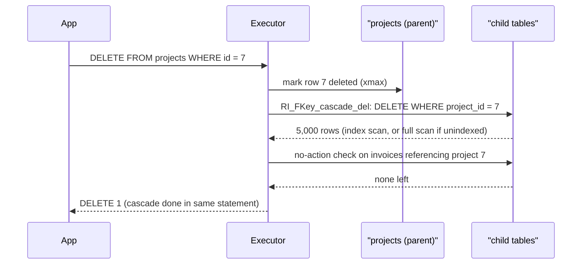

## In one minute
- A relational database stores data as relations (tables of rows with the same columns) and links rows by *values*, such as a `customer_id`, never by physical pointers.
- Because nothing points at a disk location, the engine is free to choose storage, indexes and join order itself; you declare *what* you want and a planner decides *how*.
- Keys and constraints (`PRIMARY KEY`, `UNIQUE`, `FOREIGN KEY`, `CHECK`) make the database the final guard of data integrity, no matter which service or script writes.
- Normalization stores each fact once, so updates cannot leave contradictions; joins put the facts back together at read time.
- The model's costs are real: joins need memory and good statistics, foreign keys need indexes and locks, and none of it spans shards for free.

## How it works

### Values, not pointers
Before 1970, databases such as IBM's IMS stored records in hierarchies that programs navigated by following pointers, so changing the storage layout broke every program. Edgar Codd proposed presenting data as mathematical relations: unordered sets of tuples ([Codd, 1970](https://www.engineering.upenn.edu/~zives/03f/cis550/codd.pdf)). An order refers to its customer by holding the customer's key value, and disk layout and indexes become invisible to the query.

This *physical data independence* is why SQL can be declarative. A query is an expression in relational algebra (select, project, join, union, difference, aggregate); each operator takes and returns relations, so the planner can rewrite the expression into any equivalent form. Databases 101 shows tables and SQL from the user's side; this lesson looks at what the model asks of the engine.

### Keys and constraints
A *candidate key* is a minimal set of columns that identifies a row; the *primary key* is the one you pick. Natural keys (an email) carry meaning but change, dragging every reference with them, so most schemas use surrogate keys (sequences, UUIDs) plus `UNIQUE` on the natural key. Random version 4 UUIDs land at random places in the primary-key B-tree, so every insert touches a cold page. RFC 9562 (2024) added time-ordered version 7 UUIDs partly for this reason ([RFC 9562](https://www.rfc-editor.org/rfc/rfc9562.html)), and Postgres 18 ships a built-in `uuidv7()` ([Postgres 18 release notes](https://www.postgresql.org/docs/18/release-18.html)).

A *foreign key* says every non-null `orders.customer_id` must exist in `customers.id`, and chooses what happens when the parent is deleted:

- `NO ACTION` (the default) and `RESTRICT` reject the change if referencing rows remain. `NO ACTION` checks at the end of the statement (or at commit if deferred), so a statement that also removes the children succeeds; `RESTRICT` checks immediately.
- `CASCADE` deletes the referencing rows too, recursively.
- `SET NULL` keeps the children but clears the reference; `SET DEFAULT` sets it to the column default instead. In Postgres, `ON DELETE SET NULL (author_id)` can clear only some columns of a composite key ([Postgres docs](https://www.postgresql.org/docs/current/ddl-constraints.html)). InnoDB rejects `SET DEFAULT` entirely ([MySQL docs](https://dev.mysql.com/doc/refman/8.4/en/create-table-foreign-keys.html)).

Engines differ in what they actually enforce, so check rather than assume. MySQL parsed `CHECK` constraints and silently ignored them before 8.0.16 ([MySQL 8.0 docs](https://dev.mysql.com/doc/refman/8.0/en/create-table-check-constraints.html)). Postgres 18 (September 2025) added temporal keys: `PRIMARY KEY (room_id, valid_at WITHOUT OVERLAPS)` forbids two rows for one room with overlapping time ranges, and a `PERIOD` foreign key checks that a child's range is covered by its parent's. It also added `NOT ENFORCED` for `CHECK` and foreign keys, which records the rule without checking it ([Postgres 18 release notes](https://www.postgresql.org/docs/18/release-18.html)).

### Normalization in one example
Take `order_lines(order_id, product_id, quantity, product_name, customer_email)` keyed by `(order_id, product_id)`. `product_name` depends on only part of the key (a second normal form violation) and `customer_email` depends on the order, not the line (third normal form). Rename a product and thousands of lines must change; miss one and the product has two names. Normalizing moves each fact next to its key: `products(id, name)`, `orders(id, customer_id)`, `customers(id, email)`, `order_lines(order_id, product_id, quantity)`. Copying facts back for read speed is the deliberate step covered in Denormalization.

### Joins put it back together
Engines have three join algorithms:

- **Nested loop:** for each outer row, probe the inner side, ideally by index. Best for a small outer side.
- **Hash join:** hash the smaller input on the join key, then stream the larger one past it. Best for large equality joins.
- **Merge join:** walk two inputs sorted on the key in lockstep. Best when indexes already supply the order.

### NULL and three-valued logic
`NULL` means unknown, so comparisons with it yield `UNKNOWN` and `WHERE` drops the row. `WHERE id NOT IN (SELECT manager_id FROM staff)` returns nothing if any `manager_id` is null. Use `NOT EXISTS`.

### The same shape elsewhere
Referential integrity is the multi-step consistency shape: deleting one thing must deal with everything that depends on it. Kubernetes objects carry `ownerReferences`, and deleting a Deployment cascades in the foreground (children first), in the background (a garbage collector follows), or orphans the children, which is `SET NULL` by another name.

## Down the stack

### Layer 1: The contract
A result is a multiset of rows with no order unless you write `ORDER BY`. `NOT NULL` and `CHECK` are checked per row; `UNIQUE` and foreign keys per statement, or at commit if declared `DEFERRABLE INITIALLY DEFERRED`. A committed state never contains a dangling foreign key, a duplicate key or a failed `CHECK`; a violation aborts the statement (SQLSTATE `23503` for a foreign key, `23505` for unique), and inside a transaction the transaction must roll back. Cascading actions run inside the same statement, so they are atomic with it.

### Layer 2: The mechanism
Postgres implements foreign keys as internal constraint triggers. Inserting or updating a child row fires `RI_FKey_check_ins` or `RI_FKey_check_upd`, which runs roughly `SELECT 1 FROM ONLY parent WHERE id = $1 FOR KEY SHARE`. `FOR KEY SHARE` blocks deleting the parent or changing its key but not updating its other columns. Deleting a parent fires `RI_FKey_cascade_del`, `RI_FKey_setnull_del` or a no-action or restrict check, each of which queries the child table by the foreign key column.

The parent key must have a unique index, so the check is one B-tree probe. Postgres does not index the child column automatically, so each parent delete can scan the child table; InnoDB creates that index for you if none exists ([MySQL docs](https://dev.mysql.com/doc/refman/8.4/en/create-table-foreign-keys.html)). InnoDB's cascaded changes also do not fire triggers on the child table. `UNIQUE` is enforced by the unique index itself, and an insert that meets an uncommitted duplicate waits to see whether it commits.

A hash join's table is bounded by `work_mem` (4 MB by default) times `hash_mem_multiplier` (2.0 by default since Postgres 15) ([Postgres docs](https://www.postgresql.org/docs/current/runtime-config-resource.html)). If the build side does not fit, Postgres splits both inputs into batches by hash, writes all but the first to temporary files, and joins batch by batch.

### Layer 3: The machine
A Postgres row lives in an 8 KB heap page, found through a 4-byte line pointer near the start of the page. Each tuple has a 23-byte header ([Postgres docs](https://www.postgresql.org/docs/current/storage-page-layout.html)), an optional null bitmap, then column data with each value aligned to its type's boundary. Column order therefore changes row size: `(bool, bigint, bool, bigint)` takes 32 bytes of data because each `bigint` must start on an 8-byte boundary, while `(bigint, bigint, bool, bool)` takes 18. With the header the tuples are 56 and 48 bytes; across 100 million rows that is about 800 MB of heap and cache. Values that push a row past about 2 KB are compressed or moved out of line by TOAST ([Postgres docs](https://www.postgresql.org/docs/current/storage-toast.html)).

Join memory is where the physical costs show. A hash join whose build side is 2 million rows of about 60 bytes needs roughly 120 MB plus hash overhead; with an 8 MB budget it splits into 16 or more batches and writes and rereads most of both inputs through temp files, turning a sub-second join into several seconds of disk I/O. An indexed nested loop costs a B-tree descent per outer row: a few cached page reads, or about 100 microseconds per page from NVMe.

### Why it's built this way
1. Programs that navigate storage pointers break whenever storage changes, so the model links rows by value and hides the physical layout.
2. Hidden layout means the engine must decide how to execute queries, so a cost-based planner with statistics sits in the middle of every query.
3. Many applications and scripts write the same data, so integrity rules live in the database, where no writer can skip them.
4. A child insert must not race a parent delete, so the check takes a row lock on the parent; that lock is the weak `FOR KEY SHARE` so that ordinary parent updates are not blocked.
5. Memory is finite and inputs are not, so joins and sorts degrade gracefully by partitioning and spilling to disk rather than failing.

## Diagram


## Worked example
A project-management SaaS has `projects` (2 million rows), `tasks` (60 million rows, 7 GB, `project_id REFERENCES projects ON DELETE CASCADE`) and `comments` (300 million rows, cascading from `tasks`, indexed on `task_id`). Nobody indexed `tasks.project_id`.

A tenant with 10,000 projects churns. `DELETE FROM projects WHERE tenant_id = 99` fires the cascade trigger 10,000 times, each running `DELETE FROM tasks WHERE project_id = $1` as a sequential scan of 7 GB. At 2 GB/s that is 3.5 seconds per project, about 10 hours, in one transaction that holds locks and pins its snapshot so `VACUUM` stalls.

With `CREATE INDEX CONCURRENTLY ON tasks(project_id)`, each cascade is a B-tree descent to about 30 tasks (60 million / 2 million). The whole delete removes about 300,000 tasks and 1.5 million comments: perhaps a minute, still too long for one transaction on a busy primary.

The final design deletes 100 projects per transaction, pausing between batches to keep replication lag under a second. For the largest tenants, a soft delete flag makes the user-facing action one row update, and a purge job runs the cascade off-peak.

## In the wild
- **Figma, 2024: keeping joins and foreign keys inside a shard.** After its database stack grew almost 100x from 2020, Figma sharded RDS Postgres horizontally. Tables that share a shard key are grouped into "colos", so joins and transactions within one key keep working, and a Go proxy routes queries and runs limited scatter-gather for the rest. The first table took about 9 months and went live in September 2023 with about 10 seconds of partial unavailability ([Figma](https://www.figma.com/blog/how-figmas-databases-team-lived-to-tell-the-scale/)).
- **Notion, 2021: sharding by the key every relation already carried.** With VACUUM stalling and transaction ID wraparound looming on one Postgres, Notion split data by workspace ID into 480 logical shards on 32 physical databases, chosen because 480 has many divisors. Because every block belongs to exactly one workspace, related rows stay on one shard and most queries avoid cross-shard joins. Dual writes, a 3-day backfill and dark reads checked the copy before a cutover of about 5 minutes ([Notion](https://www.notion.com/blog/sharding-postgres-at-notion)).
- **GitHub, 2016: schema changes without write-blocking locks.** GitHub found trigger-based online migration tools added overhead to every write and fought for metadata locks on busy MySQL tables. Its gh-ost tool instead tails the binary log into a "ghost" table, throttles on replication lag, and postpones cut-over; it was proven by running no-op migrations on production replicas and comparing checksums ([GitHub](https://github.blog/2016-08-01-gh-ost-github-s-online-migration-tool-for-mysql/)).

## Trade-offs
| Option | Strengths | Weaknesses | Choose when |
|---|---|---|---|
| Foreign keys in the database | Integrity guaranteed for every writer | Lock and index costs; impossible across shards | One database owns the related tables |
| References checked in application code | Works across services and shards | Races and bugs leave orphans; needs repair jobs | Data split across services or stores |
| `ON DELETE CASCADE` | One statement, atomic cleanup | Unbounded fan-out in one transaction | Small, bounded child sets |
| Soft delete plus async purge | Fast user action, purge paced off-peak | Every query must filter deleted rows | Large tenants, legal retention needs |
| Surrogate keys | Stable, compact, cheap joins | Need a separate `UNIQUE` on the natural key | Almost always |
| Natural keys | Readable, no extra lookup | Key changes cascade to every reference | Truly immutable identifiers such as ISO codes |

## Pitfalls in production
- **Unindexed foreign key columns.** Parent deletes scan the child table. Index every referencing column.
- **Adding a constraint to a big table.** `ALTER TABLE ... ADD FOREIGN KEY` scans the whole table while holding `SHARE ROW EXCLUSIVE` locks on both the child and the parent, blocking writes to both. Add it `NOT VALID`, then run `VALIDATE CONSTRAINT`, which takes only `SHARE UPDATE EXCLUSIVE` on the child and `ROW SHARE` on the parent. Since Postgres 18 the same trick works for `NOT NULL` ([Postgres docs](https://www.postgresql.org/docs/current/sql-altertable.html)).
- **`NOT IN` with nullable columns.** One null in the subquery empties the result. Use `NOT EXISTS`.
- **Relying on implicit order.** Without `ORDER BY`, order changes with data size, parallelism or a new index, and pagination skips and repeats rows.
- **Cascades as a hidden fan-out.** One delete can touch millions of rows in one transaction. Know your cascade graph and batch large deletes.

## Leadership lens
- Ask which invariants the schema enforces and which live only in application code; the latter are rules a backfill script or a second service can skip.
- Foreign keys and joins work only within one database, so keep tables that reference each other on the same shard key.
- Put "index your foreign keys" and "add constraints NOT VALID, then VALIDATE" on the migration review checklist.
- Decide deletion policy per entity (cascade, restrict, soft delete with purge) as a product and compliance decision, not an ORM default.

## Check yourself
1. Why can the planner reorder joins freely in a relational database but not in a pointer-navigating one?
   **Answer:** Relational operators take and return relations and links are values, so equivalent algebra expressions give the same result regardless of order. Pointer navigation fixes the access path in the program.
2. A `DELETE` on a parent table with 5,000 rows takes 20 minutes. What is the first thing you check?
   **Answer:** Whether each referencing column in child tables is indexed. Without an index every per-row foreign key action scans the whole child table.
3. Why does Postgres lock the parent row `FOR KEY SHARE` instead of `FOR SHARE` when checking a child insert?
   **Answer:** The check only needs the key to stay put. `FOR KEY SHARE` blocks deletes and key changes but lets other transactions update non-key columns of the parent.
4. Under what condition does `NO ACTION` succeed where `RESTRICT` fails?
   **Answer:** When the same statement, or with deferral the same transaction, also removes or repoints the referencing rows, because `NO ACTION` checks at the end rather than immediately.

## Practice
**Task:** Build a small referential integrity engine. `Db` has `create_table(name)` and `add_fk(child, column, parent, on_delete)` where `on_delete` is `"cascade"`, `"set_null"` or `"no_action"`; rows are maps from column to integer or null, keyed by an integer id. `insert(table, id, row)` returns false if the id already exists or any non-null foreign key column points to a missing parent id. `delete(table, id)` deletes the row and, recursively, every row reached through `cascade` keys; then, if any surviving row still references a deleted row through a `no_action` key, it changes nothing and fails (Python `None`, TypeScript `null`, Go an error). Otherwise it nulls the column in surviving rows that reference a deleted row through `set_null` keys and returns the deleted rows as `(table, id)` pairs sorted by table then id (an empty list if the row does not exist). `get(table, id)` returns a copy of the row or nothing; in Go a null column is simply absent from the map.

```python starter
class Db:
    def __init__(self):
        self.tables = {}
        self.fks = []

    def create_table(self, name):
        self.tables[name] = {}

    def add_fk(self, child, column, parent, on_delete):
        self.fks.append((child, column, parent, on_delete))

    def insert(self, table, id, row):
        # TODO
        raise NotImplementedError

    def get(self, table, id):
        # TODO
        raise NotImplementedError

    def delete(self, table, id):
        # TODO
        raise NotImplementedError
```

```python tests
def shop():
    db = Db()
    for t in ["customers", "orders", "items", "coupons"]:
        db.create_table(t)
    db.add_fk("orders", "customer_id", "customers", "cascade")
    db.add_fk("orders", "coupon_id", "coupons", "set_null")
    db.add_fk("items", "order_id", "orders", "cascade")
    db.insert("customers", 1, {})
    db.insert("coupons", 3, {})
    db.insert("orders", 5, {"customer_id": 1, "coupon_id": 3})
    db.insert("items", 10, {"order_id": 5})
    db.insert("items", 11, {"order_id": 5})
    return db

def test_insert_checks_parent_and_duplicates():
    db = shop()
    assert not db.insert("orders", 6, {"customer_id": 99}), "missing parent"
    assert db.insert("orders", 6, {"customer_id": None}), "null reference is allowed"
    assert not db.insert("orders", 6, {"customer_id": 1}), "duplicate id"

def test_cascade_chain():
    db = shop()
    assert db.delete("customers", 1) == [("customers", 1), ("items", 10), ("items", 11), ("orders", 5)]
    assert db.get("items", 10) is None

def test_set_null_keeps_child():
    db = shop()
    assert db.delete("coupons", 3) == [("coupons", 3)]
    assert db.get("orders", 5) == {"customer_id": 1, "coupon_id": None}

def test_no_action_blocks_and_changes_nothing():
    db = shop()
    db.create_table("payments")
    db.add_fk("payments", "order_id", "orders", "no_action")
    db.insert("payments", 20, {"order_id": 5})
    assert db.delete("customers", 1) is None
    assert db.get("orders", 5) == {"customer_id": 1, "coupon_id": 3}
    assert db.get("items", 11) == {"order_id": 5}

def test_no_action_ok_when_child_also_deleted():
    db = shop()
    db.create_table("notes")
    db.add_fk("notes", "customer_id", "customers", "no_action")
    db.add_fk("notes", "order_id", "orders", "cascade")
    db.insert("notes", 30, {"customer_id": 1, "order_id": 5})
    assert db.delete("customers", 1) == [("customers", 1), ("items", 10), ("items", 11), ("notes", 30), ("orders", 5)]

def test_diamond_and_self_reference_listed_once():
    db = Db()
    db.create_table("emp")
    db.add_fk("emp", "manager_id", "emp", "cascade")
    db.add_fk("emp", "mentor_id", "emp", "cascade")
    db.insert("emp", 1, {})
    db.insert("emp", 2, {"manager_id": 1})
    db.insert("emp", 3, {"manager_id": 2, "mentor_id": 1})
    assert db.delete("emp", 1) == [("emp", 1), ("emp", 2), ("emp", 3)]

def test_delete_missing_row():
    db = shop()
    assert db.delete("orders", 404) == []
    assert db.get("orders", 404) is None
```

```python solution
class Db:
    def __init__(self):
        self.tables = {}
        self.fks = []

    def create_table(self, name):
        self.tables[name] = {}

    def add_fk(self, child, column, parent, on_delete):
        self.fks.append((child, column, parent, on_delete))

    def insert(self, table, id, row):
        rows = self.tables[table]
        if id in rows:
            return False
        for child, col, parent, _ in self.fks:
            if child == table and row.get(col) is not None and row[col] not in self.tables[parent]:
                return False
        rows[id] = dict(row)
        return True

    def get(self, table, id):
        row = self.tables[table].get(id)
        return dict(row) if row is not None else None

    def _referencing(self, table, id, action):
        for child, col, parent, act in self.fks:
            if parent == table and act == action:
                for cid, row in self.tables[child].items():
                    if row.get(col) == id:
                        yield child, cid, col

    def delete(self, table, id):
        if id not in self.tables[table]:
            return []
        doomed = set()
        stack = [(table, id)]
        while stack:
            ref = stack.pop()
            if ref in doomed:
                continue
            doomed.add(ref)
            for child, cid, _ in self._referencing(ref[0], ref[1], "cascade"):
                stack.append((child, cid))
        for t, i in doomed:
            for child, cid, _ in self._referencing(t, i, "no_action"):
                if (child, cid) not in doomed:
                    return None
        for t, i in doomed:
            for child, cid, col in list(self._referencing(t, i, "set_null")):
                if (child, cid) not in doomed:
                    self.tables[child][cid][col] = None
        for t, i in doomed:
            del self.tables[t][i]
        return sorted(doomed)
```

```typescript starter
export type Row = Record<string, number | null>;

export class Db {
  tables: Map<string, Map<number, Row>> = new Map();
  fks: [string, string, string, string][] = [];

  createTable(name: string): void {
    this.tables.set(name, new Map());
  }

  addFk(child: string, column: string, parent: string, onDelete: string): void {
    this.fks.push([child, column, parent, onDelete]);
  }

  insert(table: string, id: number, row: Row): boolean {
    throw new Error("TODO");
  }

  get(table: string, id: number): Row | null {
    throw new Error("TODO");
  }

  delete(table: string, id: number): [string, number][] | null {
    throw new Error("TODO");
  }
}
```

```typescript tests
function shop(): Db {
  const db = new Db();
  for (const t of ["customers", "orders", "items", "coupons"]) db.createTable(t);
  db.addFk("orders", "customer_id", "customers", "cascade");
  db.addFk("orders", "coupon_id", "coupons", "set_null");
  db.addFk("items", "order_id", "orders", "cascade");
  db.insert("customers", 1, {});
  db.insert("coupons", 3, {});
  db.insert("orders", 5, { customer_id: 1, coupon_id: 3 });
  db.insert("items", 10, { order_id: 5 });
  db.insert("items", 11, { order_id: 5 });
  return db;
}

test("insert checks parent and duplicates", () => {
  const db = shop();
  assert(!db.insert("orders", 6, { customer_id: 99 }), "missing parent");
  assert(db.insert("orders", 6, { customer_id: null }), "null reference is allowed");
  assert(!db.insert("orders", 6, { customer_id: 1 }), "duplicate id");
});

test("cascade chain", () => {
  const db = shop();
  assertEqual(db.delete("customers", 1), [["customers", 1], ["items", 10], ["items", 11], ["orders", 5]]);
  assertEqual(db.get("items", 10), null);
});

test("set null keeps child", () => {
  const db = shop();
  assertEqual(db.delete("coupons", 3), [["coupons", 3]]);
  assertEqual(db.get("orders", 5), { customer_id: 1, coupon_id: null });
});

test("no action blocks and changes nothing", () => {
  const db = shop();
  db.createTable("payments");
  db.addFk("payments", "order_id", "orders", "no_action");
  db.insert("payments", 20, { order_id: 5 });
  assertEqual(db.delete("customers", 1), null);
  assertEqual(db.get("orders", 5), { customer_id: 1, coupon_id: 3 });
  assertEqual(db.get("items", 11), { order_id: 5 });
});

test("no action ok when child also deleted", () => {
  const db = shop();
  db.createTable("notes");
  db.addFk("notes", "customer_id", "customers", "no_action");
  db.addFk("notes", "order_id", "orders", "cascade");
  db.insert("notes", 30, { customer_id: 1, order_id: 5 });
  assertEqual(db.delete("customers", 1),
    [["customers", 1], ["items", 10], ["items", 11], ["notes", 30], ["orders", 5]]);
});

test("diamond and self reference listed once", () => {
  const db = new Db();
  db.createTable("emp");
  db.addFk("emp", "manager_id", "emp", "cascade");
  db.addFk("emp", "mentor_id", "emp", "cascade");
  db.insert("emp", 1, {});
  db.insert("emp", 2, { manager_id: 1 });
  db.insert("emp", 3, { manager_id: 2, mentor_id: 1 });
  assertEqual(db.delete("emp", 1), [["emp", 1], ["emp", 2], ["emp", 3]]);
});

test("delete missing row", () => {
  const db = shop();
  assertEqual(db.delete("orders", 404), []);
  assertEqual(db.get("orders", 404), null);
});
```

```typescript solution
export type Row = Record<string, number | null>;

export class Db {
  tables: Map<string, Map<number, Row>> = new Map();
  fks: [string, string, string, string][] = [];

  createTable(name: string): void {
    this.tables.set(name, new Map());
  }

  addFk(child: string, column: string, parent: string, onDelete: string): void {
    this.fks.push([child, column, parent, onDelete]);
  }

  insert(table: string, id: number, row: Row): boolean {
    const rows = this.tables.get(table)!;
    if (rows.has(id)) return false;
    for (const [child, col, parent] of this.fks) {
      const v = row[col];
      if (child === table && v !== undefined && v !== null && !this.tables.get(parent)!.has(v)) return false;
    }
    rows.set(id, { ...row });
    return true;
  }

  get(table: string, id: number): Row | null {
    const row = this.tables.get(table)!.get(id);
    return row ? { ...row } : null;
  }

  private referencing(table: string, id: number, action: string): [string, number, string][] {
    const out: [string, number, string][] = [];
    for (const [child, col, parent, act] of this.fks) {
      if (parent !== table || act !== action) continue;
      for (const [cid, row] of this.tables.get(child)!) {
        if (row[col] === id) out.push([child, cid, col]);
      }
    }
    return out;
  }

  delete(table: string, id: number): [string, number][] | null {
    if (!this.tables.get(table)!.has(id)) return [];
    const key = (t: string, i: number) => t + "\u0000" + i;
    const doomed = new Map<string, [string, number]>();
    const stack: [string, number][] = [[table, id]];
    while (stack.length) {
      const [t, i] = stack.pop()!;
      if (doomed.has(key(t, i))) continue;
      doomed.set(key(t, i), [t, i]);
      for (const [c, cid] of this.referencing(t, i, "cascade")) stack.push([c, cid]);
    }
    for (const [t, i] of doomed.values()) {
      for (const [c, cid] of this.referencing(t, i, "no_action")) {
        if (!doomed.has(key(c, cid))) return null;
      }
    }
    for (const [t, i] of doomed.values()) {
      for (const [c, cid, col] of this.referencing(t, i, "set_null")) {
        if (!doomed.has(key(c, cid))) this.tables.get(c)!.get(cid)![col] = null;
      }
    }
    for (const [t, i] of doomed.values()) this.tables.get(t)!.delete(i);
    return [...doomed.values()].sort((a, b) => (a[0] < b[0] ? -1 : a[0] > b[0] ? 1 : a[1] - b[1]));
  }
}
```

```go starter
package practice

type Ref struct {
	Table string
	ID    int
}

type FK struct {
	Child, Column, Parent, OnDelete string
}

type Db struct {
	tables map[string]map[int]map[string]int
	fks    []FK
}

func NewDb() *Db {
	return &Db{tables: map[string]map[int]map[string]int{}}
}

func (d *Db) CreateTable(name string) {
	d.tables[name] = map[int]map[string]int{}
}

func (d *Db) AddFK(child, column, parent, onDelete string) {
	d.fks = append(d.fks, FK{child, column, parent, onDelete})
}

// Insert: a column absent from row is null.
func (d *Db) Insert(table string, id int, row map[string]int) bool {
	panic("TODO")
}

func (d *Db) Get(table string, id int) (map[string]int, bool) {
	panic("TODO")
}

func (d *Db) Delete(table string, id int) ([]Ref, error) {
	panic("TODO")
}
```

```go tests
package practice

import (
	"reflect"
	"testing"
)

func shop() *Db {
	db := NewDb()
	for _, t := range []string{"customers", "orders", "items", "coupons"} {
		db.CreateTable(t)
	}
	db.AddFK("orders", "customer_id", "customers", "cascade")
	db.AddFK("orders", "coupon_id", "coupons", "set_null")
	db.AddFK("items", "order_id", "orders", "cascade")
	db.Insert("customers", 1, map[string]int{})
	db.Insert("coupons", 3, map[string]int{})
	db.Insert("orders", 5, map[string]int{"customer_id": 1, "coupon_id": 3})
	db.Insert("items", 10, map[string]int{"order_id": 5})
	db.Insert("items", 11, map[string]int{"order_id": 5})
	return db
}

func mustDelete(t *testing.T, db *Db, table string, id int, want []Ref) {
	t.Helper()
	got, err := db.Delete(table, id)
	if err != nil {
		t.Fatalf("unexpected error: %v", err)
	}
	if len(got) == 0 && len(want) == 0 {
		return
	}
	if !reflect.DeepEqual(got, want) {
		t.Fatalf("got %v, want %v", got, want)
	}
}

func TestInsertChecksParentAndDuplicates(t *testing.T) {
	db := shop()
	if db.Insert("orders", 6, map[string]int{"customer_id": 99}) {
		t.Fatal("missing parent accepted")
	}
	if !db.Insert("orders", 6, map[string]int{}) {
		t.Fatal("null reference rejected")
	}
	if db.Insert("orders", 6, map[string]int{"customer_id": 1}) {
		t.Fatal("duplicate id accepted")
	}
}

func TestCascadeChain(t *testing.T) {
	db := shop()
	mustDelete(t, db, "customers", 1, []Ref{{"customers", 1}, {"items", 10}, {"items", 11}, {"orders", 5}})
	if _, ok := db.Get("items", 10); ok {
		t.Fatal("item 10 should be gone")
	}
}

func TestSetNullKeepsChild(t *testing.T) {
	db := shop()
	mustDelete(t, db, "coupons", 3, []Ref{{"coupons", 3}})
	row, ok := db.Get("orders", 5)
	if !ok || !reflect.DeepEqual(row, map[string]int{"customer_id": 1}) {
		t.Fatalf("got %v", row)
	}
}

func TestNoActionBlocksAndChangesNothing(t *testing.T) {
	db := shop()
	db.CreateTable("payments")
	db.AddFK("payments", "order_id", "orders", "no_action")
	db.Insert("payments", 20, map[string]int{"order_id": 5})
	if _, err := db.Delete("customers", 1); err == nil {
		t.Fatal("expected error")
	}
	row, ok := db.Get("orders", 5)
	if !ok || !reflect.DeepEqual(row, map[string]int{"customer_id": 1, "coupon_id": 3}) {
		t.Fatalf("order changed: %v", row)
	}
	if _, ok := db.Get("items", 11); !ok {
		t.Fatal("item 11 should survive")
	}
}

func TestNoActionOkWhenChildAlsoDeleted(t *testing.T) {
	db := shop()
	db.CreateTable("notes")
	db.AddFK("notes", "customer_id", "customers", "no_action")
	db.AddFK("notes", "order_id", "orders", "cascade")
	db.Insert("notes", 30, map[string]int{"customer_id": 1, "order_id": 5})
	mustDelete(t, db, "customers", 1, []Ref{{"customers", 1}, {"items", 10}, {"items", 11}, {"notes", 30}, {"orders", 5}})
}

func TestDiamondAndSelfReferenceListedOnce(t *testing.T) {
	db := NewDb()
	db.CreateTable("emp")
	db.AddFK("emp", "manager_id", "emp", "cascade")
	db.AddFK("emp", "mentor_id", "emp", "cascade")
	db.Insert("emp", 1, map[string]int{})
	db.Insert("emp", 2, map[string]int{"manager_id": 1})
	db.Insert("emp", 3, map[string]int{"manager_id": 2, "mentor_id": 1})
	mustDelete(t, db, "emp", 1, []Ref{{"emp", 1}, {"emp", 2}, {"emp", 3}})
}

func TestDeleteMissingRow(t *testing.T) {
	db := shop()
	mustDelete(t, db, "orders", 404, nil)
	if _, ok := db.Get("orders", 404); ok {
		t.Fatal("row 404 should not exist")
	}
}
```

```go solution
package practice

import (
	"errors"
	"sort"
)

type Ref struct {
	Table string
	ID    int
}

type FK struct {
	Child, Column, Parent, OnDelete string
}

type Db struct {
	tables map[string]map[int]map[string]int
	fks    []FK
}

type hit struct {
	ref    Ref
	column string
}

func NewDb() *Db {
	return &Db{tables: map[string]map[int]map[string]int{}}
}

func (d *Db) CreateTable(name string) {
	d.tables[name] = map[int]map[string]int{}
}

func (d *Db) AddFK(child, column, parent, onDelete string) {
	d.fks = append(d.fks, FK{child, column, parent, onDelete})
}

// Insert: a column absent from row is null.
func (d *Db) Insert(table string, id int, row map[string]int) bool {
	rows := d.tables[table]
	if _, ok := rows[id]; ok {
		return false
	}
	for _, fk := range d.fks {
		if fk.Child != table {
			continue
		}
		if v, ok := row[fk.Column]; ok {
			if _, exists := d.tables[fk.Parent][v]; !exists {
				return false
			}
		}
	}
	cp := map[string]int{}
	for k, v := range row {
		cp[k] = v
	}
	rows[id] = cp
	return true
}

func (d *Db) Get(table string, id int) (map[string]int, bool) {
	row, ok := d.tables[table][id]
	if !ok {
		return nil, false
	}
	cp := map[string]int{}
	for k, v := range row {
		cp[k] = v
	}
	return cp, true
}

func (d *Db) referencing(r Ref, action string) []hit {
	var out []hit
	for _, fk := range d.fks {
		if fk.Parent != r.Table || fk.OnDelete != action {
			continue
		}
		for cid, row := range d.tables[fk.Child] {
			if v, ok := row[fk.Column]; ok && v == r.ID {
				out = append(out, hit{Ref{fk.Child, cid}, fk.Column})
			}
		}
	}
	return out
}

func (d *Db) Delete(table string, id int) ([]Ref, error) {
	if _, ok := d.tables[table][id]; !ok {
		return []Ref{}, nil
	}
	doomed := map[Ref]bool{}
	stack := []Ref{{table, id}}
	for len(stack) > 0 {
		r := stack[len(stack)-1]
		stack = stack[:len(stack)-1]
		if doomed[r] {
			continue
		}
		doomed[r] = true
		for _, h := range d.referencing(r, "cascade") {
			stack = append(stack, h.ref)
		}
	}
	for r := range doomed {
		for _, h := range d.referencing(r, "no_action") {
			if !doomed[h.ref] {
				return nil, errors.New("foreign key violation: " + h.ref.Table + " still references " + r.Table)
			}
		}
	}
	for r := range doomed {
		for _, h := range d.referencing(r, "set_null") {
			if !doomed[h.ref] {
				delete(d.tables[h.ref.Table][h.ref.ID], h.column)
			}
		}
	}
	out := make([]Ref, 0, len(doomed))
	for r := range doomed {
		delete(d.tables[r.Table], r.ID)
		out = append(out, r)
	}
	sort.Slice(out, func(i, j int) bool {
		if out[i].Table != out[j].Table {
			return out[i].Table < out[j].Table
		}
		return out[i].ID < out[j].ID
	})
	return out, nil
}
```

## Mock interview
**Prompt:** Design the schema for a multi-tenant invoicing product on Postgres: 5,000 tenants, 200 million invoices, 1.5 billion lines, and GDPR deletion of customers. Cover keys, constraints and deletion.

- Follow-up: How would you enforce that an invoice line's product belongs to the same tenant as its invoice?
- Follow-up: One GDPR delete takes 40 minutes and replication lag spikes. Why, and the fix?
- Follow-up: You must shard by tenant. Which constraints survive?

**A strong answer covers:**
- Surrogate keys, `UNIQUE` on natural keys, `tenant_id` on every table.
- Composite foreign keys such as `(tenant_id, product_id) REFERENCES products(tenant_id, id)` so cross-tenant references are impossible by construction.
- Indexed referencing columns; restrict for invoices (retention), cascade or anonymize for personal data.
- Batched or asynchronous deletes instead of one huge cascade.
- Tenant-local foreign keys survive sharding by `tenant_id`; global references move to application checks plus reconciliation.

## Sources and further study
**Primary**
- [Selinger et al., Access Path Selection in a Relational Database Management System (SIGMOD 1979)](https://courses.cs.duke.edu/compsci516/cps216/spring03/papers/selinger-etal-1979.pdf): the System R paper behind cost-based planning and join ordering.
- [RFC 9562: Universally Unique IDentifiers (2024)](https://www.rfc-editor.org/rfc/rfc9562.html): replaces RFC 4122 and defines time-ordered UUIDv7 for better index locality.

**Systems docs**
- [PostgreSQL: ALTER TABLE](https://www.postgresql.org/docs/current/sql-altertable.html): the lock each subcommand takes, and `NOT VALID` with `VALIDATE CONSTRAINT`.
- [MySQL: FOREIGN KEY constraints](https://dev.mysql.com/doc/refman/8.4/en/create-table-foreign-keys.html): InnoDB's automatic child index, unsupported `SET DEFAULT`, and cascades that skip triggers.
- [PostgreSQL 18 release notes](https://www.postgresql.org/docs/18/release-18.html): temporal keys, `NOT ENFORCED` constraints, virtual generated columns and `uuidv7()`.

**Books**
- *Designing Data-Intensive Applications* (2nd ed.), Martin Kleppmann and Chris Riccomini, Ch 3 "Data Models and Query Languages": the relational model next to document and graph models, and why declarative queries won.
- *Database Internals*, Alex Petrov, Ch 3 "File Formats": slotted pages, cell layout and the binary encoding behind a heap tuple.

**Other curricula**
- [donnemartin/system-design-primer](https://github.com/donnemartin/system-design-primer): treats the RDBMS section as a scaling story (replication, federation, sharding, denormalization, SQL tuning) and says little about constraints or referential actions.
- [Azure Architecture Center: Understand data models](https://learn.microsoft.com/en-us/azure/architecture/data-guide/technology-choices/understand-data-store-models): frames relational stores as schema-on-write with integrity and ACID, at the cost of sharding for horizontal scale.

## Watch
- [#01 - Relational Model & Algebra (CMU Database Group)](https://www.youtube.com/watch?v=APqWIjtzNGE): Andy Pavlo on Codd's model, keys and the algebra operators that planners rewrite.
- [11 - Join Algorithms (CMU Database Group)](https://www.youtube.com/watch?v=yFk_GfaY2Hk): nested loop, sort-merge and hash joins with their I/O costs.
- [Primary Key vs Secondary Key (Hussein Nasser)](https://www.youtube.com/watch?v=PQcIfqE85Co): how primary and secondary indexes differ in Postgres and MySQL storage.

## Free resources
- [A Relational Model of Data for Large Shared Data Banks (E. F. Codd, 1970)](https://www.engineering.upenn.edu/~zives/03f/cis550/codd.pdf): the original paper; the first section on data independence is still the best argument for the model.
- [PostgreSQL: Constraints](https://www.postgresql.org/docs/current/ddl-constraints.html): precise semantics of keys, checks and referential actions, including `NO ACTION` versus `RESTRICT`.
- [Architecture of a Database System (Hellerstein, Stonebraker, Hamilton)](https://dsf.berkeley.edu/papers/fntdb07-architecture.pdf): how a relational engine is organized from process model to storage.
- [Use The Index, Luke: The Join Operation](https://use-the-index-luke.com/sql/join): how each join algorithm uses indexes, with execution plans.
- [PostgreSQL: TOAST](https://www.postgresql.org/docs/current/storage-toast.html): how large values are compressed and stored out of line.
- [Kubernetes: Garbage Collection](https://kubernetes.io/docs/concepts/architecture/garbage-collection/): cascading deletion through owner references, the same problem outside a database.
